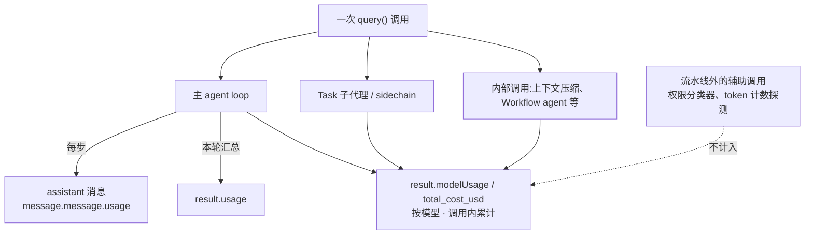

import { Canvas, Controls, Meta } from '@storybook/addon-docs/blocks';
import * as CostTracking from './cost-tracking.stories';

<Meta of={CostTracking} name="Docs" />

# 成本与用量

跑 agent 花了多少钱、用了多少 token,答案都在消息流里:每条 `assistant` 消息挂着该次模型请求的用量,每条 `result` 消息汇总出三类账目字段。本课讲清三个口径各覆盖什么、不同会话形态下怎么累计才不重复、逐步明细与缓存计价怎么算,最后把它们合成一个跨调用的用量看板。看完导读与参考表,你应该能预测:一个"两轮输入、派过一次子代理"的流式会话里,第二条 `result` 的 `usage` 会不会包含第一条的量、`modelUsage` 里该有几个桶、`total_cost_usd` 能不能两条相加。

| 字段 | 挂在哪 | 覆盖范围 | 累计方式 | 什么时候读它 |
| --- | --- | --- | --- | --- |
| `usage`(result 消息) | result | 仅主 agent loop | 流式多轮下只算本轮输入 | 看"这次输入的主循环用量" |
| `usage`(assistant 消息) | 每条 assistant 消息 | 仅主 agent loop | 每步(逐请求) | 逐步明细;输入侧是真值,output 是占位值 |
| `modelUsage` | result | 主循环 + 子代理 + 内部调用 | 调用内跨输入轮累计;续跑含历史 | 记账口径,按模型分桶 |
| `total_cost_usd` | result | 与 modelUsage 相同 | 与 modelUsage 同生命周期 | 费用总额(估算) |

## 快速上手

单次调用一个 result 就是一张完整账单。沿用[第一次运行](?path=/docs/first-run--docs)的环境,跑一个只读任务,把账单读出来:

```ts
// 前置:ANTHROPIC_API_KEY 已可见。
// 预期:流以 result 收尾;打印本次调用的轮数、耗时与按模型的费用明细。
import { query } from "@anthropic-ai/claude-agent-sdk";

for await (const message of query({
  prompt: "Review README.md and summarize it in three sentences.",
})) {
  if (message.type === "result") {
    console.log(
      "结束:", message.subtype,
      "· 轮数:", message.num_turns,
      "· 耗时:", message.duration_ms, "ms",
    );
    console.log("估算总额: $", message.total_cost_usd.toFixed(6));
    for (const [model, m] of Object.entries(message.modelUsage)) {
      console.log(
        `  ${model}: 输入 ${m.inputTokens} · 缓存写 ${m.cacheCreationInputTokens}` +
          ` · 缓存读 ${m.cacheReadInputTokens} · 输出 ${m.outputTokens} · $${m.costUSD.toFixed(6)}`,
      );
    }
    console.log("主循环本轮: 输入", message.usage.input_tokens, "· 输出", message.usage.output_tokens);
  }
}
```

预期输出(数字随任务与模型变化,结构一致;金额为客户端估算):

```text
结束: success · 轮数: 0 · 耗时: 8432 ms
估算总额: $ 0.026322
  claude-sonnet-4-5: 输入 1254 · 缓存写 2480 · 缓存读 18600 · 输出 512 · $0.026322
主循环本轮: 输入 1254 · 输出 512
```

单轮调用里 result 就是全部账目;麻烦出在多轮、续跑与子代理——这三个字段并不是同一个口径,下面先分清它们。

## 三个记账字段

SDK 把账记在消息流的两处。每次模型请求会产出一条或多条 `assistant` 消息,原始 API 响应(`BetaMessage`)挂在 `message.message` 上,它的 `usage` 就是该请求的 token 明细;每轮输入结束时产出一条 `result` 消息,汇总出三个口径。会话本身有三层范围:step(一次请求/响应)、一次 `query()` 调用、session(用 resume 串起来的一串调用)——字段归属和累计方式都由这三层决定。



### usage:主循环、本轮

`result.usage` 只覆盖主 agent loop:不含 Task 子代理、sidechain 与辅助模型调用;流式多轮会话里,每条 `result` 的 `usage` 只算触发它的那轮输入,不跨轮累计。想知道"这次输入的主循环用了多少 token",读它。字段沿用 Anthropic API 的 `BetaUsage`(result 上以 `NonNullableUsage` 提供,可空位已收窄为非空):

| 字段(snake_case) | 含义 |
| --- | --- |
| `input_tokens` | 非缓存的输入 token |
| `cache_creation_input_tokens` | 本次写入缓存的输入,计价高于普通输入 |
| `cache_read_input_tokens` | 本次命中缓存的输入,计价有折扣 |
| `output_tokens` | 输出 token(result 上是真值;assistant 消息上是占位值,见「逐步分解」) |
| `output_tokens_details.thinking_tokens` | 思维 token 明细,已包含在 `output_tokens` 内,不要相加(TS SDK ≥ 0.3.228) |

输入侧总 token 是三项之和:

```ts
if (message.type === "result") {
  const u = message.usage;
  const inputSide = u.input_tokens + u.cache_creation_input_tokens + u.cache_read_input_tokens;
  console.log("主循环本轮: 输入侧", inputSide, "· 输出", u.output_tokens);
}
```

### modelUsage:全链路、按模型

`modelUsage` 是按模型分桶的累计账:`Record<string, ModelUsage>`,键是模型名。覆盖主循环、Task 子代理、sidechain 与内部调用(上下文压缩、Workflow agent 等);流水线外的辅助调用(权限分类器、token 计数探测)不计入。流式多轮下跨输入轮累计;resume / fork 的调用会从 transcript 恢复历史合计,第一条 result 就带着会话此前的账。SDK 类型注释把它称为 token 与费用记账的正确字段:

```ts
if (message.type === "result") {
  for (const [model, m] of Object.entries(message.modelUsage)) {
    console.log(model, "输入", m.inputTokens, "· 输出", m.outputTokens, "· 费用", `$${m.costUSD.toFixed(6)}`);
  }
}
```

| 字段(camelCase) | 含义 |
| --- | --- |
| `inputTokens` / `outputTokens` | 非缓存输入 / 输出 token(累计) |
| `cacheReadInputTokens` / `cacheCreationInputTokens` | 缓存读 / 写 token(累计) |
| `thinkingTokens?` | 思维 token,已含在 `outputTokens` 内,不要相加;TS SDK ≥ 0.3.257,且只统计运行在会记录该字段的 CLI 版本上的轮次 |
| `webSearchRequests` | 该模型的 web 搜索请求次数 |
| `costUSD` | 该模型的累计估算费用(客户端估算) |
| `contextWindow` / `maxOutputTokens` | 模型的上下文窗口与最大输出,是容量元数据,不是用量 |
| `canonicalModel?` | 计价使用的规范模型 id(可能与键名的别名 / 供应商写法不同) |
| `provider?` | 服务后端:`firstParty` / `bedrock` / `vertex` / `foundry` / `anthropicAws` / `mantle` / `gateway` |
| `costBasis?` | 最近一次请求按哪张价格表计价:`list`(内置牌价)/ `managed`(modelPricing 配置)/ `unknown`(未匹配,`costUSD` 是猜测值) |

### total_cost_usd:估算总额

`total_cost_usd` 与 `modelUsage` 覆盖范围、生命周期完全相同,是整次调用的估算费用总额。它不是账单:估算基于 SDK 构建时打包的价格表(组织配置了 `modelPricing` 时按配置价),价格调整、未识别的模型、未建模的计费规则都会造成偏差;数据驻留场景(响应 `usage` 报告 `inference_geo: "us"`)按牌价上浮 10%;web 搜索等按次计费项不包含在内。对外计费、财务决策请以 Console 用量页或 Usage and Cost API 为准。成功与错误的 `result` 都携带它;会话崩溃时可能清零(处理见「异常与恢复」)。

## 累计与重置

同一份账,读法取决于会话形态。核心规则一条:`usage` 永远是"本轮"的,`modelUsage` 与 `total_cost_usd` 在调用内跨输入轮累计、随续跑恢复历史——所以多数场景是"读最新一条 result",而不是相加:

| 会话形态 | result.usage | modelUsage / total_cost_usd | 看板怎么累计 |
| --- | --- | --- | --- |
| 单次调用(字符串 prompt) | 本轮(= 整次调用) | 本次调用 | 读 result 即可 |
| 流式多轮(`AsyncIterable` 输入) | 只算本轮输入 | 跨输入轮累计 | 取最新一条 result,不要相加 |
| resume / fork 续跑 | 只算本轮输入 | transcript 历史 + 本次 | 取最新一条 result(已含历史) |
| 相互独立的多次调用 | 各自本轮 | 各自本次调用 | 逐条相加 |

三个重置口:`/clear`、`/reset`、`/new` 会把累计清零,SDK 同时产出 `SDKConversationResetMessage`(`trigger: "clear"` 等),看板收到它就把本地累计归零。`maxBudgetUsd` 的统计口径是"本次调用开始以来(或最近一次 /clear 以来)"的花费——续跑恢复的历史不计入预算,不会被会话的历史大额误触发(费用上限的首次设定见[第一次运行](?path=/docs/first-run--docs),流式输入的组织方式见[多轮对话](?path=/docs/multi-turn--docs))。版本注意:CC 2.1.277 之前,续跑会话从零起算。

下面的实例回放一个两轮输入、可派子代理的流式会话,把三个口径的差别摆在一起(全部为演示数据,不调用模型):

<Canvas of={CostTracking.Interactive} />
<Controls of={CostTracking.Interactive} />

| 读者操作 | 可观察证据 |
| --- | --- |
| 把「读取的 result」切到 2 | usage 面板换成第 2 轮输入的本轮值;modelUsage 与 total_cost_usd 只增不减 |
| 开关「子代理调用」 | modelUsage 增减 claude-haiku-4-5 桶、total_cost_usd 随之变化;usage 纹丝不动 |
| 打开 Show code | 看到该 Canvas 实际执行的 `cost-tracking-demo.ts`,上半部分即两轮输入的演示账目 |

## 逐步分解

每条 `assistant` 消息的 `message.message` 上有 `id` 与 `usage`:一次 API 响应可产出多条 assistant 消息(文本块、tool_use 块各一条),它们共享同一个 `id` 与同一份 usage——并行工具调用时尤其明显。所以逐步累计输入侧必须按 `id` 去重,并跳过子代理消息(`parent_tool_use_id` 非空):

```ts
// 主循环输入侧逐步累计:按 message.id 去重、跳过子代理;输出 token 从 result 读。
const seenIds = new Set<string>();
let inputTokens = 0;
let outputTokens = 0;

for await (const message of query({ prompt })) {
  if (message.type === "assistant" && !message.parent_tool_use_id) {
    const { id, usage } = message.message;
    if (id && !seenIds.has(id)) {
      seenIds.add(id);
      inputTokens +=
        usage.input_tokens +
        usage.cache_creation_input_tokens +
        usage.cache_read_input_tokens;
    }
  } else if (message.type === "result") {
    outputTokens = message.usage.output_tokens; // 逐步 output 是占位值,以 result 为准
  }
}
```

output 为什么从 result 读:assistant 消息上的 `output_tokens` 只是 API 在 `message_start` 时上报的占位值,同一次响应的多条消息带的是同一个占位值;真实输出数在响应结束时才确定,写入 `result` 的 `usage`。想在流式渲染时看输出增长,开启 `includePartialMessages`,读每条 `message_delta` 事件(`SDKPartialAssistantMessage`)携带的 `usage`。

请求怎么数:SDK 没有请求数字段。主循环请求数约等于去重后的 assistant `message.id` 个数(step 就是一次请求/响应);`num_turns` 数的是工具往返轮,口径不同;`duration_api_ms` 是 API 累计耗时;`modelUsage.webSearchRequests` 只数 web 搜索。

## 缓存与计费

SDK 自动使用 prompt caching,无需配置。费用影响集中在两个输入侧字段:`cache_creation_input_tokens`(写入缓存,计价高于普通输入)与 `cache_read_input_tokens`(命中缓存,计价有折扣)——两者与 `input_tokens` 分开计价,所以"某次输入变贵"常常是缓存写入,而不是用量失控。

缓存条目的 TTL 决定"下次还命中吗":

- API key 认证下默认 5 分钟。
- 设环境变量 `ENABLE_PROMPT_CACHING_1H` 请求 1 小时 TTL(经 `options.env` 传入);1 小时 TTL 的写入计价更高,适合调用间隔长、上下文大的任务。
- 分桶控制:主会话一个桶,子代理等其余调用一个桶——主会话用 `CLAUDE_CODE_PROMPT_CACHE_TTL` 环境变量或 `promptCacheTtl` 设置,子代理侧用 `CLAUDE_CODE_SUBAGENT_PROMPT_CACHE_TTL` 环境变量或 `subagentPromptCacheTtl` 设置;取值 `5m` / `1h`,优先级高于 `ENABLE_PROMPT_CACHING_1H`。

```ts
for await (const message of query({
  prompt: longTaskPrompt,
  options: {
    // 缓存写入改为 1 小时 TTL:间隔长的批处理任务减少重复的缓存写入
    env: { ...process.env, ENABLE_PROMPT_CACHING_1H: "1" },
  },
})) {
  // ...
}
```

## 异常与恢复

错误的 `result` 同样带 `usage`、`modelUsage` 与 `total_cost_usd`,失败运行也能记账。两处口径要留意:

- `error_max_budget_usd`:`usage` 少算了"越过预算的那次响应",`modelUsage` 与 `total_cost_usd` 含它。对账以 `modelUsage` / `total_cost_usd` 为准。
- `error_during_execution`(会话崩溃):各费用字段可能整体清零。恢复路径:
  1. 流式多轮且崩溃前有正常 result:直接用上一条 result,它就是截至当时的累计账;
  2. 单次调用、崩溃发生在第一轮输入、或上一轮输入本身就是 /clear:逐步补救——把 assistant 消息的输入侧 token 按 `id` 去重相加(流式模式下只加最后一条 result 之后的),得到主循环的输入与缓存 token;
  3. 子代理用量、输出 token 与 USD 费用无法这样恢复:逐步 `output_tokens` 是占位值,子代理消息又被跳过,只能接受缺口。

## 建立用量看板

把前面的规则合成两步:每次调用落一条记录,再按调用链聚合。

```ts
import type { SDKResultMessage } from "@anthropic-ai/claude-agent-sdk";

interface UsageRecord {
  sessionId: string;
  totalCostUsd: number; // total_cost_usd:估算总额
  inputTokens: number;  // 以下四项来自 modelUsage 各桶求和
  outputTokens: number;
  cacheReadTokens: number;
  cacheCreationTokens: number;
  numTurns: number;     // 工具往返轮数
  durationMs: number;
}

// 一条 result → 一条记录:记账字段取 modelUsage,轮次耗时取公共字段
function toRecord(message: SDKResultMessage): UsageRecord {
  const buckets = Object.values(message.modelUsage);
  const sum = (pick: (m: (typeof buckets)[number]) => number) =>
    buckets.reduce((total, bucket) => total + pick(bucket), 0);
  return {
    sessionId: message.session_id,
    totalCostUsd: message.total_cost_usd,
    inputTokens: sum((m) => m.inputTokens),
    outputTokens: sum((m) => m.outputTokens),
    cacheReadTokens: sum((m) => m.cacheReadInputTokens),
    cacheCreationTokens: sum((m) => m.cacheCreationInputTokens),
    numTurns: message.num_turns,
    durationMs: message.duration_ms,
  };
}
```

聚合规则照搬「累计与重置」的表:同一条 resume / fork 链上的记录取最新一条(链上每条的累计都含此前历史),相互独立的调用或调用链逐字段相加。`session_id` 可作展示与初筛,但不要只按它聚合——fork 分支拿到新的 session id,累计里却含母会话的历史;哪次调用续了哪个会话,看板自己是知道的,把"链"作为聚合键才准确。两个提醒:会话内 `/clear` 会把累计清零,对账要求高时,收到 `SDKConversationResetMessage` 就把该会话此前的记录先另存一份;上下文占用量是另一个口径(窗口容量,不是计费),需要时用 `query` 的 `getContextUsage()` 查看。另外 `Query` 上还有一个标注 experimental 的用量查询接口,随时可能变动,看板不要依赖。日志与 OpenTelemetry 追踪见[可观测性](?path=/docs/observability--docs)。

## 最佳实践

- **记账用 `modelUsage`,总额用 `total_cost_usd`,`usage` 只做主循环观察。** `usage` 不含子代理与内部调用、流式下按轮,拿它对账必然少算;需要逐步归因时才下到 assistant 消息的逐步 usage。
- **先判会话形态,再决定加不加。** 独立调用相加;resume / fork 链取最新 result;收到 `SDKConversationResetMessage` 先归零再继续记。
- **成本兜底叠加 `maxTurns` 与 `maxBudgetUsd`。** 前者限工具往返轮数、后者限估算费用;注意 `maxBudgetUsd` 只统计本次调用(自最近一次 /clear 以来)的花费,续跑历史不计入。
- **把金额一律当估算。** 用 `costBasis` 判断每桶计价依据(`list` / `managed` / `unknown`),`unknown` 说明该模型没匹配到价格行;对外计费与财务决策接 Console 用量页或 Usage and Cost API。

## 常见问题

- `usage` 和 `modelUsage` 对不上。
  口径不同:`usage` 只含主 agent loop 且流式多轮下按轮,`modelUsage` 含子代理与内部调用且调用内累计。对账用 `modelUsage`(差异明细见「三个记账字段」)。

- 把流式会话里每条 `result` 的 `total_cost_usd` 相加,总额虚高。
  每条 result 上的 `modelUsage` / `total_cost_usd` 已是跨输入轮的累计值;取最新一条即可,相加必然重复计算(规则见「累计与重置」)。

- `assistant` 消息上的 `output_tokens` 小得离谱,同一次响应的多条消息数值还完全一样。
  那是 `message_start` 的占位值;真实输出数在 `result` 的 `usage` 上,流式观察读 `message_delta` 事件的 `usage`(见「逐步分解」)。

- `total_cost_usd` 与 Console 账单对不平。
  它是客户端估算:构建时价格表、数据驻留按牌价上浮、不含按次计费项,都会造成偏差;先用 `costBasis` 确认计价依据,再决定是否接权威账单(见「total_cost_usd:估算总额」)。

## 总结回顾

摘要:

账本挂在消息流两处:每条 assistant 消息带该次请求的逐步 usage,每条 result 汇总出三个口径——`usage`(主循环、本轮)、`modelUsage`(全链路、按模型、调用内累计、续跑含历史)与 `total_cost_usd`(与 modelUsage 同生命周期的估算总额)。累计方式由会话形态决定:独立调用相加,流式多轮与 resume / fork 链取最新 result,`/clear` 等命令把累计清零。逐步统计要按 `message.id` 去重并跳过子代理消息,输出 token 以 result 为准;缓存读 / 写 token 分开计价,TTL 默认 5 分钟、可按桶调到 1 小时。错误 result 同样带账,崩溃清零时按恢复路径补救;看板就是逐调用记录加上按调用链聚合,金额一律按估算对待。

一句话:

> 记账读 `modelUsage`,总额看 `total_cost_usd`,主循环观察用 `usage`;累计先问会话形态——独立相加、链上取最新 result,而且它们都是估算,不是账单。

知识要点:

- result 消息上 `usage`、`modelUsage`、`total_cost_usd` 各覆盖什么?流式多轮与续跑时怎么累计?
- 逐步统计输入 token 为什么必须按 `message.id` 去重?输出 token 应该从哪里读?
- 缓存读 / 写 token 如何分别计价?TTL 的默认值与分桶控制项是什么?
- `error_max_budget_usd` 与会话崩溃时,账目字段各是什么状态?哪些能恢复、怎么恢复?
- 搭一个跨调用的用量看板,记录与聚合各取哪些字段、遵守哪些规则?

## 参考资料

- [Track cost and usage](https://code.claude.com/docs/en/agent-sdk/cost-tracking)
- [TypeScript SDK reference](https://code.claude.com/docs/en/agent-sdk/typescript)
- [claude-agent-sdk-typescript 仓库](https://github.com/anthropics/claude-agent-sdk-typescript)(`sdk.d.ts` 中 `SDKResultMessage`、`ModelUsage`、`NonNullableUsage` 的类型定义)
