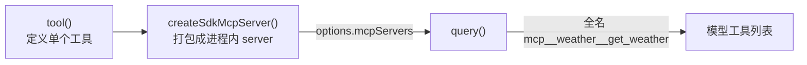

import { Canvas, Controls, Meta } from '@storybook/addon-docs/blocks';
import * as CustomTools from './custom-tools.stories';

<Meta of={CustomTools} name="Docs" />

# 进程内自定义工具

内置工具加 Bash 兜底能覆盖大部分文件与命令操作,但 agent 迟早要调用你业务里的确定性能力:查内部接口、读私有数据库、跑一段领域算法。`tool()` 与 `createSdkMcpServer()` 把这类能力定义成同一进程里的 async 函数:入参用 zod 校验,调用即执行,没有子进程、没有网络往返。工具以标准 MCP 工具的形态进入模型工具列表,全名 `mcp__<server>__<tool>`,权限、hooks、工具搜索等既有机制原样适用。外部 MCP server 的接入与自建是后续两课,本课只在边界处给入口。看完导读与参考表,你应该能预测:注册一个工具后模型怎么发现并调用它,入参不合法时会发生什么。



| 项 | 值 / 默认 | 回查要点 |
| --- | --- | --- |
| `tool(name, description, inputSchema, handler, extras?)` | — | 定义单个工具;四个参数加一个可选 extras |
| `inputSchema` | zod 字段对象 | 是「字段 → 校验器」的裸对象,不是 `z.object()`;SDK 换算成 JSON Schema 给模型 |
| handler 返回值 | `{ content, structuredContent?, isError? }` | `content` 必填;模型收 `content`,应用侧另收 `structuredContent` |
| `createSdkMcpServer({ name, ... })` | `version` 默认 `"1.0.0"` | 把工具打包成进程内 server(`type: "sdk"`),不起子进程 |
| 注册位置 | `options.mcpServers` | 键名参与工具全名;与外部 MCP server 走同一通道 |
| 工具全名 | `mcp__<server>__<tool>` | `allowedTools`、权限规则、hooks 都认全名 |
| zod | peer dependency | 项目里 `npm install zod`;schema 兼容 Zod 3 与 4 |
| 工具搜索 | 默认开启 | SDK MCP 工具默认被延迟加载;`alwaysLoad` 保持常驻,见[工具搜索](?path=/docs/tool-search--docs) |

## 快速上手

前置环境沿用[安装与凭证](?path=/docs/install--docs)(SDK 已装、`ANTHROPIC_API_KEY` 可见),再补一个 zod 依赖——SDK 把它声明为 peer dependency,而示例代码里的 `import { z } from "zod"` 要从你的项目解析:

```bash
npm install zod
```

新建 `custom-tool.ts`,三段代码对应三个动作:定义 → 打包 → 注册:

```ts
// 最小进程内工具:tool() 定义 → createSdkMcpServer() 打包 → options 注册。
// 前置:zod 已安装,ANTHROPIC_API_KEY 对当前进程可见。
// 预期:assistant 的工具调用块打印全名 mcp__weather__get_weather,
//       最终回答里出现工具返回的天气文本,循环以 Done: success 收尾。
import { query, tool, createSdkMcpServer } from "@anthropic-ai/claude-agent-sdk";
import { z } from "zod";

// 1. 定义工具:名字、说明、入参 schema、handler
const getWeather = tool(
  "get_weather",                                // 工具名,与 server 名拼成全名
  "查询一个城市当前的天气状况",                    // 模型靠它决定何时调用
  {
    city: z.string().describe("城市名,如 北京"),  // describe 的说明会进 JSON Schema
    unit: z.enum(["celsius", "fahrenheit"])       // 限定取值,防呆
      .describe("温度单位")
      .optional(),                                // 可选参数,handler 里判空
  },
  async ({ city, unit }) => {
    const suffix = unit === "fahrenheit" ? "°F" : "°C";
    const temperature = unit === "fahrenheit" ? 64 : 18; // 这里换成真实业务调用
    return {
      content: [{ type: "text", text: `${city}当前 ${temperature}${suffix},多云` }],
    };
  },
);

// 2. 打包成进程内 MCP server:name 参与 mcp__weather__* 全名
const weatherServer = createSdkMcpServer({
  name: "weather",
  version: "1.0.0",
  tools: [getWeather],
});

// 3. 注册进 query():mcpServers 挂载,allowedTools 用全名放行
for await (const message of query({
  prompt: "北京现在天气怎么样?适合跑步吗?",
  options: {
    mcpServers: { weather: weatherServer },
    allowedTools: ["mcp__weather__get_weather"],
  },
})) {
  if (message.type === "assistant" && message.message?.content) {
    for (const block of message.message.content) {
      if ("name" in block) {
        console.log(`Tool: ${block.name}`); // 打印的是全名,不是裸名
      } else if ("text" in block) {
        console.log(block.text);
      }
    }
  } else if (message.type === "result") {
    console.log(`Done: ${message.subtype}`);
  }
}
```

运行:

```bash
npx tsx custom-tool.ts
```

预期输出(文字每次运行都不同,结构相同):

```text
Tool: mcp__weather__get_weather
北京当前 18°C,多云。温度适宜、云量不高,适合跑步,建议穿轻便透气的衣物。
Done: success
```

三个事实从输出能看出来:`Tool:` 行打印的是 `mcp__weather__get_weather` 全名——工具在模型眼里就是一个标准 MCP 工具;handler 返回的 text 直接进入模型上下文,被组织进最终回答;除了定义与注册,不需要任何进程或网络配置。想核对 server 挂载状态,读流里 init 消息的 `mcp_servers` 字段(见"注册进 query")。

## 定义工具

`tool()` 的四个参数各自回答一个问题:

| 参数 | 回答的问题 | 关键约束 |
| --- | --- | --- |
| `name` | 这个工具叫什么 | 与 server 名拼成全名 `mcp__<server>__<tool>` |
| `description` | 模型什么时候该调用它 | 模型可见的说明书,写清用途、单位与失败行为 |
| `inputSchema` | 入参长什么样 | zod 字段对象;同时生成给模型的 JSON Schema 和给 handler 的静态类型 |
| `handler` | 调用之后执行什么 | async 函数;收到的入参已通过校验 |

`tool()` 返回一个 `SdkMcpToolDefinition`——就是"名字 + 说明 + schema + handler"的数据结构,本身不执行任何东西,要等 `createSdkMcpServer()` 打包、`query()` 注册之后才会被调用。

### 入参:zod 校验

`inputSchema` 传「字段 → zod 校验器」的裸对象,不要包 `z.object()`:

```ts
// 正确:裸对象,键是字段名,值是校验器
{ city: z.string(), unit: z.enum(["celsius", "fahrenheit"]) }

// 错误:整体包一层 z.object(),类型对不上
z.object({ city: z.string() })
```

这个对象一物两用:SDK 把它换算成 JSON Schema 放进模型看到的工具定义,所以 `.describe()` 里的说明模型读得到,用来引导它正确填参;TypeScript 则从它推导 handler 的参数类型——`city` 是 `string`,`unit` 是 `"celsius" | "fahrenheit" | undefined`。

校验发生在进入 handler 之前:模型发来的入参不满足 schema 时,调用在校验层被拦下,你的函数不会执行,模型收到错误信息并可以修正后重试(完整旅程见"一次调用的旅程")。

可选参数有两种写法:`.optional()` 让字段可缺省,handler 里判空后给默认值;`.default("celsius")` 让校验层直接补值,handler 总能拿到确定的值。

边界:`inputSchema` 必须能换算成 JSON Schema,换算失败的该工具会被剔出工具列表并触发 `CLAUDE_SDK_MCP_TOOL_SCHEMA_UNCONVERTIBLE` 警告(排查见常见问题)。

### 返回值:content 与 structuredContent

handler 返回 `CallToolResult`:`content` 必填,是内容块数组;`structuredContent` 与 `isError` 可选。内容块可以在同一次返回里混用,各类型在 TypeScript 中的行为:

| 块 `type` | 关键字段 | 模型收到 |
| --- | --- | --- |
| `text` | `text` | 文本原文,最常用 |
| `image` | `data`(base64 裸串,不带 `data:` 前缀)、`mimeType` | PNG/JPEG/GIF/WebP 进入视觉输入;其余类型存盘,收到路径文本;没有 URL 字段,要抓取后在 handler 里编码 |
| `audio` | `data`、`mimeType` | SDK 存盘,模型收到带文件路径的文本块 |
| `resource` | `uri` + `text` 或 `blob`(可带 `mimeType`) | 嵌入的资源内容 |
| `resource_link` | `uri`、`name` | 模型收到文本;应用侧在 `tool_use_result` 的 `resourceLinks` 里拿链接 |

`structuredContent` 是给应用侧的机器可读 JSON,与 `content` 并行返回:设置后,模型收到这份 JSON 以及 `content` 里的 image/resource 块,但 text 块不再转发——官方假定它与 JSON 重复。给人读的解释放 `content`,给程序的数据放 `structuredContent`,不要指望两者都到达模型。

`isError: true` 用来把"业务上的失败"作为正常结果优雅回传,写法见错误处理。

### 工具标注与加载控制

`tool()` 的第五个参数 extras 是可选项,承载标注与加载行为:

```ts
tool(
  "get_weather",
  "查询一个城市当前的天气状况",
  { city: z.string(), unit: z.string().optional() },
  async (args) => {
    /* … */
  },
  { annotations: { readOnlyHint: true } }, // 第五个参数:extras
);
```

标注(annotations)向运行环境描述工具的行为特征:

| 字段 | 默认 | 含义 |
| --- | --- | --- |
| `readOnlyHint` | `false` | 不修改环境;true 时模型可把它与其他只读工具并行调用 |
| `destructiveHint` | `true` | 可能有破坏性更新;仅信息性 |
| `idempotentHint` | `false` | 同参重复调用无额外影响;仅信息性 |
| `openWorldHint` | `true` | 会访问进程外系统;仅信息性 |

标注是元数据不是强制——它不改变 handler 能做什么,只影响模型的调用策略,所以要与函数的真实行为一致。加载控制有两个字段:工具搜索默认开启时,SDK MCP 工具被延迟加载——模型先只看到工具名(`searchHint` 可补充一行简介),用到才取完整 schema;`alwaysLoad: true` 让工具保持常驻。取舍见[工具搜索](?path=/docs/tool-search--docs)。

## 注册进 query

`createSdkMcpServer()` 把工具数组打包成一个进程内 MCP server:

| 选项 | 默认 | 作用 |
| --- | --- | --- |
| `name` | 必填 | server 名,参与工具全名,也是权限规则与 init 消息里的标识 |
| `version` | `"1.0.0"` | server 版本标识 |
| `tools` | 不传则无工具 | `tool()` 定义的工具数组 |
| `instructions` | `undefined` | 随 initialize 返回、呈现给模型的 server 级说明 |
| `alwaysLoad` | `false` | server 级开关:全部工具不参与工具搜索的延迟加载 |
| `timeout` | `undefined` | 单次工具调用超时(毫秒,最小 1000,SDK v0.3.248+) |

注册就是把 server 放进 `options.mcpServers`,键名即 server 名:

```ts
const weatherServer = createSdkMcpServer({ name: "weather", tools: [getWeather] });

for await (const message of query({
  prompt: "…",
  options: {
    mcpServers: {
      weather: weatherServer,    // 键名 weather → 工具全名 mcp__weather__get_weather
      // github: githubServer,   // 外部 MCP server 也走这一通道,见"接入 MCP server"
    },
    allowedTools: ["mcp__weather__*"], // 通配放行 weather server 的全部工具
  },
})) {
  /* … */
}
```

放行与权限:进程内工具和内置工具一样走完整的权限评估。`allowedTools` 认全名——单个 `"mcp__weather__get_weather"`,或 `"mcp__weather__*"` 放行整个 server;省略放行且没有 `canUseTool` 回调时,需要确认的调用一律被拒。`canUseTool` 的审批选项里带 `mcpServer` 来源信息,可以做 server 级审批(见[权限规则与 canUseTool](?path=/docs/permissions--docs))。

核对注册:流里第一条 init 消息的 `mcp_servers` 数组带每个 server 的 `name`、`status`(`"connected"` / `"failed"` 等)与 `source`(进程内 server 为 `"sdk"`)。

与外部 MCP server 的边界:`mcpServers` 是统一通道。外部 server 的值是 stdio/HTTP 配置对象;进程内 server 的值是 `createSdkMcpServer()` 返回的 `type: "sdk"` 配置,内含活的 `McpServer` 实例、不可序列化——工具只在宿主进程可用。接入外部 server 见[接入 MCP server](?path=/docs/mcp-integration--docs),用 MCP SDK 自建独立 server 见[自建 MCP server](?path=/docs/mcp-server--docs)。

## 一次调用的旅程

一次调用全程发生在宿主进程内,链路固定五站:模型发出 `tool_use`(全名 + 入参)→ SDK 路由到对应 server,用 `inputSchema` 校验入参 → 校验通过才执行 handler → 返回值作为 `tool_result` 回传 → 模型继续。校验失败与业务错误都以结果形态回到模型,agent loop 不中断。

下面的实例回放四种入参场景的完整旅程(全部为演示数据,不调用模型与真实服务):

<Canvas of={CustomTools.Interactive} />
<Controls of={CustomTools.Interactive} />

| 读者操作 | 可观察证据 |
| --- | --- |
| 把「入参场景」切到 缺必填字段 / 类型错误 | 校验站变红,handler 站显示未执行,tool_result 回传校验错误 |
| 切到 业务错误 | 校验放行、handler 执行,但返回 `isError: true`,模型改为向用户说明 |
| 拖动「调用进度」 | 逐站查看 tool_use 入参、校验结论、handler 状态、tool_result 与模型下一步 |
| 打开 Show code | 看到该 Canvas 实际执行的 `custom-tools-demo.ts`,上半部分是四个场景的数据 |

## 错误处理

一次调用有三种失败形态,处理方式各不相同:

| 形态 | 谁发现 | 模型收到 | handler |
| --- | --- | --- | --- |
| 入参不满足 schema | server 校验层 | 校验错误信息,可修正重试 | 不执行 |
| handler 抛出未捕获异常 | SDK 兜底捕获 | 原始异常消息转为错误结果 | 执行过 |
| 业务失败 | handler 自己 | `isError: true` + 组织过的消息 | 自己返回 |

推荐第三种:可能失败的工具在 handler 里自己 catch,返回带上下文的错误消息——原始异常的栈与内部路径对模型没有用,组织过的消息能让它自我纠正:

```ts
tool(
  "fetch_data",
  "从内部 API 拉取数据",
  { endpoint: z.string().url().describe("API 端点 URL") },
  async (args) => {
    try {
      const response = await fetch(args.endpoint);
      if (!response.ok) {
        // HTTP 层失败:把状态码转成模型可读的消息
        return {
          content: [{
            type: "text",
            text: `API error: ${response.status} ${response.statusText}`,
          }],
          isError: true,
        };
      }
      const data = await response.json();
      return { content: [{ type: "text", text: JSON.stringify(data, null, 2) }] };
    } catch (error) {
      // 网络或解析失败:组织过的消息优于裸异常
      return {
        content: [{
          type: "text",
          text: `Failed to fetch data: ${error instanceof Error ? error.message : String(error)}`,
        }],
        isError: true,
      };
    }
  },
);
```

`isError: true` 不中断 agent loop:错误作为 `tool_result` 回到模型,它可以选择换参数重试、换工具,或向用户说明。会把整个运行打断的是进程级故障,处理方式与普通运行一致,见[错误处理与中断](?path=/docs/error-handling--docs)。

## 最佳实践

- **description 写成"何时用我"的说明书。** 模型靠它决定调不调用、怎么填参:写清用途、单位、取值范围与失败时的行为;含糊的 description 是"模型不调用我的工具"的第一原因。
- **让 inputSchema 兼作文档。** 每个字段 `.describe()` 补语义,取值固定用 `z.enum()` 限定,可选参数显式 `.optional()`;schema 同时约束模型与类型,不需要另写第二份说明。
- **只读工具标 `readOnlyHint: true`。** 模型可以把它与其他只读调用并行执行;有副作用的工具保持默认,不要为性能虚标。
- **放行面用全名或 server 级通配。** `allowedTools` 写 `"mcp__weather__*"` 一次放行整个 server,或点名单个工具;更细的审批交给 `canUseTool`,hooks 拦截同样按全名匹配(见[Hook 事件](?path=/docs/hooks--docs))。
- **按"要不要进程边界"选实现形态。** 与宿主共享状态、复用闭包与已建立的连接、密钥不落盘 → 进程内 `tool()`;要独立进程隔离、跨项目复用、非 TypeScript 技术栈 → 外部 MCP server,接入见[接入 MCP server](?path=/docs/mcp-integration--docs),自建见[自建 MCP server](?path=/docs/mcp-server--docs)。

## 常见问题

- 注册了工具,模型却从不调用。
  先核对注册:init 消息的 `mcp_servers` 里有没有这个 server、`tools` 列表里有没有全名。再看 `description` 是否说清了"何时用我"。工具搜索默认开启,SDK MCP 工具被延迟加载,模型可能先发起一次工具搜索再取到 schema——这是正常流程,细节见[工具搜索](?path=/docs/tool-search--docs)。

- 工具调用被权限拒绝,handler 根本没执行。
  `allowedTools` 里写的是裸名 `get_weather` 而不是全名 `mcp__weather__get_weather`;改用全名,或用 `"mcp__weather__*"` 放行整个 server。没有放行且没有 `canUseTool` 时,需要确认的调用一律被拒。

- 启动时警告 `CLAUDE_SDK_MCP_TOOL_SCHEMA_UNCONVERTIBLE`,模型工具列表里没有这个工具。
  该工具的 inputSchema 换算不成 JSON Schema,被剔出工具列表(同 server 的其他工具不受影响)。常见原因:项目里安装的 zod 与 SDK 内置的 zod 版本不一致,或 schema 里 `z.lazy()` 的目标定义在使用之后。统一 zod 版本,把 schema 定义完整后再传入 `createSdkMcpServer()`。

- 设置了 `structuredContent`,模型却看不到 content 里的 text 块。
  这是规定行为:text 块被假定与 JSON 重复,设置 `structuredContent` 后不再转发,只有 JSON 与 image/resource 块到达模型。给人读的说明与给程序的数据二选一,或接受说明只到应用侧。

- 模型收到了奇怪的内部异常信息。
  handler 抛出的未捕获异常以原始消息转为错误结果,栈与内部路径会直接暴露给模型。控制暴露面:handler 里自己 try/catch,返回 `isError: true` 与组织过的消息(见错误处理)。

## 总结回顾

摘要:

本课讲了把业务能力做成 agent 可调用工具的最短路径:`tool()` 用名字、说明、zod schema 与 async handler 定义一个工具,schema 一物两用——换算成 JSON Schema 给模型、推导静态类型给 handler,校验把不合法的调用挡在 handler 之前;`createSdkMcpServer()` 把工具打包成 `type: "sdk"` 的进程内 server,通过 `options.mcpServers` 注册,工具以 `mcp__<server>__<tool>` 全名进入模型工具列表,`allowedTools` 用全名或通配放行。一次调用固定五站:tool_use → 校验 → handler → tool_result → 模型继续;校验失败、handler 抛错、业务错误三种失败形态都以结果形态回到模型,agent loop 不中断。extras 上的标注与 `alwaysLoad` 控制并行策略与加载时机,`structuredContent` 给应用侧机器可读数据但不再转发 text 块。

一句话:

> `tool()` + `createSdkMcpServer()` 让业务函数以标准 MCP 工具的形态进入同一进程的 agent:zod schema 管校验,全名管权限,一切失败都是模型可以读到并自我纠正的结果。

知识要点:

- `tool()` 的四个参数各自回答什么问题?`inputSchema` 为什么是裸对象而不是 `z.object()`?
- handler 返回值的三部分(`content` / `structuredContent` / `isError`)分别给谁?设置 `structuredContent` 后 `content` 里的 text 块去哪了?
- 工具全名怎么拼成?`allowedTools` 为什么必须写全名?
- 一次调用经过哪五站?校验失败时 handler 执行吗?模型看到什么?
- handler 抛错与返回 `isError: true` 的差别是什么?推荐哪种?
- 工具标注四个 hint 的默认值是什么?哪个影响并行调用?
- 什么时候选进程内工具,什么时候选外部 MCP server?

## 参考资料

- [Give Claude custom tools](https://code.claude.com/docs/en/agent-sdk/custom-tools)
- [TypeScript SDK reference](https://code.claude.com/docs/en/agent-sdk/typescript)
