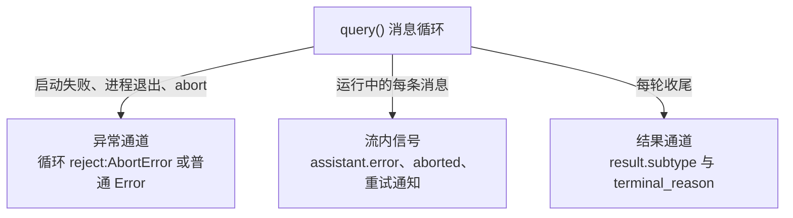

import { Meta } from '@storybook/addon-docs/blocks';

<Meta id="error-handling" title="生产化/健壮性/错误处理与中断" name="Docs" />

# 错误处理与中断

agent 的一次运行是长时异步循环:可能在启动时就挂掉,可能在几十轮工具调用中被打断,也可能"正常结束"却没完成任务——失败信号因此分散在三处:消息循环的异常、流内消息的错误字段、每轮收尾的 result 消息。本课把这三处接成一个程序侧的失败模型:先给出"从哪里拿信号、怎么判定成败"的骨架,再讲两类主动控制——`abortController` 终止整个运行、`interrupt()` 只打断当前轮,最后落到 API 层错误的自动重试与调参。面向"现象 → 排查步骤"的运维排查见[故障排查](?path=/docs/troubleshooting--docs),本课只讲程序怎么接住失败。看完导读与参考表,你应该能预测:同样是运行失败,主动中止走 catch 的 `AbortError` 分支,触顶走 result 的 `error_*` 分支——而且之后循环还会抛错,两条路径不会混。

| 失败场景 | 程序侧信号 | 处理入口 |
| --- | --- | --- |
| 应用超时、业务取消(终止整个运行) | 循环 reject `AbortError` | 中止与中断 |
| 打断当前轮,会话继续用 | `interrupt()` 及其回执 | 中止与中断 |
| 启动失败、进程非零退出、被信号杀死 | 循环 reject 普通 `Error` | [故障排查](?path=/docs/troubleshooting--docs) |
| API 层错误:429、529、认证、账单 | `assistant` 消息的 `error` 字段 | API 层错误与重试 |
| `maxTurns`、`maxBudgetUsd`、结构化输出触顶 | result 的 `subtype` 为 `error_*` | 判定结果 |
| 网络抖动、服务过载 | CLI 自动重试兜底 | API 层错误与重试 |

## 快速上手

把一次运行包进"stderr 回调 + try/catch + result 判定"的骨架,本课所有机制都落在这副骨架上:

```ts
// 前置:SDK 已安装,ANTHROPIC_API_KEY 对当前进程可见(见安装与凭证课)。
// 演示:一次运行的三类结局各有归宿——成功与触顶走 result,中止与故障走 catch。
import { query, AbortError } from "@anthropic-ai/claude-agent-sdk";

const controller = new AbortController();
setTimeout(() => controller.abort(), 120_000); // 应用侧兜底超时:2 分钟

try {
  for await (const message of query({
    prompt: "分析 src/ 目录的模块依赖,指出循环引用风险",
    options: {
      abortController: controller,                  // 外部中止入口
      allowedTools: ["Read", "Glob", "Grep"],       // 只读分析任务,窄放行
      maxTurns: 20,                                 // 轮次兜底
      maxBudgetUsd: 2,                              // 费用兜底(美元)
      stderr: (data) => process.stderr.write(data), // 故障现场别丢
    },
  })) {
    if (message.type === "result") {
      if (message.subtype === "success") {
        console.log("成功:", message.result);
      } else {
        // 触顶或执行中断:不是异常,result 里仍带 usage 与 total_cost_usd 可记账
        console.error("未成功:", message.subtype);
      }
    }
  }
} catch (error) {
  if (error instanceof AbortError) {
    console.error("已中止:超时或调用方取消"); // SDK 类型化 API 里唯一的错误类
  } else {
    // 启动失败、非零退出等没有专用错误类,message 原文就是排查入口
    console.error("运行失败:", (error as Error).message);
  }
}
```

正常运行输出结果;2 分钟没跑完则输出:

```text
已中止:超时或调用方取消
```

这个骨架刻意把两件事分开:循环内处理"有结果"的结局(`success` 和 `error_*` 都是数据),循环外只兜"没有结果"的结局(中止与故障)。为什么错误 result 之后循环还会抛错、两条路径怎么不打架,见下文错误契约。

## 失败信号从哪里来



三条通道接的东西不同,处理位置也不同:

- **异常通道——循环 reject。** `for await` 循环在两种情况下 reject:一是 `abortController.abort()`,reject 的是 SDK 类型化 API 里唯一的错误类 `AbortError`(从包根导出);二是 CLI 子进程启动失败或非零退出,reject 的是普通 `Error`——没有 SDK 错误类可匹配,只能按 `message` 原文定位,这类故障的排查路径见[故障排查](?path=/docs/troubleshooting--docs)。
- **流内信号——消息里夹带错误。** 运行中的 `assistant` 消息可能带 `error` 字段(API 层错误值,见下文);被中止或打断截断的消息带 `aborted: true`,内容可能停在半句;CLI 自动重试发生时,流里也有重试通知消息(`SDKAPIRetryMessage`)可观察。这些信号不中断循环,消费消息时要逐条检查。
- **结果通道——result 消息判定。** 每轮以 result 消息收尾,`subtype` 是判定成败的第一字段;它不是异常,`error_*` 子类型同样是正常数据。

## 判定结果

result 消息的 `subtype` 决定这轮算不算成功。成功只有一种,失败有四种:

| subtype | 何时出现 | 处理要点 |
| --- | --- | --- |
| `success` | 任务正常完成 | 读 `result` 文本;配置了 `outputFormat` 时还要核对 `structured_output` 是否存在,见[结构化输出](?path=/docs/structured-outputs--docs) |
| `error_max_turns` | `maxTurns` 用尽 | 不是故障:提高上限或拆小任务;usage 仍可核算 |
| `error_max_budget_usd` | 客户端费用估算触顶 | 同上;费用统计口径见[成本与用量](?path=/docs/cost-tracking--docs) |
| `error_during_execution` | 执行中出错(请求被取消、会话崩溃、沙箱启动失败等) | 读 `errors[]` 与 `terminal_reason` 分流 |
| `error_max_structured_output_retries` | 结构化输出重试用尽 | 先化简 schema 再逐条加回约束 |

所有 result 子类型都带 `total_cost_usd`、`usage`、`num_turns`、`session_id`——触顶与被打断的运行同样能记账。错误 result 上还有两个回查字段:`terminal_reason` 给出终局原因(如 `max_turns`、`budget_exhausted`,中断场景为 `aborted_streaming` 或 `aborted_tools`),`api_error_status` 给出终止会话的 API 错误 HTTP 状态码。

判定"成功"的完整条件是 `subtype === "success"`——只看"有没有 result"会把触顶的运行当成功。成功 result 上的 `stop_reason` 是模型侧补充:`refusal` 表示模型拒绝作答,那是任务被拒,不是技术故障。

### 错误 result 之后还会抛错

单次 `query()`(字符串 prompt)在产出错误 result 后还会抛错——触顶时抛的就是 `Reached maximum number of turns`。这是刻意设计:错误不该被静默吞掉。所以快速上手的骨架才把处理分成两处:循环内记 result 的账,循环外兜异常路径;别把同一件事在两处都做一遍。

流式输入会话(见[多轮对话](?path=/docs/multi-turn--docs))不同:一条消息触顶后会话保持存活,下一条消息照常处理——`maxTurns` 的计数随新消息开新轮而重置;`maxBudgetUsd` 的累计总量继续保留,触顶后同会话的后续消息都会以 `error_max_budget_usd` 结束(`/clear` 才重置,上限覆盖子代理花费)。唯一例外是会话崩溃:发完最后一条 `error_during_execution` 后进程退出,费用相关字段可能归零,不能再继续发消息。

## 中止与中断

两类主动停止,作用范围不同,先选对再写代码:

| | `abortController.abort()` | `query.interrupt()` |
| --- | --- | --- |
| 作用范围 | 终止整个运行 | 只打断当前正在处理的轮 |
| 适用模式 | 任何模式 | 仅流式输入模式 |
| 之后的循环 | 以 `AbortError` 结束 | 会话存活,后续消息照常 |
| 典型场景 | 应用超时、业务取消 | "停止这条回答",界面继续 |

### abortController

`options.abortController` 默认就是每次 `new AbortController()`,不调 `abort()` 便不构成任何限制;它是"从外部终止整个运行"的程序入口——中止后查询停止并清理资源,消息循环 reject `AbortError`,进行中的工具调用一并终止:

```ts
// 场景:发起这次任务的业务请求被取消,agent 运行没有继续的意义。
const controller = new AbortController();
businessRequest.onCancel(() => controller.abort()); // 取消信号传导给 agent 运行

try {
  for await (const message of query({
    prompt: task,
    options: { abortController: controller },
  })) {
    // ...
  }
} catch (error) {
  // 循环以 AbortError 结束;想区分"用户取消"与"兜底超时",看是谁调了 abort()
}
```

abort 不是瞬间生效:SDK 先关闭子进程的标准输入、给 CLI 约 2 秒优雅收尾,然后才终止进程——清理逻辑不要假设同步完成。流式模式下需要强杀并立即清理资源时,可以调 `query.close()` 直接终止底层进程。

### interrupt()

`interrupt()` 打断当前轮,只对流式输入模式可用(字符串 prompt 的单次查询没有这个入口);基础用法见[多轮对话](?path=/docs/multi-turn--docs),这里讲打断之后怎么收场。被打断的轮仍会以一条 result 收尾,`terminal_reason` 标记为中断;对应的 assistant 消息带 `aborted: true`、没有 `stop_reason`——判定与记账时别把它当普通失败重试。

新版 CLI(Claude Code v2.1.205 起,init 消息的 `capabilities` 数组宣告 `interrupt_receipt_v1`)让 `interrupt()` resolve 一份回执:

```ts
// 场景:用户点了"停止回答"——当前轮不要了,会话和排队的消息都还在。
const conversation = query({ prompt: chat(), options: {} });

async function stopCurrentTurn() {
  const receipt = await conversation.interrupt(); // 仅流式输入模式可用
  if (receipt) {
    // 回执是打断处理时刻的快照,clean interrupt 时先于该轮 result 到达
    // still_queued:还没轮到的用户消息,打断后仍会被处理——不要重发
    console.log("仍在排队:", receipt.still_queued.join(", ") || "无");
  }
  // 旧版 CLI(v2.1.205 之前)resolve undefined:打断照常生效,只是没有回执
}

setTimeout(() => void stopCurrentTurn(), 5_000); // 5 秒后打断当前轮

for await (const message of conversation) {
  if (message.type === "result") {
    console.log("本轮收尾:", message.subtype); // 被打断的轮也有一条 result
  }
}
```

回执(`SDKControlInterruptResponse`)的核心字段是 `still_queued`:打断处理时刻仍在排队的用户消息 UUID。这些消息打断后仍会被依次处理(除非出现在 `cancelled` 里),所以不要把 `still_queued` 当成"丢失的消息"重发,否则会重复回答。

## API 层错误与重试

模型 API 出错时,失败先出现在流内:assistant 消息的 `error` 字段携带错误值。常见值与程序侧的第一反应:

| error 值 | 含义 | 程序侧第一反应 |
| --- | --- | --- |
| `rate_limit` | HTTP 429,触达自己的配额 | CLI 会自动退避重试;持续出现才降并发或申请提额 |
| `overloaded` | HTTP 529,服务端容量不足 | 不是你的配额问题,交给 CLI 重试 |
| `authentication_failed` | 认证失败 | 核对 key,见[故障排查](?path=/docs/troubleshooting--docs) |
| `billing_error` / `account_on_hold` | 账户或账单状态异常 | 到 Claude Console 检查账户与账单 |
| `invalid_request` | 请求参数非法 | 检查 prompt 与 options 的构造 |
| `model_not_found` | 模型名不存在或账户不可用 | 核对模型名与可用模型列表 |
| `server_error` | 服务端 5xx | CLI 自动重试 |
| `max_output_tokens` | 输出被截断 | 调整任务粒度或输出约束 |
| `oauth_org_not_allowed` | 组织不允许此接入方式 | 改用 API key 凭证 |
| `cloud_credential_error` / `unknown` | 云端凭证问题 / 未分类 | 按错误原文排查 |

CLI 对瞬时错误(`rate_limit`、`overloaded`、`server_error` 等)默认自动退避重试,最多 10 次。重试对程序是透明的——不需要自己写重试循环,只需要知道两个后果:

- **重试不重跑已产出内容的请求。** 请求已经返回部分响应(比如工具调用已开始)时,CLI 不重跑它,而是保留已完成内容继续当前轮——这避免了工具调用执行两次。
- **重试会拉长墙钟时间。** 每次重试有独立的 `API_TIMEOUT_MS` 窗口,最坏耗时约 `API_TIMEOUT_MS × (重试次数 + 1)` 再加退避间隔。

调参变量都经 `options.env` 进入 CLI 子进程(`env` 是替换式,必须展开 `process.env`,写法见[安装与凭证](?path=/docs/install--docs)):

| 变量 | 默认 | 作用 |
| --- | --- | --- |
| `API_TIMEOUT_MS` | `600000` | 单次请求超时(毫秒),对主循环与所有子代理生效 |
| `CLAUDE_CODE_MAX_RETRIES` | `10`(上限 15) | API 瞬时错误的重试次数 |
| `CLAUDE_CODE_RETRY_WATCHDOG` | 关闭 | 设 `1` 后 429/529 持续重试不设限;新版 CLI 还把其他瞬时错误的默认重试提到 300 次并解除上限 |
| `CLAUDE_ENABLE_STREAM_WATCHDOG` | 开启 | 流式看门狗:响应头已到但响应体停止时中止并重试;设 `0` 关闭 |
| `CLAUDE_STREAM_IDLE_TIMEOUT_MS` | `300000` | 流空闲判定阈值(毫秒),显式设置低于此值会被钳回 |
| `CLAUDE_ASYNC_AGENT_STALL_TIMEOUT_MS` | `600000` | 子代理停滞看门狗(毫秒) |

主模型持续失败时,用 `fallbackModel` 指定回退模型,接受逗号分隔的列表、按序尝试:

```ts
// 瞬时错误交由 CLI 重试;按最坏墙钟预算调参。
options: {
  env: {
    ...process.env,               // env 是替换式:必须展开,否则连 PATH 与凭证一起丢
    API_TIMEOUT_MS: "120000",     // 单次请求窗口:2 分钟
    CLAUDE_CODE_MAX_RETRIES: "3", // 最坏墙钟 ≈ 120s × (3 + 1) + 退避
  },
  fallbackModel: "claude-sonnet-5", // 主模型持续失败时的回退
}
```

## 最佳实践

- **兜底分三层,各管一段。** CLI 自动重试管瞬时错误,`maxTurns` / `maxBudgetUsd` 管循环失控,`abortController` 配应用超时管"整体卡死"——三层互不替代,无人值守至少配齐后两层(见[Options](?path=/docs/options--docs))。
- **判定成功用完整条件。** `subtype === "success"` 是底线;依赖结构化输出时同时核对 `structured_output` 存在;被打断的轮(`terminal_reason` 为 `aborted_*`)按"被打断"记账,不按普通失败重试。
- **重试原任务前先分类。** `AbortError` 与触顶(`error_max_turns`、`error_max_budget_usd`)是确定性终止,重试前先调参数或拆任务;`rate_limit`、`overloaded` 已被 CLI 自动重试覆盖,自己只兜"重试用尽后仍失败"。
- **中断与中止对应用户的不同意图。** "停止这条回答"用 `interrupt()`,会话继续;"取消整个任务"用 `abort()`,循环收尾——界面上是两个按钮,程序里是两个入口。

## 常见问题

- result 里已经拿到 `error_max_turns`,catch 又捕获到 `Reached maximum number of turns`,处理逻辑跑了两次。
  契约是"先 yield 错误 result、再抛错":把结果处理只放在循环内的 result 分支,catch 只兜中止与故障;或者用标志位保证每个结局只处理一次。

- `interrupt()` 返回 `undefined`,拿不到回执。
  CLI 版本低于 v2.1.205,或 init 消息的 `capabilities` 没有宣告 `interrupt_receipt_v1`。`undefined` 不代表打断失败:当前轮照常以中断 result 收尾,只是没有 `still_queued` 可查。

- 照着 `still_queued` 把排队消息重发了一遍,agent 重复回答。
  `still_queued` 列出的消息打断后仍会被处理(除非出现在 `cancelled` 里)。回执是快照,不是丢失清单——不要重发。

- 调了 `abort()` 之后,程序过了一两秒才真正停下来。
  SDK 先关闭子进程 stdin、给 CLI 约 2 秒优雅收尾再终止进程,这是设计行为;依赖"abort 后立即释放"的清理逻辑要放在循环结束后,而不是 abort 调用之后。

- `API_TIMEOUT_MS` 设成了 60 秒,一次运行却跑了远超一分钟。
  超时窗口按单次请求计,且每次自动重试有独立窗口:最坏耗时约 `API_TIMEOUT_MS × (重试次数 + 1)` 加退避。控墙钟要同时调 `CLAUDE_CODE_MAX_RETRIES`,再加应用侧 `abortController` 超时兜底。

## 总结回顾

摘要:

一次运行的失败信号分散在三处,本课把它们接成程序侧的失败模型:异常通道里,消息循环 reject `AbortError`(SDK 类型化 API 里唯一的错误类,对应主动中止)或普通 `Error`(启动失败与进程退出,排查见故障排查课);流内信号里,assistant 消息的 `error` 字段携带 API 层错误值,`aborted: true` 标记被截断的消息;结果通道里,`subtype` 判定成败——`success` 之外有 `error_max_turns`、`error_max_budget_usd`、`error_during_execution`、`error_max_structured_output_retries` 四种,全部带 usage 与费用可记账。错误契约是"先报 result、再抛错",所以循环内记 result 账、循环外兜异常;流式会话在错误 result 后保持存活,会话崩溃除外。主动控制两个入口:`abortController.abort()` 终止整个运行(先给 CLI 约 2 秒优雅收尾),`interrupt()` 只打断当前轮并以回执报告仍在排队的消息。API 层瞬时错误由 CLI 自动退避重试兜底(默认 10 次),`API_TIMEOUT_MS` 与 `CLAUDE_CODE_MAX_RETRIES` 控制超时与重试,墙钟时间按窗口数估算。

一句话:

> 失败信号分三处接——循环 catch 中止与故障、流内查 error 与 aborted、result 判 subtype;主动控制分两个入口——abort 杀整个运行,interrupt 只打断当前轮。

知识要点:

- 一次运行的失败信号从哪三条通道来?各由程序里的哪段代码接住?
- SDK 唯一命名的错误类是什么?其余异常为什么只能按 message 匹配?
- 四个错误 result 子类型分别在什么条件下出现?判定成功的完整条件是什么?
- 错误 result 之后循环为什么还会抛错?单次 `query()` 与流式会话的行为差异是什么?
- `abort()` 与 `interrupt()` 的作用范围、前提条件、之后循环的状态各是什么?
- interrupt 回执的 `still_queued` 该怎么处理?为什么不能重发?
- `rate_limit` 与 `overloaded` 分别对应哪个 HTTP 状态码?CLI 默认自动重试多少次?
- 最坏墙钟时间怎么估算?受哪两个变量控制?

## 参考资料

- [Agent SDK reference - TypeScript](https://code.claude.com/docs/en/agent-sdk/typescript)
- [Agent SDK Troubleshooting](https://code.claude.com/docs/en/agent-sdk/troubleshooting)
- [How the agent loop works](https://code.claude.com/docs/en/agent-sdk/agent-loop)
- [Error reference](https://code.claude.com/docs/en/errors)
- [Environment variables](https://code.claude.com/docs/en/env-vars)
