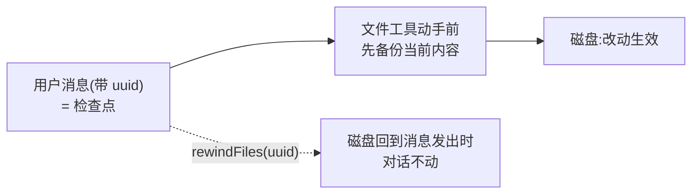

import { Canvas, Controls, Meta } from '@storybook/addon-docs/blocks';
import * as FileCheckpointing from './file-checkpointing.stories';

<Meta of={FileCheckpointing} name="Docs" />

# 文件检查点

agent 会改文件,但第一次就改对并不总发生:改坏了想撤销,或想回到某个决定之前重新来。文件检查点解决的就是这件事——开启 `enableFileCheckpointing` 后,SDK 在 Write / Edit / NotebookEdit 动手前把文件内容备份下来;每条用户消息都是一个检查点,`rewindFiles()` 把文件退回任意检查点发出时的状态,而对话历史原样保留。本课沿用[消息流](?path=/docs/message-stream--docs)的消息模型,讲清检查点怎么产生、怎么回退、能回什么不能回什么,以及与 resume、fork 的配合。看完导读与参考表,你应该能预测:回退到第一条用户消息,agent 的全部文件改动都会消失,但对话里说过的话一条不少。



| 项 | 值 / 默认 | 回查要点 |
| --- | --- | --- |
| `enableFileCheckpointing` | `false` | 在 `options` 设 `true` 开启;Write / Edit / NotebookEdit 动手前自动备份 |
| 检查点 ID | 用户消息的 `uuid` 字段 | 需配 `extraArgs: { "replay-user-messages": null }`,用户消息才回放进输出流 |
| `query.rewindFiles(id)` | 第二参 `{ dryRun?: boolean }` | 回到该用户消息发出时的状态;只回文件,不回对话 |
| 可回滚范围 | Write / Edit / NotebookEdit 的本地文件改动 | Bash、子代理、目录结构、远程文件不在追踪内 |
| 检查点归属 | 创建它的会话 | 跨进程回退:先 `resume` 会话,再在其上回退 |

## 快速上手

沿用[安装与凭证](?path=/docs/install--docs)配置好的项目环境(Node.js 18+、ESM、tsx、`ANTHROPIC_API_KEY`),在项目里放一个 `utils.ts` 作为任务对象。新建 `rewind.ts`:开启检查点跑一个会改文件的任务,记住初始检查点,流结束后把文件退回运行前。

```ts
// 前置:SDK 已安装,当前 shell 设置了 ANTHROPIC_API_KEY。
// 演示:开启文件检查点跑一个会改文件的任务,记住初始检查点;流结束后
//       resume 会话把文件回退到运行前,验证对话不受影响。
// 预期:先正常跑完一轮改动(输出见《第一次运行》);结尾多出回退行;
//       磁盘上 utils.ts 恢复原样、helpers.ts 消失,对话历史仍在。
import { query } from "@anthropic-ai/claude-agent-sdk";

const opts = {
  enableFileCheckpointing: true, // 开启文件检查点:文件工具改动前自动备份
  extraArgs: { "replay-user-messages": null }, // 用户消息回放进流,检查点 uuid 由此可读
  allowedTools: ["Read", "Write", "Edit"],
  permissionMode: "acceptEdits", // 放行语义见《第一次运行》
};

let checkpoint: string | undefined; // 第一条用户消息 = "运行前" 的恢复点
let sessionId: string | undefined;

for await (const message of query({
  prompt: "给 utils.ts 的 getData 加上缓存,再把公共函数拆到 helpers.ts",
  options: opts,
})) {
  if (message.type === "user" && !checkpoint) {
    checkpoint = message.uuid; // 检查点 ID 就是用户消息的 uuid
  }
  if (message.type === "result") {
    sessionId = message.session_id;
  }
}

// 流已结束:重新 resume 这个会话执行回退。执行回退的 query 同样要开检查点,
// 所以展开 ...opts;prompt 传空字符串,只借这次连接回退,不派新任务。
if (checkpoint && sessionId) {
  const rewindQuery = query({
    prompt: "",
    options: { ...opts, resume: sessionId },
  });
  for await (const message of rewindQuery) {
    const rewind = await rewindQuery.rewindFiles(checkpoint);
    console.log(`canRewind=${rewind.canRewind}`, rewind.filesChanged);
    break; // 回退完成即退出,不展开新的对话
  }
}
```

运行:

```bash
npx tsx rewind.ts
```

预期输出(文件清单以实际改动为准):

```text
canRewind=true [ 'utils.ts', 'helpers.ts' ]
```

打开目录核对:`utils.ts` 回到运行前的内容,`helpers.ts` 已被删除;再 `resume` 同一个会话,agent 仍记得整段对话——文件退了,对话没退。这次运行会发起真实的模型请求、消耗 API 额度;本课以讲解为主,不要求逐个运行。

## 检查点怎么产生

开启 `enableFileCheckpointing: true` 后,SDK 在文件工具动手前把当前内容备份;检查点不是一个独立对象,而是**挂在用户消息上**——"回退到某条用户消息",意思是文件回到那条消息发出时的状态。要在流里读到检查点 ID,还差第二个开关:`extraArgs: { "replay-user-messages": null }` 让用户消息回放进输出流(默认不回放),`message.uuid` 由此可读。

两条抓取惯例:

- **初始检查点:** 第一条用户消息的 uuid 代表"运行前"的状态,任务开头抓一次,失败回滚全靠它。
- **任意中间点:** 多轮会话里每条用户消息都是新检查点;想"回到某个决定之前",抓那条消息的 uuid。

改动是否已落备份,看 `files_persisted` system 消息(`subtype: "files_persisted"`,携带 `files` 清单与 `failed` 失败项)。边界:检查点只属于创建它的那个会话,跨进程回退要先把会话 `resume` 回来,见下文「与 resume、fork 配合」。

## 回滚文件

`rewindFiles()` 挂在 `query()` 的返回值上,参数是要回到的那条用户消息的 uuid,语义是:把每个被追踪的文件恢复到该消息发出时的状态——其后创建的文件删除,其后修改的文件恢复;对话历史不受影响。流还开着时随时可调,典型模式是"失败即回滚":

```ts
// 场景:无人值守任务失败时,不让半成品改动留在磁盘上。
// 预期:result 报告非 success 时,文件退回运行前;流照常走完,对话照常收尾。
let checkpoint: string | undefined;

const conversation = query({ prompt: "重构 utils.ts", options: opts });

for await (const message of conversation) {
  if (message.type === "user" && !checkpoint) {
    checkpoint = message.uuid;
  }
  if (message.type === "result" && message.subtype !== "success") {
    await conversation.rewindFiles(checkpoint); // 磁盘回到运行前,对话不受影响
  }
}
```

另一个官方示例的触发点是 `files_persisted` system 消息:想"每次改动落定备份后就评估一次是否回退",在收到它时调 `rewindFiles`。返回值 `RewindFilesResult` 说明本次回退做了什么:

| 字段 | 含义 |
| --- | --- |
| `canRewind` | 本次回退是否成功;`false` 时看 `error` |
| `error?` | 失败原因 |
| `filesChanged?` | 恢复或删除的文件路径 |
| `insertions?` / `deletions?` | 恢复动作带来的行数变化 |
| `skippedLinks?` | 因符号链接等被安全跳过的路径数;仅真实回退有值,dryRun 预览不含 |

不确定会不会误伤时,先用 `dryRun: true` 预览——不落盘,只返回同样的统计:

```ts
// 只预览不真退:看会动哪些文件,再决定。
const preview = await conversation.rewindFiles(checkpoint, { dryRun: true });
if (preview.canRewind && preview.filesChanged?.length) {
  await conversation.rewindFiles(checkpoint);
}
```

下面的实例用演示数据回放"三轮改动后反悔"的时间线,观察回退到不同检查点时每个文件的处置(不调用 LLM API):

<Canvas of={FileCheckpointing.Interactive} />
<Controls of={FileCheckpointing.Interactive} />

| 读者操作 | 可观察证据 |
| --- | --- |
| 拖动「回退到」 | 时间线在所选检查点后画出回退分界,文件卡片同步给出处置动作 |
| 停在 m1(初始状态) | utils.ts 恢复到 v0、helpers.ts 删除——文件回到运行前 |
| 停在 m3 | 只回退第三轮:helpers.ts 恢复到 v1,utils.ts 恢复到 v2 |
| 对比「对话历史」读数 | 任何检查点下 m1 · m2 · m3 全部保留——只回文件,不回对话 |
| 打开 Show code | 看到该 Canvas 实际执行的 `file-checkpointing-demo.ts`,上半部分即回退预览逻辑 |

### 流结束后回退

`rewindFiles` 必须在流还开着时调用:`for await` 走完后连接随之关闭,再调会抛 `ProcessTransport is not ready for writing`。想在进程里"先跑完、看结果、再决定退不退",用 `resume` 接回会话、借一次新连接执行回退(快速上手就是这条路径):

```ts
// 场景:当初的 query 已跑完退出,现在看完结果决定回滚。
// 关键:resume 出来的 query 自己也要开 enableFileCheckpointing,别漏。
const rewindQuery = query({
  prompt: "", // 空提示词:只借这次连接执行回退
  options: { ...opts, resume: sessionId },
});
for await (const message of rewindQuery) {
  await rewindQuery.rewindFiles(checkpointId);
  break;
}
```

## 能回什么、不能回什么

备份只围绕内置文件工具建立,回滚范围因此有明确边界:

| 改动方式 | 能否回滚 | 说明 |
| --- | --- | --- |
| Write / Edit / NotebookEdit | 能 | 备份在改动前自动创建,回退恢复内容或删除新文件 |
| Bash 命令的改动(`echo > file`、`sed -i` 等) | 否 | 不经过文件工具,没有备份 |
| 子代理的文件编辑 | 否 | 例外:带 `context: fork` 的 skill 以前台运行时,其改动被追踪,见[Agent Skills](?path=/docs/skills--docs) |
| 目录的创建 / 移动 / 删除 | 否 | 回滚只恢复文件内容,不动目录结构 |
| 远程 / 网络文件 | 否 | 只追踪本地文件 |

两个补充判断:

- **安全跳过:** 回退时,若被追踪路径上是符号链接、硬链接等非常规文件,或其父目录已不再解析到检查点时的位置、备份无法安全读取,这些路径会被跳过,计入 `skippedLinks`(跳过行为需要 Claude Code CLI v2.1.216+;SDK 捆绑 CLI 运行时,升级 `@anthropic-ai/claude-agent-sdk` 即可跟进)。
- **范围外用 git 兜底:** 检查点覆盖的是窄而确定的一片;任务会走 Bash 改文件、会派子代理时,让 agent 用 git 管理改动(或任务前后自行提交),版本控制承担更广的回滚。

## 与 resume、fork 配合

检查点只属于创建它的会话,于是三条配合规则:

- **跨进程回退历史会话:** `resume` 接回会话再 `rewindFiles`;执行回退的 query 自己也要开 `enableFileCheckpointing`(见上文"流结束后回退")。SDK 之外,CLI 也提供等价能力:`CLAUDE_CODE_ENABLE_SDK_FILE_CHECKPOINTING=true claude -p --resume <session-id> --rewind-files <checkpoint-uuid>`。
- **fork 只分对话不分文件:** fork 复制出的是新会话(见[多轮对话](?path=/docs/multi-turn--docs)),原会话的检查点不能在新会话上回退;想"连文件一起回到过去",回到创建检查点的那个会话里 `rewindFiles`。
- **回到历史中间:** 对话按消息 UUID 回到某一步用 `resumeSessionAt`(见[多轮对话](?path=/docs/multi-turn--docs));需要文件也回到那时,配合 `rewindFiles` 传同一时间点的用户消息 uuid。

## 常见问题

- 调 `rewindFiles()` 抛 `ProcessTransport is not ready for writing`。
  在 `for await` 走完之后才调用,连接已随流结束关闭。流内直接回退;流已结束就 `resume` 会话(空提示词)再回退,见"流结束后回退"。

- 流里读不到检查点,`message.uuid` 是 `undefined`。
  options 里没设 `extraArgs: { "replay-user-messages": null }`;用户消息不回放进流,就没有 uuid 可取。

- 回退报 `No file checkpoint found for this message`。
  创建会话时没开 `enableFileCheckpointing`,或会话没正常结束就 resume 回退。确认原始 query 带开关,并让流自然走完再回退。

- 回退报 `File rewinding is not enabled`。
  执行回退的那个 query 没开检查点——resume 时传的 options 里也要有 `enableFileCheckpointing: true`(展开 `...opts`)。SDK 外的 CLI 回退同理,要设 `CLAUDE_CODE_ENABLE_SDK_FILE_CHECKPOINTING=true`。

- `options` 不识别 `enableFileCheckpointing`。
  SDK 或捆绑的 CLI 版本过旧,升级 `@anthropic-ai/claude-agent-sdk` 到最新。

## 总结回顾

摘要:

文件检查点把"agent 改坏的文件"变成可撤销的操作:开启 `enableFileCheckpointing` 后,SDK 在 Write / Edit / NotebookEdit 动手前备份文件,检查点挂在用户消息上(配 `extraArgs: { "replay-user-messages": null }` 才能在流里读到 uuid);`rewindFiles(uuid)` 把每个被追踪的文件退回那条消息发出时的状态——其后创建的删除、其后修改的恢复,对话历史不动,`dryRun: true` 可以先预览。回滚范围只覆盖内置文件工具对本地文件的改动:Bash、子代理(除 `context: fork` 的前台 skill)、目录结构与远程文件都不在追踪内,更广的回滚交给 git。流开着时可随时回退(如失败即回滚、`files_persisted` 触发),流结束后连接关闭,要 `resume` 会话(空提示词、重开开关)再退;检查点只属于创建它的会话,fork 只分对话不分文件。

一句话:

> 检查点挂在用户消息上,`rewindFiles` 把文件退回那条消息发出时的状态——只回文件,不回对话。

知识要点:

- 开启文件检查点要设哪两项?检查点 ID 从流里的哪条消息读?
- `rewindFiles` 的参数与返回值字段是什么?`dryRun` 预览怎么用?
- 哪些改动可回滚、哪些不可?`skippedLinks` 计的是什么?
- 流结束后怎么回退?为什么会抛 `ProcessTransport is not ready for writing`?
- fork 与 resume 场景下,文件回退分别怎么做?

## 参考资料

- [Rewind file changes with checkpointing](https://code.claude.com/docs/en/agent-sdk/file-checkpointing)(文件检查点与 `rewindFiles` 的官方专题页)
- [TypeScript SDK reference](https://code.claude.com/docs/en/agent-sdk/typescript)(`enableFileCheckpointing` 默认值、`rewindFiles()` 签名与 `RewindFilesResult` 字段的定义处)
