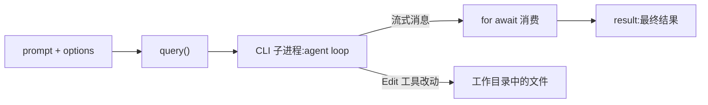

import { Meta } from '@storybook/addon-docs/blocks';

<Meta id="first-run" title="上手/第一次运行" name="Docs" />

# 第一次运行

上一课装好了 SDK 并让 `ANTHROPIC_API_KEY` 对进程可见。本课写一个最小的 `query()` 脚本:把一个有 bug 的文件交给 agent,让它自己修好,并在脚本里拿到最终结果。看完导读与参考表,你应该能预测:运行脚本后,终端会先交错出现 agent 的文字与 `Tool:` 行,最后是 `Done: success`,而且目标文件真的被改了。

| 项 | 值 / 默认 | 回查要点 |
| --- | --- | --- |
| `query()` 入参 | `prompt: string \| AsyncIterable<SDKUserMessage>` | 字符串 prompt 是单轮任务;`AsyncIterable` 是流式输入,做多轮对话用,见[多轮对话](?path=/docs/multi-turn--docs) |
| 返回值 | `Query`,extends `AsyncGenerator<SDKMessage, void>` | 用 `for await` 消费;以 result 消息收尾(其后可能有少量尾部事件) |
| `cwd` | `process.cwd()` | agent 默认在当前目录读文件、改文件 |
| `allowedTools` | `[]` | 点名自动放行的工具;不会把 Claude 限制在列表内 |
| `permissionMode` | `undefined` | 起始模式由 CLI 决定;无人值守改文件显式设 `"acceptEdits"` |
| `maxTurns` | `undefined`(不限) | 只统计含工具调用的轮次 |
| 凭证 | 进程环境中的 `ANTHROPIC_API_KEY` | 配置路径见[安装与凭证](?path=/docs/install--docs) |

## 快速上手

沿用上一课的项目目录(Node.js 18+、ESM、tsx、SDK 已装好),新建一个有 bug 的 `utils.py` 作为 agent 的任务对象:

```python
def calculate_average(numbers):
    total = 0
    for num in numbers:
        total += num
    return total / len(numbers)   # 空列表时除以零


def get_user_name(user):
    return user["name"].upper()   # user 为 None 时抛 TypeError
```

新建 `agent.ts`:

```ts
// 最小 agent 脚本:一次 query() 驱动 agent 修复 utils.py,拿到最终结果。
// 前置:SDK 已安装,当前 shell 设置了 ANTHROPIC_API_KEY。
// 预期:终端交错打印 agent 文字与 Tool: 行,最后输出 Done: success;
//       运行结束后 utils.py 被真实改写。
import { query } from "@anthropic-ai/claude-agent-sdk";

// query() 返回异步消息流,for await 逐条消费,流以 result 消息收尾
for await (const message of query({
  prompt: "Review utils.py for bugs that would cause crashes. Fix any issues you find.",
  options: {
    allowedTools: ["Read", "Edit", "Glob"], // 自动放行这三个工具
    permissionMode: "acceptEdits", // 自动接受文件编辑
  },
})) {
  // assistant 消息:一段文字或一次工具调用
  if (message.type === "assistant" && message.message?.content) {
    for (const block of message.message.content) {
      if ("text" in block) {
        console.log(block.text); // agent 的文字
      } else if ("name" in block) {
        console.log(`Tool: ${block.name}`); // 发起的工具调用
      }
    }
  } else if (message.type === "result") {
    console.log(`Done: ${message.subtype}`); // 最终结果
  }
}
```

运行:

```bash
npx tsx agent.ts
```

预期输出(文字每次运行都不同,结构相同——文字与 `Tool:` 行交错,以 `Done:` 结尾):

```text
我先读取 utils.py,检查会让程序崩溃的边界情况。
Tool: Read
两处风险:calculate_average 对空列表除以零;get_user_name 没有处理 None。
Tool: Edit
修复完成:两处都加了边界检查,函数不会再崩溃。
Done: success
```

打开 `utils.py` 核对:文件已被改写,两处 bug 都加上了防御性处理。这次运行会发起真实的模型请求、消耗 API 额度,用量与费用记在 result 消息里(见下文"判定最终结果")。整个过程中,agent 自主完成"读文件 → 定位问题 → 编辑文件"的循环,`query()` 只负责交任务和收结果。

## 消息流里有什么

`query()` 把 prompt 交给 CLI 子进程里的 agent loop,自己返回一个异步生成器:循环运行期间,SDK 把发生的事作为消息流式产出,`for await` 逐条拿到;agent 停止后,流以一条 result 消息收尾。



本课的流里会反复出现四类消息:

| `message.type` | 何时出现 | 里面有什么 |
| --- | --- | --- |
| `system`(subtype 为 `"init"`) | 会话启动,第一条 | 会话元数据:`session_id`、`tools`、`model`、`cwd`、`permissionMode` 等 |
| `assistant` | Claude 每产出一段文字或发起一次工具调用 | `message.message.content` 内容块:文字块有 `text`,工具调用块有 `name` |
| `user` | 每次工具执行完,结果回传给 Claude | 工具结果(`tool_result`),通常不用展示 |
| `result` | agent loop 结束 | `subtype`、最终文本 `result`、`num_turns`、`usage`、`total_cost_usd`、`session_id` |

快速上手的脚本只打印了 `assistant` 与 `result`;不加过滤直接打印整条消息,会看到 `system` 的 init 元数据等原始对象,调试有用但噪音大。一轮(turn)是循环里的一个往返:Claude 产出 → SDK 执行工具 → 结果回传;循环在 Claude 产出不含工具调用的回复后结束。完整的 `SDKMessage` 类型体系见[消息流](?path=/docs/message-stream--docs)。

### 取出文本与工具调用

`assistant` 消息的 `message.message.content` 是内容块数组:`"text" in block` 判定文字块,读 `block.text`;`"name" in block` 判定工具调用块,读 `block.name`,工具入参在 `block.input`。把快速上手里这段判断换成自己的渲染逻辑,就是把过程接到日志或界面的接法。

### 判定最终结果

result 消息标记 agent loop 结束,`subtype` 是主要的判定字段,先判 `subtype` 再读数据:

| `subtype` | 含义 | 可读字段 |
| --- | --- | --- |
| `success` | 任务完成 | `result`:最终文本;`is_error` 为 `false` |
| `error_max_turns` | 达到 `maxTurns` 上限 | 无 `result`;`errors` 数组说明原因 |
| `error_during_execution` | 执行中出错(如请求被取消) | 同上 |
| `error_max_budget_usd` | 达到 `maxBudgetUsd` 费用上限 | 同上 |

`result` 字段只在 `success` 子类型上存在,不判 `subtype` 直接读会踩空;所有子类型都带 `num_turns`、`usage`、`total_cost_usd` 与 `session_id`,出错也能记账、续跑。被拒绝的工具调用记录在 `permission_denials` 字段里。

只关心最终结果时,流可以只过滤 `result`;像"总结 README.md"这样的只读任务,连 `options` 都不用传:

```ts
import { query } from "@anthropic-ai/claude-agent-sdk";

// 只读任务不需要放行工具;过滤出 result 消息,先判 subtype 再读 result
for await (const message of query({ prompt: "用三句话总结 README.md" })) {
  if (message.type === "result" && message.subtype === "success") {
    console.log(message.result);
  }
}
```

## 让 agent 能改文件

快速上手里 `allowedTools` 与 `permissionMode` 是"脚本跑得完"的前提,不是装饰。工具调用按固定顺序做权限评估:deny 规则、ask 规则、权限模式、allow 规则,最后落到 `canUseTool` 回调(全链路见[权限规则与 canUseTool](?path=/docs/permissions--docs))。`query()` 默认 `allowedTools` 为空、也没有 `canUseTool` 回调,此时凡需要确认的工具调用一律被拒绝:agent 拿到拒绝结果,通常只能报告无法完成修改,被拒调用记录在 result 的 `permission_denials` 里。

第一次运行只需要两个放行手段:

- `allowedTools`:点名工具的调用自动放行,如 `["Read", "Edit", "Glob"]`;没有点名的工具仍然可用,只是调用会继续走后续评估。
- `permissionMode: "acceptEdits"`:自动接受文件编辑与文件系统操作(`mkdir`、`rm`、`mv` 等),与 `allowedTools` 一起覆盖"读 + 改"的完整链路。

两个事实帮你想清楚放行面:读取工作目录内的文件本就无需批准;真正会触发确认的是文件编辑和多数命令执行。所以只读任务不需要放行,会改文件的任务至少要 `acceptEdits`。四种常用模式的对比与 `bypassPermissions` 的风险见[权限模式](?path=/docs/permission-modes--docs)。

## 控制单次运行

| 选项 | 默认 | 作用 |
| --- | --- | --- |
| `maxTurns` | `undefined`(不限) | 限制含工具调用的轮数;超出以 `error_max_turns` 结束 |
| `maxBudgetUsd` | `undefined` | 客户端费用估算达到上限即停,以 `error_max_budget_usd` 结束 |
| `model` | CLI 默认 | 指定模型别名或完整模型名 |
| `cwd` | `process.cwd()` | agent 的工作目录,默认读写范围的根 |
| `abortController` | `new AbortController()` | 调用 `abort()` 可从外部中止本次运行 |

不设上限时,循环一直跑到 agent 自己完成——任务边界清楚时没问题,开放任务可能跑很久。无人值守运行建议至少设 `maxTurns`,在意费用再加 `maxBudgetUsd`(统计口径见[成本与用量](?path=/docs/cost-tracking--docs));中止与重试见[错误处理与中断](?path=/docs/error-handling--docs);常用配置项的完整地图见 [Options](?path=/docs/options--docs)。

## 常见问题

- agent 表示无法修改文件就提前结束,或 result 的 `permission_denials` 非空。
  没有提供 `canUseTool` 回调时,需要确认的工具调用一律被拒绝。按上文放行:`allowedTools` 点名 + `permissionMode: "acceptEdits"`;先用 `permission_denials` 核对哪些调用被拒,再补放行面。

- 循环里收到了 `error_max_turns` 的 result 消息,`for await` 之后又抛了一个错。
  字符串 prompt 的单轮调用在产出错误结果后,`query()` 还会再抛出包含失败说明的错误。用 `try ... catch` 包住整个循环:先处理流里的 result 消息,再在 catch 里收尾。

- 收到 result 消息就 `break`,偶尔错过结尾的输出。
  让 `for await` 迭代到流自然结束,不要在 result 处中断。result 之后还可能有少量尾部系统事件(如 `prompt_suggestion`),官方建议迭代到完成。

## 总结回顾

摘要:

本课用一个修复 `utils.py` 的最小脚本跑通了第一次 `query()` 运行:`query()` 收 prompt 与 options,返回异步消息流;循环期间流式产出 `system`、`assistant`、`user` 三类过程消息,`assistant` 的内容块里能取到文字与工具调用;agent 停止后流以 result 消息收尾,`subtype` 区分 `success` 与各类错误,`result` 字段只在成功时有值。无人值守驱动会改文件的 agent,要用 `allowedTools` 点名放行、`permissionMode: "acceptEdits"` 自动接受编辑,否则需要确认的调用一律被拒;`maxTurns` 与 `maxBudgetUsd` 给单次运行兜底。

一句话:

> `query()` 交任务,`for await` 收流,result 消息给最终结果;无人值守改文件,权限放行必须显式。

知识要点:

- `query()` 怎么调用?返回什么?用什么语法消费?
- 一次运行的消息流里,四类核心消息各在何时出现、装着什么?
- 怎么从 `assistant` 消息取文字与工具调用?怎么判定最终结果成败并安全读取 `result` 字段?
- 为什么无人值守的改文件任务必须设 `allowedTools` 与 `permissionMode`?不加会发生什么?
- 脚本被拒、错误结果后又抛错、在 result 处 break,分别怎么处理?

## 参考资料

- [Quickstart](https://code.claude.com/docs/en/agent-sdk/quickstart)
- [TypeScript SDK Reference](https://code.claude.com/docs/en/agent-sdk/typescript)
- [How the agent loop works](https://code.claude.com/docs/en/agent-sdk/agent-loop)
- [Configure permissions](https://code.claude.com/docs/en/agent-sdk/permissions)
- [Streaming Input](https://code.claude.com/docs/en/agent-sdk/streaming-vs-single-mode)
