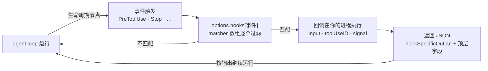

import { Canvas, Controls, Meta } from '@storybook/addon-docs/blocks';
import * as Hooks from './hooks.stories';

<Meta of={Hooks} name="Docs" />

# Hook 事件

agent 运行的每一步都在冒事件:要调一次工具、收到一条 prompt、派出一个子代理、停下来。hooks 让你在这些点上接进自己的代码——在 `options.hooks` 里按事件名登记回调,事件触发时 SDK 就在你的 Node 进程里调用它:传入事件快照(`input`)、关联 ID(`toolUseID`)与取消信号(`signal`),拿回一个 JSON 对象,由 SDK 决定放行、表态、注入上下文,或什么都不做。本课是 Hooks 家族第 1 课:把 33 个事件铺成一张目录(何时触发、输入有什么、能回什么),再讲清 hooks 配置结构——matcher、timeout 与类型化回调。在回调里拦截、改写与自动决策的写法,以及 hook 与 `canUseTool` 的分工,见[Hook 拦截与自动化](?path=/docs/hook-control--docs)。看完导读与参考表,你应该能预测:一轮"读文件 → 改文件 → 回答"的任务,事件按什么顺序冒出来。



事件目录(33 个 `HookEvent`,按家族分组)。"输入要点"列只写该事件在公共字段之外的专属字段,公共字段见"回调的输入与输出";"能回什么"列只列事件专属输出,所有事件都接受的顶层字段同样见后文。

**工具链路——每次工具调用的前后与权限决策:**

| 事件 | 何时触发 | 输入要点 | 能回什么 |
| --- | --- | --- | --- |
| `PreToolUse` | 工具调用执行前 | `tool_name`、`tool_input`、`tool_use_id` | `permissionDecision`(allow / deny / ask / defer)、`updatedInput`;拦截与改写见[Hook 拦截与自动化](?path=/docs/hook-control--docs) |
| `PostToolUse` | 工具调用成功后 | 加 `tool_response`、`duration_ms?` | `additionalContext`、`updatedToolOutput`(替换模型看到的输出) |
| `PostToolUseFailure` | 工具调用失败后 | 加 `error`、`is_interrupt?` | `additionalContext` |
| `PostToolBatch` | 一批并行工具调用全部落定后、下次模型请求前 | `tool_calls[]`(含每次调用的输入与响应) | `additionalContext` |
| `PermissionRequest` | 工具调用需要权限决策时 | 加 `permission_suggestions?` | `decision`(allow / deny,与 canUseTool 同款应答) |
| `PermissionDenied` | auto 模式拒绝工具调用后 | 加 `reason` | `retry: true` 提示模型可重试 |

**轮次与会话——prompt 进出与状态通知:**

| 事件 | 何时触发 | 输入要点 | 能回什么 |
| --- | --- | --- | --- |
| `UserPromptSubmit` | 用户 prompt 提交后、Claude 处理前 | `prompt`、`session_title?` | `additionalContext`;`decision: "block"` 挡下 prompt |
| `UserPromptExpansion` | 用户敲的命令或 MCP prompt 展开成 prompt 前;Claude 自己调 skill 不触发 | `expansion_type`、`command_name`、`command_args` | `additionalContext`;`decision: "block"` 挡下展开 |
| `MessageDisplay` | 带文字的 assistant 消息完成显示,每条一次 | `delta`、`message_id`、`final` | `displayContent` 替换显示文本,不改转录 |
| `Stop` | agent 完成响应停止;用户中断不触发,API 错误改触发 `StopFailure` | `stop_hook_active`、`last_assistant_message?` | `additionalContext`;`decision: "block"` 让 agent 继续干 |
| `StopFailure` | 一轮以 API 错误结束,替代 `Stop` | `error`、`error_details?` | 输出被忽略,只用于记录与告警 |
| `SessionStart` | 会话开始或恢复 | `source`(startup / resume / clear / compact / fork) | `additionalContext`、`initialUserMessage?` |
| `SessionEnd` | 会话终止 | `reason` | 无决策控制,输出被丢弃;默认超时 1.5 秒 |
| `Setup` | 会话 setup / 维护 | `trigger`(init / maintenance) | `additionalContext` |
| `Notification` | agent 发出状态通知 | `message`、`notification_type` | `additionalContext` |

**子代理与任务:**

| 事件 | 何时触发 | 输入要点 | 能回什么 |
| --- | --- | --- | --- |
| `SubagentStart` | 子代理启动 | `agent_id`、`agent_type` | `additionalContext` |
| `SubagentStop` | 子代理完成 | 加 `agent_transcript_path`、`stop_hook_active` | `additionalContext`;`decision: "block"` 让子代理继续 |
| `TaskCreated` | `TaskCreate` 工具创建任务时 | `task_id`、`task_subject` | `decision: "block"` 挡下创建,`reason` 回给模型 |
| `TaskCompleted` | 任务被标记完成时 | 同 `TaskCreated` | `decision: "block"` 挡下完成 |
| `TeammateIdle` | 团队队友即将空闲 | `teammate_name` | 无事件专属输出 |

**环境与扩展:**

| 事件 | 何时触发 | 输入要点 | 能回什么 |
| --- | --- | --- | --- |
| `PreCompact` | 对话压缩前 | `trigger`(manual / auto)、`custom_instructions` | `decision: "block"` 可挡下压缩 |
| `PostCompact` | 压缩完成后 | `trigger`、`compact_summary` | 无事件专属输出 |
| `PreModelSwitch` | 请求的模型切换生效前 | `from_model`、`to_model`、`source`、`context_tokens` | `permissionDecision`(可拦截切换) |
| `PostModelSwitch` | 会话模型已变,含自动 fallback | 同 `PreModelSwitch`,source 取值更多 | `additionalContext` |
| `ConfigChange` | 配置文件变化 | `source`、`file_path?` | 无事件专属输出 |
| `InstructionsLoaded` | CLAUDE.md / rules 文件载入上下文 | `file_path`、`memory_type`、`load_reason` | 无事件专属输出 |
| `CwdChanged` | 工作目录变化 | `old_cwd`、`new_cwd` | `watchPaths?` 增补监视路径 |
| `DirectoryAdded` | 会话中新增工作目录 | `directory`、`source` | 无事件专属输出 |
| `FileChanged` | 被监视文件变化;matcher 指定监视哪些文件名 | `file_path`、`event`(change / add / unlink) | `watchPaths?` 增补监视路径 |
| `WorktreeCreate` | 创建 git worktree | `name` | `worktreePath?` |
| `WorktreeRemove` | worktree 移除 | `worktree_path` | 无事件专属输出 |
| `Elicitation` | MCP server 请求用户输入 | `mcp_server_name`、`message`、`requested_schema?` | `action`(accept / decline / cancel)+ `content` |
| `ElicitationResult` | 用户响应 elicitation 后、回传 server 前 | `mcp_server_name`、`action`、`content?` | `action` + `content`(可改写或拦下) |

## 快速上手

注册两个纯观察回调,看 hook 的输入长什么样、从哪里执行。前置环境沿用[安装与凭证](?path=/docs/install--docs)(SDK 已装、`ANTHROPIC_API_KEY` 可见)。

```ts
// 预期:每次工具调用前打印一行 [PreToolUse],agent 停下时打印 [Stop];
//       回调在你的 Node 进程里执行,不经过消息流,Claude 对日志无感知。
import {
  query,
  HookCallback,
  PreToolUseHookInput,
  StopHookInput,
} from "@anthropic-ai/claude-agent-sdk";

// 回调签名三参:事件输入、toolUseID、{ signal };本例只用前两参
const logToolCalls: HookCallback = async (input, toolUseID) => {
  // input 是全部事件输入的联合类型,按 hook_event_name 收窄后才能取专属字段
  const pre = input as PreToolUseHookInput;
  console.log(`[PreToolUse] ${pre.tool_name}`, pre.tool_input, `toolUseID=${toolUseID}`);
  return {}; // 不表态:调用继续走正常权限评估
};

const onStop: HookCallback = async (input) => {
  const stop = input as StopHookInput;
  console.log(`[Stop] 最后回答:${stop.last_assistant_message ?? "(无)"}`);
  return {};
};

for await (const message of query({
  prompt: "用三句话总结 README.md",
  options: {
    allowedTools: ["Read", "Glob", "Grep"], // 放行读类工具,任务跑得完
    hooks: {
      PreToolUse: [{ hooks: [logToolCalls] }], // 无 matcher:每次工具调用都触发
      Stop: [{ hooks: [onStop] }],
    },
  },
})) {
  // hook 回调不在这条消息流里;这里照常消费 SDKMessage
  if (message.type === "result" && message.subtype === "success") {
    console.log("结果:", message.result);
  }
}
```

预期输出(摘要文本每次运行不同,结构相同):

```text
[PreToolUse] Read { file_path: 'README.md' } toolUseID=toolu_01ABC123
结果:README.md 介绍了本仓库的……
[Stop] 最后回答:README.md 介绍了本仓库的……
```

三个观察点:`tool_input` 的类型是 `unknown`,要按官方工具输入类型收窄后再用;省略 matcher 的条目让每次工具调用都进回调,全量审计日志就这样注册;返回 `{}` 表示 hook 不表态,调用继续走正常权限评估(评估链全貌见[权限规则与 canUseTool](?path=/docs/permissions--docs))。

## 事件时序

33 个事件按触发节奏分三档,判断"我的回调会在什么时候被调"先看节奏:

| 节奏 | 事件 | 规律 |
| --- | --- | --- |
| 每会话 | `SessionStart`、`SessionEnd`、`Setup` | 会话开始或恢复、终止、setup 时各一次 |
| 每轮 | `UserPromptSubmit` → 工具事件 → `Stop` / `StopFailure` | prompt 提交进、回合结束出;`Stop` 与 `StopFailure` 互斥——正常结束触发 `Stop`,API 错误触发 `StopFailure`,用户中断两者都不触发 |
| 每次工具调用 | `PreToolUse` →(需要决策时 `PermissionRequest`)→ `PostToolUse` / `PostToolUseFailure`;并行批次落定再触发 `PostToolBatch` | 失败走 `PostToolUseFailure`,成功才走 `PostToolUse` |

其余事件按条件出现:派子代理时 `SubagentStart` / `SubagentStop` 包住子代理自己的工具事件,子代理内事件的输入带 `agent_id` / `agent_type`,主线程事件没有;对话压缩、模型切换、MCP 交互(`Elicitation` / `ElicitationResult`)、配置与目录变化各按对应动作出现。

下面的实例回放三种任务的事件时间线(演示数据,时序与输入字段对应官方事件定义,只覆盖正文讲到的分支):

<Canvas of={Hooks.Interactive} />
<Controls of={Hooks.Interactive} />

| 读者操作 | 可观察证据 |
| --- | --- |
| 观察默认场景"改一个文件" | 每轮必经的 `UserPromptSubmit` 与 `Stop` 夹着两对 `PreToolUse` / `PostToolUse`;结束行是 `Stop` |
| 切换为"命令失败再重试" | 失败的 Bash 走 `PostToolUseFailure`,修复重试成功走 `PostToolUse`;事件数变为 9 |
| 切换为"派子代理探查" | `SubagentStart` / `SubagentStop` 包住子代理内的 `PreToolUse` / `PostToolUse`,读数显示"子代理内事件 2 个 · 输入带 agent_id" |

想从消息流里核对事件确实触发,在 options 里加 `includeHookEvents: true`(默认 `false`):流里会出现 `system` 消息的三个子类型——`hook_started`(hook 开始执行)、`hook_progress`(执行中的输出)、`hook_response`(执行结束,带 `outcome`)。`SessionStart` 与 `Setup` 的生命周期消息总是包含;`Notification`、`SessionEnd`、`PreCompact`、`PostCompact` 即使开了选项也不产生 `hook_started`。消息类型体系见[消息流](?path=/docs/message-stream--docs)。

## 配置结构

`hooks` 选项的类型是 `Partial<Record<HookEvent, HookCallbackMatcher[]>>`,默认 `{}`:键是事件名(33 个 `HookEvent`,大小写敏感),值是 `HookCallbackMatcher` 数组。一个完整的配置长这样:

```ts
import { query } from "@anthropic-ai/claude-agent-sdk";
import type { HookCallback } from "@anthropic-ai/claude-agent-sdk";

// 一个回调:签名三参,返回 Promise<HookJSONOutput>(见"回调的输入与输出")
const auditLogger: HookCallback = async (input) => {
  return {};
};

query({
  prompt: "...",
  options: {
    hooks: {
      PreToolUse: [
        {
          matcher: "Write|Edit",    // 可选:过滤触发条件,见下节
          hooks: [protectEnvFiles], // 必填:该 matcher 命中时执行的回调(如拦截 .env 写入的检查)
          timeout: 30,              // 可选:单位秒;省略用事件默认
        },
        { hooks: [auditLogger] },   // 无 matcher:该事件每次发生都触发
      ],
    },
  },
});
```

四条结构事实:

- 同一事件可以配多个 matcher,一个 matcher 里可以放多个回调:事件触发时**所有匹配的回调并行执行**,决策取最严——`deny` > `defer` > `ask` > `allow`,任何一个 `deny` 否决其余结果。写每个回调时别依赖"另一个回调先跑完"。
- 回调在 `query()` 所在的 Node 进程里执行,不是 CLI 子进程里的 shell 命令;settings 文件里的 shell command hooks 随 `settingSources` 启用的设置层一并加载,与回调 hooks 并存(见[设置来源](?path=/docs/settings-sources--docs))。
- 事件名对大小写敏感。类型检查会挡住 `HookEvent` 之外的拼写,但运行期写错的键被静默忽略——不报错,也永远不触发。
- 配置在 `query()` 时一次性传入,运行期不能增删 hook;要换 hook 就开新会话。

### matcher

`matcher` 过滤"这次事件要不要调我的回调"。求值方式取决于它含什么字符:

| matcher 写法 | 求值方式 | 例 |
| --- | --- | --- |
| 省略、`"*"` 或 `""` | 匹配全部 | 该事件每次发生都触发 |
| 只含字母、数字、`_` `-` 空格 `,` `\|` | 精确串,或 `\|` / `,` 分隔的精确串列表 | `"Bash"`、`"Edit\|Write"`、`"Edit, Write"` |
| 含其他任何字符 | JavaScript 正则,非锚定 | `"^mcp__"`、`"mcp__memory__.*"` |

正则路径用 `RegExp.prototype.test`,在任意位置命中即成功:`Edit.*` 同时匹配 `Edit` 和 `NotebookEdit`,要整串匹配就写 `^Edit$`。两个特例:`FileChanged` 与 `StopFailure` 的精确串字符集更窄(只有字母、数字、`_`、`\|`),写进逗号、空格或连字符会掉进正则路径,且只支持 `\|` 分隔。

matcher 对什么匹配由事件决定。常用事件的对照(完整表见官方 hooks 参考):

| matcher 对象 | 事件 |
| --- | --- |
| 工具名(`Bash`、`Edit\|Write`、`mcp__.*`) | `PreToolUse`、`PostToolUse`、`PostToolUseFailure`、`PermissionRequest`、`PermissionDenied` |
| agent 类型(`Explore`、`general-purpose`) | `SubagentStart`、`SubagentStop` |
| 通知类型(`permission_prompt` 等) | `Notification` |
| 启动方式 / 结束原因(`startup`、`clear`…) | `SessionStart`、`SessionEnd` |
| 压缩来源(`manual` / `auto`) | `PreCompact`、`PostCompact` |
| 目标模型名 | `PreModelSwitch`、`PostModelSwitch` |
| 配置来源(`project_settings` 等) | `ConfigChange` |
| 载入原因(`session_start` 等) | `InstructionsLoaded` |
| 目录新增方式(`slash_command` 等) | `DirectoryAdded` |
| 错误类型(`rate_limit` 等) | `StopFailure` |
| MCP server 名 | `Elicitation`、`ElicitationResult` |
| 要监视的文件名 | `FileChanged` |
| 命令名 | `UserPromptExpansion` |
| setup 触发方式(`init` / `maintenance`) | `Setup` |
| **无 matcher 支持,写了被静默忽略** | `UserPromptSubmit`、`PostToolBatch`、`Stop`、`TeammateIdle`、`TaskCreated`、`TaskCompleted`、`WorktreeCreate`、`WorktreeRemove`、`MessageDisplay`、`CwdChanged` |

MCP 工具按注册名 `mcp__<server>__<tool>` 出现在工具事件里,匹配整个 server 要补 `.*`:`mcp__memory__.*` 匹配 memory server 的全部工具,而 `mcp__memory` 只含精确串字符、按精确串比较,一个工具都匹配不到;server 名带连字符同理写 `mcp__brave-search__.*`。

最重要的一条边界:**matcher 只匹配名称字段,不看参数**。想按 `file_path`、`command` 这类输入过滤,在回调里检查 `tool_input`——matcher 写不了 `Bash(rm *)` 这样的参数规则。

### timeout

`HookCallbackMatcher.timeout` 以秒为单位,作用于该 matcher 里的所有回调;省略时用事件默认值:多数事件 600 秒,`UserPromptSubmit`、`PreModelSwitch`、`PostModelSwitch` 30 秒,`MessageDisplay` 10 秒,`SessionEnd` 在关停预算内默认 1.5 秒。

超时的回调被取消、输出丢弃,会话继续不挂死,但"丢弃输出"对不同事件的含义完全不同:

| 超时后果 | 事件 | 含义 |
| --- | --- | --- |
| 不表态即不放行 | `PreToolUse` | 工具不执行,Claude 收到"hook 未按时响应"的说明,本轮继续 |
| 不表态即不放行 | `UserPromptSubmit` | prompt 被阻止(消息点名 hook 与超时),会话继续——回调可能是策略门,不放未审查的 prompt 过去 |
| 不表态即不放行 | `PreModelSwitch` | 模型切换被阻止:没回答就等于没批准 |
| 视为无决策 | `Stop`、`SubagentStop` | agent 照常停止,如同回调放行 |
| 保留现状 | `PostToolUse`、`PostToolUseFailure` 等 | 工具结果保留,记日志继续 |

决策类回调要显式想清楚超时语义:把必须"不放行"的检查配足 `timeout`,并在回调里响应第三参的 `signal`(超时或运行中止时收到),把未完成的工作收尾干净。

## 回调的输入与输出

每个回调收到固定的三参:

```ts
type HookCallback = (
  input: HookInput,              // 全部事件输入的联合类型,按 hook_event_name 收窄
  toolUseID: string | undefined, // 工具事件的调用 ID;非工具事件为 undefined
  options: { signal: AbortSignal }, // 超时或运行中止时收到取消信号
) => Promise<HookJSONOutput>;
```

| 参数 | 用途 |
| --- | --- |
| `input` | 事件快照。每个事件有自己的 `*HookInput` 类型(如 `PreToolUseHookInput`、`StopHookInput`),专属字段见开场目录;`tool_input` 等载荷类型为 `unknown`,按官方工具输入类型收窄后使用 |
| `toolUseID` | 关联同一次工具调用:用它把 `PreToolUse` 与 `PostToolUse` 对齐;非工具事件为 `undefined` |
| `options.signal` | 回调超时或整个运行被中止时收到 `AbortSignal`,用来收尾未完成的副作用 |

所有事件输入都带一组公共字段(`BaseHookInput`):

| 公共字段 | 内容 |
| --- | --- |
| `session_id` / `transcript_path` / `cwd` | 会话 ID / 转录文件路径(异步写,可能滞后于内存对话)/ 触发时的工作目录 |
| `hook_event_name` | 事件名;收窄输入类型的判别字段 |
| `prompt_id?` | 当前正在处理的 prompt 的 UUID,首个用户输入后才出现 |
| `permission_mode?` | 当前权限模式 |
| `effort?` | `{ level }` 当前 effort 等级 |
| `agent_id?` / `agent_type?` | 在子代理内触发时填充;主线程事件没有 `agent_id`,用它区分子代理调用 |

回调的返回值类型是 `HookJSONOutput = SyncHookJSONOutput | AsyncHookJSONOutput`。同步输出分两类:

- **顶层字段**:每个事件都接受,但部分事件会丢弃或另行投递——`systemMessage`(给用户看,不给模型)、`continue`(控制 agent 是否继续运行)、`decision`(`"approve"` / `"block"`)、`stopReason`、`reason`、`suppressOutput`。各事件的字段落点以官方 hooks 页各事件小节为准。
- **`hookSpecificOutput`**:控制当前事件,`hookEventName` 必带(标明这段输出属于哪个事件),其余字段按事件不同——`PreToolUse` 是 `permissionDecision`(`"allow"` / `"deny"` / `"ask"` / `"defer"`)、`permissionDecisionReason`、`updatedInput`;`PostToolUse` 是 `additionalContext`、`updatedToolOutput`;`Stop` 是 `additionalContext`;`PermissionRequest` 是 `decision`(allow / deny 应答,形态与 `canUseTool` 相同)。

三条裁决规则:同一事件的多个回调并行执行,决策取最严——`deny` > `defer` > `ask` > `allow`,任何一个 `deny` 否决其余;返回 `{}` 表示 hook 不表态,事件按默认流程继续,**不等于批准**;`permissionDecision` 与 `updatedInput` 的完整写法、"阻止停止"的自动化,以及 hook 与 `canUseTool` 的分工,见[Hook 拦截与自动化](?path=/docs/hook-control--docs)——hooks 在权限评估链里是第 1 步,deny 在任何模式下都生效(评估链全貌见[权限规则与 canUseTool](?path=/docs/permissions--docs))。

### 异步输出

纯副作用的回调可以不等结果:`async: true` 告诉 agent 不等回调完成就继续,`asyncTimeout`(毫秒,可选)给后台操作一个超时。

```ts
// 副作用型回调:把日志发出去就返回,agent 不等它
const asyncHook: HookCallback = async (input) => {
  sendToLoggingService(input).catch(console.error);
  return { async: true, asyncTimeout: 30000 };
};
```

代价是这条输出什么也控制不了:不能拦截、改写或注入上下文,agent 已经继续走了。只把日志、指标、通知这类不影响决策的工作放进异步输出。

## 最佳实践

- **回调快进快出,副作用异步化。** `PreToolUse` 卡住会拖住整次工具调用,`UserPromptSubmit` 卡住会拖住整轮处理;纯观察、转发类逻辑放进 `{ async: true }` 输出,决策类逻辑保持同步并尽快返回。
- **matcher 收窄注册面,参数过滤进回调。** matcher 只匹配名称字段,匹配不了 `file_path`、`command` 这类参数;业务检查用 `"Write|Edit"` 这类精确列表收窄到最小面,参数级判断在回调里查 `tool_input`;省略 matcher 的全量注册留给审计日志。
- **决策输出对照事件落点写。** 顶层字段不是处处生效:`PreCompact`、`PostCompact`、`SessionEnd`、`MessageDisplay` 丢弃 `systemMessage` 与 `continue`,`StopFailure` 忽略全部输出;写回调前对照官方 hooks 页各事件小节确认字段去向。

## 常见问题

- 注册了 hook,事件发生时回调却从不执行。
  按序检查四处:事件名大小写写对(`PreToolUse`,不是 `preToolUse`);matcher 落在哪条求值路径——`mcp__memory` 只含精确串字符、按精确串比较,一个工具都匹配不到,要写 `mcp__memory__.*`;事件是否支持 matcher——给 `Stop`、`UserPromptSubmit` 这类事件配 matcher 会被静默忽略;任务是否提前结束——达到 `maxTurns` 上限会话即终止,hook 来不及执行。

## 总结回顾

摘要:

hooks 把你的代码接进 agent 生命周期:`options.hooks` 按 `HookEvent` 事件名分组登记 `HookCallbackMatcher`(可选 matcher + 必填回调数组 + 可选 timeout),事件触发时 SDK 在你的进程里并行执行所有匹配的回调,输入是公共字段(`BaseHookInput`)加事件专属字段的快照,输出是一个 JSON——顶层字段与必带 `hookEventName` 的 `hookSpecificOutput`,SDK 据此放行、拒绝、注入上下文或什么都不做,多回调冲突取最严。33 个事件按触发节奏分三档:每会话(`SessionStart` / `SessionEnd` / `Setup`)、每轮(`UserPromptSubmit` 进、`Stop` / `StopFailure` 出)、每次工具调用(`PreToolUse` 进、`PostToolUse` / `PostToolUseFailure` 出),其余按条件出现,子代理内事件带 `agent_id`。matcher 有精确串与正则两条求值路径,各事件匹配的对象不同、部分事件不支持;timeout 缺省按事件取 600 / 30 / 10 / 1.5 秒,超时后果因事件而异——决策类事件不表态即不放行,`Stop` 类视为无决策;拦截、改写与自动决策的写法归[Hook 拦截与自动化](?path=/docs/hook-control--docs)。

一句话:

> 事件定时机、matcher 定范围、回调定输出——配置就是把三者按"事件 → matcher 数组 → 回调数组"登记进 `options.hooks`。

知识要点:

- `options.hooks` 的类型结构是什么?`HookCallbackMatcher` 有哪三个字段?
- 回调的三参签名是什么?`toolUseID` 和 `signal` 各用来做什么?
- 每个事件输入的公共字段有哪些?怎么区分子代理内触发?
- 同步输出分哪两类?`hookSpecificOutput` 里 `hookEventName` 为什么必带?多个回调的决策冲突怎么裁决?
- matcher 的求值路径有哪几条?哪些事件不支持 matcher?MCP 工具怎么匹配整个 server?
- `timeout` 省略时各事件的默认值是多少?超时后 `PreToolUse` 与 `Stop` 的后果差在哪?
- `async: true` 输出能做什么、不能做什么?怎么从消息流里核对 hook 触发?

## 参考资料

- [Intercept and control agent behavior with hooks(Agent SDK)](https://code.claude.com/docs/en/agent-sdk/hooks)(事件目录、配置结构、matcher、timeout、异步输出与常见问题)
- [Agent SDK reference - TypeScript](https://code.claude.com/docs/en/agent-sdk/typescript)(`HookEvent`、`HookCallback`、`HookCallbackMatcher`、`HookInput`、`HookJSONOutput` 类型与 `hooks` / `includeHookEvents` 选项)
- [Hooks reference(Claude Code)](https://code.claude.com/docs/en/hooks)(matcher 求值规则、各事件 matcher 对象、公共输入字段与各事件输出落点)
