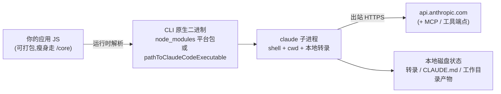

import { Meta } from '@storybook/addon-docs/blocks';

<Meta id="hosting" title="生产化/运行与部署/打包与托管" name="Docs" />

# 打包与托管

"我机器上能跑"到"镜像和打包产物里能跑"之间隔着一层,本课把这层拆开。核心模型只有两句话:你的产物里有两种东西——自己写的 JS(可以 bundle)和 SDK 捆绑的原生 CLI 二进制(不是 JS,运行时要能在磁盘上找到它),打包的全部约束都从这里来;每个 `query()` 会话是一个真实子进程,拥有 shell、工作目录和本地磁盘上的会话状态,托管的全部约束都从这里来。看完导读与参考表,你应该能预测:`npm ci --omit=optional` 的镜像、`bun build --compile` 的单文件、只拷 `dist` 不拷 `node_modules` 的产物,各自会在哪一步报什么错。



| 项 | 值 / 默认 | 回查要点 |
| --- | --- | --- |
| CLI 二进制来源 | SDK 捆绑的平台可选依赖,如 `@anthropic-ai/claude-agent-sdk-darwin-arm64` | 原生二进制不是 JS;运行时必须在磁盘上找到它 |
| 版本对应 | 捆绑 CLI 版本与 SDK 版本一一对应 | 升级 CLI = 升级 SDK;minor 前看 changelog |
| 跳过可选依赖 | 运行报 `Native CLI binary for <platform>-<arch> not found` | 重装带上 optional,或设 `pathToClaudeCodeExecutable` |
| `pathToClaudeCodeExecutable` | 默认从捆绑二进制自动解析 | 仅可选依赖被跳过或平台不受支持时需要 |
| `/core` 入口 | `@anthropic-ai/claude-agent-sdk/core` | SDK v0.3.282+、TypeScript 5.0+;打包时用 |
| `/core` 裁掉的导出 | 至少含 `prewarm()`、`InMemorySessionStore`、会话 list/read/fork/import/summarize 助手 | 需要就从根入口导入;同一进程两个入口只能用一个 |
| bun 单文件 | `bun build --compile` 内解析不到二进制 | `extractFromBunfs()`(v0.3.144+)+ `pathToClaudeCodeExecutable` |
| 容器运行时 | Node.js 18+ | CLI 子进程不需另装 Node |
| 资源起点 | 每 agent 1 GiB RAM / 5 GiB 磁盘 / 1 CPU | 下限不是上限;按会话峰值 RSS 重算 |
| 网络出口 | 到 `api.anthropic.com` 的出站 HTTPS | MCP server 与外部工具的端点也要放行 |
| 会话状态 | 转录、`CLAUDE.md`、工作目录产物都在本地磁盘 | 默认活不过容器重启、缩容、换节点 |

## 快速上手

容器侧的最小闭环:一个把平台二进制带全、在镜像内安装的 Dockerfile 骨架。官方可部署的 Dockerfile 与 Kubernetes 清单在 hosting cookbook,下面是按文档事实整理的教学骨架:

```dockerfile
# 教学骨架:可直接部署的版本见官方 hosting cookbook(见参考资料)。
FROM node:22-slim
WORKDIR /app
# 先拷清单再装依赖:利用层缓存;npm ci 必须带上可选依赖,平台二进制才会落地镜像
COPY package.json package-lock.json ./
RUN npm ci --omit=dev --include=optional
# 再拷源码并构建;捆绑的 CLI 二进制随 node_modules 一起进镜像
COPY . .
RUN npm run build
CMD ["node", "dist/agent.js"]
```

两条判断决定这个骨架能不能跑:

- **安装发生在镜像内。** 平台二进制按安装时的操作系统与架构选择;把 macOS 上装好的 `node_modules` 拷进 Linux 镜像,二进制不匹配,运行时起不来(报错对照见常见问题)。
- **可选依赖不能省。** `--omit=optional` 或包管理器跳过可选依赖,`query()` 在运行时报 `Native CLI binary for <platform>-<arch> not found`。

应用代码侧不需要任何"部署专用"改动:入口仍是普通的 `query()` 循环(见[安装与凭证](?path=/docs/install--docs)与[第一次运行](?path=/docs/first-run--docs)),镜像里给足 `ANTHROPIC_API_KEY` 与出站网络即可。

## 打包限制

打包工具处理的是 JS;CLI 是平台原生二进制,以可选依赖的形式待在 `node_modules/@anthropic-ai/claude-agent-sdk-<platform>-<arch>/` 里,运行时由 SDK 解析定位。三条规则覆盖全部打包场景:

- **别把二进制从产物里弄丢。** bundle 只会带走 JS;二进制要么随 `node_modules` 一起部署,要么用 `pathToClaudeCodeExecutable` 指到别处。
- **JS 侧瘦身用 `/core` 入口。** 根入口内联了自己的 `zod` 与 `@modelcontextprotocol/sdk` 副本;打包场景换 `/core` 避免重复。
- **启动失败先查二进制。** "找不到"与"找到了但起不来"是两类故障,处理路径不同(见常见问题)。

### pathToClaudeCodeExecutable

`Options.pathToClaudeCodeExecutable` 指定 Claude Code 可执行文件的路径,默认从捆绑的平台二进制自动解析。只有两种情况需要显式设置:安装时可选依赖被跳过,或目标平台不在支持列表内:

```ts
// 场景:镜像里用单独安装的 claude,而不是 SDK 捆绑的平台包。
query({
  prompt,
  options: {
    // 指向的文件必须真实存在、可执行;指向的路径失效时报错对照见常见问题
    pathToClaudeCodeExecutable: "/usr/local/bin/claude",
  },
});
```

边界:设置了该选项,SDK 就按这个路径找 CLI,不再回落到捆绑二进制;部署排障时先确认镜像里这个路径上到底是什么。

### bun 单文件可执行

`bun build --compile` 把应用编成单文件可执行程序后,SDK 解析不到捆绑的 CLI:`require.resolve` 在编译产物的 `$bunfs` 虚拟文件系统里不工作,运行报同一个 `Native CLI binary for <platform>-<arch> not found`——报错相同,原因和处理完全不同。官方做法:把平台二进制作为文件资产嵌进去,启动时用 `extractFromBunfs()` 落到真实路径,再交给 `pathToClaudeCodeExecutable`:

```ts
// 前置:SDK >= 0.3.144;资产 import 对应的平台包要与 bun build --compile 的 --target 一致。
// 预期:cliPath 是磁盘上的真实二进制路径;开发环境(非编译产物)下 extractFromBunfs
//       原样返回输入路径,同一份代码两用。
import binPath from "@anthropic-ai/claude-agent-sdk-darwin-arm64/claude" with { type: "file" };
import { extractFromBunfs } from "@anthropic-ai/claude-agent-sdk/extract";
import { query } from "@anthropic-ai/claude-agent-sdk";

const cliPath = extractFromBunfs(binPath);

for await (const message of query({
  prompt: "Hello",
  options: { pathToClaudeCodeExecutable: cliPath },
})) {
  console.log(message);
}
```

每个编译产物只嵌一个平台的二进制:交叉编译先装对端的平台包(如 `npm install @anthropic-ai/claude-agent-sdk-linux-x64 --force`);Windows 的二进制子路径是 `claude.exe`(如 `@anthropic-ai/claude-agent-sdk-win32-x64/claude.exe`)。

### /core 入口

应用把 SDK 和自己的依赖打在一起时,从 `@anthropic-ai/claude-agent-sdk/core` 导入(要求 SDK v0.3.282+、TypeScript 5.0+)。它是为打包准备的瘦身入口:

- **体积来源:** 根入口把 `zod` 与 `@modelcontextprotocol/sdk` 内联成自己的副本;`/core` 改从你的 `node_modules` 按 SDK `peerDependencies` 声明的范围引入——bundle 里已有它们时不再带第二份。
- **导出差异:** 常用 API 一致,裁掉的是低频导出,见下表。
- **二选一:** 根入口与 `/core` 是两份独立 bundle,同一进程只能用其一;混用会得到两份 SDK 类与状态。

```ts
// 打包场景:从 /core 导入,函数签名与根入口一致
import { query } from "@anthropic-ai/claude-agent-sdk/core";
```

| 导出 | 根入口 | `/core` |
| --- | --- | --- |
| `query()`、`startup()`、`tool()`、`createSdkMcpServer()`、`resolveSettings()` | 有 | 有 |
| 会话重命名 / 打标 / 删除函数、`AbortError`、运行时常量、全部类型 | 有 | 有 |
| `prewarm()` | 有 | 无 |
| `InMemorySessionStore` | 有 | 无 |
| 会话 list / read / fork / import / summarize 助手 | 有 | 无 |

`/core` 不新增任何自己的名字;上表"无"的清单是文档列出的"至少包括"项。预热与 `/core` 的取舍在[进程与预热](?path=/docs/process-model--docs)课已从 API 侧讲过,这里补齐打包视角:用了 `/core`,预热能力就只剩 `startup()`。

## 容器化托管

SDK 托管不是托管一个无状态 API 包装:每个会话对应一个子进程,N 个并发会话就是 N 个子进程(进程模型见[进程与预热](?path=/docs/process-model--docs)课)。三类状态默认写在容器本地磁盘上,都不活过容器重启、缩容或换节点:

| 状态 | 默认位置 |
| --- | --- |
| 会话转录 | `~/.claude/projects/`,设了 `CLAUDE_CONFIG_DIR` 则在其 `projects/` 下 |
| `CLAUDE.md` 记忆文件 | 用户层在 `~/.claude/CLAUDE.md`,项目层在会话工作目录 |
| 工作目录产物 | 会话的工作目录 |

要让会话能回来,转录用 `SessionStore` 适配器镜像到持久存储(接口与双写架构见[会话存储](?path=/docs/session-storage--docs)课);`CLAUDE.md` 与工作目录产物要自己安排卷挂载或对象存储同步。

### 镜像里放什么

- **基础镜像:** Node.js 18+ 即可;捆绑二进制自带 CLI 运行时,子进程不需要另装 Node。
- **安装方式:** `npm ci` 必须包含可选依赖(见快速上手);SDK 版本与捆绑 CLI 版本一一对应,升级 CLI 就升级 SDK——补丁版连续跟,minor 前看 changelog。
- **Yarn 1.x 特例:** 它不应用 npm 的 `libc` 字段,glibc 与 musl 两个平台包都会装进镜像;SDK v0.2.141+ 仍会启动正确变体,但想给镜像瘦身可删掉不匹配的那个,glibc x64 环境是 `rm -rf node_modules/@anthropic-ai/claude-agent-sdk-linux-x64-musl`。

### 容器要连通什么

- **出站:** 到 `api.anthropic.com` 的 HTTPS(Bedrock / Vertex 走各自区域端点,本手册不展开);agent 用到 MCP server 或外部工具,那些端点也要放行。生产环境把出站流量收进 egress 代理做域名白名单、凭证注入与日志,完整模式见安全部署指南,容器与代理的组合实践见[沙箱](?path=/docs/sandbox--docs)课。
- **入站:** 对外暴露 HTTP / WebSocket 端口的是你的应用;子进程自己不监听任何网络端口。

### 资源与伸缩

1 GiB RAM、5 GiB 磁盘、1 CPU 是每个 agent 的合理起点——是下限不是上限:内存随会话长度与工具活动增长。每台宿主能放多少 agent,用官方公式按峰值算,不用空闲基线:

```text
agents per host = (host RAM - overhead) / (per-session RAM ceiling)
```

单会话内存上限用代表性会话压到目标长度、记录峰值 RSS 实测。long-running 模式横向扩容时,负载均衡后按 `sessionId` 一致性哈希把会话钉在同一容器上,会话才总是命中同一个存活的子进程。

### 会话形态

四种模式覆盖"容器寿命和会话寿命怎么对齐",先选形态再看部署目标:

| 模式 | 容器与会的关系 | 适用 | 关键配置 |
| --- | --- | --- | --- |
| Ephemeral | 一任务一容器,跑完即毁 | 一次性任务:修 bug、票据抽取、翻译 | `TASK_PROMPT` 环境变量 + `maxTurns` |
| Long-running | 常驻容器承载多个长会话 | 邮件分诊、Slack bot、持续服务 | `streamInput()` 加轮次;`startup()` / `prewarm()` 预热 |
| Hybrid | 闲置即缩容,回来再拉起 | 跨多次交互、间隔闲置的会话 | 必须配 `SessionStore`,否则容器一停转录就丢 |
| Multi-agent | 一容器多个 SDK 子进程协作 | 需要共享环境的多 agent 仿真 | 每个 agent 独立 `cwd` + 设置隔离 |

ephemeral 模式的入口最简单,官方示例即一个读环境变量的一次性脚本:

```ts
// 一次性任务容器入口:启动 → 读 TASK_PROMPT → 跑完即退。
// 预期:任务在轮限内完成时流里出现 success 结果;超出 maxTurns 先收到
//       error_max_turns 结果消息、随后 query() 抛错,需要干净退出就包 try。
import { query } from "@anthropic-ai/claude-agent-sdk";

const prompt = process.env.TASK_PROMPT!;
for await (const message of query({ prompt, options: { maxTurns: 20 } })) {
  console.log(message);
}
```

long-running 模式的会话保持与预热原语(`startup()`、`prewarm()`、`streamInput()`)分别在[多轮对话](?path=/docs/multi-turn--docs)与[进程与预热](?path=/docs/process-model--docs)课展开;这里只记托管判断:容器规格按"最大并发会话数 × 单会话内存上限"配。

### 多租户隔离

共享容器服务多个租户时,SDK 默认行为会把文件系统里的设置与 `CLAUDE.md` 读进会话,一个租户的上下文可能漏进另一个租户的会话。五道隔离一起上:

```ts
// 场景:共享容器按租户跑会话;tenantDir / configDir 每租户独立、互不可读。
// 预期:会话不读用户/项目/本地设置,不加载 auto memory,全局配置落在租户自己的目录。
for await (const message of query({
  prompt,
  options: {
    cwd: tenantDir,                    // 每租户独立工作目录,每次 query() 显式传
    settingSources: [],                // 不加载 user/project/local 设置
    env: {
      ...process.env,                  // env 整体替换,先展开保住 PATH 与 ANTHROPIC_API_KEY
      CLAUDE_CONFIG_DIR: configDir,            // 每租户独立的全局配置目录
      CLAUDE_CODE_DISABLE_AUTO_MEMORY: "1",    // auto memory 不受 settingSources 控制,显式关
    },
  },
})) {
  // ...
}
```

- `settingSources: []` 排除文件系统设置来源,能管什么、管不住什么见[设置来源](?path=/docs/settings-sources--docs)课。
- auto memory 在 `settingSources` 之外无条件加载进系统提示词,必须用 `CLAUDE_CODE_DISABLE_AUTO_MEMORY=1` 单独关。
- 出口侧按租户应用不同的 egress 规则(独立出口 IP、凭证、域名白名单),一个租户被攻破时不能借另一个租户的出站策略外传数据。
- 每个配置目录只服务一个工作目录且不用 `SessionStore` 时,还可在 env 设 `CLAUDE_CODE_PROJECT_DIR_NAME` 让转录路径保持简短(SDK v0.3.234+)。

### 把子进程放到别处跑

`Options.spawnClaudeCodeProcess` 允许替换 SDK 默认的 spawn,把 CLI 跑在虚拟机、另一台机器或远程容器里——宿主应用与 CLI 子进程不必同机。用它时记住[进程与预热](?path=/docs/process-model--docs)课的对应约束:`prewarm()` 备件的 `options.cwd` 必须是子进程那一侧存在的目录。其余细节官方仅以 Options 条目形式给出,按需查阅 TypeScript 参考。

### 已知限制

部署设计要绕开的四条官方明示限制:

| 限制 | 绕法 |
| --- | --- |
| 会话没有顶层超时 | 用 `maxTurns` 限定工具往返轮数 |
| 长会话内存增长 | 限长或定期回收子进程 |
| 大规模并行子代理扇出易触发限流 | 拆小批次,不一次发起大范围并行派发 |
| 子代理没有墙钟 deadline | 在 `AgentDefinition` 里给每个子代理设 `maxTurns`;`CLAUDE_ASYNC_AGENT_STALL_TIMEOUT_MS` 是停顿看门狗,不是总时长上限 |

## 最佳实践

- **JS 与二进制分开对待。** bundle 瘦身走 `/core`(记得同一进程二选一);二进制的完整性靠可选依赖或 `pathToClaudeCodeExecutable`,两者都要保证"运行时能在磁盘上找到一个匹配平台的可执行文件"。
- **产物完整性优先于镜像瘦身。** 依赖在镜像内安装、带上可选依赖;确要瘦身,从删 Yarn 1.x 的多余平台包下手,不要动可选依赖本身。
- **会话状态三选一,跟"用户要不要回来"走。** 一次性任务选 ephemeral 丢弃;要恢复就上 `SessionStore` + 持久卷;`CLAUDE.md` 与工作目录产物 `SessionStore` 不镜像,另配存储。
- **上限自己定。** 会话无顶层超时、子代理无墙钟 deadline,分别用 `maxTurns` 与停顿看门狗兜底;容量按峰值 RSS 公式倒推,长会话限长或定期回收。
- **边界外移。** `ANTHROPIC_API_KEY` 从 secret manager 进环境,出站流量过 egress 代理注入凭证;agent 容器里不留多余凭证。

## 常见问题

- 服务启动就报 `Native CLI binary for <platform>-<arch> not found`(常规容器 / Node 部署)。
  安装跳过了可选依赖:重新安装并带上 optional(如 `npm ci --include=optional`),或用 `pathToClaudeCodeExecutable` 指向镜像里单独安装的 `claude` 二进制。`bun build --compile` 场景的同名报错原因不同,处理见上文 bun 单文件小节。

- 打包 / 编译后 import 不到 `prewarm`、`InMemorySessionStore` 或会话助手函数。
  用了 `/core` 入口:这些导出为控制体积被裁掉了。需要哪个就从根入口 `@anthropic-ai/claude-agent-sdk` 导入——但同一进程根入口与 `/core` 只能选一个,切换入口等于换一份 SDK 实例。

- 镜像里二进制明明在,启动却报 `Claude Code native binary at <path> exists but failed to launch`(消息附 libc 提示)。
  二进制与容器的架构或 libc 不匹配,或镜像构建中丢了执行权限:在镜像内重新安装 SDK 让平台包按容器平台落盘,或按实际运行架构重建镜像。

- 服务里报 `Claude Code executable not found at <path>. Is options.pathToClaudeCodeExecutable set?`。
  指向的路径在运行环境里不存在或不可访问:核对构建是否真把该文件带进了产物(常见于只拷 `dist` 不拷 `node_modules`,或路径拼错),以及运行进程能否读它。

## 总结回顾

摘要:

打包约束源于 CLI 是原生二进制:它以平台可选依赖形式待在 `node_modules` 里,运行时由 SDK 解析定位——bundle 只带走 JS,所以产物要么带全 `node_modules`(安装不省 optional、在目标镜像内安装保证平台匹配),要么用 `pathToClaudeCodeExecutable` 指向别处的二进制;`bun build --compile` 的单文件产物要在 `$bunfs` 失效处用 `extractFromBunfs()` 落盘再指路径;JS 侧瘦身换 `/core` 入口(SDK v0.3.282+),它导出常用 API 与全部类型、裁掉 `prewarm()`、`InMemorySessionStore` 与会话助手,并把 `zod` 与 MCP SDK 改从宿主 `node_modules` 取,同一进程根入口与 `/core` 二选一。托管约束源于子进程是真实进程:三类状态(转录、`CLAUDE.md`、工作目录产物)默认在本地磁盘、活不过容器重启;容器要给 Node.js 18+、到 `api.anthropic.com` 与工具端点的出站、按峰值 RSS 公式折算的资源;会话按容器寿命分 ephemeral / long-running / hybrid / multi-agent 四种形态,要恢复就配 `SessionStore`;多租户共享容器用 `settingSources: []`、关 auto memory、独立 `CLAUDE_CONFIG_DIR` 与 `cwd` 隔离;已知限制(无顶层超时、长会话内存增长、扇出限流、子代理无墙钟 deadline)各自有对应的兜底参数。

一句话:

> 打包时让运行时找得到原生 CLI 二进制(JS 瘦身走 `/core`),托管时把子进程当作有本地状态的真实进程来给资源、连网络、存会话。

知识要点:

- CLI 二进制从哪来、为什么不能 bundle 进 JS?产物里必须保证什么?
- `pathToClaudeCodeExecutable` 默认怎么解析?什么情况下需要显式设置?
- `bun build --compile` 后为什么报 `Native CLI binary ... not found`?三步修复是什么?
- `/core` 入口为打包省了什么、裁掉了什么?与根入口能否混用?
- 容器里三类本地状态是什么、默认位置在哪?哪个能靠 `SessionStore` 持久化?
- 容器需要什么运行时、哪些出站网络、多少资源?每宿主 agent 数怎么算?
- 四种会话形态各适用什么场景?hybrid 为什么必须配 `SessionStore`?
- 多租户隔离的五道措施是什么?auto memory 为什么单独关?
- 四条已知限制各自的兜底参数是什么?

## 参考资料

- [Hosting the Agent SDK](https://code.claude.com/docs/en/agent-sdk/hosting)(子进程模型、会话形态、容器供给、生产关注点、已知限制与部署故障)
- [Agent SDK reference - TypeScript](https://code.claude.com/docs/en/agent-sdk/typescript)(`pathToClaudeCodeExecutable`、bun 单文件编译、`/core` 入口、Yarn 1.x 双平台包)
- [Troubleshooting](https://code.claude.com/docs/en/agent-sdk/troubleshooting)(CLI 找不到、启动失败与进程退出的报错对照)
- [Hosting cookbook(anthropics/claude-cookbooks)](https://github.com/anthropics/claude-cookbooks/tree/main/claude_agent_sdk/hosting)(Docker、Modal、Kubernetes 的可部署清单)
