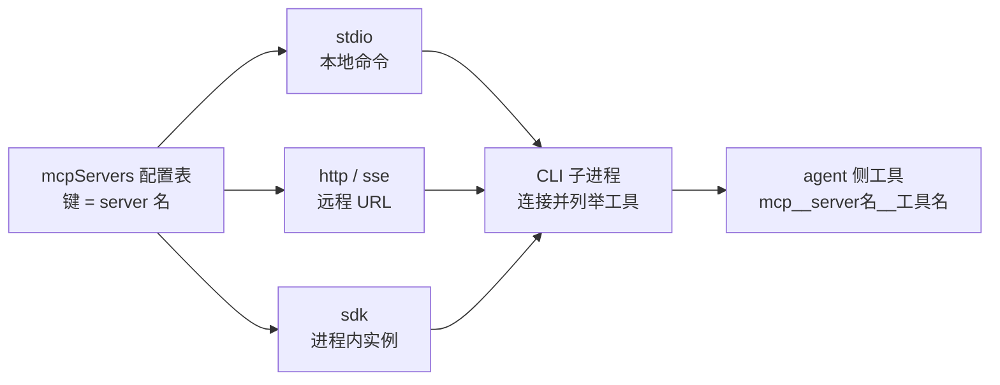

import { Canvas, Controls, Meta } from '@storybook/addon-docs/blocks';
import * as McpIntegration from './mcp-integration.stories';

<Meta of={McpIntegration} name="Docs" />

# 接入 MCP server

内置工具之外的能力可以由 MCP server 提供:文件系统、数据库、内部 API,官方与社区都有现成实现。本课讲消费侧——用 `mcpServers` 配置把现成的外部 server 接进 `query()`:三种传输形态各要哪些字段,agent 侧工具怎么改名、怎么放行,连接状态去哪里核对。看完导读与参考表,你应该能预测:配好一个 server 后,init 消息里会出现它的名字和连接状态,agent 侧只会看到 `mcp__` 前缀的工具名。

边界:工具直接写在本进程里(`tool()` + `createSdkMcpServer()`)是[进程内自定义工具](?path=/docs/custom-tools--docs)的主题;自己动手写一个 MCP server 是[自建 MCP server](?path=/docs/mcp-server--docs)的主题。本课只接现成的,进程内形态只在参考表与选型规则里给入口。



| 形态 | 配置字段 | 适用 | 回查要点 |
| --- | --- | --- | --- |
| stdio | `command`、`args?`、`env?`(`type` 可省) | 本地命令进程 | CLI 负责拉起与回收;凭证经 `env` 传入,SDK 不自动加载 `.env` |
| http | `type: "http"`、`url`、`headers?` | Streamable HTTP 远程 server | 代码配置只认 `"http"`;`"streamable-http"` 只是 JSON 文件里的别名 |
| sse | `type: "sse"`、`url`、`headers?` | SSE 端点的远程 server | 旧式传输,新接入优先 `"http"` |
| sdk | `type: "sdk"`、`name`、`instance` | 同进程自定义工具 | 由 `createSdkMcpServer()` 产生,见进程内自定义工具 |

三种传输形态都接受可选 `timeout`(毫秒,单次工具调用的硬上限)与 `alwaysLoad`(把该 server 的工具常驻上下文,取舍见[工具搜索](?path=/docs/tool-search--docs))。

## 快速上手

把一个 stdio MCP server 配进 `query()`,放行它的工具,再从 init 消息核对连接状态。前置环境沿用[安装与凭证](?path=/docs/install--docs)(SDK 已装、`ANTHROPIC_API_KEY` 可见);本次运行消耗真实 API 额度。

```ts
// 把一个 stdio MCP server 配进 query(),放行它的工具,并从 init 消息核对连接状态。
// 前置:SDK 已安装,ANTHROPIC_API_KEY 对进程可见,本机可执行 npx。
// 预期:init 消息的 mcp_servers 报出 workspace 的连接状态,tools 里出现 mcp__workspace__* 工具;
//       agent 完成任务后以 result 收尾。
import { query } from "@anthropic-ai/claude-agent-sdk";

for await (const message of query({
  prompt: "列出 ~/projects/demo 目录里的一级内容",
  options: {
    mcpServers: {
      // 键是 server 名,决定工具前缀 mcp__workspace__*
      workspace: {
        type: "stdio", // 有 command 时可省略
        command: "npx",
        args: ["-y", "@modelcontextprotocol/server-filesystem", "/Users/me/projects"],
      },
    },
    // MCP 工具必须显式放行;这里通配放行整个 server 的工具
    allowedTools: ["mcp__workspace__*"],
  },
})) {
  // init 消息是核对 MCP 连接状态的第一入口
  if (message.type === "system" && message.subtype === "init") {
    console.log("server 状态:", message.mcp_servers);
    console.log(
      "MCP 工具:",
      message.tools.filter((name) => name.startsWith("mcp__")),
    );
  }
  if (message.type === "result" && message.subtype === "success") {
    console.log("结果:", message.result);
  }
}
```

预期输出(工具清单以 server 实际提供为准):

```text
server 状态: [{ name: 'workspace', status: 'connected' }]
MCP 工具: [ 'mcp__workspace__list_directory', 'mcp__workspace__read_file', ... ]
结果:demo 目录下有 src、tests、README.md …
```

三点从输出能看出来:server 名就是 `mcpServers` 的键;agent 侧工具一律改名为 `mcp__workspace__*`,放行规则也按这个名字写;init 消息的 `mcp_servers` 数组逐 server 回报连接状态。这三条对应下面三个主题小节。

## 传输形态

`mcpServers` 的类型是 `Record<string, McpServerConfig>`:键是 server 名,值是一段传输配置,字段由形态决定。选型一句话:server 是本地一条命令 → stdio;是一个 URL → http(旧式端点用 sse);工具写在本进程代码里 → sdk 形态,由 `createSdkMcpServer()` 产生,见[进程内自定义工具](?path=/docs/custom-tools--docs)。server 名是 agent 侧的命名空间,起名当公开 API 对待——改名等于整套工具换前缀。

### stdio:本地命令

stdio 形态由 CLI 子进程把一条本地命令拉起为 MCP server 进程,经 stdin/stdout 通信,会话结束随之回收。`command` 与 `args` 描述命令,`env` 是传给该进程的环境变量:

```ts
const mcpServers = {
  workspace: {
    type: "stdio", // 有 command 时可省略
    command: "npx",
    args: ["-y", "@modelcontextprotocol/server-filesystem", "/Users/me/projects"],
  },
};
```

三条要点:

- `env` 用来给 server 子进程传凭证等变量。SDK 不自动加载 `.env`:代码配置里自己从 `process.env` 取值拼进去。
- 同样的字段也写在项目根的 `.mcp.json` 里,JSON 配置中的 `${VAR}` 会在运行时展开:

```json
{
  "mcpServers": {
    "workspace": {
      "command": "npx",
      "args": ["-y", "@modelcontextprotocol/server-filesystem", "/Users/me/projects"],
      "env": { "API_KEY": "${API_KEY}" }
    }
  }
}
```

- `.mcp.json` 在 `project` 设置源开启时加载(默认开);显式设过 `settingSources` 的要包含 `"project"`。命令必须本机可执行——拉不起来是 stdio `failed` 的头号原因(见常见问题)。

### sse 与 http:远程 server

远程 server 用 `url` 描述端点,`headers` 携带认证。`"http"` 是 Streamable HTTP,`"sse"` 是旧式 Server-Sent Events 端点;SDK 类型只声明 `"http"`,代码里新接入优先用它:

```ts
const mcpServers = {
  weather: {
    type: "http",
    url: "https://api.example.com/mcp",
    headers: {
      // token 自己带:SDK 不代跑 OAuth 流程
      Authorization: `Bearer ${process.env.WEATHER_TOKEN}`,
    },
  },
};
```

两条边界:

- server 要求认证而本地没有可用 token 时,会话以 `needs-auth` 状态继续跑(少这个 server 的工具),SDK 不会替你完成登录;把已有 token 经 `headers` 带上是标准做法。
- 端点不可达时状态是 `failed`,原因在 `mcpServerStatus()` 的 `error` 里(见下文核对连接状态)。

## 工具命名与放行

MCP 工具进入会话后一律改名:`mcp__<server-name>__<tool-name>`。server 名取自配置的键,工具名由 server 自己声明——键为 `github` 的 server 提供工具 `list_issues`,agent 侧看到的就是 `mcp__github__list_issues`。这个名字出现在三处:init 消息的 `tools` 数组、assistant 消息的工具调用块、以及放行规则里。

放行手段对比:

| 手段 | 写法 | 适用 |
| --- | --- | --- |
| `allowedTools` 点名 | `["mcp__github__list_issues"]` | 只放行个别工具 |
| `allowedTools` 通配 | `["mcp__github__*"]` | 放行整个 server 的工具 |
| `canUseTool` 回调 | 逐调用审批,见[权限规则与 canUseTool](?path=/docs/permissions--docs) | 动态判断 |
| `bypassPermissions` | 见[权限模式](?path=/docs/permission-modes--docs) | 全部放行,范围过宽 |

两条规则:

- **MCP 工具必须显式放行。** 没放行时 agent 看得见工具、调用一律被拒(单次 `query()` 没有 `canUseTool` 时,需要确认的调用全部拒绝,被拒记录进 result 的 `permission_denials`)。
- **`permissionMode: "acceptEdits"` 不覆盖 MCP 工具**(它只自动接受文件编辑);官方建议 MCP 的放行优先用 `allowedTools`,不要为此放宽权限模式。

## 核对连接状态

两个核对入口,粗细分工:

- **init 消息的 `mcp_servers`:** `{ name, status }[]`,启动即报,先粗看一眼。
- **`mcpServerStatus()`:** Query 方法,返回完整状态——`serverInfo`(server 名与版本)、`error`(失败原因)、`tools`(server 声明的工具清单)、`scope` / `source`(配置来源)。

五种状态的判断与处理:

| status | 含义 | 下一步 |
| --- | --- | --- |
| `connected` | 已连接 | 可用;`serverInfo`、`tools` 可读 |
| `failed` | 连接失败 | 从 `mcpServerStatus()` 读 `error`;修好配置再 `reconnectMcpServer(name)` |
| `needs-auth` | 要求认证且无可用 token | 自己把 token 经 `headers` 带上重跑;SDK 不代跑 OAuth |
| `pending` | 未定:还在连 / 缓存列表等首次使用 / 等待超时 | 不等于失败;复核后再判断(见下) |
| `disabled` | 已停用 | `toggleMcpServer(name, true)` 重新启用 |

`pending` 是最容易被误判的状态,有三种成因:仍在连接中;来自 `.mcp.json`、插件等来源的 server 缓存了工具列表,连接推迟到首次调用;连接等待超过了截止时间。前两种不是失败——缓存列表的 server 在 agent 首次调用其工具时自动连接,之后转为 `connected`。

连接时机决定你什么时候能核对:stdio 与 http/sse server 默认要等到连上才开始首个回合,等待窗口由环境变量 `MCP_TIMEOUT` 控制(默认 30 秒);新版本 CLI 可用 `CLAUDE_CODE_MCP_STARTUP_WAIT_MS` 调整首回合等待(设为 `0` 跳过)。这些变量经 `options.env` 进入子进程,写法见[安装与凭证](?path=/docs/install--docs)。

下面的实例回放一次会话里两个 server 的状态核对:切换四种连接场景,在三个核对点之间步进,看 init 与 `mcpServerStatus()` 各回报什么、每种状态怎么处理(演示数据,不真实连接任何 server):

<Canvas of={McpIntegration.Interactive} />
<Controls of={McpIntegration.Interactive} />

| 读者操作 | 可观察证据 |
| --- | --- |
| 观察默认状态(全部连上 · init 消息) | 两个 server 都报 `connected`;步进到 `mcpServerStatus()` 看到 serverInfo 与工具清单 |
| 切到「stdio 拉不起来」 | init 即报 `failed`;`mcpServerStatus()` 里 `error` 与原始 config 可读;不修配置,重连仍是 `failed` |
| 切到「远程要认证」 | `weather` 报 `needs-auth`,会话不带它继续跑;处理动作是 headers 带 token 重跑 |
| 切到「缓存列表 pending」 | init 与 `mcpServerStatus()` 都报 `pending`;agent 首次调用后转 `connected`——pending 不等于失败 |
| 打开 Show code | 看到该 Canvas 实际执行的 `mcp-status-demo.ts`,上半部分即四种场景的核对点数据 |

## 运行中增删 server

Query 对象上有三个运行中的 MCP 管理方法,在流还开着的时候调用:

| 方法 | 作用 | 返回 / 抛错 |
| --- | --- | --- |
| `setMcpServers(servers)` | 用传入的集合替换动态配置的 server | `McpSetServersResult`:`{ added, removed, errors }` |
| `toggleMcpServer(name, enabled)` | 停用或启用;停用会断开连接并移除其工具 | 失败抛错 |
| `reconnectMcpServer(name)` | 按名重连 | 失败抛错 |

典型用法:流跑到 init 后替换动态 server,agent 随即用上新集合:

```ts
// 运行中替换动态配置的 MCP server:added / removed / errors 说清这次替换动了什么。
// setMcpServers 在流运行期间(例如收到 init 后)调用;settings 文件来源的 server 不受影响。
import { query } from "@anthropic-ai/claude-agent-sdk";

const q = query({
  prompt: "对比两个数据源的天气数据",
  options: {
    mcpServers: {
      workspace: {
        command: "npx",
        args: ["-y", "@modelcontextprotocol/server-filesystem", "/tmp"],
      },
    },
  },
});

for await (const message of q) {
  if (message.type === "system" && message.subtype === "init") {
    const outcome = await q.setMcpServers({
      weather: { type: "http", url: "https://api.example.com/mcp" },
    });
    console.log(outcome); // { added: ['weather'], removed: ['workspace'], errors: {} }
  }
  if (message.type === "result") {
    console.log("结束:", message.subtype);
  }
}
```

边界:`setMcpServers` 影响的是经 SDK 通道(`mcpServers` 选项与该方法本身)配置的动态集合;settings 文件(如 `.mcp.json`)来源的 server 不受它影响,插件提供的 server 也不随省略被移除——所以 `setMcpServers({})` 不保证会话回到零 MCP 状态。

## 代码之外的 server 来源

一次会话里的 MCP server 不一定都来自代码。`mcpServers` 之外还有几条进入通道,排查"多出我没配的 server"或"配了没生效"时按这张表找:

| 来源 | 进入方式 | 控制手段 |
| --- | --- | --- |
| `mcpServers` 选项 | 代码配置(本课主线) | 直接增删 |
| project `.mcp.json` | 项目根文件,`project` 设置源开启时加载(默认开) | `settingSources` 不含 `"project"` 则不加载 |
| user settings / 插件 | 用户设置文件与插件自带 | 随设置与插件管理 |
| claude.ai connectors | 使用 claude.ai 登录态时自动加载 | `strictMcpConfig: true` 或 settings 里关闭 |

一条一刀切的开关:`strictMcpConfig: true` 让会话只认 `mcpServers` 传入的 server,忽略 `.mcp.json`、用户设置、插件 server 与 claude.ai connectors。想要"代码配了什么就只有什么"的干净会话,配它。

边界:组织托管策略(managed settings)可以在主机侧允许或拒绝 MCP server,SDK 配不掉也关不掉——这与 [Options](?path=/docs/options--docs) 课里"不受 `settingSources` 控制的输入"是同一条边界。核对某个 server 从哪来,看 `mcpServerStatus()` 返回里的 `scope` 与 `source` 字段。

## 最佳实践

- **server 名当命名空间起。** 名字直接构成 `mcp__<server>__<tool>` 前缀与放行规则,定下来就不要改:改名等于整套工具换前缀,`allowedTools` 规则与已有调用记录全要跟着动。
- **放行优先 `allowedTools`,不动权限模式。** 通配一个 server(`"mcp__github__*"`)或点名单个工具;`acceptEdits` 不覆盖 MCP 工具,`bypassPermissions` 放得开但把内置工具一并裸奔,不值得为 MCP 用它。
- **凭证经 `env` 与 `headers` 注入,不写死在配置里。** stdio 从 `process.env` 取值放进 `env`,远程把 token 放进 `headers`;`.mcp.json` 的 `${VAR}` 运行时才展开,代码配置则完全不展开——两处都别把真实 token 提交进仓库。

## 常见问题

- init 里 server 的 status 是 `pending`,是不是连失败了?
  不一定。`pending` 可能是还在连接、缓存了工具列表等首次调用才连、或等待超过截止时间。用 `mcpServerStatus()` 复核;来自 `.mcp.json` 与插件的 server 常见缓存列表形态,首次调用会自动连接。

- init 的 `tools` 里明明有某个 `mcp__` 工具,agent 一调却被拒。
  MCP 工具必须显式放行:`allowedTools` 加 `"mcp__<server>__<tool>"` 或通配 `"mcp__<server>__*"`;`acceptEdits` 不会自动放行 MCP 工具。被拒调用记录在 result 的 `permission_denials` 里,先核对再补放行。

- stdio server 状态是 `failed`,重连也失败。
  先读 `mcpServerStatus()` 的 `error` 与 `config`:常见原因是命令不在 PATH、缺 `npx`、或凭证没进来(SDK 不自动加载 `.env`,`env` 要显式传)。根因在配置时,`reconnectMcpServer` 解决不了,修好再重连。

- 远程 server 报 `needs-auth`,SDK 会帮我跑 OAuth 吗?
  不会。SDK 不代跑 OAuth 流程;把已有 token 经 `headers`(如 `Authorization: Bearer …`)带上重跑,或改用不依赖交互登录的接入方式。

- agent 拿到的工具结果是一个文件路径,不是内容。
  超过 25,000 token 的工具输出会被存成文件、替换为指向该路径的结果;需要更大幅度时经 `options.env` 调高 `MAX_MCP_OUTPUT_TOKENS`。

- 配在 `.mcp.json` 里的 server 没生效。
  该文件只在 `project` 设置源开启时加载,显式设过 `settingSources` 的要包含 `"project"`;`strictMcpConfig: true` 也会忽略它;组织托管策略 deny 的 server 在更上层,SDK 侧解除不了。

## 总结回顾

摘要:

`mcpServers` 把现成的 MCP server 接进 `query()`:键是 server 名,值按传输形态给配置——stdio 给 `command` / `args` / `env`,http 与 sse 给 `url` / `headers`,进程内工具的 sdk 形态由 `createSdkMcpServer()` 产生(见进程内自定义工具)。agent 侧只看到 `mcp__<server>__<tool>` 命名的工具,必须显式放行:优先 `allowedTools` 点名或通配,`acceptEdits` 不覆盖 MCP 工具。连接状态两处核对:init 消息的 `mcp_servers` 粗看 name 与 status,`mcpServerStatus()` 细看 serverInfo、error、tools 与来源;五种状态里 `pending` 不等于失败(还在连、缓存列表、等待超时),`failed` 先修配置再重连,`needs-auth` 自己经 headers 带 token。运行中用 `setMcpServers`、`toggleMcpServer`、`reconnectMcpServer` 管理动态集合;代码之外还有 `.mcp.json`、用户设置、插件与 claude.ai connectors 四条进入通道,`strictMcpConfig: true` 一刀切只认 `mcpServers`。

一句话:

> 键定前缀、形态定字段、init 定状态——MCP 工具必须显式放行,`pending` 不是失败。

知识要点:

- 三种传输形态分别要哪些字段?`type` 在什么情况下可省?
- agent 侧的 MCP 工具名怎么构成?server 名来自哪里?
- MCP 工具怎么放行?为什么说 `acceptEdits` 不够、`bypassPermissions` 过宽?
- init 消息与 `mcpServerStatus()` 各回报什么?五种状态分别怎么处理?
- `pending` 有哪三种成因?怎么确认它不是失败?
- 运行中怎么替换、停用、重连 server?`setMcpServers` 影响哪些来源?
- 代码之外还有哪些 server 进入通道?怎么让会话只认 `mcpServers`?

## 参考资料

- [MCP in the Agent SDK](https://code.claude.com/docs/en/agent-sdk/mcp)(传输形态、`.mcp.json`、工具命名与放行、状态核对与连接时机、环境变量的主来源)
- [Agent SDK reference - TypeScript](https://code.claude.com/docs/en/agent-sdk/typescript)(`Options.mcpServers`、`McpServerConfig` 各形态、`McpServerStatus`、`mcpServerStatus()` / `setMcpServers()` 等类型定义处)
