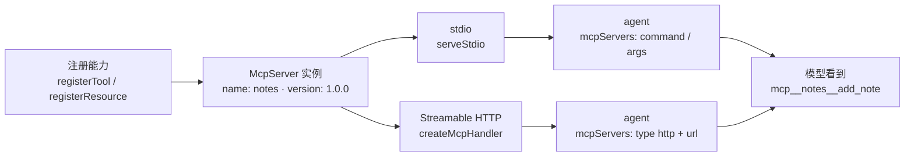

import { Canvas, Controls, Meta } from '@storybook/addon-docs/blocks';
import * as McpServer from './mcp-server.stories';

<Meta of={McpServer} name="Docs" />

# 自建 MCP server

[进程内自定义工具](?path=/docs/custom-tools--docs)把能力写进 agent 同一进程;当能力要被多个 host 复用、要独立部署与隔离,或者根本不是 TypeScript 写的,就该做成一个独立 MCP server。本课讲生产侧:用官方 TypeScript MCP SDK 注册工具与资源,经 stdio 与 Streamable HTTP 两种传输对外服务,在 agent 的 `mcpServers` 里指向它,并在接入前用 MCP Inspector 验证行为。看完导读与参考表,你应该能预测:同一份注册代码,从 stdio 换到 HTTP 只改「怎么对外服务」这一段;agent 侧看到的仍是 `mcp__<server>__<tool>` 全名。

版本线:MCP TypeScript SDK 仓库 main 分支已是 v2——server 用拆分包 `@modelcontextprotocol/server`,实现 2026-07-28 规范;旧线 v1 是单包 `@modelcontextprotocol/sdk`,自 v2 发布起至少再维护 6 个月修复。本课全部按 v2 书写;网上教程对不上时先分版本线(见常见问题)。协议规范细节与 client 开发不在本课展开,入口在参考资料。



| 项 | 值 / 默认 | 回查要点 |
| --- | --- | --- |
| server 包 | `@modelcontextprotocol/server` | 官方 TS SDK v2 的 server 包;v1 线是单包 `@modelcontextprotocol/sdk` |
| 运行要求 | Node.js >= 20;zod v4 | v2 要求 Node 20+;schema 走 Standard Schema,`zod/v4`、Valibot、ArkType 均可 |
| `new McpServer({ name, version })` | — | server 名与版本;name 参与 agent 侧工具全名 |
| `registerTool(name, config, handler)` | — | config:`description`、`inputSchema`、`outputSchema`、`title`、`annotations` |
| `registerResource(name, uri, config, read)` | — | 固定 URI 或 `ResourceTemplate` 模板 |
| stdio 服务入口 | `serveStdio(factory)` | 从 `@modelcontextprotocol/server/stdio` 子路径导入;stdout 是协议通道 |
| HTTP 服务入口 | `createMcpHandler(factory)` | 返回 `{ fetch, close, notify, bus }`;默认每个请求一个新实例 |
| agent 侧接入 | `options.mcpServers` | stdio 给 `command` / `args`;HTTP 给 `type: "http"` + `url` |
| 工具全名 | `mcp__<server>__<tool>` | 放行、hooks 都认全名,细则见[接入 MCP server](?path=/docs/mcp-integration--docs) |
| 调试 | MCP Inspector | `npx @modelcontextprotocol/inspector <启动命令>` |

## 快速上手

前置环境沿用[安装与凭证](?path=/docs/install--docs)(Node、ESM、npm),另有两点贴着本课:SDK v2 要求 Node.js >= 20;zod 装的是 v4。新建 server 项目:

```bash
npm init -y
npm pkg set type=module   # SDK 只发 ESM
npm install @modelcontextprotocol/server zod
npm install -D tsx
```

新建 `stdio-server.ts`(完整文件在本课目录):

```ts
// 最小 stdio MCP server:两个工具,进程守着 stdin 等 agent 来连。
// 前置:@modelcontextprotocol/server 与 zod v4 已安装,Node.js >= 20。
// 运行:npx tsx stdio-server.ts;stderr 打出启动横幅,之后进程等待协议消息。
// 调试:npx @modelcontextprotocol/inspector npx tsx stdio-server.ts。
import { McpServer } from "@modelcontextprotocol/server";
import { serveStdio } from "@modelcontextprotocol/server/stdio";
import * as z from "zod/v4";

// 状态归 server 进程所有:agent 侧看不到这些变量,只能通过工具读写
const notes: string[] = [];

function createNotesServer(): McpServer {
  const server = new McpServer({ name: "notes", version: "1.0.0" });

  server.registerTool(
    "add_note",
    {
      description: "保存一条笔记,返回当前笔记总数",
      inputSchema: z.object({
        text: z.string().min(1).describe("笔记内容"), // describe 会进模型看到的 JSON Schema
      }),
    },
    async ({ text }) => {
      notes.push(text);
      return {
        content: [{ type: "text", text: `已保存,当前共 ${notes.length} 条笔记` }],
      };
    },
  );

  server.registerTool(
    "list_notes",
    {
      description: "列出全部已保存的笔记",
      // 无入参的工具直接省略 inputSchema
    },
    async () => ({
      content: [{
        type: "text",
        text: notes.length
          ? notes.map((n, i) => `${i + 1}. ${n}`).join("\n")
          : "(还没有笔记)",
      }],
    }),
  );

  return server;
}

// serveStdio 接管传输:调一次工厂得到服务实例,读 stdin、写 stdout
void serveStdio(createNotesServer);
console.error("notes MCP server running on stdio");
```

两件事已经可以看出:注册一个工具就是「名字 + 说明 + zod schema + async handler」,`.describe()` 的说明会随 schema 换算给模型;最后一行之前没有任何传输代码——注册能力与对外服务是两段独立的关注点。先单独验证一次(见 MCP Inspector 调试),再让 agent 连上它。

stdio 形态下,`mcpServers` 只需要启动命令:

```ts
// agent 侧:把自建 stdio server 配进 mcpServers,放行其工具,核对连接。
// 前置:stdio-server.ts 路径换成绝对路径;ANTHROPIC_API_KEY 可见,本次运行消耗 API 额度。
// 预期:init 消息报 notes · connected,tools 里出现 mcp__notes__* 全名。
import { query } from "@anthropic-ai/claude-agent-sdk";

for await (const message of query({
  prompt: "记一条笔记:周四下午 3 点同步 MCP server 进度,然后读出全部笔记",
  options: {
    mcpServers: {
      // 键名 notes 是 server 名,决定工具前缀 mcp__notes__*
      notes: {
        command: "npx",
        args: ["tsx", "/absolute/path/to/stdio-server.ts"],
        // 编译后跑构建产物更稳:command: "node", args: ["/abs/dist/stdio-server.js"]
      },
    },
    // MCP 工具必须显式放行;这里通配放行整个 server
    allowedTools: ["mcp__notes__*"],
  },
})) {
  if (message.type === "system" && message.subtype === "init") {
    console.log("server 状态:", message.mcp_servers);
    console.log("MCP 工具:", message.tools.filter((t) => t.startsWith("mcp__")));
  }
  if (message.type === "result" && message.subtype === "success") {
    console.log("结果:", message.result);
  }
}
```

预期输出(文字每次运行都不同,结构相同):

```text
server 状态: [{ name: 'notes', status: 'connected' }]
MCP 工具: [ 'mcp__notes__add_note', 'mcp__notes__list_notes' ]
结果:已记下笔记「周四下午 3 点同步 MCP server 进度」;当前共 1 条笔记 …
```

server 名来自配置键、工具一律以 `mcp__<server>__<tool>` 全名出现、连接状态在 init 消息核对——这三条与接现成 server 完全一致。

## 进程内工具还是独立 server

本课与[进程内自定义工具](?path=/docs/custom-tools--docs)解决同一个问题——让 agent 调用你的业务能力——差别在能力放在哪里。判断维度:

| 维度 | 进程内 `tool()` + `createSdkMcpServer()` | 独立 MCP server(本课) |
| --- | --- | --- |
| 能力的使用者 | 只有当前这个 SDK 应用 | 任何 MCP host:Claude Code、Claude Desktop、claude.ai connectors、你自己的多个 agent |
| 状态与依赖 | 直接共享宿主的闭包、连接、密钥 | 状态归 server 进程,经工具与资源暴露 |
| 故障边界 | handler 异常由 SDK 兜底成错误结果,同一进程 | server 崩溃不带走 agent;进程生命周期归 host 管 |
| 技术栈 | TypeScript + zod | 任何能实现 MCP 协议的语言;TypeScript 用官方 SDK |
| 部署形态 | 与应用同一部署单元 | stdio:随 agent 一起装在本机;HTTP:独立服务,多 agent 共享一个端点 |
| 调用成本 | 函数调用,无进程/网络开销 | stdio 每会话一个子进程;HTTP 每调用一次网络往返 |

一句话:能力只服务这一个应用、想直接复用宿主状态 → 进程内;要跨 host 复用、要隔离与独立部署、要远程共享、或不是 TypeScript → 独立 server。迁移成本不高:两边注册形态几乎同构(说明 + zod 校验 + async handler 返回 content 块),主要换注册 API(`tool()` → `registerTool()`)并补一个服务入口(`serveStdio()` 或 `createMcpHandler()`)。

## 注册工具与资源

MCP server 对外暴露三类能力,控制者各不相同:

| 能力 | 谁决定用不用 | 用途 |
| --- | --- | --- |
| Tools | 模型(经用户审批) | 可执行的动作:查数据、写记录、调内部 API |
| Resources | 应用 / host | 只读数据上下文:配置、报表、文件内容,由应用附加给模型 |
| Prompts | 用户 | 用户主动触发的模板;本课不展开,注册 API 是 `registerPrompt` |

工具与资源互不替代:给模型一个「主动执行的动作」注册成工具;给应用一段「随时可读的数据」注册成资源。Agent SDK 会话里,工具以 `mcp__<server>__<tool>` 全名进入模型工具列表;资源的消费方式由 host 决定。

### registerTool:工具

`registerTool(name, config, handler)` 的 config 承载 handler 之外的全部定义:

| config 字段 | 作用 | 要点 |
| --- | --- | --- |
| `description` | 模型可见的说明书 | 写清用途、单位、失败行为;模型靠它决定何时调用 |
| `inputSchema` | 入参 schema | 完整的 `z.object({...})`;SDK 从它换算 JSON Schema、校验入参、推导 handler 类型 |
| `outputSchema` | 结构化出参 schema | 配合 handler 返回 `structuredContent`,SDK 在结果离开 server 前校验 |
| `title` | 展示名 | 给 host 界面用,与调用名 `name` 分开 |
| `annotations` | 行为提示 | `readOnlyHint` / `destructiveHint` / `idempotentHint`;是提示不是强制,不改变 SDK 的执行方式 |

辨析——同是 zod,两种包法:Agent SDK 的 `tool()` 收「字段 → 校验器」的裸对象(`{ city: z.string() }`);MCP SDK 的 `registerTool` 收完整 `z.object({ city: z.string() })`。从进程内迁过来时最容易在这里卡类型。

handler 收到的入参已通过校验,返回 `{ content, structuredContent?, isError? }`:`content` 是内容块数组(text / image / audio / resource / resource_link),模型读 `content`;`isError: true` 把业务失败作为正常结果回传,模型可以读到并自我纠正。入参不满足 schema 的调用到不了 handler——SDK 直接回一条带校验细节的错误结果。这套返回契约与进程内工具一致(内容块类型表见[进程内自定义工具](?path=/docs/custom-tools--docs)),本课不重复:

```ts
server.registerTool(
  "add_note",
  {
    description: "保存一条笔记,返回当前笔记总数",
    inputSchema: z.object({
      text: z.string().min(1).describe("笔记内容"), // describe 会进模型看到的 JSON Schema
    }),
    annotations: { readOnlyHint: false }, // 会写进程内状态,如实标注
  },
  async ({ text }) => {
    notes.push(text);
    return {
      content: [{ type: "text", text: `已保存,当前共 ${notes.length} 条笔记` }],
    };
  },
);
```

### registerResource:资源

固定 URI 的资源用四参形态注册:名字、URI、元信息、读取回调:

```ts
server.registerResource(
  "notes-stats",
  "notes://stats",
  {
    title: "笔记统计",
    description: "当前笔记数量",
    mimeType: "application/json", // config 的 mimeType 描述整个资源,出现在 resources/list
  },
  async (uri) => ({
    contents: [{
      uri: uri.href,
      mimeType: "application/json",
      text: JSON.stringify({ count: notes.length }),
    }],
  }),
);
```

回调返回 `contents` 数组,每项带自己的 `uri` 与 `text`(或 base64 `blob`),一次可以返回多个内容项。同一类资源有一组实例时,用 `ResourceTemplate` 注册 URI 模板,匹配到的变量解析后作为回调第二参数:

```ts
server.registerResource(
  "note",
  new ResourceTemplate("notes://{noteId}", {
    // list 是必填键:给枚举回调则实例出现在 resources/list;实例无边界时传 undefined
    list: async () => ({
      resources: notes.map((_, i) => ({
        uri: `notes://${i}`,
        name: `笔记 ${i + 1}`,
      })),
    }),
  }),
  { title: "一条笔记", mimeType: "text/plain" },
  async (uri, { noteId }) => ({
    contents: [{
      uri: uri.href,
      text: notes[Number(noteId)] ?? "(这条笔记不存在)",
    }],
  }),
);
```

一条安全边界:模板变量是客户端可控输入,拿它拼文件路径时先 `realpath` 再校验前缀,别把原始变量直接传给文件系统调用——`..` 与符号链接可以逃出目录。

## 传输:stdio 与 Streamable HTTP

注册代码是同一份,传输决定「server 以什么形态被客户端拿到」。选型:

| 传输 | 形态 | 适合 |
| --- | --- | --- |
| stdio | 本机一条命令,host 拉起子进程,stdin / stdout 通信 | 随 agent 同机部署;一个客户端一个进程;零网络配置 |
| Streamable HTTP | 一个 URL 端点,服务常驻 | 多 agent / 多机共享同一能力;独立部署、扩缩与鉴权 |

两种传输可以共存:同一个 `createNotesServer` 工厂,stdio 与 HTTP 各接一个入口,注册的能力完全一致。

### stdio:本地进程

`serveStdio(factory)` 是 v2 的 stdio 入口,从 `@modelcontextprotocol/server/stdio` 子路径导入;它接管传输,调用一次工厂得到服务实例:

```ts
import { serveStdio } from "@modelcontextprotocol/server/stdio";

const handle = serveStdio(createNotesServer);
// 客户端关闭 stdin(EOF)时连接自动回收;持有定时器等句柄时在 close 里释放
process.on("SIGINT", () => {
  void handle.close();
});
console.error("notes MCP server running on stdio");
```

也可用底层形态自己接线——官方 README 与 modelcontextprotocol.io 快速教程都这么写,v2 仍然支持:

```ts
import { StdioServerTransport } from "@modelcontextprotocol/server/stdio";

const server = createNotesServer();
await server.connect(new StdioServerTransport());
console.error("notes MCP server running on stdio");
```

三条纪律:

- **stdout 是协议通道。** host 把 stdout 的每一行当 JSON-RPC 消息解析,一条 `console.log` 就能弄坏整条流;日志一律走 `console.error`(stderr),host 会把 server 的 stderr 记进自己的日志。
- **生命周期归 host。** agent 会话结束,CLI 子进程随之回收,server 不需要自己守护进程。
- **凭证经 `env` 进来。** agent 配置的 `env` 字段是 server 子进程的环境变量,server 从 `process.env` 读;SDK 不自动加载 `.env`。

### Streamable HTTP:HTTP 端点

HTTP 形态的中心是 `createMcpHandler(factory)`:传入同一个工厂,拿回一个 web 标准 handler(`{ fetch, close, notify, bus }`)。注册代码与 `stdio-server.ts` 完全相同,完整文件见本课目录 `http-server.ts`,接线部分:

```ts
import { createMcpHandler } from "@modelcontextprotocol/server";
import {
  localhostHostValidation,
  localhostOriginValidation,
  toNodeHandler,
} from "@modelcontextprotocol/node";
import { createServer } from "node:http";

const mcpHandler = createMcpHandler(createNotesServer);
const nodeHandler = toNodeHandler(mcpHandler);
const validateHost = localhostHostValidation();
const validateOrigin = localhostOriginValidation();

createServer((req, res) => {
  if (!validateHost(req, res) || !validateOrigin(req, res)) return;
  void nodeHandler(req, res);
}).listen(3000, "127.0.0.1");

console.error("notes MCP server listening on http://127.0.0.1:3000/");
```

四条要点:

- **默认无状态。** 工厂每个 HTTP 请求跑一次,请求之间互不持有——连接池、缓存这类跨请求资源建在模块作用域,工厂保持便宜、无副作用。
- **响应形态。** 默认返回单个 JSON 体,工具调用中途有通知时升级为 SSE;`responseMode: "json"` 永不流式,`"sse"` 永远流式。
- **安全靠自己。** handler 默认信任调用者:不校验 Host / Origin、不验 token。本机部署时 host / origin 校验防 DNS rebinding;对外部署时上游验证 bearer token,经 `handler.fetch(request, { authInfo })` 传入,工具里从 `ctx.http.authInfo` 读。框架适配包(`@modelcontextprotocol/express` / `hono` / `fastify`)在本机绑定默认开启这两个校验。
- **要会话、可恢复、多节点时**超出了无状态默认,见 SDK 文档的 Sessions, state, and scaling;本课不展开。

agent 侧指向(放行与核对与 stdio 相同):

```ts
const mcpServers = {
  notes: {
    type: "http",
    url: "http://127.0.0.1:3000/",
    // server 要求认证时:headers: { Authorization: `Bearer ${process.env.NOTES_TOKEN}` }
  },
};
```

## MCP Inspector 调试

接进 agent 之前,先用官方调试器 MCP Inspector 单独核对 server——不配 host、不花 LLM 额度:

```bash
# stdio server:启动命令直接作为参数
npx @modelcontextprotocol/inspector npx tsx stdio-server.ts
# HTTP server:不带参数启动,在界面里选 Streamable HTTP 并填 URL
npx @modelcontextprotocol/inspector
```

浏览器界面里 Connect 建立连接,Tools 页签列出 server 声明的全部工具;选中一个、填参、Run,直接看到返回的 content 块。核对清单:

| 核对点 | 判断 |
| --- | --- |
| Tools 列表 | 注册的工具都在;缺了多半是 schema 或注册代码问题 |
| 填参调用 | 合法入参返回预期 content;故意传坏参数,应看到校验错误而不是 handler 崩溃 |
| 失败形态 | 业务失败应显示为带说明的错误结果(`isError`),模型可读 |
| server 日志 | stderr 输出在 Inspector 的面板里;启动即崩、输出被污染等连接层问题也在这里显形 |

边界:Inspector 只验证 server 本身;agent 侧的放行、连接状态与超时环境变量,见[接入 MCP server](?path=/docs/mcp-integration--docs)。

## 接入 agent

指向、放行、核对三步在快速上手已走通,这里是回查视角:指向——stdio 给 `command` / `args` / `env`,HTTP 给 `type: "http"` + `url` + `headers`;放行——`allowedTools` 用全名或 `mcp__notes__*` 通配;核对——init 消息的 `mcp_servers` 粗看状态,`mcpServerStatus()` 细看 serverInfo 与工具清单。

一次调用在链路上怎么走、两种传输差在哪、断点会在哪一环显形,用下面的实例回放(演示数据,不真实启动 server 或调用 LLM):

<Canvas of={McpServer.Interactive} />
<Controls of={McpServer.Interactive} />

| 读者操作 | 可观察证据 |
| --- | --- |
| 观察默认链路(stdio · 第 1 站) | 配置键 notes → 前缀 mcp__notes__*;尚未发生通信,断点提示指向启动命令 |
| 切换「传输」到 Streamable HTTP | 链路换成 HTTP 请求-响应;断点提示换成可达性与认证 |
| 拖动「链路进度」 | 逐站查看跨边界动作、线上内容与 agent 侧可见证据;工具调用前有校验站 |
| 打开 Show code | 看到该 Canvas 实际执行的 `mcp-call-chain-demo.ts`,上半部分是两套传输的站点数据 |

## 最佳实践

- **server 名与工具名当公开 API。** 它们拼成 `mcp__<server>__<tool>` 全名,定下来就别改——改名等于整套工具换前缀;`description` 与每个字段的 `.describe()` 是模型唯一读到的说明,当成 API 文档写。
- **annotations 如实标注。** `readOnlyHint` / `destructiveHint` / `idempotentHint` 会影响 host 的调用策略,与 handler 真实行为不符的标注比没有更糟;只读工具标 `readOnlyHint: true` 有并行收益。
- **HTTP 工厂保持无状态纪律。** 跨请求资源放模块作用域,工厂只做组装;发现「每次调用状态都像被重置」,先查是不是把状态建在了工厂里。
- **stdio 日志走 stderr。** 把 `console.log` 从 stdio server 里清干净再交付;部署前用 Inspector 过一遍启动与调用,再接 agent。

## 常见问题

- 网上教程的 import 与本文对不上:`@modelcontextprotocol/sdk`、`server.tool(...)`、`StreamableHTTPServerTransport`。
  那是 v1 线的写法。v2 把单包拆成 `@modelcontextprotocol/server` 等拆分包,`server.tool()` 改为 `registerTool()`,Streamable HTTP 传输类改名并移入 `@modelcontextprotocol/node`;官方提供 codemod:`npx @modelcontextprotocol/codemod@latest v1-to-v2 .`。v1 文档在 ts.sdk.modelcontextprotocol.io 根路径,v2 在 `/v2/` 下,查资料先分清版本线。

- Inspector 里一切正常,接进 agent 后工具却调不动。
  Inspector 只证明 server 正确,agent 侧还有自己的闸门:先看 init 消息里 server 是否 `connected`,再核对 `allowedTools` 写的是不是全名(`mcp__notes__add_note`,不是裸名 `add_note`);stdio 拉不起来时用 `mcpServerStatus()` 读 error,常见是命令不在 PATH 或缺 `npx`。排查路径见[接入 MCP server](?path=/docs/mcp-integration--docs)。

- HTTP server 的内存状态每次调用都像被重置。
  `createMcpHandler` 的工厂每个请求跑一次,建在工厂里的变量随实例一起被丢弃;把要跨请求的状态移到模块作用域,或改存外部存储。需要真正的会话、订阅与多节点扩缩时,参考 SDK 文档的 Sessions, state, and scaling,本课不展开。

## 总结回顾

摘要:

本课讲了生产侧的自建路径:用官方 TypeScript MCP SDK v2(`@modelcontextprotocol/server`,Node 20+,zod v4)把业务能力注册成工具与资源——`registerTool` 用完整 `z.object` 收入参、annotations 向 host 提示行为,`registerResource` 支持固定 URI 与 `ResourceTemplate` 模板;同一份注册代码经两个传输入口对外服务——stdio 用 `serveStdio`(stdout 是协议通道,日志走 stderr,生命周期归 host),Streamable HTTP 用 `createMcpHandler`(默认无状态,跨请求状态放模块作用域,Host / Origin 校验与认证自己接线)。接入 agent 与接现成 server 完全同一套:`mcpServers` 指向、`allowedTools` 全名放行、init 消息核对状态;接入前用 MCP Inspector 单独核对工具清单、入参校验与返回形态。与进程内 `tool()` 的取舍按使用者范围、故障隔离、技术栈与部署形态判断。

一句话:

> 注册能力与对外服务是两段独立的关注点——同一份 `registerTool` / `registerResource`,stdio 与 Streamable HTTP 只是「怎么被拿到」的两种答案。

知识要点:

- 什么时候把能力做成独立 MCP server,而不是进程内 `tool()`?
- `registerTool` 的 config 有哪些字段?`inputSchema` 与 Agent SDK `tool()` 的裸字段对象差在哪?
- handler 的返回值结构是什么?入参校验失败时 handler 会执行吗?
- 固定 URI 资源与 `ResourceTemplate` 模板各怎么注册?`list` 键决定什么?
- `serveStdio` 与 `createMcpHandler` 各自的角色?为什么 stdio server 不能 `console.log`?
- HTTP 形态下「工厂每请求执行一次」意味着什么?跨请求状态放哪?
- agent 侧怎么指向、放行、核对自建 server?MCP Inspector 核对哪四件事?

## 参考资料

- [MCP TypeScript SDK 仓库](https://github.com/modelcontextprotocol/typescript-sdk)(v1 / v2 两条线、包拆分与最小示例的主来源)
- [Build a server(v2 教程)](https://ts.sdk.modelcontextprotocol.io/v2/get-started/first-server.html)(安装、`registerTool`、`serveStdio`、stdout 纪律与 Inspector 用法)
- [Tools(v2)](https://ts.sdk.modelcontextprotocol.io/v2/servers/tools.html)(config 字段、annotations、structuredContent 与校验行为)
- [Resources(v2)](https://ts.sdk.modelcontextprotocol.io/v2/servers/resources.html)(`registerResource`、`ResourceTemplate` 与路径安全)
- [Serving over stdio(v2)](https://ts.sdk.modelcontextprotocol.io/v2/serving/stdio.html)(`serveStdio`、EOF 回收与 stderr 纪律)
- [Serving over HTTP(v2)](https://ts.sdk.modelcontextprotocol.io/v2/serving/http.html)(`createMcpHandler`、无状态默认、`toNodeHandler` 与安全校验)
- [Upgrade to v2](https://ts.sdk.modelcontextprotocol.io/v2/migration/upgrade-to-v2.html)(v1 / v2 API 对照与 codemod)
- [Packages(v2)](https://ts.sdk.modelcontextprotocol.io/v2/get-started/packages.html)(拆分包职责与 `./stdio` 子路径)
- [Build an MCP server(MCP 官方快速教程)](https://modelcontextprotocol.io/docs/2026-07-28/develop/build-server)(三类能力概念、TypeScript stdio 快速教程)
- [MCP Inspector](https://github.com/modelcontextprotocol/inspector)(启动命令与界面核对)
- [MCP in the Agent SDK](https://code.claude.com/docs/en/agent-sdk/mcp)(agent 侧 `mcpServers` 配置、工具全名、放行与 `MAX_MCP_OUTPUT_TOKENS`)
