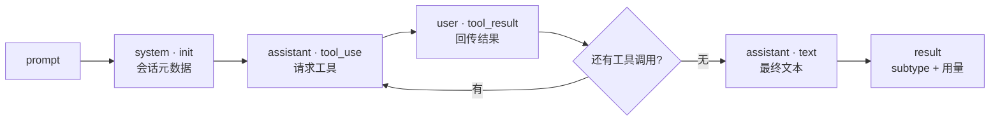

import { Canvas, Controls, Meta } from '@storybook/addon-docs/blocks';
import * as MessageStream from './message-stream.stories';

<Meta of={MessageStream} name="Docs" />

# 消息流

调用 `query()` 后,拿到的不是"一个回答",而是一条消息流:agent loop 每往前走一步,SDK 就向流里产出一条带 `type` 字段的消息。本课建立这条流的心理模型——消息按什么顺序流动、五类核心消息各长什么样、怎么从流里提取文本、工具调用与最终结果。看完导读与参考表,你应该能预测:一个"跑测试 → 修代码 → 再跑测试"的任务,流里会依次出现哪些 `type`、各携带什么。



| type | 何时出现 | 携带内容 | 回查要点 |
| --- | --- | --- | --- |
| `system`(`subtype: "init"`) | 会话启动,流的第一条 | session_id、tools、model、mcp_servers 等 | session_id 在这里最先拿到 |
| `assistant` | 模型输出的每个内容块 | `message.message.content` 里的 text / tool_use 块 | 文本与工具调用都在这里提取 |
| `user` | 每次工具执行后 | tool_result 块与 tool_use_result 结构化输出 | 这是工具结果,不是"用户发言" |
| `result` | 循环结束 | subtype、result、total_cost_usd、num_turns | result 字段只在 success 分支存在 |
| `stream_event` | 开启 includePartialMessages 时 | 原始 API 流事件(`event` 字段) | 默认关闭,详见[流式输出](?path=/docs/streaming-output--docs) |

## 快速上手

用 `for await` 消费 `query()`,按 `type` 分流:最小的闭环只需要处理 `assistant` 拿文本、处理 `result` 拿结束状态。前置环境见[安装与凭证](?path=/docs/install--docs)。

```ts
// 前置:ANTHROPIC_API_KEY 已可见;先用不带工具的小任务看清流的形态。
// 预期:先打印模型回答,再打印结束原因;流自然耗尽后脚本退出。
import { query } from "@anthropic-ai/claude-agent-sdk";

for await (const message of query({ prompt: "用一句话介绍这个项目" })) {
  if (message.type === "assistant") {
    for (const block of message.message.content) {
      if (block.type === "text") {
        console.log("回答:", block.text);
      }
    }
  }
  if (message.type === "result") {
    console.log("结束:", message.subtype);
  }
}
```

预期输出:

```text
回答:这个项目是一个命令行待办事项管理工具。
结束:success
```

不调用工具的任务流最短,只有三条消息:system(init)→ assistant(text)→ result。工具调用与工具结果怎么提取,是下面各节的主线。

## Agent loop 与 turn

`query()` 驱动的就是 Claude Code 的 agent loop。每一步对应流里的一条(或一组)消息:

1. **接收 prompt:** SDK 启动会话,产出 `system`(`subtype: "init"`),携带本次会话的元数据。
2. **模型评估:** 模型决定下一步,产出一条或多条 `assistant`——模型的每个内容块(text、tool_use)各对应一条。
3. **执行工具:** SDK 运行请求的工具,把结果作为 `user` 消息回传给模型。
4. **重复:** 回到第 2 步。一次"模型输出 → 执行工具 → 结果回传"的往返是一个 **turn**,期间控制权不会回到你的代码,你只是在消费流。
5. **收尾:** 模型产出不含工具调用的纯文本 `assistant`,随后 `result` 标记循环结束。

两个限制循环的口径:`maxTurns` 只数含工具调用的轮;`maxBudgetUsd` 按估算费用掐断。任一触顶时,`result` 的 `subtype` 相应为 `error_max_turns` / `error_max_budget_usd`(见下文 result 小节)。

以 prompt"跑一下测试,修好失败的那个,再确认通过"为例,消息流全程如下:

| # | type | turn | 内容摘要 |
| --- | --- | --- | --- |
| 1 | `system`(`init`) | — | 会话元数据:session_id、model、tools |
| 2 | `assistant` | 1 | tool_use 块:Bash(`npm test`) |
| 3 | `user` | 1 | tool_result 块:3 个测试失败 |
| 4 | `assistant` | 2 | tool_use 块:Edit(`src/auth.ts`) |
| 5 | `user` | 2 | tool_result 块:编辑已应用 |
| 6 | `assistant` | — | text 块:"已修复,3 个测试全部通过",无工具调用 |
| 7 | `result` | — | success:num_turns 2、total_cost_usd、result 文本 |

下面的实例用同一场景回放这条流,逐条展示每种消息的形态(全部为演示数据,不调用模型):

<Canvas of={MessageStream.Interactive} />
<Controls of={MessageStream.Interactive} />

| 读者操作 | 可观察证据 |
| --- | --- |
| 拖动「流位置」 | 时间线高亮对应消息,读数与卡片显示它的 type 与关键载荷 |
| 把「工具轮数」调到 0 | 工具轮整段消失,流缩短为 init → assistant → result 三条 |
| 打开 Show code | 看到该 Canvas 实际执行的 `message-stream-demo.ts`,上半部分即演示消息序列 |

## 消息类型

`SDKMessage` 是流中全部消息的联合类型,成员有三十多个,`type` 字符串字段是判别字段:TypeScript 靠它窄化,`if (message.type === "result")` 之后 `message` 就是 `SDKResultMessage`。三条共同规则:

- 判断类型用 `message.type`,不做 instanceof;`assistant` 与 `user` 消息把原始 API 消息包在 `.message` 字段里,内容块位于 `message.message.content`,不是 `message.content`。
- 五类核心消息(system / assistant / user / result / stream_event)覆盖循环全生命周期;其余成员是观察类事件——限流状态、任务通知、hook 生命周期、工具进度等,不需要它们也能驱动循环,用到时查 TypeScript 参考的消息类型清单。
- 给类型分流留一个忽略未知 type 的 default 分支:SDK 升级会带来新消息类型,严格枚举会在升级时出问题。

### system:init 与运行状态

init 消息在流的最前面,报告会话以什么配置启动:`session_id` 在这里最先拿到(之后 result 也会带);`tools`、`mcp_servers`(每项含 `name` 与 `status`)、`model`、`permissionMode`、`cwd`、`claude_code_version` 等字段让你在发第一个 prompt 前就能核对会话形态。

```ts
if (message.type === "system" && message.subtype === "init") {
  console.log("session:", message.session_id);
  console.log("model:", message.model);
  console.log("tools:", message.tools.join(", "));
  for (const server of message.mcp_servers) {
    console.log(`mcp: ${server.name} → ${server.status}`);
  }
}
```

`system` 家族还有其他 subtype,各自是联合类型里的独立类型:

| subtype | 独立类型 | 携带内容 |
| --- | --- | --- |
| `compact_boundary` | `SDKCompactBoundaryMessage` | `compact_metadata.trigger`(`"manual"` / `"auto"`)与 `pre_tokens`,出现即说明旧上下文已被压缩成摘要 |
| `informational` | `SDKInformationalMessage` | `content` 文本与 `level`(`"info"` / `"notice"` / `"suggestion"` / `"warning"`),循环发出的状态横幅 |
| `worker_shutting_down` | `SDKWorkerShuttingDownMessage` | `reason`(如 `"host_exit"`),worker 进程即将退出 |

边界:除 `init` 外,每个 subtype 在 `SDKMessage` 联合里都是独立类型,TypeScript 判断要同时匹配两层——`message.type === "system" && message.subtype === "compact_boundary"` 通过后,`message` 才窄化为 `SDKCompactBoundaryMessage`。

### assistant:模型输出

`assistant` 消息是模型输出,`message` 字段是 Anthropic SDK 的原始响应(`BetaMessage`,含 `id`、`model`、`stop_reason`、`usage`)。模型响应里的每个内容块各产出一条 `assistant` 消息:文本块、工具调用块分开到达,同一次响应的各条共享 `message.id`。文本与工具调用都从这里提取:

```ts
if (message.type === "assistant") {
  for (const block of message.message.content) {
    if (block.type === "text") {
      console.log("文本:", block.text);
    } else if (block.type === "tool_use") {
      console.log("工具调用:", block.name, block.input);
    }
  }
}
```

边界:

- `message.error` 是模型层错误码(`SDKAssistantMessageError`);注意 `'rate_limit'`(429,超出配额)与 `'overloaded'`(529,服务端容量)的含义不同。
- `aborted: true` 表示中断截断了这条消息:没有 `stop_reason`,内容可能停在半句。
- `timestamp` 来自产出消息那台机器的时钟,只用于显示,不要拿它给消息排序;顺序以到达流的先后为准。
- `parent_tool_use_id` 非空表示这条消息来自子代理;主会话的消息该字段为 `null`。

### user:工具结果回传

`user` 消息在每次工具执行后由 SDK 自动产出,把 `tool_result` 块回传给模型——它不代表"用户说了话"。`message` 字段是 Anthropic SDK 的 `MessageParam`;`tool_result` 块用 `tool_use_id` 指回对应的 `tool_use` 调用,`tool_use_result` 字段则是该工具的结构化输出对象(形状随工具而定,类型为 `unknown`):

```ts
if (message.type === "user") {
  const content = message.message.content;
  if (Array.isArray(content)) {
    for (const block of content) {
      if (block.type === "tool_result") {
        console.log("工具结果 →", block.tool_use_id, block.content);
      }
    }
  }
}
```

边界:`parent_tool_use_id` 非空时,这条结果属于某个子代理的工具调用;`isSynthetic: true` 表示系统合成的输入。你自己通过流式输入发出去的消息也以 `user` 消息出现在流里,组织方式见[多轮对话](?path=/docs/multi-turn--docs)。

### result:结束消息

`result` 标记 agent loop 结束,`subtype` 是判断任务怎么结束的第一入口:

| subtype | 含义 | result 字段 |
| --- | --- | --- |
| `success` | 正常完成 | 有,最终文本 |
| `error_max_turns` | 触达 `maxTurns` 上限 | 无 |
| `error_max_budget_usd` | 触达 `maxBudgetUsd` 上限 | 无 |
| `error_during_execution` | 执行中被错误打断(如请求被取消) | 无 |
| `error_max_structured_output_retries` | 结构化输出重试耗尽 | 无 |

```ts
if (message.type === "result") {
  if (message.subtype === "success") {
    console.log("完成:", message.result);
  } else {
    console.log("停止:", message.subtype, "原因:", message.errors);
  }
  console.log("session:", message.session_id, "费用:$", message.total_cost_usd);
}
```

要点:

- `result` 字段只存在于 `success` 分支,读取前先判断 `subtype`;错误分支用 `errors: string[]` 看失败原因。
- 所有 subtype 都携带 `session_id`、`num_turns`、`total_cost_usd`、`usage`、`duration_ms`,失败结束同样能记账、续接会话。
- `stop_reason` 是模型在最后一轮停止生成的原因,常见值:`end_turn`(正常结束)、`max_tokens`(输出上限)、`refusal`(模型拒绝;检测拒绝就查这个值)。
- `usage` 只统计主 agent loop;要覆盖子代理与内部调用的全量口径用 `modelUsage`,见[成本与用量](?path=/docs/cost-tracking--docs)。

### stream_event:增量事件

默认不存在;`options.includePartialMessages: true` 时,SDK 额外产出 `stream_event` 消息,`event` 字段是 Anthropic SDK 的原始流事件(`BetaRawMessageStreamEvent`):`message_start`、`content_block_start`、`content_block_delta`(文本增量 `text_delta`、工具输入增量 `input_json_delta`)、`content_block_stop`、`message_delta`、`message_stop`。`ping` 是保活帧,直接忽略:

```ts
if (message.type === "stream_event") {
  if (
    message.event.type === "content_block_delta" &&
    message.event.delta.type === "text_delta"
  ) {
    process.stdout.write(message.event.delta.text);
  }
}
```

边界:`stream_event` 的 `parent_tool_use_id` 恒为 `null`——增量只覆盖主会话,子代理的文本要靠 `forwardSubagentText` 转发为完整消息;开启后完整的 `assistant` 消息仍会照常到达,渲染时选一种来源,避免重复拼接。接界面的完整做法见[流式输出](?path=/docs/streaming-output--docs)。

## 常见问题

- 读取模型输出时,`message.content` 是 undefined。
  内容块不在消息外壳上:`assistant` / `user` 消息把原始 API 消息包在 `.message` 字段里,按 `message.message.content` 取,再用 `block.type` 分流处理 text、tool_use、tool_result。

- 循环里收到 `result` 消息就 break 或 return,后面的消息丢了。
  `result` 之后还可能有少量尾随的 system 事件(如开启 `promptSuggestions` 后的 `prompt_suggestion`);让 `for await` 自然结束,不要在 `result` 处提前终止流。

- 任务失败时,catch 里的错误信息不如预期详细,甚至以为没走到错误处理分支。
  单次 `query()` 的行为是:先产出错误 `result` 消息,然后再抛出异常。错误的 `subtype` 分支先执行,随后才进入 catch;连接或进程类失败则没有 result、只有异常。把循环放进 try,两条通道各自处理。

## 总结回顾

摘要:

`query()` 的返回值是一条按 agent loop 步骤依次产生的消息流:启动产出 system(init),模型评估产出 assistant(每个内容块一条),工具执行后以 user 回传结果,如此往复构成 turn,直到纯文本 assistant 之后以 result 收尾。`type` 是判别字段,TypeScript 按它窄化;`assistant` 与 `user` 的内容块在 `message.message.content` 里,分别提取 text / tool_use 与 tool_result。result 用 subtype 区分五种结束方式,公共字段让失败也能记账与续接;stream_event 只在 includePartialMessages 开启时出现,提供原始增量。三十多个联合成员中,五类核心驱动循环,其余是可选的观察类事件,处理时对未知 type 保持宽容。

一句话:

> 消息流的读取姿势:按 `message.type` 分流,内容块取自 `message.message.content`,在 `result` 判断 `subtype`——但不要在 `result` 处停下来。

知识要点:

- 一次带工具调用的会话,消息流按什么顺序流动?turn 与消息如何对应?
- 五类核心消息各自的 type 值、出现时机与关键载荷是什么?
- 从流里提取文本、工具调用、工具结果、最终结果的代码分别怎么写?
- result 的五个 subtype 各代表什么结束方式?哪些字段所有 subtype 都有?
- stream_event 何时出现?它和完整 assistant 消息的关系是什么?

## 参考资料

- [How the agent loop works](https://code.claude.com/docs/en/agent-sdk/agent-loop)
- [TypeScript SDK reference](https://code.claude.com/docs/en/agent-sdk/typescript)
- [Messages API reference](https://platform.claude.com/docs/en/api/messages/create)(`BetaMessage` / `MessageParam` 与内容块形态的定义处)
