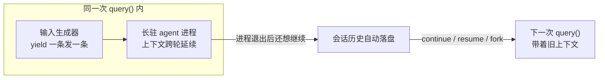
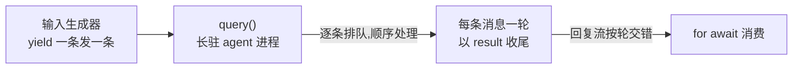

import { Meta } from '@storybook/addon-docs/blocks';

<Meta id="multi-turn" title="上手/多轮对话" name="Docs" />

# 多轮对话

上一课的 `query()` 是"交一次任务、收一次结果"。真实应用里 agent 要连着聊:用户追问一句,agent 带着前文回答;进程重启了,还要能回到之前的对话。本课给出两条组织路径——同一次 `query()` 里用流式输入连发多轮消息,上下文自然延续;跨进程用 `continue`、`resume`、`fork` 恢复落盘的历史会话。看完导读与参考表,你应该能预测:快速上手里第二条消息发出后,agent 能答出第一条才告知的信息,且每轮各以一条 result 消息收尾。



| 需求 | 入口 | 要点 |
| --- | --- | --- |
| 同一次 `query()` 连续对话 | `prompt` 传 `AsyncIterable<SDKUserMessage>` | agent 成为长驻进程,上下文跨轮延续 |
| 构造一条用户消息 | `SDKUserMessage` | `type: "user"`、`message`、`parent_tool_use_id: null` 必填 |
| 中断当前轮 | `query.interrupt()` | 仅流式输入模式可用 |
| 运行中换权限模式 / 模型 | `query.setPermissionMode()` / `query.setModel()` | 仅流式输入模式可用 |
| 接上最近一次会话 | `options.continue: true` | 默认 `false`;找当前目录下最近的会话 |
| 恢复指定会话 | `options.resume: sessionId` | `session_id` 从 init 或 result 消息读取 |
| 复制历史分支 | `options.resume` + `forkSession: true` | 新 ID 新历史,原会话不变 |
| 从历史中间恢复 | `options.resumeSessionAt: messageUuid` | 按消息 UUID 回到某一步;文件回退配合文件检查点课 |
| 会话不落盘 | `options.persistSession: false` | 默认 `true`;关闭后无法再 resume |

## 快速上手

沿用前两课的项目与凭证,新建 `chat.ts`:

```ts
// 前置:SDK 已安装,当前 shell 设置了 ANTHROPIC_API_KEY。
// 演示:同一个 query() 里连发两条消息,第二条依赖第一条才告知的信息。
// 预期:输出按轮交错——第一轮文字 + result,第二轮答出"小红和 7" + result。
import { query, type SDKUserMessage } from "@anthropic-ai/claude-agent-sdk";

async function* conversation(): AsyncGenerator<SDKUserMessage> {
  yield {
    type: "user",
    message: { role: "user", content: "我叫小红,最喜欢的数字是 7,请记住。" },
    parent_tool_use_id: null,
  };
  yield {
    type: "user",
    message: { role: "user", content: "我叫什么?最喜欢的数字是多少?" },
    parent_tool_use_id: null,
  };
}

for await (const message of query({ prompt: conversation() })) {
  if (message.type === "assistant" && message.message?.content) {
    for (const block of message.message.content) {
      if ("text" in block) console.log(block.text); // agent 的回复
    }
  } else if (message.type === "result") {
    console.log(`-- 本轮结束(${message.subtype}) --`); // 每条用户消息各一轮
  }
}
```

运行:

```bash
npx tsx chat.ts
```

预期输出(文字每次不同,结构相同):

```text
好的小红,我记住了:你最喜欢的数字是 7。
-- 本轮结束(success) --
你叫小红,你最喜欢的数字是 7。
-- 本轮结束(success) --
```

与上一课相比有两处变化:`prompt` 从字符串换成了异步生成器(流式输入);agent 从"单次任务"变成"长驻进程",两条消息在同一个会话里按顺序各走一轮——第二轮能答出第一轮才告知的信息,就是上下文跨轮延续的直接证据。纯聊天不需要放行工具,`options` 可以不传。`SDKUserMessage` 逐字构造很啰嗦,实际项目通常包一个 helper:

```ts
const userMessage = (content: string): SDKUserMessage => ({
  type: "user",
  message: { role: "user", content },
  parent_tool_use_id: null,
});
```

后文示例都用这个 helper。真实运行会消耗 API 额度;本课以讲解为主,不要求逐个运行。

## 流式输入

`prompt` 传 `AsyncIterable<SDKUserMessage>`(异步生成器即可)时,`query()` 进入流式输入模式:agent 作为长驻进程,从输入流逐条取用户消息,每条触发一个完整的 agent loop,回复按序写回输出流。两次 `yield` 之间可以 `await` 任何条件——等用户输入、等文件、等上一轮回复;期间会话保持不断。生成器执行完毕、排队消息处理完后,整个 `query()` 结束。



### 发送用户消息

一条顶层用户消息的最小表达是三个字段:`type: "user"`、`message`(Anthropic 消息格式,`role: "user"` 加内容)、`parent_tool_use_id` 传 `null`。`message.content` 可以是字符串,也可以是内容块数组——文本与图片混排(附件细节见[附件与用户输入](?path=/docs/user-input--docs)课):

```ts
// content 为内容块数组:文字与图片混排(与官方示例同构)
yield {
  type: "user",
  message: {
    role: "user",
    content: [
      { type: "text", text: "Review this architecture diagram" },
      {
        type: "image",
        source: { type: "base64", media_type: "image/png", data: pngBase64 },
      },
    ],
  },
  parent_tool_use_id: null,
};
```

发送节奏有两条规则:

- **连续 `yield` 是排队,不是打断。** 生成器不停产出时,消息按顺序逐条处理,每条各走一轮;想让下一条"等 agent 回完再说",见下一小节的闸门写法。
- **两次 `yield` 之间可以 `await`。** 等用户输入、等文件、等条件都行,`await` 期间 agent 空闲等待,会话不断。

不触发回复的消息用 `shouldQuery: false`:只追加到会话记录,不触发模型回合,内容并入下一条真正的用户消息,适合注入背景信息而不消耗模型调用:

```ts
yield { ...userMessage("补充:测试环境是 staging"), shouldQuery: false };
```

生成器之外还有一条输入通道:先起 `query()`,再用 `Query.streamInput()` 推送后续消息。已经用字符串 prompt 起的单次查询则没有这些输入手段——这是"多轮交互用流式输入"的直接原因。

### 按轮收取回复

输出流按轮交错:消息 n 的过程消息(`assistant`、`user` 等,类型体系见[消息流](?path=/docs/message-stream--docs)课)→ 消息 n 的 result → 消息 n+1 的过程消息 → …… 消费者靠 result 消息分轮。下一句要说什么取决于上一轮回复时(聊天界面的常见节奏:看到回答再追问),让 result 驱动发送:

```ts
// 场景:第二轮"直接修复"必须基于第一轮的分析结论。
// 做法:消费者在 result 处解开闸门,生成器等闸门打开才 yield 下一条。
let openGate = () => {};

async function* chat(): AsyncGenerator<SDKUserMessage> {
  yield userMessage("分析 index.ts 有没有性能问题");
  await new Promise<void>((resolve) => {
    openGate = resolve; // 等第一轮结束
  });
  yield userMessage("按你刚才的结论直接修复");
}

for await (const message of query({
  prompt: chat(),
  options: { allowedTools: ["Read", "Edit"], permissionMode: "acceptEdits" },
})) {
  if (message.type === "result") openGate(); // 一轮收尾,放行下一条输入
}
```

若不需要根据回复决定内容,连续 `yield` 即可,消息会排队按序处理。想结束整个对话,让生成器返回(或退出 `for await`);想只打断当前一轮,用 `interrupt()`,见下。

### 运行中控制

把 `query()` 的返回值接住,消费流的同时保留控制入口。`interrupt()`、`setPermissionMode()`、`setModel()` 都只在流式输入模式下可用,字符串 prompt 的单次查询没有这些手段:

```ts
const conversation = query({ prompt: chat(), options: {} });

setTimeout(() => void conversation.interrupt(), 5_000); // 5 秒后打断当前轮

for await (const message of conversation) {
  if (message.type === "result") console.log(`-- ${message.subtype} --`);
}
```

- `interrupt()`:打断当前正在处理的轮;新版 CLI 返回回执,可确认排队消息的状态,旧版解析为 `undefined`。
- `setPermissionMode()`:运行中切换权限模式(如临时收进 `plan`),模式含义见[权限模式](?path=/docs/permission-modes--docs)课。
- `setModel()`:运行中换模型;传 `undefined` 或 `"default"` 重置为默认。

## 延续历史会话

每次运行的完整对话历史由 SDK 自动写盘(存储位置与格式见[会话存储](?path=/docs/session-storage--docs)课),因此进程退出后历史仍在。但会话记录的是**对话**——prompt、工具调用、结果、回复——不含文件系统:恢复后 agent 记得聊过什么、改过什么,文件现在的样子要重新读。跨进程回到历史,按场景选入口:

| 场景 | 入口 | 关键差异 |
| --- | --- | --- |
| 单会话应用,接上最近一次 | `continue: true` | 不用保存 ID;找当前目录下最近的会话 |
| 多会话应用(如一个用户一个会话) | `resume: sessionId` | 自己保存 ID,指定回到哪一段 |
| 想试另一种方案,不丢原会话 | `resume` + `forkSession: true` | 复制出新会话,原会话原封不动 |

不想要长驻进程的轻量多轮:每次用字符串 prompt 调 `query()`、都带 `continue: true`,同样能带着上文继续;代价是没有流式输入的运行中控制。枚举与读取历史会话用顶层函数 `listSessions()`、`getSessionMessages()`,见[会话管理](?path=/docs/session-management--docs)课。

### continue

`continue: true` 接上**当前目录下最近的一次会话**,无需跟踪 ID:

```ts
// 场景:上一课的 agent 脚本已经跑完退出;新进程想接着刚才的任务继续。
// 预期:agent 记得上次读过的文件、做过的修改,直接在此基础上往下做。
for await (const message of query({
  prompt: "继续刚才的任务:跑一遍测试,报告还有没有失败",
  options: { continue: true }, // 接上当前目录下最近一次会话
})) {
  if (message.type === "result" && message.subtype === "success") {
    console.log(message.result);
  }
}
```

边界:`continue` 按"当前工作目录"找最近的会话——换一个目录运行就接不上(会话按目录归档);同目录多次运行后,接到的也未必是你想聊的那一次。多会话场景改用 `resume`。

### resume

`resume` 恢复指定的会话,适合多会话应用(一个用户一个会话)或要回到非最近一次的历史。`session_id` 有两条获取路径:init system 消息的直接字段(见[消息流](?path=/docs/message-stream--docs)课的 init 表),以及 result 消息的 `session_id` 字段(成功与错误 result 都有,中断后也能记账续跑):

```ts
// 保存:消费流时把 session_id 存进自己的存储(如数据库)
if (message.type === "system" && message.subtype === "init") {
  saveSession(message.session_id);
}

// 恢复:任意时刻、任意进程,带着完整历史继续
for await (const message of query({
  prompt: "接着这个会话:把刚才的分析整理成 review.md",
  options: { resume: loadSession() }, // 指定要回到的会话
})) {
  // ...
}
```

需要回到历史中某一条消息而非末尾时,用 `resumeSessionAt` 传该消息的 UUID。跨主机恢复(会话文件只在创建它的机器上)要搬运会话文件或配置 `sessionStore`,见[会话存储](?path=/docs/session-storage--docs)课。

### fork

`resume` 配 `forkSession: true` 时,SDK 以指定会话的历史为底**复制**出一个新会话:新的 session ID、完整拷贝的历史;原会话与原 ID 完全不变,两份历史可分别再 `resume`。适合"试另一种方案,不行就丢掉":

```ts
// 场景:想试一种重构方案,又不想动原会话的历史。
// 预期:init 消息带出 fork 产生的新 session_id;原会话原封不动。
for await (const message of query({
  prompt: "换一种方案:不用缓存,重写 getData()",
  options: { resume: savedId, forkSession: true }, // 复制历史,开新会话
})) {
  if (message.type === "system" && message.subtype === "init") {
    console.log(`fork 出的新会话: ${message.session_id}`);
  }
}
```

边界:fork 分的是**对话历史,不是文件**——fork 之后 agent 改的文件是磁盘上的真实改动,原会话的历史里没有这次改动,但文件已经变了。需要连文件一起分支或回滚,用文件检查点与 `rewindFiles()`,见[文件检查点](?path=/docs/file-checkpointing--docs)课。

## 常见问题

- 生成器里的代码抛了错,流却以 `Claude Code process aborted by user` 结束,看不到真实报错。
  流式输入模式下,输入生成器内部的异常会以这句报错收场,掩盖原始错误。把生成器主体包进 try/catch,或先记日志再重抛;看到这句报错优先检查生成器内部代码(如 `readFile` 失败)。

- `resume` 之后 agent"忘了"文件的现状,或按旧内容继续操作。
  会话只持久化对话,不持久化文件系统:恢复的是"当时聊了什么、改过什么",不是当时的文件。文件后来被改过时,先让 agent 重新读文件再继续;要回到当时的文件状态,用文件检查点的 `rewindFiles()`(见[文件检查点](?path=/docs/file-checkpointing--docs)课)。

- 换了目录或隔了一阵,`continue: true` 接上的不是想聊的那次会话,甚至找不到会话。
  `continue` 只按当前工作目录找最近一次会话。要么回到原目录运行,要么改用 `resume` 加自己保存的 `session_id`;会话按目录归档的规则见[会话存储](?path=/docs/session-storage--docs)课。

## 总结回顾

摘要:

本课给出组织多轮交互的两条路径。同一次 `query()` 内,`prompt` 传 `AsyncIterable<SDKUserMessage>` 进入流式输入模式:agent 成为长驻进程,每 `yield` 一条用户消息(必填 `type: "user"`、`message`、`parent_tool_use_id: null`)触发一轮 agent loop、以 result 消息收尾,上下文跨轮自然延续;连续 `yield` 按序排队,两次 `yield` 之间可 `await` 等条件,`shouldQuery: false` 注入上下文不触发回合,靠 result 分轮可实现"看到回复再追问";`interrupt()`、`setPermissionMode()`、`setModel()` 是流式模式独有的运行中控制。跨进程时,会话历史自动落盘但只存对话不存文件:`continue: true` 接当前目录最近会话,`resume` 加 `session_id`(从 init 或 result 消息读取)回到指定会话,`resume` 配 `forkSession: true` 复制出新会话且原会话不动;fork 只分对话不分文件。

一句话:

> 一次 `query()` 内用流式输入连发多轮,跨进程用 `continue`、`resume`、`fork` 回到落盘的历史会话。

知识要点:

- 流式输入怎么建立?`SDKUserMessage` 必填哪些字段?
- 每条用户消息在输出流里对应什么?怎么按 result 分轮、等回复后再发下一条?
- `shouldQuery: false` 用来做什么?
- 哪些运行中控制只在流式输入模式下可用?
- `continue`、`resume`、`fork` 各适合什么场景?`session_id` 从哪两条路径获得?
- fork 之后,原会话、新会话 ID、文件改动分别是什么状态?

## 参考资料

- [Streaming Input vs Single Message Input](https://code.claude.com/docs/en/agent-sdk/streaming-vs-single-mode)
- [Work with sessions](https://code.claude.com/docs/en/agent-sdk/sessions)
- [TypeScript SDK Reference](https://code.claude.com/docs/en/agent-sdk/typescript)
