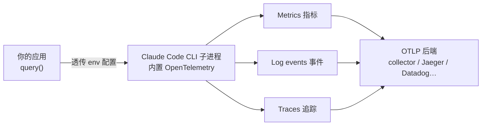

import { Meta } from '@storybook/addon-docs/blocks';

<Meta id="observability" title="生产化/可观测与成本/可观测性" name="Docs" />

# 可观测性

线上 agent 出了问题,你需要回答:它调了哪些工具、每次模型请求花了多久、消耗了多少 token、失败发生在哪。这套答案不必自己埋点:SDK 驱动的 Claude Code CLI 子进程内置了 OpenTelemetry,能把三个信号——指标(metrics)、事件(log events)、追踪(traces)——直接导出到任何接受 OTLP 的后端;SDK 本身不产遥测,只负责把配置透传给子进程。本课讲配置怎么传、三个信号里有什么、追踪怎么读、数据怎么打标与归属,以及敏感内容怎么控制。看完导读与参考表,你应该能预测:快速上手里给 `query()` 挂一段 env,CLI 就会把数据导到你指定的 collector,而应用循环里的输出不会有任何变化。

只想从消息流里读 token 与费用、不接外部后端,见[成本与用量](?path=/docs/cost-tracking--docs)课。



| 项 | 取值 / 默认 | 要点 |
| --- | --- | --- |
| 总开关 | `CLAUDE_CODE_ENABLE_TELEMETRY=1` | 不设则全部关闭 |
| 指标导出器 | `OTEL_METRICS_EXPORTER` | `otlp` / `prometheus` / `console` / `none`,逗号分隔可多选 |
| 事件导出器 | `OTEL_LOGS_EXPORTER` | `otlp` / `console` / `none` |
| 追踪导出器 | `OTEL_TRACES_EXPORTER` | `otlp` / `console` / `none`;还需 `CLAUDE_CODE_ENHANCED_TELEMETRY_BETA=1`(beta) |
| 传输协议 | `OTEL_EXPORTER_OTLP_PROTOCOL` | `grpc` / `http/json` / `http/protobuf`;CLI 无默认协议,必须设置,可用 `..._METRICS_PROTOCOL` 等按信号覆盖 |
| 端点 | `OTEL_EXPORTER_OTLP_ENDPOINT` | 可用 `..._LOGS_ENDPOINT` 等按信号覆盖 |
| 鉴权 | `OTEL_EXPORTER_OTLP_HEADERS` | 如 `Authorization=Bearer your-token` |
| 指标导出间隔 | `OTEL_METRIC_EXPORT_INTERVAL`,默认 `60000` ms | 注意单数 METRIC;事件与追踪是 `OTEL_LOGS_EXPORT_INTERVAL`、`OTEL_TRACES_EXPORT_INTERVAL`,默认 `5000` ms |
| 导出诊断 | `CLAUDE_CODE_OTEL_DIAG_STDERR=1` | 导出错误默认静默;设 1 后经 `stderr` 回调输出(需 Claude Code v2.1.179+) |
| 服务名 | `OTEL_SERVICE_NAME`,默认 `claude-code` | 多 agent 共用 collector 时改名过滤 |
| 资源属性 | `OTEL_RESOURCE_ATTRIBUTES` | 逗号分隔 `key=value`,特殊字符需百分号编码 |
| 内容开关 | 默认全部关闭 | `OTEL_LOG_USER_PROMPTS` 等,见「敏感内容开关」 |

## 快速上手

最常见的配置是三路信号全开、走 OTLP HTTP 到一个 collector。在 env 里加一组变量即可,循环代码不用动:

```ts
// 前置:设置 ANTHROPIC_API_KEY;真实运行消耗 API 额度,本课以讲解为主。
import { query } from "@anthropic-ai/claude-agent-sdk";

const otelEnv = {
  // 总开关:不设它,下面全部不生效
  CLAUDE_CODE_ENABLE_TELEMETRY: "1",
  // 追踪是 beta 信号,需要这个开关;指标与事件不需要
  CLAUDE_CODE_ENHANCED_TELEMETRY_BETA: "1",
  // 每个信号各选导出器;SDK 下不要用 console(原因见「遥测从哪里来」)
  OTEL_TRACES_EXPORTER: "otlp",
  OTEL_METRICS_EXPORTER: "otlp",
  OTEL_LOGS_EXPORTER: "otlp",
  // 标准 OTLP 传输配置;本地验证时把端点指到本地 collector 或一体化 Jaeger 容器
  OTEL_EXPORTER_OTLP_PROTOCOL: "http/protobuf",
  OTEL_EXPORTER_OTLP_ENDPOINT: "http://localhost:4318",
  OTEL_EXPORTER_OTLP_HEADERS: "Authorization=Bearer your-token",
};

for await (const message of query({
  prompt: "列出当前目录的文件",
  // env 整体替换子进程环境,先展开 process.env 保住 PATH 与 ANTHROPIC_API_KEY
  options: { env: { ...process.env, ...otelEnv } },
})) {
  if (message.type === "result" && message.subtype === "success") {
    console.log(message.result);
  }
}
```

预期观察:循环里的输出与不挂 `otelEnv` 时完全一致——导出发生在 CLI 子进程内,对应用透明。任务结束后到后端核对:指标侧找 `claude_code.session.count`(会话开始时发出),事件侧提交一个 prompt 后找 `claude_code.user_prompt`。

子进程默认继承应用环境,所以同样的效果可以不写一行代码:在 Dockerfile、Kubernetes manifest 或 shell profile 里导出这组变量,省掉 `options.env`(容器部署细节见[打包与托管](?path=/docs/hosting--docs)课)。

## 遥测从哪里来

SDK 自己不产生任何遥测。`query()` 启动的 Claude Code CLI 子进程内置了 OpenTelemetry 埋点:每次模型请求与工具执行记录 span,token 与费用计数器产出指标,每条 prompt 与工具结果产出结构化事件。SDK 只做一件事——把配置透传给子进程,由 CLI 直接导出到你的 collector。

配置就是环境变量,有两个放法:

- **进程环境**:在 shell、容器或编排器里设好,每次 `query()` 自动继承,零代码改动;生产部署推荐。
- **每次调用 `options.env`**:同一进程里不同代理需要不同遥测设置时用。TypeScript 的 `env` 会整体替换继承环境,对象里要带 `...process.env`(选项语义见[Options](?path=/docs/options--docs)课)。

一条硬边界:`console` 导出器把遥测写进标准输出,而 stdout 正是 SDK 与子进程之间的消息通道——SDK 下不要把任何导出器设为 `console`。想本地检查遥测,把 `OTEL_EXPORTER_OTLP_ENDPOINT` 指到本地 collector 或一体化 Jaeger 容器。

### 三条信号

三个信号相互独立,各有开关与导出器,只开需要的即可:

| 信号 | 内容 | 打开方式 |
| --- | --- | --- |
| Metrics | token、费用、会话、代码行数、工具决策等计数器 | `OTEL_METRICS_EXPORTER` |
| Log events | 每条 prompt、API 请求、API 错误、工具结果的结构化记录 | `OTEL_LOGS_EXPORTER` |
| Traces | interaction、模型请求、工具调用、hook(beta)的 span | `OTEL_TRACES_EXPORTER` + `CLAUDE_CODE_ENHANCED_TELEMETRY_BETA=1` |

指标以 `claude_code.` 为前缀,常用的有 `claude_code.session.count`、`claude_code.token.usage`、`claude_code.cost.usage`、`claude_code.lines_of_code.count`、`claude_code.active_time.total`;指标也可选 `prometheus` 导出器,由 `http://localhost:9464/metrics` 抓取。事件如 `claude_code.user_prompt`、`claude_code.tool_result`、`claude_code.api_request`、`claude_code.api_error`、`claude_code.tool_decision`。完整清单见 Monitoring 参考。

每条指标与事件都带标准属性:`session.id`、`user.id`、登录时的 `user.email` 与 `organization.id`,以及 `OTEL_RESOURCE_ATTRIBUTES` 注入的自定义键。token 与费用指标还带 `model` 与 `query_source`(`main` / `subagent` / `auxiliary`)属性,可把子代理与辅助调用的开销拆出来。指标基数可用开关下调:`OTEL_METRICS_INCLUDE_SESSION_ID`、`OTEL_METRICS_INCLUDE_ACCOUNT_UUID`、`OTEL_METRICS_INCLUDE_RESOURCE_ATTRIBUTES` 默认均为 `true`,设 `false` 即去掉对应属性。

## 读 agent 追踪

追踪是信息量最大的视图,但处于 beta:设 `CLAUDE_CODE_ENABLE_TELEMETRY=1` 与 `CLAUDE_CODE_ENHANCED_TELEMETRY_BETA=1`,再配 `OTEL_TRACES_EXPORTER`(复用通用 OTLP 端点、协议与头)。打开后,agent loop 的每一步都是追踪后端里可查的 span:

```text
claude_code.interaction              # 一轮 agent loop:从收到 prompt 到产出回复
├── claude_code.llm_request          # 每次 Claude API 调用
├── claude_code.hook                 # 每次 hook 执行(需 detailed beta tracing)
└── claude_code.tool                 # 每次工具调用
    ├── claude_code.tool.blocked_on_user   # 等待权限决定
    ├── claude_code.tool.execution         # 实际执行
    └── (Agent 工具)子代理的 llm_request / tool span 嵌套于此
```

`llm_request` span 带 `model`、`ttft_ms`、`input_tokens` / `output_tokens`、cache 读写 token、`status_code` 与 `error` 等属性;`tool` span 带 `tool_name`、`duration_ms`、`result_tokens`。`llm_request`、`tool.execution` 与 `hook` span 在失败时记 OpenTelemetry status `ERROR`,其余 span 始终 `UNSET`。span 名与属性属于 beta,可能随版本变化。

默认每个 span 带 `session.id` 属性:对同一会话的多次 `query()`(`resume` 见[会话管理](?path=/docs/session-management--docs)课),在后端按 `session.id` 过滤就是一条完整时间线;把 `OTEL_METRICS_INCLUDE_SESSION_ID` 设为假值可去掉该属性。

子代理委托链天然在同一 trace 里:agent 通过 Agent(旧名 Task)工具派生子代理时,子代理的 `llm_request` 与 `tool` span 嵌套在父代理的 `claude_code.tool` span 之下。

`claude_code.hook` span 是例外:只在 detailed beta tracing 下出现,需要 `ENABLE_BETA_TRACING_DETAILED=1` 加 `BETA_TRACING_ENDPOINT`——而且这一对变量会同时改变日志与追踪的导出去向(见[Hooks](?path=/docs/hooks--docs)课的 hook 事件背景)。

## 关联应用自身的追踪

SDK 自动把 W3C trace context 传进 CLI 子进程:你的应用里有活动的 OpenTelemetry span 时调用 `query()`,SDK 把 `TRACEPARENT` 与 `TRACESTATE` 注入子进程环境,CLI 读到后让 `claude_code.interaction` 成为你的 span 的子节点——agent 运行出现在应用 trace 内部,而不是断开的孤立根。

配套的两条关联:

- 运行期间发出的 OTLP 事件记录带同样的 `trace_id` 与 `span_id`——即使没配追踪导出器,日志后端也能把事件与 trace 关联起来。
- CLI 把 `TRACEPARENT` 转发给它执行的每条 Bash / PowerShell 命令,命令自己发出的 span 会挂在包裹它的 `claude_code.tool.execution` 之下。

两条边界:在 `options.env` 里显式设置 `TRACEPARENT` 会跳过自动注入——想固定某个父上下文时用;交互式 CLI 会话完全忽略入站 `TRACEPARENT`,只有 Agent SDK 与 `claude -p` 运行遵守它。

## 标记与归属

默认 CLI 上报的 `service.name` 是 `claude-code`:跑多个 agent,或 SDK 与其他服务共用一个 collector 时,后端按服务过滤会混在一起。用两个变量改名并附加部署元数据,它们作为 OpenTelemetry 资源属性落到该 agent 发出的每个 span、指标与事件上:

```ts
const options = {
  env: {
    ...process.env,
    // ... 导出器配置 ...
    OTEL_SERVICE_NAME: "support-triage-agent",
    OTEL_RESOURCE_ATTRIBUTES: "service.version=1.4.0,deployment.environment=production",
  },
};
```

`OTEL_RESOURCE_ATTRIBUTES` 是逗号分隔的 `key=value`:值不能含空格,逗号、空格、等号等字符要百分号编码;自定义键不会覆盖 `session.id`、`user.id` 这类标准属性。每个键同时成为指标数据点上的标签,可直接按团队、成本中心分组;高基数值会抬高指标存储成本,只想进资源块、不进数据点标签时设 `OTEL_METRICS_INCLUDE_RESOURCE_ATTRIBUTES=false`。

### 按终端用户归属

CLI 按调用 Anthropic 的凭证给每条事件附加身份属性——一个服务多个终端用户时,这些属性识别的是你的服务凭证,不是被代理的用户。要让工具调用与 MCP 活动归到具体终端用户,在每次 `query()` 注入 `enduser.id` 与 `tenant.id` 作为资源属性:

```ts
// 场景:Web 服务每个请求代表一个用户运行 agent。
// 预期:后端按 enduser.id 过滤,即可看到单个用户的全部工具决策与结果。
options: {
  env: {
    ...process.env,
    // ... 导出器配置 ...
    OTEL_RESOURCE_ATTRIBUTES: `enduser.id=${encodeURIComponent(request.userId)},tenant.id=${encodeURIComponent(request.tenantId)}`,
  },
},
```

带用户身份后,`tool_decision`、`tool_result`、`mcp_server_connection`、`permission_mode_changed` 四类事件构成逐用户审计链,可转发给 SIEM 平台做安全审计。

## 敏感内容开关

默认遥测是结构性的:每个 span 记时长、模型名、工具名,token 数在 API 返回用量时记录(失败或中断的请求可能没有);agent 读写的具体内容默认不导出。四个开关按需放开:

| 变量 | 放开什么 | 边界 |
| --- | --- | --- |
| `OTEL_LOG_USER_PROMPTS=1` | prompt 文本,出现在 `claude_code.user_prompt` 事件与 `claude_code.interaction` span 上 | —— |
| `OTEL_LOG_TOOL_DETAILS=1` | 工具输入参数(文件路径、shell 命令、搜索模式),出现在 `claude_code.tool_result` 事件上 | 同时放开追踪 span 上的 `file_path`、`full_command` 等属性 |
| `OTEL_LOG_TOOL_CONTENT=1` | 工具的完整输入与输出体,作为 `claude_code.tool` span 上的 span event | 需先开启追踪;默认 60 KB 截断 |
| `OTEL_LOG_RAW_API_BODIES` | 完整 Messages API 请求/响应 JSON,作为 `api_request_body` / `api_response_body` 事件 | `=1` 内联 60 KB 截断;`file:<目录>` 落盘不截断、事件带 `body_ref` 路径 |

`OTEL_LOG_RAW_API_BODIES` 的 body 含完整对话历史(扩展思考内容始终脱敏),开启它即视为同意前三个开关会暴露的一切。助手回复文本另有 `OTEL_LOG_ASSISTANT_RESPONSES=1`(未设时回落到 `OTEL_LOG_USER_PROMPTS` 的值)。

除非观测管线已获准存储 agent 处理的数据,否则保持这些变量不设;需要给指标降噪时优先调上一节的基数开关。

## 最佳实践

- **生产配置放进程环境。** 变量写在 Dockerfile、Kubernetes manifest 或启动脚本里,所有 `query()` 自动继承,代码零改动;`options.env` 只用于同一进程里多个代理要不同遥测设置的场景,且记得先展开 `process.env`。
- **多 agent 共用 collector 先改名。** `service.name` 默认都是 `claude-code`,用 `OTEL_SERVICE_NAME` 区分服务、`OTEL_RESOURCE_ATTRIBUTES` 带 `service.version` 与 `deployment.environment`,后端按资源属性过滤;逐用户审计需求再叠加 `enduser.id` 注入。
- **审计链路走事件通道。** 把 `OTEL_EXPORTER_OTLP_LOGS_ENDPOINT` 单独指向 SIEM 的 OTLP receiver,配 `OTEL_LOG_TOOL_DETAILS=1`,`tool_decision`、`tool_result`、`mcp_server_connection`、`permission_mode_changed` 就是带身份属性的审计链;指标与追踪可以另指后端,三个信号互不绑定。
- **内容开关保持默认关闭。** prompt 文本、工具输入输出、原始 API body 都不在默认遥测里;放开任何一项前,先确认观测管线的存储与访问控制覆盖 agent 处理的数据。

## 常见问题

- 配好了导出,后端却看不到任何数据。
  CLI 导出失败默认静默:端点不可达或拒绝数据时,agent 照常运行,遥测被丢弃且应用无感知。处理:在 env 加 `CLAUDE_CODE_OTEL_DIAG_STDERR: "1"` 并挂 `stderr` 回调读诊断(需 Claude Code v2.1.179+);诊断输出里 `[3P telemetry]` 前缀的行才是你的导出器错误,`[Anthropic telemetry]` 前缀与你的配置无关。锚点:后端先确认 `claude_code.session.count` 指标;只配了日志时,提交一个 prompt 找 `claude_code.user_prompt` 事件。

- 想在 SDK 里把导出器设成 `console` 本地看数据,结果输出异常。
  `console` 导出器把遥测写进标准输出,而 stdout 正是 SDK 与子进程之间的消息通道,SDK 下禁止使用。改把 `OTEL_EXPORTER_OTLP_ENDPOINT` 指到本地 collector 或一体化 Jaeger 容器。

- 任务几秒就结束,后端只收到一部分 span 或指标。
  CLI 按间隔批量导出:指标默认 60 秒、日志与追踪默认 5 秒;进程干净退出会尝试 flush,但受短超时限制,collector 响应慢仍可能丢;进程被直接杀掉,批量缓冲里的数据全部丢失。处理:短命调用把 `OTEL_METRIC_EXPORT_INTERVAL`、`OTEL_LOGS_EXPORT_INTERVAL`、`OTEL_TRACES_EXPORT_INTERVAL` 一起调低,如 `"1000"`。

- 应用与后端都接了 OTel,agent 的 trace 却是孤立的根。
  走自定义 `ANTHROPIC_BASE_URL` 网关时,traceparent 头与子进程 `TRACEPARENT` 转发默认关闭(部分代理会拒绝不认识的头),在 env 设 `CLAUDE_CODE_PROPAGATE_TRACEPARENT=1` 恢复。另检查调用 `query()` 时应用侧是否真的有活动 span——SDK 只在此情况下注入。

- 费用与 token 该看 OTel 指标还是消息流?
  `claude_code.cost.usage` 与 `claude_code.token.usage` 面向聚合看板、告警与按团队拆分,数值是估算;要逐次调用读取或建自己的用量看板,直接读 result 消息的 `modelUsage` / `total_cost_usd`,见[成本与用量](?path=/docs/cost-tracking--docs)课。

## 总结回顾

摘要:

SDK 不产生遥测:内置 OpenTelemetry 的是它驱动的 Claude Code CLI 子进程,SDK 只把环境变量透传进去,CLI 直接把指标、事件、追踪三个信号导出到 OTLP 后端。配置放进程环境(生产推荐)或每次调用的 `options.env`(TypeScript 下整体替换,先展开 `process.env`);SDK 下禁用 `console` 导出器。追踪(beta)按 `interaction` → `llm_request` / `tool` / `hook` 分层,子代理 span 嵌套在父 `claude_code.tool` 之下,每个 span 带 `session.id`;SDK 自动注入 `TRACEPARENT`,让 agent trace 挂进应用自身 trace。`service.name` 默认 `claude-code`,用 `OTEL_SERVICE_NAME` 与 `OTEL_RESOURCE_ATTRIBUTES` 打标,注入 `enduser.id` 后四类事件成为逐用户审计链。prompt、工具输入输出与原始 API body 默认不导出,由四个 `OTEL_LOG_*` 开关按需放开;导出失败默认静默,用 `CLAUDE_CODE_OTEL_DIAG_STDERR` 加 `stderr` 回调诊断,短任务调低三个导出间隔防丢。

一句话:

> agent 行为的可观测性不靠 SDK 埋点,靠给 CLI 子进程配好 OTel 环境变量,把它当作一个被观测的服务接入你的后端。

知识要点:

- 三个信号各用什么变量打开?追踪为什么还需要 `CLAUDE_CODE_ENHANCED_TELEMETRY_BETA=1`?
- 为什么 TypeScript 里 `options.env` 要先展开 `process.env`?`console` 导出器为什么在 SDK 下不能用?
- `claude_code.tool` span 的两个子 span 是什么?子代理的 span 嵌套在哪?
- 应用自身的 trace 怎么与 agent 的 `interaction` span 连起来?显式设置 `TRACEPARENT` 会发生什么?
- `service.name` 默认是什么?按终端用户归属要设什么、有什么编码要求?
- 四个 `OTEL_LOG_*` 开关各放开什么内容?默认为什么不放开?
- 导出失败为什么应用无感知?怎么让错误浮出来?
- 短任务丢数据的两个窗口是什么?怎么收窄?

## 参考资料

- [Observability with OpenTelemetry](https://code.claude.com/docs/en/agent-sdk/observability)
- [Monitoring(指标、事件与变量完整参考)](https://code.claude.com/docs/en/monitoring-usage)
- [Agent SDK reference - TypeScript](https://code.claude.com/docs/en/agent-sdk/typescript)
