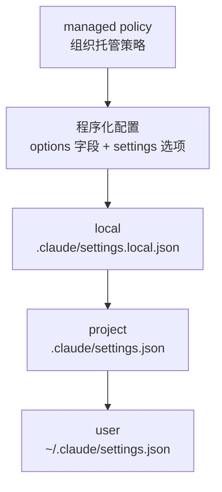

import { Meta } from '@storybook/addon-docs/blocks';

<Meta id="options" title="配置与控制/配置体系/Options" name="Docs" />

# Options

`query()` 收两个参数:prompt 决定 agent 做什么,`options` 决定它在什么条件下做——用哪个模型、在哪个目录、哪些工具免审批、最多跑多少轮、最多花多少钱。`Options` 的每个字段都是可选的,一个不传就跑 SDK 默认值。本课是这些字段的地图:开场参考表给出高频项,配置项地图按家族铺开常用字段与默认值,深度细节归属各自课程,这里只给入口和边界。看完导读与参考表,你应该能回答:为什么 `allowedTools` 是"放行"而不是"白名单"?为什么 `env` 一旦显式设置就必须展开 `process.env`?为什么设了 `settingSources: []` 也未必得到绝对干净的会话?

SDK 与 Claude Code 同底座:`query()` 实际驱动捆绑的 CLI 子进程,options 的字段由 SDK 转交并落实到子进程(见[安装与凭证](?path=/docs/install--docs))。这也意味着一次会话的配置不止 options 一层——文件系统设置与环境变量也在同时起作用,所以本课在地图之外还要划清边界:SDK 能用到 Claude Code 的哪些功能,哪些配置不受 `settingSources` 控制地生效。不确定配置是否生效时,读流里的 init 消息即可核对(见下文快速上手)。

| 选项 | 默认 | 作用 | 回查要点 |
| --- | --- | --- | --- |
| `cwd` | `process.cwd()` | agent 的工作目录 | 决定加载哪个项目的设置、skills 从哪发现、会话归属哪个项目 |
| `model` | CLI 默认 | 模型别名或完整模型名 | 取值与 preset 见[模型与系统提示词](?path=/docs/model-and-prompt--docs) |
| `allowedTools` | `[]` | 点名自动放行的工具 | 是放行不是白名单,未列出的工具仍走权限评估 |
| `permissionMode` | `undefined` | 起始权限模式 | 省略时会话可能以 auto 模式启动,无人值守应显式设置 |
| `maxTurns` | `undefined`(不限) | 轮次上限 | 只数含工具调用的轮;`0` 等同不限 |
| `maxBudgetUsd` | `undefined`(不限) | 客户端费用估算上限(美元) | 设 `0` 会被 CLI 拒绝,会话不启动 |
| `env` | `process.env` | CLI 子进程的环境变量 | 替换式而非合并,显式设置须展开 `process.env` |
| `abortController` | `new AbortController()` | 从外部中止本次运行 | 调 `abort()` 中止;详见[错误处理与中断](?path=/docs/error-handling--docs) |
| `systemPrompt` | `undefined`(最小提示词) | 系统提示词配置 | 默认不是 Claude Code 的完整提示词,详见[模型与系统提示词](?path=/docs/model-and-prompt--docs) |
| `settingSources` | CLI 默认(全部来源) | 加载哪些文件系统设置 | `[]` 得到只认程序化配置的干净会话 |

## 快速上手

把最常用的几个字段组合进一次只读任务,再看 init 消息怎么回报生效配置。前置环境沿用[安装与凭证](?path=/docs/install--docs)(SDK 已装、`ANTHROPIC_API_KEY` 可见)。

```ts
// 组合常用选项的只读任务:限定模型与目录,放行读取工具,轮次与费用双上限。
// 前置:SDK 已安装,ANTHROPIC_API_KEY 对当前进程可见。
// 预期:init 消息回报生效配置,result 收尾;未设置的字段全部走默认值。
import { query } from "@anthropic-ai/claude-agent-sdk";

for await (const message of query({
  prompt: "用三句话总结这个仓库的 README",
  options: {
    model: "claude-sonnet-5",               // 模型别名
    cwd: "/path/to/repo",                   // agent 的工作目录
    allowedTools: ["Read", "Glob", "Grep"], // 点名放行只读工具
    maxTurns: 8,                            // 轮次上限
    maxBudgetUsd: 1,                        // 费用上限(美元)
    // env、abortController、systemPrompt 等字段未设置,走默认值
  },
})) {
  // init 消息回报会话以什么配置启动,是核对 options 是否生效的第一入口
  if (message.type === "system" && message.subtype === "init") {
    console.log("模型:", message.model);
    console.log("工作目录:", message.cwd);
    console.log("权限模式:", message.permissionMode);
    console.log("可用工具:", message.tools.slice(0, 6).join(", "), "...");
  }
  if (message.type === "result" && message.subtype === "success") {
    console.log("结果:", message.result);
  }
}
```

预期输出(工具列表为节选,完整列表随环境不同):

```text
模型:claude-sonnet-5
工作目录:/path/to/repo
权限模式:default
可用工具:Task, Bash, Glob, Grep, Read, Edit, ...
结果:这个仓库的 README 介绍了项目用途、安装方式与常用命令……(三句话)
```

两点从输出能看出来的事实:`tools` 是本次会话可用的工具全集,`allowedTools` 的放行体现在权限评估环节,不会增减这个列表;本例未设 `permissionMode`,init 回报的是 CLI 决定的起始模式。消息类型的完整体系见[消息流](?path=/docs/message-stream--docs)。

## 配置从哪里来

一次会话的配置从四个通道进入 CLI 子进程。settings 类配置按优先级从高到低合并:



- **managed policy:** 组织托管策略(端点或服务器下发),优先级最高。SDK 配不掉它,只能从主机侧移除,或由组织 Owner 调整。
- **程序化配置:** options 字段本身,加上 `settings` 选项——它可以接收内联 settings 对象、settings 文件路径或 JSON 字符串,两者都整体覆盖下面三层的文件系统设置;`settings` 的内容在运行中还能用 `applyFlagSettings()` 更新(仅流式输入可用)。
- **文件系统设置:** 由 `settingSources` 决定加载哪几层,省略时 local、project、user 三层全开——这也是 SDK 与 Claude Code CLI 行为一致的关键,各来源的加载位置见[设置来源](?path=/docs/settings-sources--docs)。
- **环境变量:** `env` 选项注入子进程环境(默认继承 `process.env`),不参与上面的优先级;`ANTHROPIC_API_KEY`、`ANTHROPIC_BASE_URL`、`API_TIMEOUT_MS` 等 CLI 读取的变量都从这里进入,注入写法见[安装与凭证](?path=/docs/install--docs)。

判断"配置为什么没生效",按这张图从上往下找来源:先看 managed policy,再看 options 与 `settings`,最后看文件系统三层。想在启动前核对文件层的合并结果,SDK 提供 `resolveSettings()`,用法见[设置来源](?path=/docs/settings-sources--docs)。

## 配置项地图

Options 的字段有五十多个,按回答的问题分成六个家族。每行给默认值与一句话边界,"详见"指向承载深度细节的课程;个别 Alpha 标注或极底层字段(`managedSettings`、`projectConfigRoot`、`verbatimPrompts`、`loadTimeoutMs` 等)不进表格,需要时直接查 [TypeScript 参考](https://code.claude.com/docs/en/agent-sdk/typescript)的 Options 表。

### 进程与运行

控制 CLI 子进程在哪跑、怎么拉起、怎么观察。

| 选项 | 默认 | 作用与边界 |
| --- | --- | --- |
| `cwd` | `process.cwd()` | 工作目录;决定项目设置与 hooks 加载、skills 发现、会话存储归属;没有运行中修改的方法,换目录要开新会话 |
| `env` | `process.env` | 子进程环境变量;显式设置是替换而非合并,写法见[安装与凭证](?path=/docs/install--docs) |
| `abortController` | `new AbortController()` | 调 `abort()` 从外部中止本次运行,详见[错误处理与中断](?path=/docs/error-handling--docs) |
| `executable` / `executableArgs` | 自动检测 / `[]` | 运行 CLI 的 JS 运行时(node、bun、deno)及其参数 |
| `pathToClaudeCodeExecutable` | 自动解析捆绑二进制 | 可选依赖被跳过或平台不在支持列表时,指向单独安装的 `claude` |
| `spawnClaudeCodeProcess` | `undefined` | 自定义拉起进程,把 CLI 跑进 VM、容器或远程主机,详见[打包与托管](?path=/docs/hosting--docs) |
| `debug` / `debugFile` / `stderr` | `false` / `undefined` / `undefined` | 调试日志开关;`debugFile` 指定日志文件并隐式开启 debug;`stderr` 回调接收子进程 stderr |
| `sessionId` | 自动生成 | 指定本次会话的 UUID |
| `title` | `undefined` | 会话的显示标题 |
| `persistSession` | `true` | `false` 时会话不落盘,之后无法 resume |

### 轮次与预算

给无人值守的循环兜底,触顶即停。

| 选项 | 默认 | 作用与边界 |
| --- | --- | --- |
| `maxTurns` | `undefined`(不限) | 含工具调用的轮次上限;`0` 等同不限;单次 `query()` 撞顶先产出 `error_max_turns` 结果再抛错 |
| `maxBudgetUsd` | `undefined`(不限) | 客户端费用估算达到上限即停,以 `error_max_budget_usd` 结束;`0` 会被 CLI 拒绝启动;统计口径见[成本与用量](?path=/docs/cost-tracking--docs) |
| `effort` | `undefined` | 单次响应的投入档位,从 `low` 到 `max`,详见[模型与系统提示词](?path=/docs/model-and-prompt--docs) |
| `taskBudget` | `undefined`(Alpha) | API 侧 token 预算,模型被告知剩余额度以自行收尾 |

### 工具与权限

决定 agent 能动什么、每次调用怎么审批。权限评估全链路见[权限规则与 canUseTool](?path=/docs/permissions--docs)。

| 选项 | 默认 | 作用与边界 |
| --- | --- | --- |
| `allowedTools` | `[]` | 点名的调用自动放行;不限制 Claude 只能用这些工具 |
| `disallowedTools` | `[]` | 禁用工具:裸名(`"Bash"`)直接从上下文移除;作用域规则(`"Bash(rm *)"`)保留工具,但任何模式下都拒绝匹配的调用 |
| `permissionMode` | `undefined` | 起始权限模式;省略时会话可能以 auto 启动,四种模式对比见[权限模式](?path=/docs/permission-modes--docs) |
| `canUseTool` | `undefined` | 审批回调,只在权限评估落到"需要询问"时触发,见[权限规则与 canUseTool](?path=/docs/permissions--docs) |
| `allowDangerouslySkipPermissions` | `false` | 使用 `bypassPermissions` 的必填前置开关 |
| `permissionPrompts` | `'host'` | 权限提示交给谁:`'host'` 路由给 `canUseTool`,`'none'` 直接拒绝本应提示的调用 |
| `additionalDirectories` | `[]` | 额外可访问的目录(以 `--add-dir` 传入);project 设置源下还会加载这些目录的 skills、commands、subagents |
| `tools` | `undefined` | 工具面配置:工具名数组或 Claude Code 预设 |
| `toolAliases` | `undefined` | 把内置工具名映射到 MCP 工具,如 `{ Bash: "mcp__workspace__bash" }` |
| `toolConfig` | `undefined` | 内置工具行为微调(如 AskUserQuestion 的预览格式) |
| `planModeInstructions` | `undefined` | plan 模式下替换默认工作流正文的指令 |
| `sandbox` | `undefined` | 命令与网络沙箱的程序化配置,详见[沙箱](?path=/docs/sandbox--docs) |

### 提示词与输出

塑造模型看到什么指令、流里产出什么形态。

| 选项 | 默认 | 作用与边界 |
| --- | --- | --- |
| `systemPrompt` | `undefined`(最小提示词) | 字符串为自定义提示词;`{ type: "preset", preset: "claude_code" }` 换用 Claude Code 系统提示词并可 `append` 追加,详见[模型与系统提示词](?path=/docs/model-and-prompt--docs) |
| `thinking` | `{ type: "adaptive" }`(支持的模型) | 思考配置;`maxThinkingTokens` 已弃用,改用本字段 |
| `includePartialMessages` | `false` | 流中额外产出 `stream_event` 增量事件,详见[流式输出](?path=/docs/streaming-output--docs) |
| `outputFormat` | `undefined` | `{ type: "json_schema", schema }` 约束最终输出,详见[结构化输出](?path=/docs/structured-outputs--docs) |
| `forwardSubagentText` | `false` | 把子代理的文本与思考块作为带 `parent_tool_use_id` 的完整消息转发进流 |
| `agentProgressSummaries` | `false` | 为子代理生成单行进度摘要 |
| `promptSuggestions` | `false` | 回合结束后产出 `prompt_suggestion` 建议消息 |

### 扩展加载

接入 Claude Code 的扩展机制:MCP、子代理、hooks、技能与插件。

| 选项 | 默认 | 作用与边界 |
| --- | --- | --- |
| `mcpServers` | `{}` | 外部与进程内 MCP server 配置,详见[接入 MCP server](?path=/docs/mcp-integration--docs) |
| `strictMcpConfig` | `false` | `true` 时只用 `mcpServers` 传入的 server,忽略 `.mcp.json`、用户设置、插件与 claude.ai connectors |
| `agents` | `undefined` | 程序化定义子代理,详见[子代理](?path=/docs/subagents--docs) |
| `agent` | `undefined` | 主线程使用的 agent 名(须在 `agents` 或 settings 中定义) |
| `hooks` | `{}` | 程序化 hook 回调,详见[Hook 事件](?path=/docs/hooks--docs) |
| `skills` | `undefined` | `"all"` 或技能名数组;设置后 SDK 自动把 Skill 工具加进 `allowedTools`,详见[Agent Skills](?path=/docs/skills--docs) |
| `plugins` | `[]` | 本地插件路径列表,详见[插件](?path=/docs/plugins--docs) |
| `settingSources` | CLI 默认(全部来源) | 加载哪些文件系统设置,见下节 |
| `settings` | `undefined` | 内联 settings 对象、文件路径或 JSON 字符串;整体覆盖文件系统三层,运行中可用 `applyFlagSettings()` 更新 |
| `betas` | `[]` | 启用 beta 特性 |
| `onElicitation` | `undefined` | MCP elicitation 请求回调;未提供时此类请求自动拒绝 |

### 会话延续

把一次运行接到历史会话上。

| 选项 | 默认 | 作用与边界 |
| --- | --- | --- |
| `resume` | `undefined` | 要恢复的会话 ID,详见[多轮对话](?path=/docs/multi-turn--docs) |
| `resumeSessionAt` | `undefined` | 恢复到指定消息 UUID |
| `forkSession` | `false` | 配合 `resume` 分叉为新会话 ID,不续写原会话 |
| `continue` | `false` | 继续最近一次对话 |
| `sessionStore` | `undefined` | 外部会话存储适配器,跨主机恢复,详见[会话存储](?path=/docs/session-storage--docs) |

## SDK 能用到 Claude Code 的哪些功能

SDK 与 Claude Code CLI 同底座,CLI 的文件系统能力默认继承:省略 `settingSources` 时,`query()` 读取与 CLI 相同的设置——user、project、local 三层设置文件、CLAUDE.md,以及 `.claude/` 下的 skills、agents、commands。传 `settingSources: []` 则只认程序化配置,得到行为完全可预测的干净会话。各来源的加载位置与 CLAUDE.md 的查找规则见[设置来源](?path=/docs/settings-sources--docs)。

但范围有限定:`settingSources` 管不到下面这些输入,它们不受该选项影响地生效。

| 输入 | 行为 | 如何关闭 |
| --- | --- | --- |
| managed policy 设置 | 端点托管策略(MDM plist、注册表、服务器下发)始终加载 | 从主机移除策略文件;服务器管理的由组织 Owner 控制,SDK 侧无法关闭 |
| `~/.claude.json` 全局配置 | 始终读取 | 用 `env` 里的 `CLAUDE_CONFIG_DIR` 把它挪走 |
| auto memory(`~/.claude/projects/<project>/memory/`) | 会话启动时并入系统提示词 | `env` 设 `CLAUDE_CODE_DISABLE_AUTO_MEMORY=1`,或 settings 里 `autoMemoryEnabled: false` |
| claude.ai MCP connectors | 使用 claude.ai 登录态时加载;传 `mcpServers: {}` 压不掉 | `strictMcpConfig: true`、settings 里 `disableClaudeAiConnectors: true`,或 `env` 设 `ENABLE_CLAUDEAI_MCP_SERVERS=false` |
| `~/.claude/settings.json` 的 sandbox deny/mask 条目 | 沙箱运行时仍作为限制生效 | 从该设置文件移除这些条目 |

对照需求找入口,官方"选对功能"表收敛成 SDK 视角如下;每一行的深度细节都在对应课程。

| 想做的事 | SDK 入口 | 本手册课程 |
| --- | --- | --- |
| 项目约定常驻上下文(CLAUDE.md) | `settingSources` 含 `"project"` | [设置来源](?path=/docs/settings-sources--docs) |
| 按需加载专项知识与流程 | `settingSources` + `skills` | [Agent Skills](?path=/docs/skills--docs) |
| 隔离上下文的子任务 | `agents`(配合放行 Agent 工具) | [子代理](?path=/docs/subagents--docs) |
| 工具调用上跑确定性逻辑 | `hooks` 回调或 settings 文件 hook | [Hook 事件](?path=/docs/hooks--docs) |
| 结构化访问外部服务 | `mcpServers` | [接入 MCP server](?path=/docs/mcp-integration--docs) |
| 多实例协作(agent teams) | 不经 SDK 选项配置,是 CLI 功能 | 本手册不展开 |

两个边界提醒:每启用一项功能都会进入上下文窗口、占用 token;无人值守、多租户场景下不要依赖默认配置做隔离——干净环境的完整组合见下文最佳实践。

## 最佳实践

- **无人值守运行,先配兜底再放行。** 显式设置 `permissionMode`(不要依赖省略时的起始模式),用 `allowedTools` 窄放行或 `canUseTool` 逐调用审批;`maxTurns` 与 `maxBudgetUsd` 至少设一个,`abortController` 配合应用自己的超时;让 `for await` 自然结束,并用 `try ... catch` 收尾(撞上限时单次 `query()` 会先产出错误结果再抛错)。
- **CI 与多租户用净空组合。** `settingSources: []` 关掉文件系统设置,`env` 展开必要的 `process.env`(至少 `PATH` 与 `ANTHROPIC_API_KEY`),再加 `CLAUDE_CODE_DISABLE_AUTO_MEMORY=1` 关掉 auto memory;managed policy 仍会生效,租户间隔离要靠各自独立的文件系统,不能只靠选项。
- **排查"配置没生效"按优先级走。** 先读 init 消息回报的会话形态,再按 managed policy → options 与 `settings` → local → project → user 的顺序找来源;想知道某个目录最终会合并出什么文件层配置,启动前跑 `resolveSettings()`(见[设置来源](?path=/docs/settings-sources--docs))。

## 常见问题

- 给 options 传了 `temperature`、`max_tokens` 或 `outputStyle`,要么类型报错要么没有效果。
  这三个值在 `Options` 上没有对应字段:`temperature`、`top_p`、`max_tokens` 官方明确不设选项,需要时改用 `effort` 或直接调用 Messages API;`outputStyle` 属于 settings 层,写进内联 `settings` 对象或 settings 文件。

- `maxTurns` 与 `maxBudgetUsd` 都传 `0`,行为却完全相反。
  `maxTurns: 0` 等同不限,循环跑到任务结束;`maxBudgetUsd: 0` 会被 CLI 当作无效金额在启动时拒绝,会话一次都不会运行。两个上限未设置时都是不限。

- 没设 `permissionMode`,agent 却自动批准了一些本该确认的操作。
  省略 `permissionMode` 时起始模式由 CLI 决定,可能以 auto 模式启动。无人值守任务显式设置模式,并配合 `allowedTools` 或 `canUseTool` 收窄放行面;模式对比见[权限模式](?path=/docs/permission-modes--docs)。

## 总结回顾

摘要:

options 是 `query()` 全部行为控制的入口,字段全可选,不传就跑默认值。一次会话的配置来自四个通道:managed policy 优先级最高,程序化配置(options 字段与 `settings` 选项)覆盖文件系统三层,`settingSources` 决定 local、project、user 哪些加载,`env` 是进程环境的独立通道。配置项地图按进程与运行、轮次与预算、工具与权限、提示词与输出、扩展加载、会话延续六个家族铺开常用字段与默认值,深度细节各归对应课程。SDK 默认继承 Claude Code 的文件系统能力,`settingSources: []` 可得干净会话,但 managed policy、`~/.claude.json`、auto memory、claude.ai connectors 等输入不受它控制;核对配置生效情况,启动后读 init 消息,启动前用 `resolveSettings()`。

一句话:

> options 字段全可选、默认值可查;判断"配置为什么没生效",先按优先级找层,再读 init 消息的回报。

知识要点:

- 一次会话的配置来自哪四个通道?settings 类配置的优先级顺序是什么?
- 开场参考表十个高频项的默认值分别是什么?`allowedTools` 为什么不是白名单?
- `maxTurns` 与 `maxBudgetUsd` 对 `0` 的处理有什么不同?
- `temperature`、`max_tokens`、`outputStyle` 想生效分别应该怎么写?
- `settingSources` 默认加载什么?哪五类输入不受它控制?多租户净空环境怎么组合?
- 启动前和启动后分别用什么手段核对配置生效情况?

## 参考资料

- [Configure your agent](https://code.claude.com/docs/en/agent-sdk/configuration)
- [Agent SDK reference - TypeScript](https://code.claude.com/docs/en/agent-sdk/typescript)
- [Use Claude Code features in the SDK](https://code.claude.com/docs/en/agent-sdk/claude-code-features)
