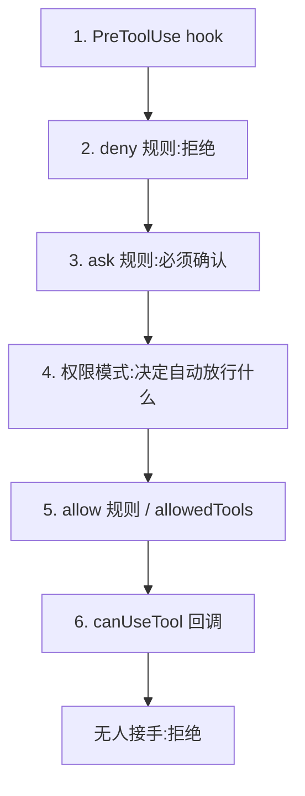

import { Canvas, Controls, Meta } from '@storybook/addon-docs/blocks';
import * as PermissionModes from './permission-modes.stories';

<Meta of={PermissionModes} name="Docs" />

# 权限模式

`permissionMode` 决定权限评估链路里"权限模式"这一环自动放行什么:同一个改文件脚本,`default` 下 `Edit` 被拒并记入 `permission_denials`,换成 `acceptEdits` 就静默落盘,`plan` 下只读探索不动文件,`bypassPermissions` 下几乎全放。本课区分这四种模式的放行范围、拦截范围与适用场景,顺带给出同类型里另外两个取值(`dontAsk`、`auto`)的边界,以及运行中切换模式的 `setPermissionMode()` 入口。细粒度的 allow/deny/ask 规则与 `canUseTool` 回调是另一门课的主题,这里只给位置和入口,见[权限规则与 canUseTool](?path=/docs/permissions--docs)。看完导读与参考表,你应该能预测:一个没有 `canUseTool` 回调的脚本跑改文件任务,`default` 模式下编辑会被拒,而接受编辑类操作的模式会直接跑通。

`Options.permissionMode` 的类型是 `PermissionMode`,默认 `undefined`——省略时起始模式由 CLI 决定,官方 TypeScript 参考明确提示"可能以 auto 模式启动",所以无人值守任务应显式设置。会话实际以哪个模式起步,读 init 消息的 `permissionMode` 字段即可核对。

| 取值 | 免审批(不问就跑) | 仍会拦下 | 适用场景 |
| --- | --- | --- | --- |
| `default` | 读取类:文件读取与内置只读命令 | 文件编辑与多数命令——落到确认,无 `canUseTool` 即拒 | 敏感工作,逐项审查 |
| `acceptEdits` | 读取 + 工作目录与 `additionalDirectories` 内的文件编辑(`Edit`/`Write`)与 `mkdir`、`touch`、`rm`、`rmdir`、`mv`、`cp`、`sed` | 范围外与受保护路径、关键路径 `rm`、其余命令 | 本地迭代改代码,事后 `git diff` 审查 |
| `plan` | 只读(照 `default` 运行) | 一切文件编辑与改文件的命令——即使 allow 规则匹配也落到确认 | 动手前调研、产出方案 |
| `bypassPermissions` | 几乎一切,含受保护路径写入 | 任何模式都不自动放行的动作(显式 ask 规则、关键路径 `rm` 等);必填 `allowDangerouslySkipPermissions` | 仅限隔离容器/VM |
| `dontAsk`(补充) | 读取 + 已被规则或 `allowedTools` 预先批准的 | 会触发确认的一律自动拒绝,`canUseTool` 永不触发 | 锁死的 CI 与脚本 |
| `auto`(补充) | 例行动作由模型分类器代审,免人工提示 | 分类器拦截项;可用性受套餐与模型限制 | 信任大方向、想减少提示的长任务 |

## 快速上手

同一个改文件任务,只改 `permissionMode` 这一个选项,对照两次运行。前置环境沿用[安装与凭证](?path=/docs/install--docs)(SDK 已装、`ANTHROPIC_API_KEY` 可见),工作目录下放一个带 bug 的 `utils.py`(见[第一次运行](?path=/docs/first-run--docs))。脚本不提供 `canUseTool` 回调,所以落到"需要确认"的调用一律被拒。

```ts
// 对照实验:同一个改文件任务,只改 permissionMode 这一个选项。
// 前置:SDK 已安装,ANTHROPIC_API_KEY 可见;工作目录下有带 bug 的 utils.py;
//       脚本未提供 canUseTool 回调,落到"需要确认"的调用一律被拒。
// 预期:default 下 Edit 被拒,agent 报告无法修改,permission_denials 非空;
//       acceptEdits 下编辑自动放行,utils.py 被真实改写,denials 为空。
import { query } from "@anthropic-ai/claude-agent-sdk";

for await (const message of query({
  prompt: "Fix the crash bugs in utils.py.",
  options: {
    permissionMode: "default", // 换成 "acceptEdits" 再跑一次对照
  },
})) {
  // init 消息回报会话实际起步的模式,是核对 permissionMode 生效的第一入口
  if (message.type === "system" && message.subtype === "init") {
    console.log("起始模式:", message.permissionMode);
  }
  if (message.type === "assistant" && message.message?.content) {
    for (const block of message.message.content) {
      if ("name" in block) console.log(`Tool: ${block.name}`);
    }
  }
  if (message.type === "result") {
    console.log("结束:", message.subtype);
    console.log("被拒调用数:", message.permission_denials?.length ?? 0);
  }
}
```

预期输出——`default`(agent 文字每次不同,结构相同):

```text
起始模式:default
Tool: Read
Tool: Edit
结束:success
被拒调用数:1
```

agent 读到文件、尝试编辑,编辑被拒后只能报告"无法修改"。预期输出——`acceptEdits`:

```text
起始模式:acceptEdits
Tool: Read
Tool: Edit
结束:success
被拒调用数:0
```

编辑静默放行,`utils.py` 被真实改写。两次运行的差异全部来自模式这一环:消息流的消费方式见[消息流](?path=/docs/message-stream--docs),`permission_denials` 字段的含义见[第一次运行](?path=/docs/first-run--docs)。

## 评估链路中的模式

一次工具调用的权限评估按固定顺序走六步,从上到下,任何一步放行或拒绝,评估即停;`permissionMode` 是其中第 4 步:



三条跨模式的事实把本课和其他环节划清边界:

- **deny 规则任何模式都生效**,包括 `bypassPermissions`——想硬禁一个操作,写 deny 规则,别指望模式兜底。
- **allow 规则在 `bypassPermissions` 下无效**:该模式本来就不看放行规则。
- **SDK 没有终端交互界面**,评估走到"需要确认"时,调用由 `permissionPrompts` 决定去处:默认 `'host'` 路由给 `canUseTool` 回调,`'none'` 直接拒绝;没有回调时就是拒。规则写法与回调的完整用法见[权限规则与 canUseTool](?path=/docs/permissions--docs)。

下面的实例回放五种模式对六类调用的判定(演示数据,不调用模型;前提是无 hooks、无权限规则、无 `allowedTools`、无 `canUseTool` 回调;`auto` 依赖模型分类器,不可确定性复现,不纳入):

<Canvas of={PermissionModes.Interactive} />
<Controls of={PermissionModes.Interactive} />

| 读者操作 | 可观察证据 |
| --- | --- |
| 模式保持 `default`,选「Edit src/app.ts」 | 该格红色「拒绝」,决定环节是 canUseTool(缺),免审批 1/6 |
| 切到 `acceptEdits` | 同一格变绿「放行」,决定环节变为权限模式,免审批 3/6 |
| 选「rm -rf /」,切到 `bypassPermissions` | 仍是「拒绝」——关键路径删除任何模式都不自动放行 |
| 切到 `dontAsk` | 除读取外全部红色,说明提示 canUseTool 永不触发 |
| 打开 Show code | 看到该 Canvas 实际执行的 `permission-modes-demo.ts`,上半部分即判定函数 |

### default 模式

标准权限行为:只有读取类免审批——工作目录内的文件读取与内置只读命令;文件编辑与多数命令走到链路后续,靠 `allowedTools` 点名或 `canUseTool` 接手,两者皆无则一律被拒。

```ts
// default 模式:只放行读取,其余靠 allowedTools 点名或 canUseTool 接手。
// 预期:Bash(npm test) 命中放行直接执行;agent 若想改文件,编辑仍被拒(未放行)。
for await (const message of query({
  prompt: "跑一遍测试并总结失败原因;不要修改任何文件",
  options: {
    permissionMode: "default",
    allowedTools: ["Bash(npm test)"], // 规则写法见权限规则与 canUseTool 一课
  },
})) {
  // 处理消息……
}
```

预期:`Bash(npm test)` 走放行规则执行,读取无需批准,任何写操作被拒。适用判断:`default` 适合敏感工作与逐项审查;SDK 场景下"逐项"必须有 `canUseTool` 接,否则等于全拒——这不是故障,是模式语义。

### acceptEdits 模式

在 `default` 之上自动放行文件编辑与文件系统命令:`Edit`、`Write`,以及 `mkdir`、`touch`、`rm`、`rmdir`、`mv`、`cp`、`sed`;范围是工作目录与 `additionalDirectories`,SDK 会做符号链接检查。范围之外——其他路径、受保护路径(如 `.git`、`.claude`)、关键路径删除——以及其余命令仍走到确认。

```ts
// acceptEdits:范围内的编辑与文件系统命令免审批;命令执行仍要走审批链。
// 预期:Edit/Write 直接落盘;Bash(npm test) 不在其列,无回调即被拒。
for await (const message of query({
  prompt: "修复 utils.py 的两处崩溃 bug,然后跑 npm test 验证",
  options: { permissionMode: "acceptEdits" },
})) {
  // 处理消息……
}
```

预期:`Edit` 放行、文件被改;`npm test` 被拒,`permission_denials` 计 1,agent 报告测试未能运行。适用判断:本地迭代改代码的主流选择,配合事后 `git diff` 审查;无人值守改文件任务的起点(见[第一次运行](?path=/docs/first-run--docs)),再用 `maxTurns`、`maxBudgetUsd` 兜底(见 [Options](?path=/docs/options--docs))。

### plan 模式

只读探索不改文件:读取类照 `default` 运行,文件编辑从不自动放行——即使 allow 规则匹配也会落到确认;会改文件的 shell 命令(`touch`、`rm` 等)同样落到确认。没有 `canUseTool` 时这些调用被拒,所以 plan 模式的产出就是方案文本本身。

```ts
// plan 模式:只读探索并产出方案;文件编辑从不自动放行,即使 allow 规则匹配。
// 预期:读文件、搜索照常执行;agent 尝试 Edit 时被拒(无回调),流里拿到的是方案文本。
for await (const message of query({
  prompt: "调研 auth 模块的登录实现,提出重构方案,先不要动代码",
  options: { permissionMode: "plan", allowedTools: ["Read", "Grep"] },
})) {
  // 处理消息……
}
```

预期:调研类工具调用正常执行,流里是方案文本;`Edit` 若被尝试,记入 `permission_denials`。三个边界:`planModeInstructions` 可替换 plan 模式默认工作流正文;Claude 可能用 `AskUserQuestion` 澄清需求——这类需要用户交互的工具任何模式都不自动放行,SDK 里的处理入口见[附件与用户输入](?path=/docs/user-input--docs);官方建议的完整流程是 plan 起步、确认方案后切 `acceptEdits` 动手(见下文"运行中切换模式")。

### bypassPermissions 模式

跳过权限提示与安全检查,工具调用立即执行,包括受保护路径写入。两道例外仍然会拦:显式 ask 规则,以及"任何模式都不自动放行"的动作(关键路径 `rm`/`rmdir`、需要用户交互的工具等)——SDK 里它们路由给 `canUseTool`,没有回调就被拒。

```ts
// bypassPermissions:跳过权限检查;allowDangerouslySkipPermissions 是必填前置。
// 预期:工具调用不再有确认环节;只应在隔离容器/VM 里这样跑。
for await (const message of query({
  prompt: "把数据迁移脚本跑完,不要停下来问我",
  options: {
    permissionMode: "bypassPermissions",
    allowDangerouslySkipPermissions: true, // 缺了它,会话起不来
  },
})) {
  // 处理消息……
}
```

四个硬边界:`allowDangerouslySkipPermissions: true` 是必填前置,启动时与之后 `setPermissionMode()` 切换时都要(默认 `false`);Linux/macOS 上以 root/sudo 运行会拒绝启动,认可的沙箱内才自动跳过该检查;`allowedTools` 不会限制它;子代理定义里的 `"bypassPermissions"` 永不生效,子代理只在父会话本身 bypass 时才 bypass(见[子代理](?path=/docs/subagents--docs))。官方警告:只在无法触达宿主机的隔离环境(容器/VM)里使用。

## 运行中切换模式

`query()` 返回的 `Query` 对象带 `setPermissionMode(mode: PermissionMode): Promise<void>`,可以在会话运行中改模式。官方权限页给出的典型流程:plan 起步探索,方案定了再放开编辑。

```ts
// 官方示例流:plan 起步只读探索,方案确认后切 acceptEdits 动手。
// 预期:前半段只读调研;切到 acceptEdits 后编辑开始落盘。
const q = query({
  prompt: "Refactor the auth module to use OAuth",
  options: { permissionMode: "plan" },
});
// 前期:plan 模式只读调研
await q.setPermissionMode("acceptEdits"); // 方案确认后放开编辑
for await (const message of q) {
  // 处理消息……
}
```

边界:官方 TypeScript 参考把该方法标注为仅流式输入模式可用,而官方权限页的示例在字符串 prompt 下先切换再迭代;两种写法以你固定的 SDK 版本实测为准,需要确保中途切换可靠时用流式输入(见[多轮对话](?path=/docs/multi-turn--docs))。切换模式不影响 deny 与 ask 规则——它们在链路中排在模式之前。

## 最佳实践

- **按信任边界选模式,不按"提示烦不烦"。** 本地有人盯:`default` 或 `acceptEdits`,靠 `git diff` 事后审查;动手前要对齐方案:`plan`,确认后 `setPermissionMode` 切出;无人值守改文件:`acceptEdits` 加 `maxTurns`/`maxBudgetUsd` 兜底;完全隔离的容器:`bypassPermissions` 加必填开关。硬性禁令永远写 deny 规则——它是唯一任何模式都生效的拦截手段。
- **无人值守显式设置 `permissionMode`,并给"确认"一个去处。** 省略时起始模式由 CLI 决定、可能以 auto 启动,行为不可预测;要么提供 `canUseTool` 接住确认,要么 `permissionPrompts: "none"` 明确拒绝,不要让调用落在无人应答的确认态。
- **在 bypass 里保留最后防线要靠规则,不靠回调。** deny 规则与关键路径机制在 `bypassPermissions` 下仍然生效,是仅存的拦截手段;`canUseTool` 回调在该模式下会被绕过(见下文常见问题),审计逻辑不要押在它身上。

## 常见问题

- 设了 `permissionMode: "bypassPermissions"`,会话启动报错,或某些调用还是没执行。
  先查 `allowDangerouslySkipPermissions: true` 是否打开——它是该模式的必填前置,启动与 `setPermissionMode` 切换都要求;Linux/macOS 以 root/sudo 运行会被直接拒绝启动;组织侧可用 `disableBypassPermissionsMode` 禁用该模式。个别调用没执行则是另一回事:ask 规则匹配与关键路径 `rm` 属于"任何模式都不自动放行"的动作,bypass 下仍会走确认,SDK 里落到 `canUseTool`,无回调即拒。

- 传了 `canUseTool` 回调,在 `bypassPermissions` 模式或 `allowedTools` 裸工具名下却不触发。
  设计如此:模式自动放行与裸工具名放行都发生在回调之前。SDK 检测到这种组合会发出 `CLAUDE_SDK_CAN_USE_TOOL_SHADOWED` 警告;需要每次调用都过手,就不要用 bypass 模式,也不要用裸工具名放行。

- plan 模式下给 `Edit` 配了 `allowedTools`(或 allow 规则),编辑还是没被放行。
  plan 模式的语义是文件编辑从不自动放行,规则匹配也只会落到确认。用 `canUseTool` 接住(见[权限规则与 canUseTool](?path=/docs/permissions--docs)),或方案确认后 `setPermissionMode` 切出 plan 再动手。

## 总结回顾

摘要:

`permissionMode` 是权限评估链路六步中的第 4 步,决定哪些调用不问就跑;类型 `PermissionMode` 官方列出六个值,主线是四种:`default` 只放读取,其余落到确认、无 `canUseTool` 即拒;`acceptEdits` 加上工作目录与 `additionalDirectories` 内的文件编辑与 `mkdir`/`touch`/`rm` 等文件系统命令;`plan` 只读探索,文件编辑即使规则匹配也不自动放行;`bypassPermissions` 几乎全放,但必填 `allowDangerouslySkipPermissions`、拒 root/sudo,且 deny 规则、ask 规则与关键路径删除仍会拦。补充取值 `dontAsk` 把会提示的调用一律自动拒,`auto` 由模型分类器代审且可用性受限。模式可用 `setPermissionMode()` 运行中切换,典型流程是 plan 起步、确认后切 `acceptEdits`。省略 `permissionMode` 时起始模式由 CLI 决定、可能以 auto 启动,无人值守必须显式设置;会话实际起步模式读 init 消息核对。

一句话:

> 模式决定"哪一环自动放行":default 只放读取,acceptEdits 加文件编辑,plan 只看不动,bypassPermissions 几乎全放但要显式开关加隔离环境;硬边界交给 deny 规则。

知识要点:

- 权限评估链路有哪六步?模式是第几步?deny 规则与 allow 规则分别在哪些模式下生效?
- 四种主模式各自的免审批范围与拦截范围是什么?分别适用什么场景?
- `acceptEdits` 自动放行哪些工具与命令?路径范围怎么划(工作目录、`additionalDirectories`、受保护路径、关键路径)?
- `plan` 模式下 allow 规则为什么放不开文件编辑?官方建议的 plan → acceptEdits 流程怎么写?
- `bypassPermissions` 的必填前置是什么?哪些调用在它之下仍会拦?
- `setPermissionMode()` 的签名与使用注意是什么?
- 省略 `permissionMode` 时起始模式由谁决定?怎么核对会话实际起步的模式?

## 参考资料

- [Configure permissions](https://code.claude.com/docs/en/agent-sdk/permissions)(权限评估链路、各模式细节、acceptEdits 范围、plan/bypassPermissions 边界、子代理继承与 SDK 警告)
- [TypeScript SDK reference](https://code.claude.com/docs/en/agent-sdk/typescript)(`PermissionMode` 类型、`Options.permissionMode` 默认值、`setPermissionMode`、`allowDangerouslySkipPermissions`、`permissionPrompts`)
- [Choose a permission mode](https://code.claude.com/docs/en/permission-modes)(各模式"免问即跑"范围、受保护路径与关键路径、`dontAsk`/`auto` 的行为背景)
