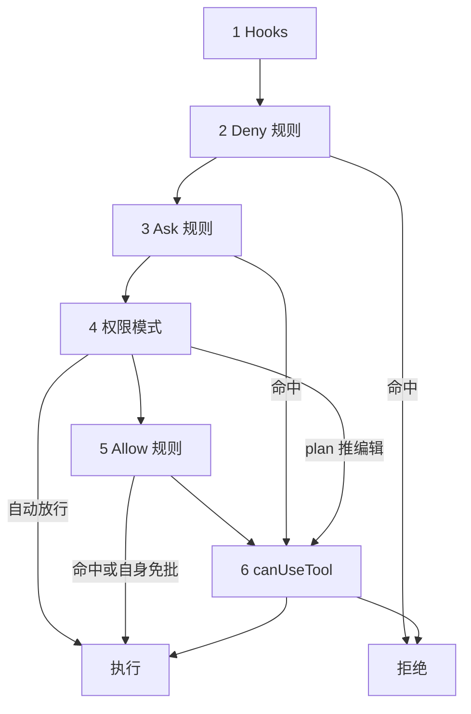

import { Canvas, Controls, Meta } from '@storybook/addon-docs/blocks';
import * as Permissions from './permissions.stories';

<Meta of={Permissions} name="Docs" />

# 权限规则与 canUseTool

Claude 每次想动工具,SDK 都按固定顺序过一条评估链:hooks → deny 规则 → ask 规则 → 权限模式 → allow 规则 → canUseTool 回调。规则是一条 `Tool(specifier)` 模式字符串,声明"这类调用免批 / 必问 / 禁止";canUseTool 兜住前面没拦下的每一次调用,应答时不只能放行或拒绝,还能改写工具输入、把批准落成规则留给下次。本课讲清评估链每一步谁说了算、各家工具的规则语法、回调何时被触发与如何应答。看完导读与参考表,你应该能预测:把裸名 `"Bash"` 放进 `allowedTools` 后再配置 `canUseTool`,Bash 调用还会不会走到回调。

与[权限模式](?path=/docs/permission-modes--docs)的分工:模式决定评估链第 4 步的整体放行策略,是会话级的粗控;本课讲单次调用怎么被规则与回调精细裁决,衔接处只讲先后顺序与覆盖关系。

| 输入 | 默认 | 回查要点 |
| --- | --- | --- |
| `allowedTools` | `[]` | allow 规则入口;裸名条目在回调之前放行整个工具,不是白名单 |
| `disallowedTools` | `[]` | deny 规则入口;裸名把工具从上下文移除,作用域规则在任何模式下都拒绝 |
| `canUseTool` | `undefined` | 只在评估链落到"提示"时触发;未配置时本应提示的调用被直接拒绝 |
| `permissionPrompts` | `'host'` | `'host'` 路由给回调,`'none'` 不调回调、直接拒绝本应提示的调用 |
| 规则匹配顺序 | deny → ask → allow | 第一条命中的名单决定结果,与规则具体程度无关 |
| settings.json 规则 | 随已启用的设置层加载 | SDK 页点名 `"project"` 来源;各层并集合并,`[]` 则文件规则全关 |
| `suggestions` | 由 CLI 备好 | 回调第三参携带现成 `PermissionUpdate`,回填 `updatedPermissions` 免下次询问 |

## 快速上手

用最小脚本接上 `canUseTool`,看它怎么接管一次工具调用。前置环境沿用[安装与凭证](?path=/docs/install--docs)(SDK 已装、`ANTHROPIC_API_KEY` 可见)。

```ts
// 前置:SDK 已安装,ANTHROPIC_API_KEY 对当前进程可见。
// 预期:删除类 Bash 命令被拒绝,Claude 读到 message 后换方案;其余调用照常执行。
import { query } from "@anthropic-ai/claude-agent-sdk";

for await (const message of query({
  prompt: "清空 dist 目录后重新构建",
  options: {
    canUseTool: async (toolName, input) => {
      if (toolName === "Bash" && String(input.command).startsWith("rm ")) {
        // deny:message 会回给 Claude,它可能换一种做法
        return { behavior: "deny", message: "禁止 rm -rf,请使用构建脚本自带的清理命令" };
      }
      // allow:updatedInput 传回原输入,工具按原样执行
      return { behavior: "allow", updatedInput: input };
    },
  },
})) {
  if (message.type === "assistant") {
    for (const block of message.message.content) {
      if ("name" in block) console.log("调用:", block.name);
    }
  }
  if (message.type === "result" && message.subtype === "success") {
    console.log("结果:", message.result);
  }
}
```

预期输出(第二次 Bash 是换了清理方式之后的构建命令):

```text
调用: Bash
调用: Bash
结果: 已清理 dist 并完成重新构建……
```

两处从这段就能看出的行为:第一,回调只在调用落到"提示"这一步时触发——若把 `"Bash"` 裸名放进 `allowedTools`,上面的 Bash 调用会在 allow 规则那步被放行,回调一次都不会执行;第二,没配置 `canUseTool` 时,本应提示的调用被直接拒绝而不是挂起。

## 评估顺序

Claude 请求一次工具调用后,SDK 按固定顺序过六个检查点,任何一个都能终止评估。先记住三组先后关系:**deny 与 ask 规则在模式之前**,`bypassPermissions` 压不过它们;**allow 规则在模式之后**,所以 `allowedTools` 收不住 `bypassPermissions`,想收窄只能用 `disallowedTools`;**canUseTool 永远最后**,任何提前放行都会跳过它。



| 步骤 | 谁参与 | 命中后 | 未命中去向 |
| --- | --- | --- | --- |
| 1 Hooks | `hooks` 里的 PreToolUse 回调 | 可拒绝或放行;hook 的 allow 不跳过后面的 deny 与 ask 规则 | 进入下一步 |
| 2 Deny 规则 | `disallowedTools` + settings 的 `deny` | 拒绝——任何模式都挡,含 `bypassPermissions` | 进入下一步;裸名规则到不了这里,工具早已从上下文移除 |
| 3 Ask 规则 | settings 的 `ask`(仅此入口) | 交给 canUseTool 确认,`bypassPermissions` 也拦得回;`dontAsk` 模式下改为拒绝 | 进入下一步 |
| 4 权限模式 | `permissionMode` | `bypassPermissions` 放行;`acceptEdits` 放行文件操作;`plan` 把编辑推给回调;`dontAsk` 不放行 | 进入下一步 |
| 5 Allow 规则 | `allowedTools` + settings 的 `allow` | 放行;无需规则的调用(工作目录内读文件、内置只读命令)也在这步解决 | 进入下一步 |
| 6 canUseTool | 你的回调 | allow / deny,可改写输入 | 未配置回调、`permissionPrompts: 'none'` 或 `dontAsk` 模式 → 拒绝 |

三点模式衔接:

- 模式的整体行为与适用场景见[权限模式](?path=/docs/permission-modes--docs);`PermissionMode` 类型另有较新的 `dontAsk` 与 `auto` 取值——前者把本应提示的调用直接拒绝、永远不调回调,后者交给模型分类器逐个审查。
- `rm`/`rmdir` 对关键路径的删除是"任何模式都不自动放行"的例外,allow 规则对它同样无效,各模式下的去向见权限模式课。
- 遮蔽警告只盯两类"整工具放行"的配置:`bypassPermissions` 与裸名 `allowedTools` 条目;带 specifier 的条目与 `acceptEdits` 不触发警告,但被它们放行的调用同样进不了回调(见下节)。

下面的实例回放一次调用的完整判定路径:换调用、开关规则与模式,看六步各自判了什么、哪一步终止评估、canUseTool 是否被触发(演示数据,判定路径对应官方评估顺序,只覆盖正文讲到的分支):

<Canvas of={Permissions.Interactive} />
<Controls of={Permissions.Interactive} />

| 读者操作 | 可观察证据 |
| --- | --- |
| 观察默认状态 | allow 规则 `Bash(npm *)` 在第 5 步命中:调用执行,canUseTool 未触发 |
| 选「Bash: rm -rf build/」并打开「deny 规则 Bash(rm *)」 | 第 2 步命中、任何模式下都拒绝——把模式切到 bypassPermissions 也一样 |
| 选「Read: ./.env」并打开「ask 规则 Read(./.env)」 | 第 3 步命中直接路由到回调,即使模式是 bypassPermissions;切到 dontAsk 则变成拒绝 |
| 关掉「已配置 canUseTool」并选「mcp__github__get_issue」 | 六步走完没人应答,读数显示调用被直接拒绝 |
| 打开「allowedTools 裸名 "Bash"」并选「Bash: npm test」 | 第 5 步放行整个工具,回调未触发;已配置回调时出现 CLAUDE_SDK_CAN_USE_TOOL_SHADOWED 警告 |

### 回调被遮蔽的警告

两类配置会让 SDK 在 `query()` 构造时发出一次 Node 进程警告(代码 `CLAUDE_SDK_CAN_USE_TOOL_SHADOWED`):`permissionMode: 'bypassPermissions'`,以及 `allowedTools` 里的每个裸名条目(如 `"Read"`)——它们都会在回调被咨询之前自动放行调用,回调对这部分调用形同虚设。带 specifier 的条目(`Bash(ls *)`)与 `acceptEdits` 模式不触发警告;settings 文件里的 allow 规则也会遮蔽回调,但不参与这项检测。

```ts
// 预期:构造 query 时进程收到一次警告,warning.code 为 CLAUDE_SDK_CAN_USE_TOOL_SHADOWED;
//       bypassPermissions 与裸名 "Read" 都会在回调被咨询前放行调用。
process.on("warning", (warning) => {
  if (warning.code === "CLAUDE_SDK_CAN_USE_TOOL_SHADOWED") {
    console.warn("canUseTool 被遮蔽:", warning.message);
  }
});

query({
  prompt: "...",
  options: {
    permissionMode: "bypassPermissions", // 触发源 1:模式先放行
    allowedTools: ["Read"],              // 触发源 2:裸名条目先放行整个工具
    canUseTool: async (toolName, input) => ({ behavior: "allow", updatedInput: input }),
  },
});
```

看到这条警告时的选择:收窄放行面(裸名改作用域条目、换 `default` 模式),让调用真正落到回调;或者承认回调不需要覆盖这些调用,把必须逐次执行的检查改写成 PreToolUse hook——hook 先于评估链的一切,deny 在 `bypassPermissions` 下也生效(见[Hook 事件](?path=/docs/hooks--docs)与两课的分工辨析)。

## 权限规则

规则是 `Tool` 或 `Tool(specifier)` 模式字符串:裸名匹配该工具的全部调用,括号里的 specifier 收窄到具体输入;specifier 内部的括号按字面量处理,命令或路径里带括号无需转义。三张名单、两个入口:

| 名单 | 程序化入口(Options) | 文件入口(settings.json) |
| --- | --- | --- |
| allow | `allowedTools` | `permissions.allow` |
| deny | `disallowedTools` | `permissions.deny` |
| ask | 无——只能写进文件 | `permissions.ask` |

`allowedTools` / `disallowedTools` 往对应名单里加条目;文件规则随 `settingSources` 启用的设置层加载、各层并集合并,SDK 文档点名 `"project"` 来源——显式传 `settingSources` 时要包含它(见[设置来源](?path=/docs/settings-sources--docs))。三张名单的匹配顺序是 **deny → ask → allow**,第一条命中的决定结果,规则更具体也改变不了顺序:allow 不能给 deny 开例外,更具体的 allow 也压不过同命中的 ask。

deny 的裸名与作用域两种形态行为完全不同,allow 同理:

| 写法 | 作为 deny | 作为 ask | 作为 allow |
| --- | --- | --- | --- |
| 裸名 `Bash`(或 `Bash(*)`) | 工具整个从上下文移除,Claude 看不到也调不了 | 该工具每次调用都提示 | 放行该工具全部调用(会触发遮蔽警告) |
| 作用域 `Bash(rm *)` | 工具保留;匹配的调用在任何模式下拒绝 | 匹配的调用必问 | 只放行匹配的调用,其余照走评估链 |

### Bash 规则

Bash 规则匹配"写的命令文本",`*` 代表任意文本。写法对照:

| 规则 | 匹配 | 不匹配 |
| --- | --- | --- |
| `Bash(npm run build)` | `npm run build` | `npm run build --watch` |
| `Bash(npm run *)` | `npm run build`、`npm run` | `npm install` |
| `Bash(ls *)` | `ls -la`、`ls` | `lsof`(空格是规则的一部分) |
| `Bash(ls*)` | `ls -la`、`lsof` | |
| `Bash(git log * main)` | `git log --oneline main` | `git log main` |

判断:`*` 放在子命令之后——`Bash(git log *)` 只放行 git log,`Bash(git *)` 放行所有 git 命令;尾部 ` *`(前面带空格)还匹配裸命令,`Bash(ls *)` 连 `ls` 本身也放行;`:*` 后缀与尾部 ` *` 等价。带 `*` 的 allow 规则若把通配放在子命令之前(如 `Bash(git * main)`),启动时会收到警告。

复合命令按 `&&`、`||`、`;`、`|`、`|&`、`&`、换行拆成子命令独立匹配;deny/ask 命中任一子命令(包括藏在子壳、命令替换、循环体里的)即触发。包装器 `timeout`、`time`、`nice`、`nohup`、`stdbuf`、`command`、`builtin` 及 zsh 的 `noglob` 会先剥掉再匹配,所以 `Bash(npm test *)` 也匹配 `timeout 30 npm test`。

最重要的边界:**规则匹配的是命令文本,不是程序本身**——`Bash(rm *)` 拦得住 `rm -rf build/`,拦不住 `/bin/rm -rf build/`、`bash -c 'rm -rf build/'`;`Bash(git push *)` 拦不住 `git -C . push origin main`。deny 规则因此不是安全边界:不依赖命令文本的约束交给[沙箱](?path=/docs/sandbox--docs),逐命令的自定义检查交给 PreToolUse hook。

两个补充判断:内置只读命令(`ls`、`cat`、`head`、`tail`、`grep`、`find`、`git` 只读形式等)任何模式都不提示、不需要规则,想让其中某个命令走提示就给它加 ask 规则;deny/ask 还能按输入参数匹配(`Bash(run_in_background:true)`、`Agent(model:opus)`),但主内容字段不可参数匹配——`Bash(command:...)` 会被忽略并告警。

```ts
// Options 两个名单里放同样的字符串;ask 名单只有 settings.json 一个入口
query({
  prompt: "...",
  options: {
    allowedTools: ["Bash(npm run *)", "Bash(git commit *)"],
    disallowedTools: ["Bash(git push *)"],
  },
});
```

```json
// .claude/settings.json:三张名单;settingSources 含 "project"(默认)时加载
{
  "permissions": {
    "allow": ["Bash(npm run *)"],
    "ask": ["Bash(git push *)"],
    "deny": ["Read(./.env)"]
  }
}
```

预期:`npm run build` 免批;`git push` 每次必问;读 `.env` 直接拒绝。

### Read 与 Edit 规则

路径规则用 gitignore 语法,四种锚点:

| 锚点 | 含义 | 例 |
| --- | --- | --- |
| `//path` | 文件系统绝对路径 | `Read(//Users/alice/secrets/**)` |
| `~/path` | 家目录相对 | `Read(~/Documents/*.pdf)` |
| `/path` | 锚在规则来源 | project / local 层 = 主工作目录;user 层 = `~/.claude`;`--settings` 文件 = 文件所在目录 |
| `path` / `./path` | 相对当前目录 | `Read(*.env)` |

判断:单个 `/` 开头不是绝对路径——`/Users/alice/file` 锚在规则来源,挡不住磁盘上的同名绝对路径;要绝对路径就用 `//`。

覆盖范围与匹配深度:

- 写路径规则一律写 `Edit(path)`——它管所有写文件的内置工具(含 Write 与 NotebookEdit);`Write(path)` 规则文件权限检查永远不会匹配,写了无效。
- `Read` deny 同时挡住同路径的 Edit 与 Write(包括在该路径新建文件);NotebookEdit 不在其中,"任何工具都别改"的路径要补 `Edit` deny。
- 单段目录模式的匹配深度随名单类型变:`Edit(src/**)` 作为 allow 只匹配 `<cwd>/src`,作为 deny/ask 匹配任意深度的 `src` 目录;想任何名单都全深度,写 `Edit(**/src/**)`。
- `!` 否定模式在同一来源的名单里挖例外:`Read(*.env)` 后跟 `Read(!sample.env)`,则除 `sample.env` 外全部 `.env` 被拒。
- symlink 两头都查:deny 命中请求路径或解析目标任一即拒,allow 要两头都命中才放行。

边界:Read/Edit deny 只管"点名"的文件操作——`grep -r pattern .` 这类不点名文件的读取、脚本自己打开文件的子进程都管不住;OS 级防线是[沙箱](?path=/docs/sandbox--docs)。

```json
// .claude/settings.json:常见组合——挡密钥,放开文档
{
  "permissions": {
    "deny": ["Read(./.env)", "Read(./secrets/**)", "Edit(//etc/**)"],
    "allow": ["Edit(docs/**)"]
  }
}
```

预期:根目录 `.env` 与 `secrets/` 全目录的读取被拒,`/etc` 下任何写被拒,`docs/` 的编辑免批。

### WebFetch 与 MCP 规则

WebFetch 规则用 `domain:` 前缀按主机名匹配,大小写不敏感:`WebFetch(domain:example.com)` 匹配该域;`domain:*.example.com` 匹配任意深度子域但不含裸域 `example.com`;`*` 在其他位置只匹配两 点之间的文本,`WebFetch(domain:example.*)` 匹配 `example.org` 而不匹配 `example.evil.com`。裸 `WebFetch` 与 `WebFetch(domain:*)` 都覆盖所有 URL,但只有 `domain:` 形式联动沙箱域名表。

MCP 规则用配置时的 server 名(接入方式见[接入 MCP server](?path=/docs/mcp-integration--docs)):

| 规则 | 匹配 |
| --- | --- |
| `mcp__puppeteer` | puppeteer server 的任意工具 |
| `mcp__puppeteer__*` | 同上,通配写法 |
| `mcp__github__get_issue` | 该 server 的单个工具 |

两个通配限制:allow 名单里工具名通配的唯一合法位置是 `mcp__<server>__` 前缀之后、server 段不能带 glob——`mcp__github__get_*` 合法,`mcp__puppeteer__*` 合法,但裸 `"*"`、`"B*"`、`"mcp__*"` 这类未锚定的 allow 通配会被忽略并告警,不放行任何调用;deny/ask 名单支持整名 glob,`"*"` 匹配所有工具、`"mcp__*"` 匹配所有 MCP 工具,`disallowedTools: ["*"]` 直接清空工具面。

边界:需要用户交互的工具——`AskUserQuestion` 与标注 `_meta["anthropic/requiresUserInteraction"]` 的 MCP 工具——即使 allow 规则命中也会落到 `canUseTool`(`dontAsk` 模式下改为拒绝)。

## canUseTool 回调

回调是 SDK 版的交互式权限提示:评估链前五步都没解决的调用落到"提示"时被调用。它不是每次调用的必经之路——被 `allowedTools`、allow 规则或模式提前放行的调用永远不会触发它;反过来,未配置回调时本应提示的调用被直接拒绝。`permissionPrompts` 默认 `'host'` 把提示路由给回调,`'none'` 显式声明无人应答;还有一条 `permissionPromptToolName` 通道把提示交给 MCP 工具,本课不展开。

签名与应答类型:

```ts
type CanUseTool = (
  toolName: string,
  input: Record<string, unknown>,
  options: {
    signal: AbortSignal;
    suggestions?: PermissionUpdate[];
    blockedPath?: string;
    mcpServer?: { name: string; source: string };
    decisionReason?: string;
    defaultToNo?: boolean;
    suppressAlwaysAllowRule?: boolean;
    toolUseID: string;
    agentID?: string;
    requestId: string;
  },
) => Promise<PermissionResult | null>;
```

第三个参数的回查表:

| 字段 | 用途 |
| --- | --- |
| `signal` | 运行被中止时收到信号,提示 UI 应同步关闭 |
| `suggestions` | CLI 备好的 `PermissionUpdate[]`,回填 `updatedPermissions` 可免下次询问 |
| `decisionReason` | 触发这次权限请求的原因说明 |
| `blockedPath` | 路径类请求里触发拦截的文件路径 |
| `mcpServer` | MCP 工具所属 server 及其来源;非 MCP 工具无此字段 |
| `toolUseID` / `agentID` | 本次调用的 ID / 所在子代理的 ID |
| `requestId` | 控制请求 ID;应用在带外自行回 `control_response` 时必须回显 |
| `defaultToNo` | `true` 时提示 UI 不得提供一键批准,应打开在拒绝项上 |
| `suppressAlwaysAllowRule` | `true` 时不要提供"总是允许"——落成的规则会比本次动作放行更多 |

返回值:正常返回 `PermissionResult`(下三节);返回 `null` 仅当应用已在带外发送对应 `control_response`(回显 `requestId`),SDK 便不再写响应——其他场景返回 `null` 会让调用被无限期挂起,权限提示不超时。

### allow:放行与改写

```ts
// 原样放行:把 input 传回 updatedInput,工具按 Claude 请求的输入执行
return { behavior: "allow", updatedInput: input };

// 放行前改写:Claude 看到执行结果,但不知道输入被改过
return {
  behavior: "allow",
  updatedInput: {
    ...input,
    command: String(input.command).replace("/tmp", "/tmp/sandbox"),
  },
};
```

- `updatedInput` 省略时按原输入执行;旧版 CLI(v2.1.207 之前)会把缺该字段的 allow 当拒绝并报验证错误,遇到时先升级 CLI 或始终回传 `input`。
- 改写适合收紧路径、补约束;想让 Claude 知道为什么,用 deny 的 `message`。
- 边界:allow 只作用于到达回调的调用,提前放行的调用轮不到这里。

### deny:拒绝

```ts
// 拒绝并把原因回给 Claude:它会读到 message,可能换一种做法继续
return { behavior: "deny", message: "禁止直接删除,请改用构建脚本自带的清理命令" };

// 拒绝并中止整个运行,不再给 Claude 换方案的机会
return { behavior: "deny", message: "越权操作,任务终止", interrupt: true };
```

`message` 写清"为什么拒、可以怎么做",Claude 会据此调整后续动作。`interrupt: true` 在拒绝单个调用的同时中止整个 agent 运行,适合不可挽回的越权场景。

### updatedPermissions:批准并落规则

"批准并记住"的写法:回调第三参 `suggestions` 里是 CLI 备好的 `PermissionUpdate` 数组,把条目回填进 `updatedPermissions`,同类调用下次直接被 allow 规则放行、不再进回调。

```ts
canUseTool: async (toolName, input, { suggestions = [] }) => {
  const choice = await askUser(`允许 ${toolName}?`, ["一次", "总是", "拒绝"]);
  if (choice === "总是") {
    // 只回填 localSettings 目标的建议:规则写入 .claude/settings.local.json,跨会话生效
    const persist = suggestions.filter((s) => s.destination === "localSettings");
    return { behavior: "allow", updatedInput: input, updatedPermissions: persist };
  }
  if (choice === "一次") return { behavior: "allow", updatedInput: input };
  return { behavior: "deny", message: "用户拒绝" };
};
```

回填用的 `PermissionUpdate`:`type` 有 `addRules` / `replaceRules` / `removeRules` / `setMode` / `addDirectories` / `removeDirectories` 六种;规则本体是 `PermissionRuleValue { toolName, ruleContent? }`——`ruleContent` 就是前面学的 specifier 文本;落点 `destination`:

| destination | 写到哪里 |
| --- | --- |
| `userSettings` | `~/.claude/settings.json` |
| `projectSettings` | `.claude/settings.json` |
| `localSettings` | `.claude/settings.local.json`(Bash 提示建议的默认落点) |
| `session` | 仅当前会话 |
| `cliArg` | CLI 参数层 |

## 最佳实践

- **想让检查覆盖每次调用,别放在 canUseTool。** 提前放行(裸名 `allowedTools`、allow 规则、`acceptEdits` / `bypassPermissions`)全部绕过回调;把放行面收窄成作用域规则、保持 `default` 模式,或把强制检查写成 PreToolUse hook——hook 先于评估链的一切,deny 在 `bypassPermissions` 下也生效。
- **无人值守优先"声明式收紧",而不是回调兜底。** 固定工具面用作用域 allow 规则 + `dontAsk` 模式(或 `permissionPrompts: 'none'`),本应提示的调用明确拒绝;`canUseTool` 留给有真人或宿主程序应答的场景,并在回调里处理 `signal`,避免应用退出后提示悬挂。
- **规则当护栏,回调当交互层。** 能预先枚举的禁令与放行写成规则,启动即生效、零运行时成本;需要运行时上下文(人工审批、按任务放行、改写输入)的才进回调;回调里用 `suggestions` 把重复批准沉淀成规则,会话越跑越少询问。
- **规则是文本匹配,不是安全边界。** Bash 规则拦不住换形态的调用,Read/Edit deny 管不住不点名的读取与子进程;把"必须成立"的约束同时配[沙箱](?path=/docs/sandbox--docs)(OS 级)与 deny 规则(声明式)。

## 常见问题

- 配了 `canUseTool`,却一次都没被调用。
  调用在前面被放行了:检查 `allowedTools` 是否有裸名条目、`permissionMode` 是否为 `acceptEdits` / `bypassPermissions`、settings 里是否有命中该工具的 allow 规则;构造 `query()` 时出现 `CLAUDE_SDK_CAN_USE_TOOL_SHADOWED` 警告即为前两类。要让调用回到回调,收窄放行面或换 `default` 模式;要覆盖所有调用,改用 PreToolUse hook。

- 明明写了 `Bash(rm *)` 之类的 deny 规则,删除还是执行了。
  规则匹配"写的命令文本"——`/bin/rm -rf build/`、`bash -c 'rm …'` 这类换形态调用不匹配。看清实际命令形态后补规则(复合命令按子命令独立匹配,规则要写到真实子命令),并把不依赖命令文本的约束交给沙箱或 PreToolUse hook 检查命令全文。

- settings.json 里的 allow / ask / deny 一条都没生效。
  先确认 `settingSources` 含 `"project"` 且文件能通过 JSON 校验——非法 JSON、注释、schema 不匹配都会让整份文件被跳过(排查见[设置来源](?path=/docs/settings-sources--docs));再确认 ask 规则没写进 Options——ask 名单只有 settings 文件一个入口,`allowedTools` / `disallowedTools` 是另外两个独立入口。

## 总结回顾

摘要:

一次工具调用按 hooks → deny 规则 → ask 规则 → 权限模式 → allow 规则 → canUseTool 的固定顺序裁决。规则是 `Tool(specifier)` 模式字符串,走 `allowedTools` / `disallowedTools` 与 settings.json 两个入口,匹配先 deny 后 ask 再 allow、第一条命中决定结果;裸名 deny 把工具从上下文移除,作用域 deny 在任何模式下都拒绝,ask 名单只能写在 settings 文件。Bash 规则匹配命令文本(`*` 放子命令之后、复合命令拆开匹配、换形态调用不匹配),Read/Edit 规则用 gitignore 语法的四种锚点且 `Edit(path)` 管所有写文件工具,WebFetch 按 `domain:` 匹配,MCP 规则以 `mcp__<server>__` 命名。canUseTool 只在调用落到"提示"时触发,提前放行全部绕过——配 `bypassPermissions` 或裸名 `allowedTools` 还会触发遮蔽警告;应答三种形态:allow 可改写 `updatedInput`,deny 带 `message` 与可选 `interrupt`,回填 `updatedPermissions` 可把批准落成规则(`suggestions` 里是现成的 `PermissionUpdate`)。

一句话:

> 评估链定顺序、规则定类别、回调兜底询问——而一切提前放行都会跳过回调,要覆盖每次调用就得用 PreToolUse hook。

知识要点:

- 六步评估链的顺序是什么?deny / ask 规则、allow 规则与权限模式谁先谁后?
- `allowedTools`、`disallowedTools`、settings.json 各承载哪张名单?ask 规则写在哪里?
- 裸名与作用域规则在 deny 和 allow 上分别是什么行为?
- Bash 规则的 `*` 要放在哪里?哪些调用形态拦不住?内置只读命令需要规则吗?
- Read/Edit 路径的四种锚点是什么?`Write(path)` 规则为什么不生效?
- `canUseTool` 何时触发、何时不触发?`CLAUDE_SDK_CAN_USE_TOOL_SHADOWED` 警告由哪两种配置触发?
- `PermissionResult` 的 allow / deny 各带哪些字段?`suggestions` 怎么回填成持久规则?

## 参考资料

- [Configure permissions(Agent SDK)](https://code.claude.com/docs/en/agent-sdk/permissions)(评估顺序、allow/deny 规则、模式衔接与遮蔽警告)
- [Handle approvals and user input(Agent SDK)](https://code.claude.com/docs/en/agent-sdk/user-input)(canUseTool 用法,allow / deny / updatedPermissions 应答)
- [Agent SDK reference - TypeScript](https://code.claude.com/docs/en/agent-sdk/typescript)(CanUseTool、PermissionResult、PermissionUpdate 等类型与 Options 默认值)
- [Permissions(Claude Code)](https://code.claude.com/docs/en/permissions)(规则语法:Bash、Read/Edit、WebFetch、MCP 与匹配限制)
