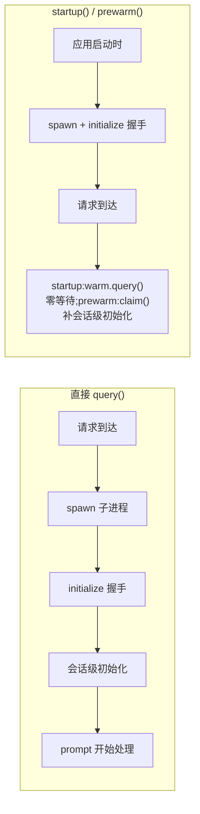

import { Canvas, Controls, Meta } from '@storybook/addon-docs/blocks';
import * as ProcessModel from './process-model.stories';

<Meta of={ProcessModel} name="Docs" />

# 进程与预热

每次 `query()` 的背后都是一次真实的进程启动:SDK 拉起一个捆绑的 Claude Code CLI 子进程,走完 initialize 握手,会话才算就绪。一次性脚本无所谓,但请求驱动的服务里,这笔冷启动成本直接落在用户等待上。本课先讲清子进程模型,再给两把预热工具:工作目录已知用 `startup()`,启动时就拿到就绪的 `WarmQuery`;目录未知用 `prewarm()`(Alpha)留一个备件进程,请求到达时 `claim()` 绑成会话;要应对并发与突发,就用这两个原语自建 warm pool。看完导读与参考表,你应该能预测:三种方式下,用户请求到达时各还要再等什么。



| 项 | 值 / 默认 | 回查要点 |
| --- | --- | --- |
| 冷启动成本 | spawn + initialize 握手 | 默认在 `query()` 关键路径上;预热把它挪到请求前 |
| `startup(params?)` | `initializeTimeoutMs` 默认 `60000` | 目录已知时用;返回 `WarmQuery` |
| `WarmQuery.query(prompt)` | 每个 `WarmQuery` 只能一次 | 发完即完;`close()` 丢弃;支持 `await using` |
| `prewarm(params?)` | Alpha;SDK v0.3.282+ | 目录未知时用;返回 `SpareProcess` |
| 备件等待目录 | `options.cwd`,缺省为配置目录下私有临时目录 | 远程 / 容器场景要给那边存在的目录 |
| 备件内存 | 约 230–260 MB | 池大小用内存预算倒推 |
| `claim({ prompt, options })` | `options.cwd` 必填;只能一次 | 还可设 model、permissionMode 等;拒绝时 fallback `query()` |
| 备件固定项 | `mcpServers`、`hooks`、`canUseTool`、`settingSources`、`systemPrompt`、`plugins` | 一种组合一个备件;组合变了重新预热 |
| 备件禁项 | `resume`、`continue`、`forkSession` | 设置即抛错;备件还没有会话 |
| 内置进程池 | 无 | 池 = 应用层组合 `prewarm` + `exited` + `close` |
| `/core` 入口 | 导出 `startup()`,无 `prewarm()` | 打包后 import 不到 prewarm 先查这里 |

## 子进程模型

当代码调用 `query()`,SDK 会 spawn 一个独立的 `claude` CLI 子进程,并通过 stdio 与它通信;这个子进程拥有 shell、工作目录和本地磁盘上的 JSONL 会话转录。三条推论直接决定生产形态:

- **一个会话对应一个子进程。** N 个并发会话就是 N 个子进程,各有自己的进程树与转录文件。
- **并发上限受宿主机内存约束。** 每个会话常驻一个子进程,RAM 是第一瓶颈。
- **子进程的二进制就是[安装与凭证](?path=/docs/install--docs)课讲的 SDK 捆绑平台原生包**,SDK 版本与捆绑 CLI 版本一一对应。

冷启动由两段成本构成:**spawn**(拉起原生二进制)与 **initialize 握手**(SDK 与子进程交换初始化信息)。默认它们都在 `query()` 的关键路径上——prompt 要等进程就绪才开始处理。预热的思路就是把这两段挪到请求到达之前。此外还有一层区分,`prewarm()` 会用到:**进程级初始化**(spawn + 握手)可以提前做完;**会话级初始化**——会话的工作目录、`SessionStart` hooks、stdio MCP server、CLAUDE.md 与 git 上下文——依赖"这个会话服务谁",可以留到绑定目录时。

子进程真实存在,可以直接观察:

```bash
# 终端 1:跑第一次运行课的最小脚本(前置:ANTHROPIC_API_KEY 可见)
npx tsx agent.ts

# 终端 2:脚本运行期间观察 CLI 子进程(macOS / Linux)
ps aux | grep -i claude
```

能看到 SDK 拉起的独立 claude 进程;同时跑 N 个会话就出现 N 个。边界:子进程由 SDK spawn 并监督,自己不监听网络端口;打包时不能 bundle 这个二进制,托管形态见[打包与托管](?path=/docs/hosting--docs)。

## startup():已知目录就预热

`startup()` 在 prompt 可用之前就把子进程 spawn 出来并完成 initialize 握手,返回一个 `WarmQuery` 句柄;之后 prompt 就绪时写入已就绪的进程,第一次 `query()` 不再内联支付 spawn 与初始化成本。适用判断很简单:发起请求时已经知道会话的工作目录,就 `startup()`。

```ts
function startup(params?: {
  options?: Options;
  initializeTimeoutMs?: number;
}): Promise<WarmQuery>;
```

| 参数 | 说明 |
| --- | --- |
| `options` | 与 `query()` 的 options 是同一个对象,cwd、model 等照常配置 |
| `initializeTimeoutMs` | 等待子进程初始化的上限(毫秒),默认 `60000`;超时 promise 以超时错误 reject |

`WarmQuery` 的接口只有两个方法:

```ts
interface WarmQuery extends AsyncDisposable {
  query(prompt: string | AsyncIterable<SDKUserMessage>): Query;
  close(): void;
}
```

最小用法——应用启动时预热,请求到达时发 prompt:

```ts
// 前置:SDK 已安装,ANTHROPIC_API_KEY 对进程可见,目录已确定。
// 预期:await startup() 结束时子进程已就绪;warm.query() 的消息流
//       与直接 query() 完全同构(同一套 SDKMessage 流)。
import { startup } from "@anthropic-ai/claude-agent-sdk";

// 应用启动时:spawn 与 initialize 握手在这里发生
const warm = await startup({ options: { cwd: "/work/repo", maxTurns: 3 } });

// 之后请求到达:写入已就绪的进程,不再支付冷启动
for await (const message of warm.query("这个仓库的结构是什么?")) {
  console.log(message);
}
```

`WarmQuery` 实现了 `AsyncDisposable`,可以用 `await using` 让清理自动发生:

```ts
// 离开作用域自动 close,不必手写清理
await using warm = await startup({ options: { cwd } });
```

边界:

- `query()` 每个 `WarmQuery` 只能调用一次——**一次预热服务一个会话**。第二个并发会话要再 `startup()` 一个,或改走下文的备件池。
- `close()` 在不发 prompt 的情况下直接关闭子进程,用来丢弃不再需要的预热。
- `options` 在预热时固定;预热完成后再想改配置,只能重新预热。

## prewarm():目录未知先备件

应用常常先启动、后知道会话服务谁:用户之后才选文件夹,请求到达才知道 `cwd`。`prewarm()`(Alpha,要求 SDK v0.3.282+)为此准备:先启动一个 Claude Code 进程作为**备件**留在手里,之后用 `claim()` 把它绑定成会话。

备件完成与 `startup()` 相同的 initialize 握手,但有几点不同:

- **等待位置:** 设了 `options.cwd` 就在那等;没设就等在 Claude Code 配置目录下的一个私有临时目录。若你的 `spawnClaudeCodeProcess` 把 CLI 跑在另一台机器或容器里,`options.cwd` 必须是那边存在的目录。
- **会话级初始化延后:** 会话的工作目录、`SessionStart` hooks、stdio MCP server、CLAUDE.md 与 git 上下文,都等 `claim()` 时才生效。
- **等待有内存代价:** 一个备件大约占 230–260 MB。
- **禁项:** `options` 里设 `resume`、`continue` 或 `forkSession` 会直接抛错——备件还没有会话可续。

```ts
function prewarm(params?: {
  options?: Options;
  initializeTimeoutMs?: number;
}): Promise<SpareProcess>;
```

`options` 与 `initializeTimeoutMs` 含义同 `startup()`,只是 `options.cwd` 在这里仅设定备件等待的目录;promise 在握手完成后 resolve 出 `SpareProcess`。

### claim:把备件绑成会话

`SpareProcess` 是"已启动、未绑定会话"的进程句柄,只能被认领一次:

```ts
interface SpareProcess extends AsyncDisposable {
  claim(params: {
    prompt: string | AsyncIterable<SDKUserMessage>;
    options: ClaimOptions;
  }): Query;
  readonly claimed: Promise<{
    cwd: string;
    sessionId: string;
    parkedMs?: number;
    sdkMcpSettled: boolean;
  }>;
  readonly exited: Promise<void>;
  close(): void;
}
```

| 成员 | 语义 |
| --- | --- |
| `claim({ prompt, options })` | 把备件绑定到 `options.cwd` 的会话并发送第一条消息;与 `query()` 一样同步返回 `Query`;只能调用一次 |
| `claimed` | Claude Code 接受认领后以 cwd 与 sessionId resolve;拒绝认领、进程先退出或先被 `close()` 时 reject |
| `exited` | 进程退出即 settle(无论是否已被认领);备件在认领前退出就换新的 |
| `close()` | 终止进程;认领之前调用等于丢弃备件,`claimed` 随之 reject |

claim 的 `options` 里 **`cwd` 必填**;此外还能设 `additionalDirectories`、`model`、`permissionMode`、`maxThinkingTokens`、`settings`(flag-settings 覆盖层)、`appendSystemPrompt`、`title`、`agents`,以及 `env` 中的会话级 token。(接口里 `parkedMs`、`sdkMcpSettled` 两个字段的语义官方参考未展开,本文不推测。)

完整旅程——启动时预热,用户选定目录后认领:

```ts
// 前置:SDK >= 0.3.282,ANTHROPIC_API_KEY 对进程可见。
// 预期:prewarm() 返回时备件已就绪;claim() 同步返回 Query,
//       消息流与直接 query() 同构;claimed 完成后才有 sessionId。
import { prewarm } from "@anthropic-ai/claude-agent-sdk";

// 应用启动时,还不知道会话在哪个文件夹
const spare = await prewarm({ options: { maxTurns: 3 } });

// 用户选定项目后:绑定 cwd 并发出第一条 prompt
const running = spare.claim({
  prompt: "这个项目用了哪些依赖?",
  options: { cwd: "/path/to/project" },
});

// claim 可能被拒绝:先挂上判断再消费消息流
spare.claimed.catch((error: Error) => {
  if (!error.message.startsWith("option_not_applied")) {
    // 走到这里说明 prompt 尚未运行:这个会话改用 query() 冷启动
  }
});

for await (const message of running) {
  console.log(message);
}
```

认领有两种失败形态,处理完全不同:

| 现象 | 含义 | 处理 |
| --- | --- | --- |
| `claimed` reject,消息以 `option_not_applied` 开头 | 会话**已在运行**,只是要求的 `model` 或 `maxThinkingTokens` 没有应用 | 读消息确认缺哪项;接受现状或重建会话 |
| `claimed` reject,其他消息 | prompt **尚未运行** | 弃用这个备件,改用 `query()` 冷启动该会话,并补一个新备件 |

Claude Code 可以拒绝认领:目录不存在,或该目录的项目 settings 设置了 `env`、`agent` 或 `model`。

最后一条硬边界:claim 设不了的选项——`mcpServers`、`hooks`、`canUseTool`、`settingSources`、`systemPrompt`、`plugins`——在备件的整个生命周期内固定。**一种固定组合留一个备件,组合变了就重新预热**,这也是池化的分组原则。

## 冷启动对比

三种方式的差别可以压缩成一句话:直接 `query()` 三段全付;`startup()` 把进程级两段挪到启动时,请求零等待;`prewarm()` 同样挪走进程级两段,但保留会话级一段给 `claim()`——这正是它"目录未知也能预热"的代价与收益。下面的实例回放三种方式的阶段归属(全部为演示数据,阶段时长是示意值,不真实调用 LLM API 与 CLI 子进程):

<Canvas of={ProcessModel.Interactive} />
<Controls of={ProcessModel.Interactive} />

| 读者操作 | 可观察证据 |
| --- | --- |
| 把「预热方式」切到 直接 query() | 时间条三段全为橙色,「启动时已完成」读数为无 |
| 切到 startup() | 剩两段蓝色启动段,「用户等待」恒为 0 ms |
| 切到 prewarm() 并拖动「时间进度」 | 游标越过启动段后开始累计用户等待,当前阶段显示会话级初始化 |
| 打开 Show code | 看到该 Canvas 实际执行的 `process-model-timeline-demo.ts`,上半部分是三种方式的阶段数据 |

## 自建 warm pool

SDK 没有内置的进程池 API;官方在托管指南里给的方向是:在预期流量到来之前预热多个子进程——目录已知的用 `startup()`,目录未知的用 `prewarm()`。池就是把 `prewarm()` 组合成备件队列:**取用即 claim,退出即补,关停即清**:

```ts
// 应用层示意实现:官方 SDK 不提供池,以下由文档化的原语组合而成。
// 前置:SDK >= 0.3.282;size 不超过内存预算允许的备件数(每个约 230–260 MB)。
import {
  prewarm,
  query,
  type Options,
  type SpareProcess,
} from "@anthropic-ai/claude-agent-sdk";

/** 一种固定选项组合一个池;options 只放备件生命周期内固定的那些 */
class SparePool {
  private readonly spares: SpareProcess[] = [];

  constructor(
    private readonly size: number,
    private readonly options?: Options,
  ) {}

  // 填池:每个备件已完成 spawn 与 initialize 握手
  async fill(): Promise<void> {
    while (this.spares.length < this.size) {
      const spare = await prewarm({ options: this.options });
      // 备件可能没用就退出:exited 一触发就出队并补新
      void spare.exited.then(() => {
        const index = this.spares.indexOf(spare);
        if (index !== -1) {
          this.spares.splice(index, 1);
          void this.fill();
        }
      });
      this.spares.push(spare);
    }
  }

  // 取用:备件是一次性的,claim 用掉就少一个
  take(): SpareProcess | undefined {
    return this.spares.pop();
  }

  // 按消耗补充,可在 claim 成功后调用
  replenish(): Promise<void> {
    return this.fill();
  }

  // 应用关停:剩余备件全部关闭
  dispose(): void {
    for (const spare of this.spares.splice(0)) {
      spare.close();
    }
  }
}

// 用法:有备件走预热路径,没备件冷启动兜底
async function startSession(pool: SparePool, cwd: string, prompt: string) {
  const spare = pool.take();
  if (!spare) {
    return query({ prompt, options: { cwd } });
  }
  const running = spare.claim({ prompt, options: { cwd } });
  // 生产中再挂 spare.claimed.catch 处理拒绝,见 claim 小节的失败语义表
  void pool.replenish();
  return running;
}
```

池的约束都来自前文的事实:

| 约束 | 依据 |
| --- | --- |
| 池上限 = 内存预算 ÷ 230–260 MB | 每个备件等待期约占这么多内存 |
| 一种固定选项组合一个池 | 固定项在备件生命周期内不可变 |
| 池空 fallback `query()` | 预热是优化不是正确性依赖 |
| 用掉、退出都要补 | `claim()` 只能一次;`exited` 即失效 |
| 关停时 `close()` 全部 | 备件是真实进程,不清理就残留 |

## 最佳实践

- **已知目录用 `startup()`,未知才 `prewarm()`。** 官方判断原话:不知道会话工作目录时用 `prewarm()`。`startup()` 的 options 全量固定,请求路径零初始化;`prewarm()` 换来目录灵活性,但 `claim()` 时仍要付会话级初始化。
- **预热时机跟着可预测的空闲走。** 应用启动、流量高峰前、用户上传或填表单期间;托管场景就是"在预期流量之前预热子进程"。
- **池大小用内存预算倒推。** 先算容器 / 宿主给 agent 的内存,再除以每备件 230–260 MB,余量留给会话运行期的开销。
- **一种固定组合一个池,不混用。** `mcpServers`、`hooks`、`canUseTool`、`settingSources`、`systemPrompt`、`plugins` 不同的会话不能共用备件。
- **生命周期三件事:退出补、用掉补、关停清。** 监听 `exited` 更换失效备件;claim 后及时补充;退出路径用 `close()` 或 `await using` 收尾。

## 常见问题

- `prewarm()` 直接抛错,提示不能带 `resume` / `continue` / `forkSession`。
  从 `options` 里去掉这三项:备件还没有会话,"续会话"不成立;要恢复历史会话就直接用 `query()`。

- `claimed` reject,错误消息以 `option_not_applied` 开头。
  会话已经在跑,只是要求的 `model` 或 `maxThinkingTokens` 没有应用。读消息确认缺哪项,按业务决定接受现状还是重建会话。

- `claimed` reject,其他错误。
  prompt 尚未运行:弃用这个备件,改用 `query()` 冷启动该会话,并补一个新备件。常见诱因是目录不存在,或项目 settings 设置了 `env`、`agent`、`model`。

- 备件还没认领就没了。
  进程退出:监听 `exited`,触发即把备件出队并补充新的(见自建 warm pool)。

- 打包构建后 import 不到 `prewarm`。
  `/core` 入口为减小加载体积裁掉了 `prewarm()`(同被裁的还有 `InMemorySessionStore` 与会话 list / read / fork / import / summarize 助手):从根入口 `@anthropic-ai/claude-agent-sdk` 导入;打包与 `/core` 的完整取舍见[打包与托管](?path=/docs/hosting--docs)。

## 总结回顾

摘要:

本课从进程模型出发:`query()` 每次调用都 spawn 一个捆绑的 Claude Code CLI 子进程,经 stdio 通信,一个会话对应一个子进程,并发受宿主内存约束;冷启动是 spawn 与 initialize 握手两段成本,默认落在请求关键路径上。`startup()` 在目录已知时把这两段挪到应用启动时,返回的 `WarmQuery` 只发一次 prompt,支持 `await using` 清理;`prewarm()`(Alpha,v0.3.282+)在目录未知时留一个已完成握手的备件,等待期占约 230–260 MB,会话级初始化留到 `claim()` 时——claim 的 options 里 `cwd` 必填,认领被拒时按 `option_not_applied` 与其他错误两种形态分别处理,固定选项(`mcpServers`、`hooks`、`canUseTool`、`settingSources`、`systemPrompt`、`plugins`)在备件生命周期内不可变。SDK 没有内置池,自建 warm pool 就是用 `prewarm` + `exited` + `close` 管理一批一次性备件:用掉补、退出补、关停清。

一句话:

> 预热把 spawn 与 initialize 握手挪出请求路径:目录已知用 `startup()` 拿 `WarmQuery`,目录未知用 `prewarm()` 留备件、`claim()` 绑会话,池化就是管理一批备件。

知识要点:

- `query()` 背后的进程模型是什么?一个会话对应什么?并发受什么限制?
- 冷启动由哪两段构成?`prewarm()` 把哪段留到了 `claim()` 时?
- `startup()` 的默认初始化超时是多少?`WarmQuery.query()` 能调用几次?怎么自动清理?
- 备件等待在哪里?占用多少内存?哪些选项在备件生命周期内固定、哪些禁止设置?
- `claim()` 的哪个参数必填?两种认领失败分别怎么处理?
- 为什么池大小要用内存预算倒推?池空时怎么兜底?
- 打包后 import 不到 `prewarm` 的原因是什么?

## 参考资料

- [Agent SDK reference - TypeScript](https://code.claude.com/docs/en/agent-sdk/typescript)
- [Hosting the Agent SDK](https://code.claude.com/docs/en/agent-sdk/hosting)
