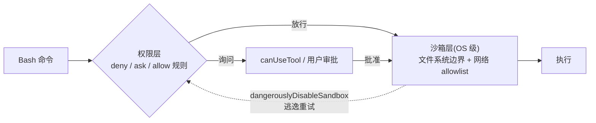

import { Canvas, Controls, Meta } from '@storybook/addon-docs/blocks';
import * as Sandbox from './sandbox.stories';

<Meta of={Sandbox} name="Docs" />

# 沙箱

权限系统决定 agent 能不能跑一条命令,沙箱决定命令跑起来之后能碰什么:文件系统与网络在操作系统层被圈死,即使模型被注入内容诱导,后果也压在边界里。本课讲 SDK 里怎么用 `Options.sandbox` 开启并配置 bash 沙箱——它与权限规则如何合并、`network` / `filesystem` / `credentials` 三组配置各管什么、平台依赖在哪里,以及为什么官方在沙箱之外仍要求容器、代理与凭证分离的纵深防御。CLI 侧的 `/sandbox` 面板和设置文件里的 `sandbox` 键与这里是同一套配置,本课只从 SDK 视角讲。看完导读与参考表,你应该能预测:把 `Options.sandbox` 从省略改成 `{ enabled: true }` 后,同一条 Bash 命令的审批方式与文件、网络可达范围会发生什么变化。



| 项 | 默认 | 回查要点 |
| --- | --- | --- |
| `Options.sandbox` | `undefined`(不启用) | 程序化入口,与设置文件里的 `sandbox` 键同构 |
| `sandbox.enabled` | `false` | 经 `Options.sandbox` 开启时缺依赖会硬失败,见下文「开启与平台前置」 |
| `autoAllowBashIfSandboxed` | `true` | 沙箱内 Bash 免提示;deny 与内容级 ask 规则仍生效 |
| `allowUnsandboxedCommands` | `true` | 设 `false` 即严格模式,`dangerouslyDisableSandbox` 被完全忽略 |
| `failIfUnavailable` | 设置层 `false`;`Options.sandbox` 开启时 `true` | 缺依赖:警告降级 vs 报错退出 |
| 网络边界 | 未列入 allowlist 的域名走权限询问 | `network.allowedDomains` 与 `WebFetch(domain:…)` allow 规则合并 |
| 文件系统边界 | 写:cwd、附加目录、用户临时目录;读默认宽松 | 收紧靠 `filesystem.*` 与 `Read` / `Edit` 规则 |
| 平台 | macOS 内置;Linux/WSL2 需 bubblewrap + socat | 原生 Windows 与 WSL1 不支持 |

## 快速上手

最小闭环:打开沙箱、放行沙箱内命令、圈定可访问域名,跑一个会执行 Bash 的任务。前置环境沿用[安装与凭证](?path=/docs/install--docs)(SDK 已装、`ANTHROPIC_API_KEY` 可见);Linux/WSL2 先装依赖:`sudo apt-get install bubblewrap socat`。

```ts
// 前置:SDK 已安装、ANTHROPIC_API_KEY 可见;Linux/WSL2 已装 bubblewrap 与 socat。
// 预期:Bash 命令在沙箱内免提示执行;命令访问 allowedDomains 之外的域名时走权限询问(canUseTool);
//       试图写 cwd 之外的路径时被 OS 层拒绝。
import { query } from "@anthropic-ai/claude-agent-sdk";

for await (const message of query({
  prompt: "跑一遍 npm test,总结失败的测试用例",
  options: {
    sandbox: {
      enabled: true,
      autoAllowBashIfSandboxed: true,
      network: { allowedDomains: ["registry.npmjs.org", "*.github.com"] },
    },
  },
})) {
  if (message.type === "result" && message.subtype === "success") {
    console.log(message.result);
  }
}
```

```text
普通 Bash 命令不再逐条审批,直接在沙箱内执行;
域名访问被限定在 registry.npmjs.org 与 *.github.com,之外的域名触发 canUseTool 询问;
写操作被圈定在工作目录、附加目录与用户临时目录内。
```

一个 SDK 特有的坑要先说:`Options.sandbox` 传 `enabled: true` 而未显式设置 `failIfUnavailable` 时,SDK 按默认 `failIfUnavailable: true` 处理——平台不支持(原生 Windows)或依赖缺失(如 Linux 缺 bubblewrap)时,`query()` 直接报错退出,而不是静默降级为无沙箱运行。能容忍降级的场景显式传 `failIfUnavailable: false`。

## 权限与沙箱

两层各管一段、同时生效:**权限规则在命令运行前决定工具能不能跑**(allow/ask/deny、`canUseTool`,见[权限规则与 canUseTool](?path=/docs/permissions--docs));**沙箱在命令运行期间用 OS 机制限制它能碰什么**。两层的路径与域名规则互相合并:

| 沙箱配置 | 合并的权限规则 |
| --- | --- |
| `network.allowedDomains` | `WebFetch(domain:…)` allow 规则 |
| `filesystem.allowWrite` | `Edit(…)` allow 规则 |
| `filesystem.denyRead` | `Read(…)` deny 规则 |
| `network.deniedDomains`、`filesystem.denyWrite` | 无对应权限规则,仅沙箱层 |

`autoAllowBashIfSandboxed: true`(默认)时,沙箱内的 Bash 命令免逐条审批,但以下情况仍会打断会话:

- **deny 规则始终生效**——沙箱内外都拒绝;
- **`rm` / `rmdir` 作用于关键路径时仍会提示**;
- **内容级 ask 规则**(如 `Bash(git push *)`)仍会提示——沙箱免提示不越过 ask;
- 裸 `Bash` / `Bash(*)` 的 ask 规则对沙箱内命令跳过(否则沙箱免提示失去意义)。

沙箱的 auto-allow 独立于权限模式:即便处于 default 模式,沙箱内命令也免提示(见[权限模式](?path=/docs/permission-modes--docs))。反过来,`Read` / `Edit` / `Write` 这类进程内工具不走沙箱,仍由权限系统管——沙箱圈的是 Bash 命令及其子进程。

两条调整边界的旁门,都要认清性质:

- **逃逸口:** 命令在沙箱内失败时,模型可以带 `dangerouslyDisableSandbox` 参数重试,该参数进入正常权限流审批;`allowUnsandboxedCommands: false`(严格模式)让它被完全忽略,所有命令必须沙箱内跑。
- **`excludedCommands`:** 命中 Bash 规则模式的命令始终在沙箱外运行,便利设置而非安全边界——这些命令仍走权限流。

下面的实例回放四条命令在不同开关组合下的判定(全部为演示数据,不调用 LLM API;判定规则与上文逐条对应):

<Canvas of={Sandbox.Interactive} />
<Controls of={Sandbox.Interactive} />

| 读者操作 | 可观察证据 |
| --- | --- |
| 关掉「autoAllowBashIfSandboxed」 | `npm test` 从"沙箱内 · 免提示"变为沙箱内需审批 |
| 关掉「allowUnsandboxedCommands」 | 逃逸重试样本从"沙箱外 · 需审批"变为沙箱内执行——严格模式忽略逃逸参数 |
| 关掉「sandbox.enabled」 | 四条命令全部回到常规权限流,deny/ask 规则行为不变 |
| 打开 Show code | 看到该 Canvas 实际执行的 `sandbox-enforcement-demo.ts`,上半部分即判定规则 |

## SandboxSettings 配置

`Options.sandbox` 的类型是 `SandboxSettings`,与设置文件里的 `sandbox` 键同一套结构:顶层是开关与审批行为(`enabled`、`autoAllowBashIfSandboxed`、`allowUnsandboxedCommands`、`failIfUnavailable`),下面分 `network`、`filesystem`、`credentials` 三组,外加少量平台与运维字段(`excludedCommands`、`ignoreViolations`、`enableWeakerNestedSandbox`、`bwrapPath`、`socatPath`、`ripgrep` 等)。字段全部可选,没写的走默认;省略整个 `Options.sandbox` 即不启用沙箱。

一个与[设置来源](?path=/docs/settings-sources--docs)的联动边界:SDK 用 `settingSources` 排除的设置来源,其 `sandbox.filesystem` 条目与 `Edit` / `Read` 规则也不参与沙箱配置的构建(CLI v2.1.246+ 起)。`settingSources: []` 的隔离会话要配沙箱,就用 `Options.sandbox` 显式给。

### 开启与平台前置

```ts
options: {
  sandbox: {
    enabled: true,            // 总开关,默认 false
    failIfUnavailable: true,  // 缺依赖即报错退出;经 Options.sandbox 开启时默认已是 true
  },
}
```

| 平台 | 状态 | 前置 |
| --- | --- | --- |
| macOS | 内置 Seatbelt 框架 | 无 |
| Linux / WSL2 | 支持 | `bubblewrap` + `socat`;可选全局装 `@anthropic-ai/sandbox-runtime` 增加 seccomp 过滤 |
| 原生 Windows / WSL1 | 不支持 | 无沙箱可用,`failIfUnavailable: true` 时会话直接失败 |

Ubuntu 24.04+ 收紧了非特权 user namespaces,可能需要为 bubblewrap 调整 AppArmor 约束(检查 `sysctl kernel.apparmor_restrict_unprivileged_userns`)。运维侧字段:`enableWeakerNestedSandbox` 供无特权容器跳过 `/proc` 重挂载(降低安全性)、`bwrapPath` / `socatPath` 指定二进制路径(仅托管设置可设)、`ignoreViolations` 按命令模式忽略违规上报。

### 网络限制

```ts
options: {
  sandbox: {
    enabled: true,
    network: {
      allowedDomains: ["registry.npmjs.org", "*.github.com"], // 通配符;与 WebFetch allow 规则合并
      deniedDomains: ["internal.example.com"],                // 始终拒绝,压过 allow 与通配符
      allowLocalBinding: true,                                // macOS:允许绑定 localhost 端口
    },
  },
}
```

- allowlist 之外:默认触发权限询问——交互会话里是提示,SDK 无人值守下走 `canUseTool`。
- `strictAllowlist: true` 把"询问"改为"确定性拒绝":只对沙箱命令生效(进程内 `WebFetch` 不受它管);文档注明它仅从 user、managed 或 CLI `--settings` 层生效,project 层设置被忽略;经 `Options.sandbox` 程序化传入时的层归属官方未逐字说明,部署前实测核对。
- `allowManagedDomainsOnly: true`(managed 设置)只认 managed 层的域名,其余来源一律忽略。
- macOS 专属:`allowUnixSockets` 按路径放行 Unix socket(Linux 的 seccomp 无法按路径过滤,该字段无效)、`allowAllUnixSockets` 双平台全放行、`allowMachLookup` 放行 XPC/Mach 服务(如 iOS Simulator、Playwright 需要)。
- `httpProxyPort` / `socksProxyPort` 换用自己的代理;`tlsTerminate` 开启进程内 TLS 终止(实验性),是下文凭证 `mask` 的前置。
- 域名列表里的 IPv6 要写成带括号形式(`"[::1]:443"`)。

### 文件系统限制

默认边界:沙箱内命令可写**工作目录、附加目录(`additionalDirectories`)与每用户临时目录**,读默认宽松——包括凭证文件。所以文件系统的最小动作是收紧读:

```ts
options: {
  sandbox: {
    enabled: true,
    filesystem: {
      denyRead: ["~/.aws"],          // 追加禁读,与 Read(…) deny 规则合并
      allowRead: ["~/.aws/config"],  // 在 denyRead 范围内重新放行(更窄的规则优先)
      allowWrite: ["/tmp/build"],    // 追加可写,与 Edit(…) allow 规则合并
    },
  },
}
```

两类绕不过的硬边界:

- **保护路径:** `.claude/` 配置与 skills/agents/hooks、`.mcp.json`、shell 启动文件(`.bashrc` 等)、`.gitconfig`、`.git/hooks/`、`~/.claude`(含 `.credentials.json`)等,写在任何 `allowWrite` 里都无效——防止 agent 改写自己的权限与启动配置。
- **`filesystem.disabled: true`** 关掉文件隔离、只留网络与 seccomp 隔离(目标是纯出口控制的部署用);仅从 user/managed/CLI `--settings` 层生效,且文件层关掉后 `denyRead` 与凭证文件的 `deny` 保护随之失效(`mask` 哨兵与 `envVars` 不受影响)。

### 凭证保护

沙箱命令默认继承全部环境变量,读文件也宽松,所以凭证要显式处理。`credentials` 对文件与环境变量各提供两档:

```ts
options: {
  sandbox: {
    enabled: true,
    network: {
      allowedDomains: ["api.github.com"],
      tlsTerminate: {}, // mask 的前置:代理需要终止 TLS 才能注入真实值
    },
    credentials: {
      envVars: [{ name: "GITHUB_TOKEN", mode: "mask", injectHosts: ["api.github.com"] }],
      files: [{ path: ".env", mode: "deny" }],
    },
  },
}
```

- **`deny`:** 文件在沙箱内禁读;环境变量对沙箱命令 unset。
- **`mask`:** 沙箱内看到的是哨兵替换值;进程发往 `injectHosts`(省略时为 `network.allowedDomains` 内的全部主机)的请求,由沙箱代理在出口处把哨兵换回真实值——agent 全程见不到明文。文件级 `mask` 在 macOS/Windows 降级为 `deny`,Linux 用哨兵副本;结构化文件可用 `extract` 正则只遮蔽捕获组,JWT 可用 `decode: "jwt"`。
- `onExtractNoMatch` 默认 `warn`(**fail-open**:正则没匹配到就让原文可读)——要求"没匹配就拒绝"的用 `deny` / `error`。
- `allowPlaintextInject` 默认 `false`:没有 TLS 终止时不做明文注入。
- AWS 场景:`awsPairs` 配对非标准命名的密钥变量,`sigv4` 决定代理无法重签的请求形态(默认 `deny`);这些属于 AWS SigV4 重签细节,Bedrock/Vertex 专属接入不在本手册范围。
- 不用 `credentials` 时的环境变量兜底:env 设 `CLAUDE_CODE_SUBPROCESS_ENV_SCRUB` 清洗传给沙箱命令的环境。

## 安全边界与部署

官方对沙箱的定位是"命令执行隔离",不是完整安全边界,四条已知绕过/局限:

| 局限 | 原因 | 部署侧补救 |
| --- | --- | --- |
| 共享主机内核 | 沙箱不是虚拟机,内核漏洞可逃逸 | gVisor / microVM 级隔离 |
| 默认不解析 TLS | 代理按客户端声明的域名放行,域名前置(domain fronting)可绕过 allowlist | TLS 终止代理(自建 `tlsTerminate` 或外部 Envoy/mitmproxy) |
| Unix socket 可绕过网络隔离 | 如 Docker socket 可直接操纵宿主容器 | 不挂载敏感 socket;`allowUnixSockets` 最小化 |
| 写权限过宽可自提权 | 可写路径内放置启动脚本、钩子 | 最小 `allowWrite`;保护路径已是硬边界 |

按官方的安全部署指南,隔离技术按强度与开销选:

| 技术 | 强度 | 开销 | 复杂度 |
| --- | --- | --- | --- |
| 沙箱运行时 | 好 | 极低 | 低 |
| 容器(Docker) | 取决于配置 | 低 | 中 |
| gVisor | 好(配置正确时优秀) | 中/高 | 中 |
| VM(Firecracker、QEMU) | 优秀 | 高 | 中/高 |

容器是沙箱之外的下一层,官方加固示例的精简骨架(完整版还含 seccomp profile 与独立的 `/home/agent` tmpfs):

```bash
docker run \
  --cap-drop ALL \
  --security-opt no-new-privileges \
  --read-only \
  --tmpfs /tmp:rw,noexec,nosuid,size=100m \
  --network none \
  --memory 2g --cpus 2 --pids-limit 100 \
  --user 1000:1000 \
  -v /path/to/code:/workspace:ro \
  -v /var/run/proxy.sock:/var/run/proxy.sock:ro \
  agent-image
```

要点:丢弃全部 capabilities 并禁止提权;根文件系统只读,唯一可写的 `/tmp` 不可执行;容器无网络,出口只走挂载进来的代理 Unix socket(凭证注入与流量记录都在宿主侧代理完成);非 root 运行;代码只读挂载。官方同时警告:不要把 `~/.ssh`、`~/.aws`、`~/.config` 这类敏感宿主目录挂进容器。

凭证在边界之外:推荐代理注入模式——代理进程持有凭证、按 allowlist 放行并记录流量,agent 侧只配出口。Claude Code 相关的两个口:`ANTHROPIC_BASE_URL` 把采样流量指向本地代理(明文 HTTP,可检查);`HTTP_PROXY` / `HTTPS_PROXY` 是系统级出口(HTTPS 成为不透明 CONNECT 隧道,除非代理做 TLS 拦截)。注意 Node 的 `fetch()` 默认忽略这些代理变量,Node 24+ 需设 `NODE_USE_ENV_PROXY=1`。容器化托管的完整链路见[打包与托管](?path=/docs/hosting--docs),多租户的设置隔离见[设置来源](?path=/docs/settings-sources--docs)。

## 最佳实践

- **无人值守会话:** `enabled: true` + 保持 `autoAllowBashIfSandboxed: true`(沙箱内免提示)+ `network.allowedDomains` 收紧出口 + deny 规则兜底;审批只在沙箱兜不住的内容级 ask 处发生。
- **要求沙箱是硬门槛时:** `Options.sandbox` 传 `enabled: true` 并保持默认的 `failIfUnavailable: true`——缺依赖宁可失败也不无沙箱运行;开发机图省事才显式传 `false` 降级。
- **关掉逃逸口:** 不可信输入场景设 `allowUnsandboxedCommands: false`,模型的重试参数不再能把命令带出沙箱;确需放行的固定命令用 `excludedCommands` 点名(它仍走权限流)。
- **凭证不进 agent:** 首选部署层代理注入(边界外持凭证);沙箱内用 `credentials` 的 `deny` / `mask` 兜底,`mask` 记得配 `network.tlsTerminate`,并在 macOS/Windows 部署上注意文件 `mask` 降级为 `deny`。
- **分层防御:** 沙箱(低开销、日常)+ 容器加固(进程级)+ 代理(网络与凭证)组合;把沙箱当唯一边界,等于接受内核逃逸与域名前置两类风险。

## 常见问题

- 打开 `enabled: true` 后会话直接报错退出,而不是照常运行。
  这是 `Options.sandbox` 侧 `failIfUnavailable` 默认 `true` 的设计行为:Linux 缺 `bubblewrap` / `socat` 或平台不支持(原生 Windows)都会硬失败。装依赖(`sudo apt-get install bubblewrap socat`),或显式传 `failIfUnavailable: false` 允许降级——注意设置文件层 `sandbox.failIfUnavailable` 的默认是 `false`(警告并降级),两个入口的默认值不同。

- 设了 `autoAllowBashIfSandboxed: true`,部分命令还是被提示。
  按预期:deny 规则始终生效;`rm` / `rmdir` 作用于关键路径、`Bash(git push *)` 这类内容级 ask 规则仍会提示。想彻底免打扰,先核对是哪条规则在拦(deny 换成网络/文件系统层收紧,内容级 ask 评估是否值得放宽),而不是关掉沙箱。

- 流里看到模型想带 `dangerouslyDisableSandbox` 参数重试命令。
  默认(allowUnsandboxedCommands: true)该参数进入正常权限流,批准后命令在沙箱外运行;不希望任何命令出沙箱,设 `allowUnsandboxedCommands: false`(严格模式),参数被完全忽略。这解释了"沙箱开着,命令却跑在沙箱外"的来源。

- 配了 `mask` 凭证,沙箱内进程拿到的还是明文(或条目没生效)。
  三个检查点:`mask` 依赖 `network.tlsTerminate`,没配就退化为 deny 语义;macOS/Windows 上文件级 `mask` 本身降级为 `deny`(只有 Linux 提供哨兵副本);`extract` 正则没匹配到时默认 `onExtractNoMatch: warn` 是 fail-open——要求拒绝就显式传 `deny` 或 `error`。

- `settingSources: []` 之后,settings 文件里写的沙箱规则不见了。
  排除的设置来源不参与沙箱配置构建(其 `sandbox.filesystem` 条目与 `Edit` / `Read` 规则一并被排除)。隔离会话要配沙箱,把整套配置写进 `Options.sandbox`;或确认该来源仍在 `settingSources` 里。

## 总结回顾

摘要:

沙箱把 Bash 命令放进 OS 级的文件系统与网络边界里,与权限系统分工互补:权限规则决定工具能不能跑,沙箱决定跑起来之后能碰什么,两层的域名与路径规则互相合并。SDK 用 `Options.sandbox`(类型 `SandboxSettings`,与设置文件 `sandbox` 键同构)程序化配置:`enabled` 开启后,`autoAllowBashIfSandboxed` 默认让沙箱内 Bash 免逐条审批,但 deny 规则、关键路径删除与内容级 ask 仍会打断;`dangerouslyDisableSandbox` 是默认可用的逃逸口,`allowUnsandboxedCommands: false` 严格模式关掉它。`network` 用 allowedDomains/deniedDomains/strictAllowlist 圈出口,`filesystem` 在"写 cwd 与临时目录、读宽松"的默认上收紧,保护路径任何配置都绕不过;`credentials` 以 deny/mask(哨兵 + 代理出口注入)防凭证外泄。平台上 macOS 内置、Linux/WSL2 依赖 bubblewrap + socat、原生 Windows 不可用。沙箱不是完整边界——共享内核、默认不解析 TLS、Unix socket 可绕过,官方要求配合容器加固与凭证代理注入做纵深防御。

一句话:

> 权限规则决定命令能不能跑,沙箱决定跑起来之后能碰什么;两层规则合并生效,而开沙箱不等于安全——部署安全还要靠容器、代理与凭证分离。

知识要点:

- 沙箱和权限系统各管什么?哪些沙箱配置与哪类权限规则合并生效?
- `autoAllowBashIfSandboxed: true` 时,哪些命令仍会询问或拒绝?
- `failIfUnavailable` 在设置文件层与 `Options.sandbox` 下默认值有何不同?缺依赖时各是什么表现?
- 哪些平台可用沙箱?Linux 需要装什么?严格模式关掉的是哪条逃逸路径?
- 网络与文件系统的默认边界是什么?`strictAllowlist` 与 `denyRead` 各怎么收紧?
- 凭证 `mask` 的工作条件(`tlsTerminate`)与平台差异是什么?
- 沙箱的四个已知局限及对应的部署侧补救是什么?

## 参考资料

- [TypeScript SDK reference](https://code.claude.com/docs/en/agent-sdk/typescript)(`Options.sandbox`、`SandboxSettings` 字段与默认值)
- [Sandboxed bash](https://code.claude.com/docs/en/sandboxing)(沙箱模式、网络/文件系统/凭证配置、auto-allow 审批行为、平台依赖与局限)
- [Securely deploying AI agents](https://code.claude.com/docs/en/agent-sdk/secure-deployment)(威胁模型、隔离技术对比、容器加固、凭证代理模式)
- [claude-agent-sdk-typescript 仓库](https://github.com/anthropics/claude-agent-sdk-typescript)(`sdk.d.ts` 类型定义逐字段核对,包版本 0.3.286)
