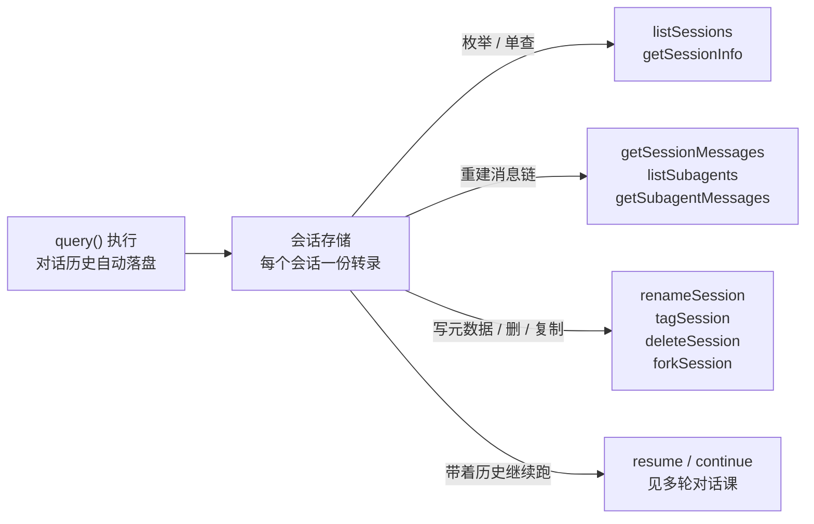

import { Meta } from '@storybook/addon-docs/blocks';

<Meta id="session-management" title="生产化/会话与状态/会话管理" name="Docs" />

# 会话管理

`query()` 跑完,对话历史已经落盘;但很多应用要做的不是"继续聊",而是管理这些历史:给用户列出可恢复的会话、审计一次任务的完整经过、给事故会话打标签、清理陈旧转录。这些操作都不需要启动 agent——SDK 提供一组顶层管理函数,直接读写落盘的会话存储。看完导读与参考表,你应该能预测:快速上手里 `listSessions` 返回的列表按什么排序,`getSessionMessages` 拿到的消息按什么顺序排。



| 函数 | 用途 | 关键返回与参数 |
| --- | --- | --- |
| `listSessions()` | 枚举会话元数据 | `SDKSessionInfo[]`,最近优先;`dir` / `limit` / `offset` |
| `getSessionInfo()` | 查单个会话 | `SDKSessionInfo \| undefined`;sidechain 或无摘要时 `undefined` |
| `getSessionMessages()` | 读完整转录 | `SessionMessage[]` 按时间顺序;`limit` / `offset` / `includeSystemMessages` |
| `listSubagents()` | 枚举子代理转录 | 该会话的 agentId 列表 |
| `getSubagentMessages()` | 读子代理转录 | `SessionMessage[]`,按时间顺序 |
| `renameSession()` | 设自定义标题 | 写入 `customTitle`,`summary` 随之变化 |
| `tagSession()` | 打标签 / 清除 | `tag: string \| null`,传 `null` 清除 |
| `deleteSession()` | 删除会话 | 删转录文件与子代理目录;找不到抛错 |
| `forkSession()` | 离线复制出新会话 | 返回新 `sessionId`;`upToMessageId` 从中间切 |

这组函数全部是顶层导入,与 `query()` 无关:调用时没有 agent 子进程,读写的就是磁盘上的会话存储。想带着历史**继续跑**,那是 `resume` / `continue` 的运行时用法,见[多轮对话](?path=/docs/multi-turn--docs)课;本课只管"把历史当数据来枚举、读取和维护"。

## 快速上手

前置:SDK 已安装;此前在本项目目录至少完整跑过一次 `query()`(会话已落盘)。新建 `sessions.ts`:

```ts
// 演示:枚举本项目的会话,再读其中最近一次的开头消息。
// 预期:先打印会话标题与 ID 列表(最近优先),再按时间顺序打印最近会话开头几条消息。
import { listSessions, getSessionMessages } from "@anthropic-ai/claude-agent-sdk";

// 1. 枚举:dir 指定项目目录,limit/offset 分页,结果最近优先
const sessions = await listSessions({ dir: process.cwd(), limit: 5 });
for (const s of sessions) {
  console.log(`${new Date(s.lastModified).toISOString()}  ${s.summary}  ${s.sessionId}`);
}

// 2. 读取:列表第一个即最近会话,取开头 3 条消息
const [latest] = sessions;
if (latest) {
  const messages = await getSessionMessages(latest.sessionId, {
    dir: process.cwd(),
    limit: 3, // 从头取 3 条;配 offset 翻页
  });
  for (const m of messages) {
    console.log(`[${m.type}]`, JSON.stringify(m.message).slice(0, 72));
  }
}
```

运行 `npx tsx sessions.ts`。预期输出(内容取决于历史,结构固定):

```text
2026-10-01T09:12:33.000Z  修复 loader.ts 的缓存问题  a1b2c3d4-1111-2222-3333-444455556666
2026-09-30T18:40:02.000Z  重构配置加载模块  9f8e7d6c-aaaa-bbbb-cccc-ddddeeeeffff
[user] {"role":"user","content":"帮我排查 loader.ts 在测试环境偶发的缓存失效"}
[assistant] {"id":"msg_01W9...","role":"assistant","content":[{"type":"text","text":"先看…"}]}
[user] {"role":"user","content":"先只看 staging 的复现路径"}
```

两次调用都没启动 agent:`listSessions` 读目录拿到元数据快照,`getSessionMessages` 从转录重建消息链。这两步就是绝大多数会话管理场景的骨架——列表 UI 用前者,审计与转录查看用后者。

## 枚举与查询

读侧两个函数返回同一个 `SDKSessionInfo` 元数据结构,差别在范围:`listSessions()` 扫描项目目录拿全部会话,`getSessionInfo()` 只读单个会话文件。

### listSessions

```ts
// 只看本项目最近 10 个会话
const sessions = await listSessions({ dir: process.cwd(), limit: 10 });

// 跨所有项目分页:省略 dir,用 offset/limit 翻页
const page1 = await listSessions({ limit: 50 });
const page2 = await listSessions({ limit: 50, offset: 50 });
```

| 参数 | 类型 / 默认 | 行为 |
| --- | --- | --- |
| `dir` | `string`,省略 | 提供时:返回该项目目录(含 git worktrees)的会话;省略时:跨**所有**项目目录返回 |
| `limit` / `offset` | `number` / `offset` 默认 `0` | 在排序结果上分页 |
| `includeWorktrees` | `boolean`,默认 `true` | `dir` 在 git 仓库内时,包含各 worktree 路径的会话 |
| `includeProgrammatic` | `boolean`,默认 `true` | SDK 发起的 headless 会话(`sdk-cli` / `sdk-ts` / `sdk-py`)与 daemon 会话是否在列 |

返回列表按 `lastModified` 最近优先排序。每个 `SDKSessionInfo` 的字段:

| 字段 | 含义 |
| --- | --- |
| `sessionId` | 会话 UUID,`resume` 用它恢复 |
| `summary` | 显示标题,取值优先级:`customTitle` → 自动生成摘要 → `firstPrompt` |
| `lastModified` / `createdAt` | 最后修改 / 创建时间(epoch 毫秒) |
| `customTitle` | `renameSession()` 或终端 `/rename` 设置的标题 |
| `tag` | `tagSession()` 设置的标签 |
| `firstPrompt` | 会话里第一条有意义的用户 prompt |
| `gitBranch` / `cwd` | 会话结束时的 git 分支 / 工作目录 |
| `fileSize` | 转录文件大小(字节);仅本地 JSONL 存储时提供 |

`summary` 的三级来源决定列表 UI 显示什么:用户改过标题就显示标题,否则显示自动摘要,最差回退到第一条 prompt。`includeProgrammatic` 是给"人看的会话选择器"准备的:SDK 自己枚举自己的会话时保持默认即可;做给人选的列表传 `false`,对齐终端 `/resume` 的口径。

### getSessionInfo

```ts
import { getSessionInfo } from "@anthropic-ai/claude-agent-sdk";

const info = await getSessionInfo("a1b2c3d4-1111-2222-3333-444455556666", {
  dir: process.cwd(),
});
if (!info) {
  // ID 不存在 / 是 sidechain 会话 / 无可提取摘要,三种情况之一
}
```

已知 ID 时用它核对存在性与元数据,比 `listSessions` 便宜——只读单个会话文件,不扫全目录。返回 `undefined`(不抛错)的三种情况:会话文件不存在;那是 sidechain(子代理)转录,不算独立会话;文件里无可提取的摘要。`dir` 省略时会搜索所有项目目录。

## 读取会话消息

`getSessionMessages()` 从转录文件重建对话:解析转录、沿 parentUuid 链串起消息,按时间顺序(最早在前)返回。它与[消息流](?path=/docs/message-stream--docs)课的运行时流是两种读取:运行时 `SDKMessage` 是 agent 执行中的实时事件;`SessionMessage` 是落盘历史的重放,`message` 字段是原始转录载荷(Anthropic 消息格式),SDK 不做运行时加工。

```ts
const messages = await getSessionMessages(sessionId, {
  dir: process.cwd(),
  offset: 0, // 从头跳过 N 条
  limit: 50, // 最多返回 N 条;大转录分页读
});
```

| 字段 | 含义 |
| --- | --- |
| `type` | `"user"` / `"assistant"`;`includeSystemMessages: true` 时还含 `"system"` |
| `uuid` | 消息 UUID,`resumeSessionAt` 与 `forkSession` 的 `upToMessageId` 都用它定位 |
| `session_id` | 所属会话 |
| `message` | 原始转录载荷,`unknown` 类型,按 Anthropic 消息格式自行收窄 |
| `parent_tool_use_id` | 工具调用产生的消息回指 `tool_use` 块 ID;顶层消息为 `null` |
| `parent_agent_id` | 所属子代理的 agentId;主会话消息为 `null` |

要点:

- system 消息(compact 边界、提示通知等)默认**不**返回,`includeSystemMessages: true` 才包含——重放给用户看的历史通常不需要它们。
- 会话不存在时返回 `[]`,与"空会话"不可区分;需要区分时先 `getSessionInfo` 核对。
- 恢复对话运行时不需要手动喂回这些消息:`resume` 直接接上完整历史,见[多轮对话](?path=/docs/multi-turn--docs)课。

### 子代理转录

子代理的对话不混在主转录里:每个子代理单独存一份。`listSubagents()` 枚举一个会话下的全部 agentId,`getSubagentMessages()` 按同样的 `SessionMessage` 结构读出单个子代理的转录:

```ts
import { listSubagents, getSubagentMessages } from "@anthropic-ai/claude-agent-sdk";

// 事后审计:找出这个会话动用了哪些子代理,各自做了什么
const agentIds = await listSubagents(sessionId, { dir: process.cwd() });
for (const agentId of agentIds) {
  const msgs = await getSubagentMessages(sessionId, agentId, { dir: process.cwd() });
  console.log(agentId, msgs.length); // 子代理的对话轮数
}
```

运行中子代理的分工与上下文隔离见[子代理](?path=/docs/subagents--docs)课;这里补充的是事后视角——历史会话动用过哪些子代理、各自聊了什么,不必在运行时记录,事后枚举即可。

## 标题、标签与生命周期

写侧四个函数共享 `SessionMutationOptions`(`dir` 定位项目目录,省略时搜索所有项目):改动都落在会话存储本身,下次枚举即可读回。

### renameSession 与 tagSession

```ts
import { renameSession, tagSession } from "@anthropic-ai/claude-agent-sdk";

await renameSession(sessionId, "排查缓存失效"); // 写入 customTitle
await tagSession(sessionId, "incident-42"); // 打上标签
await tagSession(sessionId, null); // 传 null 清除标签
```

- `renameSession` 向转录追加一条 custom-title 条目,此后 `summary` 优先显示它;`customTitle` 字段随之可读。
- `tagSession` 适合按主题或事故组织会话:打上 `incident-42`,枚举后按 `tag` 过滤,批量处理。
- 与 `query()` 的 `title` 选项分工:`title` 只给**新会话**起名;`resume` / `continue` 恢复时,已持久化的标题优先,要改老会话的标题只能调 `renameSession`。

### deleteSession 与 forkSession

```ts
import { deleteSession, forkSession } from "@anthropic-ai/claude-agent-sdk";

// 删除:移除该会话的转录文件与子代理转录目录;找不到抛错
await deleteSession(sessionId, { dir: process.cwd() });

// 离线复制:原会话不动,得到一个可 resume 的新会话
const { sessionId: newId } = await forkSession(sessionId, {
  dir: process.cwd(),
  // upToMessageId: 传某条 SessionMessage.uuid,复制到该条(含)为止;省略则全量复制
  // title: 新会话标题;省略时为原标题 + " (fork)"
});
```

- `forkSession` 复制转录消息并重映射 UUID、保留 parentUuid 链;复制出的 `sessionId` 随时可 `resume`。注意 fork 只复制**对话转录**,不带文件检查点(undo 历史),文件现状不随 fork 回退——文件回滚见[文件检查点](?path=/docs/file-checkpointing--docs)课。
- 它与[多轮对话](?path=/docs/multi-turn--docs)课的 `forkSession: true` 选项目标相同、时机不同:选项是 resume 时顺带复制,一步到位;`forkSession()` 是独立调用,先复制、何时 resume 由你决定。
- 配置了自定义 `sessionStore` 时,删除动作转给存储适配器(未实现 `delete` 则为空操作),自定义存储见[会话存储](?path=/docs/session-storage--docs)课。

转录文件在磁盘的位置与 JSONL 行格式、`sessionStore` 适配器与跨主机 resume,属于[会话存储](?path=/docs/session-storage--docs)课的内容;本课所有函数都建立在那套存储之上,但不依赖其格式细节。

## 常见问题

- `listSessions()` 不传 `dir`,结果里混着其他项目的会话。
  这是有意行为:省略 `dir` 会跨所有项目目录枚举。只想看当前项目,显式传 `dir: process.cwd()`;会话按项目目录归档,`dir` 就是过滤入口(归档规则见[会话存储](?path=/docs/session-storage--docs)课)。

- 确认跑过的会话,`getSessionInfo()` 返回 `undefined`,`getSessionMessages()` 返回 `[]`。
  按序排查三个原因:ID 抄错(拿 `listSessions` 的返回对照);那其实是一段子代理(sidechain)转录,`getSessionInfo` 与 `getSessionMessages` 不认它,改用 `listSubagents` + `getSubagentMessages` 读取;`dir` 指到了别的项目。`getSessionMessages` 的 `[]` 与"空会话"不可区分,先 `getSessionInfo` 确认会话存在再解读空列表。

- `resume` 时传了 `title`,之后 `listSessions` 里标题还是旧的。
  `query()` 的 `title` 选项只对新会话生效;恢复已有会话时,已持久化的标题优先。要改老会话的标题,在恢复之外调一次 `renameSession(sessionId, 新标题)`。

## 总结回顾

摘要:

历史会话是一等数据:每次 `query()` 落盘的转录,都可以用一组顶层函数在 agent 进程之外读写。读侧,`listSessions()` 按 `lastModified` 最近优先枚举元数据(`dir` 收敛到单项目、`limit` / `offset` 分页、`includeProgrammatic: false` 做给人用的选择器),`getSessionInfo()` 单查一个会话(不存在、sidechain、无摘要三种情况返回 `undefined`),`getSessionMessages()` 沿 parentUuid 链按时间顺序重建消息,`listSubagents()` 与 `getSubagentMessages()` 补上子代理转录的事后视角。写侧,`renameSession()` 写入 customTitle、`tagSession()` 打标签(传 `null` 清除),两者直接反映在下次枚举的 `summary` 与 `tag` 上;`deleteSession()` 删转录,`forkSession()` 离线复制出可 resume 的新会话。`query()` 的 `title` 选项只管新会话,恢复时的旧标题要用 `renameSession` 改。

一句话:

> 会话管理是一组不启动 agent 的顶层函数——枚举、读取、改元数据、删除、复制,全部直接读写落盘的会话存储。

知识要点:

- 这组函数与 `query()` / `resume` 的分工是什么?为什么说"把历史当数据"?
- `listSessions()` 的 `dir` 省略与提供分别返回什么?`includeProgrammatic` 在什么场景传 `false`?
- `summary` 的三级来源是什么?`renameSession()` 怎么影响它?`query()` 的 `title` 选项为什么改不了老会话?
- `SessionMessage` 有哪些字段?它与消息流课的运行时 `SDKMessage` 有何区别?`uuid` 还能喂给哪些 API?
- `getSessionInfo()` 返回 `undefined` 的三种情况是什么?`getSessionMessages()` 的 `[]` 为什么不能单独当"不存在"解读?
- `forkSession()` 与 `forkSession: true` 选项目标相同,时机差别是什么?fork 不复制什么?

## 参考资料

- [Work with sessions](https://code.claude.com/docs/en/agent-sdk/sessions)(会话持久化模型、管理函数概览、存储位置与跨主机 resume 的官方专题页)
- [TypeScript SDK reference](https://code.claude.com/docs/en/agent-sdk/typescript)(listSessions / getSessionInfo / getSessionMessages / renameSession / tagSession 的签名与参数定义处)
- [@anthropic-ai/claude-agent-sdk 包类型定义](https://www.npmjs.com/package/@anthropic-ai/claude-agent-sdk)(`SDKSessionInfo`、`SessionMessage`、`ListSessionsOptions` 与 deleteSession / forkSession / listSubagents 等完整声明,随包发布)
