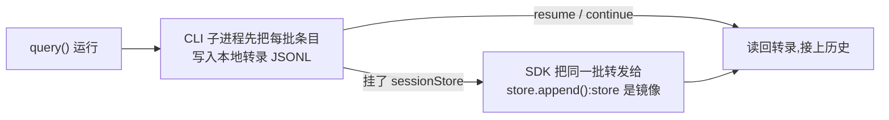

import { Meta } from '@storybook/addon-docs/blocks';

<Meta id="session-storage" title="生产化/会话与状态/会话存储" name="Docs" />

# 会话存储

每次 `query()` 运行的完整对话——prompt、每次工具调用、每个工具结果、每条回复——由 SDK 自动写成会话转录,`resume` 与 `continue` 能跨进程接上历史靠的就是这份数据(延续用法见[多轮对话](?path=/docs/multi-turn--docs)课)。本课讲转录存在哪、长什么样、怎么控制它落不落盘,以及生产环境怎么用 `SessionStore` 把它镜像到自己的对象存储、KV 或数据库,支撑多主机恢复、持久化与审计。看完导读与参考表,你应该能预测:快速上手里按工作目录的编码规则,能直接定位本机已落盘的转录文件。



| 项 | 默认值 / 入口 | 要点 |
| --- | --- | --- |
| 转录位置 | `~/.claude/projects/<project>/<session-id>.jsonl` | 设 `CLAUDE_CONFIG_DIR` 后根目录随之移动 |
| `<project>` 目录名 | 工作目录绝对路径,非字母数字字符替换为 `-` | 超过 200 字符截断并追加完整路径的哈希 |
| 自定义 `<project>` 名 | 环境变量 `CLAUDE_CODE_PROJECT_DIR_NAME` | 必须与 `CLAUDE_CONFIG_DIR` 同时设置 |
| 本地保留期 | `cleanupPeriodDays`,默认 30 天 | settings.json;最小 1,设 0 报验证错误 |
| 手动清理 | `claude project purge <path>` | 先打印删除计划,确认后执行 |
| 单次运行不落盘 | `options.persistSession: false` | 仅 TS SDK 提供;默认 `true` |
| 外部存储 | `options.sessionStore` | 实现 `SessionStore` 接口的对象 |
| SDK 自带实现 | `InMemorySessionStore` | 开发与测试用,重启即失 |
| 镜像失败信号 | `{ type: "system", subtype: "mirror_error" }` | 出现在消息流;store 故障不打断 agent |

## 快速上手

前几课的脚本已经在本机落过转录,直接定位一份。`<project>` 是工作目录绝对路径把非字母数字字符全部替换成 `-` 的结果,比如 `/Users/me/agent-demo` 编码成 `-Users-me-agent-demo`:

```bash
# 前置:在 /Users/me/agent-demo 下跑过至少一次 query()(前几课的脚本即可)。
ls ~/.claude/projects/-Users-me-agent-demo/
```

预期输出(示例,文件名即会话 ID):

```text
5b3f2c1a-8d4e-4f6b-9a7c-2e1d0f9b8a6c.jsonl
```

```bash
head -n 1 ~/.claude/projects/-Users-me-agent-demo/5b3f2c1a-8d4e-4f6b-9a7c-2e1d0f9b8a6c.jsonl
```

预期输出(示例,字段已省略):

```text
{"type":"user","uuid":"9f0c…","message":{…}}
```

每行是一个 JSON 对象,至少带 `type` 与 `uuid` 字段。行里其余结构属内部格式、没有稳定性承诺,直接解析有什么边界,见下文「JSONL 行格式」小节。

## 本地转录文件

转录默认写在本机文件系统,由驱动 `query()` 的 CLI 子进程落盘。这一节覆盖位置与命名、行格式与读取边界、保留与清理三件事,是 `resume` 排查和本地审计的底座。

### 位置与命名

转录根目录默认是 `~/.claude/projects/`(Windows 上 `~/.claude` 解析为 `%USERPROFILE%\.claude`)。设了 `CLAUDE_CONFIG_DIR` 时,本课所有 `~/.claude` 路径都改到该目录之下。

`<project>` 是工作目录的编码:绝对路径里除字母数字外的每个字符都替换成 `-`,`/Users/me/agent-demo` 编码为 `-Users-me-agent-demo`;编码结果超过 200 字符时截断到 200 并追加完整路径的哈希,这时按目录列举、匹配前 200 字符即可定位。

想让项目目录名不随工作目录漂移(多租户宿主为每个租户配独立 config 目录时尤其有用),设 `CLAUDE_CODE_PROJECT_DIR_NAME`,规则有三:

- 必须与 `CLAUDE_CONFIG_DIR` 同时设置,否则被忽略;
- 取值为 1–64 个字母、数字、连字符或下划线,不能用 Windows 设备名(如 `con`);
- CLI 启动时从 shell 环境读一次,settings 的 `env` 块设不了它。

SDK 里把两个变量写进 query 的 `env` 选项(选项含义见[Options](?path=/docs/options--docs)课):该次运行的条目落盘与它的 `resume`、`continue` 查找都按这个名字键控;`listSessions()`、`deleteSession()` 这类独立函数没有 `env` 参数、读宿主进程环境,宿主环境里也要设同名变量。需要 TS SDK v0.3.234 或更高版本。

```ts
// 场景:租户 A 的数据收在 /srv/tenant-a 下,项目目录固定叫 work,不随 cwd 变。
// 预期:转录落在 /srv/tenant-a/projects/work/,无论会话在哪个工作目录运行。
query({
  prompt: "分析当前目录的构建脚本",
  options: {
    env: {
      ...process.env, // env 会整体替换子进程环境,先展开现有环境
      CLAUDE_CONFIG_DIR: "/srv/tenant-a",
      CLAUDE_CODE_PROJECT_DIR_NAME: "work",
    },
  },
});
```

### JSONL 行格式

转录文件每行一个 JSON 对象,对应一条消息、一次工具调用或一条元数据条目,每行至少带 `type` 与 `uuid` 两个字段。除此之外的内部结构没有稳定性承诺——行格式是 Claude Code 的内部格式,版本之间会变,直接解析的脚本在任何一次发布后都可能失效。要基于会话数据构建,用受支持的接口:`listSessions()`、`getSessionMessages()`、`getSessionInfo()` 等(见[会话管理](?path=/docs/session-management--docs)课);挂了 store 且需要含压缩前轮次在内的完整原始历史时,直接调 `store.load(key)`。

转录与提示历史明文落盘,不加密;工具读过的文件内容、命令输出、粘贴的文本都会原样写进 JSONL,操作系统文件权限是唯一保护。降低暴露的三个抓手:用权限 deny 规则挡住凭证文件(见[权限规则与 canUseTool](?path=/docs/permissions--docs)课)、按需调低 `cleanupPeriodDays`、无状态任务用 `persistSession: false`。

### 保留与清理

本地转录按 `cleanupPeriodDays`(settings.json,默认 30 天)自动清扫:文件超过保留期即删除,最小值 1,设 0 会报验证错误。清扫覆盖同会话的全部落盘产物:

| 路径(相对 `CLAUDE_CONFIG_DIR`) | 内容 |
| --- | --- |
| `projects/<project>/<session-id>.jsonl` | 主转录:每条消息、每次工具调用与结果 |
| `projects/<project>/<session-id>.orphaned-<timestamp>-<suffix>.jsonl` 与 `<session-id>.jsonl.superseded-<timestamp>` | 被搁置的旧转录,不出现在会话选择器 |
| `projects/<project>/<session-id>/subagents/` | 子代理转录,随主转录一起过龄删除 |
| `projects/<project>/<session-id>/tool-results/` | 溢出到独立文件的大工具输出、MCP 工具返回的原图 |
| `file-history/<session-id>/` | 文件检查点的编辑前快照(见[文件检查点](?path=/docs/file-checkpointing--docs)课) |

要提前清掉一个项目的全部本地数据,用 CLI 命令 `claude project purge <path>`:它列出删除计划(转录、auto memory、tasks/debug/file-history、history.jsonl 中的相关行、`~/.claude.json` 里该项目条目)并要求确认,`--dry-run` 预览、`--yes` 跳过确认。

## 会话不落盘

无状态任务不想留任何转录时,给单次 `query()` 设 `persistSession: false`(默认 `true`;仅 TS SDK 提供):

```ts
// 场景:一次性的日志摘要,不需要事后恢复。
// 预期:会话只存在于内存,运行结束即消失,事后无法 resume 或 continue。
for await (const message of query({
  prompt: "总结这份日志里的错误",
  options: { persistSession: false },
})) {
  if (message.type === "result" && message.subtype === "success") {
    console.log(message.result);
  }
}
```

四条边界:

- 关闭落盘后,这份会话不能再被 `resume` / `continue`——本地没写过,store 也没收到;
- 与 `sessionStore` 组合会在启动时抛错:镜像依赖的正是被关掉的本地写入;
- 文件检查点(`enableFileCheckpointing`)的备份直写本地磁盘、不进任何镜像,与 `sessionStore` 组合同样启动抛错;
- 另一条总开关:在 `env` 里设 `CLAUDE_CODE_SKIP_PROMPT_HISTORY`,所有模式下都跳过转录与提示历史写入。

## 镜像到外部存储

本地文件绑死单机:自动扩缩的 worker、serverless、CI runner 不共享文件系统,容器随时销毁,合规审计要求数据进自己治理的存储。`SessionStore` 适配器把转录镜像到你自己的对象存储、KV 或数据库,让 A 主机创建的会话在 B 主机 `resume`。

镜像不改读写入口:以下函数都接受 `sessionStore`,传入后即对 store 而非本地文件操作——`query()`、`startup()`、`listSessions()`、`getSessionInfo()`、`getSessionMessages()`、`renameSession()`、`tagSession()`、`deleteSession()`、`forkSession()`、`listSubagents()`、`getSubagentMessages()`。挂了 store 的新会话仍然先写本地再镜像(见下文双写机制),所以 store 是镜像而非替代。

### SessionStore 接口

SDK 从 `@anthropic-ai/claude-agent-sdk` 导出 `SessionStore`、`SessionKey`、`SessionStoreEntry`、`SessionSummaryEntry`:

```ts
type SessionKey = {
  projectKey: string; // 工作目录的稳定、文件系统安全编码,与本地 <project> 目录名同源
  sessionId: string; // 会话 UUID
  subpath?: string; // 子代理转录或边车文件的键后缀,如 "subagents/agent-<id>";未设置即主转录
};

type SessionStore = {
  // 必需
  append(key: SessionKey, entries: SessionStoreEntry[]): Promise<void>;
  load(key: SessionKey): Promise<SessionStoreEntry[] | null>;

  // 可选
  listSessions?(projectKey: string): Promise<Array<{ sessionId: string; mtime: number }>>;
  listSessionSummaries?(projectKey: string): Promise<SessionSummaryEntry[]>;
  delete?(key: SessionKey): Promise<void>;
  listSubkeys?(key: { projectKey: string; sessionId: string }): Promise<string[]>;
};

type SessionSummaryEntry = {
  sessionId: string;
  mtime: number;
  data: Record<string, unknown>; // SDK 私有状态,原样保存、原样返回
};
```

`subpath` 当作不透明的键后缀处理,它跟随磁盘布局;`projectKey` 编码了工作目录,因此从 store 恢复要在与原运行一致的 cwd 下进行,用 `CLAUDE_CODE_PROJECT_DIR_NAME` 固定了键名时恢复侧也要设(见「位置与命名」)。

六个方法的调用时机与缺省行为:

| 方法 | 必需 | SDK 何时调用 | 未实现时 |
| --- | --- | --- | --- |
| `append(key, entries)` | 是 | 每批转录条目写完本地后;条目即本地 JSONL 的每一行 | —— |
| `load(key)` | 是 | `resume` 或 `continue: true` 在子进程启动前;枚举回退时逐会话调用 | —— |
| `listSessions(projectKey)` | 否 | `listSessions({ sessionStore })`;带 store 的 `continue: true` 找最新会话 | `continue: true` 抛错;`listSessions({ sessionStore })` 除非实现了 `listSessionSummaries` 否则抛错 |
| `listSessionSummaries(projectKey)` | 否 | `listSessions({ sessionStore })` 一次读全部会话元数据 | 枚举回退为逐会话 `load` |
| `delete(key)` | 否 | `deleteSession({ sessionStore })` | 删除变空操作,适合只增后端 |
| `listSubkeys(key)` | 否 | `resume` 时发现子代理转录 | 只恢复主转录 |

SDK 自带 `InMemorySessionStore`(开发与测试用,重启即失),先拿它把"挂 store → 取 session_id → 从 store 恢复"跑通。`session_id` 从 result 消息读取(获取路径见[会话管理](?path=/docs/session-management--docs)课):

```ts
// 场景:同进程里把会话从"第一次运行"接到"第二次运行",历史收在 store 里。
// 预期:第二次 query 的回复在总结第一次列出的文件——agent 带着从 store 恢复的完整上下文。
import { query, InMemorySessionStore } from "@anthropic-ai/claude-agent-sdk";

const store = new InMemorySessionStore();

let sessionId: string | undefined;
for await (const message of query({
  prompt: "列出 src/ 下的 TypeScript 文件",
  options: { sessionStore: store }, // 挂上 store
})) {
  if (message.type === "result") {
    sessionId = message.session_id;
  }
}

// 同一个 store 实例 + resume:SDK 从 store 读转录,而不是本地文件。
for await (const message of query({
  prompt: "总结刚才那些文件是做什么的",
  options: { sessionStore: store, resume: sessionId },
})) {
  if (message.type === "result" && message.subtype === "success") {
    console.log(message.result);
  }
}
```

真实运行会消耗 API 额度;本课以讲解为主,不要求逐个运行。

### 双写机制

镜像建立在"本地先行"之上:Claude Code 子进程总是先把每批条目写到本地磁盘,SDK 再把同一批转发给你的 `append()`。store 因此只是本地转录的镜像,store 故障不会打断正在运行的 agent。哪份副本在运行结束后存活,取决于这次运行怎么启动:

| 运行方式 | 本地副本 | store 副本 |
| --- | --- | --- |
| 新会话;或 `resume` 时 store 里查无此会话 | 运行结束后保留 | 收到一份拷贝 |
| 从 store 恢复的运行 | 结束时随临时目录删除 | 唯一持久的副本 |

新会话也想保持本地干净,就把 `CLAUDE_CONFIG_DIR` 指到临时目录:放进 query 的 `env` 选项并先展开 `process.env`(`env` 整体替换子进程环境);凭证要么提前把 config 目录里的凭证文件拷进临时目录,要么直接在 `env` 设 `ANTHROPIC_API_KEY`,否则报 `Not logged in`。从 store 恢复的运行本地副本本来就会被删,无需此设置。

镜像写入是尽力而为:`append()` 拒绝时 SDK 最多再重试两次(共三次,短退避;超时不重试,因为原调用可能已落地),仍失败则记日志、向消息流发一条 `{ type: "system", subtype: "mirror_error" }`、丢弃该批并继续运行。重试可能重复投递已落地的条目,`append()` 里按 `entry.uuid` 去重。

与镜像冲突的两个选项,组合即启动抛错:`persistSession: false`(关掉了镜像赖以建立的本地写入)与 `enableFileCheckpointing: true`(文件备份直写本地磁盘,不进镜像)。

### 从 store 恢复

带 store 时,`resume` 与 `continue: true` 在子进程启动前先问 store:

- `resume`:按传入的会话 ID 查;
- `continue: true`:查 store 里该目录最新的会话。

查到后,SDK 把转录写进一个临时 config 目录、以 `CLAUDE_CONFIG_DIR` 指向它启动子进程,运行结束删除整个目录——这条路径上 store 持有唯一持久副本。临时目录会用你真实的 config 目录播种:TS SDK 拷入 credentials、`.claude.json` 与 user `settings.json`(剥离 `enabledPlugins`、`extraKnownMarketplaces` 及其别名、`env` 块里的 `CLAUDE_CONFIG_DIR`),所以 settings 里配置的 `apiKeyHelper` 鉴权在恢复运行里照常可用。

store 里查无此会话时回退到本地行为:`resume` 把 ID 原样传给子进程,与不挂 store 的 `resume` 完全一致;`continue: true` 则开一个全新会话。

### 自建适配器

必填的 `append` / `load` 按这份契约实现,可选方法按需补齐:

```ts
// 骨架:把注释里的契约逐条映射到你的后端(S3、Redis、Postgres 均有官方参考实现)。
import type {
  SessionKey,
  SessionStore,
  SessionStoreEntry,
} from "@anthropic-ai/claude-agent-sdk";

function createStore(backend: YourBackend): SessionStore {
  return {
    async append(key: SessionKey, entries: SessionStoreEntry[]) {
      // 按收到顺序持久化;重试会重复投递,先按 entry.uuid 去重。
    },
    async load(key: SessionKey) {
      // 按同序返回,条目与 append 收到的深相等即可(不要求字节相等);
      // 查无此会话返回 null。
      return null;
    },
  };
}
```

- **条目不透明。** `SessionStoreEntry` 是带 `type` 字段的 JSON 安全对象;当作不透明值按序存取,不解释内容。`load` 返回值须与 `append` 收到的深相等,字节相等不作要求——Postgres `jsonb` 这类会重排对象键的后端可直接用。
- **删除要级联。** 实现 `delete` 时,删主键(无 `subpath`)必须级联删该会话全部 subkey,并移除汇总条目,否则已删会话仍出现在 `listSessionSummaries` 里;不实现 `delete` 则删除是空操作,适合只增后端。
- **汇总条目在 `append` 里维护。** `listSessionSummaries` 的数据用导出的 `foldSessionSummary` 对每批折叠生成:纯函数,带 `subpath` 的批跳过(子代理转录不得计入主会话汇总),且不写 `mtime`——落盘时自己打;同一会话的并发 `append` 要串行化读-折叠-写(事务、CAS 或按会话加锁)。
- **子代理转录跟着 `subpath` 走。** 镜像在 `subpath: "subagents/agent-<id>"` 下;实现 `listSubkeys` 后,`listSubagents({ sessionStore })` 才可用、`resume` 才会顺带恢复子代理文件,否则只物化主转录。
- **fork 不是字节拷贝。** `forkSession({ sessionStore })` 会重写每条条目的 `sessionId` 并重映射消息 UUID,再写到新键下;适配器层面的整文件拷贝(如 S3 `CopyObject`)会留下仍指向旧会话 ID 的转录,不要走这条捷径。

参考实现:官方仓库 `examples/session-stores/` 提供 S3、Redis、Postgres 三个可运行适配器,不发布 npm——把 `src/` 里对应文件拷进项目、装上后端客户端即可;适配器接收你预配置的客户端实例,凭证、TLS、区域与连接池都由你控制:

| 适配器 | 后端客户端 | 存储模型 |
| --- | --- | --- |
| `S3SessionStore` | `@aws-sdk/client-s3` | 每次 `append()` 写一个 JSONL 分片,`load()` 列举、排序、拼接 |
| `RedisSessionStore` | `ioredis` | 每条转录一个 list(`RPUSH` / `LRANGE`),外加有序集合作会话索引 |
| `PostgresSessionStore` | `pg` | `jsonb` 表一行一条目,按 `BIGSERIAL` 排序 |

改完后跑一致性测试:把 `examples/session-stores/shared/conformance.ts` 拷进测试套件,以零参工厂传入你的适配器,断言 `append`、`load` 与各可选方法的行为契约,未实现的可选方法自动跳过;工厂每次返回的 store 必须从空存储开始。

保留责任:SDK 永不删除 store 里的数据,TTL、生命周期规则或定时清理由适配器按合规要求实现;从 store 恢复的运行不留本地转录,store 的保留策略就是这份会话唯一的保留策略。

## 最佳实践

- **按部署形态选持久化入口。** 单机脚本与常驻容器,默认本地转录就够;无状态任务用 `persistSession: false` 一跑一清;不共享文件系统的部署(自动扩缩 worker、serverless、CI)挂 `sessionStore`;只是偶尔跨机器搬迁,把 `<session-id>.jsonl` 拷到新主机 `projects/` 下任意目录再 `resume` 也成立——会话文件在创建它的机器之外不会自动可见,搬过去就能用。
- **保留期两头都要管。** 本地转录按 `cleanupPeriodDays` 自动清扫,store 侧 SDK 永不删除,TTL、生命周期规则或定时清理由你的适配器负责;从 store 恢复的运行结束后本地不留副本,store 的保留策略就是这份会话唯一的保留策略——合规要求的期限要在 store 后端显式实现。
- **审计诉求落在自有 store 上。** 转录是明文,工具读过的内容都会进文件;只有把转录引到自己治理的存储,才谈得上自己的加密、访问控制与保留规则。本地侧先做两件事:用权限 deny 规则挡住凭证文件读取,按需调低 `cleanupPeriodDays`。

## 常见问题

- 直接解析 `<session-id>.jsonl` 的审计脚本,SDK 或 CLI 升级后字段对不上、脚本报错。
  行格式是内部格式,任何一次发布都可能变化。改用受支持接口 `listSessions()`、`getSessionMessages()`、`getSessionInfo()` 读取(见[会话管理](?path=/docs/session-management--docs)课);挂了 store 且需要含压缩前在内的完整原始历史时,直接调 `store.load(key)`。

- 挂了 store 用 `continue: true`,却开出一个全新会话。
  store 里查不到该目录的会话时,`continue: true` 的回退行为就是开新会话(`resume` 则回退为本地 resume)。核对键是否对得上:`projectKey` 由工作目录编码而来,换目录运行就对不上;自定义了 `CLAUDE_CODE_PROJECT_DIR_NAME` 时,query 的 `env` 与宿主进程环境要设同一个名字。

- `getSessionMessages({ sessionStore })` 返回的消息数远少于 store 里的条目数。
  这是自动压缩在起作用:它返回的是 resume 时 agent 会看到的消息链,早轮次已被摘要替换(store 里 503 条原始条目可能只返回 18 条)。要完整原始历史,直接调 `store.load(key)`。

## 总结回顾

摘要:

会话转录默认落在本机 `~/.claude/projects/<编码后的工作目录>/<session-id>.jsonl`,根目录随 `CLAUDE_CONFIG_DIR` 移动,目录名可用 `CLAUDE_CODE_PROJECT_DIR_NAME` 固定;文件是每行一个 JSON 对象的 JSONL,行格式属内部格式,程序化读取走 `listSessions()`、`getSessionMessages()` 等接口;本地副本由 `cleanupPeriodDays` 自动清扫、`claude project purge` 手动清理,无状态任务用 `persistSession: false` 完全不落盘。生产环境用 `SessionStore` 适配器把转录镜像到自有后端:必填 `append` 与 `load`,SDK 官方自带 `InMemorySessionStore` 与 S3/Redis/Postgres 参考实现;镜像建立在"本地先行"的双写之上,store 是镜像而非替代,从 store 恢复的运行结束后本地不留副本,保留、去重与删除级联由适配器负责。

一句话:

> 转录默认是本机 `~/.claude/projects/` 下的 JSONL 文件;要跨主机、抗销毁或满足审计,就实现 `SessionStore` 把它镜像到你自己的存储。

知识要点:

- 工作目录怎么编码成 `projects/` 下的目录名?`CLAUDE_CONFIG_DIR` 与 `CLAUDE_CODE_PROJECT_DIR_NAME` 各改变什么?
- 转录 JSONL 每行是什么?为什么不建议直接解析?
- 哪些路径受 `cleanupPeriodDays` 清扫?如何手动清理一个项目的本地数据?
- `persistSession: false` 用来做什么?它与 `sessionStore`、`enableFileCheckpointing` 组合会发生什么?
- `SessionStore` 必填哪两个方法?四个可选方法各解锁什么能力?
- 双写下"新会话"与"从 store 恢复的运行"结束时,本地与 store 各留什么?
- `append` 为什么要按 `entry.uuid` 去重?子代理转录存在哪个键下?

## 参考资料

- [Persist sessions to external storage](https://code.claude.com/docs/en/agent-sdk/session-storage)
- [Agent SDK reference - TypeScript](https://code.claude.com/docs/en/agent-sdk/typescript)
- [Work with sessions](https://code.claude.com/docs/en/agent-sdk/session-management)
- [Manage sessions](https://code.claude.com/docs/en/sessions)
- [Explore the .claude directory](https://code.claude.com/docs/en/claude-directory)
- [examples/session-stores(S3 / Redis / Postgres 参考适配器)](https://github.com/anthropics/claude-agent-sdk-typescript/tree/main/examples/session-stores)
