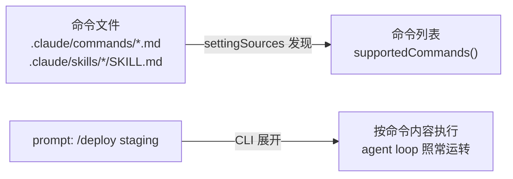

import { Canvas, Controls, Meta } from '@storybook/addon-docs/blocks';
import * as SlashCommands from './slash-commands.stories';

<Meta of={SlashCommands} name="Docs" />

# Slash 命令

自定义 slash 命令是文件系统里的 Markdown 文件:`.claude/commands/*.md` 或 `.claude/skills/<名字>/SKILL.md`。SDK 会话启动时,Claude Code 按 `settingSources` 自动发现这些文件,连同 MCP prompt 一起组成命令列表;程序在 prompt 里发 `/命令名 参数`,CLI 就按命令文件的内容展开执行;`query.supportedCommands()` 则把可用命令枚举给宿主程序。看完导读与参考表,你应该能预测:在项目里放一个 `.claude/commands/deploy.md`,启动会话后 `supportedCommands()` 会出现 `name` 为 `"deploy"` 的条目,prompt 发送 `/deploy staging` 就会按文件内容走一遍 agent loop。



| 项 | 值 | 回查要点 |
| --- | --- | --- |
| 触发写法 | prompt 字符串以 `/` 开头 | `/命令名 参数`;默认即命令,无需任何选项 |
| 关闭命令解释 | `verbatimPrompts: true` 或单条消息 `client_composed: true` | SDK v0.3.280+;文本按原文投递 |
| 枚举 API | `query.supportedCommands()` | 返回 `SlashCommand[]`;v0.3.216 起反映会话中变化 |
| 初始化列表 | `(await q.initializationResult()).commands` | 与 `supportedCommands()` 同构 |
| 命令条目 | `{ name, description, argumentHint, aliases?, builtin? }` | `builtin: true` = Claude Code 内置命令(v0.3.277+) |
| user 层目录 | `~/.claude/commands/`、`~/.claude/skills/` | 随 `settingSources` 的 `"user"` 加载 |
| project 层目录 | `<cwd>` 至仓库根各层的 `.claude/commands/`、`.claude/skills/` | 随 `"project"` 加载;`"local"` 层不加载命令 |
| 变化通知 | `SDKCommandsChangedMessage` | `subtype: "commands_changed"`,commands 为全量新列表 |

## 快速上手

写一个命令文件,发一条 prompt 触发它。先在项目里放 `.claude/commands/explain.md`:

```bash
mkdir -p .claude/commands
cat > .claude/commands/explain.md <<'EOF'
---
description: 用三句话解释指定概念
argument-hint: [概念]
---

用恰好三句话向一个中级开发者解释 $1:是什么、什么场景用、最容易踩的坑。
EOF
```

新建 `run-cmd.ts`,在 prompt 里直接发命令(前置:ANTHROPIC_API_KEY 已设置;演示会真实调用模型):

```ts
// 预期:CLI 把 "/explain 流式输入" 识别为 slash 命令,按 explain.md 的内容
//       展开执行;回复严格是三句话(是什么 / 什么场景用 / 最容易踩的坑),
//       最后以 result 收尾——回复形态遵循命令文件,就是命令被触发的证据。
import { query } from "@anthropic-ai/claude-agent-sdk";

for await (const message of query({
  prompt: "/explain 流式输入", // 以 / 开头:当作 slash 命令展开
  // 省略 settingSources 即加载 user 与 project 层,命令随层发现
})) {
  if (message.type === "result") {
    console.log("结果:", message.result);
  }
}
```

```text
结果: 流式输入让 agent 逐块拿到模型输出,适合把回复实时接到界面上;
      常用于长回复的打字机效果和需要尽早中断的场景;
      最容易踩的坑是把流式输出当成最终结果用,记得仍要消费 result 消息。
```

若这行文本没有被识别为命令,得到的只会是对 "/explain 流式输入" 这句话的普通回应,而不是三句话结构。消息类型的完整处理见[消息流](?path=/docs/message-stream--docs)。命令不在代码里定义,而在文件里——下面三节分别回答:文件怎么写、怎么触发、怎么枚举与跟踪。

## 定义一个命令

一个命令就是一个 Markdown 文件:文件位置决定命令名,frontmatter 控制触发与权限,正文是展开给模型的指令。两种写法生成同一个 `/名字`:旧格式 `.claude/commands/deploy.md`(单文件),新格式 `.claude/skills/deploy/SKILL.md`(可带支撑文件);官方对新工作推荐 skills 形态,旧 commands 文件继续有效。

### 存放位置与命令名

命令随 `settingSources` 的层加载:user 层从 `~/.claude/` 读,project 层从 `<cwd>` 向上回溯到仓库根读,`additionalDirectories` 传入的目录与仓库层同等对待;`"local"` 层只管 settings 与 CLAUDE.local.md,不加载命令(层职责见[设置来源](?path=/docs/settings-sources--docs))。命令名由文件位置推导:

| 文件位置 | 命令名 |
| --- | --- |
| `.claude/commands/deploy.md` | `/deploy`(文件名去扩展名) |
| `.claude/commands/frontend/component.md` | `/frontend:component`(子目录变 `:` 命名空间) |
| `.claude/skills/deploy-staging/SKILL.md` | `/deploy-staging`(目录名,或 frontmatter `name`) |
| MCP server `github` 的 prompt `pr_review` | `/github:pr_review`,也可写 `/mcp__github__pr_review` |

同名裁决:enterprise > personal > project;skill 胜过同名的 commands 文件;自定义命令可顶替同名内置命令的裸名(内置别名不受影响)。嵌套在启动目录之下的命令不在启动列表,agent 第一次读到该子树的文件时才按需加载。

下面的实例回放发现过程:切换层开关与启动目录,看哪些文件进入命令列表(演示数据,不调用模型):

<Canvas of={SlashCommands.Interactive} />
<Controls of={SlashCommands.Interactive} />

| 读者操作 | 可观察证据 |
| --- | --- |
| 关掉「project 层」 | 仓库命令(含嵌套)全部退出列表,只剩 user 层命令 |
| 打开「启动于 packages/web」 | 仓库根命令仍可见——命令从启动目录向上回溯到仓库根 |
| 打开「agent 已读取 packages/web」 | 嵌套命令 `/a11y` 按需出现,并伴随一条 `commands_changed` 通知 |
| 打开 Show code | 看到该 Canvas 实际执行的 `slash-commands-demo.ts`,上半部分即命名与发现规则 |

### frontmatter 常用字段

命令文件支持 skills 的全部 frontmatter 字段(`name`、`paths` 除外)。控制触发与权限最常用的几个:

| 字段 | 作用 |
| --- | --- |
| `description` | 命令做什么;模型也据此判断何时自动调用 |
| `argument-hint` | 参数提示,如 `[环境]`;`supportedCommands()` 的 `argumentHint` 即来于此 |
| `allowed-tools` | 本轮预放行的工具,免逐次询问;下一条用户消息发出后收回 |
| `model` | 本命令运行期间使用的模型,不写入设置 |
| `disable-model-invocation` | 设 `true` 则只能 `/命令` 手动触发,模型不能自动调用 |
| `context: fork` | 在子代理里运行,配合 `agent` 选择子代理类型 |

```markdown
---
description: 按团队规范审查当前 diff
argument-hint: [关注点]
allowed-tools: Read, Grep
disable-model-invocation: true
---

审查工作区改动,重点关注 $ARGUMENTS。先列问题再给修改建议。
```

### 参数与动态内容

命令正文支持三类替换:参数、路径变量、行内 shell。

| 写法 | 展开为 |
| --- | --- |
| `$ARGUMENTS` | 全部参数原文;没有占位符接参时,参数以 `ARGUMENTS: <值>` 追加在末尾 |
| `$0`、`$1`… | 位置参数,从 0 起;多词参数用引号包裹 |
| `$名字` | frontmatter `arguments: [issue, branch]` 声明的命名参数,按位置对应 |
| `` !`git status` `` | 发送前先在本地执行,输出原位替换;命令失败则整个调用中止 |
| `${CLAUDE_PROJECT_DIR}` | 项目根路径,引用仓库内脚本时不受 cwd 影响 |

```markdown
---
description: 修复指定 issue
arguments: [issue]
---

先读 ${CLAUDE_PROJECT_DIR}/docs/spec.md,再修复 issue $issue:

$ARGUMENTS
```

## 在 prompt 中触发

默认行为只有一条:**prompt 文本以 `/` 开头,CLI 就把它当命令执行**,不需要任何选项。关闭路径有两条:Options 里开 `verbatimPrompts: true`(每条消息都按原文投递),或对流式输入的单条消息设 `client_composed: true`(只关这一条,同时不展开 `@path` 与 `@server:resource` 引用)。宿主程序拼命令、透传用户原文这两种场景正好各用一边:

```ts
import { query, type SDKUserMessage } from "@anthropic-ai/claude-agent-sdk";

// 程序自己发的命令:默认即可,CLI 展开 /deploy
query({ prompt: "/deploy staging", options: { cwd: repoRoot } });

// 用户在宿主 UI 里的原文:防止以 / 开头的文本被误当命令
query({
  prompt: "/etc/hosts 里的条目怎么读?",
  options: { cwd: repoRoot, verbatimPrompts: true }, // v0.3.280+;按原文投递
});

// 只关一条:流式输入里对单条消息设置
const asIs: SDKUserMessage = {
  type: "user",
  message: { role: "user", content: "/help 是什么?" },
  parent_tool_use_id: null,
  client_composed: true, // 本条不展开 @ 引用、不执行 / 命令
};
```

两个流内形态要分清:命令展开后的执行过程就是普通 agent loop,assistant、tool_use、result 照常到达;`/context`、`/usage` 这类内置命令的输出同样以 assistant 消息到达(`SDKLocalCommandOutputMessage` 类型存在,但当前 CLI 不发射它)。内置命令在 `supportedCommands()` 的条目上带 `builtin: true`。

## 枚举与跟踪命令

`query.supportedCommands()` 返回 `SlashCommand[]`,宿主 UI 的命令菜单与参数提示都以它为数据源;`initializationResult()` 的 `commands` 字段是同一份数据,随初始化结果一并返回。流式输入模式下会话长驻,枚举之后还能跟踪变化:

```ts
// 前置:流式输入模式,会话保持开启;枚举是控制请求,不花模型调用。
// 预期:先打印启动时的命令清单;会话中命令集合变化时收到 commands_changed,
//       用消息里的 commands 全量替换缓存列表。
import { query, type SDKUserMessage } from "@anthropic-ai/claude-agent-sdk";

async function* conversation(): AsyncGenerator<SDKUserMessage> {
  // shouldQuery: false:只注入上下文、不触发回合
  yield { type: "user", message: { role: "user", content: "" }, parent_tool_use_id: null, shouldQuery: false };
  await new Promise(() => {}); // 保持会话开启;实际宿主在此等待用户输入
}

const q = query({ prompt: conversation(), options: { cwd: repoRoot } });

// 启动时的命令清单(初始化完成后 resolve)
const commands = await q.supportedCommands();
for (const command of commands) {
  console.log(`/${command.name} ${command.argumentHint}`.trimEnd(), "—", command.description);
}

// 跟踪会话中途的变化:全量替换,不要增量合并
for await (const message of q) {
  if (message.type === "system" && message.subtype === "commands_changed") {
    console.log("命令列表已更新:", message.commands.map((c) => `/${c.name}`).join(" "));
  }
}
```

`SlashCommand` 五个字段:`name`(触发名)、`description`、`argumentHint`(即 frontmatter 的 `argument-hint`)、`aliases?`(内置命令别名)、`builtin?`(Claude Code 自带命令;用户、项目、插件、MCP 来源的命令没有这个字段)。

会话中途命令列表会变,来源有三类:agent 读取子目录文件触发嵌套命令按需加载、MCP server 的 prompt 上下线、运行中调用 `q.reloadSkills()`(返回刷新后的 `SlashCommand[]`,v0.3.163+)或 `q.reloadPlugins()`(响应里同样带命令列表)。从 SDK v0.3.216 起,`supportedCommands()` 跟踪最新一次推送,与 `commands_changed` 消息保持一致;更早的版本只返回启动时的快照。

## 最佳实践

- **宿主 UI 命令菜单用"初始列表 + 变化订阅"。** 启动后取一次 `supportedCommands()`,流里监听 `commands_changed` 全量替换;只在启动时取一次,嵌套命令按需加载后菜单就会缺项。
- **命令与用户原文分开投递。** 程序拼接的命令走默认通道;透传用户输入时开 `verbatimPrompts` 或单条 `client_composed`,避免用户文本恰以 `/` 开头被误执行。
- **服务端要命令,显式带 `"project"`。** `settingSources: []` 的隔离模式下自定义命令同样不加载;需要命令的服务端会话,把命令文件提交进仓库,并让 `settingSources` 包含 `"project"`。
- **参数提示写进 `argument-hint`。** 宿主 UI 直接渲染 `argumentHint` 引导传参;拼 prompt 时给多词参数加引号,位置参数才不会切错。

## 常见问题

- 命令文件明明写了,`supportedCommands()` 里却没有。
  依次核对三点:`settingSources` 是否含对应层——命令只随 `"user"` 与 `"project"` 加载,`"local"` 不管命令;`cwd` 是否指向仓库内——project 层命令从 `<cwd>` 向上回溯到仓库根,启动在仓库外就发现不了;文件是否在启动目录之下的嵌套子目录——它们要等 agent 读到该子树文件才加载,可把该子目录加进 `additionalDirectories`,或在提示词里让 agent 先读其中的文件。

- 发送 `/xxx` 后 agent 回答"没有这个命令",或行为不像命令文件的内容。
  先确认命令真的进了列表——用 `supportedCommands()` 查 `name`,嵌套命令可能尚未加载;再查同名顶替——enterprise > personal > project,skill 胜过 commands 文件,`/name` 实际跑的是高优先级那份;最后确认没开 `verbatimPrompts` 或 `client_composed`——开了它们,文本按原文投递,不会执行命令。

- 用户输入里的 `/etc/hosts` 之类路径被当成命令处理。
  这类透传文本应关掉命令解释:全局 `verbatimPrompts: true`,或对流式输入的那一条设 `client_composed: true`;程序自己拼的命令消息不要加,否则 `/deploy` 也不会展开。

## 总结回顾

摘要:

自定义 slash 命令是文件系统里的 Markdown 文件,`.claude/commands/*.md` 与 `.claude/skills/<名字>/SKILL.md` 两种形态都生成 `/名字`:命令名由文件位置推导,子目录变成 `:` 命名空间,同名按 enterprise > personal > project、skill 胜 commands 裁决。SDK 会话按 `settingSources` 发现命令——user 层 `~/.claude/`、project 层 `<cwd>` 至仓库根,`"local"` 层不管命令;frontmatter 的 `description`、`argument-hint`、`allowed-tools`、`disable-model-invocation` 等控制触发与权限,正文里 `$ARGUMENTS`、`$0`、命名参数、行内 `` !`cmd` `` 与 `${CLAUDE_PROJECT_DIR}` 完成参数与动态内容替换。触发默认即通:prompt 以 `/` 开头就按命令执行,`verbatimPrompts` 或单条 `client_composed: true` 关闭该行为,内置命令输出以 assistant 消息到达。宿主用 `supportedCommands()` 拿 `SlashCommand[]`(name、description、argumentHint、aliases?、builtin?),流里监听 `commands_changed`,应对嵌套命令按需加载、MCP prompt 上下线与 `reloadSkills()` 带来的全量列表更新。

一句话:

> 命令是文件不是代码:`settingSources` 决定发现哪些,prompt 以 `/` 开头即触发,`supportedCommands()` 加 `commands_changed` 让宿主随时掌握列表。

知识要点:

- 命令文件放哪些位置?两种文件形态的命令名分别怎么推导?
- `supportedCommands()` 返回什么结构?`builtin` 字段怎么区分内置与自定义?
- prompt 怎么触发命令?`verbatimPrompts` 与 `client_composed` 各关掉什么?
- 命令正文里 `$ARGUMENTS`、`$0`、命名参数与行内 shell 各怎么用?
- 会话中命令列表何时变化?宿主该怎么跟踪?

## 参考资料

- [Claude Code features available to the SDK](https://code.claude.com/docs/en/agent-sdk/claude-code-features)(命令随 `settingSources` 哪一层加载、各层目录规则)
- [Slash commands](https://code.claude.com/docs/en/slash-commands)(命令文件格式、frontmatter 字段、参数替换与行内 shell)
- [TypeScript SDK reference](https://code.claude.com/docs/en/agent-sdk/typescript)(supportedCommands、SlashCommand、client_composed、verbatimPrompts、SDKCommandsChangedMessage)
- [Use MCP prompts as commands](https://code.claude.com/docs/en/mcp#use-mcp-prompts-as-commands)(MCP prompt 的命令名形式与参数传递)
