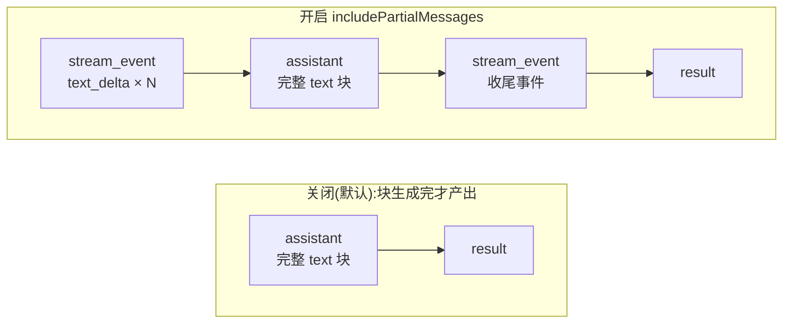

import { Canvas, Controls, Meta } from '@storybook/addon-docs/blocks';
import * as StreamingOutput from './streaming-output.stories';

<Meta of={StreamingOutput} name="Docs" />

# 流式输出

默认情况下,`query()` 对每个非空内容块等它生成完,才产出一条完整的 `assistant` 消息——整段文本说完才到手,界面在这之前无事可画。要在自己的界面里逐字出字、实时看到工具调用,把 `Options.includePartialMessages` 打开:SDK 会在原有消息之外穿插 `stream_event` 消息,`event` 字段是 Anthropic API 的原始流事件。增量不是现成全文,要按事件类型自己挑出 delta、自己累积。看完导读与参考表,你应该能预测:打开开关后,流里会多出什么、完整的 `assistant` 消息还在不在、它落在哪个位置。



| 项 | 值 | 回查要点 |
| --- | --- | --- |
| `includePartialMessages` | 默认 `false` | `Options` 布尔开关;开启后额外产出 `stream_event` |
| `stream_event` 的类型 | `SDKPartialAssistantMessage` | `event` 字段是原始 API 流事件(`BetaRawMessageStreamEvent`) |
| 文本增量 | `content_block_delta` + `text_delta` | `delta.text` 是片段,自己累积 |
| 工具输入增量 | `content_block_delta` + `input_json_delta` | `delta.partial_json` 拼成完整 JSON 字符串 |
| 事件家族 | message_start / content_block_start / content_block_delta / content_block_stop / message_delta / message_stop / ping | ping 是保活帧,直接忽略 |
| `parent_tool_use_id` | 恒为 `null` | 增量只覆盖主会话;子代理文本见"接到自己的界面" |
| 结构化输出 | 不走校验后的增量 | 最终 JSON 只出现在 `result` 消息 |

## 快速上手

打开开关,`for await` 里做三层判断:先认 `stream_event`,再认 `content_block_delta`,最后认 `text_delta`,把 `delta.text` 写到标准输出。前置环境见[安装与凭证](?path=/docs/install--docs)。

```ts
// 前置:ANTHROPIC_API_KEY 已可见;先用不带工具的小任务看清增量形态。
// 预期:文本逐字打印,而不是等整段;流自然耗尽后脚本退出。
import { query } from "@anthropic-ai/claude-agent-sdk";

for await (const message of query({
  prompt: "用一句话介绍这个项目",
  options: { includePartialMessages: true },
})) {
  if (message.type === "stream_event") {
    const event = message.event;
    if (event.type === "content_block_delta") {
      if (event.delta.type === "text_delta") {
        process.stdout.write(event.delta.text);
      }
    }
  }
}
```

预期输出(随时间逐段出现):

```text
这个项目是一个命令行待办事项管理工具。
```

三层判断是本课的固定套路。把开关去掉再跑同一个脚本,一个字都不会打印:默认的流里只有完整消息,没有 `stream_event`。消息类型体系与 agent loop 的完整地图见[消息流](?path=/docs/message-stream--docs)。

## 打开增量流

默认与开启的差别,本质是"块完成才产出"还是"边生成边发事件":

- **关闭(默认):** 每个非空内容块生成完,SDK 才产出一条完整 `assistant` 消息。一次"文本 + 工具调用"的响应是两条 `assistant`,各带自己的内容块,共享 `message.message.id`。
- **开启后:** SDK 额外产出 `stream_event`,`event` 是原始 API 流事件,不是累积文本。每个内容块走一遍 `content_block_start → content_block_delta × N → content_block_stop`;完整 `assistant` 消息照常产出,并且落在该块的 `content_block_stop` **之前**。

一轮带工具调用的会话,消息按这个顺序到达:

| 顺序 | 消息 | 说明 |
| --- | --- | --- |
| 1 | `system`(init) | 会话启动 |
| 2 | `stream_event` · message_start | 一轮响应开始 |
| 3 | `stream_event` · content_block_start | 一个块开始(text 或 tool_use) |
| 4 | `stream_event` · content_block_delta × N | 增量片段:text_delta / input_json_delta |
| 5 | `assistant`(完整块) | 照常产出,在本块 content_block_stop 之前 |
| 6 | `stream_event` · content_block_stop | 本块结束;下一个块重复 3–6 |
| 7 | `stream_event` · message_delta → message_stop | stop_reason 等收尾信息 |
| 8 | `user`(tool_result) | SDK 执行工具后回传,进入下一轮 |
| … | 下一轮从 message_start 重复 | 纯文本轮没有工具块与 tool_result |
| 末 | `result` | 循环结束 |

下面的实例用同一段回答回放两种形态(全部为演示数据,不调用模型):

<Canvas of={StreamingOutput.Interactive} />
<Controls of={StreamingOutput.Interactive} />

| 读者操作 | 可观察证据 |
| --- | --- |
| 把「includePartialMessages」拨到 off | 时间线缩成 system → assistant → user → assistant → result 五条完整消息,没有任何 stream_event |
| 拨回 on,拖动「流位置」 | stream_event 穿插出现;经过 text_delta / input_json_delta 时,下方两个累积面板逐字增长 |
| 盯住 assistant 色块 | 完整 assistant 消息总在对应块的 content_block_stop 之前到达 |
| 打开 Show code | 看到该 Canvas 实际执行的 `streaming-output-demo.ts`,上半部分即演示事件序列 |

### 文本增量

`text_delta` 是文本块的最小片段:每次事件只有几个字,SDK 不给现成全文。在快速上手的三层判断后面接一个累加器,就得到不断生长的完整文本:

```ts
// text: string —— 自己累积出完整文本;界面每收到一个片段就追加渲染
let text = "";

// 三层判断通过后:
text += event.delta.text;
```

边界:累积结果与最终 `assistant` 消息里的 text 块完全一致,可用来校验渲染;完整消息照常到达,同一段文本有两个来源,怎么选见最佳实践;夹在增量之间的 `ping` 事件直接忽略,它还有别的用途,见常见问题。

### 工具输入增量

工具调用同样逐段生成,用三种事件拼出"模型正在调用什么":

- `content_block_start`:`content_block.type === "tool_use"`,从 `name` 拿到工具名;
- `content_block_delta` + `input_json_delta`:`delta.partial_json` 是 JSON 字符串片段,逐段拼接;
- `content_block_stop`:拼接完成。

```ts
// currentTool / toolInput 在循环外初始化,跨事件累积
let currentTool: string | null = null;
let toolInput = "";

// 循环内,处理 stream_event:
if (event.type === "content_block_start") {
  if (event.content_block.type === "tool_use") {
    currentTool = event.content_block.name;
    toolInput = "";
  }
} else if (event.type === "content_block_delta") {
  if (event.delta.type === "input_json_delta") {
    toolInput += event.delta.partial_json;
  }
} else if (event.type === "content_block_stop") {
  if (currentTool) {
    console.log(`工具 ${currentTool} 输入:`, toolInput);
    currentTool = null;
  }
}
```

预期输出:

```text
工具 Read 输入: {"file_path": "README.md"}
```

边界:`partial_json` 是字符串片段,不是对象;要在 `content_block_stop` 之后(或拿到完整 `assistant` 消息后)再 `JSON.parse`。工具由 SDK 自己执行,这段增量只用来在界面上直播调用过程,不参与执行。

## 接到自己的界面

把文本增量、工具状态和结束信号接成一套终端式界面:工具块开始时显示状态指示器,执行期不上屏文本,块结束时收掉指示器,`result` 打收尾横幅。

```ts
import { query } from "@anthropic-ai/claude-agent-sdk";

// 是否正处在工具调用块中
let inTool = false;

for await (const message of query({
  prompt: "找出代码里所有 TODO 注释",
  options: {
    includePartialMessages: true,
    allowedTools: ["Read", "Bash", "Grep"],
  },
})) {
  if (message.type === "stream_event") {
    const event = message.event;
    if (event.type === "content_block_start") {
      if (event.content_block.type === "tool_use") {
        // 工具开始:显示状态指示器
        process.stdout.write(`\n[Using ${event.content_block.name}...]`);
        inTool = true;
      }
    } else if (event.type === "content_block_delta") {
      // 只在非工具块期间上屏文本
      if (event.delta.type === "text_delta" && !inTool) {
        process.stdout.write(event.delta.text);
      }
    } else if (event.type === "content_block_stop") {
      if (inTool) {
        console.log(" done");
        inTool = false;
      }
    }
  } else if (message.type === "result") {
    // agent loop 结束
    console.log("\n\n--- Complete ---");
  }
}
```

预期输出:

```text
[Using Grep...] done
在 src/ 与 lib/ 下共发现 12 处 TODO,集中在……
--- Complete ---
```

子代理的边界:`stream_event` 的 `parent_tool_use_id` 恒为 `null`,token 级增量只覆盖主会话。要把子代理的文本接进同一块界面,在 `Options` 里开 `forwardSubagentText`,子代理的文本与思考块会以完整消息形式到达(带 `parent_tool_use_id` 可归因);归因与增量只能二选一,按完整消息接。

## 最佳实践

- **渲染来源二选一。** 开启后增量与完整 `assistant` 都会到达:逐字上屏走 `stream_event`;消息历史、审计、归因用完整消息(带 `message.id`、`usage`、`parent_tool_use_id`)。同一界面里两条路径都渲染,文本必然重复。
- **工具执行期给状态,不给静默。** 用 `content_block_start` / `content_block_stop` 驱动指示器;长时间运行的工具还有周期性的 `tool_progress` 消息可读,不必靠轮询猜"卡没卡"。
- **子代理输出按完整消息接。** 增量只覆盖主会话;开 `forwardSubagentText` 让子代理文本汇成完整消息,再决定是否并入主流式界面。

## 常见问题

- 界面里同一段文本出现了两遍。
  开启 `includePartialMessages` 后,完整 `assistant` 消息仍照常到达,和 `stream_event` 是同一内容的两个来源;删掉其中一条渲染路径——通常增量负责上屏,完整消息只进历史记录。

- 开了开关,子代理的输出还是整段才出现。
  `stream_event` 的 `parent_tool_use_id` 恒为 `null`,token 级增量只覆盖主会话;在 `Options` 里开 `forwardSubagentText`,子代理文本以完整消息到达,没有增量形态。

- 在增量流里等结构化输出,拿到的 JSON 不可信或一直等不到"结果"。
  生成期间结构化 JSON 只以未校验的 `input_json_delta` 片段流出;校验后的结构化结果只出现在最终 `result` 消息的 `structured_output` 字段。"生成中"的界面用文本增量,取数以 `result` 为准。

- 按"一段时间没有内容增量"实现超时,误杀还活着的会话。
  `ping` 是保活帧:网关用 keep-alive 维持连接时,`ping` 会持续到达,把它当活性信号——有 ping 就别掐;连 ping 都停了才考虑超时。真正的内容增量只在 `content_block_delta` 出现。

## 总结回顾

摘要:

`includePartialMessages` 默认关闭,SDK 按完整内容块产出 `assistant` 消息;打开后,`stream_event` 携带原始 API 流事件穿插在原有消息之间,每个块走 start → delta × N → stop,完整 `assistant` 消息照常到达且落在本块 content_block_stop 之前。文本走 `text_delta`、工具输入走 `input_json_delta`,都是片段,要自己累积;`stream_event → content_block_delta → delta.type` 三层判断是固定套路。接到界面时用 inTool 标志切换文本上屏与工具指示器,渲染来源在增量与完整消息之间二选一;子代理没有增量,用 `forwardSubagentText` 以完整消息接入;校验后的结构化结果只出现在最终 `result` 里。

一句话:

> 增量管上屏,完整消息管记录:includePartialMessages 只多给原始事件,文本与工具输入都要自己挑 delta、自己累积。

知识要点:

- `includePartialMessages` 的默认值是什么?打开后消息流的形态怎么变?
- 一次响应里,`stream_event` 与完整 `assistant` 消息按什么顺序到达?
- 提取文本增量、累积工具输入 JSON 的固定判断套路是什么?
- 接界面时,渲染来源为什么要二选一?子代理与结构化输出的边界在哪里?

## 参考资料

- [Stream responses in real-time](https://code.claude.com/docs/en/agent-sdk/streaming-output)
- [TypeScript SDK reference](https://code.claude.com/docs/en/agent-sdk/typescript)
