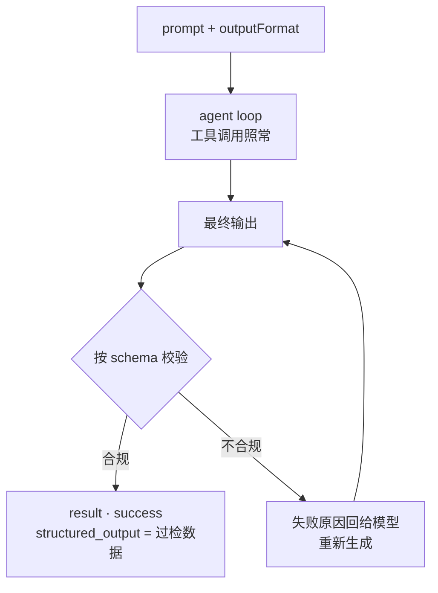

import { Canvas, Controls, Meta } from '@storybook/addon-docs/blocks';
import * as StructuredOutputs from './structured-outputs.stories';

<Meta of={StructuredOutputs} name="Docs" />

# 结构化输出

agent 默认交回自由文本,程序没法直接消费。结构化输出让你用 JSON Schema 声明最终数据的形状:agent 照常跑 agent loop、调用工具完成任务,SDK 在收尾时按 schema 校验最终输出,不合规就把失败原因回给模型重试,过检的数据放进 result 消息的 `structured_output` 字段。看完导读与参考表,你应该能预测:配上 `outputFormat` 后该去哪个字段拿数据、校验失败时流会以什么 subtype 收尾。

与相邻课程的分工:消息类型体系与 result 消息本身在[消息流](?path=/docs/message-stream--docs)讲过,本课只动一个 Options 配置和 result 的读法;边跑边拿增量文本是另一条线,见[流式输出](?path=/docs/streaming-output--docs)。

| 输入 / 概念 | 默认 / 取值 | 回查要点 |
| --- | --- | --- |
| `options.outputFormat` | `undefined`(不启用) | `{ type: "json_schema", schema }`,schema 是 JSON Schema 对象 |
| schema 校验版本 | JSON Schema draft-07 | 声明更新版本的 schema 会被拒;Zod 转换要 `target: "draft-7"` |
| `message.structured_output` | 仅 success 分支携带,类型 `unknown` | 先判 `subtype`;`success` 也可能没有值 |
| 校验失败 | 自动重试 | 重试耗尽以 `error_max_structured_output_retries` 收尾 |
| `format` 关键字 | 仅作注释 | 校验器不执行 `"format": "email"` 之类的约束 |
| 无效 schema | 启动即失败 | v2.1.205 之前的 CLI 静默忽略 schema、退回自由文本 |

## 快速上手

把 schema 交给 `outputFormat`,从 success result 里读 `structured_output`。前置环境沿用[安装与凭证](?path=/docs/install--docs)(SDK 已装、`ANTHROPIC_API_KEY` 可见);本次运行消耗真实 API 额度。

```ts
// 前置:ANTHROPIC_API_KEY 对进程可见。预期:agent 完成调研后,
// result 消息的 structured_output 携带过检数据;流自然耗尽后脚本退出。
import { query } from "@anthropic-ai/claude-agent-sdk";

// 用 JSON Schema 描述最终数据的形状
const schema = {
  type: "object",
  properties: {
    company_name: { type: "string" },
    founded_year: { type: "number" },
    headquarters: { type: "string" },
  },
  required: ["company_name"],
};

try {
  for await (const message of query({
    prompt: "调研 Anthropic,给出公司名称、成立年份与总部所在地",
    options: {
      outputFormat: { type: "json_schema", schema },
    },
  })) {
    if (
      message.type === "result" &&
      message.subtype === "success" &&
      message.structured_output
    ) {
      console.log(message.structured_output); // 可编程消费的结构,不是自由文本
    }
  }
} catch (error) {
  // 单次 query() 在产出错误 result 之后还会抛出异常;result 分支先执行,再到这里收尾
  console.error("会话以错误结束:", error);
}
```

预期输出(字段值以实际调研为准):

```text
{ company_name: 'Anthropic', founded_year: 2021, headquarters: 'San Francisco, CA' }
```

对照没配 `outputFormat` 的读法:success result 上的 `result` 字段(最终文本)仍然存在,但那是给人读的字符串;给程序消费的数据走 `structured_output`。工具调用照常发生——agent 该查就查、该算就算,约束只落在最终输出上。

## 声明输出格式

`outputFormat` 目前只有 `"json_schema"` 一种 `type`。配置后的流程:agent loop 照常推进(工具调用不受影响),循环收尾时 SDK 拿最终输出按 schema 校验,过检数据放进 success result 的 `structured_output`。



### schema 支持范围

支持全部基本类型(`object`、`array`、`string`、`number`、`boolean`、`null`)、`enum`、`const`、`required`、嵌套对象与 `$ref`;完整支持列表与限制见 API 文档的 JSON Schema limitations 清单(参考资料)。四条版本与校验器边界:

- 校验按 JSON Schema draft-07 执行,schema 里声明更新的版本(`$schema` 指向 draft 2020-12 等)会被直接拒绝。
- `format` 关键字只作注释保留:`"format": "email"` 不会被校验器执行,一个明显不是邮箱的字符串照样过检;格式级约束要么写进 prompt 要求,要么拿到数据后自己验。
- 无效 schema 让整个运行在启动时失败,报错会点名问题所在;CLI v2.1.205 之前的行为是静默忽略 schema、退回自由文本——遇到"配了格式却拿到纯文本"先升级版本。
- `structured_output` 的类型是 `unknown`:schema 在运行时校验,TypeScript 不认识它;要全程类型提示就走 Zod(见下文)。

## 校验与重试

最终输出不合规时,SDK 把校验失败连同原因回给模型重新生成,循环往复直到过检或重试额度耗尽;耗尽后运行以 `error_max_structured_output_retries` 结束。反过来说,只要以 success 收尾,`structured_output` 一定过检——你拿到的数据不需要再对着 schema 验一遍。两个非直观事实:

- `error_max_structured_output_retries` 不只来自校验失败:模型自动回退(fallback)中途撤回已完成的输出、且没有成功的重试补上,也会以同一 subtype 收尾。用 result 消息的 `errors: string[]` 区分成因——校验失败的信息指向具体字段,模型回撤则是模型层说明。
- 重试次数没有暴露成 Options 配置;想让运行更容易过检,杠杆在 schema 与 prompt 上(见最佳实践),不在重试参数上。

下面的实例回放校验与重试的全过程:schema 要求 `name`、`email` 两个 required 字段,`phone` 可选;切换三种结局场景,逐次步进模型产出,看每次校验查了什么、结局走向哪里(演示数据,不调用模型):

<Canvas of={StructuredOutputs.Interactive} />
<Controls of={StructuredOutputs.Interactive} />

| 读者操作 | 可观察证据 |
| --- | --- |
| 观察默认状态(重试后合规 · 第 1 次) | 输出把字段嵌进了 `contact`,校验指出顶层缺少 `name`,结局走向"自动重试" |
| 步进到第 3 次 | required 字段补齐,校验合规,结局变为 success · `structured_output` 已交付 |
| 切到「重试耗尽」并步进到最后 | 每次都倒在类型或 required 上,结局为 `error_max_structured_output_retries` |
| 切到「一次合规」 | 第一次就过检,没有重试发生 |
| 打开 Show code | 看到该 Canvas 实际执行的 `structured-outputs-demo.ts`,上半部分即 schema 与三个场景的尝试序列 |

## 错误处理

三种结局与一种边界情形,判定条件各不相同:

| 结局 | 判定条件 | 怎么处理 |
| --- | --- | --- |
| 成功拿到数据 | `subtype === "success"` 且 `structured_output` 存在 | 直接消费 `structured_output` |
| success 但没有数据 | `subtype === "success"` 且 `structured_output` 为空 | 按失败处理:运行结束了,但没产出结构化数据 |
| 重试耗尽 | `subtype === "error_max_structured_output_retries"` | 读 `errors` 区分校验失败与模型回撤,再对症:简化 schema、补 prompt 或重跑 |
| 其他错误 | `error_max_turns` 等(见[消息流](?path=/docs/message-stream--docs)) | 与普通运行相同,结构化配置不改变这些行为 |

完整判定分支:

```ts
// 结构化输出的标准判定:三个分支都要写,缺一个就会把异常当正常
if (message.type === "result") {
  if (message.subtype === "success" && message.structured_output) {
    console.log("数据:", message.structured_output);
  } else if (message.subtype === "error_max_structured_output_retries") {
    console.error("未能产出合规输出:", message.errors);
  } else {
    // success 但 structured_output 为空,或 error_max_turns 等其他结束方式
    console.error("运行结束但没有结构化数据:", message.subtype);
  }
}
```

两条行为边界:

- `structured_output` 只定义在 result 的 success 分支上,且 `success` 也可能没有值(运行完成但没产出结构化输出)。"成功"的完整条件因此是 subtype 与字段同时成立——只判 subtype 会拿到 `undefined`。
- 与其他错误一致:单次 `query()` 先产出错误 result 消息、之后再抛异常;连接或进程类失败没有 result、只有异常。用 `try ... catch` 包住循环,两条通道各自处理。

## 用 Zod 声明 schema

JSON Schema 对象没有类型提示,声明和消费两头都要手写形状。Zod 补上这一段:用 `z.object` 声明一次,转成 draft-07 传给 SDK,数据回来后 `safeParse` 得到全类型对象。zod 是你自己的依赖(`npm install zod`),SDK 不代发:

```ts
// zod 需自行安装。SDK 校验器只认 draft-07,而 Zod 默认目标是 2020-12,
// 所以转换时必须显式 target: "draft-7",漏了整份 schema 会被拒绝。
import { z } from "zod";

const FeaturePlan = z.object({
  feature_name: z.string(),
  summary: z.string(),
  steps: z.array(
    z.object({
      step_number: z.number(),
      description: z.string(),
      estimated_complexity: z.enum(["low", "medium", "high"]),
    }),
  ),
  risks: z.array(z.string()),
});

// 转 draft-07 后传给 query():
// query({ prompt, options: { outputFormat: { type: "json_schema", schema } } })
const schema = z.toJSONSchema(FeaturePlan, { target: "draft-7" });
```

数据回来后,用同一个 Zod schema 验回类型:

```ts
if (message.type === "result" && message.subtype === "success" && message.structured_output) {
  const plan = FeaturePlan.safeParse(message.structured_output);
  if (plan.success) {
    console.log(plan.data.steps[0].estimated_complexity); // 全程有类型提示
  }
}
```

两步各管一头:schema 对象是运行时契约(校验器认 draft-07),Zod schema 是编译时类型(IDE 提示);`safeParse` 把运行时数据验回 Zod 的类型,声明和消费就接上了。

## 最佳实践

- **schema 从小做起,保持聚焦。** 深层嵌套加大量 `required` 的 schema 更难满足,重试也更容易耗尽;先给最小可用的形状,确认稳定后再加字段。无效 schema 会在启动时被点名报错,复杂 schema 的失败则发生在运行之后。
- **拿不全的信息设为 optional。** 作者、日期这类"任务里未必有"的字段设为可选:required 抓核心字段,可选字段有就填、没有就省,重试不会为一个可有可无的字段空转。
- **prompt 与 schema 一样认真写。** 每次校验失败重试都烧轮次与费用;模糊的任务描述让模型反复产出不合规形状,清楚的产出要求能明显提高一次过检的概率。

## 常见问题

- `subtype` 是 `success`,读 `structured_output` 却是 undefined。
  `success` 只代表运行完成,不代表产出了结构化数据——按失败处理,检查任务是否真的完成、schema 是否过严。这也是官方 troubleshooting 的收录条目;判定代码要同时检查 `subtype` 与字段(见错误处理)。

- email 字段里塞了明显不是邮箱的字符串,校验却通过了。
  校验器只执行 schema 的结构与类型约束,`format` 关键字仅作注释、不强制;想挡住脏数据,把格式要求写进 prompt,或在拿到 `structured_output` 后用 Zod `safeParse` 配合字符串校验自行收紧。

- 以 `error_max_structured_output_retries` 收尾,但任务看起来很简单。
  先读 result 消息的 `errors`:校验失败信息会指向具体字段,按提示简化 schema、把拿不全的字段设为 optional 或把产出要求写清楚;如果 `errors` 是模型回退(fallback)撤回输出的说明,没有校验失败发生,直接重跑通常即可。

## 总结回顾

摘要:

结构化输出把"自由文本进、自己解析出"换成"schema 进、结构出":`options.outputFormat` 用 `{ type: "json_schema", schema }` 声明最终数据形状,agent loop 与工具调用照常,循环收尾时 SDK 按 draft-07 校验最终输出,不合规自动重试,过检数据放进 success result 的 `structured_output`。判定成功要同时看 `subtype === "success"` 与字段存在——`success` 也可能没有值;重试耗尽或模型回退撤掉产出时,以 `error_max_structured_output_retries` 结束,成因看 `errors`。Zod 提供声明、转换(`target: "draft-7"`)与消费(`safeParse`)的全程类型安全;`format` 关键字只是注释,格式级约束要在拿到数据后自己执行。

一句话:

> schema 管形状、SDK 管校验重试、`structured_output` 管交付——`success` 与字段同时成立才算拿到数据。

知识要点:

- `outputFormat` 怎么写?结构化数据从 result 消息的哪个字段拿?
- 校验失败时 SDK 做什么?重试耗尽以什么 subtype 收尾?两种成因怎么区分?
- 为什么 `success` 也可能没有 `structured_output`?判定成功的完整条件是什么?
- schema 支持哪些特性?校验按哪个 draft 版本?`format` 关键字会被执行吗?
- Zod 怎么参与声明与消费?哪一步必须 `target: "draft-7"`?

## 参考资料

- [Get structured output from agents(Agent SDK)](https://code.claude.com/docs/en/agent-sdk/structured-outputs)(outputFormat、校验与重试、错误处理与 Tips 的主来源)
- [Agent SDK reference - TypeScript](https://code.claude.com/docs/en/agent-sdk/typescript)(`Options.outputFormat` 与 `SDKResultMessage.structured_output` 的类型定义处)
- [Structured Outputs API · JSON Schema limitations](https://platform.claude.com/docs/en/build-with-claude/structured-outputs#json-schema-limitations)(SDK 页指向的完整支持列表与限制)
