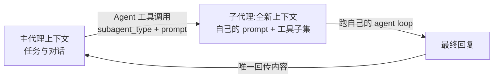

import { Canvas, Controls, Meta } from '@storybook/addon-docs/blocks';
import * as Subagents from './subagents.stories';

<Meta of={Subagents} name="Docs" />

# 子代理

主代理只有一个上下文:读过的文件、跑过的命令、失败的尝试全堆在对话里,任务一复杂,过程噪音就把要紧的内容挤出去。子代理把"一块任务"整个搬出主上下文:用 `options.agents` 定义一个专职分身,主代理通过 `Agent` 工具把任务描述交给它;它带着自己的系统提示词和工具子集,在全新的上下文里跑自己的 agent loop,跑完只把最终回复交回主代理。分工由此形成——主代理负责拆解与汇总,子代理负责专职执行,两边都看不到对方的中间过程。本课沿这条主线展开:怎么定义、怎么触发、隔离到底隔离了什么、运行中怎么观察、怎么恢复,以及创建方式、权限与数量上限等边界。子代理生命周期的 Hook 事件(`SubagentStart` / `SubagentStop`)已在[Hook 事件](?path=/docs/hooks--docs)铺过,这里直接衔接。看完导读与开场表,你应该能预测:一个只配了 `Read` / `Grep` / `Glob` 的 `code-reviewer` 被派出后,它读到的文件内容只留在它自己的上下文里,主代理拿到的只有最终审查报告。



`agents` 选项的类型是 `Record<string, AgentDefinition>`,默认 `undefined`:键是代理名(委派时作 `subagent_type`),值是定义。字段回查表:

| 字段 | 类型 / 取值 | 默认 | 回查要点 |
| --- | --- | --- | --- |
| `description` | string(必填) | — | 主代理判断"何时派它"的依据;自动触发按它匹配,写具体 |
| `prompt` | string(必填) | — | 子代理的系统提示词,定义角色与行为 |
| `tools` | string[] | 省略 = 子代理可用的全部工具 | 收窄能力面;被排除的工具在子会话里不存在,不报错也不弹权限 |
| `disallowedTools` | string[] | — | 反向排除;支持 `mcp__server`、`mcp__server__*`、`mcp__*` 三种通配 |
| `model` | string | 配置了默认子代理模型则用之,否则主模型 | 别名(`'sonnet'` 等)、完整模型 ID,或 `'inherit'`(显式用主模型) |
| `permissionMode` | PermissionMode | 继承父会话模式 | 仅父会话处于 `default` / `dontAsk` / `plan` 时生效;永不产生 `bypassPermissions` |
| `background` | boolean | — | 强制后台执行,无论 Claude 怎么请求 |
| `maxTurns` | number | 不限 | 到顶输出标记 partial,可恢复续跑(见"恢复子代理") |
| `skills` | string[] | — | 预载进上下文的技能;未列入的仍可经 Skill 工具调用 |
| `mcpServers` | (string \| object)[] | — | 字符串引用父 `mcpServers` 里已配置的名字,或内联配置 |
| `omitClaudeMd` | boolean | `false` | 跳过 user / project / local 的 CLAUDE.md(托管策略保留);对主会话无效 |
| `effort` | `'low'` 到 `'max'` 或 number | — | 该代理的推理努力等级 |
| `memory` | `'user'` / `'project'` / `'local'` | — | 自动加载 agent 记忆文件的目录范围 |
| `initialPrompt` | string | — | 作为主线程代理运行时的第一轮输入;作为子代理时忽略 |

另有实验性字段(如 `criticalSystemReminder_EXPERIMENTAL`)以类型定义为准,常规业务不使用。

## 快速上手

定义一个只读的 `code-reviewer`,显式点名派出,并从消息流分辨主代理与子代理各自的消息。前置环境沿用[安装与凭证](?path=/docs/install--docs);本例是真实运行会消耗额度的读类任务,理解机制不要求实际跑通。

```ts
// 预期:主代理先发起一次 Agent 工具调用,子代理内部的行带 [子代理] 前缀,
//       最后主代理输出审查总结;子代理读过的文件内容不会回到主上下文。
import { query } from "@anthropic-ai/claude-agent-sdk";

for await (const message of query({
  // prompt 里点名 = 显式委派,绕过按 description 的自动匹配
  prompt: "Use the code-reviewer agent to review src/auth/ for security issues.",
  options: {
    // 放行面是会话级的:委派本身(Agent)与子代理要用的读类工具一起点名
    allowedTools: ["Agent", "Read", "Grep", "Glob"],
    agents: {
      "code-reviewer": {
        // description:主代理判断"何时派它"的依据
        description: "代码审查专家。需要审查代码安全性、质量或最佳实践时使用。",
        // prompt:子代理自己的系统提示词
        prompt: "你是代码审查专家。只读分析,按严重程度输出问题清单与修复建议。",
        tools: ["Read", "Grep", "Glob"], // 工具子集:写类工具在这个子会话里不存在
        model: "sonnet", // 执行类子代理用更便宜的模型,主代理保留默认模型做规划
      },
    },
  },
})) {
  if (message.type === "assistant" && message.message?.content) {
    // 子代理内部的消息带 parent_tool_use_id(启动它的那次 Agent 调用 ID)
    const tag = message.parent_tool_use_id ? "[子代理] " : "";
    for (const block of message.message.content) {
      if ("text" in block) {
        console.log(`${tag}${block.text}`);
      } else if ("name" in block) {
        console.log(`${tag}Tool: ${block.name}`); // 委派动作显示为 Tool: Agent
      }
    }
  } else if (message.type === "result" && message.subtype === "success") {
    console.log("结果:", message.result); // 只有审查总结,没有中间过程
  }
}
```

预期输出(摘要文字每次运行不同,结构相同):

```text
Tool: Agent
[子代理] Tool: Read
[子代理] Tool: Grep
[子代理] token.ts 第 42 行硬编码了 API key,属高危;session.ts 的会话令牌没有过期时间……
审查完成,发现 2 个高危问题,建议先轮换泄露的密钥。
结果:审查完成,发现 2 个高危问题……
```

三个观察点:`tool_use` 块里委派工具叫 `Agent`,但 `system` init 消息的 `tools` 列表里同一个工具叫 `Task`(向后兼容;Claude Code v2.1.63 之前的 `tool_use` 块也叫 `Task`),按名字统计工具调用时两个值都要算;子代理内部的消息带 `parent_tool_use_id`,主线程消息没有;`result` 里只有审查总结——子代理读过的文件内容、中间尝试全部留在它自己的上下文。消息类型的完整体系见[消息流](?path=/docs/message-stream--docs)。

## 定义子代理

核心字段只有一对:`description` 与 `prompt`(都是必填)。`description` 是给主代理看的——自动委派时,主代理拿任务和各代理的 `description` 做匹配,决定派谁;写"何时用、擅长什么",不是罗列角色设定。`prompt` 是给子代理自己的系统提示词,决定它在隔离上下文里的角色与行为。

`tools` 决定子代理的能力面:省略时继承子代理可用的全部工具;列出时只有列出的工具——被排除的工具在子代理会话里**根本不存在**,不会有权限提示,也不会报错。按任务形态选工具组合:

| 用途 | tools 组合 |
| --- | --- |
| 只读分析(审查、探查) | `Read`、`Grep`、`Glob` |
| 测试执行 | `Bash`、`Read`、`Grep` |
| 代码修改 | `Read`、`Edit`、`Write`、`Grep`、`Glob` |
| 全部能力 | 省略 `tools` |

`model` 控制每个子代理用哪个模型:别名、完整模型 ID,或 `'inherit'` 显式沿用主模型;省略时用配置过的默认子代理模型,否则与主模型相同。典型分工是贵模型做主代理的规划与汇总、便宜模型做子代理的批量执行。其余字段(`disallowedTools`、`mcpServers`、`skills`、`maxTurns`、`background`、`permissionMode`、`omitClaudeMd`、`effort`、`memory`)的默认值与边界见开场回查表;`tools` 里传 `"Skill"` 的旧写法已废弃,预载技能改用 `skills` 字段。

## 触发与后台运行

主代理经 `Agent` 工具调用子代理,两条触发路径:

| 路径 | 怎么发生 | 要点 |
| --- | --- | --- |
| 自动 | 主代理拿任务与各 `description` 匹配 | 不用改 prompt;`description` 写得越具体越准 |
| 显式 | prompt 里点名代理(`Use the code-reviewer agent to …`) | 绕过自动匹配直接调用;排查"不委派"问题先用它 |

子代理**默认在后台运行**,启动形态由两层共同决定:

| 写法 | 效果 |
| --- | --- |
| Agent 调用省略 `run_in_background` | 后台执行:主代理不等结果、继续干别的,结果稍后回传(默认) |
| Agent 调用带 `run_in_background: false` | 主代理停下等待,拿到结果再继续;Claude 需要结果才能往下走时会自己这样设 |
| `AgentDefinition.background: true` | 定义侧强制后台,无论 Claude 怎么请求 |

一个版本边界:默认后台在 Claude Code v2.1.198 之前逐步铺开,旧版本里省略 `run_in_background` 可能同步运行。

## 上下文隔离与结果回传

非 fork 的子代理上下文全新开始——没有父对话,但也不是空的:

| 子代理收到 | 子代理收不到 |
| --- | --- |
| 自己的 `prompt`(系统提示词)+ Agent 工具的委派 prompt | 父对话历史与父会话的工具结果 |
| 项目 CLAUDE.md(随 `settingSources` 加载,见[设置来源](?path=/docs/settings-sources--docs);`omitClaudeMd` 可跳过) | 父会话的系统提示词 |
| 工具定义(继承全集或 `tools` 子集) | 未列入 `skills` 的预载技能内容 |

两个补充:带 `SendMessage` 工具的子代理会自动拿到一份具名代理列表,可以互发消息;extended thinking 配置随主会话继承。

回传规则是本课最重要的一条:**只有子代理的最终消息回传父代理**。主代理拿到的是一份简明总结,不是子代理读过的每个文件;中间步骤、失败尝试、长工具输出永远留在子上下文——这正是隔离的价值,探查一百个文件的过程可以只折算成主上下文里的一段结论。两种结束方式让"回传"不完整:以 API 错误(如 rate limit)结束的子代理,结果**永远不会投递**;达到 `AgentDefinition.maxTurns` 上限的子代理,输出标记 partial 并附 `agentId`,可以恢复续跑。

下面的实例回放一次委派在两个上下文里各留下什么(演示数据,条目字段对应官方 `AgentDefinition` 与 Agent 工具输入,不调用 LLM API):

<Canvas of={Subagents.Interactive} />
<Controls of={Subagents.Interactive} />

| 读者操作 | 可观察证据 |
| --- | --- |
| 观察默认场景"正常完成" | 右列(子上下文)有委派 prompt、读文件、检索与最终回复;左列只有委派与回传,读数显示"过程只留在这里" |
| 关闭"后台运行" | 左列出现"等待子代理"条目;打开时主代理在委派后继续自己的条目 |
| 切换为"轮次上限" | 两侧落点变为 partial 结果 + `agentId`,读数显示"partial 结果 · 可恢复" |
| 切换为"API 错误" | 落点变为红色"结果不会投递",读数显示"无 · 结果不投递" |

## 观察子代理运行

消息流里子代理有三处落点:

| 看哪里 | 能看到什么 |
| --- | --- |
| `assistant` 消息的 `tool_use` 块 | `name` 为 `Agent`(旧版 `Task`),`input` 带 `subagent_type`、`prompt`、`run_in_background` |
| 子代理内部的 `assistant` / `user` 消息 | 带 `parent_tool_use_id`(启动它的那次 Agent 或 Skill 调用 ID);主线程消息没有 |
| 委派调用的结果 | 对应 `user` 消息的 `tool_use_result` 字段,类型 `AgentOutput`,`status` 区分 `completed` / `async_launched` / `remote_launched`;可恢复代理的结果文本里带 `agentId: <id>` |

Hook 事件的视角见[Hook 事件](?path=/docs/hooks--docs):`SubagentStart` / `SubagentStop` 包住子代理自己的工具事件,子代理内事件的输入带 `agent_id` / `agent_type`,`matcher` 可以按 agent 类型过滤。

要枚举当前可用的子代理,用 Query 对象上的 `supportedAgents()`,返回 `AgentInfo[]`(`name`、`description`、`model?`);它是初始化时捕获的快照,不反映运行期变化:

```ts
// 预期:先打印可用子代理清单(含内置 general-purpose),再照常消费消息流
const q = query({ prompt: "…", options: { agents } });
for (const info of await q.supportedAgents()) {
  console.log(info.name, "—", info.description);
}
for await (const message of q) {
  // …
}
```

## 恢复子代理

子代理的转录独立保存、独立持久;把一个已完成的子代理接着往下用,分三步:

```ts
// 第 1 步:第一轮运行里捕获 session_id,并从 Agent 工具结果文本解析 agentId
let sessionId: string | undefined;
let agentId: string | undefined;
for await (const message of query({
  prompt: "Use the endpoint-finder agent to find all API endpoints in this codebase.",
  options: { allowedTools: ["Read", "Grep", "Glob", "Agent"], agents },
})) {
  if ("session_id" in message) sessionId = message.session_id;
  const text = JSON.stringify(message);
  agentId ??= text.match(/agentId:\s*([\w-]+)/)?.[1]; // 结果文本里的 "agentId: <id>"
}

// 第 2 步:第二次 query 传 resume: sessionId,并在 prompt 里带上 agent ID
if (sessionId && agentId) {
  for await (const message of query({
    prompt: `Resume agent ${agentId} and list the top 3 most complex endpoints.`,
    options: { allowedTools: ["Read", "Grep", "Glob", "Agent"], agents, resume: sessionId },
  })) {
    // …
  }
}
```

三条边界:自定义代理在两次 `query()` 里都要带同一份 `agents` 定义,漏了会找不到代理;恢复的子代理保留完整历史,达到 `maxTurns` 标记 partial 的输出也走这条路续跑;内置的 `Explore` / `Plan` 是一次性代理,不返回 `agentId`,无法这样恢复。

## 边界与上限

三种创建方式,同名时程序化定义覆盖文件系统定义:

| 方式 | 怎么定义 | 适用 |
| --- | --- | --- |
| 程序化 `agents` 选项 | `query()` options 里写 `AgentDefinition` | SDK 应用(官方推荐),本课主线 |
| 文件系统 | `.claude/agents/` 下的 markdown 文件(Claude Code 监视项目与 `~/.claude/agents/` 目录) | 复用 CLI 侧已有的团队配置 |
| 内置 `general-purpose` | 不定义也存在 | 不带 `subagent_type` 的 Agent 调用落到它 |

设环境变量 `CLAUDE_AGENT_SDK_DISABLE_BUILTIN_AGENTS=1` 可移除内置代理,此后不带 `subagent_type` 的 Agent 调用直接报错(`subagent_type is required`)。

子代理也能再派子代理,三个上限兜底。注意 `env` 在 TS 里是**替换**子进程环境,自定义时先展开 `process.env`:

| 上限 | 设置 | 默认 | 触顶后果 |
| --- | --- | --- | --- |
| 嵌套深度 | `CLAUDE_CODE_MAX_SUBAGENT_SPAWN_DEPTH` | 3 层 | 设 `1` = 禁止子代理再派 |
| 并发数 | `CLAUDE_CODE_MAX_CONCURRENT_SUBAGENTS` | 20 | 超出的调用收到 "Concurrent subagent limit reached" |
| 花费 | `maxBudgetUsd` 选项 | 不限 | 以 `error_max_budget_usd` 结束;上限内完成则 `success` |

```ts
options: {
  allowedTools: ["Read", "Grep", "Glob", "Agent"],
  env: {
    ...process.env, // env 是替换不是合并:先展开,否则丢 PATH
    CLAUDE_CODE_MAX_SUBAGENT_SPAWN_DEPTH: "1",
    CLAUDE_CODE_MAX_CONCURRENT_SUBAGENTS: "5",
  },
  maxBudgetUsd: 5,
}
```

权限上,子代理默认运行在父会话的权限模式里,工具调用走主会话的权限体系(评估链见[权限规则与 canUseTool](?path=/docs/permissions--docs));`AgentDefinition.permissionMode` 仅当父会话处于 `default` / `dontAsk` / `plan` 等普通模式时生效,而且永远不能借此拿到 `bypassPermissions`——子代理进入 `bypassPermissions` 只有一种情况:父会话本身就是。所以"派个子代理绕过权限"不成立。规模再往上(几十到上百个代理的扇出),用 `Workflow` 工具(TS SDK v0.3.149+;`allowedTools` 加 `"Workflow"` 自动批准),编排脚本在对话上下文之外执行,本课不展开。

## 常见问题

- 主代理从不委派,自己把活干完了。
  先在 prompt 里显式点名(`Use the code-reviewer agent to …`)验证代理本身可用,再回头补 `description`:自动触发按它匹配,要写清"何时用、擅长什么";同时确认 `allowedTools` 已放行 `Agent`。
- 子代理的工具调用被拒,或者干脆没有某个工具。
  分两层查:`tools` 列表决定工具在不在子会话里,被排除 = 不存在,不报错也不弹窗;放行面决定调用批不批——子代理沿用主会话的权限评估,它要用的写类工具同样需要 `allowedTools` / `permissionMode` / `canUseTool` 放行。
- 子代理好像没回任何结果。
  先分清三种情况:后台运行的子代理结果是稍后回传,不是丢失;以 API 错误结束的子代理,结果永远不会投递,重试即可;达到 `maxTurns` 的输出带 partial 标记和 `agentId`,按"恢复子代理"续跑。

## 总结回顾

摘要:

子代理是主代理用 `options.agents`(`Record<string, AgentDefinition>`)定义的专职分身:必填的 `description` 供主代理匹配何时委派,`prompt` 是它在全新上下文里的系统提示词,`tools` / `model` / `permissionMode` 等字段收窄它的能力与权限。主代理经 `Agent` 工具(init 消息的 tools 列表里叫 `Task`)委派,自动触发靠 `description` 匹配、prompt 点名则直接调用;子代理默认后台运行,`run_in_background: false` 让主代理等待,`background: true` 强制后台。隔离是机制自带的:子代理只带走委派 prompt、自己的系统提示词、CLAUDE.md 与工具定义,父对话与父系统提示词一概收不到,最终回复是唯一回传内容——API 错误的结果永不投递,`maxTurns` 到顶标记 partial,可用 `resume` 加 `agentId` 续跑。运行中从消息流的 `parent_tool_use_id`、hook 的 `SubagentStart` / `SubagentStop` 与 `supportedAgents()` 观察嵌套深度、并发与花费上限兜底,子代理不构成绕过权限的通道。

一句话:

> 子代理 = `agents` 定义专职分身 + `Agent` 工具委派 + 只有最终回复回传;过程留在子上下文,能力面用 `tools` 收窄,数量与花费用 env 和 `maxBudgetUsd` 兜底。

知识要点:

- 怎么用 `options.agents` 定义子代理?`AgentDefinition` 哪两个字段必填、分别决定什么?
- 主代理通过哪个工具委派?`tool_use` 块和 `system:init` 的 tools 列表里分别叫什么?
- 子代理默认前台还是后台?`run_in_background` 与 `AgentDefinition.background` 各控制什么?
- 子代理的上下文里有什么、没有什么?什么内容回传主代理?哪两种结束方式让回传不完整?
- 怎么从消息流区分子代理内部消息?怎么枚举可用子代理?
- 恢复一个子代理要哪三步?哪些代理不能恢复?
- 嵌套深度、并发、花费上限分别怎么设?为什么"派子代理绕过权限"不成立?

## 参考资料

- [Create and use subagents(Agent SDK)](https://code.claude.com/docs/en/agent-sdk/subagents)(三种创建方式、AgentDefinition 字段、触发与后台运行、上下文隔离、恢复子代理、上限控制)
- [Agent SDK reference - TypeScript](https://code.claude.com/docs/en/agent-sdk/typescript)(`agents` 选项、`AgentDefinition`、`AgentInfo` 与 `supportedAgents()`、`AgentOutput`)
- [Configure permissions(Agent SDK)](https://code.claude.com/docs/en/agent-sdk/permissions)(子代理的权限模式继承与 `bypassPermissions` 边界)
