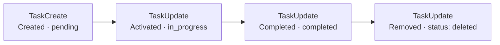

import { Canvas, Controls, Meta } from '@storybook/addon-docs/blocks';
import * as TodoTracking from './todo-tracking.stories';

<Meta of={TodoTracking} name="Docs" />

# TODO 跟踪

面对多步任务,agent 会维护一份结构化的任务清单:先建条目,再逐条推进状态,把"计划"与"进度"变成机器可读的数据。对 SDK 使用者,这份清单的价值是可以驱动自己的进度 UI——但先要建立一个关键预期:**清单不随某一条消息整体送达**,它由流里成对出现的任务工具调用(`tool_use` 块与配对的 `tool_result`)拼出来。本课沿用[消息流](?path=/docs/message-stream--docs)的消息模型,讲清清单由哪些工具承载、怎么从流里拼出清单、怎么渲染执行进度。看完导读与参考表,你应该能预测:一个两步任务的执行流里,清单何时多一条、何时推进、何时收尾,以及任务 ID 从哪一步才开始存在。



| 工具 | 关键输入 | 结构化输出(`tool_use_result`) | 用途 |
| --- | --- | --- | --- |
| `TaskCreate` | `subject`、`description`、`activeForm?` | `TaskCreateOutput`:`task: { id, subject }` | 新建一条任务,ID 由执行方分配 |
| `TaskUpdate` | `taskId`、`status?`、`subject?` 等 | `TaskUpdateOutput`:`success`、`updatedFields`、`statusChange?` | 推进状态、改字段;`status: "deleted"` 移除 |
| `TaskGet` | `taskId` | `TaskGetOutput`:`task`(找不到时为 `null`) | 读单个任务详情 |
| `TaskList` | 无 | `TaskListOutput`:`tasks` 快照 | 读整份清单 |
| `TodoWrite` | `todos: [{ content, status, activeForm }]` | `TodoWriteOutput`:`oldTodos`、`newTodos` | 一次性整表替换清单 |

## 任务工具

任务清单由五个内置工具承载,对应两组消费模型:`TaskCreate` / `TaskUpdate` / `TaskGet` / `TaskList` 逐条维护——每次调用动一条,清单状态分散在多对消息里;`TodoWrite` 整表替换——一次调用携带全量清单,输出直接给出前后对照。五个工具是否可用由模型决定,开启方式如下:

| 开启方式 | 写法 | 说明 |
| --- | --- | --- |
| 默认可用 | 无需配置 | Claude 3.x、Opus 4–4.7、Sonnet 4–4.6、Haiku 4.5;默认集合自 Claude Code v2.1.268 起,TypeScript SDK 从 v0.3.268 开始捆绑 |
| `allowedTools` 命名 | `allowedTools: ["TaskCreate", "TaskUpdate"]` | 点名任务清单工具即对该会话开启;`allowedTools` 本身的权限语义见[权限规则与 canUseTool](?path=/docs/permissions--docs) |
| `tools` 列出 | `tools: ["TaskCreate", "TaskUpdate", "TaskList"]` | 用 `tools` 收紧可用工具集时顺带开启 |
| env 开关 | `env: { ...process.env, CLAUDE_CODE_ENABLE_TODO_TOOLS: "1" }` | 对会话开启任务清单工具;`env` 整体替换子进程环境,记得带上 `...process.env` |
| 切回 TodoWrite | `env: { ...process.env, CLAUDE_CODE_ENABLE_TASKS: "0" }` | 不提供四个 Task 工具,改提供 `TodoWrite` |

边界:工具可用不等于必有清单——agent 只在复杂多步任务(约 3 步以上)、用户给了任务清单或明确要求时才建清单,短任务可能没有任何任务工具调用,进度 UI 要容忍空清单。

### 创建与推进:TaskCreate / TaskUpdate

`TaskCreate` 负责新建,`TaskUpdate` 负责之后的每次变化。两者的输入与结构化输出如下:

```ts
// 创建:输入里没有任务 ID,ID 由执行方在执行时分配
// TaskCreateInput → tool_use_result (TaskCreateOutput)
{ subject: "改造 loader.ts", description: "…", activeForm: "改造 loader.ts 中" }
→ { task: { id: "3", subject: "改造 loader.ts" } }

// 推进 / 修改 / 删除:输入自带 taskId,直接生效
// TaskUpdateInput → tool_use_result (TaskUpdateOutput)
{ taskId: "3", status: "in_progress" }   // status: "pending" | "in_progress" | "completed" | "deleted"
→ { success: true, taskId: "3", updatedFields: ["status"], statusChange: { from: "…", to: "…" } }
```

要点:

- **任务 ID 只在结果里。** `TaskCreate` 的输入没有 `id` 字段;`tool_use_result` 里的 `TaskCreateOutput` 才带分配好的 `task.id`,配对方式见下一节。
- 生命周期就是开场图那条链:`pending` 新建 → `in_progress` 激活 → `completed` 完成 → `TaskUpdate` 设 `status: "deleted"` 移除。
- `activeForm` 是"进行中"文案(现在进行时),渲染进度时 `in_progress` 条目优先显示它,`pending` / `completed` 显示 `subject`。
- `TaskUpdate` 还能改 `subject` / `description`,以及 `addBlocks` / `addBlockedBy`(依赖关系)、`owner`、`metadata` 等管理字段,均按 `taskId` 定位。

### 读回清单:TaskGet / TaskList

两个只读工具,用于主动核对清单,而不是等流里的事件:

```ts
// TaskList:整份清单快照 → tool_use_result (TaskListOutput)
{ tasks: [{ id: "3", subject: "改造 loader.ts", status: "in_progress", owner?, blockedBy: [] }] }

// TaskGet:单个任务详情,找不到时 task 为 null → tool_use_result (TaskGetOutput)
{ task: { id: "3", subject: "…", description: "…", status: "in_progress", blocks: [], blockedBy: [] } }
```

`TaskList` 适合在接手会话(如 resume 之后)时拿一次入场快照;`TaskGet` 适合核对单条详情(依赖、owner)。它们同样以 `tool_use` 块出现在流里,消费方式与创建、推进一致。

### TodoWrite:整表替换

`TodoWrite` 是清单的另一条供给线:一次调用携带全量清单,把旧表整体替换为新表,输出自带前后对照:

```ts
// TodoWriteInput → tool_use_result (TodoWriteOutput)
{ todos: [{ content: "改造 loader.ts", status: "in_progress", activeForm: "改造 loader.ts 中" }] }
→ { oldTodos: [/* 替换前 */], newTodos: [/* 替换后 */] }
```

何时用哪套:默认与四件套打交道;想要"一条消息就是一份完整快照、`oldTodos` / `newTodos` 直接做前后对照"的最简 UI,可以设 `CLAUDE_CODE_ENABLE_TASKS: "0"` 切到 `TodoWrite`。反过来,需要逐条 `id` 精确推进、依赖字段或 `metadata` 时,用四件套。两套不会同时提供,消费逻辑按选定的一套写。

## 从消息流拼任务清单

清单状态分散在多对消息里,拼法是两步配对:

1. `assistant` 消息里的 `tool_use` 块给出工具输入——`TaskCreate` 拿不到 ID,只能先按 `block.id`(tool_use_id)登记待创建的条目;`TaskUpdate` 的输入自带 `taskId`,可以直接推进。
2. 同一 `tool_use_id` 的 `user` 消息回传 `tool_result`,`message.tool_use_result` 是结构化输出——`TaskCreateOutput` 的 `task.id` 到这里才存在,此时才把条目入列。

```ts
type TaskStatus = "pending" | "in_progress" | "completed";

const tasks = new Map<string, { subject: string; status: TaskStatus }>();
const pendingCreates = new Map<string, string>(); // tool_use_id → 等待配对的 subject

for await (const message of query({ prompt: "重构配置加载,改完跑通全部测试" })) {
  if (message.type === "assistant") {
    for (const block of message.message.content) {
      if (block.type !== "tool_use") continue;
      const input = block.input as Record<string, any>; // 工具输入做一次收窄,演示从简
      if (block.name === "TaskCreate") {
        // 输入里没有 ID:先按 tool_use_id 记下,等配对的 tool_result
        pendingCreates.set(block.id, input.subject);
      } else if (block.name === "TaskUpdate") {
        const task = tasks.get(input.taskId);
        if (task && input.status) task.status = input.status;
      }
    }
  }
  if (message.type === "user") {
    const content = message.message.content;
    if (!Array.isArray(content)) continue;
    for (const block of content) {
      if (block.type !== "tool_result") continue;
      const subject = pendingCreates.get(block.tool_use_id);
      const output = message.tool_use_result as { task?: { id?: string } } | undefined;
      if (subject && output?.task?.id) {
        // TaskCreateOutput:任务 ID 在配对结果里才拿到,此时入列
        tasks.set(output.task.id, { subject, status: "pending" });
        pendingCreates.delete(block.tool_use_id);
        renderProgress(tasks); // 用最新清单刷新你的进度 UI
      }
    }
  }
}
```

下面的实例用演示数据回放"重构配置加载"这条流,观察清单如何被逐对拼出来(不调用 LLM API):

<Canvas of={TodoTracking.Interactive} />
<Controls of={TodoTracking.Interactive} />

| 读者操作 | 可观察证据 |
| --- | --- |
| 拖动「流位置」 | 时间线高亮当前消息,右侧清单随回放重建,读数同步显示清单与进度 |
| 停在第 1、3 条(assistant · TaskCreate) | 清单还没多出条目——输入里没有 ID;推进到下一步的 tool_result,条目才入列 |
| 停在 assistant · TaskUpdate | 清单立刻推进(输入自带 taskId);下一步的 TaskUpdateOutput 只做确认,清单不变 |
| 打开 Show code | 看到该 Canvas 实际执行的 `todo-tracking-demo.ts`,上半部分即演示流与回放跟踪器 |

一个防御细节:`TaskUpdate` 的输入建议按防御方式读取——CLI 会把近似键名修复后再执行(如 `id` / `task_id` 修复为 `taskId`),但修复不反映在流里,`tool_use` 块中仍是模型写下的原始键:

```ts
// 防御读取 TaskUpdate 输入的 taskId
const taskId = input.taskId ?? input.id ?? input.task_id;
```

边界:

- 任务清单工具调用与"后台任务"消息是两回事:`task_started` / `task_notification` 等 system 消息报告的是后台 Bash、Monitor、子代理的生命周期,其 `task_id` 是后台任务 ID,不是清单条目;清单只看任务工具的 `tool_use` / `tool_use_result`。
- `TodoWrite` 模式无需配对:单条消息的 `oldTodos` / `newTodos` 就是全量前后对照,直接替换本地状态即可。
- 消费到 `result` 时清单即终态;让 `for await` 自然结束,不要在 `result` 处提前断流,否则会丢尾随事件,原因见[消息流](?path=/docs/message-stream--docs)。

## 常见问题

- 想找一条"任务清单消息"或 `TodoChangeEvent` 这样的消息类型,遍历 `SDKMessage` 联合类型也没有。
  没有这种类型:清单不是消息,而是任务工具调用与结果的配对产物,按上一节的 tracker 自己维护;消息类型体系见[消息流](?path=/docs/message-stream--docs)。

- 把流里的 `task_started` / `task_notification` 当成清单更新,进度条乱跳。
  这两条 system 消息报告的是后台任务(Bash 命令、Monitor、子代理)的生命周期,`task_id` 是后台任务 ID;清单条目只来自 `TaskCreate` / `TaskUpdate`(或 `TodoWrite`)的调用与结果。

## 总结回顾

摘要:

任务清单由五个内置工具承载:TaskCreate / TaskUpdate / TaskGet / TaskList 逐条维护,TodoWrite 整表替换;是否可用取决于模型,其他模型可用 `allowedTools`、`tools` 或 `CLAUDE_CODE_ENABLE_TODO_TOOLS=1` 开启,`CLAUDE_CODE_ENABLE_TASKS=0` 切到 TodoWrite。清单本身不是消息:TaskCreate 的输入没有 ID,要等同一 tool_use_id 的 tool_result 回传 `TaskCreateOutput` 才入列;TaskUpdate 输入自带 taskId,调用即可推进,输出只做确认。按这套配对机制维护一个 Map,就能把流里的任务工具调用拼成实时进度 UI;渲染时进行中条目用 `activeForm`。`task_started` / `task_notification` 报告的是后台任务,与清单无关。

一句话:

> 任务清单不随某条消息送达,而是从任务工具的 `tool_use` 与 `tool_use_result` 里一对对拼出来——TaskCreate 的 ID 要到配对结果里拿,TaskUpdate 自带 `taskId` 直接推进。

知识要点:

- 五个任务工具分哪两组消费模型?默认在哪些模型可用,其他模型有哪些开启方式?
- TaskCreate / TaskUpdate 的输入与结构化输出各有哪些字段?任务 ID 从哪一步开始存在?
- 从消息流拼清单的配对机制怎么写?为什么 TaskCreate 要先登记、等配对结果才入列?
- TodoWrite 与四个 Task 工具在消费模型上的差别是什么?怎么切换?
- 哪些消息容易和清单更新混淆?为什么?

## 参考资料

- [Track todos](https://code.claude.com/docs/en/agent-sdk/todo-tracking)(任务工具、模型可用性、监控清单变化与实时进度展示的官方专题页)
- [TypeScript SDK reference](https://code.claude.com/docs/en/agent-sdk/typescript)(TaskCreateInput / TaskCreateOutput 等工具输入输出类型与 `SDKTaskNotificationMessage` 的定义处)
