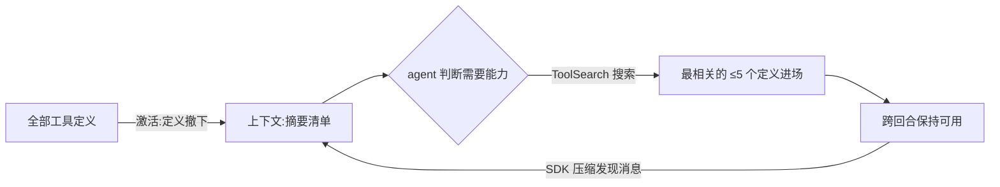

import { Canvas, Controls, Meta } from '@storybook/addon-docs/blocks';
import * as ToolSearch from './tool-search.stories';

<Meta of={ToolSearch} name="Docs" />

# 工具搜索

工具搜索解决工具规模化后的两个问题:几十个 MCP 工具的定义能在对话开始前吃掉 10-20K+ token,挤占代码、文件与对话的空间;可选项一多(经验上超过 30-50 个),agent 就开始选错工具、排错步骤,甚至干脆不用工具。它把工具定义从上下文里撤下来——agent 手里只留一份摘要清单,需要时按需搜索,每次取回最相关的少量工具。这个机制默认开启,覆盖所有已注册工具:内置工具、远程 MCP server、`createSdkMcpServer()` 的进程内工具,你可能已经在用它。本课讲五种开关怎么选、auto 阈值怎么算、激活后每个回合发生什么,以及哪些环境会悄悄退回整载。

看完导读与参考表,你应该能预测:把 `ENABLE_TOOL_SEARCH` 设成某个值后,首回合上下文装进的是完整定义还是一份摘要,以及 agent 会不会为找工具多花一次往返。

边界:server 怎么接入见[接入 MCP server](?path=/docs/mcp-integration--docs),进程内工具怎么写见[进程内自定义工具](?path=/docs/custom-tools--docs);本课讲的是它们之上的调度层——工具定义什么时候进上下文、由谁决定。

开关只有一个环境变量,经 `options.env` 传给 CLI 子进程:

| 取值 | 行为 | 适用 |
| --- | --- | --- |
| (未设置) | 开启;命中回退条件(见下文「回退与覆盖」)时改为整载 | 默认,大多数场景 |
| `"true"` | 强制开启,经代理也发送 beta header | 非官方 `ANTHROPIC_BASE_URL` 下被自动关闭时显式打开 |
| `"auto"` | 可延迟定义达到上下文窗口 10% 才激活,否则整载 | 工具规模会波动,交给 SDK 判断 |
| `"auto:N"` | 同 auto,阈值 N%(如 `"auto:5"` = 5%),越低越早激活 | 想要确定性行为时点死阈值 |
| `"false"` | 关闭;每回合整载全部定义 | 工具很少,或不支持 `tool_reference` 的通道 |

## 快速上手

给一个多工具 MCP server 会话开启工具搜索。范例以官方示例为蓝本,server 地址与输出为示意,不强求真实运行;前置环境沿用[安装与凭证](?path=/docs/install--docs)。注意:工具搜索只决定定义何时进上下文,不改变权限——放行规则照旧要写。

```ts
// 给多工具 MCP 会话开启工具搜索:定义不再整载,agent 按需搜索取用。
// 前置:SDK 已安装,ANTHROPIC_API_KEY 对进程可见。
// 预期:会话正常拿到 result;区别在上下文——工具定义被撤下,换成一份摘要清单。
import { query } from "@anthropic-ai/claude-agent-sdk";

try {
  for await (const message of query({
    prompt: "在工单系统里找出本周未关闭的 bug 单",
    options: {
      mcpServers: {
        "enterprise-tools": {
          // 远程 MCP server,工具越多越值得开工具搜索
          type: "http",
          url: "https://tools.example.com/mcp",
        },
      },
      // 放行规则照旧:搜索不改变权限,工具调用仍要先放行
      allowedTools: ["mcp__enterprise-tools__*"],
      env: {
        ...process.env, // env 是替换式,展开以保留 ANTHROPIC_API_KEY 等变量
        ENABLE_TOOL_SEARCH: "auto:5", // 可延迟定义达到窗口 5% 时激活
      },
    },
  })) {
    if (message.type === "result" && message.subtype === "success") {
      console.log("结果:", message.result);
    }
  }
} catch (error) {
  // 单发 query() 在产出 error result 后还会 throw,循环要包 try/catch
  console.error("会话以错误结束:", error);
}
```

预期输出(示意):

```text
结果:本周未关闭的 bug 单共 3 张:WEB-214、WEB-231、API-87 …
```

三点从配置里能看出来:`env` 是替换式,不展开 `process.env` 就会丢掉凭证;`allowedTools` 与工具搜索是两回事,放行不随搜索增减;错误路径要接住——单发 `query()` 在流里产出 error result 后会抛异常。

## 激活后的行为

工具搜索激活后,工具定义不再进入上下文,agent 手里是一份"有哪些能力可用"的摘要清单。判断需要某个能力时,agent 用内置的 `ToolSearch` 工具搜一遍工具目录,最相关的工具(默认最多 5 个)连同完整定义装进上下文,之后像普通工具一样调用。

装进来的工具跨回合保持可用,直到 SDK 压缩(compact)了发现它们的那些消息——压缩之后 agent 需要重新搜索才能再次取用。代价是每次搜索多一次模型往返:定义先撤下、再取回,这趟往返在工具很少时不划算,工具少于约 10 个时整载通常更快。



四条边界:

- 覆盖所有已注册工具——内置工具、远程 MCP、进程内自定义工具,不需要逐个开启。
- 目录上限 10,000 个工具;每次搜索默认最多取回 5 个。
- 不想用搜索时,除了 `ENABLE_TOOL_SEARCH: "false"`,用 `disallowedTools` 排除内置 `ToolSearch` 工具同样让会话退回整载。
- 搜索只影响"定义何时进上下文",调用权限、工具结果上限等照旧走各自规则。

## auto 模式的阈值

`auto` 不数工具个数,数可延迟定义的 token 总量:所有 server 上未标记 `alwaysLoad` 的 MCP 工具,加上按需加载的内置工具,合并计一个总池,与上下文窗口比较。总量达到窗口的 10%(默认)或 `auto:N` 指定的 N% 时激活;不足则整载,全部定义照旧进上下文。两类不计入总池:核心内置工具(`Bash`、`Read`、`Edit`)永远整载;`alwaysLoad` 豁免的工具(见下文「豁免工具」)常驻初始提示——豁免越多,池子越小,auto 越难达到阈值。

下面的实例回放这套阈值判定:切换模式、拖动规模,看首回合装进上下文的是什么、要不要付搜索往返(演示数据:窗口按 200K、每工具定义约 250 token 估算,只演示阈值行为,不代表真实 token 数;并假定模型与通道支持,不含回退条件):

<Canvas of={ToolSearch.Interactive} />
<Controls of={ToolSearch.Interactive} />

| 读者操作 | 可观察证据 |
| --- | --- |
| 观察默认(auto · 24K) | 可延迟 24K 超过阈值 20K,状态"延迟":上下文只装摘要,搜索 +1 往返 |
| 把「工具定义规模」拖到 20K 以下 | 池子不足阈值,状态翻成"整载":全部定义进上下文,无额外往返 |
| 切到 auto:5 | 阈值降到 10K,同样的工具量提前激活 |
| 拖高「alwaysLoad 豁免」 | 可延迟池变小,auto 更难达到阈值——豁免会让激活推迟 |
| 打开 Show code | 看到该 Canvas 实际执行的 `tool-search-demo.ts`,上半部分即模式与阈值推导 |

## 回退与覆盖

工具搜索默认开启,但有几类条件会让 SDK 静默退回整载——不报错、继续跑。"配了没生效"先查这张表:

| 条件 | 行为 | `ENABLE_TOOL_SEARCH` 能否覆盖 |
| --- | --- | --- |
| 模型在 SDK 的不支持清单里 | 整载 | 不能 |
| Agent Platform 上 4.5 之前的模型 | 整载(服务端拒收 beta header) | 不能 |
| Azure 上的 Microsoft Foundry | 服务端拒绝,整载 | 不能(设 `"true"` 也一样) |
| `ANTHROPIC_BASE_URL` 指向非第一方主机 | 自动关闭(多数代理不转发 `tool_reference` 块) | 能;`"true"` 会经代理发送 beta header |
| 设了 `CLAUDE_CODE_DISABLE_EXPERIMENTAL_BETAS` | 强制关闭 | 不能 |

两条要点:

- 模型要求:Sonnet 4.5、Haiku 4.5、Opus 4.5 及之后版本。
- 两个版本注记:Claude Code v2.1.221 之前,Agent Platform 的所有模型都要显式设置 `ENABLE_TOOL_SEARCH` 才开启;组织可以用 managed settings 在主机侧强制开启(Claude Code v2.1.227+)。

## 让工具可被搜到

搜索的匹配面是工具名和描述。名字写得像能力(`search_slack_messages`)比写得像动作(`query_slack`)更容易被搜中;描述里带上查询会用到的关键词(频道、私信、表情回复)能覆盖更多请求。工具多时,这两个字段就是检索索引,当公开 API 对待。

进程内自定义工具多一个专用字段:`tool()` 的第五参 `extras` 里给 `searchHint`——一行能力短语,工具搜索激活时显示在延迟工具列表里,相当于给摘要清单补关键词:

```ts
tool(
  "search_slack_messages",
  "Search Slack messages by keyword, channel, or author",
  SearchSlackMessagesSchema,
  handler,
  // searchHint:一行能力短语,进延迟工具列表;alwaysLoad 也在这层 extras 里
  { searchHint: "Search messages across Slack channels and DMs" },
);
```

再给 agent 一张能力地图:在 `systemPrompt` 的 preset 追加里列出工具类别,agent 判断"该搜什么"时更准(写法详见[模型与系统提示词](?path=/docs/model-and-prompt--docs)):

```ts
systemPrompt: {
  type: "preset",
  preset: "claude_code",
  append: "You can search for tools to interact with Slack, GitHub, and Jira.",
}
```

## 豁免工具

总有一些工具不该参与延迟:每个任务都要用的、或搜索匹配不可靠的。`alwaysLoad` 把定义常驻在初始提示里,永不延迟,三层粒度:

| 粒度 | 写法 | 作用范围 |
| --- | --- | --- |
| 单个进程内工具 | `tool()` 第五参 `{ alwaysLoad: true }` | 该工具的完整 schema 常驻初始提示 |
| 进程内整个 server | `createSdkMcpServer({ alwaysLoad: true })` | 该 server 所有工具常驻;可与单工具标记叠加 |
| 外部 MCP server | server 配置 `alwaysLoad: true`(stdio / http / sse 通用) | 该 server 的工具首轮即以完整 schema 可用 |

两条要点:

- 豁免不是免费的:定义回到上下文,占用跟着回来;`auto` 模式下豁免项不进可延迟池,豁免越多越难达到阈值(见上文实例)。
- 外部 server 设 `alwaysLoad: true` 还会改变连接时机:SDK 启动时等它的工具就绪(受连接截止时间约束),其余 server 继续后台连接,取舍见[接入 MCP server](?path=/docs/mcp-integration--docs)。

进程内工具的 `searchHint` 与 `alwaysLoad` 定义细节见[进程内自定义工具](?path=/docs/custom-tools--docs)。

## 最佳实践

- **按规模选模式,不为少量工具付搜索税。** 工具少于约 10 个,整载更快(省一次搜索往返),配 `"false"` 或干脆不设;工具多且规模会波动,用 `auto` 让 SDK 按阈值判断;要确定性行为就用 `auto:N` 点死阈值。
- **常驻与搜索分层治理。** 每个任务都要用的核心工具用 `alwaysLoad` 常驻,长尾工具交给搜索;同时把名字、描述、`searchHint` 当检索面写——搜索匹配的就是这些字段。
- **先确认通道再设 `"true"`。** 非第一方 `ANTHROPIC_BASE_URL` 下默认关闭是有原因的:代理多半不转发 `tool_reference` 块;`"true"` 只在代理确认支持时才设,否则请求直接失败,该退就退回 `"false"`。

## 常见问题

- 设了 `ENABLE_TOOL_SEARCH: "true"`,工具定义还是整载进上下文。
  先查回退条件:模型是否在支持清单(Sonnet 4.5 / Haiku 4.5 / Opus 4.5+)、是否 Azure 上的 Foundry、是否 Agent Platform 旧模型、是否设了 `CLAUDE_CODE_DISABLE_EXPERIMENTAL_BETAS`——这四类覆盖不了;只有非第一方 `ANTHROPIC_BASE_URL` 一类是 `"true"` 能翻案的,而它又要求代理支持 `tool_reference`。

- `auto` 配了却一直整载,好像没到过阈值。
  看可延迟池的构成:`alwaysLoad` 豁免的工具与核心内置工具(`Bash`/`Read`/`Edit`)都不计入,池子比工具总量小得多。把阈值调低(`auto:5`)或减少豁免;工具本来就少于约 10 个时,整载本来就是更优解,不必强开。

- 会话跑到一半抛异常退出,报错与工具无关。
  这不是工具搜索的锅:单发 `query()` 在流里产出 error result(如 `error_during_execution`)后还会 throw。循环体包 try/catch,先读 result 消息的 `subtype` 定位原因。

- agent 说"找不到能做 X 的工具",但你确定 server 上有。
  搜索匹配的是名字与描述:把名字改成能力式命名,描述补上请求会用到的关键词;进程内工具加 `searchHint`;或在 `systemPrompt` 的 append 里列出工具类别,给 agent 一张能力地图。

## 总结回顾

摘要:

工具搜索解决工具规模化后的两个问题——定义挤占上下文、选项过多拖累选择精度。它默认开启,激活后把工具定义撤下、给 agent 一份摘要清单,按需搜索并取回最相关的工具(默认最多 5 个);取回的定义跨回合可用,直到 SDK 压缩发现消息后需要重新搜索。代价是每次搜索多一次模型往返,工具少于约 10 个时整载更快。开关经 `options.env` 传 `ENABLE_TOOL_SEARCH`:未设置即开启(命中回退条件则整载),`"true"` 强制开启(Azure 上的 Foundry 与 Agent Platform 旧模型覆盖不了),`"auto"` / `"auto:N"` 按可延迟定义占窗口的百分比决定激活,`"false"` 关闭;`CLAUDE_CODE_DISABLE_EXPERIMENTAL_BETAS` 强制关闭,`disallowedTools` 排除 `ToolSearch` 工具同样退回整载。auto 数的是未豁免 MCP 工具加按需内置工具的 token 总量,核心工具与 `alwaysLoad` 豁免项不计;`alwaysLoad` 有单工具、进程内 server、外部 server 三层粒度,豁免越多 auto 越难激活。可搜性由名字、描述、`searchHint` 与 systemPrompt 类别清单决定。

一句话:

> 工具搜索把"全部定义常驻上下文"换成"摘要 + 按需取回"——工具少于约 10 个别开,环境不支持时它会静默回退整载。

知识要点:

- 工具搜索解决哪两个问题?各自的量化边界是什么?
- `ENABLE_TOOL_SEARCH` 五种取值分别什么行为?经哪个 option 传入?为什么必须展开 `process.env`?
- 激活后 agent 侧发生什么?取回的工具什么时候失效?
- `auto` 的阈值怎么算?哪些工具不计入可延迟池?
- 哪些环境会静默回退到整载?哪些能被 `"true"` 覆盖?
- `alwaysLoad` 有哪三层粒度?对 `auto` 阈值和外部 server 连接时机各有什么影响?
- 怎么让工具更容易被搜到?

## 参考资料

- [Tool search in the Agent SDK](https://code.claude.com/docs/en/agent-sdk/tool-search)(启用条件与回退、`ENABLE_TOOL_SEARCH` 取值、auto 阈值构成、搜索行为与限制、systemPrompt 提示)
- [Agent SDK reference - TypeScript](https://code.claude.com/docs/en/agent-sdk/typescript)(`Options.env`、`tool()` 的 `searchHint` / `alwaysLoad`、`createSdkMcpServer()` 的 `alwaysLoad` 等类型定义)
- [MCP in the Agent SDK](https://code.claude.com/docs/en/agent-sdk/mcp)(外部 server 配置的 `alwaysLoad`、`ToolSearch` 工具与 `disallowedTools`、豁免 server 的连接时机)
