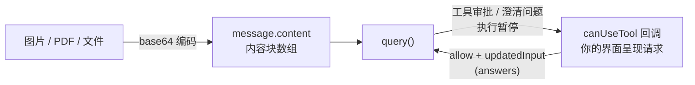

import { Canvas, Controls, Meta } from '@storybook/addon-docs/blocks';
import * as UserInput from './user-input.stories';

<Meta of={UserInput} name="Docs" />

# 附件与用户输入

agent 与用户之间有两个方向的内容交换:把截图、PDF 等附件交给 agent,以及 agent 在任务中途反过来向用户要输入。前者的通道是用户消息的 `message.content` 内容块数组——附件没有独立参数,就是数组里的非文本块;后者的通道是 `canUseTool` 回调——agent 需要工具审批或想问澄清问题时,执行暂停,请求经回调交到你手上,你的应答决定 agent 怎么继续。看完导读与参考表,你应该能预测:一张本地 PNG 要经过什么编码才能进消息、agent 发问时回调里收到什么、答案怎么回填。

与相邻课程的分工:`canUseTool` 的评估链位置与 allow / deny / `updatedPermissions` 机制在[权限规则与 canUseTool](?path=/docs/permissions--docs)讲过,本课只讲交互视角——请求怎么呈给用户、答案怎么回;流式输入的组织方式见[多轮对话](?path=/docs/multi-turn--docs)。



| 需求 | 入口 | 要点 |
| --- | --- | --- |
| 传图片 | `message.content` 加 `image` 块 | base64;media_type 限 png / jpeg / gif / webp |
| 传 PDF 等文档 | `message.content` 加 `document` 块 | base64,`media_type: "application/pdf"` |
| 引用工作区文本文件 | prompt 文本写 `@路径` | CLI 展开提及;`client_composed: true` 时按字面送达、不展开 |
| 转发用户粘贴的内容 | `SDKUserMessage.pasted_content` | 只收文本;图片与文档必须放 `message.content` |
| 工具审批请求 | `canUseTool` | 评估链落到"提示"才触发;应答形态见权限课 |
| 澄清问题 | `canUseTool`(`toolName === "AskUserQuestion"`) | questions 进、answers 出,见下文 |
| 用户久未应答 | PreToolUse hook 返回 `defer` | query 以 `tool_deferred` 结束,`resume` 继续 |

## 快速上手

把本地图片与一句话一起发给 agent。前置环境沿用[安装与凭证](?path=/docs/install--docs)(SDK 已装、`ANTHROPIC_API_KEY` 可见),工作目录放一张 `diagram.png`。

```ts
// 前置:SDK 已安装,ANTHROPIC_API_KEY 对当前进程可见,工作目录有 diagram.png。
// 演示:附件走流式输入形态——哪怕只发一条消息,prompt 也要传异步生成器。
// 预期:agent 看得到图片,回复描述图中内容(文字每次不同)。
import { query, type SDKUserMessage } from "@anthropic-ai/claude-agent-sdk";
import { readFile } from "fs/promises";

async function* attachment(): AsyncGenerator<SDKUserMessage> {
  yield {
    type: "user",
    message: {
      role: "user",
      content: [
        { type: "text", text: "这张架构图里有哪些服务?一句话概括。" },
        {
          type: "image",
          source: {
            type: "base64",
            media_type: "image/png",
            data: await readFile("diagram.png", "base64"), // 读成 base64 字符串
          },
        },
      ],
    },
    parent_tool_use_id: null,
  };
}

for await (const message of query({ prompt: attachment() })) {
  if (message.type === "assistant" && message.message?.content) {
    for (const block of message.message.content) {
      if ("text" in block) console.log(block.text); // agent 对图的描述
    }
  }
}
```

预期输出(文字每次不同,图里有几个服务答几个):

```text
图中包含 API 网关、认证服务与三个业务微服务,由消息队列连接。
```

两个要点:`prompt` 参数只装得下文本——内容块数组是 `SDKUserMessage` 的 `message.content` 形态,所以传附件必须进流式输入模式,哪怕生成器只 `yield` 一条;图片本体不走文件路径也不走 URL,以 base64 字符串直接进块。真实运行消耗 API 额度;本课以讲解为主,不要求逐个运行。

## 传附件给 agent

用户消息的 `message` 字段就是 Anthropic SDK 的 `MessageParam`,`content` 支持两种形态:字符串(纯文本)或内容块数组。附件就是往数组里加非文本块,文字与媒体混排在同一条消息里。官方页点名:`pasted_content` 忽略非文本块,图片与文档一律放 `message.content`。

### 图片

image 块的最小表达:

```ts
{
  type: "image",
  source: {
    type: "base64",
    media_type: "image/png", // 另有 image/jpeg、image/gif、image/webp
    data: pngBase64,
  },
}
```

读取与拼装用 `fs/promises`:

```ts
import { readFile } from "fs/promises";

const pngBase64 = await readFile("screenshot.png", "base64");
```

`content` 数组里 text 与 image 块的先后就是给模型看的顺序;官方示例的文字在前、图片在后,两者同属一条用户消息。

### 文档与文件引用

PDF 用 document 块:

```ts
{
  type: "document",
  source: {
    type: "base64",
    media_type: "application/pdf",
    data: pdfBase64,
  },
}
```

块的类型体系与来源变体(`url`、Files API 的 `file_id`)由 Messages API 定义,SDK 文档只要求一点:图片与文档都放 `message.content`。

文本文件还有一条更轻的通道:prompt 文本里写 `@src/index.ts` 这类 `@路径` 提及,CLI 会展开提及、把文件内容并进上下文。设置 `client_composed: true`(或 Options 开启 `verbatimPrompts`,SDK 会给每条消息置上该字段)后,消息按字面送达,不再展开。取舍:`@路径` 适合让 CLI 代管文本文件;图片与 PDF 走上面两种块,路径提及不替代编码后的媒体块。

## agent 发起的输入请求

agent 需要用户输入时有两种情形——**工具审批**(要用某个未被放行的工具)与**澄清问题**(调用 `AskUserQuestion` 工具)——都触发 `canUseTool` 回调。这与普通对话轮不同:不是 agent 说完等你下一条消息,而是任务中途挂起,执行保持暂停直到你返回应答。回调签名与 allow / deny / `updatedInput` / `updatedPermissions` 的完整机制见[权限规则与 canUseTool](?path=/docs/permissions--docs)课,回调开头先把两类请求分流:

```ts
// 路由:澄清问题与工具审批的应答形态不同,分开处理
canUseTool: async (toolName, input, { signal }) => {
  if (toolName === "AskUserQuestion") {
    return answerQuestions(input); // 澄清问题:收集答案,回填 answers
  }
  return approveTool(toolName, input, { signal }); // 工具审批:呈给用户决定
},
```

四条行为边界:

- **回调可以无限期挂起。** 执行保持暂停直到返回,适合有真人或常驻宿主的应用;`signal` 在运行被中止时收到信号,提示你的 UI 同步关闭。
- **不要让进程为一次应答吊死。** 用户可能久久不回、进程未必等得起时,官方建议改用 PreToolUse hook 返回 `defer`:query 以 `tool_deferred` 结束、进程可退出,之后从落盘会话 `resume` 续跑(机制见[Hook 拦截与自动化](?path=/docs/hook-control--docs)课)。
- **触发时机不对称。** 普通工具被规则或模式提前放行时回调不触发;`AskUserQuestion` 属于"需要用户交互"的工具,即使 allow 规则命中也会落到回调(边界条目见权限课)。想让检查覆盖每次调用,同样用 PreToolUse hook。
- **子代理里没有澄清问题。** 通过 Agent 工具拉起的子代理目前不能用 `AskUserQuestion`,交互收敛到主代理。

除回调外还有两条主动取输入的途径,已由独立课程承载:任务中途发消息、打断、补上下文用流式输入(见[多轮对话](?path=/docs/multi-turn--docs)课);表单、向导等超出多选格式的结构化输入用自定义工具(见[进程内自定义工具](?path=/docs/custom-tools--docs)课)。

### 问题格式

`toolName === "AskUserQuestion"` 时,回调收到的 `input` 是 Claude 生成的问题数组:

```json
{
  "questions": [
    {
      "question": "How should I format the output?",
      "header": "Format",
      "options": [
        { "label": "Summary", "description": "Brief overview" },
        { "label": "Detailed", "description": "Full explanation" }
      ],
      "multiSelect": false
    }
  ]
}
```

| 字段 | 说明 |
| --- | --- |
| `question` | 要显示的完整问题文本;同时是 answers 的 key |
| `header` | 问题短标签,最长 12 字符 |
| `options` | 2-4 个选项,每个有 `label` 与 `description`(可选 `preview`,见下文) |
| `multiSelect` | `true` 时允许选多个选项 |

数量与可用性限制:每次 `AskUserQuestion` 调用带 1-4 个问题、每题 2-4 个选项;该工具默认可用,但用 `tools` 数组收窄工具面时要把它列进去(如 `tools: ["Read", "Glob", "AskUserQuestion"]`),否则 agent 无法发问。澄清问题在 `plan` 模式下尤其常见——agent 先探索代码、问清需求再出方案(模式行为见[权限模式](?path=/docs/permission-modes--docs)课)。

### 回填答案

应答形态是 allow + `updatedInput`:`questions` 原样传回,`answers` 把每个问题文本映射到选中的 label。多选传 label 数组,或用 `", "` 连接成字符串,两者等价:

```ts
// key = question 全文;value = 选中 option 的 label
return {
  behavior: "allow",
  updatedInput: {
    questions: input.questions, // 原样传回,工具处理必需
    answers: {
      "How should I format the output?": "Summary",
      "Which sections should I include?": ["Introduction", "Conclusion"],
    },
  },
};
```

切换四种答案形态,看 `answers` 条目怎么生成(演示数据,不调用模型):

<Canvas of={UserInput.Interactive} />
<Controls of={UserInput.Interactive} />

| 读者操作 | 可观察证据 |
| --- | --- |
| 观察默认状态(单选 · 回 label) | 高亮行里 key 是问题全文,value 是选项 label |
| 切到「多选 · 回数组」 | 两个选项都选中,value 是 label 数组 |
| 切到「多选 · 逗号串等价」 | 同样的选择写成 `", "` 连接的字符串,与数组等价 |
| 切到「自由文本 · Other 通道」 | 卡片上 "Other" 行被选中,value 直接是用户输入的文本 |
| 打开 Show code | 看到该 Canvas 实际执行的 `user-input-demo.ts`,上半部分即问题数据与四个场景 |

三条形态规则与一个逃生口:

- **key 是 `question` 全文**——不是 `header`,也不是选项 label。
- **多选的 value** 是 label 数组,或 `", "` 连接的字符串;自由文本场景里 value 直接用用户输入的文本(不是 "Other" 三个字母):在你的界面上于 Claude 的选项后追加一个 "Other" 选项接收输入。
- **`answers` 是运行时数据**,TypeScript 对 key 是否匹配问题全文没有任何检查,写错只有 agent 表现异常;构造逻辑收敛到一个函数里测好,别在回调里现拼。
- **整体自由回复**:用户不想按选项作答时,`updatedInput` 可带可选的 `response` 字段(自由文本);设置后 Claude 收到 "The user responded: …",不再看逐题答案。适合 UI 允许"跳过问题卡、直接打字回复"的形态。

终端应用的完整闭环(编号选选项、其他输入按自由文本回填):

```ts
// 场景:终端应用。数字编号选选项,其他输入按自由文本回填。
// 预期:agent 收到 answers 后按用户选择继续任务。
import * as readline from "readline/promises";

async function prompt(question: string): Promise<string> {
  const rl = readline.createInterface({ input: process.stdin, output: process.stdout });
  const answer = await rl.question(question);
  rl.close();
  return answer;
}

async function answerQuestions(input: any) {
  const answers: Record<string, string> = {};
  for (const q of input.questions) {
    console.log(`\n${q.header}: ${q.question}`);
    q.options.forEach((opt: any, i: number) => {
      console.log(`  ${i + 1}. ${opt.label} - ${opt.description}`);
    });
    const raw = (await prompt("选择编号,或直接输入你的答案: ")).trim();
    const idx = Number(raw) - 1;
    answers[q.question] =
      Number.isInteger(idx) && idx >= 0 && idx < q.options.length
        ? q.options[idx].label // 编号 → 选项 label
        : raw;                 // 其他 → 自由文本(Other 通道)
  }
  return { behavior: "allow", updatedInput: { questions: input.questions, answers } };
}
```

预期输出(问两题、每题各自收集一次):

```text
Format: How should I format the output?
  1. Summary - Brief overview
  2. Detailed - Full explanation
选择编号,或直接输入你的答案: 1
```

### 选项预览

`toolConfig.askUserQuestion.previewFormat` 让每个选项带上可选的 `preview` 字段,给图形界面展示视觉草图(布局、配色这类"看图才好比"的选择):

```ts
// toolConfig 在 Options 上;preview 出现在 input.questions[].options[].preview
query({
  prompt: "帮我选一张数据卡片的布局",
  options: {
    toolConfig: { askUserQuestion: { previewFormat: "html" } },
    canUseTool: async (toolName, input) => {
      // preview 是 HTML 字符串或 undefined,渲染前逐个判断
      return { behavior: "allow", updatedInput: input };
    },
  },
});
```

| previewFormat | preview 内容 |
| --- | --- |
| 不设(默认) | 字段不出现,不生成预览 |
| `"markdown"` | ASCII 画与围栏代码块 |
| `"html"` | 带样式的 `<div>` 片段;SDK 先剥掉 `<script>`、`<style>` 与 `<!DOCTYPE>` |

边界:格式对该会话的全部问题生效;Claude 只在视觉对比有帮助的选项上给 `preview`,是 / 否确认、纯文本选项没有——渲染前判 `undefined`。

## 最佳实践

- **回调开头先分流,两类 UI 各走各的。** 澄清问题回填 `answers`,工具审批回填原输入或拒绝,两者的应答形态与界面都不同;揉在一个分支里容易把 `questions` 传丢。分流后各封装一个 handler,审批弹窗与问题卡片独立演化。
- **宿主常驻性决定"等"还是"defer"。** 有真人盯着的长驻应用,回调里挂着等即可,配合 `signal` 在运行中止时关掉 UI;无常驻宿主(serverless、CI)别指望回调存活,改用 PreToolUse hook 的 `defer` 把请求落盘、`resume` 续跑。
- **`answers` 的构造收敛到一个函数。** key 要用问题全文、多选有两种等价写法、自由文本要替换值——全是运行时数据,类型系统帮不上忙;集中成 helper 一次测好,别在回调里现拼。

## 常见问题

- 配了 `tools` 数组后,agent 遇到该问的也不问了,径自猜一个继续做。
  收窄工具面时 `AskUserQuestion` 被一起裁掉了。把它加回 `tools` 数组;不传 `tools` 时该工具默认可用,没有这个问题。

- `answers` 回去后,agent 说没收到答案,或答案对不上问题。
  key 用错了:必须是 `question` 的完整文本(如 `"How should I format the output?"`),写成 `header`(`"Format"`)或选项 label 都匹配不上。同时检查 `questions` 是否原样传回、多选是否用了数组或 `", "` 连接的字符串。

- `options[].preview` 一直是 undefined,界面上画不出草图。
  预览是选装项:没配 `toolConfig.askUserQuestion.previewFormat` 时字段不出现;配了之后 Claude 也只在视觉对比有帮助的选项上给,是 / 否类问题没有。渲染前逐个判 `undefined`,不要假设整组选项都有。

## 总结回顾

摘要:

本课给出 agent 与用户之间的两条内容通道。用户到 agent:附件放进 `SDKUserMessage` 的 `message.content` 内容块数组——图片用 `image` 块(base64,media_type 限 png / jpeg / gif / webp),PDF 用 `document` 块(base64,`application/pdf`),文本文件可走 prompt 里的 `@路径` 提及由 CLI 展开;块形态只存在于流式输入,传附件哪怕只发一条也要用异步生成器,`pasted_content` 只收文本。agent 到用户:需要工具审批或想问澄清问题时执行暂停,请求经 `canUseTool` 回调交到你手上——普通工具的 allow / deny 机制在权限课,本课的重点是 `AskUserQuestion` 的问答闭环:`questions`(每次 1-4 个,每题 `header` ≤12 字符、2-4 个选项、`multiSelect` 标记)进,`answers`(key 是 `question` 全文,value 是选中的 label;多选传数组或 `", "` 连接;自由文本用自加的 Other 选项、值填用户输入)出,整体自由回复用可选的 `response` 字段;`toolConfig.askUserQuestion.previewFormat` 可让选项带视觉草图。回调可无限期挂起,无常驻宿主时改用 PreToolUse 的 `defer`。

一句话:

> 附件走 `message.content` 块,审批与提问都从 `canUseTool` 进——问题原样传回,`answers` 用问题全文当 key、选中的 label 当值。

知识要点:

- 传图片、PDF 分别用什么块?media_type 取哪些值?为什么传附件要用流式输入形态?
- `@路径` 提及用来做什么?什么情况下不再展开?`pasted_content` 能装图片吗?
- agent 发起输入请求的两种情形是什么?回调开头怎么分流?
- `questions` 有哪些字段与数量限制?用 `tools` 收窄工具面时要注意什么?
- `answers` 的 key 和 value 各是什么?多选、自由文本、整体自由回复分别怎么回?
- `previewFormat` 怎么配?`preview` 字段何时出现、何时缺失?
- 用户久未应答时,怎么避免进程一直挂着?

## 参考资料

- [Handle approvals and user input(Agent SDK)](https://code.claude.com/docs/en/agent-sdk/user-input)(canUseTool 两种情形、AskUserQuestion 问题与应答格式、数量限制与 defer 建议)
- [Agent SDK reference - TypeScript](https://code.claude.com/docs/en/agent-sdk/typescript)(`SDKUserMessage`、`CanUseTool`、`ToolConfig.askUserQuestion` 与 `AskUserQuestionInput` 类型定义)
- [Streaming Input vs Single Mode(Agent SDK)](https://code.claude.com/docs/en/agent-sdk/streaming-vs-single-mode)(图片附件的官方示例)
- [PDF support(Anthropic Docs)](https://platform.claude.com/docs/en/build-with-claude/pdf-support)(`document` 块的形态与来源变体)
