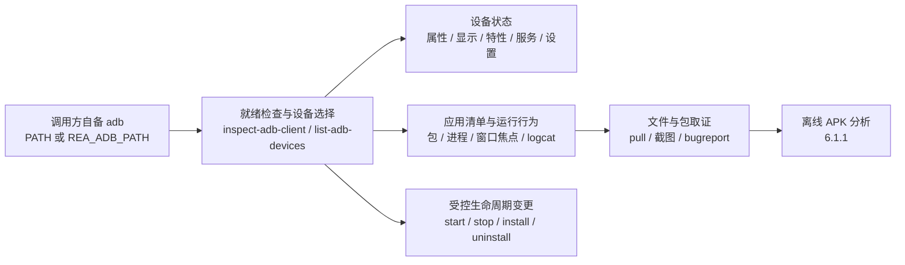

import { Meta } from '@storybook/addon-docs/blocks';

<Meta id="adb-device-analysis" title="移动与桌面应用包/Android/设备分析" name="Docs" />

# 设备分析

设备分析指把 REA 接到**你自己用 adb 连接着的运行中 Android 设备**上，对设备本身、装着的包和正在发生的活动做有界、结构化、带摘要与身份标识的检查：`rea inspect-adb-client` 确认 adb 就绪，`rea list-adb-devices` 列出在线设备，设备属性、包清单、进程、窗口焦点、设置项与 logcat 各有对应命令，`pull-adb-package` 能把完整安装包拉回主机，`start` / `stop` / `install` / `uninstall` 提供受控的应用生命周期变更。它回答的是"这台设备现在是什么状态、装了什么、正在跑什么"；它刻意不回答"这个 APK 里面结构如何、代码长什么样"——那归离线 APK 分析一课（6.1.1），本课把包拉下来后正好交接给它。主线判断一句话：REA 用调用方自备的 adb 把常用调查动作结构化——不装 platform-tools、不启动模拟器、不接管设备，读有界、变更受控、产物不覆盖。



| 回查项 | 值 |
| --- | --- |
| 前提 | 调用方自备 platform-tools 的 `adb`（官方验证版本 34.0.5）；设备已开启 USB 调试并出现在 `adb devices` 清单中 |
| adb 定位 | 默认从 PATH 解析；`export REA_ADB_PATH=/absolute/path/to/adb` 显式指定 |
| 就绪检查 | `rea inspect-adb-client` |
| 列设备 | `rea list-adb-devices` |
| serial | 每条设备命令的第一个位置参数，须与 `adb devices` 输出逐字符一致；本课示例沿用官方文档的 `emulator-5554` |
| 设备与应用状态 | `inspect-adb-device` / `inspect-adb-display` / `list-adb-features` / `list-adb-services` / `read-adb-setting` / `list-adb-packages` / `resolve-adb-packages` / `inspect-adb-package` |
| 运行中行为 | `list-adb-processes` / `inspect-adb-window` / `read-adb-logcat` |
| 取证获取 | `list-adb-directory` / `pull-adb-file` / `pull-adb-package` / `capture-adb-screen` / `collect-adb-bugreport` |
| 受控变更 | `push-adb-file` / `install-adb-package` / `uninstall-adb-package` / `start-adb-app` / `start-adb-activity` / `stop-adb-app`（声明 `mutatesTarget`） |
| MCP 同源工具 | snake_case 同名：`inspect_adb_client` / `list_adb_devices` / `inspect_adb_device` 等 |
| 预算 | 客户端检查与设备枚举 10–20 秒；shell 读取 20–60 秒（捕获上限 64 KiB–8 MiB，logcat 4 MiB、截图 32 MiB）；传输与 bugreport 600 秒 |
| 输出目录 | pull/capture 的产物独占创建，目录已存在时拒绝执行，不覆盖 |
| 拿不动的 | 任意 shell 命令、`input` / `monkey`、UI 交互（点击、输入、录屏）、`adb connect` 网络传输的建立 |

## 快速上手

环境要求：本课命令需要一台已连接的 Android 设备或模拟器——主机侧装好 Android platform-tools 的 `adb`，设备开启 USB 调试并完成授权（模拟器可用 Android Studio 的 AVD）。主机上没有设备时命令无法运行；命令形态与返回字段以官方契约为准，官方验证记录是 adb 34.0.5 配 Android 14（API 34）x86_64 模拟器。

最小闭环五步：确认 adb 就绪 → 选定设备 → 读设备身份 → 列第三方包 → 把包拉回主机交给离线分析。

```bash
rea inspect-adb-client --json
rea list-adb-devices --json
rea inspect-adb-device emulator-5554 --json
rea list-adb-packages emulator-5554 --scope third_party --json
rea pull-adb-package emulator-5554 com.whatsapp --output-directory /tmp/acq
```

逐步核对什么：第一条返回解析出的二进制路径、版本与来源，确认用的是哪个 adb；第二条每台设备带 serial、state、transport、model 和推断的 kind，从清单里拿 serial 当后续命令的第一参数；第三条返回 build、SDK、安全补丁级别、fingerprint、product、ABI 与 `emulator_observed`，设备身份一屏读完；第四条列出第三方包，每条带 base APK 的设备路径；第五条把该包的全部 APK（含 split）拉进 `/tmp/acq`，产物带大小与 SHA-256。最后一步交接：

```bash
rea inspect-android-package /tmp/acq/com.whatsapp/base.apk --json
```

至此设备侧问题（装了什么、状态如何）与包体问题（结构、组件、代码）分属两条链路：前者靠本课的在读命令，后者从这一行进入 6.1.1 应用分析。

## 就绪检查与设备选择

这套能力的授权模型是：你自备 adb，REA 只调用它。先做就绪检查：

```bash
rea inspect-adb-client --json
```

它实际执行 `adb version`，报告解析出的二进制路径、版本与来源（PATH 还是 `REA_ADB_PATH`）。这个检查只探测二进制本身、从不联系 adb server；不过后续的设备查询可能让 adb client 自己拉起本地 server——REA 不管理也不持有它，server 始终属于调用方。每个后续结果都会嵌入这组 adb 身份（`binary_path`、`path_source`、`version`、`installed_path`），证据可以追溯到当时用的具体二进制。

adb 缺失或不在 PATH 时报 `capability_unavailable`，并附设置 `REA_ADB_PATH` 的补救建议；REA 不会自动安装 platform-tools，也不会启动模拟器。

```bash
rea list-adb-devices --json
```

每台设备返回 serial、state、transport、model，以及推断出的 kind 和它的依据 `kind_basis`（来自 serial 前缀或 USB transport）——推断带依据，不靠猜。模拟器、USB 与网络设备在清单里一律同构对待；但 REA 自己不执行 `adb connect` 建立网络传输，要用网络设备先自己连好。所有设备命令的第一个位置参数都是 serial，必须与 `adb devices` 输出逐字符一致。

## 设备状态

设备现状由五个读命令覆盖，按问题归属选择：

| 命令 | 设备侧来源 | 回答的问题 |
| --- | --- | --- |
| `inspect-adb-device` | 固定 getprop 白名单 | 这台设备是什么：build、SDK、安全补丁级别、fingerprint、product、ABI、是否可调试 |
| `inspect-adb-display` | `wm size` / `wm density` | 屏幕分辨率与密度 |
| `list-adb-features` | `pm list features` | 设备声明了哪些软硬件特性（含十六进制 GL 版本） |
| `list-adb-services` | `service list` | 注册了哪些系统服务 |
| `read-adb-setting` | `settings get` | 某命名空间下某键的当前值 |

`inspect-adb-device` 的属性取自固定白名单，其中 `ro.kernel.qemu` 投影为 `emulator_observed`——属性缺席时报 null 而不是 false，"没读到"与"不是模拟器"是两回事。`read-adb-setting` 一次读一个键，读不到同样报 null 而不是失败：

```bash
rea inspect-adb-device emulator-5554 --json
rea read-adb-setting emulator-5554 global adb_enabled
```

## 应用清单与包信息

三个命令构成从模糊名字到包状态的接力：

| 命令 | 设备侧来源 | 回答的问题 |
| --- | --- | --- |
| `resolve-adb-packages` | 大小写不敏感子串搜索 | 模糊名字对应哪个包名（支持精确匹配语义） |
| `list-adb-packages` | `pm list packages -f`（按 scope 圈定） | 装了哪些包，各自 base APK 的设备路径 |
| `inspect-adb-package` | `dumpsys package` 投影 | 某个包的版本、权限等安装状态 |

```bash
rea resolve-adb-packages emulator-5554 whatsapp
rea list-adb-packages emulator-5554 --scope third_party --json
rea inspect-adb-package emulator-5554 com.whatsapp --json
```

`--scope third_party` 把清单圈在第三方包；清单里每条都带 base APK 的设备路径——这既是"装在哪"的答案，也是后面 `pull-adb-package` 的入口。排查顺序建议从 `resolve` 起步：用户口中的应用名很少等于包名。

## 运行中行为

三个读命令观察"现在正在发生什么"：

| 命令 | 设备侧来源 | 回答的问题 |
| --- | --- | --- |
| `list-adb-processes` | `ps -A` | 跑着哪些进程：user、pid、ppid、rss、state、name |
| `inspect-adb-window` | `dumpsys window` | 窗口焦点现在在哪 |
| `read-adb-logcat` | 有界 `logcat -d -t`（单缓冲） | 日志里最近发生了什么 |

窗口焦点的语义值得单独说：`inspect-adb-window` 逐字保留每个 display 头部、display ID 与全部焦点声明（`focus_contexts`）；没有 display 头的焦点声明归入 `unscoped`；声明缺失与 JSON null 是两种不同状态。汇总字段 `focus_summary` 只有三种取值：唯一上下文且焦点字段无重复时是 `single_context`；多个上下文或焦点字段重复时报 `ambiguous`，单值字段置 null；完全没有焦点声明时报 `unavailable`。displays 段只在 windows 段没有焦点字段时才读取。

logcat 是有界快照：单缓冲、`--count` 限条数、`--pid` 收窄到单个进程、捕获上限 4 MiB。拿到的是片段，不是完整回放：

```bash
rea list-adb-processes emulator-5554 --json
rea inspect-adb-window emulator-5554 --json
rea read-adb-logcat emulator-5554 --count 200 --json
rea read-adb-logcat emulator-5554 --pid 12345 --json
```

## 文件与包取证

取证命令共享三条规则：设备路径不是主机路径；每个产物附大小与 SHA-256 摘要；pull/capture 的输出目录独占创建——目录已存在时拒绝执行，不覆盖既有证据。

### 拉取文件与目录

```bash
rea list-adb-directory emulator-5554 /data/data/com.whatsapp --json
rea pull-adb-file emulator-5554 /data/local/tmp/notes.txt --output-directory /tmp/acq
```

`list-adb-directory` 一次列一个绝对路径目录：子项按 NUL 分帧解析，隐藏项包含在内，符号链接解析出目标；名字里的空白与换行原样保留，无法按 UTF-8 解析的行进 `unparsed_lines` 并标记部分覆盖。`pull-adb-file` 一次取一个绝对路径文件，产物名取设备路径的末段 POSIX 名，附大小与 SHA-256；末段缺失、`.` / `..`、主机侧重名都会被拒绝。

### 拉取完整安装包

```bash
rea pull-adb-package emulator-5554 com.whatsapp --output-directory /tmp/acq
rea inspect-android-package /tmp/acq/com.whatsapp/base.apk --json
```

`pull-adb-package` 从 `pm path` 解析该包的全部 APK 并一并拉取——split APK 永远整套拿，逐个摘要。拉下来的 `base.apk` 正好作为 6.1.1 应用分析的输入，两条链路在这里交接。被拒绝时的错误是结构化的：设备侧 `pm path` 失败报 `unreadable_output`（`retryable: false`，`details.captured_output` 保留原始输出、`details.reason` 给原因）；设备路径不安全报 `unsafe_device_path`，`details.diagnostics.rejected_paths` 列出被拒路径与原因；主机侧重名报 `duplicate_local_destination`；目标目录不可用报 `local_destination_unavailable`。系统包 APK 名字怪异时角色报 `unknown`（角色依据是 `role_basis: file_name`）。拉取被取消时保留输出目录与已完成产物，并报告中断的那条路径——剩余 APK 标记为未尝试。

### 截图与 bugreport

```bash
rea capture-adb-screen emulator-5554 --output-directory /tmp/shots
rea collect-adb-bugreport emulator-5554 --output-directory /tmp/bugs
```

截图是设备侧一次 `screencap -p`，经 exec-out 传输，产物带尺寸，上限 32 MiB；捕获被取消但文件已落盘时，错误里保留该文件的路径、摘要与尺寸。bugreport 由设备生成 zip，预算 600 秒，在隔离暂存区生成、独占发布，重名自动加数字后缀；发布失败时归档仍留在暂存区（结果给 `local_path` 与 `adb_reported_path`、摘要未知），后续操作与退出都不会销毁它。

### 推送文件

```bash
rea push-adb-file emulator-5554 /tools/frida-server /data/local/tmp/frida-server
```

`push-adb-file` 是变更操作（声明 `mutatesTarget`）：目标已存在且未声明覆盖时拒绝传输；存在性检查非原子，探测本身失败时即使声明覆盖也会阻塞传输——只有一次干净的"不存在"结果才放行。设备侧有 `sha256sum` 时对产物做摘要核对。

## 应用生命周期变更

五个命令构成受控的应用生命周期操作，全部声明 `mutatesTarget`：

| 命令 | 设备侧动作 | 语义与边界 |
| --- | --- | --- |
| `start-adb-app` | 解析启动器（`cmd package resolve-activity --brief`）后 `am start -n` | 按包名启动默认入口 |
| `start-adb-activity` | `am start -a` | 按 action 启动，可带 `--data-uri`、component 与最多 16 个类型化 extras |
| `stop-adb-app` | `am force-stop` | 停掉该包的全部进程 |
| `install-adb-package` | `adb install`（`--replace` 对应 `-r`） | 保留设备返回的 Success/Failure 结论与主机 APK 摘要 |
| `uninstall-adb-package` | `pm uninstall --user 0` | 卸载且不保留应用数据 |

```bash
rea start-adb-activity emulator-5554 android.intent.action.VIEW --data-uri https://example.com
rea install-adb-package emulator-5554 /tmp/app.apk --replace
rea uninstall-adb-package emulator-5554 com.example.app
```

install 的结果里 `replace_requested` 记录你是否声明了替换，而 `replaced` 恒为 null——替换前的旧状态没有被观察，这个 null 不是失败。安装失败时设备返回的 `Failure [...]` 原因逐字保留。本地 APK 先做快照再消费（报告的大小与 SHA-256 描述被消费的字节，`apk_path` 保留原始路径），快照需要与输入等量的临时磁盘。

REA 接受的变更就这些：没有任意 shell、没有 `input`、没有 `monkey`——本课的"变更"到 intent 启动为止，点击与输入是另一条 lane 的事。

## 边界与预算

安全边界来自构造方式：REA 为每个操作使用固定的 adb 参数向量，调用方的值只作位置参数，转发到设备 shell 时加引号——没有注入任意命令的通道。REA 也不持有长驻进程，adb server 属于调用方。

| 预算项 | 值 |
| --- | --- |
| 客户端检查 / 设备枚举 | 10–20 秒 |
| shell 读取 | 20–60 秒，捕获上限 64 KiB–8 MiB（logcat 4 MiB、截图 32 MiB） |
| 传输 / bugreport | 600 秒 |
| 超限与超时 | 超出捕获上限报 `resource_constraint`；期限耗尽报 `provider_timeout` |
| 取消 | 保留调用方给出的取消原因 |

两条出口边界：UI 层交互（点击、输入、monkey、录屏）不属于本课，官方把它划给独立的设备交互 lane（候选方案 mobile-device-mcp，需安装设备侧驱动）与 Frida 插桩 lane（插桩归 4.4.1 Frida 插桩一课）；`adb connect` 建立的网络传输 REA 尚未暴露，网络设备要先自己连好再出现在清单里。

## 最佳实践

- **先做就绪检查再开工。** `inspect-adb-client` 一次确认二进制、版本与来源；每个结果都嵌入这组 adb 身份，留档即可回答"当时用的是哪个 adb"。
- **serial 复制不手打。** 从 `list-adb-devices` 拿 serial 逐字符使用；多设备同时在线时手打 serial 是最常见的事故源。
- **读侧动作优先。** 设备状态 → 包清单 → 进程 / 窗口焦点 / logcat 的读链路能回答大部分"现在怎么样"；变更操作留给确有需要时——尤其 `uninstall-adb-package` 不保留数据，执行前确认目标。
- **产物目录一次一用。** pull/capture 独占创建输出目录是防覆盖证据的设计；重跑前换目录或手动清理，不要期待原地覆盖。
- **设备侧找现象，主机侧下结论。** logcat、窗口焦点、进程表负责"现象在场"；包拉回主机后交给 6.1.1 做结构与代码归因。两条链路接力，别在设备侧硬啃 APK 内部。

## 常见问题

- `rea inspect-adb-client` 报 `capability_unavailable`？
  adb 没安装或不在 PATH。安装 Android platform-tools 后重试，或 `export REA_ADB_PATH=/absolute/path/to/adb` 指向现有二进制；REA 不会自动安装。
- 设备插着，`list-adb-devices` 却没有它或 state 不是 `device`？
  先在终端确认 `adb devices` 能看到该设备且 state 为 `device`：显示未授权时到设备上确认 USB 调试授权弹窗。serial 必须与 `adb devices` 输出逐字符一致，REA 不做模糊匹配。
- 重跑 `pull-adb-package` / `capture-adb-screen` 报错说输出目录已存在？
  预期行为。产物独占创建，已有目录一律拒绝而不是覆盖，防止旧证据被静默替换；换新目录或先清理旧目录再跑。
- `pull-adb-package` 报 `unreadable_output` 且 `retryable: false`？
  设备侧 `pm path` 没能给出 APK 路径，常见于受限系统包。看 `details.captured_output` 里的原始输出与 `details.reason` 定位原因，不要反复重试同一包。
- `install-adb-package` 成功了，结果里 `replaced` 却是 null？
  正常。替换前的旧安装状态不被观察，`replaced` 恒为 null；是否声明了替换看 `replace_requested`，装没装成看保留下来的设备 verdict。
- `read-adb-logcat` 只拿到一小段日志？
  它是有界快照（单缓冲、`--count` 条数、4 MiB 捕获上限），不是完整日志回放；更早的历史已滚出设备缓冲区，本课工具拿不回来。跟某个进程时加 `--pid` 收窄噪音。

## 总结回顾

摘要：

设备分析让 REA 通过调用方自备的 adb 检查运行中的 Android 设备：`inspect-adb-client` 与 `list-adb-devices` 完成就绪检查与设备选择，serial 是所有设备命令的公共入口；`inspect-adb-device`、`inspect-adb-display`、`list-adb-features`、`list-adb-services` 与 `read-adb-setting` 描述设备现状；`resolve-adb-packages`、`list-adb-packages` 与 `inspect-adb-package` 摸清应用清单；`list-adb-processes`、`inspect-adb-window` 与 `read-adb-logcat` 观察运行中行为；`list-adb-directory`、`pull-adb-file`、`pull-adb-package`、`capture-adb-screen` 与 `collect-adb-bugreport` 负责取证，`push-adb-file` 与五个生命周期命令构成受控变更。所有读取有界（预算 10–600 秒、捕获上限 64 KiB–32 MiB），所有产物带 SHA-256 摘要且独占创建，固定的 adb 参数向量封死了任意命令的通道；拉回的 `base.apk` 交接给 6.1.1 做离线分析。

一句话：

> 用你自己的 adb 把"设备现在是什么状态"变成结构化、带身份与摘要的证据：读有界、变更受控、产物不覆盖；包在设备上只找到路径，结构和代码要拉回主机交给离线分析。

知识要点：

- 前置条件有哪些？`inspect-adb-client` 检查什么、刻意不联系什么？adb 缺失时报什么错？
- serial 从哪来、匹配规则是什么？`list-adb-devices` 返回哪些字段、kind 推断依据什么？
- `inspect-adb-device` 读哪些属性？`emulator_observed` 从哪个属性来、缺席时是什么值？
- 应用排查的接力路径是什么？`--scope third_party` 圈定什么？清单条目为何带 base APK 路径？
- `focus_summary` 的三种取值分别在什么条件下出现？
- `read-adb-logcat` 的边界是什么？`--pid` 与 `--count` 各管什么？
- `pull-adb-package` 拉什么、产物如何命名与校验？四种拒绝错误形态分别对应什么问题？
- push 的存在性检查为什么"声明了覆盖也可能被拦下"？
- `install-adb-package` 结果里 `replaced` 为 null 意味着什么？`uninstall-adb-package` 保留数据吗？
- 预算分几档？`resource_constraint` 与 `provider_timeout` 分别对应什么？
- 哪些动作明确不属于本课？UI 交互与 Frida 插桩的出口在哪？设备侧与离线 APK 分析（6.1.1）如何分工？

## 参考资料

- [ADB device inspection and acquisition（docs/adb-device-analysis.md）](https://github.com/morluto/rea/blob/main/docs/adb-device-analysis.md)
  本课一手来源：全部 adb 命令的契约与示例、前提与 `REA_ADB_PATH`、窗口焦点语义、取证拒绝形态、预算与生命周期、非目标与相邻 lane、官方验证记录。
