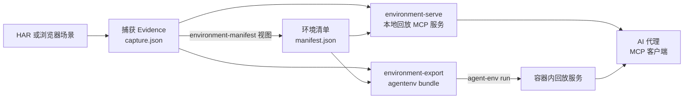

import { Meta } from '@storybook/addon-docs/blocks';

<Meta id="agent-environments" title="Evidence 与重建/代理环境" name="Docs" />

# 代理环境

代理调查一个目标时有两类老问题：环境不一致（本机能跑、代理那边跑不了），以及直接接触活体目标的副作用。代理环境（agentenv）把一次网络捕获冻结成一台只读回放服务器，同时回答这两件事：`rea environment-serve` 把环境清单（manifest）与捕获 Evidence 配对，起成本地 MCP 服务；代理连接后得到一组工具，每个工具的回答都来自保留的捕获记录——不向被录应用发送任何请求。`rea environment-export` 把同一对文件导出成 agentenv 框架可直接运行的 bundle，用于离线交付一致环境。

先建立本课核心判断：**回放不是模拟。** 服务器不建立授权模型、不发明响应语义、不表现状态转移、不校验提供的取值，也不回答没有录到的请求；一切答案都来自 Evidence，且每个工具结果都带 `_meta.provenance.untrusted_content: true` 标记（`source: "analysis_target"`）。代理消费的是"录下的过去"，不是"活着的现在"。

版本提示：本课用法与示例均取自官方 main 分支文档；撰写当日已发布的最新版（验证至 6.7.0，本机核对 `rea --help`）尚未包含这两个命令，上机验证需等待发布版本或从仓库构建，见常见问题。



| 入口 | 作用 | 关键默认值与边界 |
| --- | --- | --- |
| `rea environment-serve` | 在线：把清单与捕获起成本地回放 MCP 服务 | `--host` → `MCP_HOST` → `127.0.0.1`；`--port` → `MCP_PORT` → 临时端口；同一时刻一个客户端 |
| `rea environment-export` | 离线：导出 agentenv 框架可运行的 bundle | 目标目录必须不存在或为空；POSIX 文件 `0600`；失败不清理部分目录 |
| `agent-env run` | 运行导出的 bundle（agentenv 框架命令） | 容器内 MCP 端口 `18765`；冒烟任务随包交付 |

## 快速上手

官方管线三步：捕获、投影、起服。HAR 怎么来的见 [3.3 网络抓包](?path=/docs/web-network-captures--docs)：

```bash
# 1. 把 HAR 检查成捕获 Evidence（路径必须绝对）
rea inspect-web-network-capture /absolute/session.har har --format json > capture.json

# 2. 用 environment-manifest 视图投影出环境清单（view.json 形状见下节）
rea inspect-analysis-view view.json --format json > manifest.json

# 3. 起服务
rea environment-serve manifest.json --evidence capture.json --port 8765
```

第 3 步成功的可观察标志是 stderr 上一行 JSON 日志：`"msg":"MCP transport listening"`，同一行携带绑定的 MCP URL（这行日志不受 `REA_LOG_LEVEL` 影响）。浏览器场景捕获可以替换第 1 步：

```bash
APP_PASSWORD=… rea capture-browser-scenario scenario.json --format json > capture.json
```

场景契约见 [3.2 场景捕获](?path=/docs/browser-scenario-capture--docs)。代理侧到此已经可用：读 `/.well-known/agent-env.json` 发现环境，连 `/mcp` 调工具，每次调用得到一条带 `replay` 溯源的回放结果（语义见回放语义）。要交付离线一致环境，把第 3 步换成导出，见离线导出。

## 环境清单

环境清单不是手写文件，是 `inspect-analysis-view` 对捕获 Evidence 的一次投影。视图请求用 inline 源包住捕获原文（inline 源的一般形态见 [8.1 Evidence 包管理](?path=/docs/evidence-bundles--docs)），视图种类是 `environment-manifest`：

```json
{
  "source": { "kind": "inline", "evidence": "<capture.json 原文>" },
  "view": {
    "kind": "environment-manifest",
    "template_rules": ["after-uid-literal", "opaque-token", "sibling-variance"]
  }
}
```

`template_rules` 决定路径怎么模板化成参数：按列表顺序取第一条命中的规则（官方示例中 `get_users_by_id` 的参数位置就由第二条规则产出）。

投影出来的清单是一个工具面：

- 主 origin 上每个"方法 + 路径模板"一个工具；
- 路径参数从命中模板规则的记录推断，带 segment 位置与观测值；
- 查询参数取观测到的参数名；
- 写方法给出无值的 body 形状（按录制到的顶层键类型描述）；
- 每个工具带指向其引用父记录的指针；
- 没有 body、没有 header——捕获里的头与体只留在 Evidence 里，不进工具面。

工具面按响应媒体类型选取：没录到响应体、或没选任何 header 值的场景捕获，会在投影时被拒绝。配对是硬约束：清单的 `parent_evidence_id` 必须等于捕获文件的 `evidence_id`，不等则 `environment-serve` 与 `environment-export` 在绑定前以 `invalid_request` 拒绝，错误同时点名两个标识符。

清单与捕获两侧的预算回查：

| 预算 | 值 | 超出时 |
| --- | --- | --- |
| 显示样本 | 每个捕获样本 1 KiB UTF-8 | 仅影响展示 |
| 参数名长度 | 超过 64 字符换 `path_<n>` / `query_<n>` 别名 | 回放时映射回原名 |
| 卡序列化保留 | 1 MiB（每个 UTF-16 单元最多计 6 字节） | `resource_constraint`，监听不绑定 |
| 校准参考 | 1500 个查询字段 + 8 个并发发现 ≈ 183,798 字节卡、约 507 MiB RSS | 参考量级，不是上限 |

字段与工具从不静默省略——装不下就整体报 `resource_constraint`。捕获侧也有预算（决定 Evidence 里有什么可回放）：`max_network_body_bytes` 默认 64 KiB、`max_network_body_allocation_bytes` 1 MiB、`max_event_allocation_bytes` 4 MiB、`max_total_event_allocation_bytes` 16 MiB；回放响应体最多给出 256 KiB，base64 编码每字节约花 11 字节预算，脱敏对短密钥代价更高（12 字符密钥约 35 字节/字节）。

## 在线服务 environment-serve

```sh
rea environment-serve manifest.json --evidence capture.json [--host 127.0.0.1] [--port 0]
```

| 输入 | 解析顺序 / 默认值 |
| --- | --- |
| `--host` | 旗标 → `MCP_HOST` → `127.0.0.1` |
| `--port` | 旗标 → `MCP_PORT` → 临时端口；`--port 0` 显式要临时端口 |
| `ENVIRONMENT_NAME` | 环境变量，重命名服务环境；置空值绑定前拒绝（`configuration_invalid`） |
| `REA_LOG_LEVEL` | 覆盖日志级别；绑定 URL 那行日志除外 |

生命周期：同一时刻只服务一个 MCP 客户端；运行到 SIGINT/SIGTERM 后关监听，打印一条结构化 `{"status":"stopped", …}`（含 URL、环境名与工具数），退出码 SIGINT 为 `130`、SIGTERM 为 `143`；加载或绑定期间收到信号返回结构化 `cancelled` 结果与相同信号退出码。绑定前的拒绝（文件不可读、非 Evidence JSON、捕获不是 HAR 格式、清单视图类型不符、配对不匹配、端口不可绑定）与绑定后的监听失败都以退出码 `1` 结束；绑定后的失败报 `resource_constraint`。

### 三条路由

| 路由 | 用途 |
| --- | --- |
| `POST /mcp` | MCP 服务器本体：清单里每个工具一个 MCP 工具 |
| `GET /.well-known/agent-env.json` | 发现卡：agentenv 框架读它来发现环境 |
| `POST /agentenv` | 数据面：当前版本对每个方法都回 JSON-RPC `-32601 method not found` |

`/agentenv` 数据面虽无操作，边界是定义好的：请求体超 4 MiB 在解析前回 `413` 加 `-32000`；非 JSON 请求体回 `400` 加 `-32700`；notification 回 `202` 无 body；batch 逐条回执；空 batch、超过 100 条、或非 JSON-RPC 消息回 `-32600`；超出 JS 安全整数范围的数字 ID 以 null ID 拒绝。代理正常工作走 `/mcp`。

### 发现卡

代理使用环境的入口就是这张卡（官方文档节选）：

```json
{
  "name": "grafana-example",
  "protocolVersion": "1.0",
  "url": "/agentenv",
  "preferredTransport": "JSONRPC",
  "additionalInterfaces": [
    { "url": "/mcp", "transport": "mcp" }
  ],
  "capabilities": {
    "tools": {
      "tools": [
        {
          "name": "get_users_by_id",
          "description": "[UNTRUSTED CONTENT: recorded from analysis_target] …",
          "inputSchema": {
            "type": "object",
            "properties": {
              "id": {
                "type": "string",
                "description": "path segment [2]; observed values: 1"
              }
            },
            "required": ["id"],
            "additionalProperties": false
          }
        }
      ]
    }
  },
  "operations": [],
  "children_environments": null
}
```

| 字段 | 含义 |
| --- | --- |
| `name` | 环境名（kebab-case；`ENVIRONMENT_NAME` / `--name` 可改） |
| `protocolVersion` | `"1.0"` |
| `url` / `preferredTransport` | 数据面 `/agentenv` 与 `JSONRPC` 传输 |
| `additionalInterfaces` | 指向 `/mcp` 的 MCP 接口 |
| `capabilities.tools` | 工具目录，与 `tools/list` 响应完全一致：名称、描述、JSON Schema |
| `operations` / `children_environments` | 当前版本为空数组 / `null` |

代理侧闭环：读发现卡 → 连 `additionalInterfaces` 指向的 `/mcp` → `tools/list` 拿工具面 → `tools/call` 得到回放结果。参数形状在卡里自描述：路径参数是必填 string（带 segment 位置、模板规则、观测值）；查询参数是可选 string（与路径参数重名时改名 `query_<name>`，超长时 `query_<n>`）；写方法附可选 `body` 对象（查询参数已占用 `body` 名时用 `request_body`）；每个 schema 都以 `additionalProperties: false` 收口。工具描述统一带 untrusted 内容警告前缀——代理读卡的第一眼就该知道答案是录制的。

## 回放语义

每次工具调用，服务器在该工具引用的捕获记录中选出一条：先比对提供的路径参数与记录路径在参数位置上的分段，再比对查询值；保留匹配最多的一条，并列保持清单顺序。没有任何匹配时回答自该工具引用的第一条记录，`exact_match: false`。

回放结果自带溯源对象（官方示例）：

```json
{
  "replay": {
    "record_ordinal": 12,
    "evidence_id": "ev_capture0000000000000000000000000000000000000000000000000000000000",
    "exact_match": true,
    "recorded_path": "/api/datasources/uid/abc123",
    "recorded_query": "",
    "recorded_line_truncated": false,
    "body_recorded": true,
    "body_encoding": "utf-8",
    "truncated": false
  }
}
```

| 字段 | 含义 |
| --- | --- |
| `record_ordinal` / `evidence_id` | 选中的记录序号与所属捕获 Evidence |
| `exact_match` | 提供的每个路径参数与查询值都等于记录值才为 `true`；对省略的参数不做任何断言 |
| `recorded_path` / `recorded_query` | 记录的请求行片段；显示上限 1 KiB，截断置 `recorded_line_truncated` |
| `body_recorded` / `body_encoding` | 是否录到响应体；编码 `utf-8` 或 `base64` |
| `truncated` | 响应体超过 256 KiB，在 UTF-8 边界截断 |

响应体处理：`application/json`、`application/*+json`、`text/plain`、`text/markdown` 这几类且能安全解析时按 JSON 给出，否则给原始文本；超大整数保留原始文本；`body_recorded: false` 时 body 是 `null`——这表示"没录到"，不是"录到了 null"；非 UTF-8 字节走 `base64`。

只读边界：POST/PUT/PATCH 的请求体接受并忽略；未知参数直接拒绝为 invalid。判断一次调用的真实出处永远看 `replay` 对象，不看调用参数。

### 回放不是模拟

- 不建立授权模型——录到的 200 不代表这个取值在真实目标上也会 200；
- 不发明响应语义——返回的就是录制原文；
- 不表现状态转移——连续调用之间没有状态；
- 不校验取值——乱填的参数最多影响记录选择，不报错；
- 不回答未录制的请求——没有匹配记录时回退第一条引用记录并标 `exact_match: false`，而不是现造一个响应。

这些缺口不是缺陷而是边界：官方明确它们会作为 unknown 列在清单里。每个工具结果带 `_meta.provenance.untrusted_content: true`（`source: "analysis_target"`），把"这是录制内容"的判断留给代理。

## 离线导出 environment-export

```sh
rea environment-export manifest.json --evidence capture.json ./grafana-example --json
agent-env run ./grafana-example
```

| 旗标 | 作用 |
| --- | --- |
| `--name` | 替换清单的 kebab-case 环境名；Windows 保留设备名（`con`、`lpt1` 等）拒绝 |
| `--package-tarball <path>` | 把打包好的 rea-agents tarball 复制进环境目录，Dockerfile 改装它而非 registry 包（同层移除）——用于运行"某个检出"而非"某个发布版" |

写语义：每个输入文件只读一次，读取前先检查堆余量（不足报 `resource_constraint`）；用与 serve 相同的检查认证并交叉核对配对，配对不匹配在写任何文件前拒绝；目标目录必须不存在或为空，非空拒绝且什么都不改；完整工具目录必须先装得进 1 MiB 卡预算才动笔。成功时打印一份 JSON：写出的文件、大小与固定的包来源，退出码 `0`。POSIX 文件模式 `0600`，Windows 继承 ACL；输出树所有者核对目录身份、校验已写字节、拒绝无主条目。写中途失败以宿主错误传播并留下可检查的部分目录——重试前先删掉它（否则重试会因目录非空被拒）。

### 包结构

```text
grafana-example/
  README.md
  envs/grafana-example/Dockerfile
  envs/grafana-example/env.toml
  envs/grafana-example/manifest.json
  envs/grafana-example/evidence.json
  artifacts/check_grafana-example/verify.py
  tasks/smoke.json
```

| 文件 | 职责 |
| --- | --- |
| `README.md` | 溯源：捕获工件 SHA-256、两个 Evidence ID、清单视图摘要、工具数、包来源；声明内容归属被捕获应用，无权利不得发布 |
| `envs/<name>/manifest.json` / `evidence.json` | 配对原件的字节精确拷贝（`0600`） |
| `envs/<name>/Dockerfile` | `node:24.18.0-bookworm-slim` 加 `rea-agents@<版本>`；`MCP_HOST=0.0.0.0`、`MCP_PORT=18765`；装 Debian `python3`（slim 镜像没有，框架本地沙箱探活要用）；以非 root `node` 用户运行 `rea environment-serve /env/manifest.json --evidence /env/evidence.json` |
| `envs/<name>/env.toml` | `environment_name = "grafana-example"`——镜像里没有框架读名的 Python 源，必须显式给名 |
| `artifacts/check_<name>/verify.py` | 回放校验器（见下） |
| `tasks/smoke.json` | 冒烟任务：在本地沙箱部署环境并对 MCP 端点跑校验器；首次运行会构建框架基础设施，运行结束全部拆除 |

`verify.py` 的形态是 `async def verify(mcp_url)`，经 Python MCP 客户端两步核对：列出工具并核对数量等于清单声明；调用第一个"无路径参数的 GET 工具"（不传参数），核对调用未失败、且回放状态等于该工具第一条引用记录的录制状态，返回的报告同时给出两项结论。清单里没有这种工具时只核对数量。仓库托管验证通道 `npm run verify:agentenv:environment` 走同一条链：投影 Grafana 形捕获、打包检出、`--package-tarball` 导出、在固定的 agentenv-framework 发布版上运行并要求冒烟任务通过——它证明"一个导出的 bundle 能在某个框架发布版上跑通"。

## 最佳实践

- **两条路径按交付形态选。** 本机即时调查、单客户端、随起随停用 `environment-serve`；要交付给别人、进容器、由框架托管部署并带冒烟验证，用 `environment-export`。两者校验同一对文件，语义没有差别。
- **捕获预算为回放留余量。** 默认 `max_network_body_bytes` 64 KiB 的捕获，回放时响应体最多也只能给到 256 KiB；预期要回放大响应就在场景里上调捕获预算，并预估代价——base64 约每字节 11 字节，脱敏更贵。
- **脱敏会改变环境形状。** URL 里含脱敏密钥、或无法归因到单一请求/响应的事务不会被表示进环境。捕获后先投影一次、清点工具面，再决定脱敏策略，不要盲脱。
- **要复现"这个检出"就用 `--package-tarball`。** 默认 Dockerfile 固定 registry 上的 `rea-agents@<版本>`；带上打包 tarball 才能证明 bundle 配的是你手里的代码，托管验证通道就是这么做的。
- **把 bundle 当不可信输入对待。** 文件是 `0600`、目录所有者有校验、端口打开前两个 Evidence 都已认证——但父目录必须可信（存在系统调用竞态），且 bundle 里是被捕获应用的内容，无权利不得发布。

## 常见问题

- `rea --help` 里找不到 `environment-serve` / `environment-export`？
  已发布版本（验证至 6.7.0）尚未包含这对命令，官方 main 分支文档已先行描述。等包含该特性的发布版本，或检出 REA 仓库自行构建；不要把本课命令套在旧版本上猜参数。
- 起服报 `invalid_request`，错误同时点名捕获与清单两个标识符？
  清单不是从这份捕获投影的——`parent_evidence_id` 与捕获 `evidence_id` 不等。用同一个 `capture.json` 重新投影 `view.json` 再试；两个文件必须同源。
- 工具调用参数乱填或漏填，仍然返回成功结果？
  这是回放语义，不是故障：无匹配记录时回退该工具第一条引用记录并标 `exact_match: false`，回放也不校验取值。判断答案出处看响应里的 `replay` 对象。
- POST 工具传了 body 却毫无效果？
  只读回放把写方法的请求体接受并忽略，只有未知参数才报 invalid。要观察写行为的效果，回放给不了——那些状态转移本就不被模拟，在清单里是 unknown。
- 导出中途失败，留下一个不完整的目录？
  有意行为：输出树所有者不删除可检查的部分目录。先手动删除它再重试，重试会因目录非空而拒绝；确认残留文件无害后再清。

## 总结回顾

摘要：

代理环境把一次网络捕获冻结成只读回放 MCP 服务器。两份输入同源配对：`inspect-web-network-capture`（或 `capture-browser-scenario`）产出捕获 Evidence，`inspect-analysis-view` 的 `environment-manifest` 视图投影出环境清单，`parent_evidence_id` 必须与捕获 `evidence_id` 相等。`environment-serve` 把这对文件起成本地服务：host/port 按旗标、`MCP_HOST`/`MCP_PORT`、默认值解析，暴露 `/mcp`、发现卡与 `/agentenv` 三条路由，代理经发现卡发现环境、连 `/mcp` 调工具。每次调用按路径与查询匹配度选出一条捕获记录回放，结果带 `replay` 溯源对象；`exact_match: false` 表示回退了第一条引用记录。回放不是模拟——不建授权模型、不造语义、无状态转移、不校验取值、不答未录请求，一切结果标 `untrusted_content`。`environment-export` 把同一对文件导出成 agentenv bundle：Dockerfile 固定 Node 镜像与 rea-agents 版本、非 root 运行、容器内端口 18765，`verify.py` 与冒烟任务构成随包验证，`--name` 与 `--package-tarball` 分别控制环境名与包来源。

一句话：

> 代理环境是捕获 Evidence 的只读回放面——清单与捕获配对成一台不向目标发请求的 MCP 服务器，在线 serve、离线 export，答案永远来自录下的记录并自带 untrusted 溯源。

知识要点：

- 代理环境由哪两份文件配对组成，靠哪个字段校验，不配对时会发生什么？
- `environment-manifest` 视图请求长什么样，`template_rules` 按什么顺序生效？
- 清单的工具面包含什么、不包含什么，哪些场景捕获会在投影时被拒绝？
- `environment-serve` 的 `--host` / `--port` 按什么顺序解析，SIGINT 与 SIGTERM 的退出码各是多少？
- 服务暴露哪三条路由，`/agentenv` 数据面在当前版本对每个方法回答什么？
- 发现卡里有哪些字段，工具描述带什么前缀警告，参数名超过 64 字符会怎样？
- 一次工具调用的回放记录按什么规则选出，`exact_match: false` 说明了什么、又不断言什么？
- "回放不是模拟"具体排除了哪些行为，工具结果带什么溯源标记？
- `environment-export` 的包里有哪些文件，Dockerfile 固定了什么，冒烟任务验证什么？
- `--package-tarball` 用来证明什么？

## 参考资料

- [Agent environments from recorded captures（docs/agent-environments.md）](https://raw.githubusercontent.com/morluto/rea/main/docs/agent-environments.md)
  本课主文档：管线示例、manifest 投影与配对校验、serve 的路由与生命周期、发现卡与回放语义、bundle 结构与 Dockerfile 细节、预算与校准数据。
- [REA CLI guide（docs/cli.md）](https://raw.githubusercontent.com/morluto/rea/main/docs/cli.md)
  `environment-serve` / `environment-export` 的 synopsis、旗标、退出码与示例命令。
