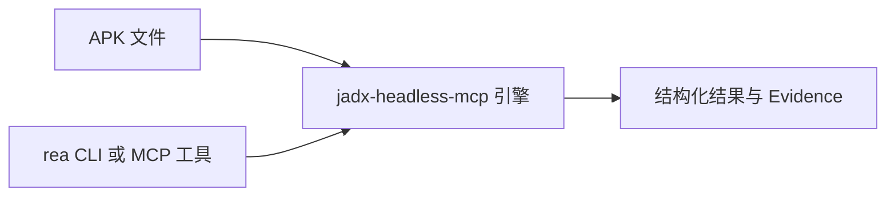

import { Meta } from '@storybook/addon-docs/blocks';

<Meta id="android-analysis" title="移动与桌面应用包/Android/应用分析" name="Docs" />

# 应用分析

REA 对 Android APK 提供静态结构分析：它在内部驱动一个 headless JADX 引擎（`jadx-headless-mcp` JAR，以固定版本与 SHA-256 校验的方式引入），把"检查包、搜类、读类、读方法、追引用"包装成一条条一次性 CLI 命令或 MCP 工具调用，每次调用都返回绑定构件（artifact-bound）的 Evidence——记录原始请求、APK SHA-256 与引擎 JAR SHA-256。整个过程不执行 APK，回答的都是"包里声明了什么、有哪些类、这个方法体长什么样、谁在静态引用它"这类问题。

本课是 Android 组的共同入口：先在这里搭好引擎并跑通基本流程；资源表解包归 [6.1.3 资源分析](?path=/docs/apktool-resources--docs)，设备与运行时归 [6.1.2 设备分析](?path=/docs/adb-device-analysis--docs)，JEB 反编译归 [6.1.4 JEB 项目](?path=/docs/jeb-projects--docs)，完整边界见下文[能力边界](#能力边界)。



| 命令 | 回答的问题 |
| --- | --- |
| `inspect-android-package` | 包里声明了什么：清单、权限、类/资源计数 |
| `search-android-classes` | 有哪些类名匹配查询 |
| `inspect-android-class` | 一个类有哪些字段、方法与重载 |
| `inspect-android-method` | 一个方法体长什么样（Java 或 smali） |
| `trace-android-references` | 谁在静态引用这个类或方法 |
| `project-android-application-graph` | 组件清单能拼出怎样的应用图与框架提示 |

## 快速上手

前置：JDK 17 或更高版本，且必须包含编译器模块（纯 JRE 不够，见[准备 JADX 引擎](#准备-jadx-引擎)）。以下下载与校验步骤在 macOS 与 Linux 通用，官方在 Linux x86-64 搭配 Temurin 21 上完成过完整验证。

下载引擎 JAR、校验 SHA-256 并导出环境变量（Linux 把 `shasum -a 256` 换成 `sha256sum -c`）：

```sh
mkdir -p "$HOME/.local/share/rea/android" &&
cd "$HOME/.local/share/rea/android" &&
curl -fL -o jadx-headless-mcp-0.7.1-all.jar \
  https://github.com/1013503897/jadx-headless-mcp/releases/download/v0.7.1/jadx-headless-mcp-0.7.1-all.jar &&
echo '6e5eacf500b64292bfb73c49797c1958f6ee44646e43e868039ae7feb573ff75  jadx-headless-mcp-0.7.1-all.jar' | shasum -a 256 -c - &&
export REA_JADX_MCP_JAR="$PWD/jadx-headless-mcp-0.7.1-all.jar"
```

对任意一个 APK 做第一次包检查：

```sh
rea inspect-android-package /path/Example.apk
```

输出中应能核对到：解码后的清单 XML、包名 / SDK / 权限等摘要声明、类与资源的计数，以及恒为 `not_performed` 的签名验证字段。需要保存结果时加全局选项 `--json`（输出格式与过滤约定见 [1.3 CLI 与 Evidence](?path=/docs/cli-evidence--docs)）。

## 准备 JADX 引擎

REA 不代装任何运行件——Java、Android SDK、JADX 本体、设备服务、模拟器都不装。它只需要两样自备的东西：

- **含编译器模块的 JDK 17+。** 引擎桥接需要在运行时编译，"能运行的 JRE 单独不够"。用 `java --list-modules | grep jdk.compiler` 确认模块存在。
- **固定版本的引擎 JAR。** 即 `jadx-headless-mcp 0.7.1`，从其 GitHub releases 下载；REA 文档在仓库 `src/android/JadxRelease.ts` 中 pin 了 SHA-256（`6e5eacf5…ff75`），下载后务必校验。用环境变量 `REA_JADX_MCP_JAR` 指向 JAR 的**绝对路径**，可选再用 `JAVA_HOME` 指定 JVM。

就绪检查发生在引擎启动时：REA 会检查 JAR 的 ZIP 目录，以及 Java 的编译器与版本模块；单次 ZIP 元数据读取上限 8 MiB。校验不过或模块缺失都会在启动前失败。

平台差异：

- **Linux：** JADX 跑在 REA 拥有的子进程里，要求 `PATH` 上有 procps 兼容的 `ps`。
- **Windows：** x64 使用 REA 打包的原生控制组件（配合 kill-on-owner-close 的 Job Object）；arm64 不在当前原生支持边界内。
- **macOS：** 使用与 Linux 相同的下载与校验步骤。

想确认整套环境可用时，REA 仓库自带验证通道：`npm run fixtures:android` 下载固定的公共样例（ApiDemos、NewPipe），`npm run verify:android` 用真实 CLI/MCP 调用核对结果、取消、清理与 Java 故障恢复，全程不需要 Gradle、模拟器或 Android SDK。

## 分析命令

所有 Android 命令共享同一个模型：`rea <command> <apk路径> [类名] [方法名] [选项]` 的一次性调用，没有守护进程。调用会启动一个引擎会话，结果保留 60 秒闲置时间；清理发生在变更、失败、超时、取消、断连或关机时，CLI 一次性调用会在返回前等待清理完成。

推荐按"逐级窄化"的顺序走：

1. `inspect-android-package` 总览包，拿到类/资源计数与清单；
2. `search-android-classes` 按名字找类；
3. `inspect-android-class` 看类清单，确定方法与重载；
4. `inspect-android-method` 读方法体、`trace-android-references` 追引用。

MCP 侧工具一一对应同名下划线形式：`inspect_android_package`、`search_android_classes`、`inspect_android_class`、`inspect_android_method`、`trace_android_references`；每个请求都带 `path`，方法类操作带 `class_name`、`method_name` 与可选 `overload_index`。

### 检查包

```sh
rea inspect-android-package /path/Example.apk
```

完整输出包含解码后的清单 XML、摘要声明（包、SDK、权限）与类/资源计数；签名验证字段显式为 `not_performed`。摘要字段由上游提取，需要精确值时应与保留的清单 XML 核对。

MCP 场景下可以改用摘要交付：`inspect_android_package` 传 `detail: "summary"` 时只返回声明、引擎身份与计数，不带解码清单文本；响应携带 `normalized_result.parent_evidence_id`，再用 `inspect_analysis_view`（source kind 为 `retained-evidence`，视图 `"view": {kind: "android", facet: "manifest", offset: 0, limit: 4096}`）按 UTF-16 code units 分页读回清单文本，跟随 `coverage.next_offset` 翻页。不支持保留机制的服务器会在启动 JADX 之前直接拒绝 summary 请求。CLI 的一次性输出永远是完整版。

### 搜索类

```sh
rea search-android-classes /path/Example.apk MainActivity
```

搜索对引擎缓存的顶级类名做**完整、大小写敏感**的匹配，空 `query` 等于清点全部类名。类名按页传输，每页最多 4096 个名字。匹配是反编译器表示的类名：重复的名字在 `matches` 中保持重复，出现多行的名字会汇总进 `duplicate_names`（含出现次数）。

### 检查类

```sh
rea inspect-android-class /path/Example.apk example.MainActivity
```

类清单只读取解析后的元数据，不生成源码，因此开销小且在方法反编译后保持一致。返回完整的显示类型、字段与内部类名；代码生成隐藏的合成成员仍可能出现。注意两套名字：`dex_descriptor` 是精确的 DEX 原型（如 `(I)V`），显示名则可能是 JADX 的别名。方法清单的另一个用途是**选重载**——下一步检查方法前的必经动作。

### 检查方法

```sh
rea inspect-android-method /path/Example.apk example.MainActivity onCreate
rea inspect-android-method /path/Example.apk example.MainActivity select --overload-index 1
```

方法名有歧义时请求会被**直接拒绝**，不会自动挑第一个重载；先用 `inspect-android-class` 的方法清单对照 `dex_descriptor` 选定 `--overload-index`。重载索引绑定具体构件与引擎版本，**跨构建不稳定**，引用结论时不要复用旧索引。

方法体的返回状态有三种边界：

- Java 体缺失时回退为 smali（`java_body_unavailable`），smali 回退按原始名字 + DEX 描述符选取完整代码块；
- `<clinit>` 这类静态初始化器返回 smali 并标记 `static_initializer_disassembly`；
- native / abstract 方法报告 `body_status: "not_available"`，分别带 `native_method` / `abstract_method` 标记。

### 追踪引用

```sh
rea trace-android-references /path/Example.apk example.MainActivity
rea trace-android-references /path/Example.apk example.MainActivity --method-name onCreate
rea trace-android-references /path/Example.apk example.MainActivity --method-name select --overload-index 1
```

返回的是**指向目标的入边静态关系**，不是运行时调用记录，也不覆盖反射与动态加载。读数时注意三个语义：

- `total` 的计数单位是 `reference_unit=using_node`——包含引用的 JADX 节点数，不是 invoke 指令条数；
- `direct_invokes` 才是指令级明细，列出匹配的 DEX invoke 指令（所在条目、方法 ID、code-unit 偏移、方法索引、opcode）：空数组表示没有匹配，`null` 表示原始代码不可得（类级引用结果也为 `null`）；
- `coverage=complete` 只覆盖"该节点的清单"；`direct_invokes_exhaustive: false` 表示结果受帧预算限制，不是穷尽枚举。

## 应用图投影

```sh
rea project-android-application-graph '{"inventory_evidence":[<inventory_artifact Evidence>]}'
```

前五条命令的输入都是 APK 路径，这一条的输入换成**免执行（execution-free）的 inventory Evidence**——归档清单/提取是另一个独立工具家族，Android 命令本身不做归档提取，其产出的 Evidence 在这里喂给投影。

投影报告三类内容：组件的路径与哈希、runtime-family 提示、基于路径的桥接（bridge）假设。框架提示按原生库文件名**精确匹配**（如 `libhermes.so`、`libflutter.so`、`libunity.so`），`libcommunity.so` 这类自创名字不会命中。桥接候选按笛卡尔积生成，在 2 MiB JSON 预算内做确定性截断，被省略的候选通过 `bridge_candidate_coverage` 报告，不会静默丢失。

## 超时与资源限制

Android 分析的多项边界是内存安全预算，默认值与覆盖方式如下：

| 项目 | 默认值 | 覆盖方式 |
| --- | --- | --- |
| 单操作截止时间 | 120 秒 | `REA_JADX_OPERATION_TIMEOUT_MS`（1–2147483647，如 `600000`） |
| 桥接启动握手 | 30 秒 | 固定 |
| 上游反编译限制 | 90 秒 | 固定 |
| 清单/方法文本预算 | 1 MiB | 超出会截断并在结果中报告 |
| 类名页大小 | 4096 个名字 | 固定 |
| 单帧读取上限 | 8 MiB | 固定 |
| 单操作 stdout/stderr 合计 | 32 MiB | 固定 |
| 引擎堆大小 | 不设置 | `REA_JADX_HEAP_MIB` |
| 参与分析的 worker | 恒为 1 个 | 与 CPU 设置无关 |

环境变量的 Java 侧惯例被保留：`JAVA_TOOL_OPTIONS`、`JDK_JAVA_OPTIONS`、`_JAVA_OPTIONS` 按标准 Java 优先级生效，`REA_JADX_ACTIVE_PROCESSOR_COUNT` 可调 JVM 可见处理器数；Evidence 会记录观测到的 `Runtime.maxMemory()`。把 `REA_JADX_OPERATION_TIMEOUT_MS` 调大时，MCP 客户端的 tool-call 超时也要同步调大，否则客户端会先于引擎放弃。

## 能力边界

这些命令**不执行 APK**。以下任务不在本课范围，REA 也不提供对应功能：

- **split APK 与 AAB：** 没有专门处理；`.aab` 被当作普通 ZIP 而非 APK。
- **签名验证：** 结果显式为 `not_performed`，APK 真实性未经证实。
- **资源表语义：** 不做完整资源解析——资源与清单解包用 Apktool，见 [6.1.3 资源分析](?path=/docs/apktool-resources--docs)。
- **设备与运行时：** 不含 ADB、模拟器或运行时捕获——连接真机/模拟器看 [6.1.2 设备分析](?path=/docs/adb-device-analysis--docs)。
- **JEB 反编译：** 不含 JEB 功能——见 [6.1.4 JEB 项目](?path=/docs/jeb-projects--docs)。
- **原生库分析：** APK 内的 `.so` 不在本课命令的分析范围，原生路线见第 4 章。

## 最佳实践

- **让每一步目标更小。** 按"包 → 类名 → 类清单 → 方法/引用"的窄化顺序走，先靠包检查的计数判断包体规模，再用搜索把类名收窄，避免直接对大包做方法级操作吃满超时。
- **把可复现性写进结论。** Evidence 已记录 APK SHA-256 与引擎 JAR SHA-256，引用某个具体重载时同时注明 `--overload-index` 绑定的构件与引擎版本，因为换一个构建索引就可能失效。
- **先配预算再跑大包。** 大 APK 或 CI 环境里，先按上表调 `REA_JADX_OPERATION_TIMEOUT_MS`（必要时加 `REA_JADX_HEAP_MIB`），MCP 场景同步调客户端超时，避免 120 秒默认值造成的假失败。
- **用官方验证通道确认环境。** 引擎 JAR、JDK 模块、平台差异都可能让首次启动失败；克隆仓库跑一次 `npm run fixtures:android` 与 `npm run verify:android` 可以把环境问题与应用问题分开。

## 常见问题

- 命令一开始就失败，提示引擎或 JAR 未就绪
  依次核对三处：`REA_JADX_MCP_JAR` 是否为**绝对路径**且指向校验过的 JAR；`java --list-modules` 是否包含 `jdk.compiler`（纯 JRE 无法编译桥接）；Linux 上 `PATH` 是否有 procps 兼容的 `ps`。就绪检查还会读 JAR 的 ZIP 目录，损坏的 JAR 在这里被拒。
- `trace-android-references` 的 `direct_invokes` 是 `null`，误以为"没有引用"
  `null` 的含义是原始代码不可得（或目标不是方法），与"无匹配"（空数组）不同；引用是否存在应结合 `total` 与节点结果判断，`total` 数的是包含引用的节点而非指令。
- 引擎清理未确认后，后续所有启动都被阻塞
  这是上一个 provider 实例的 workspace 被保留导致的：清理无法确认时会话会被留下，并阻塞同一 provider 的后续引擎启动。先处理残留会话再重试；正常路径下 CLI 一次性调用会在返回前等待清理完成。
- 把 `.aab` 当 APK 传入后得不到预期的清单与类
  REA 把 `.aab` 当作普通 ZIP 而非 APK，本课命令的清单与类视图对它不适用；要分析应用本体应获取 APK 产物，或改用归档清单/提取工具家族按 ZIP 处理包体。

## 总结回顾

摘要：

REA 的 Android 应用分析由一个自备的 headless JADX 引擎（`jadx-headless-mcp` JAR）支撑：准备含 `jdk.compiler` 的 JDK 17+ 与校验过 SHA-256 的引擎 JAR 后，`inspect-android-package` 给出清单、权限与计数总览，`search-android-classes` 与 `inspect-android-class` 把目标收窄到具体类与重载，`inspect-android-method` 读方法体（Java、smali 或标记不可用），`trace-android-references` 追入边静态引用，`project-android-application-graph` 再把 inventory Evidence 投影成带框架提示的应用图。每步结果都带绑定 APK 与引擎哈希的 Evidence；超时、文本预算与堆大小有明确默认值和覆盖变量；资源解包、设备观测与 JEB 分别由后续课程接手。

一句话：

> REA 的 Android 分析是把 headless JADX 包成一次性静态问询——问包、问类、问方法、问引用，每问一次都留下绑定 APK 与引擎哈希的 Evidence。

知识要点：

- 六条命令分别回答什么问题，按什么顺序逐级窄化目标？
- 运行前必须自备什么，如何下载、校验并挂载引擎 JAR？
- 哪些结果语义容易误读：重载索引的生命周期、`total` 与 `direct_invokes` 的区别、`null` 与空数组的区别？
- 操作超时、文本预算和引擎堆的默认值是多少，分别用什么变量调整？
- 哪些任务明确不在本课范围，分别由哪门课接手？

## 参考资料

- [REA Android APK analysis（仓库 docs/android-analysis.md）](https://github.com/morluto/rea/blob/main/docs/android-analysis.md)
- [REA CLI 参考（仓库 docs/cli.md）](https://github.com/morluto/rea/blob/main/docs/cli.md)
