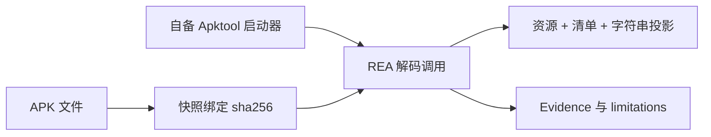

import { Meta } from '@storybook/addon-docs/blocks';

<Meta id="apktool-resources" title="移动与桌面应用包/Android/资源分析" name="Docs" />

# 资源分析

REA 通过调用方自备的 Apktool 启动器解码 Android 资源表与二进制清单，补齐 Android 静态分析三件套的最后一块：Java/Kotlin 源码走 JADX 家族（[6.1.1 应用分析](?path=/docs/android-analysis--docs)），引擎级反编译走 JEB（[6.1.4 JEB 项目](?path=/docs/jeb-projects--docs)），资源与清单走本课的 Apktool 家族。REA 从不代装 Apktool 或 Java 运行时；整条通道只有两个操作——就绪检查与解码，smali 有意跳过（`apktool d --no-src`），解码结果绑定发起时的 APK 快照并产出 Evidence。查代码去 6.1.1，查资源、清单和字符串来这里。



| 操作 | 回答的问题 |
| --- | --- |
| `inspect-apktool-client` | 启动器就绪了吗：解析到哪个 apktool、来自哪里、版本多少 |
| `decode-android-resources` | 包里的资源、清单和字符串长什么样 |

## 快速上手

前置：自备 Apktool 2.7.0 或更新版本，以及启动器能找到的 Java 运行时；选择与版本注意点见[准备 Apktool 启动器](#准备-apktool-启动器)。默认从 `PATH` 解析 `apktool`，需要指定时导出绝对路径：

```sh
export REA_APKTOOL_COMMAND=/absolute/path/apktool
```

先确认通道就绪，再对任意 APK 做第一次解码：

```sh
rea inspect-apktool-client
rea decode-android-resources /targets/Example.apk
```

输出中应能核对到：第一条报告解析到的启动器、选择来源与版本；第二条返回绑定 `target.sha256` 与 `target.bytes` 的解码结果，含 apktool.yml 元数据、解码后的清单文本与默认表的字符串条目。

## 准备 Apktool 启动器

REA 从不代装 Apktool 或 Java 运行时，通道需要两样自备的东西：

- **Apktool 2.7.0 或更新。** 官方在 Linux 上用 2.7.0 与 3.0.3 完成过验证。
- **启动器能找到的 Java 运行时。** 启动器可以是上游包装脚本，也可以是自写的 `java -jar` 脚本。

启动器选择走环境变量；不设置时从 `PATH` 解析 `apktool`：

```sh
# 可选：apktool 启动器的绝对路径（上游包装器或 java -jar 脚本均可）
export REA_APKTOOL_COMMAND=/absolute/path/apktool
```

### 就绪检查

```sh
rea inspect-apktool-client
```

检查会实际运行 `apktool --version`，报告三件事：解析到的启动器、它的选择来源、版本号。缺启动器时报 `capability_unavailable` 并附 `REA_APKTOOL_COMMAND` 修复指引——REA 不会尝试代装。`binary_session` 场景用同一主机探针确认工具可用性：它不校验某个具体 APK，也不保证所选输入能被解码。

Windows 的批处理启动器（如 Chocolatey 的 `apktool.bat`）经显式的 `cmd.exe /d /s /c` 调用运行：无 AutoRun、无延迟扩展、每个参数都加引号。启动器路径含 `"`、`%`、`^`、`!`、`&`、`|`、`<`、`>` 任一字符时报 `not_configured`，不会被传给 `cmd.exe`；REA 的临时解码路径含这些字符时，经批处理启动器的解码报 `capability_unavailable`。

### 版本通告窗口

客户端检查与解码结果会披露下列"已上报版本"的通告窗口，但不会因此拒绝其他兼容启动器：

| 通告 | 上报版本窗口 | 主机范围 |
| --- | --- | --- |
| CVE-2024-21633 | 2.9.2 之前 | 全部 |
| GHSA-vgwr-4w3p-xmjv | 2.9.3 之前 | Windows |
| CVE-2026-39973 | 3.0.0 发布线至 3.0.2 之前 | 全部 |

2026 年通告点名 3.0.1 与修复版 3.0.2；把 3.0.0 纳入窗口是从源码得出的——3.0.0 原样放行类型名，3.0.2 的补丁在类型名到达输出路径生产者之前先行校验。固定版本之前的预发布按保守原则披露；`-dirty` 这类下游标记按发布版比较并保留原拼写。

这条窗口只是版本指引，不是对某个预发布版或解码器的验证：启动器版本证明不了解码器内容、执行平台、下游 backport 或整体安全性；Windows 适用性按选定本机判断，不透明包装器可能运行另一个引擎；"没有警告"只说明没有窗口命中。解码不可信 APK 前自行核对解码器补丁，上述兼容底线不是安全建议；REA 运行时不抓取通告。

## 解码命令

一次调用完成"快照 → 解码 → 投影"，CLI 全部形态：

```sh
rea decode-android-resources /targets/Example.apk
rea decode-android-resources /targets/Example.apk --locale de
rea decode-android-resources /targets/Example.apk --locales de --locales pt-BR
rea decode-android-resources /targets/Example.apk --locales de --locales pt-BR --string-tables-only
rea decode-android-resources /targets/Example.apk --no-strings
```

MCP 侧等价方法为 `inspect_apktool_client` 与 `decode_android_resources`。解码请求参数：`path`；可选主 `locale`（投影 `res/values-<locale>/strings.xml` 而非默认表）；可重复的 `locales`（从同一次解码再投影多张本地化字符串表）；`include_strings`（默认 true）。

locale 语法有几条边界，写错会被拒绝或选错表：

- 区域语言如 `pt-BR` 选中 Android 的 `values-pt-rBR`；
- 三位数字区域如 `es-419` 选中 `values-b+es+419`；`es-r419` 被拒——Android 遗留的 `-r` 形式要求两字母区域；
- 也可以直接给 Android 限定符，如 `pt-rBR`、`b+zh+Hans+CN`；
- locale 后缀最多 23 个 ASCII 字符，取自 Apktool 的 language、script、region、variant 字段，例如 `b+sr+Latn+RS+REVISED` 选中那张确切的表。

`--string-tables-only` 把字符串条目只放进 `string_tables`（包括只选单表的情况）：顶层 `strings` 数组因此按请求为空——这不代表主表为空；表状态、计数与覆盖仍描述被检查的源。用途是多语言响应不重复主表条目，让聚合输出预算每表只计一份。`include_strings: false` 在此模式下依旧压制全部字符串投影；省略该选项则保持既有响应形态。

## 读懂解码结果

### 快照绑定与元数据

- `target.sha256` 与 `target.bytes` 把观察绑定到被解码的确切 APK；Evidence subject 携带同一快照摘要与调用方所选路径——即使原始文件在解码期间被改动。
- 元数据来自 apktool.yml 原样内容（apktool 打印什么就是什么）：版本码保留自身拼写（`'7'` 与 `7` 不同）；`package_name` 读自解码后的清单，不是推断。

### 清单与文件计数

- 清单是解码后的文本，上限 512 KiB，超出时报告截断。
- `decoded_file_count` 上限 100,000 个文件，触顶时写入 limitations。

### 字符串投影

- 字符串逐字投影：转义实体保持转义；含嵌套标记（`<b>`、`<xliff:g>`）的条目计为 unparsed 而非拍平——limitation 会给出被检查的条数。
- XML 损坏或文档根不对属于整文档投影失败：结果为 partial、披露失败原因、条目数未知；它们不会被算作"一条不支持的字符串"。
- 默认表上限 2000 条，存在更多条目时为部分覆盖。
- 带 `locales` 请求时，`string_tables` 为每张被投影的表记录 locale、状态（`present`、`missing`、`oversized`、`malformed` 或 `skipped`）、条目数与覆盖；聚合预算为 10,000 条字符串与 32 MiB XML。
- `locales` 列出的是"请求的 locale 语法可选中的常规 `strings.xml` 表"；`values-en-rUS-v21`、`values-mcc310-fr` 这类组合限定符目录只在 limitations 中按源拼写命名，不作为可选中 locale 广播——REA 不推断 Android 运行时的资源匹配。非常规 strings 表路径以部分覆盖披露。表发现与文件计数使用同一个有界遍历；文件系统故障仍是故障，不会被解释成"没有表"。
- 省略 `locales` 且未开启 `string_tables_only` 时，保持旧式单表载荷，不添加 `string_tables`。

### smali 与工作区

- smali 有意跳过（`apktool d --no-src`）：Java 源码恢复归 [6.1.1 应用分析](?path=/docs/android-analysis--docs) 的 JADX 家族；资源 smali 编辑与重打包是带变更权限的后续 lane，不在本课范围。
- 解码发生在 provider 拥有的临时目录里，结果返回前删除；APK 快照与 framework 缓存都放在其中。删除失败时结果会命名残留路径，provider 保留所有权并在关闭时重试清理——解码失败的情况也一样。

## 资源与生命周期限制

| 限制 | 值 | 越界时的表现 |
| --- | --- | --- |
| 解码截止时间 | 600 秒 | 被停止的解码报 `provider_timeout` |
| 输出捕获预算 | 4 MiB | 超出报 `resource_constraint` |
| 清单读取上限 | 512 KiB（UTF-8 解码前） | 截断并在结果中报告 |
| 字符串 XML 读取上限 | 8 MiB | 跳过该文档，按部分覆盖加明确上限报告，不当作缺失 |
| 默认字符串表条目 | 2000 条 | 存在更多条目时为部分覆盖 |
| 解码文件计数 | 100,000 个 | 触顶时在 limitations 中报告 |

失败语义分两类，别混：

- **普通非零解码退出** → `unsupported_target`，指名调用方所选 APK，并附 Apktool 诊断与捕获输出——这确立"选中的 APK 不受支持"。
- **启动器启动、所有权准备、信号终止、输出收集不完整** → provider failures：它们不确立"APK 不受支持"，问题在执行环境侧。

## 最佳实践

- **先检查再解码。** 解码前跑一次 `inspect-apktool-client`，把"环境没就绪"与"包解不开"分开；缺启动器与版本过旧在检查阶段就会暴露，不用等解码失败倒推。
- **多语言用 `--locales` 加 `--string-tables-only`。** 同一次解码投影多张表时，表专有模式避免主表条目重复计入 10,000 条聚合预算；顶层 `strings` 置空是该模式的预期行为，不是异常。
- **引用结论带上快照摘要。** `target.sha256` 绑定的是解码那一刻的 APK，原始文件事后变动不影响证据指向；写结论时引用这个摘要，可复现性才有落点。
- **解码不可信 APK 前自行核对补丁。** 通告窗口是版本指引而非安全验证，版本对也不代表该启动器安全；按版本通告窗口自行确认所选 Apktool 的补丁状态。

## 常见问题

- `inspect-apktool-client` 或解码报 `capability_unavailable`
  先核对启动器可见性：`REA_APKTOOL_COMMAND` 是否指向可执行启动器的绝对路径，或 `apktool` 是否在 `PATH` 上且 Java 可用——REA 不会代装。Windows 批处理启动器还要检查启动器路径与 REA 临时解码目录是否含 `cmd.exe` 元字符：路径含则报 `not_configured`，临时路径含则解码报 `capability_unavailable`。
- `--string-tables-only` 后顶层 `strings` 为空，误判"主表没有字符串"
  空是请求使然：条目被收进 `string_tables`，主表是否为空看对应表的条目数与覆盖状态；`include_strings: false` 同样压制全部字符串投影，两种情况都不构成"表为空"的证据。
- 含 `<b>`、`<xliff:g>` 的条目被计为 unparsed，误以为字符串被丢弃
  投影是逐字的，条目仍在结果里；unparsed 只命名"多少条未做标记级解析"的检查项，不是丢条目。真正的投影失败是整文档级的——XML 损坏或文档根不对，那时该表结果为 partial 且条目数未知。
- 解码失败后分不清是包的问题还是环境的问题
  看状态：`unsupported_target` 表示 Apktool 正常退出但解不开这个 APK，诊断与捕获输出就在结果里；启动器启动失败、信号终止、输出收集不完整是 provider failures，不能据此断定 APK 不受支持。600 秒超时与 4 MiB 预算各有专属状态 `provider_timeout` 与 `resource_constraint`。

## 总结回顾

摘要：

REA 的资源通道把自备的 Apktool 包成两个操作：`inspect-apktool-client` 实际运行 `apktool --version` 并报告解析到的启动器、来源与版本，`decode-android-resources` 对 APK 快照做一次解码，再按 locale 语法投影资源、清单与字符串。启动器要求 2.7.0 或更新加可用的 Java 运行时，结果通过 `target.sha256` 与 `target.bytes` 绑定解码那一刻的 APK；清单是上限 512 KiB 的解码文本，字符串逐字投影并有 2000 条与聚合 10,000 条的预算，多语言表以 `string_tables` 记录状态与覆盖。smali 有意跳过，代码层问题归 JADX 家族；失败分 `unsupported_target` 与 provider failures 两类，超时与预算触顶各有专属状态。

一句话：

> Apktool 通道回答"包里声明与展示的资源长什么样"：REA 用你自备的 Apktool 对 APK 快照做一次解码，产出绑定摘要的资源、清单与逐字字符串投影，代码层的问题留给 JADX。

知识要点：

- Android 静态三件套怎么分工：JADX、JEB 与本课的 Apktool 各管哪一层？
- 通道要自备什么，就绪检查报告什么，缺启动器和 Windows 批处理路径各报什么状态？
- `--locale`、`--locales`、`--string-tables-only`、`--no-strings` 分别改变什么，locale 语法有哪些会选错表或被拒的边界？
- 输出如何与 APK 快照绑定，apktool.yml 元数据与解码清单有哪些读法上的注意点？
- 字符串投影里 unparsed、整文档失败与各项上限（2000 条、512 KiB、8 MiB、10,000 条、100,000 个文件、600 秒、4 MiB）分别是什么语义？
- 哪些失败说明"APK 不受支持"，哪些是 provider 故障？

## 参考资料

- [REA Apktool resource decoding（仓库 docs/apktool-resource-analysis.md）](https://github.com/morluto/rea/blob/main/docs/apktool-resource-analysis.md)
