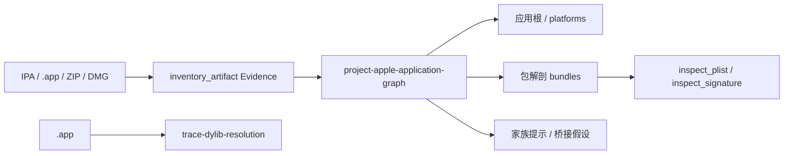

import { Meta } from '@storybook/addon-docs/blocks';

<Meta id="apple-applications" title="移动与桌面应用包/框架与系统/Apple 应用" name="Docs" />

# Apple 应用

Apple 应用包——iOS 的 IPA、macOS 的 `.app`，以及装着 `.app` 的 ZIP 与 DMG——怎么解包分析？REA 的答案是**纯解析投影**：不安装、不执行、不依赖任何 Apple 工具。`project-apple-application-graph` 把对包体的 `inventory_artifact` 盘点 Evidence 投影成 Apple 应用结构：应用根与平台、包解剖、运行时家族提示、JS/原生桥接假设和覆盖；`trace-dylib-resolution` 在 TypeScript 里解析 Mach-O/FAT 加载命令，按 dyld 语义回答每条 dylib 加载会到达哪个文件。分工边界要先记住：投影**不读 plist 和签名语义**——`Info.plist` 字段交给 `inspect_plist`，签名声明交给 `inspect_signature`；家族提示只是路径线索，不是运行时观察。APK、ASAR 会被投影按输入错误拒绝，Android 包分析见 [6.1.1 应用分析](?path=/docs/android-analysis--docs)。



| 命令 | 回答的问题 |
| --- | --- |
| `rea project-apple-application-graph '{"inventory_evidence":[…]}'` | 包体盘点投影成 Apple 应用结构：应用根、平台、包解剖、家族提示、桥接假设、覆盖 |
| `rea trace-dylib-resolution MyApp.app [--root <path>] [--architecture <arch>]` | 每条 Mach-O dylib 加载命令在根内到达哪个文件，断裂卡在哪一步 |

MCP 侧一一对应下划线形式：`project_apple_application_graph`（带 `inventory_evidence` 数组）、`trace_dylib_resolution`（带 `roots` 数组与可选 `architecture`）。

## 快速上手

前置：两条命令都是 REA 内置纯解析——投影免执行，dylib 追踪连 Apple 工具都不需要，非 macOS 主机也能跑。直接对 `.app` 追踪加载解析：

```sh
rea trace-dylib-resolution MyApp.app --json
rea trace-dylib-resolution MyApp.app --root Contents/MacOS/MyApp --architecture arm64 --json
```

输出应能核对到：bundle 里每个可执行文件（主程序、XPC 服务、app 扩展、login item、特权助手、helper 工具）各自成为独立进程根，拥有自己的 `@executable_path`；每条边列出尝试过的全部候选路径及其结果。

投影的输入不是路径，而是对同一 IPA、macOS `.app` 目录、ZIP 或 DMG 盘点得到的已认证 `inventory_artifact` Evidence 记录（Evidence 概念见 [1.3 CLI 与 Evidence](?path=/docs/cli-evidence--docs)）：

```sh
rea project-apple-application-graph '{"inventory_evidence":[<inventory_artifact Evidence>]}'
```

输出应能核对到：每个盘点类别的全部组件都在结果里；`platforms` 对带 `Contents/` 的根列 `macos`，对带 `Info.plist` 的浅根列 `ios`。结果需要保存或过滤时使用全局选项 `--json`。

## 应用根与平台

投影先把一份包体盘点切成应用根。三种盘点根的划分规则：

| 盘点根 | 应用根 |
| --- | --- |
| IPA | 每个 `Payload/<Name>.app` |
| `.app` 目录 | `.`（被盘点的 bundle 本身） |
| 含应用的目录 / ZIP / DMG | 每个最外层 `<Name>.app` 及其 `Contents/` |

- 名字以 `.app` 结尾的被盘点目录自成一根，即使盘点不完整或没有 `Contents/`。
- **根外组件不归属应用**：安装器、磁盘镜像附赠物、AppleDouble sidecar 留在组件列表，但不进家族提示与桥接候选，limitation 报告被排除的条目数。IPA 是例外——投影仍列出全部归档组件，包括 `SwiftSupport/`。
- `ditto -c -k --keepParent` 打出的 ZIP 报 `<Name>.app`；DMG 报 `<image>.dmg/<Volume>/<Name>.app`，子盘点需要原生 macOS 挂载适配器——只有根身份时投影为 partial，说明 bundle 缺失未知。
- **平台判定**：`platforms` 对有 `Contents/` 的根列 `macos`，对有 `Info.plist` 的浅根列 `ios`；两者皆无（如空盘点）就没有平台。
- 根与布局发现用已知目录和深层路径隐含的祖先：名为 `*.app`、`Contents`、`Versions` 的叶子文件或符号链接不确立该目录。

## 包解剖

`bundles` 列出每个应用根及其下每个嵌套 bundle，各报告 `parent_path`、`layout`、`info_plist_path`、`executable_candidates`、`signing_paths`。这是后续读 plist、查签名的定位入口。

### 三种布局

| 布局 | 含义 | 内容目录 |
| --- | --- | --- |
| `macos-deep` | 有 `Contents/` | `Contents/`，可执行文件在 `Contents/MacOS/` |
| `versioned-framework` | 有 `Versions/` | 每个真实 `Versions/<version>/` |
| `shallow` | 两者皆无 | bundle 目录本身 |

### 角色按路径约定

`role_basis: "path-convention"`——角色由路径形态决定，不读 plist 声明：

| 角色 | 路径 |
| --- | --- |
| `app-extension` | `*.appex` |
| `xpc-service` | `*.xpc`（含框架内的 XPC 服务） |
| `framework` | `*.framework` |
| `system-extension` | `*.systemextension` |
| `driver-extension` | `*.dext` |
| `plug-in` | `PlugIns/*.bundle`、`*.plugin`、`*.qlgenerator`、`*.mdimporter` |
| `resource-bundle` | `Resources/*.bundle`（如 SwiftPM 资源包） |
| `bundle` | 其余 `*.bundle` |
| `login-item` | `Contents/Library/LoginItems/*.app` |
| `helper-application` | `Contents/Helpers/*.app` |
| `nested-application` | 其余嵌套 `*.app` |

### 特权助手与 launchd 配置

组件列表还包含三组安全相关入口：

- **`privileged_helpers`**：直接位于 `Contents/Library/LaunchServices/` 的文件——SMJobBless 助手所在地。
- **`launchd_plists`**：直接位于 `Contents/Library/LaunchAgents/`（`domain: "agent"`）或 `Contents/Library/LaunchDaemons/`（`domain: "daemon"`）的 `.plist`，即 SMAppService 使用的配置。
- **`helpers`**：直接位于 `Contents/Helpers/` 的文件。

### 符号链接与 AppleDouble

- 符号链接按路径记录在 `symlinks`，**目标不被盘点**——versioned framework 通过真实 `Versions/<version>/` 描述，不通过 `Versions/Current`。
- framework 的 `info_plist_path` 为 null（附 limitation 说明）的两种情形：有多个真实版本目录（即使只有一个持有 plist——由 `Versions/Current` 决定生效者），或唯一版本目录没有 `Resources/Info.plist`。
- AppleDouble sidecar（`._*` 与 `__MACOSX/`）是盘点事实，描述的是相邻文件，被排除在根、角色与解剖组件之外。

## 家族提示与桥接假设

- **家族提示按完整路径段匹配**：`React.framework`、`ReactNative.framework`、`hermes.framework`、`Flutter.framework`、`UnityFramework.framework` 等；`Preact.framework`、`Community.framework`、`MyApp.framework` 这类子串不识别；单独的 `App.framework` 也不代表 Flutter。
- 提示来自盘点，**不是观察到的加载**；通用框架与 dylib 路径不确立 Swift/Objective-C——投影不解码语言元数据。
- **桥接假设**是每个应用根内的 JS/原生路径配对：依据由原生路径推断、对每个配对脚本重复，不证明某个特定绑定。
- 桥接候选的序列化数组上限 2 MiB：投影先算配对数与精确 UTF-8 JSON 尺寸，超预算保留确定性前缀；`bridge_candidate_coverage` 报告 total/emitted/omitted 配对数，整体覆盖降为 partial 并附 limitation。**组件数组不受裁剪影响**——候选被省略时组件仍然完整。

## 覆盖与组件判读

- **覆盖两态**：供给的盘点页能重构完整已认证盘点时报 `complete-within-inventory`，否则 `partial`；partial 的含义是"缺失未知"。
- **`unavailable_components`**：字节未被读到的文件（如加密归档成员）列在这里，带原始路径、格式、加密标志、limitation 与 null 内容身份。它们把整体覆盖强制为 partial——即使 `inventory_complete` 为 true，组件缺失仍然未知。目录没有文件字节，符号链接留在 `symlinks`，两者都不是不可读文件组件。该字段参与计算 `projection_id`，包括它为空时。
- **组件按内容认**：内容节点以 SHA-256 认字节，只报内容推导的格式；每个出现（occurrence）有自己的 `artifact_kind`、`artifact_format` 与可执行权限——相同字节可在不同路径分别扮演脚本、资源或原生 addon。IPA 这类包格式属于出现本身，其 ZIP 字节共享内容格式。
- 重复的盘点页按工件身份与出现路径合并，原 Evidence ID 保留为源 Evidence；图与目录身份用 locale 无关的 Unicode 排序。

## Dylib 加载解析

`trace-dylib-resolution` 回答每条 Mach-O dylib 加载命令到达哪个文件。它对活动 Mach-O，或活动 `.app` 内每个可执行文件运行；bundle 里每个可执行文件都是独立进程根。加载命令用 TypeScript 从 Mach-O 与 FAT 头解析，包括较新链接器为 delayed initialization 等标志发出的 `dylib_use_command` 编码；不执行任何东西、不需要 Apple 工具，非 macOS 主机也能用。

### 解析规则

解析跟随 dyld 语义：

- `@executable_path` 是进程根可执行文件所在目录；根是库时为 undetermined。
- `@loader_path` 是持有该加载命令的镜像目录，或拥有被展开 `LC_RPATH` 的镜像目录。
- `@rpath` 先试加载镜像的每个 `LC_RPATH`，再沿加载链向上直到进程根。
- 依赖按 load-command 顺序、dependents-first 加载；每个镜像每进程只加载一次，install name 匹配已加载镜像的后续 `@rpath` 请求直接复用。
- 根内跟随 `Versions/Current` 之类符号链接；经 `..` 或绝对路径逃出根记 `escapes-target`。
- 切片按 dyld 的 graded architectures：`x86_64h` 进程也会加载 `x86_64`。

### 候选与 resolution

每条边列出尝试过的每个候选路径及其结果：`resolved`、`absent`、`not-mach-o`、`malformed`、`unsupported`（识别出但超出解析器覆盖的 Mach-O，如大端镜像）、`architecture-missing`、`outside-target`、`escapes-target`、`undetermined`。边的 `resolution` 四态：

| 状态 | 含义 |
| --- | --- |
| `resolved` | 根内镜像加载，且没有更早候选不可判定 |
| `conditional` | 根内镜像会解析，但根外更早候选（如 `/usr/lib/swift`）若在运行系统上存在会胜出 |
| `unresolved` | 每个候选在根内都确定缺失或不可用 |
| `undetermined` | 根内无候选解析，且有候选在根外或依赖环境 |

`conditional` 镜像仍被追踪——它是被分析根供给的镜像；其下游每条边带 `loader_conditional: true`，按 install name 复用它的请求也是 conditional。这些边上的 findings 只在 conditional 镜像加载时成立。

### findings

`findings` 是推导，不是观察：

- `required-load-unresolved`、`weak-load-unresolved`、`lazy-load-unresolved`。`LC_LAZY_LOAD_DYLIB` 依赖会解析但**不遍历**——dyld 首次使用时才加载，未解析的 lazy 依赖不是启动失败。
- `earlier-rpath-candidate-absent`：放在更早建模搜索路径上的兼容 Mach-O 可能抢得先机，受未建模搜索输入与代码签名 library validation 影响。findings 不确立 dyld 实际会加载哪个镜像；签名元数据用 `inspect_signature`。
- `dyld-environment-present`：保留观察到的 `LC_DYLD_ENVIRONMENT` 条目。只有可执行根供给进程设置，库等非可执行根上的条目不改变解析或覆盖；可执行根的镜像选择覆盖（image-selection overrides）未建模。

### 已知边界

- 绝对 install name（如 `/usr/lib/libSystem.B.dylib`）记 `outside-target`；macOS 11+ 上多数系统库在 dyld shared cache 里，REA 不对宿主机核对。
- dyld 空目录条目保留不确定性：现代 dyld 会给普通与回退目录条目追加斜杠和镜像名，空条目可能搜索 `/child.dylib` 或 `/Foo.framework/Foo`——这些未核对路径保留不确定性，空回退不抢先于普通搜索命中。空版本目录列表不扫描目录，空后缀只重复原候选，不添加不确定性。命令值在任何情况下原样保留。

## 能力边界

- **投影不读 plist**：`CFBundleExecutable`、标识符、`SMPrivilegedExecutables`、`BundleProgram`、URL schemes、usage descriptions 等字段，用 `inspect_plist` 读 bundle 的 `info_plist_path` 或 launchd plist；代码签名声明用 `inspect_signature` 对可执行候选读取。CMS 语义与观察到的运行时调用同样不在投影范围内。
- **家族提示不确立语言**：Swift/Objective-C 不因通用框架路径成立，需另行验证。
- **桥接假设不证明绑定**：配对是路径推断，逐对重复而非逐对验证。
- **DMG 子盘点需 macOS**：原生挂载适配器只在 macOS 提供，其余平台只能拿到 DMG 根身份。
- **官方验证通道**：`verify:macos-bundle` 用 `otool -l` 核对每个被追踪镜像的解析器输出，并用 `DYLD_PRINT_LIBRARIES` 比较两个进程根的预测加载顺序与 dyld 实际加载的镜像。
- **后续入口**：`Flutter.framework` 命中只是线索，真正的 Flutter 分析见 [6.2.1 Flutter 应用](?path=/docs/flutter-analysis--docs)；Mach-O 可执行文件的函数级调查见 [4.1.1 原生调查](?path=/docs/native-investigation--docs)。

## 最佳实践

- **先投影，再读 plist 与签名。** 投影便宜且免执行：用 `bundles` 的 `info_plist_path` 定位要读的 plist，用 `executable_candidates` 圈定签名检查对象，再交给 `inspect_plist` / `inspect_signature`，避免对包内上百个文件逐个猜。
- **按 resolution 四态措辞，不把 conditional 说成失败。** `conditional` 是根内供给的镜像会加载、真机上根外候选可能赢；`unresolved` 才是根内确定断裂。引用 findings 时注明"仅当 conditional 镜像加载时成立"。
- **引用结论绑定覆盖状态。** 带上 `projection_id` 与 `coverage`；partial 时如实说"缺失未知"，`unavailable_components` 非空（如加密成员）时即使 `inventory_complete` 为 true 也不宣称完整。
- **家族提示当线索，不当结论。** `Flutter.framework` / `hermes.framework` 命中后去对应专项确认，不要直接写"这是 Flutter 应用"；语言归属（Swift/Objective-C）同样要另行取证。
- **跨平台分工。** 两条命令都不需要 Apple 工具、不执行目标，可在非 macOS 主机上对 IPA/ZIP 预筛；需要 DMG 子盘点或真实签名、加载验证时再回 macOS。

## 常见问题

- 家族提示会把 `Preact.framework` 认成 React 吗？
  不会。提示按完整路径段匹配，`Preact.framework`、`Community.framework`、`MyApp.framework` 这类子串不识别；单独的 `App.framework` 也不代表 Flutter。提示只来自盘点路径，不是加载观察。
- framework 的 `info_plist_path` 是 null？
  两种合法情形：有多个真实 `Versions/<version>/` 目录（即使只有一个持有 plist，由 `Versions/Current` 决定生效者），或唯一版本目录缺 `Resources/Info.plist`。响应附 limitation 说明原因，不是解析故障。
- `coverage` 是 partial，但 `inventory_complete` 是 true？
  `unavailable_components` 非空（如加密归档成员）会把整体覆盖强制为 partial——字节没读到，组件缺失就未知。目录与符号链接不算不可读文件组件，不会触发这一点。
- `resolution: "conditional"` 是不是解析失败？
  不是。根内镜像会加载并继续追踪（下游边带 `loader_conditional: true`）；不确定的是真机上根外更早候选（如 `/usr/lib/swift`）是否抢先生效。只有 `unresolved` 表示根内确定断裂。
- `lazy-load-unresolved` 意味着应用无法启动？
  不。`LC_LAZY_LOAD_DYLIB` 依赖由 dyld 首次使用时才加载，REA 解析它但不遍历；未解析的 lazy 依赖不是启动失败。
- DMG 投影只报了根身份，coverage 是 partial？
  DMG 子盘点需要原生 macOS 挂载适配器；只有根身份时投影为 partial 并说明 bundle 缺失未知。用 `ditto -c -k --keepParent` 打包的 ZIP 则直接报 `<Name>.app`。

## 总结回顾

摘要：

REA 把 Apple 应用包的解包分析做成两条纯解析命令。`project-apple-application-graph` 接收对 IPA、macOS `.app`、ZIP 或 DMG 盘点得到的已认证 `inventory_artifact` Evidence，投影出应用根与平台、包解剖（`bundles` 的三种布局、路径约定角色、`info_plist_path`、`executable_candidates`、`signing_paths`，以及特权助手、launchd 配置与符号链接）、按完整路径段匹配的运行时家族提示、按路径配对的 JS/原生桥接假设（2 MiB 预算内保留确定性前缀）；覆盖分 `complete-within-inventory` 与 `partial`，加密等读不到的字节进 `unavailable_components` 并把缺失标记为未知。`trace-dylib-resolution` 用 TypeScript 解析 Mach-O/FAT 加载命令，按 dyld 语义建模 `@executable_path`、`@loader_path`、`@rpath`，对每个进程根给出候选路径、resolution 四态与推导性 findings。plist 字段与签名声明刻意留在投影之外，由 `inspect_plist` 与 `inspect_signature` 接手；全程免执行、免 Apple 工具。

一句话：

> Apple 包分析的分工是：投影负责"包里有什么、结构是什么"，plist 与签名的"语义"交给 `inspect_plist` / `inspect_signature`，而家族提示永远只是路径线索，不是运行时结论。

知识要点：

- 投影接受哪些输入，APK/ASAR 会怎样，应用根按盘点根怎么划分，`platforms` 何时列 `macos` / `ios`？
- `bundles` 报告哪些字段，三种布局与路径约定角色怎么读，`info_plist_path` 何时为 null？
- 家族提示的匹配规则是什么，为什么不能据此断言 Swift/Objective-C 或特定桥接绑定？
- 覆盖两态怎么判读，`unavailable_components` 与 `inventory_complete` 的关系是什么？
- `trace-dylib-resolution` 的三种 `@` 路径怎么解析，候选结果与 resolution 四态分别怎么读，findings 为什么只是推导？
- 哪些事投影刻意不做、分别由哪个工具接手，`verify:macos-bundle` 怎么核对解析器？

## 参考资料

- [REA Apple Application Inventory Projection（仓库 docs/apple-application-analysis.md）](https://github.com/morluto/rea/blob/main/docs/apple-application-analysis.md)
