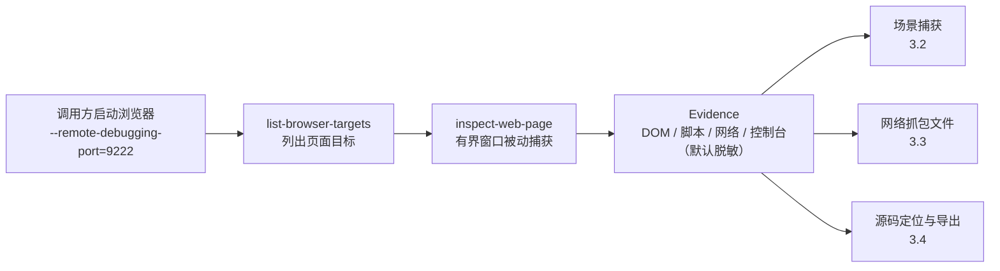

import { Meta } from '@storybook/addon-docs/blocks';

<Meta id="browser-observation" title="网站与浏览器/浏览器观测" name="Docs" />

# 浏览器观测

浏览器观测指把 REA 连到一个**由你自己启动并持有**的 Chrome 系浏览器上，通过 Chrome DevTools Protocol（CDP）对选定的已有页面做有界、被动、默认脱敏的观察：`rea list-browser-targets` 列出调试端点上的页面目标，`rea inspect-web-page` 在选定时间窗内捕获一次页面快照——DOM 结构、可访问性结构、脚本清单、资源、窗口内的网络与控制台事件、WebSocket 帧大小、workers 与存储配额。它回答的是"这个页面现在长什么样、窗口内发了哪些请求、加载了哪些脚本"；它刻意不回答"如何驱动页面交互、请求响应体里有什么、这段脚本对应哪个原始源文件"——驱动页面交互与场景化捕获归场景捕获一课，抓包文件与请求体归网络抓包一课，脚本导出与运行时源码归因归源码定位与导出一课。主线判断一句话：自己带调试端口启动浏览器、自己选目标，REA 只附着观察——两条命令换一份窗口内的在场快照，不是一份浏览器自动化或因果证明。



| 回查项 | 值 |
| --- | --- |
| 列目标 | `rea list-browser-targets http://127.0.0.1:9222 --json` |
| 观察页面 | `rea inspect-web-page http://127.0.0.1:9222 TARGET_ID --observation-ms 1000 --json` |
| 截图 | `rea capture-web-screenshot http://127.0.0.1:9222 TARGET_ID --json` |
| MCP 同源工具 | `list_browser_targets` / `inspect_web_page` / `capture_web_screenshot` |
| 前提 | 浏览器由调用方以 `--remote-debugging-port` 启动并在调查结束后自己关闭；REA 不启动、不拥有、不终止它 |
| 端点 | `http://127.0.0.1:PORT` 或 `ws://127.0.0.1:PORT/devtools/browser/ID`；`[::1]` 可替换 `127.0.0.1`；`localhost`、内网地址、HTTPS、`wss:`、带凭据/查询/片段/隐式端口的 URL 均无效 |
| `--observation-ms` | 观察窗口毫秒数，默认 `500` |
| `--allowed-origins` | 精确 origin 过滤，只含 scheme、host、port；路径、凭据、查询、片段与通配都不合法 |
| `--include-*` | `accessibility-text`、`console-text`、`json-body-shapes`、`websocket-shapes`、`script-sources`、`storage-keys`、`storage-fingerprints`，各自独立选择 |
| attach 语义 | 网络与控制台只从 attach 起记录（`prior_activity_available` 恒为 `false`）；attach 前解析的脚本仍会列出 |
| coverage 状态 | `complete_within_window` / `policy_filtered` / `attach_limited` / `truncated` |
| 预算与超时 | 目标发现 10 秒；每条 WebSocket 消息 64 MiB（超出报 `payload_limit`）；每次握手与命令响应各 20 秒（停滞报 `provider_timeout`）；脚本源 32 MiB 加 20 秒；脚本元数据 8 MiB / 50,000 条 |
| 传输失败 | 连不上报 `endpoint_unreachable`；发现响应非 200 或非 JSON 报 `invalid_endpoint_response`；窗口内主 frame 导航报 `target_changed` |

## 快速上手

先有一个本地页面。三个文件组成一个与官方 notes-web 示例同构的最小应用：页面加载 15 秒后拉取 notes.json 渲染列表，`#export` 按钮在浏览器内把笔记生成 CSV（本课不点它，驱动交互是场景捕获一课的事）。

```html
<!-- index.html -->
<!doctype html>
<html>
  <head><meta charset="utf-8" /><title>notes-web</title></head>
  <body>
    <h1>Notes</h1>
    <ul id="notes"></ul>
    <button id="export">Export notes</button>
    <script src="./app.js"></script>
  </body>
</html>
```

```js
// app.js — 延迟 15 秒才发请求，让观察窗口来得及接住它
console.log('notes-app: script parsed');
setTimeout(() => {
  fetch('./notes.json')
    .then((r) => r.json())
    .then((notes) => {
      const list = document.getElementById('notes');
      for (const n of notes) {
        const li = document.createElement('li');
        li.textContent = n.title + ': ' + n.body;
        list.appendChild(li);
      }
      console.log('notes-app: loaded ' + notes.length + ' notes');
    });
}, 15000);
```

```json
[
  { "id": 1, "title": "first note", "body": "load me over HTTP" },
  { "id": 2, "title": "second note", "body": "export me as CSV" }
]
```

一个终端起服务，另一个终端带调试端口启动浏览器（macOS 要写应用包内可执行文件的完整路径；Linux 上通常是 `google-chrome`、`chromium` 或 `chromium-browser`）：

```bash
cd /tmp/rea-browser-demo && python3 -m http.server 3000

"/Applications/Google Chrome.app/Contents/MacOS/Google Chrome" \
  --remote-debugging-port=9222 \
  --user-data-dir=/tmp/rea-browser-profile \
  http://127.0.0.1:3000
```

REA 不启动、不拥有、也不终止这个浏览器——调查结束后由你自己退出它。再随手开一个无关标签页（示例里是 3001 端口上的另一页），马上用它演示多页面与 origin 过滤。列出目标、拿到 `target_id`：

```bash
rea list-browser-targets http://127.0.0.1:9222 --json > list.json
jq -r '.normalized_result.targets[] | [.target_id, .url, .title] | @tsv' list.json
```

实测输出（`target_id` 是浏览器实例特定的，每次重启浏览器都会变；以下实测在 macOS 上以 `--headless=new` 运行同一启动命令采集，有头浏览器输出同构）：

```text
36E3A1716B2D2990E3B8FFC0A2A59F76	http://127.0.0.1:3000/	notes-web
82B84E8944A382F34504B0AA5791BAD0	http://127.0.0.1:3001/	other origin
```

观察这个目标。窗口给 30000 毫秒，盖过第 15 秒的延迟请求：

```bash
rea inspect-web-page http://127.0.0.1:9222 36E3A1716B2D2990E3B8FFC0A2A59F76 \
  --observation-ms 30000 --json > inspect.json
jq -c '{ms: .normalized_result.capture_window.observation_ms, status: .normalized_result.completeness.status, scripts: [.normalized_result.scripts.items[].url], requests: [.normalized_result.network.requests[] | {method, url, status}]}' inspect.json
```

实测输出：

```json
{"ms":30000,"status":"policy_filtered","scripts":["http://127.0.0.1:3000/app.js"],"requests":[{"method":"GET","url":"http://127.0.0.1:3000/notes.json","status":200}]}
```

三个直接可核对的结果：`notes.json` 的 GET 请求出现在网络清单里——窗口接住了第 15 秒的延迟请求；`app.js` 出现在脚本清单里——尽管它是在 REA attach 之前解析的（脚本不受 attach 时刻限制，网络请求受）；总状态是 `policy_filtered` 而不是 `complete_within_window`——未选中的附加内容（控制台文本、脚本源等）按节标记了过滤。看完不需要任何收尾动作：REA 断开的只是自己的连接，浏览器和页面原样继续运行。

## 启动浏览器与端点

这套能力的授权模型很直接：调用方自己启动一个带调试端口的浏览器，REA 通过 CDP 的 HTTP 发现端点找到它。两个 flag 缺一不可：`--remote-debugging-port=9222` 打开回环调试端口，`--user-data-dir=/tmp/rea-browser-profile` 指定一个专用 profile——CDP 对所选 profile 有很深的访问能力，不要把日常 profile 暴露给调查流程。

```bash
google-chrome \
  --remote-debugging-port=9222 \
  --user-data-dir=/tmp/rea-browser-profile \
  http://127.0.0.1:3000
```

其他 Chromium 系浏览器（Chromium、Brave 等）用同样两个 flag。REA 需要的是浏览器在回环端口上的 HTTP 发现端点：被自动化 SDK 用 `--remote-debugging-pipe` 或私有通道驱动的浏览器没有这个端点，`list-browser-targets` 无从附着。Linux 上桌面 keyring 卡住首次导航时，给专用 profile 加 `--password-store=basic` 绕过。

端点只能写字面回环 URL：`http://127.0.0.1:9222` 或浏览器套接字，`[::1]` 可以替换 `127.0.0.1`；`localhost`、内网地址、HTTPS 与 `wss:`、带凭据/查询/片段/隐式端口的 URL 都不是合法 CDP 端点，调试端口也不要暴露到非回环接口。连接失败报 `endpoint_unreachable`（实测见常见问题）；端口上有 HTTP 服务但发现响应不是 200 或不是 JSON，报 `invalid_endpoint_response`。

### 浏览器套接字端点

一些浏览器只暴露回环 browser WebSocket，没有 `/json/version` 与 `/json/list`：Chrome 136 起 `--remote-debugging-port` 对**默认 profile** 直接被忽略；Chrome 144 起可以在已运行的浏览器里从 `chrome://inspect/#remote-debugging` 打开远程调试，这种模式只服务 browser socket——这也是检查现有 profile 中页面的主要途径。这时把套接字本身当端点传：

```bash
rea list-browser-targets ws://127.0.0.1:9222/devtools/browser/<id>
```

端口与 `/devtools/browser/<id>` 路径由 Chrome 写在 user data 目录的 `DevToolsActivePort` 文件里，REA 不会替你读这个文件。只有 `list_browser_targets`、`inspect_web_page`、`analyze_web_bundle`、`observe_web_session`、`discover_webmcp_tools` 和 `capture_web_screenshot` 接受套接字端点；场景 attach、运行时源码归因和 Electron 观测仍然要求 HTTP 发现。每次调用开一条 WebSocket，同时完成发现（`Browser.getVersion`、`Target.getTargets`）与页面操作，发现受同样的 10 秒期限约束，Chrome 可能要求你逐连接批准。Evidence 里浏览器标识脱敏为 `ws://127.0.0.1:9222/devtools/browser/[REDACTED]`。

## 列出页面目标

`list-browser-targets` 给定字面端点，一次返回全部合格的 page 目标；`--allowed-origins` 可以用精确 origin 收窄结果。快速上手的实测里，同一浏览器的两个标签页都列了出来；只关心调查目标时加过滤：

```bash
rea list-browser-targets http://127.0.0.1:9222 \
  --allowed-origins http://127.0.0.1:3000 --json > filtered.json
jq -r '.normalized_result.targets[] | [.target_id, .url] | @tsv' filtered.json
```

实测输出只剩 notes-web 一个目标：

```text
36E3A1716B2D2990E3B8FFC0A2A59F76	http://127.0.0.1:3000/
```

三条使用边界：`target_id` 是浏览器实例特定的，先列目标再引用，REA 在 attach 前还会立即重检目标的当前类型与 origin；现有 profile 里可能同时开着很多无关页面，每个合格目标都带 URL 与标题，用 `--allowed-origins` 只留你在调查的 origin；`attached` 字段可空——`true` 与 `false` 只在发现层报告了布尔值时出现，HTTP 发现的 `/json/list` 可能省略它，此时为 `null`。

## 观察一个页面

`inspect-web-page` 对选定目标做一次有界捕获。默认作用域是该页当前 origin（可用 `allowed_origins` 扩展），origin 之外的 frames、资源、脚本、事件与 workers 被排除，被排除项只计数、不暴露内容。REA 先建立主 frame 的 origin 边界，再启用 Runtime、Debugger、Network 观测，捕获前后各重检一次边界；主 frame 在最终捕获期间发生导航时，混合结果被整体丢弃并报 `target_changed`。

默认窗口 500 毫秒（`--observation-ms` 调整）。捕获内容包括：作用域内的 frames、DOM 与可访问性节点（结构与角色）、被接纳的脚本、资源、workers、存储配额，以及窗口内观察到的网络、控制台与 WebSocket 事件。响应体默认不请求也不解析，`Network.getResponseBody` 只有在选中 JSON 体形状捕获时才会发出。网络与控制台覆盖从 attach 开始——`prior_activity_available` 恒为 `false`，这两个数组里的缺席不构成"事件没发生"的证据；脚本是例外，attach 之前已解析的脚本仍会出现在 `scripts` 里。所以一个在 attach 前就加载完的页面，会同时出现"脚本列得出、当初取回它们的请求列不出"——快速上手的实测正是这个形态：`app.js` 在脚本清单里，而文档与 `app.js` 自身的请求都不在网络清单里，只有窗口内的 `notes.json` 请求在。

### 附加捕获内容

七类内容各自独立选择，需要才加：

| 选项 | 选中后额外保留 |
| --- | --- |
| `--include-accessibility-text` | 可访问性节点的名称与描述（默认只留结构与角色） |
| `--include-console-text` | 已交付控制台消息的原始基本类型值，逐字保留 |
| `--include-json-body-shapes` | allowed-origin JSON 响应体的无值类型路径，`Network.getResponseBody` 仅因此发送 |
| `--include-websocket-shapes` | 文本帧的无值 JSON 形状分类 |
| `--include-script-sources` | 脚本源码内联返回，带 SHA-256 摘要（共享 32 MiB 加 20 秒预算） |
| `--include-storage-keys` | 存储键名、IndexedDB 名与缓存名（值永远脱敏） |
| `--include-storage-fingerprints` | SHA-256 身份与值指纹，需同时选中 `--include-storage-keys` |

```bash
rea inspect-web-page http://127.0.0.1:9222 TARGET_ID \
  --observation-ms 30000 \
  --include-console-text --json > inspect-console.json
jq -c '.normalized_result.console.events[] | {type, text_capture}' inspect-console.json
```

实测输出（同一个演示页面，新开一个标签页后立即观察）：

```json
{"type":"log","text_capture":{"status":"included","values":[{"argument_index":0,"type":"string","text":"notes-app: script parsed"}],"retained_bytes":24}}
{"type":"log","text_capture":{"status":"included","values":[{"argument_index":0,"type":"string","text":"notes-app: loaded 2 notes"}],"retained_bytes":25}}
```

对照快速上手里默认捕获的同类事件：那里 `text_capture.status` 是 `not_approved`，只有类型、参数类型、时间戳与源位置。脱敏规则在选项之外同样生效：URL 完整保留但去掉 userinfo；DOM 快照只留节点类型、名称、值长度与属性名，不留文本与属性值；网络事件留方法、状态、MIME、大小、类型、initiator 栈位置与完整 URL，Cookie 与 authorization 头永不保留；控制台的对象、getter 与远程属性永不展开。可访问性文本、脚本内容、查询值与显式请求的控制台原文可能携带应用秘密并进入 Evidence——按调查需要加选，不要默认全开。

### 读懂捕获 Evidence

`normalized_result` 分十五块，逐块回答"这次捕获看到了什么"：

| 块 | 本课示例应用的实测值 |
| --- | --- |
| `browser` | 实测 `product: Chrome/155.0.8059.85`、协议版本 `1.3`、`js_version: 15.5.35.25` |
| `target` | `target_id`、`type: page`、`title: notes-web`、URL 与 `origin: http://127.0.0.1:3000`、`attached: false` |
| `capture_window` | `observation_ms: 30000` 与本地起止时间戳 |
| `completeness` | `status`、`conditions`、按节列出的 `policy_filtered_sections`、`attach_limited_sections`、`truncated_sections`、`excluded` 与 `dropped_events` |
| `frames` | 主 frame 的 `frame_id` 与 URL |
| `dom` | `total_nodes: 26` 与节点数组（类型、名称、值长度、属性名） |
| `accessibility` | `total_nodes: 20`；默认 `text_capture.status: not_approved` |
| `scripts` | `total: 1` 与脚本条目（见下） |
| `resources` | 实测一条：`app.js`，`type: Script`、`mime_type: text/javascript`、`content_size: 508` |
| `network` | 实测一条 `notes.json` GET 请求；`prior_activity_available: false` |
| `console` | 窗口内事件，带类型、参数类型、时间戳与源位置 |
| `workers` | 实测为空数组 |
| `metadata` | 响应头投影、DOM URL、agent 提示与排除项 |
| `storage` | `usage_bytes: 0`、`quota_bytes: 596766093312` 与各类存储键名槽位 |
| `limitations` | 四条固定局限（attach 起观测、永不保留清单、source-map 只报声明、无 URL 脚本被排除） |

`scripts.items` 是回查主体。实测一条：

```json
{"script_key":"scr_5e9b29d689af4f2b37d8d69ad62f387c5816070c3b34893e17f67606d4b2e3d5","frame_id":"36E3A1716B2D2990E3B8FFC0A2A59F76","url":"http://127.0.0.1:3000/app.js","origin":"http://127.0.0.1:3000","cdp_hash":"e9da7dd2e09e29c003ba50e93bbee2c9e7c9daf8857630ef78dafd6bb863d221","length":508,"is_module":false,"language":"JavaScript","source_map_url":null,"resource_reconciliation":{"status":"exact","resource_key":"res_05303e5dad7b075ddfee85692b111a1975a46cd29b7a88a83b818bd97c9a6268"},"source":{"included":false,"reason":"source capture was not selected"}}
```

`script_key` 是稳定的脚本键（排除瞬态 CDP script ID），`cdp_hash` 与 `length` 标识内容，`resource_reconciliation.status: exact` 说明脚本已对齐到资源树条目，`source` 块明确告诉你源码没被选中而不是不存在。URL 缺失的脚本因 origin 无法建立而被排除。

完整性按节判定再汇总：本次实测 `status: policy_filtered`、`conditions` 同时列出 `attach_limited` 与 `policy_filtered`，`attach_limited_sections` 覆盖网络与控制台等事件节（attach 前的窗口外事实），`policy_filtered_sections` 覆盖未选中的附加内容节。四种状态的含义：`complete_within_window` 窗口内完整；`policy_filtered` 有内容因未选中或最小化策略被过滤；`attach_limited` 有内容因 attach 晚于事件而缺失；`truncated` 撞上预算或校验被截断。读到任何"缺席"，先看这三处再下结论。

## 观察面一览与边界

browser-observation 覆盖的观察面不止两个核心命令，按问题归属选择：

| 观察面 | 用途 | 归属 |
| --- | --- | --- |
| `list_browser_targets` / `inspect_web_page` | 列目标、有界页面捕获 | 本课核心 |
| `capture_web_screenshot` | 返回可见视口的内容寻址 PNG | 本课可叠加的辅助面 |
| `compare_web_screenshots` | 有界本地 PNG 像素对比，无 OCR；256 MiB 工作内存预算，超限报 `resource_constraint` | 截图对比入口 |
| `compare_web_captures` | 对比被动捕获或按步骤对齐的场景捕获；缺失或截断的证据绝不当作等价 | 对比入口，场景对齐归 3.2 |
| `observe_web_session` | 为一次外部用户操作开观测窗口，按序记录 reload、SPA 导航、重定向、失败、生命周期与目标终止 | 3.2 场景捕获 |
| `discover_webmcp_tools` | 经实验性 WebMCP CDP 域返回页面内注册的工具声明与 schema 摘要；attach-only，从不调用 `WebMCP.invokeTool` | 特殊场景回查 |
| `analyze_web_bundle` | 不执行解析脚本构件，得到 chunk 边、路由与端点候选、vendor 指纹，可选 source-map 证据 | 3.4 源码定位与导出 |
| `export_web_scripts` / `export_evidence_bundle` | 把捕获的脚本导出给静态 JS 分析；导出 Evidence 包 | 3.4 源码定位与导出；Evidence 包归 8.1 |

相邻问题的边界与入口：要驱动点击输入、按场景契约捕获一段完整交互或做捕获对比，用场景捕获的 `capture-browser-scenario`、`observe-web-session` 与 `compare-web-captures`（场景捕获一课）；要请求/响应体与 HAR/SAZ 抓包文件，用 `inspect-web-network-capture` 离线分析（网络抓包一课）——`inspect-web-page` 刻意不取响应体；要 V8 精确覆盖执行计数（`observe-web-execution`）、节点监听器检查（`inspect-web-event-listeners`）、脚本导出与 bundle 解析，归源码定位与导出一课；Electron 的 `file://` 页面走独立的 provider 与目标边界，归 Electron 观测与 Fuses 一课。

## 最佳实践

- **专用 profile，用完自己关。** CDP 对所选 profile 有深访问能力，REA 也不是沙箱：附着的页面以原有权限继续运行、可以独立发外部请求。专用 `--user-data-dir` 把爆炸半径限制在调查里，调查结束退出浏览器。
- **窗口长度贴合触发时机。** 默认 500 毫秒只适合"看当前状态"。要接住某个动作产生的请求或事件，把 `--observation-ms` 盖过它的触发时刻——实测同一页面，默认窗口下网络清单为空，30000 毫秒窗口稳稳接住第 15 秒的请求。
- **多页面浏览器先加 `--allowed-origins`。** 列目标用它收窄，观察时默认作用域是目标页当前 origin，需要跨 origin 再显式扩展。origin 之外的内容被排除计数，不进入证据。
- **附加内容按需加选。** 每个 `--include-*` 都可能把应用秘密带进 Evidence；通过 MCP 调用时省略选项即用保守默认，需要时才逐项打开。
- **先想清楚数据出口再捕获。** 快照回答"有什么"，回答不了"谁驱动了它"（场景捕获）、"体里有什么"（网络抓包）、"源码在哪"（源码定位与导出）。别用页面快照硬回答另外三课的问题。

## 常见问题

- `rea list-browser-targets http://127.0.0.1:9222 --json` 退出码 1，报 `provider_unavailable`？
  浏览器多半没起来或端口不对。实测对空端口 9555 执行得到：顶层 `code: provider_unavailable`、`details.reason: endpoint_unreachable`、`retryable: true`。确认目标进程在运行、`--remote-debugging-port` 的端口与传入端点一致后重试；若浏览器由自动化 SDK 用 `--remote-debugging-pipe` 驱动，它没有 HTTP 发现端点，REA 无法附着。
- 浏览器起了，却列不到自己要的页面？
  Chrome 136 起默认 profile 直接忽略 `--remote-debugging-port`。换专用 `--user-data-dir` 重新启动；要检查现有 profile 里的页面，Chrome 144 起从 `chrome://inspect/#remote-debugging` 打开远程调试，并用 `ws://127.0.0.1:9222/devtools/browser/<id>` 套接字端点连接（端口与路径在该 profile 的 `DevToolsActivePort` 文件里）。
- `network.requests` 里没有页面加载时的那些请求？
  它们发生在 attach 之前：网络与控制台覆盖从 attach 起，`prior_activity_available` 恒为 `false`，缺席不是"没发生"的证据；同一页面的脚本仍会列出（解析先于 attach 也报告）。要接住启动期请求，把目标动作安排进窗口内——延迟触发或观察一个新开的标签页。
- 明明有延迟请求，窗口却没接到？
  默认窗口只有 500 毫秒。实测对照：同一演示页面，默认捕获 `requests` 为空，`--observation-ms 30000` 接到了第 15 秒的请求。把窗口长度盖过触发时刻即可。
- 传 `localhost` 报端点无效？
  正常。合法 CDP 端点只有字面回环 URL：`http://127.0.0.1:PORT`（或 `[::1]`）与 `ws://127.0.0.1:PORT/devtools/browser/ID`，写显式端口；`localhost`、内网地址、`wss:`、带凭据或查询参数的写法都被拒绝。
- 捕获报 `target_changed` 是坏了吗？
  不是。窗口内主 frame 发生了导航，REA 丢弃混合结果并显式报错，避免把两个页面的事实拼进一份证据。重新列目标，在导航已稳定的页面上重新观察。

## 总结回顾

摘要：

浏览器观测由 `list-browser-targets` 与 `inspect-web-page` 两个命令组成，作用于调用方自己启动并持有的 Chrome 系浏览器：前者在回环 CDP 端点上一次列出全部合格页面目标（可按精确 origin 过滤），后者对选定目标做一次有界、被动、默认脱敏的窗口捕获，覆盖 DOM 与可访问性结构、脚本、资源、workers、存储配额与窗口内的网络、控制台、WebSocket 事件，七类附加内容用 `--include-*` 独立加选。网络与控制台只从 attach 起记录而脚本不受此限，所以"请求缺席"与"脚本缺席"证据效力不同；完整性按节判定，以 `complete_within_window`、`policy_filtered`、`attach_limited`、`truncated` 四态与按节清单表达。REA 不驱动交互、不取响应体、不做源码归因——场景捕获、网络抓包与源码定位与导出分别承接这三类问题。

一句话：

> 浏览器观测是用自己启动的调试端口换一份有界、被动、默认脱敏的页面在场快照：窗口内看到了什么才证明什么，attach 之前与 origin 之外的事实仍是显式未知。

知识要点：

- 最小闭环由哪两条命令组成？各自回答什么问题？
- 合法 CDP 端点有哪两种形态？哪些写法无效？
- Chrome 136/144 之后，检查默认 profile 里的页面要走哪条路？
- `--observation-ms` 默认多少？窗口必须满足什么条件才能接住目标动作？
- 默认捕获包含什么？七个 `--include-*` 各自额外保留什么？
- 哪些数据默认脱敏、哪些永不保留？
- coverage 四种状态各自什么含义？`status` 与两个按节清单如何共同表达完整性？
- 为什么"网络请求缺席"与"脚本缺席"的证据效力不同？
- 交互捕获、抓包文件分析、脚本导出与执行计数分别归哪一课？

## 参考资料

- [Website observation with CDP（docs/browser-observation.md）](https://github.com/morluto/rea/blob/main/docs/browser-observation.md)
  本课一手来源：浏览器启动与端点规则、`list-browser-targets` 与 `inspect-web-page` 契约、附加捕获选项、数据最小化、完整性与预算、非目标与威胁模型。
- [Website runtime source attribution（docs/web-runtime.md）](https://github.com/morluto/rea/blob/main/docs/web-runtime.md)
  边界出口：`observe-web-execution` 与 `inspect-web-event-listeners` 的运行时源码归因，归源码定位与导出一课。
- [REA CLI 文档（docs/cli.md）](https://github.com/morluto/rea/blob/main/docs/cli.md)
  `--json` 输出选择与退出码体系（实测 0 与 1）。
- [REA 官方示例：notes-web](https://rea.tools/examples/notes-web/)
  快速上手演示应用同构的官方练习目标：加载 notes.json 并在浏览器内生成 CSV。
