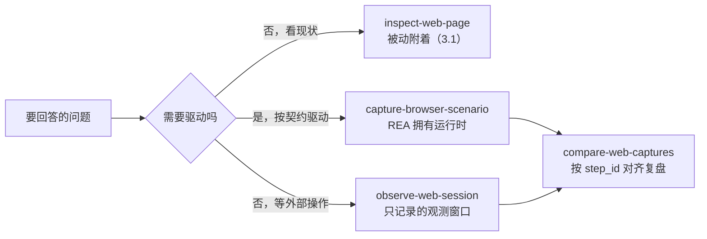

import { Meta } from '@storybook/addon-docs/blocks';

<Meta id="browser-scenario-capture" title="网站与浏览器/场景捕获" name="Docs" />

# 场景捕获

3.1 的被动观测附着到一个已经在运行的浏览器，看窗口里现在有什么；本课的场景捕获换一种在场方式：REA 经 Playwright provider **拥有并驱动运行时**，按一份声明式契约执行固定动作序列，产出「初始状态 + 每个动作一条记录」的时间线证据。主线判断一句话：**证据形态由谁拥有运行时决定**——附着只读得到现状快照；拥有才能驱动动作、留下逐步记录，并把同一段交互重放两次做归一化对比。`capture-browser-scenario` 面对浏览器，`capture-electron-scenario` 用同一套契约思想面对 Electron 应用，`observe-web-session` 为外部用户操作开一个只记录不驱动的观测窗口，`compare-web-captures` 把两次捕获按 `step_id` 对齐复盘。网络抓包文件归 3.3 网络抓包，源码定位与导出归 3.4，Electron 进程侧详解在 2.6；本课只讲场景捕获本身。



| 回查项 | 值 |
| --- | --- |
| 命令族 | `capture-browser-scenario`、`observe-web-session`、`compare-web-captures`；MCP 同源工具为对应下划线名（`capture_browser_scenario` 等） |
| 最小请求 | `browser`（launch/connect 二选一）+ `start_url` + 至少一个 `actions` 条目 |
| 默认捕获 | 仅最终 URL（`capture.at_end` 默认 `["url"]`），其余工件一律 `not_requested` |
| 动作词汇 | `goto`、`click`、`fill`、`press`、`select_option`、`check`、`uncheck`、`wait_for`、`wait_for_timeout` |
| 事件族 | `console`、`page-errors`、`network`、`websockets`、`frames`、`workers`、`popups`、`downloads` |
| launch 模式 | REA 拥有临时 profile，结束时关闭并删除；`headless` 默认 `true` |
| connect 模式 | 显式端口回环 CDP 端点 + `target_id`；断开不关闭外部浏览器；场景 attach 不收套接字端点 |
| 密钥 | `secret_id` + `environment_variable` 声明，值只放环境变量；凭据头一律脱敏 |
| 对比输入 | 两份捕获各自的 `normalized_result`（传文件路径）；仅按唯一 `step_id` 对齐 |
| 证据语义 | `changed` 证明已观测的归一化差异；缺失、截断、对齐失败一律 `unknown`，绝不当作 `unchanged` |
| 本课实测环境 | rea 6.7.0（npm latest）、macOS arm64、Chrome 155.0.8059.85（`--headless=new`） |

## 快速上手

准备一个三文件的本地小站：搜索按钮原地渲染结果，URL 不变——这正是官方契约文档用来解释「为什么默认捕获不够」的形态。把它放到任意目录（下文用 `/tmp/rea-scenario-demo`）：

```html
<!doctype html>
<html lang="en">
<head><meta charset="utf-8"><title>REA scenario demo</title><link rel="icon" href="data:,"></head>
<body>
  <h1>Notes search</h1>
  <input id="q" value="rea" />
  <button id="search">Search</button>
  <ul id="results" data-state="idle"></ul>
  <p id="settle" data-state="pending">waiting</p>
  <script src="/app.js"></script>
</body>
</html>
```

```js
const button = document.getElementById('search');
const results = document.getElementById('results');

button.addEventListener('click', () => {
  results.dataset.state = 'loading';
  fetch('/search.json?q=' + encodeURIComponent(document.getElementById('q').value), {
    headers: {
      'Authorization': 'Bearer demo-secret-token',
      'X-Demo-Note': 'plain-header'
    }
  })
    .then((r) => r.json())
    .then((data) => {
      console.log('search completed with', data.results.length, 'hits');
      results.innerHTML = '';
      for (const item of data.results) {
        const li = document.createElement('li');
        li.textContent = item;
        results.appendChild(li);
      }
      results.dataset.state = 'ready';
      setTimeout(() => {
        document.getElementById('settle').dataset.state = 'done';
      }, 300);
    })
    .catch((err) => {
      console.error('search failed', err);
      results.dataset.state = 'error';
    });
});
```

`search.json` 先放三条结果；`#settle` 标记在结果就绪后再等 300 毫秒才置为 `done`，它是给「复盘与对比」一节预留的确定性终点。起一个静态服务器，再写最小场景——`browser` 选 launch 模式并给出本机 Chrome 路径、`start_url`、至少一个动作：

```bash
cd /tmp/rea-scenario-demo && python3 -m http.server 3000
```

```json
{
  "browser": {
    "mode": "launch",
    "executable_path": "/Applications/Google Chrome.app/Contents/MacOS/Google Chrome"
  },
  "start_url": { "url": "http://127.0.0.1:3000" },
  "actions": [
    { "step_id": "settle", "action": "wait_for_timeout", "duration_ms": 100 }
  ]
}
```

```bash
rea capture-browser-scenario ./browser-scenario.json --json > url-capture.json
jq -c '.normalized_result.scenario' url-capture.json
```

实测输出（`scenario` 块同时回显了生效的选择与保留预算）：

```json
{"start_origin":"http://127.0.0.1:3000","action_count":1,"secret_references":[],"network_content":{"request_body":false,"response_body":false,"header_values":false},"event_families":[],"limits":{"max_events":10000,"max_event_allocation_bytes":4194304,"max_total_event_allocation_bytes":16777216,"max_network_transactions":1024,"max_network_body_bytes":65536,"max_network_body_allocation_bytes":1048576,"max_network_header_allocation_bytes":1048576,"max_network_metadata_allocation_bytes":1048576}}
```

`INPUT_JSON` 可以是内联 JSON 或文件路径；`--json` 输出完整 Evidence。结果结构是 `browser`、`scenario`、`steps`、`events`、`completeness`、`limitations` 六块。看时间线：

```bash
jq -c '.normalized_result.steps[] | {step_id, action, status, elapsed_ms}' url-capture.json
```

```json
{"step_id":"scenario_start","action":"goto_start","status":"completed","elapsed_ms":1801}
{"step_id":"settle","action":"wait_for_timeout","status":"completed","elapsed_ms":101}
```

时间线以 `scenario_start` 开头——那是 REA 打开页面（`before_url` 为 `about:blank`）的初始状态记录；此后每个声明动作各有一条记录。这条最小场景没有选任何工件，但结果却是：

```json
{"status":"complete","equality_eligible":true,"missing_sections":[],"truncated_sections":[]}
```

`completeness` 为 `complete`，而最终步的六个工件里只有 `url` 是 `captured`，其余全部 `not_requested`。这就是本课最重要的陷阱：**`complete` 只覆盖「请求过的节」，`not_requested` 表示「REA 没看」，不是「页面没有内容」**。一条只有 URL 的捕获可以是 `complete` 的，却回答不了「页面渲染了什么」。要回答渲染问题，补工件重跑，而不是从缺席里推断。

## 与被动观察的分界

官方 browser-observation 文档对 provider 权限的划分是本节的地基：CDP 页面捕获与 V8 Inspector 观测附着到已运行目标，不启动、不驱动、不求值；Playwright 场景则**拥有并驱动**运行时——要么 launch 一个 provider 自有的浏览器，要么 attach 调用方选定的外部浏览器。两个 provider 因权限与生命周期不同而分开，共用一套排除原因词表（`BrowserExclusionReason`）。

落到命令，浏览器阶段有三种「在场」方式：

| 命令 | 在场方式 | 回答的问题 |
| --- | --- | --- |
| `inspect-web-page`（3.1） | 被动附着，短窗口快照 | 页面现在有什么结构、脚本、资源 |
| `observe-web-session`（本课） | 被动附着，计时观测窗口 | 窗口期内发生了哪些导航级事件 |
| `capture-browser-scenario`（本课） | 拥有并驱动，逐步执行 | 这段交互怎么走、每步发生了什么 |

`observe_web_session` 为一次外部用户操作武装一个请求时长的观测窗口，按序记录 reload、SPA 导航、重定向、失败、生命周期与目标终止元数据——它只记录，从不驱动。场景捕获则在相反一端：动作是契约的一部分。最有意思的是两条线可以同时在同一个浏览器上工作。实测：带调试端口启动外部 Chrome，先开一个 8 秒观测窗口，再让 connect 模式的场景去驱动同一个目标：

```bash
rea observe-web-session http://127.0.0.1:9223 TARGET_ID --observation-ms 8000 --json > observe.json
# 窗口期内运行 connect 模式的搜索场景
```

```bash
jq -c '[.normalized_result.timeline[] | select(.type=="navigation_committed") | {sequence, type, url, loader_id}]' observe.json
```

```json
[{"sequence":7,"type":"navigation_committed","url":"http://127.0.0.1:3000/","loader_id":"8DA08798E428301C4EC4D9B734C9BF03"}]
```

时间线里这条 `navigation_committed` 带着新的 `loader_id`——它正是场景驱动的那次重新导航；窗口期两端的页面生命周期（commit、load、networkidle 等）也逐条按序记录。而场景里那次原地 `fetch` 和 console 输出**没有**出现在观测窗口中：observe 的记录停留在导航与生命周期层级，动作与事件属于场景捕获的表面。注意 `observe.json` 的 `completeness` 为 `attach_limited`——附着晚于页面活动的部分永远补不回来。

connect 模式本身也是一条边界。实测同一场景改用 connect（目标来自 3.1 的 `list-browser-targets`）：

```json
{ "browser": { "mode": "connect", "cdp_endpoint": "http://127.0.0.1:9223", "target_id": "TARGET_ID" } }
```

```bash
rea capture-browser-scenario ./browser-connect.json --json > connect-capture.json
jq -c '.normalized_result.browser' connect-capture.json
```

```json
{"mode":"connect","process_ownership":"external","cleanup":"disconnected-external"}
```

`cleanup` 是 `disconnected-external`：REA 只断开，不关闭外部浏览器（实测 Chrome 进程在场景结束后仍在）。代价有三条，都写进了这次捕获的 `limitations`：附着前的事件永远缺口（「CDP attachment cannot recover pre-attach events」）、断开页面会话可能清掉调用方设置的 `navigator.platform` 仿真、以及 connect 捕获的 `events` 永远进 `missing_sections`（下文「复盘与对比」展开）。证据效力还有一处单向差异要知道：场景捕获不提供请求的 initiator 栈，被动 CDP 观测保留自己的 initiator 证据——把请求归因到发起它的代码，归 3.3 与 3.4。

## 场景契约

契约是声明式的：固定动作词汇、显式 HTTP(S) 目标、确定性的浏览器设置、显式存储种子、provider 拥有的存活期限。动作、密钥、存储种子的数量没有上限；时长、动作、导航超时是固定的 provider 管辖期限，请求里没有调用方可调的 `limits` 对象——`capture.limits` 只管保留预算，改不了这些期限。导航跟随场景点名的目的地与页面自己的普通请求，没有单独的 origin 白名单，也没有请求拦截层。

### 动作与等待

九个动作覆盖交互所需：`goto`（带 `wait_until`：`commit`、`domcontentloaded`、`load`）、`click`（可选 `button`、`click_count`）、`fill`、`press`、`select_option`、`check`、`uncheck`、`wait_for`、`wait_for_timeout`。定位器有三种 `kind`：`css`、`test_id`、`role`（`role` 配 `name`，覆盖 button、textbox、link 等 14 个角色）。每个动作可带 `timeout_ms`；省略表示等到完成为止（或等到请求取消）。

关键语义是 `timeout_ms` 只覆盖动作本身。点击的 `timeout_ms` 到期不代表页面就绪：不换页的 `fetch` 或延迟渲染可能更晚完成，所以用 `wait_for` 等一个**页面自己的就绪标记**再取最终捕获。REA 不会从捕获选择里推断应用就绪。实测搜索场景——点击后等 `#results` 的 `data-state` 变为 `ready`，再等预留的 `#settle` 标记：

```json
{
  "browser": { "mode": "launch", "executable_path": "/Applications/Google Chrome.app/Contents/MacOS/Google Chrome" },
  "start_url": { "url": "http://127.0.0.1:3000" },
  "actions": [
    { "step_id": "search", "action": "click", "locator": { "kind": "css", "selector": "#search" }, "timeout_ms": 10000 },
    { "step_id": "results-ready", "action": "wait_for", "locator": { "kind": "css", "selector": "#results[data-state='ready']" }, "state": "visible", "timeout_ms": 10000 },
    { "step_id": "settled", "action": "wait_for", "locator": { "kind": "css", "selector": "#settle[data-state='done']" }, "state": "visible", "timeout_ms": 10000 }
  ],
  "capture": { "at_end": ["dom", "accessibility", "url"] }
}
```

```bash
rea capture-browser-scenario ./browser-search.json --json > search-capture.json
jq -r '.normalized_result.steps[-1].artifacts.accessibility.value.text' search-capture.json
```

实测输出——可访问性树是读「页面渲染了什么」最紧凑的方式：

```text
- document:
  - heading "Notes search" [level=1]
  - textbox: rea
  - button "Search"
  - list:
    - listitem: capture-browser-scenario
    - listitem: observe-web-session
    - listitem: compare-web-captures
  - paragraph: waiting
```

URL 没变，三条结果已经在树里——这就是「点击成功、URL 不变、内容已变」的标准证据链。`wait_for` 的 `state` 支持 `attached`、`detached`、`visible`、`hidden`；页面同步更新的场景可以省掉等待步。

### 两种浏览器模式

| 回查项 | launch | connect |
| --- | --- | --- |
| 输入 | `executable_path`（绝对路径）+ `headless`（默认 `true`） | `cdp_endpoint`（显式端口回环 HTTP）+ `target_id` |
| 运行时归属 | provider-owned 临时 profile | external，调用方自己的浏览器 |
| 清理 | 关闭并删除 profile；只断开外部浏览器，实测 Chrome 进程仍在 | 断开；不关闭 |
| 语言环境 | `environment.locale` 同时设置 Intl、`navigator.language(s)` 与 `Accept-Language` | 只设 Intl；页面与请求语言保持调用方现状，捕获标注此局限 |
| 事件完整性 | 从自有 context 导航前开始观测 | 附着前事件永远缺口；共享上下文里只保留根页面与发现弹窗帧的网络事件 |
| `equality_eligible` | 可为 `true` | 恒为 `false`（`events` 恒进 `missing_sections`，实测） |

`start_url` 与导航目的地必须是 HTTP(S)，查询值与片段可以直接写在 URL 里；需要引用已声明密钥的值改用有序的结构化 query 条目。原始 URL userinfo 凭据直接拒绝。场景 attach 只收 HTTP 发现端点，不收浏览器套接字（六条被动表面才收套接字，见 3.1）。环境默认值是确定性的：viewport 1280x720、locale en-US、时区 UTC、浅色、减少动效、service worker **默认阻止**（应用需要时设 `environment.service_workers` 为 `allow`；attach 模式下 `block` 会在目标页面受 service worker 控制时直接拒绝捕获）。

### 存储种子与密钥

`storage` 三类种子的播种时机不同：cookies 在初始导航前安装；local storage 每个浏览器存储分区播种一次；session storage 每个顶层浏览上下文里每个 origin 播种一次。播种发生在该区域第一个文档脚本之前；后到的 origin 在首次访问时拿到种子。应用随后的写入、删除、清空在后续导航中持续生效；新场景各用各的种子，互不继承。cookies 的作用域是每次捕获时的页面 URL。分区化的 frame 可以拿到同 origin 但独立的 local storage 种子。播种预脚本经 CDP 调试器插桩实现，观察者只恢复栈顶属于自己私有种子脚本的暂停；页面断点与 `debugger` 语句仍归附着中的调试客户端控制。

密钥用声明代替硬编码：`secrets` 里每条是 `secret_id` + `environment_variable`，真实值只存在于环境变量中。声明的 UTF-8 密钥值及其标准 URI/form、JSON 转义形态会从观测内容中替换掉，其他编码不做解释；动作、URL、存储值里的每个密钥引用都必须有声明。也可以只为脱敏而声明一个密钥——不引用、只用来遮蔽匹配到的观测内容。凭据头（`Authorization`、`Proxy-Authorization`、`Cookie`、`Set-Cookie`）的值一律不保留。持久化结果里已解析的密钥值会被替换回密钥引用，所以结果文件可以安全留存。

### 校验与固定期限

不支持的动作标签、未知字段、重复 `step_id`、未声明的密钥引用都会在验证期失败。实测把两个动作都改名成 `search`：

```bash
rea capture-browser-scenario ./dup.json --json; echo "exit=$?"
```

```json
{"code":"invalid_request","category":"invalid_input","retryable":true,"message":"Analysis input is invalid. Check the arguments and try again."}
```

退出码 1，`details.issues` 逐条给出位置与原因（`"path":["actions"]`、`"Action step IDs must be unique"`）。按 1.3 的退出码契约：0 表示完成（可能带部分证据或警告），1 表示未能完成，128+N 是信号导出状态；`capture-browser-scenario` 与 `capture-electron-scenario` 都走 CLI 的共享取消处理——SIGINT 落 `130`、SIGTERM 落 `143`，操作落定后退出，结构化 `cancelled` 结果可能先于状态码打印。

## 捕获内容

工件按问题选，共六种：`screenshot`（视觉布局或画布这类不出文本的内容）、`dom` 与 `accessibility`（渲染出的文本与结构，后者通常更紧凑）、`url`（最终落点）、`history` 与 `storage`（导航历史、cookies 与 web 存储——它们**从不**被隐式捕获）。`at_end` 取收尾状态，`after_each_step` 取多步场景中每步之间的中间状态。事件族按需选：`console`、`page-errors`、`network`、`websockets`、`frames`、`workers`、`popups`、`downloads`——只要「页面是怎么走到这个结果的」，就挑对应族。

保留预算写进结果的 `scenario.limits`（见快速上手的实测输出）：默认 10,000 条事件、单事件 4 MiB 估算分配、留存事件共 16 MiB、1,024 条网络事务、每事务阶段 64 KiB 请求体字节、请求体脱敏与 base64、留存头值、网络元数据各 1 MiB。每个默认值都可以在 `capture.limits` 里上调或下调（必须是正整数）。被省略的事件按 `events.omissions.by_kind` 计数并说明原因，受影响的事务 ID 列在 `network_transactions` 行，超限的连续事务段由 `network_transaction_range` 标出。

### 网络证据

`capture.events` 里选 `network` 会保留请求、响应、完成、失败与未完成请求的元数据；内容另用三个独立开关选——`capture.network.request_body`、`response_body`、`header_values`，全部默认 `false`。选中任意内容会自动启用网络元数据观测，此时 `events` 里再列 `network` 就是可选的。实测给搜索场景加上：

```json
"capture": {
  "at_end": ["dom", "accessibility", "url"],
  "events": ["network", "console"],
  "network": { "response_body": true, "header_values": true }
}
```

把上面的捕获块存成 `browser-net.json` 跑一遍（动作与「动作与等待」的场景相同），输出存为 `net-capture.json`。每个请求对象拿到捕获范围内唯一的 `transaction_id`，共享同一 URL 的请求各算各的；重定向只在**前驱被观测到**时才以 `redirected_from_transaction_id` 链接，`redirected_from_transaction_state` 为 `root` 表示 Playwright 没观测到前驱、为 `unknown` 表示前驱存在但在捕获之外——null 前驱不证明没有上一跳。请求事件只保留头名列表，值在内容事件里：

```bash
jq -c '[.normalized_result.events.items[] | select(.kind=="network-content" and .phase=="request") | .headers.items[] | select(.name=="Authorization" or .name=="X-Demo-Note")]' net-capture.json
```

```json
[{"name":"Authorization","value":null,"redacted":true},{"name":"X-Demo-Note","value":"plain-header","redacted":false}]
```

普通头原样保留（含顺序与重复），凭据头置 null 并标 `redacted: true`。选中的响应体保留 base64 字节、字节数、媒体类型与 SHA-256——摘要描述的是**脱敏之后**的留存字节：

```json
[{"state":"captured","bytes":91,"sha256":"822a8b447d90ee205a2251dfe66daa64b7b41ee08427ee47e1f47994e4e3e43f","media_type":"application/json"}]
```

三条边界要记住。第一，请求体字节是 Playwright 暴露多少算多少，`not_exposed` 不证明请求体不存在、也不保证覆盖 multipart 文件；响应体字节来自 Playwright 的 `Response.body()`，必要时它可能用一次带凭据的重新加载来满足调用，所以字节与原始事务的对应关系不设保证，且这不是压缩的线上表示。第二，最终步结束时观测即停：在途请求发 `request-unfinished` 事件，已开始的读取各自有 5 秒期限排空——那是单次读取期限，不是总捕获截止；也不等待长连接。第三，场景捕获不提供 initiator 栈。

## 时间线

结果的骨架是「初始状态 + 每动作一条记录」。每步报告动作状态、耗时、净化前后 URL、事件序号边界、六工件各自独立的类型化状态，以及逐级 completeness。事件归属步用的是**接收顺序**：Evidence 明文写着「event sequence records provider receipt order; simultaneous browser causality is not inferred」——步是接收窗口，不是因果断言。这条边界有实测形态：同一场景两次重跑，页面事件内容完全一致，但 console 事件落在 `search` 步还是 `results-ready` 步可以在步边界上漂移（事件在边界瞬间到达时，两次运行归给不同的步）。内容事件同样可能晚到：请求在第一步发出，它的响应体内容事件可以记在后续步或收尾排空期，`source_event_sequence` 指回事务所处阶段的原始事件，对比时按「发出请求的那一步」归组。

捕获级 completeness 汇总各步的缺失与截断，外加两条固定规则：connect 模式一律把 `events` 计入缺失；任何事件局限（弹窗早期事件缺口、预算截断、内容不可用等）也把 `events` 计入缺失。一旦 `equality_eligible` 为 `false`，这次捕获就只能用来证明「变了」，不能担保「没变」。

## 复盘与对比

场景捕获的确定性来自契约本身：空存储加显式种子、确定性的环境默认值、固定动作词汇、provider 拥有的期限。它刻意不做的也有两条：不等待后台工作收尾（completeness 不为后台行为背书），不从捕获选择推断就绪。复盘因此是「重放同一契约，对比归一化结果」，而不是「相信两次运行逐字节相同」。

`compare-web-captures` 接受两份浏览器场景捕获，CLI 传**各自 `normalized_result`** 的文件路径（用文件而不是内联——捕获里可能嵌着截图字节）：

把 `browser-net.json` 的 `network` 收窄到只选 `response_body`（为什么不开 `header_values`，见本节末尾的坑），存成对比用场景，连跑两次存为 `net-a.json`、`net-b.json`：

```bash
jq -c '.normalized_result' net-a.json > net-a.norm.json
jq -c '.normalized_result' net-b.json > net-b.norm.json
rea compare-web-captures ./net-a.norm.json ./net-b.norm.json --json > cmp.json
```

实测把整份 Evidence 信封直接传进去会被 `invalid_request` 拒绝并列出 `before_scenario.*` 缺失——CLI 要的就是 `normalized_result` 那一层。对齐只认唯一且完全一致的 `step_id`：重复 ID、缺失对侧、动作种类变更、浏览器与 origin 上下文不兼容都作为对齐失败返回。实测拿一条动作的场景对比三条动作的场景：

```json
{"status":"partial","aligned_steps":1,"before_only":["settle"],"after_only":["results-ready","search","settled"],"failures":[{"code":"missing_before_step","step_id":"results-ready","reason":"Step results-ready is missing from the before capture."},{"code":"missing_before_step","step_id":"search","reason":"Step search is missing from the before capture."},{"code":"missing_before_step","step_id":"settled","reason":"Step settled is missing from the before capture."},{"code":"missing_after_step","step_id":"settle","reason":"Step settle is missing from the after capture."}]}
```

对齐失败阻止 `unchanged` 判定，但已观测到的差异仍然可以证明 `changed`。两个真正同契约的捕获对齐后，每步逐工件给出 `changed`、`unchanged` 或 `unknown`，变化项带归一化前后的 SHA-256 与捕获状态。归一化是显式承诺：结果里记录全部内置规则与整体 SHA-256 摘要。实测同场景连跑两次（完全相同的 fixture 与 JSON）：

```json
{"overall_status":"unchanged"}
```

```json
{"built_in_rules":["ignore_step_elapsed_ms","ignore_event_sequence","ignore_event_step_index","compare_screenshot_content_digest","compare_normalized_text_content","ignore_capture_local_network_transaction_ids","attribute_network_transactions_to_request_step","compare_network_transactions_as_unordered_collection","preserve_redirect_transaction_ancestry"],"rules":[],"sha256":"6b49eb312721e1deafe764cc456357438ba74d65121f55811e514e09e76d74ed"}
```

九条内置规则各管一件事：忽略步耗时与事件序号/步下标这类易变字段、截图按内容摘要比、DOM 与可访问性按归一化文本比、去掉捕获本地事务 ID、把网络事务归到发出请求的步、作为无序集合比较、重定向保留完整前驱链指纹。可选的调用方规则是有界的**精确字面替换**，作用域限定在点名的工件种类上，排序规范化后保存进结果，只作用于已脱敏的持久字段。

把 `search.json` 加一条结果再重跑，`changed` 的形态是逐工件、可归因的：

```json
[{"step_id":"scenario_start","status":"unchanged","artifacts":[]},{"step_id":"search","status":"changed","artifacts":[{"artifact":"events","status":"changed"}]},{"step_id":"results-ready","status":"changed","artifacts":[{"artifact":"events","status":"changed"}]},{"step_id":"settled","status":"changed","artifacts":[{"artifact":"dom","status":"changed"},{"artifact":"accessibility","status":"changed"}]}]
```

响应体的差异归到发出请求的 `search` 步，console 文本的差异（3 hits 变 4 hits）落在 `results-ready` 步，最终 DOM 与可访问性文本的差异在 `settled` 步——一条差异链完整对应到交互过程。三个实测踩过的坑决定对比能不能给出 `unchanged`：

- **`request_body: true` 配纯 GET 场景。** GET 请求没有请求体，每个请求体内容都是 `not_exposed`，按契约「未暴露的读取使所选事件覆盖不完整」——捕获级 completeness 变 `incomplete`、`missing_sections` 只有 `events`、`equality_eligible` 为 `false`，对比只能给出 `unknown`（`Artifact coverage is not comparable`）。POST 表单场景才值得开 `request_body`。
- **`header_values: true` 遇上易变头。** 实测 Python 静态服务器的 `Date` 响应头每次运行都不同（秒级变化），`Last-Modified` 则稳定——开着头值捕获，两次完全相同的重跑会因 `Date` 报 `changed`。字面替换规则救不了逐秒变化的值；做对比时别选 `header_values`。
- **步边界抖动。** console 这类普通事件按接收步归组，紧贴步边界的事件两次运行可能归给不同的步、导致整步事件摘要变掉。给场景尾部放一个确定的等待（本课 fixture 的 `#settle` 标记就是干这个的），把事件窗关进同一个步里。

两侧的 `scenario.event_families` 或 `scenario.network_content` 选择不一致时，对应证据一律 `unknown` 并附恢复指引——「多捕了数据」本身不构成网站变化的证明。

## Electron 场景

`capture-electron-scenario` 与浏览器版共享同一契约思想：声明式请求、REA 经 Playwright 拥有并驱动运行时、动作序列、时间线证据。差异集中在四点。输入换成 `executable_path` + `application_path`（应用根默认取入口父目录）加参数与动作。动作集不同：click 与 wait 之外，还有窗口级 renderer reload 与 crash、合成 `open-url` / `second-instance` 深链投递。记录面换成 Electron 形态：窗口与 WebContents 身份、进程指标、IPC 通道与值形状元数据——payload 值一律不保留；时间线覆盖 app/window/会话/导航/shell/权限/弹窗/下载/protocol/进程/IPC 事件族。门槛不同：主动捕获要求目标可执行文件理睬 Node CLI inspector 参数，`EnableNodeCliInspectArguments` fuse 被禁用或移除时在启动进程之前就以 `AnalysisUnsupportedTargetError`（`unsupported_target`）失败。进程所有权、60 秒启动期限、阻断与取消语义、fuse 排查的完整展开在 2.6；主动 Evidence 交给 `reconcile-javascript-runtime` 做目标级对账的桥在 2.4。

## 最佳实践

- **按问题选工件，警惕 `complete` 的 URL-only 捕获。** 默认捕获只有最终 URL；「渲染了什么」要 `dom` 或 `accessibility`，「长什么样」要 `screenshot`，「写了什么状态」才要 `history` 或 `storage`。`not_requested` 是「没看」，不是「没有」。
- **等页面自己的就绪标记。** `click` 的 `timeout_ms` 只管点击本身；用 `wait_for` 等 `data-state` 这类应用自报的就绪条件，再取最终捕获。REA 不会替你推断就绪。
- **对比前先固定选择。** 两侧 `events` 事件族与 `network` 内容选择一致才可比；`header_values` 会把 `Date` 这类易变头带进摘要、`request_body` 配 GET 会直接失去等价资格——省着选。
- **给场景一个确定性终点。** 尾部放一个由页面自报的等待目标（本课的 `#settle`），把尾部事件关进同一步，`unchanged` 才稳定可达。
- **launch 起步，connect 只在必要时用。** connect 保留外部浏览器的真实状态，但事件永远带 pre-attach 缺口、等价资格恒为 `false`，还可能扰动外部客户端的平台仿真——unchanged 复盘用 launch，changed 验证才用 connect。
- **密钥走声明。** 值只放环境变量，声明即可自动脱敏观测内容，持久化结果里只剩引用——证据文件可以安全留存与流转。

## 常见问题

- `compare-web-captures` 传整份 Evidence 报 `invalid_request`、列出 `before_scenario.*` 缺失？
  CLI 的两个位置参数要的是各捕获的 `normalized_result` 层。用 `jq -c '.normalized_result' 捕获.json > 捕获.norm.json` 落成文件再传；两份都必须是完整场景捕获（含对齐所需的全部嵌套字段）。
- 完全相同的重跑却报 `changed`？
  按三个来源排查：易变响应头（`header_values` 开着时 `Date` 每秒都变）、步边界事件漂移（尾部加确定等待）、fixture 自身的时间戳或随机数。比对结果里的逐工件 SHA-256 会指出差异落在哪个工件。
- 捕获 `incomplete`、`missing_sections` 只有 `events`？
  查 `network` 内容选择与请求形态是否匹配：`request_body: true` 配纯 GET 场景时每个请求体都 `not_exposed`，事件覆盖按契约记为不完整。改选 `response_body` 或把 `request_body` 留给 POST 场景。
- connect 模式捕获的 `equality_eligible` 恒为 `false`？
  设计如此：附着前的事件永远缺口，`events` 恒进 `missing_sections`。connect 捕获适合做 `changed` 验证；`unchanged` 复盘用 launch 模式。
- `click` 状态 `completed`，捕获里却看不出交互效果？
  多半是默认 URL-only 捕获遇上了原地渲染：点击成功、URL 不变、工件没选。补 `dom` 或 `accessibility` 重跑；渲染晚于点击的再补 `wait_for` 就绪标记。
- 校验失败 `invalid_request`，不知道哪里错了？
  读 `details.issues`：逐条给出 `path` 与 `message`，常见于重复 `step_id`、未知字段、未声明的密钥引用、不支持的 URL（如 userinfo 凭据）。
- Ctrl-C 之后退出码是 `130`？
  `capture-browser-scenario` 与 `capture-electron-scenario` 走共享取消处理：SIGINT 落 `130`、SIGTERM 落 `143`，操作落定后退出；结构化 `cancelled` 结果可能先打印，把它和进程状态当两个信号读。

## 总结回顾

摘要：

场景捕获是浏览器阶段与被动观测并列的另一条 provider 线：REA 经 Playwright 拥有并驱动运行时，按声明式契约（browser 启动/连接选择、`start_url`、固定词汇的动作序列、确定性环境、显式存储种子与密钥声明）执行交互，产出「初始状态 + 每动作一条记录」的时间线证据。工件与事件族按需选择，默认只有最终 URL，`not_requested` 表示没看而非没有；`completeness` 只为已请求的节背书。网络证据以捕获内唯一的 `transaction_id` 组织，凭据头脱敏、选中内容留 base64 字节与 SHA-256，最终步截止时的在途请求记 `request-unfinished`。复盘靠 `compare-web-captures`：仅按唯一 `step_id` 对齐，九条内置归一化规则加可选字面替换规则构成显式承诺（带摘要），`changed` 可证、缺失与截断一律 `unknown`——`unchanged` 需要对齐成功、双侧完整且选择一致。`observe-web-session` 补上「外部操作窗口」这一格：只记录导航级元数据，从不驱动。Electron 侧的 `capture-electron-scenario` 共享契约思想，输入、动作集、记录面与 fuse 门槛不同，详解在 2.6。

一句话：

> 谁拥有运行时，证据就长什么样：附着只读到现状快照，拥有才驱动出逐步时间线；而「没变」的结论永远比对齐、归一化和双侧完整负责——缺一格就只配说 `unknown`。

知识要点：

- 三种在场方式（被动快照、观测窗口、场景驱动）分别回答什么问题？`observe-web-session` 看得见场景驱动的哪一层、看不见哪一层？
- 最小契约包含哪三部分？默认捕获是什么、为什么 `complete` 的 URL-only 捕获回答不了渲染问题？
- launch 与 connect 在运行时归属、清理、语言环境与 `equality_eligible` 上差在哪？
- `timeout_ms` 只覆盖什么？为什么就绪要等 `wait_for` 的页面自报标记？
- 网络证据里 `transaction_id`、`redirected_from_transaction_state`、`not_exposed`、`request-unfinished` 各自怎么读？
- 对比在什么条件下能给 `unchanged`？三个实测坑（GET 配 `request_body`、易变头、步边界漂移）分别怎么避开？

## 参考资料

- [Browser scenario contract（docs/browser-scenario-contract.md）](https://github.com/morluto/rea/blob/main/docs/browser-scenario-contract.md)
  本课一手来源：契约结构、最小与交互示例、工件与事件族选择、存储种子与密钥、网络证据、保留预算、场景对比与清理边界。
- [Website observation with CDP（docs/browser-observation.md）](https://github.com/morluto/rea/blob/main/docs/browser-observation.md)
  provider 权限划分（attach 与 Playwright 场景）、`observe_web_session` 与 `compare_web_captures` 表面定义、场景 attach 需 HTTP 发现、无 HTTP 发现浏览器的边界。
- [MCP contracts（docs/mcp-contracts.md）](https://github.com/morluto/rea/blob/main/docs/mcp-contracts.md)
  `compare_web_captures` 的两种输入形状（passive 与 scenario）与嵌套校验规则。
- [Electron file-page observation（docs/electron-observation.md）](https://github.com/morluto/rea/blob/main/docs/electron-observation.md)
  主动 Electron 场景的输入、动作集、时间线记录面、fuse 前置条件与对账投影。
- [CLI and Evidence（docs/cli.md）](https://github.com/morluto/rea/blob/main/docs/cli.md)
  退出码契约与 `capture-browser-scenario`、`capture-electron-scenario` 的共享取消处理（SIGINT 130、SIGTERM 143）。
