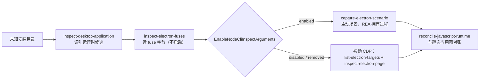

import { Meta } from '@storybook/addon-docs/blocks';

<Meta id="electron-observation" title="JavaScript 与 Electron/Electron 观测与 Fuses" name="Docs" />

# Electron 观测与 Fuses

打包成桌面应用的 Electron 程序把代码装进 `app.asar`，把一批行为开关编进二进制本身。本课讲 REA 针对这类目标的四个命令：`inspect-desktop-application` 从安装目录识别运行时候选；`inspect-electron-fuses` 读二进制里的 fuse 字节，不启动应用；`inspect-electron-page` 对已在运行的 CDP 端点做只读页面观测；`capture-electron-scenario` 由 REA 启动并拥有应用，跑一次主动场景捕获。主线判断一句话：**先读 fuse 字节，再选观测路线**——`EnableNodeCliInspectArguments` 一项就决定打包应用是否理睬 `--inspect`，也决定主动捕获能不能启动。静态分析目录与 ASAR 归静态分析一课，V8 Inspector 三角色观测归运行时观测一课，观测与静态图的对账归运行时对账一课，从 ASAR 恢复源码归源码恢复与重建一课，普通网页观测归阶段 3 的浏览器观测；本课只讲 Electron 专属的部分并给入口。



| 回查项 | 值 |
| --- | --- |
| 命令族 | `inspect-electron-fuses`、`list-electron-targets`、`inspect-electron-page`、`capture-electron-scenario`；MCP 同源工具为对应下划线名 |
| 识别运行时 | `rea inspect-desktop-application /artifacts/MyApplication --json` |
| 读 fuses | `rea inspect-electron-fuses /Applications/Example.app --json`；不启动应用、不改字节、不用网络 |
| fuse 字节 | `0x30` disabled、`0x31` enabled、`0x72` removed、其他字节 unknown |
| 观测窗口 | `--observation-ms`，默认 `100` |
| 脚本源码 | 默认排除；`--include-script-sources` 收录，预算 32 MiB UTF-8、20 秒共享收集期限 |
| 主动捕获输入 | JSON 文件：`executable_path`、`application_path`，外加参数与 actions |
| 主动捕获门槛 | fuse 禁用或移除时，启动前即以 `unsupported_target` 失败 |
| 进程边界 | 被动观测不执行代码、不导航、不终止目标；主动捕获由 REA 拥有进程并清理，且不是沙箱 |
| 本课实测环境 | rea 6.7.0（npm latest）、macOS arm64、Electron 44.9.1 |

## 快速上手

随手拿一个打包好的 Electron 应用就能读 fuse——这条命令不启动目标，读的是二进制里的字节。以 Discord 为例：

```bash
rea inspect-electron-fuses /Applications/Discord.app --json > discord.json
jq -c '.normalized_result.artifact' discord.json
```

```json
{"selected_path":"/Applications/Discord.app","resolved_path":"/Applications/Discord.app/Contents/Frameworks/Electron Framework.framework/Versions/A/Electron Framework","sha256":"fa2c1aae9baae561acc20629d68f86c298da88d8b9ac8609694c5061922321e5","bytes":343520432,"format":"mach-o-universal"}
```

应用包解析到框架二进制，universal 双架构，SHA-256 锁定被读的字节。用 jq 把 fuse 表转成可读形式：

```bash
jq -r '.normalized_result.slices[0].sentinels[0].fuses[] | [.index, .name, .state, .raw_byte] | @tsv' discord.json
```

```text
0	RunAsNode	disabled	48
1	EnableCookieEncryption	disabled	48
2	EnableNodeOptionsEnvironmentVariable	enabled	49
3	EnableNodeCliInspectArguments	disabled	48
4	EnableEmbeddedAsarIntegrityValidation	disabled	48
5	OnlyLoadAppFromAsar	disabled	48
6	LoadBrowserProcessSpecificV8Snapshot	disabled	48
7	GrantFileProtocolExtraPrivileges	enabled	49
```

`raw_byte` 的 `48`、`49` 就是十六进制 `0x30`、`0x31`。关键一行是下标 3：`EnableNodeCliInspectArguments` 被禁用——这个二进制会忽略 `--inspect` 与 `--inspect-brk`，主动场景捕获对它会在启动前直接拒绝。结果里的运行时推导已经写明：

```bash
jq -c '.normalized_result.runtime_implications[0]' discord.json
```

```json
{"relationship":"derivation","slice_index":0,"sentinel_offset":159936192,"subject":"node_cli_inspect_arguments","fuse_index":3,"outcome":"not_honored"}
```

每条推导都标着 `relationship: "derivation"`、来自哪个 fuse 下标、落到哪个运行时后果。一条命令读完，观测路线已经确定：这个包要动态观测，得走被动 CDP。

## 识别 Electron 应用

拿到一个安装目录而不知道它是什么运行时时，入口是 `inspect_desktop_application`：读目录条目、选中的头部与有界元数据，报告运行时候选、支持文件、组件路径标记和具体的后续操作建议。它不需要原生分析引擎，也不运行应用、不解包归档、不跟随子符号链接、不联网、不改目标文件。

```bash
rea inspect-desktop-application /artifacts/MyApplication \
  --detail summary --evidence_output /reports/application.evidence.json --json
```

形态要点：

- CLI 一次性调用默认返回完整 Evidence；`--detail summary` 返回摘要 Evidence 和发布回执，此时必须给 `--evidence_output`（先检查后分析），已有输出文件永不覆盖。
- MCP 同源工具默认 `detail: "summary"`：完整 Evidence 留在会话里（`normalized_result.parent_evidence_id` 指向它），返回的候选带代表性路径、计数、覆盖面、局限和分组 next probes；没有 Evidence 保留能力的服务器在读目标前就拒绝 summary，改选 `detail: "complete"` 内联取回。
- 结果按集合组织：`files`、`omissions`、`candidates`、`components`、`next_probes`，都支持 `fields`、`offset`、`limit` 分页。
- 默认上限 20,000 个检查条目、8 MiB 探测读取总量；可调到 100,000 与 64 MiB。上限与失败的探测都会造成部分覆盖。

Electron 在候选家族里的判定证据只有一条路径约定：存在 `resources/app.asar` 或 `resources/default_app.asar`，且归档有效性不做验证。候选是推导或推断，**不证明**应用真的加载或执行过。识别只回答"可能是什么"，下一节的 fuse 读取才落到字节。

版本提示：官方文档已发布该命令；实测 rea 6.7.0 的 CLI 命令清单中还没有它（`inspect-electron-fuses` 在 6.4.0 也缺席、6.7.0 提供）。升级到新版本后可用；在那之前，可以用 fuse 读取甄别——非 Electron 包会直接报 `Electron Framework binary was not found`（实测见常见问题）。

## Fuses

fuse 是编进 Electron 二进制的一段带版本号的配置字节（fuse wire）。`inspect-electron-fuses` 在二进制里搜索 sentinel 签名，读出 `wire_version`、声明的 fuse 数量与逐个字节的状态，推导出四个运行时问题的答案：这个包会不会理睬 `--inspect` 与 `--inspect-brk`、`ELECTRON_RUN_AS_NODE`，会不会强制内嵌 ASAR 完整性校验，是否只从 `app.asar` 加载应用代码。它是纯静态字节读取：不启动应用、不改 fuse 字节、不用网络。

### 读取对象与路径

- macOS 传 `.app` 包或 Electron Framework 二进制，解析顺序为：顶层 `Electron Framework` → `Versions/Current/Electron Framework` → `Versions/A/Electron Framework`；符号链接只在框架目录内部跟随。快速上手实测的 `resolved_path` 就落在 `Versions/A/...`。
- Windows 与 Linux 传主执行文件；wire 存在可执行文件里，不在 `app.asar`。
- CLI 相对路径按调用方工作目录解析；MCP 必须绝对路径。POSIX 上路径逐组件解析，符号链接先于父目录（`..`）步骤跟随；包选择可以以 `.` 结尾或穿过真实目录做父步骤，以目录符号链接结尾的父步骤被拒绝。Windows 保留原生盘符与分隔符解析。
- 结果由四块组成：`artifact`（选中路径、解析后的常规文件、SHA-256、字节大小、容器格式 `mach-o`、`mach-o-universal`、`pe` 或 `elf`）；`slices`（thin 单片，universal 每架构一片，各带 `file_offset`、`size`、`architecture`）；`sentinels`（`sentinel_offset` 为文件绝对偏移，内含 `wire_version`、`declared_length` 与有序 fuse 表）；`runtime_implications` 与 `limitations`。
- 容量：只收最大 1 GiB 的常规文件，以 256 KiB 窗口搜索，每片最多保留 32 个 sentinel；官方文档给出九项 fuse 单片结果约 1200 个 CLI token、双片约 1300 的量级。不产生临时文件。

### 九个 fuse 各管什么

wire version 1 的名字按下标排列。REA 只对四项给出运行时推导；其余各项只报告名字与状态，用途按 Electron 官方 fuse 语义理解，本课不替文档补含义：

| 下标 | 名称 | REA 的运行时推导 |
| --- | --- | --- |
| 0 | RunAsNode | disabled 或 removed → `ELECTRON_RUN_AS_NODE` 不被理睬（`not_honored`）；enabled → honored |
| 1 | EnableCookieEncryption | 无专属推导，只报状态 |
| 2 | EnableNodeOptionsEnvironmentVariable | 无专属推导，只报状态 |
| 3 | EnableNodeCliInspectArguments | disabled 或 removed → Electron 忽略 `--inspect` 与 `--inspect-brk`（`not_honored`）；enabled → honored |
| 4 | EnableEmbeddedAsarIntegrityValidation | disabled 或 removed → 不强制校验（`not_enforced`）；enabled → 强制（`enforced`）。Electron 只在 macOS 与 Windows 编译该校验；Linux ELF 保留读到的字节，强制结果为 unknown |
| 5 | OnlyLoadAppFromAsar | disabled 或 removed → 应用代码不限制到 `app.asar`（`not_restricted_to_app_asar`） |
| 6 | LoadBrowserProcessSpecificV8Snapshot | 无专属推导，只报状态 |
| 7 | GrantFileProtocolExtraPrivileges | 无专属推导，只报状态 |
| 8 | WasmTrapHandlers | 无专属推导，只报状态 |

下标超过这张表、或出现在其他 wire 版本上时，保留 `name: null` 加原始字节。wire 自己声明的数量 `declared_length` 可以小于九：实测 Discord 的 wire 声明 8 项（WasmTrapHandlers 缺席），KeeWeb 只声明 1 项（只有 RunAsNode），Cursor 声明满 9 项。每条推导都标 `relationship: "derivation"` 并绑定来源 fuse 下标；universal 二进制每一片各推一遍。

### 字节与状态判断

- wire 字节只有三种合法值：`0x30` disabled、`0x31` enabled、`0x72` removed；其他字节报 unknown。`raw_byte` 字段按十进制输出（实测 48、49）。
- **removed 不是 enabled**：被移除的 fuse 按禁用对待——Inspector 参数与 `ELECTRON_RUN_AS_NODE` 不被理睬，应用代码也不被限制到 `app.asar`。
- 找不到 sentinel 时 fuse 状态是 unknown，**不等于全部禁用**。wire 越过切片边界时报告 truncated，只报告存在的字节。一片里有两个以上 sentinel 时全部报告，REA 不替你挑一个。
- fuse 字节不证明应用没有用别的方式开调试：`app.commandLine` 或应用代码里的 remote-debugging 开关都不写在字节里。

## Fuses 与观测门槛

fuse 状态直接改写两条观测路线的可达性：

- **V8 Inspector 路线（运行时观测一课）**：`observe-javascript-runtime --runtime-kind electron-main` 面对的门槛是——`EnableNodeCliInspectArguments` 被禁用或移除时，Electron 直接忽略 Inspector 参数，目标列表里可能干脆没有 main 进程目标。缺席本身不能反推 fuse：先跑 `inspect-electron-fuses` 看字节，再排查启动参数与端口。
- **主动场景捕获路线**：`capture-electron-scenario` 要求目标可执行文件理睬 Node CLI inspector 参数（`--inspect` 或 `--remote-debugging-port`），Playwright 才能建立 DevTools 协议会话。fuse 被禁用或移除时，命令在启动进程之前就以 `AnalysisUnsupportedTargetError`（错误码 `unsupported_target`）失败，不会等满 60 秒启动期限。实测对 Discord 二进制发起捕获（保留关键字段的投影）：

```bash
rea capture-electron-scenario discord-scenario.json --json
```

```json
{"code":"unsupported_target","category":"unsupported_target","retryable":false,"remediation":{"action":"Use passive CDP observation tools (inspect_electron_page), or launch active capture against an Electron development build or a stock Electron runtime with the extracted app."}}
```

错误消息写明原因（目标二进制禁用了 `EnableNodeCliInspectArguments`），补救动作指向两条替代路线：改走被动 CDP 观测，或换未限制的开发版二进制配解包出的 `app.asar`。

## 被动页面观测

两条命令、一次有界捕获。`list-electron-targets` 一次返回端点服务的全部合资格目标；`inspect-electron-page` 附着到 Electron/Chromium CDP 端点，检查已存在的 `file://` 渲染页面——不执行 JavaScript，不调用 Electron API。端点必须是字面端口的回环 HTTP 地址；选中端点就暴露它服务的全部目标及其本地路径元数据。

实测最小现场：给 Electron 应用加 `--remote-debugging-port=9223` 启动后先列目标：

```bash
rea list-electron-targets http://127.0.0.1:9223 --json > targets.json
jq -c '.normalized_result.targets[]' targets.json
```

```json
{"target_id":"B979235E7D0B32096A708751AEACC3A5","type":"page","title":"REA Electron Demo","file_path":"/private/tmp/rea-elec-demo/index.html","attached":null}
```

`file_path` 直接落到磁盘位置；`attached` 为 `null` 表示 CDP 发现层没报附着状态，Evidence 的 limitations 会写明按 unknown 处理。端点身份（`browser` 块）带 `product`、`protocol_version`、`revision`、`user_agent`，被排除目标的计数放在 `excluded`（`unsupported_url`、`non_page`）。

### 目标边界

- inspect 请求提供字面回环端点加 target ID；REA 重新发现目标并对活动端点校验 ID，ID 对不上就不会检查。
- 只接受解析为常规文件的本地无主机 `file://` URL，包括打包应用从 `app.asar` 内部提供的页面：路径中第一个本身是常规文件的 `.asar` 组件被当作归档，其余部分必须在该归档头部里命名一个常规文件，报告路径是规范归档路径拼接该成员。
- 一律拒绝：远程主机、编码过的路径分隔符、ASAR 目录或链接、不存在的路径。
- ASAR 头部经单个文件句柄读取，声明长度对归档大小校验，编码 JSON 头部上限 16 MiB；头部缓存跨 8 个归档共 16 MiB，超限按 scope refusal 拒绝。
- 取消时，已启动的文件系统操作落定后即停止后续文件授权；ASAR 描述符关闭失败按带类型的未完成清理处理（带可重试归属），不算页面缺失或未授权。

### 读懂观测结果

```bash
rea inspect-electron-page http://127.0.0.1:9223 B979235E7D0B32096A708751AEACC3A5 \
  --observation-ms 100 --json > page.json
```

`normalized_result` 分十块，实测内容如下：

| 块 | 实测内容 |
| --- | --- |
| `target` | 与 list 相同的目标条目（`target_id`、`type`、`title`、`file_path`、`attached`） |
| `browser` | `product`、`protocol_version`、`revision`、`user_agent` |
| `capture_window` | `started_at`、`ended_at`、`observation_ms: 100` |
| `frames` | 逐帧 `frame_id`、`parent_frame_id`、`file_path`；脚本元数据保留所属执行上下文的 frame ID |
| `dom` | `nodes` 数组与 `total_nodes`（实测 17）；每节点有 `index`、`parent_index`、`node_type`、`node_name`、`node_value_length`、`attribute_names` |
| `scripts` | `total` 与 `items`：`script_key`、`frame_id`、`file_path`、`cdp_hash`、`length`、`is_module`、`language` |
| `resources` | `resource_key`、`file_path`、`type`（实测 `Script`）、`mime_type`、`content_size`；尺寸缺失或非法时按 unknown 并产生完整性诊断 |
| `workers` | worker、service-worker、shared-worker 目标的被动清点，带校验过的 opener-target 与 parent-frame ID；REA 不附着、不在其中执行代码；URL 必须解析到本地文件才保留 |
| `completeness` | 状态与逐块缺失明细（见下） |
| `limitations` | 文字局限逐条列出 |

DOM 节点下标保持快照中的位置；无效行带完整性诊断剔除，所以 `total_nodes` 可能大于保留的节点数，某个 `parent_index` 也可能指向被剔除的源节点。

不做清单写进 Evidence 的 limitations，实测原文包括：

```text
REA does not evaluate renderer JavaScript, invoke Electron APIs, navigate, click, or close the page.
```

即不保留 DOM 值、不执行渲染进程代码、不导航、不点击、不触发 Electron IPC、不关闭目标、不终止应用。

一条跨客户端的 CDP 状态局限要知道：断开检查的页面会话可能清掉调用方在 Chromium 内设置的 `navigator.platform` 仿真，REA 无法恢复其他客户端的完整 user-agent/client-hint 配置。用一次性目标，或让属主客户端重放配置；该共享局限的完整讨论见官方 browser-observation 文档与浏览器观测一课。

### 脚本源码与预算

默认排除脚本内容。实测未收录时的 `completeness`：状态 `policy_filtered`，`excluded` 明细为 `script_sources` 因 `not_approved` 排除 1 条、`scripts` 因 `out_of_target_scope` 排除 1 条、因 `unattributed_origin` 排除 2 条。需要源码时加 `--include-script-sources`：

```bash
jq -c '.normalized_result.scripts.items[0].source' page-sources.json
```

```json
{"included":true,"artifact":{"sha256":"d4c07cda039f9c395beea9d94504ab160b88e025ea435dc8b8da80d71c9ba595","bytes":122,"media_type":"text/javascript","charset":"utf-8","text":"const input = document.getElementById('q');\ninput.addEventListener('input', () => { input.value = input.value.trim(); });\n"}}
```

源码收集按内容寻址工件落盘（SHA-256、字节数、媒体类型、文本）。预算有三条：脚本与源码共享一个 20 秒收集期限，最多保留 32 MiB UTF-8 文本；被省略的源码保留脚本元数据并注明原因，超大源码被省略后较小的仍可能装下；单条 CDP 响应另有 64 MiB 上限。源码预算不设脚本数量上限。

## 主动场景捕获

被动观测回答"现在这个页面里有什么"；要看到行为——点击、导航、IPC、崩溃恢复——就用 `capture-electron-scenario`。场景请求提供 Electron 可执行文件与应用入口，外加参数与动作；应用根默认取入口的父目录，应用用了别的根时显式给出。REA 经官方 Playwright Electron API 启动应用并拥有其生命周期。CLI 与 MCP 接受同一 schema，实测最小请求：

```json
{ "executable_path": "/path/to/electron/dist/Electron.app/Contents/MacOS/Electron", "application_path": "/tmp/rea-elec-demo" }
```

```bash
rea capture-electron-scenario scenario.json --json
```

### 场景输入与所有权

- 动作集合：click 与 wait、窗口级 renderer reload 与 crash、合成 `open-url` / `second-instance` 深链投递。
- 记录内容：捕获范围内的 window 与 WebContents 身份、进程指标、IPC 通道与值形状元数据；payload 值一律不保留。
- 所有权不是沙箱：被拥有的进程保有正常的主机文件系统与网络权限。
- 启动（含初始状态快照）有 60 秒期限；附着晚于应用活动时，时间线明确标记部分覆盖——实测 `coverage.status` 为 `partial_attach`，`observed_event_families` 与 `unavailable_event_families` 分列已看到与看不到的事件家族。

### 时间线与证据读法

实测对上面的演示应用跑一次无动作场景、再 SIGINT 取消，`normalized_result` 关键块如下：

- `application`：`executable_path`、`application_path`、`electron_version`（实测 44.9.1）、`process_ownership: "provider-owned"`、`cleanup: "terminated-owned-process"`。
- `timeline` 事件逐条带 `sequence`、`correlation_id`、`kind`（实测 `app-lifecycle`）、`event`（实测 `will-finish-launching`、`ready`、`session-created`）、`phase: "observed"`、`argument_shapes`、`process_type: "main"`、`source: "electron-active-hook"`、`capture_method: "api-wrapper"`。整个时间线覆盖动作状态、app/window/WebContents 关联、preload、session、导航、shell、权限、弹窗、下载、protocol、原生插件、进程与 IPC 事件。
- `windows`：实测一条 `window_id: "window:1"`、`web_contents_id`、`url` 为 `file:///...`、`title`、`visible`、`destroyed`。窗口 ID、URL 与缓存标题来自一次主进程 Electron 快照，渲染进程崩溃不需要渲染侧标题查询成功；窗口插桩用 Electron 的 window-created 事件，只读 `BrowserWindow` 导出的运行时也覆盖。
- `ipc`：实测 `{"events":[],"observed":0,"dropped":0}`。主进程 `on`/`once` 注册被挂钩记录，已触发的 `once` 只记一次；通道与参数形状保留观测到的长度，payload 值永不保留。挂钩在应用加载前注入，子进程环境剔除 `NODE_OPTIONS`。
- preload 配置来自窗口运行时元数据（含 Electron 的可选内部 preload 描述符；已在 Electron 44.7.0 验证，两种表示都不暴露的运行时保留不可用路径）。配置了 preload 路径或 IPC 处理器能工作，都不证明 preload 真的执行过。

主进程 IPC 挂钩对不透明场景记录观察缺口而不是猜测：`ipc-observation-gap`（其空 `argument_shapes` 表示未观测到参数，不是零参回调）、`once-metadata`、`listener-chain`、`listener-registration`、`listener-removal`——各缺口都只表示"这次没观测到"，不证明注册、投递或移除没发生；缺口记录即使单条被丢弃也计入覆盖。

### 阻断、取消与清理

- 主动钩子阻断并记录外部 shell 与导航、权限、下载、弹窗、更新器和 OS 集成效果。被阻断的同步 shell API 保持返回契约：`showItemInFolder` 返回 `undefined`、`writeShortcutLink` 返回 `false`——两种返回都不代表请求的主机操作发生过；`shell-attempt` 事件记录被阻断的阶段与参数形状。`openExternal` 与 `openPath` 的阻断继续以 promise 拒绝。
- 动作等到完成或取消为止：目标永不出现的 click、没开窗口的应用里缺 `window_index` 的 wait，会一直挂起直到取消。
- CLI 的 SIGINT/SIGTERM 请求取消并等待被拥有进程清理。实测取消后结果完整落盘、`cleanup` 记为 `terminated-owned-process`；取消后的终态读取有 5 秒，超时则保留初始快照并把这次过期记进诊断；取消保留调用方原因。
- 清理无法验证时，已收集的观察保留在 `details.partial_observation`，应用清理标记 `unverified`；清理上的不确定不构成向无关进程发信号的授权。

主动捕获产出的 Evidence 也能交给 `reconcile-javascript-runtime`（运行时对账一课），但这个投影刻意只绑目标：它把应用路径与捕获结果绑到静态图上，frames、scripts、workers 与执行断言要等一次独立的被动运行时捕获来补。

## 最佳实践

- **先字节后进程。** fuse 读取不启动应用、约 1200 个 token、无临时文件，成本几乎为零；任何 Electron 目标先跑 `inspect-electron-fuses`，再决定走哪条观测路线。
- **按问题选表面。** 识别未知安装目录用 `inspect-desktop-application`；"这个包会理睬哪些开关"读 fuse；"页面里现在有什么"用被动 CDP；"它如何行为、IPC 长什么样"才用主动捕获——并接受它启动前可能被 fuse 拒绝。
- **源码按需收录。** `--include-script-sources` 会消耗 32 MiB 与 20 秒的共享预算，还会把脚本正文带进 Evidence；只看结构时保持默认排除，`completeness` 的 `excluded` 明细会告诉你省了什么。
- **主动捕获用一次性环境。** REA 拥有进程并负责清理，但不是沙箱；对不熟悉的包，优先在受控目录与开发版二进制上跑场景。
- **两套证据都交给对账。** 被动与主动 Evidence 都能喂 `reconcile-javascript-runtime`；主动投影只有目标级绑定，完整归因仍要静态应用图加被动捕获。

## 常见问题

- `inspect-electron-fuses` 报 `Electron Framework binary was not found inside /Applications/X.app`？
  这个包里没有 Electron Framework——多半不是 Electron 应用（实测 Maccy、Feishu 两个已安装包都返回此错、退出码 1）。先用识别命令看运行时候选，或确认包结构是否非常规；对非 Electron 目标本课其余命令不适用。
- `capture-electron-scenario` 秒退，`unsupported_target`？
  目标二进制的 `EnableNodeCliInspectArguments` 被禁用或移除，Playwright 无法建立 DevTools 会话。这不是暂时性错误（`retryable: false`），重试无意义；改走被动 CDP 观测，或换开发版二进制配解包出的 `app.asar`。
- 打包应用带 `--inspect` 启动了，Inspector 目标列表里却没有 main 进程？
  先查 fuse 再排查：`EnableNodeCliInspectArguments` 禁用或移除时 Electron 忽略 Inspector 参数，列表缺席是正常结果。fuse 是 enabled 就转向启动参数与端口本身（V8 Inspector 侧的排查见运行时观测一课）。
- `inspect-electron-page` 成功了，`scripts` 却缺条目、也没有源码？
  看结果的 `completeness` 块：状态 `policy_filtered` 时 `excluded` 逐条列出原因——源码默认因 `not_approved` 排除，脚本可能因 `out_of_target_scope` 或 `unattributed_origin` 排除。要源码加 `--include-script-sources`；超预算省略的条目保留元数据并注明原因，`truncated_sections` 出现时说明有截断。
- 观测完之后，别的调试器里 `navigator.platform` 变了？
  断开页面会话可能清掉调用方在 Chromium 内设置的平台仿真，REA 无法恢复其他客户端的完整配置。用一次性目标做观测，或让属主客户端重放自己的配置。
- fuse 全是 disabled，能断定这个应用没开调试端口吗？
  不能。fuse 字节只回答参数开关是否被理睬；应用可以通过 `app.commandLine` 或代码里的 remote-debugging 开关自行开 CDP。判断"有没有开着端点"，去列目标，而不是只读字节。

## 总结回顾

摘要：

Electron 桌面目标的分析围绕四条命令展开。`inspect-desktop-application` 读安装目录的条目与头部，按路径约定（`resources/app.asar` 或 `resources/default_app.asar`）给出包含 Electron 在内的运行时候选，候选只是推断。`inspect-electron-fuses` 解析 `.app` 包到 Electron Framework（Windows/Linux 为主执行文件），搜索 sentinel 并读出 wire 的版本、声明长度与逐个 fuse 字节：`0x30` 禁用、`0x31` 启用、`0x72` 移除、其余 unknown；removed 按禁用对待，没有 sentinel 是 unknown 而非禁用；REA 对 Inspector 参数、`ELECTRON_RUN_AS_NODE`、ASAR 完整性与仅从 `app.asar` 加载四项给出逐条运行时推导。`EnableNodeCliInspectArguments` 是观测总闸：禁用或移除时 Electron 忽略 `--inspect`，主动捕获在启动前以 `unsupported_target` 失败，替代路线是被动 CDP 或开发版二进制。被动侧 `list-electron-targets` 与 `inspect-electron-page` 只读检查既有 `file://` 页面——路径、DOM 结构、脚本与资源身份、worker 清点、显式完整性，不执行代码也不终止目标，源码按需收录且有 32 MiB 与 20 秒预算。主动侧 `capture-electron-scenario` 经 Playwright 启动并拥有应用，记录窗口与 WebContents 身份、进程指标、IPC 通道与值形状（payload 永不保留）和完整时间线，阻断外部副作用时保持返回契约，取消时清理自有进程并保留部分证据。

一句话：

> 对 Electron 目标，先读 fuse 字节再选观测路线：`EnableNodeCliInspectArguments` 决定主动捕获能否启动，被动 CDP 永远可用，而 fuse 字节本身永远不证明应用没有用别的方式开调试。

知识要点：

- 四条命令分别回答什么问题？哪两条完全不启动目标？
- fuse wire 的三种合法字节是什么？removed 与 enabled 在运行时行为上差在哪？
- 找不到 sentinel、一片里有多个 sentinel、`declared_length` 小于九，分别怎么解读？
- `EnableNodeCliInspectArguments` 如何分别影响 Inspector 观测与主动捕获？被拒后的两条替代路线是什么？
- 被动页面观测的十块结果各回答什么？`completeness` 的 `policy_filtered` 与 `excluded` 怎么读？
- 主动捕获的 timeline 记录哪些事件家族？IPC payload 去哪了？取消后清理与终态读取如何进行？

## 参考资料

- [Electron file-page observation（docs/electron-observation.md）](https://github.com/morluto/rea/blob/main/docs/electron-observation.md)
  本课一手来源：被动页面观测的目标边界、工作流、结果结构、源码预算、主动场景捕获与 fuse 前置条件。
- [Electron fuse state（docs/electron-fuses.md）](https://github.com/morluto/rea/blob/main/docs/electron-fuses.md)
  fuse 读取对象、九项 v1 名称、字节状态语义、sentinel 与截断规则、容量限制。
- [Desktop installation directories（docs/desktop-applications.md）](https://github.com/morluto/rea/blob/main/docs/desktop-applications.md)
  `inspect_desktop_application` 的用法、Evidence 集合与分页、资源上限、Electron 家族判定证据。
- [Passive browser observation（docs/browser-observation.md）](https://github.com/morluto/rea/blob/main/docs/browser-observation.md)
  断开页面会话清除 `navigator.platform` 仿真的共享 CDP 状态局限（provider authorities 一节）。
