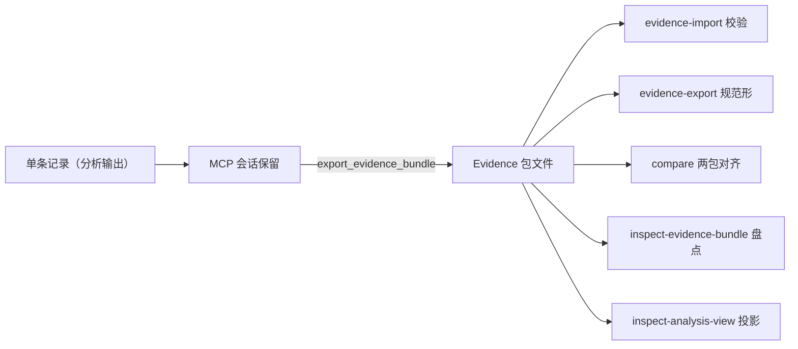

import { Meta } from '@storybook/addon-docs/blocks';

<Meta id="evidence-bundles" title="Evidence 与重建/Evidence 包管理" name="Docs" />

# Evidence 包管理

一次分析交付一条 Evidence 记录，但真正的分析资产往往是一整个会话——记录、unknown、工件身份、捕获与环境捆在一起。Evidence 包（bundle）就是这个会话级资产的文件交换单位。本课讲包的完整生命周期：用 `export_evidence_bundle` 把会话导出成包文件，用 `evidence-import` 校验，用 `evidence-export` 写出规范形式，用 `compare` 对齐两个包，用 `inspect-evidence-bundle` 盘点内容，用 `inspect-analysis-view` 从已有 Evidence 投影小视图——全程不重跑分析。Evidence 记录的字段与 `evidence_id` 语义见 [1.3 CLI 与 Evidence](?path=/docs/cli-evidence--docs)，本课只做包级操作，概念部分只做桥接。



| 命令 | 用途 | MCP 侧工具 | 关键边界 |
| --- | --- | --- | --- |
| `evidence-import` | 校验包，汇报导入计数 | `import_evidence_bundle` | 只收包；单条记录报 wrong-kind |
| `evidence-export` | 把包写成规范 JSON 形式 | 无（会话导出用 `export_evidence_bundle`） | 已存在的目标拒绝写入，除非 `--overwrite` |
| `compare` | 按记录身份对齐两个包 | `compare_bundles` | 回答"资产一致吗"，不比内容差异 |
| `inspect-evidence-bundle` | 盘点包内记录 | `get_evidence_bundle`（读会话） | `path` 必须绝对；`filters` 要求 `detail: "summary"` |
| `inspect-analysis-view` | 投影 summary、分页等小视图 | `inspect_analysis_view` | 不重跑分析；CLI 源用 `inline` |

CLI 与 MCP 的不对称先记住：CLI 每次调用都是独立进程，上述命令全部读写文件；MCP 侧的同族工具读写的是当前连接的会话保留（ledger）——参数不同、来源不同，对应差异在各节展开。

## 快速上手

拿到一个会话包后（怎么来见下文），四条命令走完包生命周期闭环。本课输出实测自 rea-agents 6.7.0（macOS arm64），包来自对迷你 JS 应用（3 个源文件）的一次真实分析。

```bash
# 1. 校验包
rea evidence-import session-bundle.json

# 2. 导出规范形式
rea evidence-export session-bundle.json canonical.json --overwrite

# 3. 自比：原始包与规范形应完全一致
rea compare session-bundle.json canonical.json --filter-output status,left_bundle_sha256,right_bundle_sha256

# 4. 盘点包内容（path 必须绝对）
rea inspect-evidence-bundle '{"path":"/tmp/rea-bundle-demo/session-bundle.json","detail":"summary"}' --format json --filter-output 'kind,total_retained_records,matching_records'
```

逐步的真实输出：

```text
# 1.
imported: 1
unknowns_added: 0
total: 1

# 2.
path: /private/tmp/rea-bundle-demo/canonical.json
bytes: 165174
records: 1

# 3.
status: unchanged
left_bundle_sha256: 676444b0351344a1ceaace80c796dc7f515afc6b0ceb4bf5598eb72f0ca7a074
right_bundle_sha256: 676444b0351344a1ceaace80c796dc7f515afc6b0ceb4bf5598eb72f0ca7a074

# 4.
{"kind":"evidence-bundle-summary","total_retained_records":1,"matching_records":1}
```

第 3 步两个 SHA-256 相同：规范导出对已经是规范形的包是字节恒等变换。这个闭环是全课的预演，下面逐个展开。

## 记录与包

单条记录与会话包是两种文件，混用是最常见的错误来源：

| | 单条 Evidence 记录 | Evidence 包 |
| --- | --- | --- |
| 怎么产生 | 任一分析命令的输出（`--json` 落文件） | MCP 会话内 `export_evidence_bundle` 导出 |
| 顶层结构 | `evidence_id`、`subject`、`provider`、`normalized_result` 等记录字段 | 七个集合数组：`artifacts`、`captures`、`environments`、`providers`、`records`、`scenarios`、`unknowns` |
| 谁能消费 | `inspect-analysis-view`（`inline` 源）、各 compare 工具的 inline 输入 | `evidence-import`、`evidence-export`、`compare`、`inspect-evidence-bundle` |
| 典型体积 | 迷你应用约 165 KB；真实应用可达数百 MB | 记录加信封，随会话内容增长 |

为什么需要包？三个边界决定了"必须有个文件单位"：

- **CLI 进程即用即走。** 每次调用都是独立进程，记录不留在任何会话里，要用必须先落文件（见 [1.3 CLI 与 Evidence](?path=/docs/cli-evidence--docs)）。
- **MCP retained 引用只属于一个连接。** 引用（`{"kind": "retained-evidence", "evidence_id": "ev_…"}`）在目标关闭重开与进程重启后仍可用，但 `close_binary` 会清空它们；丢失的引用只报 `details.reason: "missing"`——服务器无法区分"从未记录、被清空还是别的连接保留的"。官方给出的恢复路径有三条：补 inline Evidence、重跑生产命令、导入先前导出的包。包就是第三条路的载体。
- **单帧传输有预算。** stdio 客户端按 10 MiB 接收预算拒绝超大结果（`resource_constraint`，`details.resource: "transport"`，引用在 `details.reported_limits.evidence_reference`）；可用环境变量 `REA_MCP_MAX_RESPONSE_BYTES` 上调（十进制整数，最小 10485760）。官方明确：导出能"保留完整会话，而不必把它塞进单个 MCP 帧"。

MCP 接入与会话机制本身见 [1.4 MCP 接入](?path=/docs/mcp-integration--docs)；本课关心的是包文件怎么进出这个会话。

## 导入校验

`evidence-import` 把包文件交给 REA 做结构与身份校验，并汇报计数；MCP 侧的 `import_evidence_bundle` 做同一件事，还会把记录真正入账当前连接的 ledger：

```bash
rea evidence-import session-bundle.json
```

```text
imported: 1
unknowns_added: 0
total: 1
```

校验语义（来自 MCP 契约文档）：包的信封、身份、manifest 等固定元数据里出现不支持的字段，会在鉴权之前被拒绝；被拒绝的导入不改变会话保留状态。应用自己的元数据可以放进 `parameters`、`raw_result`、`normalized_result` 或 analysis-profile 的 parameters，键名原样保留。`import_evidence_bundle` 的参数是 `path`，必须绝对路径，相对路径直接拒绝。

最高频的错误是把分析输出当包喂进来。单条记录喂给 `evidence-import`（或 `evidence-export`、`compare`），退出码 1：

```text
error: Analysis failed
code: invalid_request
category: invalid_input
message: "Expected an Evidence bundle with records and manifest arrays, but this JSON is one Evidence record (ev_60c7ed036af037fed468c83dc3709615c09bd956906430e6bac0e8bc4f1a9912). Export a session bundle with the MCP export_evidence_bundle tool and supply that file."
retryable: true
remediation:
  action: "Export a session bundle with the MCP export_evidence_bundle tool and supply that file."
details:
  operation: read
  reason: wrong-kind
  path: /private/tmp/rea-bundle-demo/app-evidence.json
```

处理动作就写在错误信息里：会话包唯一的生产方式是 MCP 工具 `export_evidence_bundle`（见下节）。单条记录不需要进包——直接投影视图或作为 inline Evidence 使用。

## 导出

两个导出共享同一套写文件语义：目标是新文件，已存在默认拒绝；真正写入是原子发布——"完整包导出把规范 JSON 流式写入一个原子发布的文件"；取消导出会停止序列化并删除 staging 文件，目标只在原子发布那一刻改变。写入中途取消有可能已经发布完成，此时取消回执里 `details.published: true`、`details.published_path`、`details.bytes` 保留发布事实——判断目标文件状态先看回执，不要猜。

### 会话导出 export_evidence_bundle

MCP 工具，把当前连接 ledger 里的全部记录导出成一个包文件。参数：`path`（绝对路径，相对路径拒绝）、`overwrite`（默认 `false`，与 CLI 的 `--overwrite` 同语义）。先在会话里跑一次分析，再导出（工具调用经 MCP 客户端发出，接入方式见 [1.4 MCP 接入](?path=/docs/mcp-integration--docs)）：

```text
// tools/call: analyze_javascript_application {"input_path": "/tmp/rea-demo-app"}
// tools/call: export_evidence_bundle {"path": "/tmp/rea-bundle-demo/session-bundle.json"}
{"result":{"path":"/tmp/rea-bundle-demo/session-bundle.json","bytes":165174,"records":1,"unknowns":0}}
```

`records` 与 `unknowns` 是导出的记录数——上面这个包里有 1 条记录、0 条 unknown。

### 规范导出 evidence-export

CLI 命令，把一个已有包写成规范（canonical）JSON 形式：

```bash
rea evidence-export session-bundle.json canonical.json
```

```text
path: /private/tmp/rea-bundle-demo/canonical.json
bytes: 165174
records: 1
```

目标已存在时拒绝写入，除非显式给 `--overwrite`（官方规则："Exports preserve an existing destination unless `--overwrite` is explicit."）：

```json
{"error":"Analysis failed","code":"invalid_request","category":"invalid_input","message":"Evidence file already exists. Choose another path or allow overwrite.","retryable":true,"remediation":{"action":"Evidence file already exists. Choose another path or allow overwrite."},"details":{"operation":"write","reason":"exists","path":"/private/tmp/rea-bundle-demo/canonical.json"}}
```

规范形式的价值在快速上手第 3 步已经看到：对本来就是规范形的包，再导出是字节恒等变换（`shasum -a 256` 两文件相同）。判断两个包是否一致，先比文件 SHA-256；不一致时再交给 `compare` 解释差异。它同样只收包，单条记录报 wrong-kind。

## 比较两个包

`compare` 回答的问题是"这两个包里的分析资产一致吗"。关键判断先记住：**比较按记录身份（`evidence_id`）对齐，不逐字段比内容**。`evidence_id` 是内容寻址的（记录的 SHA-256 摘要），所以同一条记录在两个包里必然一致；而两次独立运行的记录内容必然不同、ID 必然不同——它们不会被判为"变更"，而是各自成为单侧条目，整体状态是 `unknown`。

两侧完全一致时（快速上手第 3 步），`status: unchanged`，`changes` 与 `limitations` 都是空数组。`left_bundle_sha256` / `right_bundle_sha256` 就是两个包文件的 SHA-256，与 `shasum -a 256` 的结果一致。

两侧记录集不同时，把导入过旧记录的合并包（2 条记录）与只有新记录的包（1 条记录）比较：

```bash
rea compare merged-bundle.json session-bundle.json
```

```text
status: unknown
left_bundle_sha256: 947beb1db52f9256015c5720cb68d8ea0adc4a0e7d02a0a7f7d688e07b32b5d2
right_bundle_sha256: 676444b0351344a1ceaace80c796dc7f515afc6b0ceb4bf5598eb72f0ca7a074
summary:
  records_unchanged: 1
  records_added: 0
  records_removed: 0
  records_changed: 0
  …
  unresolved: 1
changes[1]:
  - entity: evidence
    key: ev_de7a63a61182aa2ba7a8403ee626e9a71277c5193c7c0fdf29bd545d54a9dacb
    classification: unknown
    conclusion_kind: unresolved_branch
    left_evidence_ids[1]: ev_de7a63a61182aa2ba7a8403ee626e9a71277c5193c7c0fdf29bd545d54a9dacb
    right_evidence_ids: []
    left_digest: de7a63a61182aa2ba7a8403ee626e9a71277c5193c7c0fdf29bd545d54a9dacb
    right_digest: null
    limitations[1]: EvidenceBundle has no inventory completeness marker; one-sided membership may reflect incomplete capture.
limitations[1]: EvidenceBundle has no inventory completeness marker; one-sided membership remains unknown.
```

解读要点：只出现在一侧的记录进 `changes[]`，`classification: unknown`、`conclusion_kind: unresolved_branch`；包整体 `status: unknown`、退出码仍为 0——`unknown` 不是失败，是"无法断言"。两个不同运行的包比较，所有记录都会是单侧条目，`unresolved` 等于记录总数。

回查：`summary` 的全部计数与 `changes[]` 条目字段：

| 字段 | 含义 |
| --- | --- |
| `records_unchanged` / `records_added` / `records_removed` / `records_changed` | 记录四档对齐结果 |
| `unknowns_unchanged` / `unknowns_added` / `unknowns_removed` / `unknowns_advanced` / `unknowns_diverged` | unknown 记录的对齐与演化计数 |
| `unresolved` | 未能对齐的条目数 |
| `changes[].entity` / `key` | 条目类型与身份键（如 `evidence` 与其 `evidence_id`） |
| `changes[].classification` / `conclusion_kind` | 分类与结论类型（观测到 `unknown` / `unresolved_branch`） |
| `changes[].left_evidence_ids` / `right_evidence_ids` | 该键在两侧的记录 ID |
| `changes[].left_digest` / `right_digest` | 两侧内容摘要，缺席侧为 `null` |

MCP 工具 `compare_bundles` 接收 `left_bundle_path` 与 `right_bundle_path`（同样按文件比较），另支持 `record_pairs` 数组显式指定左右记录的配对（`left_evidence_id` / `right_evidence_id`）——需要把两次运行的记录强行对齐时用它。

边界：包比较不做行为差异分析。两次版本之间"目标行为哪里变了"用 `compare_application_versions`、`compare_functions`、`compare_artifacts`（分别由对应课程承载，官方 cli.md 也将应用追踪与版本比较指向 JavaScript application workflows 文档）；导入历史源码树逐层比对属于历史源码比对一课。

## 盘点包内容

`inspect-evidence-bundle` 用一个 JSON 请求盘点包文件，先看清单再决定投递多少：

```bash
rea inspect-evidence-bundle '{"path":"/tmp/rea-bundle-demo/session-bundle.json","detail":"summary"}' --format json
```

```json
{"kind":"evidence-bundle-summary","filters":{},"total_retained_records":1,"matching_records":1,"unknown_revisions":0,"records":[{"evidence_id":"ev_60c7ed03…a9912","subject":{"name":"rea-demo-app","digest":{"sha256":"0798b58a…7156d"},"local_path":"/private/tmp/rea-demo-app","format":"directory","architecture":null},"provider":{"id":"rea-javascript-application","name":"REA JavaScript application analyzer","version":"1"},"operation":"analyze_javascript_application","confidence":"derived","authority":"shipped-artifact","analysis_profile_digest":null,"retention":"complete-record","limitation_count":5,"native_dossier":{"available":false,"reason":"different-operation"}}]}
```

`summary` 返回每条记录的身份（`evidence_id`、subject 摘要、provider、operation）、`confidence` / `authority`、`retention: "complete-record"`、限制条数与原生档案可用性。请求的三个键各有硬约束，都有实测错误：

- `path` 必须绝对路径，相对路径报 `invalid_request`："path must be an absolute local filesystem path"。
- `filters` 要求同时给 `detail: "summary"`，否则报："Record filters require detail: summary; complete returns the canonical bundle."
- 省略 `detail` 等于要求完整 canonical 包投递——大包上这是最贵的用法。

`filters` 支持五个键的精确匹配：`evidence_id`、`operation`、`target_sha256`、`analysis_profile_digest`、`procedure_address`。实测过滤 `{"operation":"analyze_javascript_application"}` 时，`matching_records` 从总数中筛出匹配项。

MCP 侧的 `get_evidence_bundle` 是同族工具，但来源不同：它读当前连接的 ledger，没有 `path` 参数。两个用途：`detail: "summary"` 加 `filters` 做会话内发现（返回 Evidence ID、工件与 provider 身份、analysis-profile 摘要、原生过程元数据），发现过程不启动 provider；省略 `detail` 则投递完整 canonical 包——宽包可能超过 10 MiB 单帧，这时导出成文件再走 CLI。注意官方边界：summary 盘点"不会让任意大的文件变便宜地导入"——`evidence-import` 仍会在内存预算内完整校验文件。

## 投影分析视图

`inspect-analysis-view` 对已完成分析的 Evidence 投影一个 caller 选择的视图：不重跑分析、不启动 provider，大包变小结果。官方给出的闭环是"保存、构造视图请求、投影"：

```bash
rea analyze-javascript-application /absolute/path/to/app --json > app-evidence.json
jq -c '{source: {kind: "inline", evidence: .}, view: {kind: "summary"}}' app-evidence.json > view.json
rea inspect-analysis-view view.json --filter-output normalized_result.summary.statistics
```

实测输出（3 个源文件的迷你应用）：

```text
normalized_result:
  summary:
    statistics:
      relevant_files: 3
      text_bytes_read: 420
      parsed_javascript_files: 3
      visited_ast_nodes: 105
      findings: 7
      modules: 0
      …
```

视图请求由 `source`（Evidence 从哪来）和 `view`（要看什么）组成。源有两种形态：`inline` 把完整记录嵌进请求（上面的 jq 构造，CLI 与 MCP 通用、可移植）；`retained-evidence` 用 `{"kind": "retained-evidence", "evidence_id": "ev_…"}` 引用当前 MCP 会话里的记录。官方文档还描述了第三种 `evidence-file` 源（按文件名引用存档，"REA 读取并认证文件，再像 retained Evidence 一样投影，大文件受文件读取器约束而不是按 inline 输入计费"；CLI 相对路径按工作目录解析，MCP 用绝对路径）——但已发布版本（验证至 6.7.0）只接受 `retained-evidence` 与 `inline`，写 `evidence-file` 会报 `expected: retained-evidence, inline`，见常见问题。

`view` 的种类：

| 视图 | 形状 | 用途 |
| --- | --- | --- |
| `summary` | `{"kind": "summary"}` | 一份统计概览；334 MB 的 Obsidian 应用 Evidence 投影出约 10 KB |
| `page` | `{"kind": "page", "collection": "modules", "offset": 0, "limit": 32}` | 分页浏览集合；集合有 `sections`、`symbols`、`modules` |
| `item` | `{"kind": "item", "collection": "sections", "selector": {"name": ".text"}}` | 按 `index`、`name`、`path` 或 `node_id` 取单个成员 |
| `native` | `{"kind": "native", "facet": "pseudocode", "offset": 0, "limit": 64}` | 原生分析 facet（procedure、pseudocode、assembly、basic_blocks、comments、callers、callees、references 等）；offset / limit 默认 0 / 64 |
| `facet` | `{"kind": "facet", "facet": "mitigations"}` | 二进制布局记录的专属 facet：`mitigations`、`linkage` |

分页边界：原生 facet 的 offset / limit 默认 0 / 64；pseudocode 按 UTF-16 code unit 分页且从不拆开代理对，其余按行分页。视图过大时官方建议"减小页大小或导出 retained Evidence"。

投影的产物本身就是一条新的、小得多的 Evidence 记录（page 视图实测节选）：

```text
evidence_id: ev_ba4cbb88d886cba520c301f47cd1b3606437bc7a70b504e87f8c0de7f90c7588
provider:
  id: rea-analysis-view
  name: REA analysis view projection
  version: "1"
operation: inspect_analysis_view
parameters:
  parent_evidence_id: ev_60c7ed036af037fed468c83dc3709615c09bd956906430e6bac0e8bc4f1a9912
  view:
    kind: page
    collection: modules
```

`parameters.parent_evidence_id` 指回父记录——视图可以继续传递、保存，而溯源链不断。视图结果携带所选事实的摘要（digest），引用结论时带上视图记录与父记录两个 ID。

## 最佳实践

- **搬运靠包，引用靠 ID。** 跨进程、跨连接移动分析资产用 `export_evidence_bundle` 的包文件；在会话内或文档里指认一条结论用它的 `evidence_id`。两者不互换：包喂 import 家族，ID 喂 retained 引用。
- **比较前先选对齐键。** 问"两次分析的资产清单一致吗"用包 `compare`（按身份对齐）；问"目标行为哪里变了"用版本与函数比较工具。不同运行的包拿去 `compare`，结果必然是满屏 `unresolved`——这是语义，不是故障。
- **先盘点后投递。** 大包先 `inspect-evidence-bundle`（或会话内 `get_evidence_bundle`）用 `detail: "summary"` 加 `filters` 定位记录，再决定完整投递、投影小视图还是导出文件；不要上来就要 complete 包撞 10 MiB 单帧预算。
- **写目标显式化，import 做门禁。** 导出永远给新文件或显式 `--overwrite`（MCP 侧 `overwrite: true`）；脚本在消费任何包文件前先跑 `evidence-import`，把校验失败挡在下游之前。

## 常见问题

- 把 `rea analyze-… --json` 保存的文件喂给 `evidence-import`，报 "Expected an Evidence bundle with records and manifest arrays, but this JSON is one Evidence record"？
  这是单条记录不是包。会话包只能由 MCP 工具 `export_evidence_bundle` 导出；单条记录的正确去处是 `inspect-analysis-view` 的 inline 源或各 compare 工具的 inline 输入，不需要进包。
- `compare` 两个不同运行的包，`status: unknown`、所有记录都是单侧 `unresolved` 条目？
  正常语义：记录按内容寻址的 `evidence_id` 对齐，两次运行的记录 ID 必然不同。要对齐两次运行，用 MCP `compare_bundles` 的 `record_pairs` 显式指对，或改用版本 / 函数比较工具看行为差异。
- 按文档写了 `{"kind": "evidence-file", "path": …}` 源，`inspect-analysis-view` 报 `expected: retained-evidence, inline`？
  官方 main 分支文档已描述 `evidence-file`（按文件引用、按文件读取器计费），但已发布版本（验证至 6.7.0）尚未包含该形态。用 `jq -c '{source: {kind: "inline", evidence: .}, view: …}'` 先构造 inline 请求。
- CLI 里 `evidence-import` 每次都报 `imported: 1`，记录到底存到哪里了？
  没有存。CLI 每次调用是独立进程，计数只描述本次校验；要让记录留在会话里供 retained 引用，走 MCP 会话的 `import_evidence_bundle`。跨会话复用靠包文件本身，不靠 CLI 的导入动作。

## 总结回顾

摘要：

Evidence 包把"一整个会话的分析资产"变成一个文件单位。单条记录由分析命令产出，会话包只能由 MCP 的 `export_evidence_bundle` 导出，顶层是 `records` 等七个集合数组；`evidence-import` / `import_evidence_bundle` 在鉴权前校验固定元数据并汇报计数，喂单条记录会报 wrong-kind。`evidence-export` 把包写成规范 JSON，已存在目标默认拒绝、`--overwrite` 显式放行，写入是原子发布，取消回执保留发布事实。`compare` / `compare_bundles` 按内容寻址的 `evidence_id` 对齐两侧：一致报 `unchanged`，单侧记录进 `changes[]`、整体 `unknown` 且退出码为 0。`inspect-evidence-bundle` / `get_evidence_bundle` 用 summary 加 filters 盘点，绝对路径与"filters 要求 summary"是两条硬约束。`inspect-analysis-view` 从 inline 或 retained 源投影 summary、分页、原生 facet 等视图，不重跑分析；投影产物是一条通过 `parent_evidence_id` 指回父记录的小 Evidence。文档中的 `evidence-file` 源在已发布版本（验证至 6.7.0）尚未提供。

一句话：

> Evidence 包是会话级分析资产的交换单位——记录靠内容寻址 ID 认身份，包靠校验、规范导出、身份对齐比较、盘点和投影在不重跑分析的前提下复用。

知识要点：

- 单条 Evidence 记录与会话包的差别是什么，包的顶层集合有哪些？
- 会话包由哪个工具导出，`path` 与 `overwrite` 参数有什么约束？
- `evidence-import` 校验什么、汇报什么，被拒绝的导入对会话状态有什么影响？
- `evidence-export` 的规范形式意味着什么，`--overwrite`、原子发布与取消回执各自怎么工作？
- `compare` 按什么对齐两个包，`unchanged` 与 `unknown` 分别说明什么，`changes[]` 条目有哪些字段？
- `inspect-evidence-bundle` 的 filters 有哪五个键，为什么必须配 `detail: "summary"`？
- `inspect-analysis-view` 的源与视图各有哪些形态，投影产物是什么、怎么指回父记录？
- `evidence-file` 源在官方文档与已发布版本之间有什么落差，当前可用的替代是什么？

## 参考资料

- [REA CLI guide（docs/cli.md）](https://raw.githubusercontent.com/morluto/rea/main/docs/cli.md)
  本课主文档：`evidence-import` / `evidence-export` / `compare` 的定位与 `--overwrite` 规则、`inspect-analysis-view` 的保存—投影闭环、`evidence-file` 源描述与规模数据。
- [MCP contracts（docs/mcp-contracts.md）](https://raw.githubusercontent.com/morluto/rea/main/docs/mcp-contracts.md)
  `export_evidence_bundle` / `get_evidence_bundle` / `import_evidence_bundle` 的契约、导入校验与原子发布语义、retained 引用与 ledger 边界、10 MiB 帧预算、原生 facet 分页规则。
