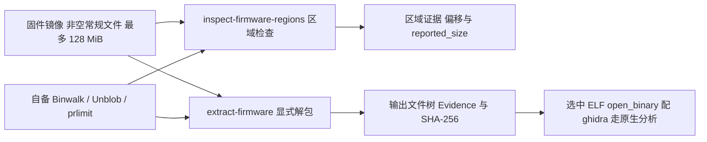

import { Meta } from '@storybook/addon-docs/blocks';

<Meta id="firmware-analysis" title="固件、数据与流量/固件分析" name="Docs" />

# 固件分析

REA 的固件通道用调用方自备的 Binwalk 与 Unblob 处理固件镜像：Binwalk 3.1.x 做区域检查，Unblob 26.6.x 做显式解包，报告解析分别以 3.1.0 与 26.6.4 验证，当前里程碑的验证平台是 Linux x64。整条通道不需要设备、root 权限、挂载、仿真，也不执行解出的程序；任意固件字节不通过原生可执行准入，要反编译得在解包结果里单独选中 ELF 交给 Ghidra。REA 从不代装工具：执行请求时校验工具的 `--version` banner，并用 util-linux 的 `prlimit` 约束子进程。实测覆盖是 gzip、USTAR、ext4 加 Linux x64 ELF 子文件；SquashFS、UBIFS、专有固件与其他主机、架构仍未验证。本课是「固件、数据与流量」阶段的第一课，解出的 SQLite 快照、PCAP 与信号记录分别归本阶段后续课程。



默认值与预算是本课的回查入口，后文所有小节都以这张表为基准：

| 项目 | 值 |
| --- | --- |
| Binwalk 通道 | 3.1.x，报告解析以 3.1.0 验证 |
| Unblob 通道 | 26.6.x，报告解析以 26.6.4 验证 |
| 验证平台 | Linux x64（当前里程碑） |
| 输入准入 | 非空常规文件，最多 128 MiB |
| 解包深度 | 默认 3，允许范围 1–10 |
| 单次重操作期限 | 墙钟 120 秒 / 120 CPU 秒 |
| 进程限制 | 每进程 1 GiB 地址空间，0 core dump（经 `prlimit`） |
| 诊断输出预算 | stdout 加 stderr 合计 8 MiB，触顶报 truncated-output |
| 生产者 JSON 报告 | 最多 8 MiB 且必须有效 UTF-8 |
| 输出暂存预算 | 默认 256 MiB 与 10,000 条目（`--max-output-bytes` / `--max-output-files`） |

## 快速上手

前置：自备 Binwalk 3.1.x 与 Unblob 26.6.x 的可执行文件，以及 util-linux 的 `prlimit`（通常在 `/usr/bin/prlimit`）；banner 校验与其余前置见[提供分析工具](#提供分析工具)。以绝对路径导出两个环境变量：

```sh
export REA_BINWALK_COMMAND=/absolute/path/to/binwalk
export REA_UNBLOB_COMMAND=/absolute/path/to/unblob
```

先看区域，再解包到一个尚不存在的输出目录：

```sh
rea inspect-firmware-regions /path/to/firmware.bin
rea extract-firmware /path/to/firmware.bin /path/to/new-output --offset 64 --length 4096 --max-depth 3
```

输出中应能核对到：第一条返回区域摘要（偏移、签名与 `reported_size`）并把完整 payload 写入 Evidence；第二条在新输出目录发布文件树，每个结果都带独立校验的 SHA-256。选中其中某个 ELF 后，用 `open_binary` 配 ghidra provider 进入原生分析，见[继续分析解出的程序](#继续分析解出的程序)。

## 提供分析工具

固件通道的两条工具线都是调用方自备：REA 不安装 Binwalk、Unblob、它们的依赖或任何系统包，只在执行请求时运行工具的 `--version` 做校验。检查与解包的前置相互独立，一条就绪不代表另一条可用。

### 环境变量与版本 banner

两个环境变量都接受可执行文件的绝对路径：

```sh
export REA_BINWALK_COMMAND=/absolute/path/to/binwalk
export REA_UNBLOB_COMMAND=/absolute/path/to/unblob
```

校验按 banner 原文执行：Binwalk 必须打印 `binwalk <version>`，Unblob 必须只打印版本号本身。落在 3.1.x / 26.6.x 版本线内的其他构建会被接受：观察到的版本写入结果，同时 limitation 记录「报告解析未对该构建验证」。

### prlimit 与诊断预算

两条通道都要求 util-linux 的 `prlimit`，通常位于 `/usr/bin/prlimit`，需要时用 `REA_FIRMWARE_PRLIMIT_COMMAND` 覆盖绝对路径。诊断输出有硬预算：单条命令的 stdout 加 stderr 最多保留 8 MiB，超出即以明确的 truncated-output 错误停止分析；子进程限制不约束父侧管道的保留量，已完成的命令会先排干输出流再记录诊断。失败的 worker 在清理时保留 worker 与工作区，供下一次请求前或关机时重试。

### Unblob 的外部提取器与沙箱

Unblob 需要所选格式的外部提取器出现在它继承的 `PATH` 上，例如 ext2/ext3/ext4 对应 `debugfs`。缺提取器不会静默丢文件：有效的分析报告会保留部分结果，并内联依赖名。Unblob 默认的 Landlock 沙箱与 skip 规则保持启用；沙箱启动失败仍是可操作的错误，REA 不会改用 `--no-sandbox` 重试。

### 上游源码与 Linux 进程前置

上游工具源码以可选的 pinned submodule 原样保存：

```sh
git submodule update --init third_party/binwalk third_party/unblob
```

常规 REA 构建与 npm 包既不包含也不构建这些源码或引擎二进制。Linux 上 Binwalk 与 Unblob 以 REA 拥有的进程运行，还要求 REA 的 `PATH` 上有 procps 兼容的 `ps`，出处见 [1.1 安装与设置](?path=/docs/installation--docs)。

## 区域检查与解包

两条通道一前一后但相互独立：区域检查回答「镜像里有哪些可识别区域」，解包回答「区域里的文件树长什么样」。CLI 与 MCP 表达同一意图，返回同一类 Evidence：原始输入路径与 SHA-256、原始生产者报告、实际可执行文件路径与摘要、版本与 limitations。Binwalk 签名 UUID 与 Unblob blob ID 都是 producer-local 身份，只在单份报告内可解释——跨运行比较一律用内容哈希加源范围；版本字段同理，只记录观察值，不证明安装构建的源码修订。

| 操作 | 回答的问题 | 工具通道 |
| --- | --- | --- |
| `inspect-firmware-regions` | 镜像里有哪些可识别区域 | 自备 Binwalk 3.1.x |
| `extract-firmware` | 区域里的文件树长什么样 | 自备 Unblob 26.6.x |

### 区域检查：inspect-firmware-regions

最小命令与 MCP 形态：

```sh
rea inspect-firmware-regions /path/to/firmware.bin
```

```json
{
  "name": "inspect_firmware_regions",
  "arguments": { "path": "/path/to/firmware.bin" }
}
```

读法有三条边界：

- 区域偏移指原始固件中的字节位置。`reported_size` 原样保留 Binwalk 的输出；`size_basis=provider_reported_validation_unknown` 表示 Binwalk 在序列化前会用下一个签名或 EOF 代替未知长度。
- 签名与它的置信字节都只是文件区域证据，不证明存在有效分区、加密或运行时行为。
- 检查依赖单独配置的 Binwalk（`REA_BINWALK_COMMAND`）；没配置时检查步骤不可用，相关区域保持未检查状态。

### 显式解包：extract-firmware

CLI 把输出目录作为位置参数，范围与深度用旗标控制；MCP 用 `output_directory`、`range` 与 `max_depth` 表达同一请求：

```sh
rea extract-firmware /path/to/firmware.bin /path/to/new-output
rea extract-firmware /path/to/firmware.bin /path/to/selected-output \
  --offset 64 --length 4096 --max-depth 3
```

```json
{
  "name": "extract_firmware",
  "arguments": {
    "path": "/path/to/firmware.bin",
    "output_directory": "/path/to/new-output",
    "range": { "offset": 64, "length": 4096 },
    "max_depth": 3
  }
}
```

输出目录必须同时满足三个条件：尚不存在、是绝对路径、父目录已存在。发布采用独占、抗 symlink 的写入与持久化摘要回读，已有输出目录从不被覆盖。这不是原子的目录改名：文件还在写入时新树就可能已经可见；未提交的失败输出会被回滚。symlink 与特殊文件只记录、不发布；空目录、属主与可执行权限位不还原。深度默认 3，允许范围 1–10。

### 读懂解包报告

解包结果由常规文件路径、独立校验的 SHA-256、可用时的生产者哈希、chunks、诊断与任务谱系（task derivations）组成。Unblob 的任务报告本身无序，REA 按路径与 blob ID 解析关系。三条读法边界：

- 逻辑引用使用 `$input`、`$output` 或 `$output/<relative-path>`，因此真实名为 `$input` 的文件不会与原始输入混淆。
- chunk 偏移属于该任务的输入文件；只有落在所选输入范围内的 chunk 才有已知 `root_file_range`，且已按所选偏移调整。
- 解压产生的子文件原始字节范围与运行时地址未知：任务谱系不建立穿过解压的逐字节映射。

状态只有 `partial` 与 `complete` 两种，别过度解读：

- `partial` 标记未知或加密 chunk、已报告的提取问题、未发布的链接与特殊文件、达到深度限制。
- `complete` 表示引擎完成了配置范围内的提取且没有上述已报告条件——默认 skip 规则与格式覆盖仍然适用，也不确立「固件已被完整重建」。

### 缺口与恢复：extraction_gaps

`extraction_gaps` 把上述条件变成可恢复的行：每行标识一个未提取区域或一个失败的任务/阶段。chunk 行保留自身身份与字节范围，属于所选输入时还带原始文件范围；多文件阶段保留报告中的 ID 与 handler、字节范围未知；独立任务失败则阶段身份为 null。恢复规则：

- 每行的 `continuation_id` 指向 `extraction_continuations` 中的一条指令，多个区域可共享同一段恢复说明而不丢失区域身份；指令只使用已经配置的能力。
- 依赖名按生产者 missing-dependency 报告原样保留；报告有效但没有名字时记为未知依赖的失败，REA 不推断可执行身份或具体安装步骤。
- 每次重跑解包都要求一个尚不存在的 `output_directory`，先前证据因此保留。
- 遇到嵌套的未知 chunk：对实际发布的子文件再跑 `inspect_firmware_regions`，而不是用相同 handler 原样重复整次提取。
- 登记缺口不等于目标固件损坏，也不等于保留区域为空；REA 不会代装任何东西。

## 继续分析解出的程序

解包树里的 ELF 要单独选中，走既有原生通道：

```json
{
  "name": "open_binary",
  "arguments": {
    "path": "/path/from/extraction/usr/bin/program",
    "provider_id": "ghidra"
  }
}
```

打开后即可使用 `analyze_function`、`inspect_native_api` 等原生原语；原生侧的架构与可执行文件验证照常适用——任意固件字节不通过准入，只有解包发布且验证过的 ELF 子文件能进入。通用的 MIPS ELF 与 RISC-V ELF lane 是独立文档，各有自己的准入边界（见参考资料）。本里程碑有意不做：PowerPC 反编译、raw flash 加载配置、bootloader 与设备树语义、漏洞扫描、仿真、硬件运行时捕获。原生原语的用法入口见 [4.1.1 原生调查](?path=/docs/native-investigation--docs)。

## 资源与生命周期限制

| 限制 | 值 | 说明 |
| --- | --- | --- |
| 输入准入 | 非空常规文件，最多 128 MiB | 分析前拷贝并哈希进私有工作区；拷贝期间超出限额与既有超大文件得到同样的类型化输入拒绝；应提供限额内的稳定副本，不原地修改源文件 |
| 重操作排队 | 每个 provider 实例一次 | 第二个请求等待，无自动并行提取引擎；Binwalk 单线程、Unblob 单 worker |
| 时间与进程 | 120 秒墙钟 / 120 CPU 秒 / 每进程 1 GiB 地址空间 / 0 core dump | 经 `prlimit` 继承执行 |
| 生产者 JSON 报告 | 最多 8 MiB 且有效 UTF-8 | 编码损坏或超限的报告直接失败，不修复、不截断生产者数据 |
| 诊断输出 | 合计 8 MiB | 触顶报 truncated-output，并带精确捕获字节数 |
| 输出暂存预算 | 默认 256 MiB 与 10,000 条目 | 用 `max_output_bytes` / `max_output_files` 配置，CLI 为 `--max-output-bytes` / `--max-output-files` |
| 解包深度 | 默认 3，范围 1–10 | `--max-depth` / `max_depth` |

预算语义的边界：暂存预算靠轮询并在退出后复查，短暂超出可能出现；继承的文件大小限制约束单个文件而非总存储，地址空间按进程计算而非总内存配额；worker 数量对所有外部提取器都不等于 CPU 亲和；这些限制不主张 cgroup 或容器级遏制。取消会先清理拥有的进程组再删除工作区；清理结果不确定时保留资源，并阻塞该 provider 实例的后续操作。

## 最佳实践

- **先看区域再圈范围。** 用 `inspect-firmware-regions` 的区域证据挑 `--offset` 与 `--length`，配合 `--max-depth` 控制解包面；比一次硬解整个镜像更贴合 128 MiB 输入、256 MiB 暂存与 120 秒期限的预算。
- **证据引用绑内容哈希与源范围。** 签名 UUID 与 blob ID 都是 producer-local，跨运行、跨报告比较用 SHA-256 加源范围；写结论时带上解包当次的内容哈希。
- **按缺口逐行恢复，不盲目重跑。** `partial` 与 `extraction_gaps` 给出的是可恢复清单：缺依赖的补齐对应外部提取器，嵌套未知 chunk 对已发布子文件重新区域检查；每次重跑都要新的输出目录，别指望覆盖旧结果。
- **ELF 先验证再进 Ghidra。** 从解包树选 ELF 时确认它已发布且带独立校验的 SHA-256；原生准入照常适用，别把任意固件字节直接喂给 `open_binary`。

## 常见问题

- 命令一执行就因工具前置失败，工具明明装好了
  先核对 banner：Binwalk 的 `--version` 必须打印 `binwalk <version>`，Unblob 必须只打印版本号本身；再确认两条通道的前置各自独立，检查缺 Binwalk 不影响解包，反之亦然；`prlimit` 缺失或路径不对同样在执行阶段失败，用 `REA_FIRMWARE_PRLIMIT_COMMAND` 指定绝对路径。诊断输出合计超过 8 MiB 时以 truncated-output 错误停止。
- Unblob 解包后某些格式没解出来，比如 ext4
  所选格式的外部提取器必须在 Unblob 继承的 `PATH` 上（ext2/ext3/ext4 是 `debugfs`）；缺失不会静默丢文件，有效报告保留部分结果并内联依赖名，`extraction_gaps` 行保留精确依赖名与所属 handler，按名字补齐后换新的输出目录重跑。
- 报错要求换输出目录，或写入中途失败
  输出目录必须尚不存在、为绝对路径、父目录已存在，REA 从不覆盖已有输出；写入不是原子改名，失败时未提交的输出会回滚；每次重跑都要求新的不存在目录，先前证据保留在 Evidence 里。
- 结果状态是 `partial`，是不是整次解包失败了
  不是。`partial` 只标记未知或加密 chunk、已报告的提取问题、未发布的链接与特殊文件或达到深度限制，单条失败不连坐整次任务；`complete` 也只表示引擎完成配置的提取且无已报告条件，默认 skip 规则与格式覆盖仍然适用，两种状态都不确立「固件已被完整重建」。
- 两次运行的任务与 chunk ID 对不上
  Binwalk 签名 UUID 与 Unblob blob ID 是 producer-local 身份，只在单份报告内可解释；跨运行比较改用内容哈希加源范围。版本字段同样只记录观察到的版本，不证明安装构建的源码修订。

## 总结回顾

摘要：

REA 的固件通道由两条自备工具线组成：Binwalk 3.1.x 做 `inspect-firmware-regions` 区域检查，Unblob 26.6.x 做 `extract-firmware` 显式解包，CLI 与 MCP 返回同一类 Evidence——原始路径与 SHA-256、原始生产者报告、实际可执行文件信息、版本与 limitations。工具接入靠 `REA_BINWALK_COMMAND`、`REA_UNBLOB_COMMAND` 加 `prlimit`，banner 格式、8 MiB 诊断预算、外部提取器与 Landlock 沙箱各有明确规则。解包结果按文件树发布并绑定独立校验的内容哈希，`partial`/`complete` 与 `extraction_gaps` 把失败拆成可逐行恢复的清单；解出的 ELF 单独经 `open_binary` 配 ghidra provider 进入既有原生通道。输入、时间、进程、JSON 报告与暂存预算构成资源边界；Linux x64 是当前验证平台，实测覆盖 gzip/USTAR/ext4 加 Linux x64 ELF 子文件，SquashFS、UBIFS、专有固件与其他主机、架构仍未验证。

一句话：

> 固件分析是两条自备工具通道的解包投影：Binwalk 看区域、Unblob 解文件、报告绑哈希可逐行恢复，解出的 ELF 再单独进 Ghidra——REA 不代装工具，也不需要设备、挂载或仿真。

知识要点：

- 两条通道各要自备什么，banner 怎么校验，`prlimit`、外部提取器与沙箱规则是什么？
- `inspect-firmware-regions` 返回的区域证据怎么读，`size_basis` 与置信字节各说明什么、给不了什么？
- `extract-firmware` 的输出目录要满足什么条件，哪些文件属性不会被还原？
- 解包报告里 `$input`/`$output`、chunk 偏移、`root_file_range`、`partial`/`complete` 分别是什么语义？
- `extraction_gaps` 的行怎么读，`continuation_id` 与重跑规则是什么？
- 解出的 ELF 怎么进入原生分析，哪些能力是本里程碑有意不做的？
- 输入、时间、进程、报告与暂存预算各是多少，超出时的表现是什么？

## 参考资料

- [Firmware analysis（仓库 docs/firmware-analysis.md）](https://raw.githubusercontent.com/morluto/rea/main/docs/firmware-analysis.md)
  本课一手来源：通道版本与 banner 校验、CLI/MCP 契约、报告字段、`extraction_gaps`、资源预算与验证覆盖。
- [Installation（仓库 docs/installation.md）](https://raw.githubusercontent.com/morluto/rea/main/docs/installation.md)
  Linux 上 REA 拥有进程的 `ps` 前置（linux-owned process prerequisite）的权威出处。
- [Ghidra MIPS ELF lane（仓库 docs/ghidra-mips.md）](https://raw.githubusercontent.com/morluto/rea/main/docs/ghidra-mips.md)
  解出的 MIPS ELF 子文件的独立分析通道与准入边界。
- [Ghidra RISC-V ELF lane（仓库 docs/ghidra-riscv.md）](https://raw.githubusercontent.com/morluto/rea/main/docs/ghidra-riscv.md)
  解出的 RISC-V ELF 子文件的独立分析通道与准入边界。
