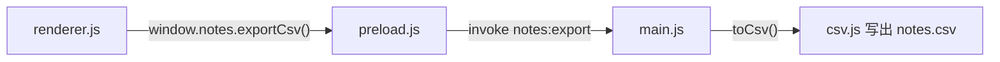

import { Meta } from '@storybook/addon-docs/blocks';

<Meta id="first-analysis" title="入门/第一次分析" name="Docs" />

# 第一次分析

第一次分析指对本地目标跑一次静态分析命令：REA 读取应用的文件字节，不执行其中任何代码，返回一份带证据编号的 Evidence 记录。记录里既有「找到了什么」，也有「证据在哪一行」「哪些结论只是推断」「哪些内容没有覆盖」。学会读这份记录，后续所有分析线（JavaScript、原生、网站等）读数方式都一致。

本课用官方 Notes 示例应用跑通第一次 JS 应用静态分析。它是一个只有 6 个源文件的 Electron 小应用，功能路径横跨渲染进程与主进程：



| 回查项 | 值 |
| --- | --- |
| 练习目标 | 官方 Notes 示例（`rea.tools/examples/notes-example.zip`） |
| 分析命令 | `npx -y rea-agents@latest analyze-javascript-application /absolute/path/to/app --json` |
| 结果去向 | stdout 输出一份完整 JSON Evidence；stderr 输出 `rea_progress` 进度行 |
| 退出码 | `0` 完成（可能带限制或未知）；`1` 失败；`128+N` 信号 |
| `integrity_policy` 默认 | `fail`（可选 `record-and-continue`） |
| Node 要求 | 22.x（不低于 22.19）、24.x（不低于 24.11）或 26+；Linux 另需 procps 兼容的 `ps` |
| 证据编号前缀 | `ev_`（Evidence 记录）、`jag_`（应用图）、`jag_node_`（节点）、`jag_observation_`（观察）、`art_`（工件条目） |

## 快速上手

下载并解压官方示例，得到 `notes-example` 目录。分析只需要 Node.js 和 npm，不需要安装 Electron。

```bash
curl -fsSL https://rea.tools/examples/notes-example.zip -o notes-example.zip
unzip notes-example.zip
npx -y rea-agents@latest analyze-javascript-application /absolute/path/to/notes-example --json > notes-evidence.json
```

命令结束后用退出码和输出核对三件事：

1. 退出码为 `0`，`notes-evidence.json` 里有顶层字段 `evidence_id`，值形如 `ev_a9d4a662…`（`ev_` 加 64 位十六进制）。
2. `normalized_result.summary.electron.ipc` 中 `literal_channels`、`renderer_transmissions`、`main_handlers`、`paired_renderer_transmissions` 都是 `1`，`ambiguous_renderer_transmissions` 是 `0`——与上面功能图一一对应：一个通道、一次调用、一个处理器、成功配对。
3. 顶层 `limitations` 是一个非空列表：分析完成了，但每条结论的适用边界都写在里面。

这份输出约 400 KB，而示例只有 1817 字节源码。真实应用的 Evidence 可以达到数百 MB，所以接下来的重点是学会分层读它，而不是通读它。

## 分析命令

```bash
npx -y rea-agents@latest analyze-javascript-application /absolute/path/to/app --json
```

- `npx -y rea-agents@latest` 临时下载并运行最新版，免全局安装；`-y` 自动确认下载。
- `analyze-javascript-application` 是子命令：对目录或 `.asar` 做只读静态分析。
- 目标必须是绝对路径；把 `/absolute/path/to/app` 换成你的目标。
- `--json` 输出 JSON 文档（保存结果时用它）。终端默认格式是 TOON；`--json` 在终端下缩进、在管道或重定向时输出紧凑格式。

运行期间屏幕上分两路：stderr 逐行打印 `rea_progress` 进度（本示例共 19 条，依次经过清点解析源文件、构建并封存应用图、构建语义图、校验并哈希封存 Evidence 几个阶段，最后一条 `terminal: true` 表示完成）；stdout 保持纯净，只有最终那份 JSON 结果。因此保存结果时把两路分开重定向，后续 `jq` 等工具才能直接解析。

等价用法：

```bash
# 全局安装后直接用 rea（README 推荐的常规方式）
npm install --global rea-agents
rea --help

# 通用入口 rea analyze：目录与 .asar 自动选择 JS 静态分析，无需指定 provider
rea analyze /absolute/path/to/app --json
```

必要边界：静态 JS 分析不需要 Hopper、Ghidra 或 IDA，目标也不必能运行；ASAR 完整性校验默认 `fail`（发现摘要不匹配即报错），`--integrity-policy record-and-continue` 可以记录矛盾继续分析，细节归静态分析专题；MCP 工具 `analyze_javascript_application` 与该命令同源，接入方式归 MCP 课程。

## 读懂 Evidence 记录

一份 Evidence 记录的顶层是固定的字段集合。先认清每层的职责，再按问题挑字段读：

| 顶层字段 | 内容 |
| --- | --- |
| `evidence_id` | 本记录的编号，`ev_` 加 64 位十六进制 |
| `subject` | 分析对象：名称、SHA-256 摘要、本地路径、格式 |
| `operation` | 产生记录的操作，此处为 `analyze_javascript_application` |
| `parameters` | 实际生效的参数，如 `format: auto`、`integrity_policy: fail` |
| `normalized_result` | 结果本体：`graph`、`summary`、`statistics`、`limitations`、`semantic_graph` 等 |
| `limitations` | 记录级的限制说明 |
| `authority` / `confidence` | 证据来源类别（`shipped-artifact`）与派生级别（`derived`） |

读法顺序：先用 `summary` 与 `statistics` 回答「找到了什么」，再进 `graph` 用编号回答「证据在哪、多可信」，最后用 `coverage`、`limitations` 与未知记录回答「什么还没被证明」。

### evidence_id 与 subject

`evidence_id` 是整份记录的唯一编号，由记录内容的规范化 JSON 哈希推导而来，因此编号和目标字节、参数绑定在一起：引用一次分析结果时，引用的就是这个编号。`subject` 记录对象身份——本例是名称 `notes-example`、格式 `directory`、以及整个目录内容的 SHA-256 摘要，`normalized_result.root_artifact_sha256` 与之一致。判断「两份记录是不是对同一个目标」时，比对摘要而不是路径。

### summary 与 statistics

`normalized_result.summary.electron` 把 Electron 面清点成计数。官方示例的实测值：

```json
{
  "browser_windows": 1,
  "explicit_web_preferences": 1,
  "preload_entrypoints": 1,
  "context_bridge_apis": 1,
  "exposed_api_members": 1,
  "ipc": {
    "literal_channels": 1,
    "renderer_transmissions": 1,
    "main_handlers": 1,
    "paired_renderer_transmissions": 1,
    "ambiguous_renderer_transmissions": 0,
    "unpaired_literal_renderer_transmissions": 0
  }
}
```

对照功能路径读：1 个窗口、1 个 preload、1 个 `contextBridge` API（`notes.exportCsv`）、1 条字面 IPC 通道（`notes:export`）、一次调用与一个处理器配对成功、无歧义配对。完整输出里还有一个 `operations` 字段，本例计到 `2`：renderer 的 `invoke` 与 main 的 `handle` 是两个操作，共用 1 个通道名。`paired` 只表示「静态上唯一匹配」，不证明运行时执行过。

`normalized_result.statistics` 描述分析工作量：本例 `relevant_files: 6`、`parsed_javascript_files: 4`、`visited_ast_nodes: 241`、`findings: 21`、`parse_failures: 0`。`parse_failures` 非 0 说明有文件没解析成功，结论覆盖随之打折。

### graph 里的节点与位置

`normalized_result.graph` 是 JavaScript Application Graph：本例 32 个节点、45 条边、1 个根节点。节点种类覆盖 package、artifact、Electron 主进程/preload/渲染进程、JS 模块与资产、`contextBridge` API、IPC 通道与处理器、BrowserWindow 等；边的关系词表包括 `contains`、`loads`、`imports`、`exposes`、`invokes`、`handles`、`maps_to`、`calls` 等。

每个节点带一个 `jag_node_` 编号，每条观察记录带一个 `jag_observation_` 编号，工件条目带 `art_` 编号——这些都是内容哈希，用于精确引用和跨工具传递。观察里最常用的是位置：证据落在哪个文件的哪一行。

```json
{
  "label": "notes:export",
  "properties": { "channel": "notes:export", "operation": "invoke" },
  "evidence": {
    "location": { "kind": "source-range", "source": "preload.js",
                  "start": { "line": 4, "column": 19 } }
  },
  "observation_id": "jag_observation_25b51454…"
}
```

节选自实测输出（保留了判定字段）：这条「字面 IPC 通道 `notes:export`」的观察指向 `preload.js` 第 4 行，正是 `ipcRenderer.invoke("notes:export")` 那一行。追任何一条结论，都用 `location` 回到源文件核对。

### authority、state 与 confidence

每条观察和每条边都带三个判定字段，回答「这个事实是怎么知道的、有多确定」：

```json
{
  "relation": "invokes",
  "evidence": {
    "authority": "static-relationship-inference",
    "state": "inferred",
    "confidence": "high"
  }
}
```

- `authority` 是证据来源：AST 静态分析（`ast-static-analysis`）、静态关系推断（`static-relationship-inference`）、被动运行时观测、原生分析、用户断言等。
- `state` 是认知状态：`observed`（直接观察到）、`inferred`（推断出来）、`unknown`、`unavailable`。
- `confidence` 是独立于前两者的置信级别：`exact`、`high`、`medium`、`low`、`unknown`。

对比同一个通道 `notes:export` 的两类事实：通道字符串出现在 `preload.js` 第 4 行，是 AST 观察得到的 `observed` + `exact`；而「renderer 的 invoke 与 main 的 handle 是同一通道的一对」是推断得到的 `inferred` + `high`——静态上唯一匹配，但没有运行证明。一个 AST 观察永远不会被升级成运行时事实；想让推断变硬，需要后续的运行时观测课程。

### coverage、limitations 与 unknowns

三个机制回答「什么还没被证明」，缺一不可读：

- `coverage` 描述覆盖状态。`normalized_result.graph.coverage` 为 `complete` 时，清点和图构建没有截断；状态还可能是 `partial`、`unknown` 或 `unavailable`。语义关系图（`semantic_graph`）单独报告覆盖——本例应用图完整，但语义图汇总出 71 条未知项。
- `limitations` 逐条写明适用边界，官方示例的 7 条包括「Electron 关系由惰性语法推导，运行时注册、可达性与默认值未经证明」「静态导入与入口点不证明运行时执行」。引用结论前先扫一遍这份列表。
- unknowns 是显式的未知记录。「没找到」和「证明不存在」是两回事：空白页不证明功能不在，缺失发现不证明应用没有使用某个 Electron API。

## 保存与投影大结果

真实应用的完整 Evidence 可达数百 MB（官方测量：一份 334 MB 的 Obsidian 分析结果，投影出的摘要视图只有约 10 KB）。标准做法是保存完整记录，再投影出需要的切片：

```bash
rea analyze-javascript-application /absolute/path/to/app --json > app-evidence.json
jq -c '{source: {kind: "inline", evidence: .}, view: {kind: "summary"}}' app-evidence.json > app-view.json
rea inspect-analysis-view app-view.json --json
```

`inspect-analysis-view` 从保存的 Evidence 投影视图，不重新分析。`view` 换成模块页可以分页浏览模块：

```json
{ "kind": "page", "collection": "modules", "offset": 0, "limit": 32 }
```

摘要视图本身也是一份带 `evidence_id` 的记录，其 `normalized_result.parent_evidence_id` 指回原分析的编号：本课示例投影出的摘要返回 `parent_evidence_id: ev_a9d4a662…`，与原记录对得上。摘要里汇总了工件身份、统计、Electron 计数、应用与语义覆盖、未知数量和 `limitation_count`。后续按工作流追踪某个功能、比较两个版本，都以这份保存的 Evidence 为输入。

## 常见问题

- 把 stdout 和 stderr 合并重定向后，`jq` 解析报错。
  分开重定向：`--json > result.json 2> progress.log`。`rea_progress` 进度行和 npx 的 npm 警告都走 stderr，混进 stdout 会破坏 JSON 文档。
- 用 `rea … | head` 之类提前关闭管道后，退出码是 141。
  这是输出通道被关闭（SIGPIPE），只说明输出被拒收，不代表分析失败——操作本身可能已完成。要看完整结果就重定向到文件；脚本里配合 `set -o pipefail` 保留真实失败状态。

## 总结回顾

摘要：

第一次分析对本地 JS 应用目录或 ASAR 跑 `analyze-javascript-application`，得到一份以 `evidence_id` 编号的 Evidence 记录：`summary` 与 `statistics` 清点找到了什么，`graph` 用内容哈希编号把每条观察定位到文件行号，`authority`、`state` 与 `confidence` 区分直接观察和静态推断，`coverage`、`limitations` 与 unknowns 写明什么没有被证明。结果太大时保存完整记录，用 `inspect-analysis-view` 投影摘要或模块页。

一句话：

> 第一次分析的产出不是结论，而是一份带编号的证据记录——编号定位到源码行，authority 与 confidence 告诉你每个结论能信多深，limitations 告诉你它不能证明什么。

知识要点：

- 分析命令是什么？结果和进度分别从 stdout、stderr 的哪一路出来？
- `ev_`、`jag_node_`、`jag_observation_`、`art_` 编号分别标识什么？由什么推导而来？
- `observed` 加 `exact` 与 `inferred` 加 `high` 的差别，在 `notes:export` 通道上分别对应哪类事实？
- `coverage`、`limitations`、unknowns 各自回答什么问题？「没找到」能当成「不存在」吗？
- 完整 Evidence 太大时，用什么命令投影出摘要视图和模块页？

## 参考资料

- [REA 官方指南：JavaScript and Electron Analysis](https://rea.tools/guides/javascript/) —— Notes 示例应用下载、功能路径讲解与 `summary.ipc` 结果摘录
- [CLI and Evidence](https://github.com/morluto/rea/blob/main/docs/cli.md) —— 首个分析命令、保存与投影、输出格式与退出码
- [JavaScript artifact reconstruction](https://github.com/morluto/rea/blob/main/docs/javascript-artifact-reconstruction.md) —— 结果记录内容、来源选择、完整性与覆盖语义
- [JavaScript Application Graph](https://github.com/morluto/rea/blob/main/docs/javascript-application-graph.md) —— 节点与关系词表、证据与权威性模型、编号策略
