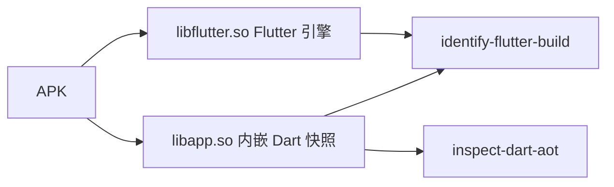

import { Meta } from '@storybook/addon-docs/blocks';

<Meta id="flutter-analysis" title="移动与桌面应用包/框架与系统/Flutter 应用" name="Docs" />

# Flutter 应用

Flutter 应用在包结构上与普通 Android 应用不同：Dart 业务代码经 AOT 编译进每个 ABI 目录下的 `libapp.so`，内嵌 Dart VM 与 isolate 快照；Flutter 引擎本体放在 `libflutter.so`。普通 Android 命令靠 JADX 建立的类视图看不到这些 Dart 代码（Android 包检查见 [6.1.1 应用分析](?path=/docs/android-analysis--docs)）。REA 的 Flutter 命令族改用**纯解析**回答两步问题：`identify-flutter-build` 识别构建事实——是否检出、快照哈希、每 ABI 的引擎事实；`inspect-dart-aot` 解出所选 ABI 的快照结构与字符串池投影。全程免引擎、免安装、免执行、免外部查询，是 Flutter 逆向的分诊（triage）步骤：快照哈希是通向 Dart SDK 版本的钥匙，而知道 SDK 版本才谈得上用布局专属解析器做更深的恢复。



| 命令 | 回答的问题 |
| --- | --- |
| `rea identify-flutter-build <apk>` | 这是什么 Flutter 构建：是否检出、快照哈希、每 ABI 引擎事实 |
| `rea inspect-dart-aot <apk> [--abi <label>]` | 所选 ABI 的 `libapp.so` 里有什么：快照段、哈希、字符串池投影 |

MCP 侧一一对应下划线形式：`identify_flutter_build`（带 `path`）、`inspect_dart_aot`（带 `path` 与可选 `abi`）。

## 快速上手

前置：不需要安装任何引擎或工具——识别与解析都是 REA 内置的纯解析，直接对 APK 跑两条命令：

```sh
rea identify-flutter-build /targets/Example.apk
rea inspect-dart-aot /targets/Example.apk
rea inspect-dart-aot /targets/Example.apk --abi armeabi-v7a
```

识别输出应能核对到：`flutter_detected`（存在任一 `lib/<abi>/libapp.so` 即为 true）、快照哈希，以及每个 ABI 的 `libflutter` 事实（字节大小、SHA-256、build id、可能出现的版本与工具链标签）。AOT 输出应能核对到：四个 `_kDart*Snapshot*` 快照段、来自 VM 与 isolate 头的哈希，以及 `package:` / `dart:` URI 与标识符 token 的计数。

`inspect-dart-aot` 不带 `--abi` 时按固定优先级选 ABI：arm64-v8a → x86_64 → x86 → armeabi-v7a → 其余按字母序。显式 `--abi` 填 `identify_flutter_build` 报告的目录标签，非标准标签也能选中并原样保留。需要保存或过滤结果时加全局选项 `--json`（见 [1.3 CLI 与 Evidence](?path=/docs/cli-evidence--docs)）。

## 识别构建事实

`identify-flutter-build` 扫描 APK 内各 ABI 目录，以字节模式提取事实，不执行包体也不联网。结果分两组：面向 `libapp.so` 的检出与哈希，面向 `libflutter.so` 的引擎事实。

### 检出与快照哈希

- **`flutter_detected`** 在存在任一 `lib/<abi>/libapp.so` 时为 true；负结果同样报告完整覆盖——"不存在"本身就是答案。
- **`snapshot_hash`** 是 `libapp.so` 中快照 magic（`f5 f5 dc dc`）之后 20 字节处的 Dart 构建哈希。识别操作按字节模式扫描；AOT 检查读导出的 VM 与 isolate 头，两者口径不同。
- **`snapshot_hash_sources`** 计数所选操作观察到的有效记录；记录彼此不一致时，不同值保留进 `snapshot_hash_candidates`，`snapshot_hash` 置 null 且 `coverage: "partial"`——REA 保留歧义，不替你挑一个。
- **`elf_header_valid`** 校验受支持的小端 ELF32/ELF64 头、表项宽度与表范围是否落在库文件实际字节长度内。截断、畸形或不支持的头报 false 并把覆盖降为 partial，但字节扫描出的哈希仍保留。该检查不证明表内容或导出符号有效。
- APK 在解析前先做摘要，`target.sha256` 把观察绑定到确切的输入。

### libflutter 引擎事实

每个 ABI 独立观察：库字节大小、SHA-256 摘要、来自 ELF 声明 `PT_NOTE` / `SHT_NOTE` 范围的 GNU build id，以及构建携带的带标签字符串。判读规则：

- `Dart VM version` 字符串在 release 引擎构建中常被 strip——缺失报 null，是明确答案而非解析失败；Android clang/LLVM 工具链行按原文保留，作为构建出处。
- `build_id` 只在所有声明的 note 范围都检查过且只发现一个 ID 时才填；冲突 ID、畸形或受限的 note 元数据把覆盖降为 partial；不同 ID 保留在 `build_id_candidates`。声明范围之外的字节匹配不能充当 build id。
- 带标签字符串必须匹配完整文法才发布；被文法或投影上限裁掉的标签分别由 `dart_version_capped`、`toolchain_capped` 报告，任一出现识别覆盖即为 partial；跨读取块切分的值会保留，但不发布截断的前缀。
- 某 ABI 只有 `libapp.so` 没有 `libflutter.so`（或反之）时，`coverage` 同样报 partial。

## 解 Dart AOT 快照

`inspect-dart-aot` 完整读取所选 ABI 的 `libapp.so`，回答"载荷里到底有什么"。读法分两层：先解快照结构与头，再从 isolate 数据段投影字符串池。

### 快照结构与头部

- 四个 `_kDart*Snapshot*` 符号通过 ELF **动态符号表**定位（ELF32 与 ELF64、小端、逐读边界检查），各自报告文件偏移与大小；数据段携带 `f5f5dcdc` magic，解析出头部 kind 与长度（存储长度不含 4 个 magic 字节）。
- 完整结构覆盖目前要求头部 kind 为 3——受支持的 [Dart 2.14 布局](https://github.com/dart-lang/sdk/blob/2.14.0/runtime/vm/snapshot.h)中的 FullAOT 值。kind 编号随 Dart 版本变化，其他值原样保留并报 partial，不猜测含义；声明长度放不进所属符号的头部保留观测字段并报 partial。
- 地址解析检查所有重叠的 `PT_LOAD` 解释（含部分重叠）：等价映射合并，冲突映射让受影响符号保持未解析并限定覆盖；动态 hash、symbol、string 表用同一套映射检查。
- 没有导出快照符号的载荷直接拒绝，不做猜测。

快照哈希读自每个导出数据符号开头的头：完整哈希覆盖要求 VM 与 isolate 双方都有有效头；同一符号内的重复记录不能顶替另一方的头；别名或重叠的数据符号报 partial。

### 字符串池投影

从 isolate 数据段投影三类不同的字符串，各自带计数，截断时报 `coverage: "partial"`：

- `package:` 源 URI——应用自身与依赖的 Dart 文件，相当于一份依赖清单；
- `dart:` SDK URI——应用用到了哪些 SDK 库；
- 标识符形状的 token。

官方基准（Flutter Gallery 2.9.2）：arm64-v8a 与 x86_64 上为 756 个 package URI、201 个 dart URI，armeabi-v7a 上为 212 / 48；响应中每类最多保留 500 条。`libapp.coverage` 描述结构检查，`string_pool.coverage` 描述这个有界投影；任一为 partial 则整体 partial。

## MCP 摘要交付与分页

CLI 一次性输出永远是完整版；MCP 的 `inspect_dart_aot` 在 `detail` 省略或为 `"complete"` 时同样返回全量。`detail: "summary"` 只返回所选目标/ABI/库身份、全部快照头、结构覆盖、字符串池覆盖与原始下界计数，不带字符串列表；同时保留完整源 Evidence，并返回一个关联的 `inspect_analysis_view` 摘要。分析与 ABI 选择不受影响。

分页读回字符串：用 `normalized_result.parent_evidence_id` 作 retained source 调 `inspect_analysis_view`，视图形如 `view: {kind: "dart-aot", collection: "package_uris", offset: 0, limit: 64}`。collection 有 `package_uris`、`dart_uris`、`class_like_tokens` 三种。判读要点：

- 页面保留原始字符串与顺序、所选 ABI、库身份与源覆盖；
- `returned_counts` 描述生产方返回的行数，以 `_at_least` 结尾的计数仍是下界；
- 翻尽整个页序列不会把部分池变成完整池，也不会把字节模式 token 变成类型化的类或函数；
- 视图不重开 APK；原 Evidence 在其既有 session 生命周期内仍可导出；
- summary 需要 retaining server；旧 server 在 schema discovery 后仍保留完整请求。

## 预算与容量边界

| 项目 | 预算 | 超出时的行为 |
| --- | --- | --- |
| APK 快照 | 2 GiB（复制过程也计入） | `resource_constraint` |
| 识别的累计库提取 | 768 MiB（提取前核对声明大小） | `resource_constraint` |
| 单库读取 | 256 MiB | `resource_constraint` |
| ZIP 元数据 | 8 MiB | `resource_constraint` |
| ELF 头 + note 表 + note 载荷 | 共享 8 MiB 元数据预算 | partial，`build_id: null` |
| 不同 build id / 非空 note 范围 | 64 个 / 1024 个 | partial，保留已检候选 |
| ABI 清单 / 单库路径长度 | 32 个 / 1024 字节 | 拒绝重复的相关库路径 |
| 不同快照哈希（识别） | 64 个 | `resource_constraint` 拒绝，不静默丢弃 |

两条命令都先把 APK 复制成 provider 自有的只读快照，再摘要与解析，并发修改的原始文件不会混进同一次观察：复制时 pin 一个已接受的描述符，并在复制后核对身份、大小、模式与时间戳；快照只在全部自有 reader 与文件描述符成功关闭后才删除，失败的关闭与清理会保留并在 `close()` 时重试。源权限失败保持 `access_denied`，源身份变化保持 `artifact_changed`，provider 存储故障报 `resource_constraint` 并带原生 I/O 原因。取消在复制、元数据/符号遍历、字符串扫描与清理之后都会被检查。

AOT 侧与所选 ABI 相关的三条边界：库预算在选定 ABI 之后才应用到所选库，未选中的超大库不会阻塞它；未定义的动态符号导入不算快照导出；section-stripped 的库要求能从 `DT_HASH` 或 `DT_GNU_HASH` 得到有界符号数，两者皆无的布局会被拒绝，符号名与终结符必须装进链接的字符串表。

## 能力边界

- **不做哈希→SDK 映射。** 把快照哈希对应到 Dart SDK 发行版需要外部数据集（如 reFlutter 维护的），REA 刻意不查——识别只负责把哈希解出来。
- **字符串池是字节模式投影，不是反序列化的 cluster 语义。** 类型化的类与函数恢复需要 SDK 专属解析器（快照布局随版本变——这正是哈希是钥匙的原因）；`class_like_tokens` 里含附带匹配。
- **不执行 APK、不安装引擎、不联网查询。**
- **后续入口。** 类型化恢复可从 JEB 的 GUI Dart unit 与针对 `libapp.so` 的原生分析入手——JEB 见 [6.1.4 JEB 项目](?path=/docs/jeb-projects--docs)，原生路线见 [4.1.1 原生调查](?path=/docs/native-investigation--docs)。

## 最佳实践

- **先识别，后解快照。** 识别便宜（字节模式扫描）且覆盖全部 ABI；用它确认检出、拿到快照哈希与 ABI 目录标签，再把标签作为 `--abi` 传给 `inspect-dart-aot`，只完整读取真正要解的那一个库。
- **把哈希当钥匙，但别在 REA 里找 SDK 版本。** 拿 `snapshot_hash` 去外部数据集（如 reFlutter 维护的）映射 Dart SDK 发行版；知道 SDK 版本后才能选对布局专属解析器做类型化恢复。
- **引用结论时绑定证据。** 带上 `target.sha256`；识别与 AOT 的哈希口径不同（字节扫描 vs 头部解析），出现 `snapshot_hash_candidates` 时如实报告歧义，不要自行挑选。
- **大 APK 或 CI 先对预算表。** 超大库、受限元数据都会把覆盖降为 partial；MCP 场景结果大时用 `detail: "summary"` 加分页，避免一次性回传整份字符串列表。
- **用官方验证通道确认环境与结论。** `npm run verify:flutter -- --apk PATH [--plain-apk PATH]` 会经编译版 CLI 与 stdio MCP 各跑一遍两个工具、比较 Evidence 并检查每个 ABI；配合 `--expectations scripts/fixtures/flutter-gallery-expectations.json` 与 Gallery 2.9.2（112 MB、三 ABI）可核对每 ABI 的引擎标签、URI 计数与快照哈希。官方记录值：三个 ABI 报告同一哈希 `65817c30a78bb44c3dc3771876b6010a`（来自两个快照段）、各有引擎 build id、无 Dart 版本标签（release 引擎的预期）与 Android clang 工具链行；plain aapt2 构建的 APK 报 not-detected 且覆盖完整。可选的 `--plain-apk` 用于检查负检出。

## 常见问题

- `snapshot_hash` 是 null，还带出 `snapshot_hash_candidates`
  这是多条有效记录不一致：REA 保留全部不同值并把覆盖降为 partial，而不是静默挑一个。对照 `snapshot_hash_sources` 数出的记录数，再用 `inspect-dart-aot` 读 VM 与 isolate 头交叉核对。
- `libflutter` 事实里没有 Dart 版本字符串
  release 引擎构建常把 `Dart VM version` 字符串 strip 掉，null 是明确报告而非故障；工具链行通常仍在，可作构建出处。怀疑标签是被裁掉而非缺失时，看 `dart_version_capped` / `toolchain_capped`。
- `inspect-dart-aot` 一上来就拒绝
  两种硬拒绝：载荷没有导出快照符号；或库被 section-stripped 且没有 `DT_HASH`、`DT_GNU_HASH` 可界定符号数。识别操作不受影响，仍可按字节模式给出快照哈希。
- `build_id` 为 null
  声明的 note 范围冲突、畸形或超预算（64 个 build id / 1024 个非空范围 / 8 MiB 元数据）都会把覆盖 partial 化并保留候选，先看 `build_id_candidates`；声明范围之外的字节匹配不能作为 build id。
- `class_like_tokens` 里出现完全无关的标识符
  字符串池投影是字节模式匹配，`class_like_tokens` 含附带匹配，不是类型化的类/函数恢复；类型化恢复需要按快照哈希确定 SDK 版本后的专属解析器。

## 总结回顾

摘要：

REA 把 Flutter 应用的逆向起点做成纯解析的两步：`identify-flutter-build` 扫描各 ABI 目录，给出 `flutter_detected`、快照哈希与每 ABI 的 `libflutter` 引擎事实（大小、SHA-256、GNU build id、带标签字符串），歧义值进 candidates 而不替读者挑选；`inspect-dart-aot` 完整读取所选 ABI 的 `libapp.so`，解出四个快照段与头部（kind 3 即 FullAOT 才有完整结构覆盖）、来自 VM 与 isolate 头的哈希，以及 `package:` / `dart:` URI 与标识符 token 的字符串池投影。MCP 场景可用 `detail: "summary"` 与 `inspect_analysis_view` 分页读回。全部操作免引擎、免执行、免外部查询；2 GiB 快照、768 MiB 提取、8 MiB 元数据等预算界定了覆盖范围；哈希→SDK 的映射与类型化恢复被刻意留在命令族之外，靠外部数据集与后续工具接手。

一句话：

> Flutter 逆向的第一把钥匙是 `libapp.so` 里的快照哈希——REA 用纯解析把它解出来，而把它换算成 Dart SDK 版本，要拿哈希去外部数据集查。

知识要点：

- Flutter 应用的产物与普通 APK 差在哪，为什么 6.1.1 的 JADX 类视图看不到 Dart 代码？
- 两条命令分别回答什么问题，`flutter_detected`、`snapshot_hash` 与 `libflutter` 事实怎么读，哈希记录不一致时 REA 如何处理？
- `inspect-dart-aot` 返回哪些快照段与头部，完整结构覆盖要求什么 kind，字符串池投影包含哪三类内容、官方基准计数是多少？
- MCP 的 summary 交付与三种 collection 分页怎么用，`_at_least` 计数意味着什么？
- 预算与容量上限分别是多少、超出时报什么，哪些任务被刻意排除、后续靠什么接手？

## 参考资料

- [REA Flutter build identification（仓库 docs/flutter-analysis.md）](https://github.com/morluto/rea/blob/main/docs/flutter-analysis.md)
- [Dart VM 快照布局常量（dart-lang/sdk 2.14.0 runtime/vm/snapshot.h）](https://github.com/dart-lang/sdk/blob/2.14.0/runtime/vm/snapshot.h)
