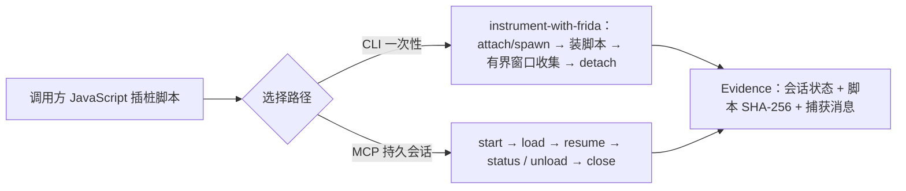

import { Meta } from '@storybook/addon-docs/blocks';

<Meta id="frida-instrumentation" title="原生二进制/动态分析/Frida 插桩" name="Docs" />

# Frida 插桩

静态分析回答「代码里有什么」，Frida 插桩回答「运行时实际发生了什么」。REA 通过可选的 Frida Node 绑定提供原生动态分析：你写一段 JavaScript 插桩脚本，REA 把它装进一个显式选定的目标进程，收集脚本用 `send()` 发回的消息，并把会话状态、脚本摘要与消息留存为 Evidence。REA 不替你搭 Frida 环境——宿主机侧的绑定是可选依赖，目标侧的 frida-server 由使用者自备——也不自动挑选目标，每次插桩都必须明确给出设备、模式与目标，且 REA 绝不杀死目标进程。使用路径有两条：CLI 的一次性命令 `instrument-with-frida` 适合「装脚本、观察一个有界窗口、拿 Evidence 结束」；MCP 的持久会话操作适合分段加载脚本、轮询状态的长驻观察。本课讲清前置条件、两条路径的用法、证据判读，以及与「原生调查」静态分析的配合。



| 条目 | 默认行为或取值 | 回查 |
| --- | --- | --- |
| CLI 命令 | `list-frida-devices`、`list-frida-processes`、`instrument-with-frida` | 设备与进程发现 |
| MCP 工具 | 发现 2 个 + 会话生命周期 6 个 + 一次性 `instrument_with_frida` | 持久会话 |
| 观察窗口 | `--duration-ms` 默认 1000，取值 0–60000 | 脚本与观察窗口 |
| 脚本来源 | `--script` 内联或 `--script-file` 文件，二选一 | 脚本与观察窗口 |
| 消息捕获 | 上限 16 MiB，超出时报告截断 | 证据判读 |
| Frida 绑定 | 可选依赖 `frida` 17.23.2，仅在 Frida 操作运行时加载 | 前置条件 |
| 远程地址 | `host[:port]`，IPv6 地址加方括号；keepalive 单位为秒 | 远程设备 |
| 认证值 | 只存活于当次调用或会话，从不写入 Evidence | 远程设备 |
| 目标保护 | REA 不装 frida-server、不杀目标；关闭会话后目标状态报告为 `unknown` | 生命周期规则 |

## 准备与设备发现

### 前置条件

插桩依赖三件事，都在首次操作前确认：

1. **宿主机侧：REA 的 Frida 绑定。** `frida` 是 npm 可选依赖（版本固定 17.23.2），只有在 Frida 操作真正运行时才会加载，安装 REA 时它可能并未装上。`rea capabilities` 会报告 Frida 相关操作是否可用；REA 仓库自带 `npm run verify:frida` 验证通道（要求 Linux 宿主机与可选绑定），可用来确认绑定安装完好。
2. **目标侧：可连接的 Frida 环境。** 本机进程由 Frida 直接注入；远程设备需要目标上已运行 frida-server。REA 明确不做这件事——它从不在目标上安装 Frida 服务端。
3. **一个显式目标。** attach 模式需要进程 PID，spawn 模式需要程序路径。REA 不会自动选择目标进程。

脚本以目标进程的全部权限运行——它能访问该进程的内存、文件系统与网络。只对自己有权分析的目标写探针。

### 设备与进程发现

两个只读命令回答「这台机器能插桩什么」。列出当前可用的 Frida 设备：

```bash
rea list-frida-devices --json
```

输出包含设备数组，每个设备带 `device_id`、`name`、`type`（设备类型由 Frida Core 报告，取值见 Frida Core API）；`cleanup_error` 为 null 表示清理无异常。

列出某台设备上可见的进程：

```bash
rea list-frida-processes --device-id local --json
```

`--device-id` 取上一步输出的设备标识，本机设备用 `local`；每个进程报告 `pid`、`name` 与可为 null 的 `identifier`。这两个命令也是插桩前的就绪性检查：设备列不出来或进程列表异常时，先解决 Frida 环境再谈插桩。远程端点改用 `--remote-address`（见「远程设备」），与 `--device-id` 互斥。

## 一次性插桩

`instrument-with-frida` 是 CLI 侧的插桩命令：把一段脚本装进选定目标，观察一个有界时间窗口内发回的消息，然后 detach 并返回 Evidence。命令形态：

```bash
rea instrument-with-frida <mode> <target> [options] --json
```

### attach 与 spawn

位置参数 `mode` 决定 REA 怎么进入目标。附加到一个已在运行的进程时用 `attach`，`target` 必须是正整数 PID：

```bash
rea instrument-with-frida attach 4242 --script-file ./hook.js --json
```

由 REA 启动目标程序时用 `spawn`，`target` 是程序路径。spawn 出的进程先保持暂停，脚本加载完成后才继续运行，入口之前的代码也能被钩住。`--argument` 可重复传入，把参数逐个透传给目标程序：

```bash
rea instrument-with-frida spawn /absolute/path/to/program --script-file ./hook.js --argument --verbose --json
```

边界：`--argument` 只在 spawn 模式有效，attach 下传它直接报输入错误；attach 的 `target` 不是正整数同样被拒绝。目标设备用 `--device-id` 指定，缺省 `local`。

### 脚本与观察窗口

`--script` 与 `--script-file` 二选一，同时给出或都不给都会被拒绝。探针脚本用 Frida JavaScript API 编写，在目标进程内执行，用 `send()` 把观察结果发回 REA。钩住一个导出函数、报告每次调用参数的最小脚本：

```js
// hook.js：对目标模块的 getenv 导出挂钩，报告被查询的环境变量名
const mod = Process.getModuleByName("TARGET_MODULE");
Interceptor.attach(mod.getExportByName("getenv"), {
  onEnter(args) {
    send({ name: args[0].readCString() });
  },
});
```

模块名与导出名按静态分析的结论填写（见「与静态分析配合」）。观察窗口由 `--duration-ms` 控制，默认 1000 毫秒，上限 60000。窗口结束时 REA 卸载脚本、detach，并把捕获到的消息写进 Evidence；需要更长的观察用持久会话（见下）。

### 证据判读

命令返回的 Evidence 是插桩结论的唯一载体。返回结构（字段节选，命名与官方契约一致，值为示意）：

```json
{
  "evidence": {
    "evidence_id": "ev_<64位十六进制>",
    "provider": { "id": "frida" },
    "operation": "instrument_with_frida",
    "confidence": "observed",
    "normalized_result": {
      "session_id": "<uuid>",
      "device_id": "local",
      "target": "/absolute/path/to/program",
      "pid": 4242,
      "mode": "spawn",
      "state": "detached",
      "scripts": [{ "script_id": "<uuid>", "name": "rea-<uuid>" }],
      "messages": [{ "type": "send", "payload": { "name": "LANG" } }],
      "messages_truncated": false,
      "source_kind": "file",
      "source_path": "/absolute/path/hook.js",
      "source_sha256": "<64位十六进制>"
    }
  },
  "cleanup_error": null
}
```

判读要点：

- **会话与脚本身份。** `device_id`、`mode`、`target`、`pid` 记录「对什么插了桩」；`source_path` 与 `source_sha256` 记录「装了哪个脚本」。脚本源码本身不入 Evidence——只有路径与 SHA-256，可随时与本地文件比对确认「当时跑的就是这份脚本」。
- **消息即观察结果。** `messages` 数组是窗口期内脚本 `send()` 发回的内容，`type` 为 `send` 的消息带 `payload`。这是把运行时行为写进证据链的入口。
- **截断标记。** 消息捕获上限 16 MiB；`messages_truncated` 为 true 表示窗口内消息太多被截断，证据不完整，应缩小探针输出或缩短窗口后重跑。
- **清理状态。** 顶层 `cleanup_error` 为 null 表示卸载与 detach 干净完成；非 null 时观察结果仍然有效，但目标上可能残留会话资源，按错误信息处理后重试关闭。
- **编码限制。** 文件脚本含非法 UTF-8 时，REA 仍按替换解码加载，但会在 Evidence 中记录该限制，并通过 `raw_result.source_representation` 记录编码、解码模式与实际传给 Frida 的源串摘要 `loaded_source_sha256`。

## 持久会话

MCP 暴露 9 个 Frida 工具：`list_frida_devices` 与 `list_frida_processes` 对应 CLI 的两个发现命令，其余 6 个构成可分步控制的会话生命周期，另有一次性工具 `instrument_with_frida` 与 CLI 命令共用同一工作流。需要长时间观察、分段加载脚本或中途检查状态时，用持久会话而不是反复跑一次性命令。

### 会话操作序列

典型顺序：

1. `start_frida_session`——attach 到 PID 或 spawn 程序，返回 `session_id` 与初始 `state`。spawn 会话从 `paused` 开始，attach 会话直接 `running`。
2. `load_frida_script`——把脚本装进会话，`source_kind` 为 `inline` 时给 `source`，为 `file` 时给 `path`；返回 `script_id`、`source_sha256` 与已捕获消息。
3. `resume_frida_session`——把暂停的 spawn 会话推进到 `running`；attach 会话已在运行，不能也不需要 resume。
4. `frida_session_status`——随时查会话状态、已装脚本列表与累计消息，消息历史受捕获预算约束并报告截断。
5. `unload_frida_script`——按 `script_id` 只卸载一个脚本，会话与其他脚本继续存活。
6. `close_frida_session`——卸载会话全部脚本并 detach，返回 `target_state: "unknown"`。

### 生命周期规则

这些规则决定异常时目标会处在什么状态：

- **spawn 暂停是显式设计。** 暂停中的 spawn 会话只有在脚本清理或 detach 确认插桩已释放后，REA 才会恢复目标运行；两条清理路径都失败时目标保持暂停，清理错误被保留报告，可重试。
- **REA 永不杀目标。** 关闭会话只卸载脚本并 detach；目标的最终存活状态报告为 `unknown`，由调用方自行确认。
- **会话寿命不超过 server 进程。** MCP 会话随 MCP 服务器进程结束而结束；启动失败时已获取的 Frida 句柄（含未 attach 的暂停 spawn）会被保留，供之后的清理重试，而不是当作已释放。

## 远程设备

远程 Frida 端点用 `host[:port]` 表示，IPv6 地址加方括号。三个 CLI 命令共用同一组远程选项：`--remote-address`、`--token`、`--certificate`、`--origin`、`--keepalive-interval`（单位为秒，与 Frida Core 17.23.2 的 keepalive 语义一致）：

```bash
rea list-frida-processes --remote-address 192.0.2.10:27042 --json
```

凭据纪律由契约保证：认证值只在当次调用或会话内有效，从不写入 Evidence，也不要把凭据拼进端点地址。Evidence 只保留非认证的目标选择信息——设备或端点、模式、程序或 PID、spawn 参数。MCP 工具的同一能力通过 `remote` 对象传入，字段为 `address`、`token`、`certificate`、`origin`、`keepalive_interval`。

## 与静态分析配合

探针「钩哪个函数」的答案几乎总来自静态分析。[4.1.1 原生调查](?path=/docs/native-investigation--docs)的 `rea function`、`decompile`、`xrefs` 负责缩小候选：从字符串、导入表或交叉引用找到可疑函数的符号或地址，先读反编译确认参数含义，再写探针到运行时验证。典型闭环：

1. 静态定位：`rea analyze` 与 `rea function` 给出候选函数的模块、符号或地址。
2. 写探针：用 `Process.getModuleByName` 加 `getExportByName` 解析静态给出的导出名，或直接对静态给出的地址 `Interceptor.attach`；`onEnter(args)` 读参数、`onLeave(retval)` 看返回值，`send()` 回传。
3. 运行验证：一次性命令拿短窗口证据，或持久会话做长观察。
4. 归档：Evidence 带 `evidence_id`，与静态证据同链留存；`source_sha256` 保证探针可复核。

边界：stripped 二进制可能没有可用符号名，探针退回到按地址挂钩；脚本能以目标权限做任何事，不要把探针指向不可信目标。

## 最佳实践

- **attach 还是 spawn。** 目标是长期运行、不便重启的进程，用 attach 加短窗口；需要受控重现、或关心入口前的行为，用 spawn——脚本装载先于目标执行，这是 attach 给不了的观察位。
- **一次性还是持久会话。** 一次短观察就能拿到结论的用 CLI 一次性命令，Evidence 一步到位；要分段加载多个脚本、轮询状态或交互控制时用 MCP 会话，别把一次性命令当轮询器反复跑。
- **脚本用文件而非内联。** `--script-file` 让 Evidence 记录可追溯的路径与 SHA-256，脚本可复用、可版本化；内联只留给几行的一次性探针。
- **预算消息量。** 16 MiB 捕获上限意味着探针应该自己过滤——只在条件命中时 `send()`，而不是全量转发；截断的证据要重跑，不要直接当结论用。

## 常见问题

- spawn 启动后目标一直没动静？
  spawn 会话默认暂停，等脚本加载后需要 resume：一次性 CLI 流程自动处理；MCP 流程必须显式调用 `resume_frida_session`。如果脚本清理失败，目标会一直保持暂停，按 Evidence 中的清理错误处理后重试关闭。
- 命令报 `Provide exactly one of --script or --script-file.`？
  两个都传了或两个都没传。脚本来源必须且只能给一个。
- attach 模式传 `--argument` 被拒绝？
  `--argument` 只用于 spawn 模式向目标程序传参；attach 的目标是已在运行的进程，没有启动参数可传。
- `messages_truncated` 为 true？
  窗口期消息超过 16 MiB 捕获上限，证据被截断。给探针加条件过滤缩小输出，或缩短 `--duration-ms`，然后重跑。
- 远程认证选项报 `Remote credentials and connection options require remoteAddress`？
  `--token` 等认证与连接选项必须与 `--remote-address` 同时出现；只给凭据不给端点会被拒绝。
- `close_frida_session` 返回 `target_state: "unknown"` 是失败了吗？
  不是。这是正常契约：REA 卸载脚本并 detach 后不跟踪目标存活状态，也绝不杀目标，所以最终状态如实报告为未知，由调用方自行确认。

## 总结回顾

摘要：

REA 的 Frida 插桩把调用方编写的 JavaScript 探针装进显式选定的目标进程，运行时收集 `send()` 消息并留存为 Evidence。宿主机依赖可选的 `frida` Node 绑定（17.23.2），目标侧环境（本机注入或 frida-server）由使用者自备，REA 从不装服务端也不杀目标。`list-frida-devices` 与 `list-frida-processes` 盘点可插桩对象；CLI 的 `instrument-with-frida` 一步完成 attach/spawn、装脚本、有界窗口收集与 detach，`--duration-ms` 默认 1000 毫秒、上限 60 秒，消息捕获上限 16 MiB 并报告截断；MCP 的六个会话操作支持暂停恢复、分段装卸脚本与状态轮询。Evidence 记录会话身份、脚本路径与 SHA-256、捕获消息与清理状态——脚本源码与认证值都不入库。远程端点用 `host[:port]` 加可选 token、certificate、origin、keepalive（秒）连接。与静态分析配合：`rea function`、`decompile`、`xrefs` 出候选，探针到运行时验证，证据同链归档。

一句话：

> 插桩三要素——显式目标、调用方脚本、有界窗口——共同保证运行时看到的每条消息都能追溯到具体进程与具体脚本。

知识要点：

- REA 的 Frida 绑定装在哪一侧？目标侧的 frida-server 由谁负责？
- CLI 三条 Frida 命令分别回答什么问题？持久会话操作为什么只在 MCP 提供？
- attach 与 spawn 的 `target` 各是什么？spawn 会话为什么从 paused 开始？
- Evidence 为什么只存脚本路径与 SHA-256 而不存源码？`messages_truncated` 为 true 时怎么办？
- 关闭会话后 `target_state` 为什么是 `unknown`？哪些值从不进入 Evidence？

## 参考资料

- [REA Frida instrumentation 指南](https://github.com/morluto/rea/blob/main/docs/frida-instrumentation.md)
- [REA Frida CLI 命令定义（命令、参数与校验规则）](https://github.com/morluto/rea/blob/main/src/cli/fridaCommands.ts)
- [Frida Core API（设备、会话与脚本加载）](https://frida.re/docs/frida-core-api/)
- [Frida JavaScript API（目标侧插桩：Interceptor、send）](https://frida.re/docs/javascript-api/)
