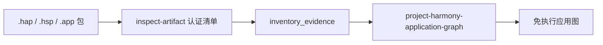

import { Meta } from '@storybook/addon-docs/blocks';

<Meta id="harmony-analysis" title="移动与桌面应用包/框架与系统/HarmonyOS 应用" name="Docs" />

# HarmonyOS 应用

鸿蒙应用的入口与 Android 路线不同：REA 对 HarmonyOS 的支持目前是第一增量（HarmonyOS 路线 #1431）——**包识别与组件清单**。它不装 SDK、不启引擎、不执行包体，先用共享的 hardened ZIP 读取器认证 `.hap` / `.hsp` / `.app` 包的清单，再把认证过的清单投影成免执行的应用图。读完本课你应能预测：对任意一个鸿蒙包，REA 会报告里面有哪些组件文件及其哈希、打包模型提示、运行时家族与 N-API 桥假设；同时记住核心边界——每个断言都只是"路径存在"，清单语义、Ark 字节码内容、资源解析与签名验证不在当前能力内，它们留在投影的 `limitations` 数组里，直到专属 HarmonyOS provider 出现。



| 后缀 | REA 分类 | 回查要点 |
| --- | --- | --- |
| `.hap` | 安装模块 | 可安装的应用模块 |
| `.hsp` | 运行时共享包 | 供多个模块共享运行时代码的包 |
| `.app` | 发行 App Pack | HAP/HSP 子包按路径列出、不递归清点；仅对通过 ZIP magic 验证的根输入生效 |
| `.har` | 不按后缀分类 | `.har` 也是 HTTP Archive JSON 的后缀；鸿蒙共享包要求验证过的 ZIP 字节，当前以显式限制延迟 |

## 快速上手

前置：不需要任何外部 SDK、工具链或引擎。清单与投影分三步，对包直接跑：

```sh
rea inspect-artifact /path/to/Example.hap --format json > inspection.json
node --input-type=module -e 'import { readFileSync } from "node:fs"; console.log(JSON.stringify({ inventory_evidence: [JSON.parse(readFileSync("inspection.json", "utf8"))] }));' > projection-input.json
rea project-harmony-application-graph projection-input.json --format json
```

第二步的 node 一行命令把 `inspection.json` 包成 `inventory_evidence` 数组——这就是投影的输入契约：一份清单证据。MCP 侧同一工作流收敛为一次调用：`project_harmony_application_graph` 接收同样的 `inventory_evidence` 输入；CLI 与 MCP 共享工作流，内联返回 artifact-bound Evidence。

投影输出应能核对到：六类组件（清单、Ark 字节码、资源、原生库、JavaScript、签名条目）的精确路径、artifact ID 与哈希；Stage / FA / `unknown` 打包模型提示；FA 的 `assets/<module>/resources/` 与 Stage 的 `resources/` 资源；`ark` / `native` / `javascript` 运行时家族提示；字节码与 `libs/<abi>` 原生库之间的 N-API 桥假设。

## 包格式识别

分类的判定基础是字节而不是后缀：根输入先要通过共享 hardened ZIP 读取器（`src/artifacts/`）的 ZIP magic 验证，才进入鸿蒙分类。两个边界直接从这个机制推出：

- **`.app` 只在根输入上成立。** App Pack 分类要求输入本身就是通过 ZIP magic 验证的根文件；嵌套在其他包（如 IPA）里、以 `.app` 结尾的 ZIP 成员保持通用 `zip` 分类，不会被当成 App Pack。
- **`.har` 刻意不按后缀识别。** `.har` 同时是 HTTP Archive（网络抓包 JSON）的后缀，REA 拒绝靠后缀猜测：鸿蒙共享包必须验证 ZIP 字节，这部分能力当前以显式限制的形式延迟，而不是静默误分类。

`.app` 作为 App Pack 只列 HAP/HSP 子包的路径，不递归清点子包内部；要深入子包，对列出的每个子包再跑一遍三步工作流。

## 组件清单投影

投影把认证过的清单组织成应用图，报告分三组读：组件与哈希、打包模型提示、运行时家族与桥假设。

### 组件路径与哈希

- 每个组件报告精确路径、artifact ID 与哈希，覆盖清单、Ark 字节码、资源、原生库、JavaScript 与签名条目六类。
- 路径由文件与切片（slice）出现提供，同时覆盖组件与子包路径；目录树与符号链接在源清单中保留身份，但不归为代码文件。
- 支持的源码扩展名与组件行共用同一分类规则——某个成员算不算"代码文件"，全套口径一致。
- 无法认证的组件路径同样会列出（ID 与哈希未知），包括加密条目；它们把投影覆盖降为 partial，但路径本身不丢。

### 打包模型提示

打包模型是从文件存在性推断的提示：清单里有 `module.json` 条目才声称 Stage，有 `config.json` 条目才声称 FA，两者都没有就是 `unknown`。资源布局跟随模型：FA 资源位于 `assets/<module>/resources/`，Stage 资源位于 `resources/`。它是提示不是判定——要确认模型语义，需要超出当前增量的清单语义分析。

### 运行时家族与 N-API 桥

- 运行时家族提示 `ark` / `native` / `javascript` 来自路径与格式；Ark 与 JavaScript 提示分别汇总已分类的字节码与 JavaScript 列表。
- N-API 桥是路径假设：在字节码与 `libs/<abi>` 原生库之间按路径推测桥接关系。它是假设，不是已观察的原生边界——已观察边界在当前增量之外。

## 验证通道

官方验证通道在本机核对环境与投影行为。先取 fixture：`npm run fixtures:harmony` 下载 SHA-256 固定的 1.0.1 HAP release（来自 MIT 许可的 harmony-next-pipeline 源码仓库）到忽略的 `_reference/harmony-integration/`；pin 记录源 revision、release asset ID、大小与摘要。下载的构件不再分发，捆绑组件的许可也未经独立审计。

```sh
npm run fixtures:harmony
REA_HARMONY_TEST_HAP=_reference/harmony-integration/entry-default-unsigned.hap \
  npm run verify:harmony
```

通道同时演练编译版 CLI 与真实 SDK 连接的 stdio MCP：`inspect_artifact` 的真实性、投影确定性、Stage 模型路径提示、清单/字节码/资源的精确组件集、完整清单覆盖，以及 CLI/MCP 一致性。对这个 fixture，native 与桥集合为空是预期结果。

两条边界要记住：通道检查 fixture 没有 META-INF 签名条目，这不确立包是否已签名；release 构件的编译器/SDK 版本与可复现构建也未独立建立——通道不完成 #1431 的固定工具链验收，也不验证 Ark 解码或签名。要对已安装的 REA 包跑同样的检查，把 `REA_HARMONY_ENTRYPOINT` 指到它的 `scripts/rea.mjs`；默认通道用仓库构建。

## 能力边界

- **每个断言都是 path-presence only。** 投影证明"包里存在这个路径"，不解释它。引用结论时措辞跟着收窄：能说"清单含此组件、哈希为某值"，不能说"应用申请了某权限"。
- **五类语义留在 `limitations` 数组。** 清单语义（模块身份、abilities、入口、权限、依赖）、Ark 字节码内容与版本、资源解析、签名验证、已观察原生边界——当前增量全部不做，等专属 HarmonyOS provider；投影的 `limitations` 数组会如实列出这份边界。
- **清单认证不过就失败。** REA 对无法认证清单的包 fails closed，直接报错而不是带病输出。
- **更深的成员分析靠包外接手。** 当前投影不提供解包或解码；要继续分析原生库等成员，需在 REA 之外取出文件后走原生路线（入口见 [4.1.1 原生调查](?path=/docs/native-investigation--docs)）。

## 最佳实践

- **把投影当分诊，先读 `limitations`。** 投影回答"有什么、可能是什么模型、代码在哪些运行时家族"；还能不能深入、要靠什么接手，先看 `limitations` 数组与 partial 覆盖，再规划后续步骤。
- **App Pack 逐子包推进。** `.app` 只列子包路径；对列出的每个 HAP/HSP 各跑一遍三步工作流再按组件汇总，不要假设一次投影覆盖整个 App Pack。
- **交互用 MCP，脚本用 CLI 三步。** MCP 的 `project_harmony_application_graph` 一次吃 `inventory_evidence`；脚本与管道用 CLI 三步，中间文件 `inspection.json` 与 `projection-input.json` 本身可留档作证据。
- **引用绑定 artifact ID 与哈希。** 断言都落在路径与哈希上，引用时把 artifact ID 与哈希一并带上，措辞守住"path-presence only"。

## 常见问题

- `.har` 文件没有被识别成鸿蒙共享包
  这是刻意行为：`.har` 与 HTTP Archive JSON 撞名，REA 不按后缀分类，鸿蒙共享包要求验证 ZIP 字节；当前以显式限制延迟支持，没有绕过入口。
- 投影覆盖是 partial，有些组件只有路径没有 ID 与哈希
  包里存在无法认证的组件（包括加密条目），投影如实降级：路径保留，ID 与哈希未知。先读 `limitations` 数组确认语义边界，再判断这个包还能分析到什么程度。
- 打包模型提示是 `unknown`，或与我对应用的认知不符
  Stage 只从 `module.json` 条目声称，FA 只从 `config.json` 条目声称，其余一律 `unknown`。这是文件存在性提示，不是权威判定；确认模型语义需要当前增量之外的清单语义分析。
- 输入一个包，REA 直接失败、没有投影
  fails closed：清单无法通过认证时 REA 拒绝投影，而不是带病输出。这不等于文件损坏——先确认包的完整性与来源，再看具体错误信息。
- fixture 没有签名条目，能得出"未签名"吗
  不能。通道只检查该 fixture 没有 META-INF 签名条目；签名状态不在当前增量内，无法由这条检查确立。

## 总结回顾

摘要：

REA 对 HarmonyOS 的支持目前是第一增量（#1431）：包识别与组件清单。它用共享的 hardened ZIP 读取器认证 `.hap` / `.hsp` / `.app` 包——`.app` 只认通过 ZIP magic 验证的根输入、只列子包路径不递归，`.har` 因与 HTTP Archive 撞名刻意不按后缀分类——再把认证清单投影成免执行的应用图：六类组件的精确路径、artifact ID 与哈希，从 `module.json` / `config.json` 推断的 Stage/FA 打包模型提示与对应资源布局，`ark` / `native` / `javascript` 运行时家族，以及字节码与 `libs/<abi>` 原生库之间的 N-API 桥假设。CLI 走 inspect-artifact → 包装 `inventory_evidence` → project-harmony-application-graph 三步，MCP 的 `project_harmony_application_graph` 一步吃同样输入；官方验证通道用 SHA-256 固定的 fixture 核对投影确定性与 CLI/MCP 一致性。所有断言 path-presence only：清单语义、Ark 字节码内容、资源解析、签名验证与已观察原生边界留在 `limitations` 数组，等专属 provider；清单认证不过时 REA 直接失败。

一句话：

> REA 眼中的鸿蒙应用目前是一份经过认证的文件清单——它能证明包里有什么，还解释不了这些文件意味着什么。

知识要点：

- REA 认哪三种根格式？`.app` 的根输入限定与子包处理是什么，`.har` 为什么被刻意排除？
- CLI 三步工作流每步做什么？MCP 侧对应哪个工具、输入契约是什么？
- 投影报告哪些信息？Stage/FA 提示从哪来，运行时家族与 N-API 桥假设怎么读？
- 哪五类语义留在 `limitations` 数组？"path-presence only" 对引用结论的措辞意味着什么？
- 验证通道怎么跑、检查什么？"fixture 无 META-INF 签名条目"为什么不等于"未签名"？

## 参考资料

- [REA HarmonyOS 静态包清单（仓库 docs/harmony-analysis.md）](https://github.com/morluto/rea/blob/main/docs/harmony-analysis.md)
- [harmony-next-pipeline（验证通道 fixture 的来源仓库）](https://github.com/ohosvscode/harmony-next-pipeline)
