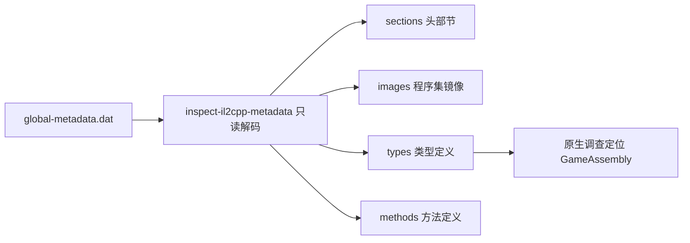

import { Meta } from '@storybook/addon-docs/blocks';

<Meta id="il2cpp-metadata" title="托管代码与字节码/IL2CPP 元数据" name="Docs" />

# IL2CPP 元数据

Unity 选择 IL2CPP 后端时，C# 代码被编译成原生机器码，但托管世界的名称并不会消失——它们集中存放在数据目录里的 `global-metadata.dat` 中。`rea inspect-il2cpp-metadata`（MCP 工具 `inspect_il2cpp_metadata`）只读解码这个文件，还原程序集镜像、类型定义与方法定义的名称和索引范围，以及全部头部节信息——不执行目标、不需要安装 Unity，也不需要 GameAssembly 二进制或 Hopper/Ghidra/IDA。它不做的事同样要先说清：不链接原生代码地址，不解密加密或混淆的元数据，也不返回字段、属性、签名、参数与泛型实例。Evidence 与 JSON 输出的通用约定见 [1.3 CLI 与 Evidence](?path=/docs/cli-evidence--docs)。



| 回查点 | 内容 |
| --- | --- |
| CLI 调用 | `rea inspect-il2cpp-metadata /absolute/path/global-metadata.dat --json` |
| MCP 工具 | `inspect_il2cpp_metadata`，`arguments.path` 必须是绝对路径 |
| 支持版本 | 29、31、39；其他版本直接拒绝 |
| 输入要求 | 普通文件（目录与符号链接拒绝），不超过 256 MiB |
| 完整报告上限 | 64 MiB |
| 魔数 | `0xFAB11BAF`（little-endian，JSON 数字） |
| 关键边界 | 不链接原生代码、不解密元数据、不返回字段/属性/签名 |

## 快速上手

前置：已安装 REA（见 [1.1 安装与设置](?path=/docs/installation--docs)）。路径指向任一 IL2CPP 应用的 `global-metadata.dat`，例如从 Android 包解出的 `assets/bin/Data/Managed/Metadata/global-metadata.dat`。不需要 Unity、原生二进制或 provider。

```bash
rea inspect-il2cpp-metadata /absolute/path/global-metadata.dat --json
```

观察返回的规范化结果，核对这几层：

- `artifact`：路径、SHA-256、字节长度，把结论锚定到确切的文件；
- `magic` 为 `0xFAB11BAF`、`metadata_version` 是 29、31 或 39，说明这是一个被识别的元数据文件；
- `index_widths`、`sections`、`images`、`types`、`methods`：依次是索引宽度、31 个头部节、程序集镜像、类型定义与方法定义。

CLI 默认返回完整 Evidence；真实游戏的完整报告可能很大，先用 `jq .` 保存到文件再翻页，见「大结果的翻页与投影」。

## 读出什么

输出是单个规范化结果：顶层字段回答「这是什么文件、按什么版本编码」，数组字段回答「里面按顺序排着哪些托管定义」。各字段的边界判读见下面的小节；报错时的处理见「失败判读」。

| 字段 | 内容 |
| --- | --- |
| `artifact` | `path`、SHA-256、字节长度 |
| `magic` | `0xFAB11BAF`（little-endian） |
| `metadata_version` | 29、31 或 39 |
| `index_widths` | `type_definition`、`generic_container`、`parameter`、`type` 四类索引的宽度（1、2 或 4 字节）与 `type_width_source` |
| `sections` | 全部 31 个头部节：`offset`、`size`、`count` |
| `images` | 程序集镜像：`name`、`type_start`、`type_count` |
| `types` | 类型定义：名称、命名空间、方法与嵌套类型区间 |
| `methods` | 方法定义：`name`、`declaring_type` |
| `limitations` | 工具能力边界的机器可读说明 |

### 构件身份、版本与索引宽度

`artifact` 用路径加 SHA-256 唯一锚定输入文件，后续引用这份分析时靠它核对拿到的还是不是同一个文件。`magic` 是第一道门：文件开头不是 `0xFAB11BAF` 就直接报 `unrecognized-magic`。`metadata_version` 记录解码所按的版本；`index_widths` 说明这个版本序列化各类索引用了几个字节——版本 29 与 31 固定 4 字节（`type_width_source` 为 `fixed-width-version`），版本 39 的类型索引宽度从 `interface-offsets-record` 或 `type-definition-record` 推导，来源记录在 `type_width_source` 里。

### 头部节

`sections` 返回元数据头部的全部 31 个节，每个节给出 `offset`、`size` 与 `count`；版本 29 与 31 的 `count` 为 `null`，计数需按 `size` 自行推导。头部节是结果完整性的依据：后续解码出的名称、类型、方法都来自这些节所界定的范围，校验失败（越界、重叠、头部尺寸异常）会以 `invalid_format` 报出，见「失败判读」。

### 镜像、类型与方法

`images`、`types`、`methods` 是解出的托管定义本体：

| 集合 | 字段 | 用途 |
| --- | --- | --- |
| `images` | `name`、`type_start`、`type_count` | 程序集镜像把类型定义区间分区 |
| `types` | `name`、`namespace`、`method_start`、`method_count`、`nested_type_start`、`nested_type_count`、`declaring_type` | 每个类型的名称、命名空间与方法、嵌套类型区间 |
| `methods` | `name`、`declaring_type` | 方法名与所属类型 |

判读边界：`declaring_type` 为 `-1` 表示顶层类型；`nested_type_start` 指向元数据里的 `nestedTypes` 表，该表本身不返回，嵌套关系经 `declaring_type` 还原。所有名称只来自元数据文件本身，不代表哪些方法真的被编译进了原生二进制。

## 版本支持

工具只解码三个元数据版本，其他版本报 `unsupported-version` 拒绝：

| `metadata_version` | 示例 Unity 版本 | 类型索引宽度 |
| --- | --- | --- |
| 29 | 2022.3.30f1 | 固定 4 字节 |
| 31 | 2022.3.62f3 | 固定 4 字节 |
| 39 | 6000.4.2f1 | 从 `interface-offsets-record` 或 `type-definition-record` 推导 |

两条核验边界要记住：写出这些版本号的其他 Unity 发布版本未经检查；版本 29 与 39 缺少真实生产样本覆盖——仓库的验证流程只用版本 31 的公开样例跑通过，见最佳实践。

## 大结果的翻页与投影

完整报告上限 64 MiB，真实游戏轻易逼近这个量级，一次性读完通常不划算。两条路径：

**MCP：默认 compact，按需翻页。** MCP 调用默认返回链接的 `inspect_analysis_view` 概览——构件身份、元数据版本、索引宽度与 `sections`、`images`、`types`、`methods`、`nested_types` 五项计数，不带行；完整解码结果作为 Evidence 保留在会话内，经 `normalized_result.parent_evidence_id` 续查：

```json
{"name": "inspect_il2cpp_metadata", "arguments": {"path": "/artifacts/Data/Managed/Metadata/global-metadata.dat"}}
```

翻页与过滤规则：可查集合为 `sections`、`images`、`types`、`methods`；过滤器支持批量 `indices`、精确 `names` 与 `fields` 选择，`types` 另有 `image_indices`、`namespaces`、`declaring_types`，`methods` 另有 `declaring_types`。多个过滤器取交集；空过滤器选不出任何行；`fields: []` 只返回索引。`offset` 按匹配行计数（不是源索引），`limit` 默认 64，`coverage.next_offset` 续页；`detail: "complete"` 内联返回全部行。源文件删除后这些查询仍然可用。

**CLI：compact 导出加投影。** CLI 默认给完整 Evidence；大文件改用 compact 模式——完整结果导出到新文件，终端只打概览：

```bash
rea inspect-il2cpp-metadata /absolute/path/global-metadata.dat \
  --detail summary --evidence_output /tmp/metadata-evidence.json --json
```

compact 模式必须带 `--evidence_output`；已存在的文件从不覆盖。之后用 `rea inspect-analysis-view` 从导出的 Evidence 投影出 summary 或按集合翻页：

```bash
jq -c '{source: {kind: "inline", evidence: .}, view: {kind: "summary"}}' \
  /tmp/metadata-evidence.json > /tmp/metadata-view.json
rea inspect-analysis-view /tmp/metadata-view.json

jq -c '{source: {kind: "inline", evidence: .}, view: {kind: "page", collection: "types", offset: 0, limit: 32}}' \
  /tmp/metadata-evidence.json > /tmp/types-page.json
rea inspect-analysis-view /tmp/types-page.json
```

source 也可以用 `{"kind": "evidence-file", "path": "..."}` 直接引用已保存的 Evidence 文件。

## 失败判读

| 报错 | 含义与处理 |
| --- | --- |
| `unrecognized-magic` | 魔数不是 `0xFAB11BAF`：文件可能被加密，或根本不是 IL2CPP 元数据 |
| `unsupported-version` | 版本号不是 29、31 或 39：确认 Unity 版本，或怀疑文件被改写 |
| `invalid_format: truncated-header` | 文件比头部还短，不是完整的元数据文件 |
| `invalid_format: unexpected-header-size` | `stringLiterals.offset` 不是头部大小（版本 29/31 为 256 字节，版本 39 为 380 字节）；改标版本号的文件常在这里暴露 |
| `invalid_format: section-out-of-bounds` / `section-overlap` | 节越界 / 节重叠（零大小节豁免，间隙允许） |
| `invalid_format: record-size-mismatch` | 记录尺寸与所标版本不匹配；改标版本号的文件也可能在此暴露 |
| `invalid_format: type-index-width` / `index-out-of-range` | 类型索引宽度异常 / 索引越界 |
| `invalid_format: nested-type-conflict` / `declaring-type-mismatch` | 嵌套类型关系冲突 / 声明类型不匹配 |
| `invalid_format: image-range-overlap` | 两个镜像声明了同一段类型定义 |
| `invalid_format: invalid-string` | 名称索引没有指向字符串起点，或名称未终止、不是合法 UTF-8 |

另有两条不直观的边界：工具的两个检查比 IL2CPP 运行时更严格（名称索引按字符串起点校验；空范围起点必须介于 -1 与集合大小之间），被其他工具重写过的文件可能被误拒——文件能被游戏加载不代表能通过本工具。文件在读取期间被修改与请求被取消是两种不同的错误；每个 reader 只做一次检查。

## 最佳实践

- **把解出的类型信息当原生调查的地图，而不是终点。** `types` 与 `methods` 给出按镜像分区的功能名字单：先用命名空间和方法名圈定感兴趣的类型，再带着这些名称转入 [4.1.1 原生调查](?path=/docs/native-investigation--docs)的 disassemble、search、xrefs 工作流，在 GameAssembly 等原生二进制里定位实现。本工具不做名称到原生地址（方法 RVA）的链接，这一步必须由原生侧补上。
- **大文件先 compact 再翻页，不要硬读完整报告。** MCP 侧默认就是 compact 加会话内翻页；CLI 侧用 `--detail summary --evidence_output` 导出后，经 `inspect-analysis-view` 按 summary 或 page 取所需集合。一次性内联全部行只在确实要全量消费时用（MCP `detail: "complete"`）。
- **结论范围限定在元数据事实。** 工具返回的 `limitations` 与官方口径一致：覆盖范围只描述保留下来的元数据事实；运行时行为、与原生代码的对应关系 remain unknown。字段、属性、签名、参数、泛型实例不在解码范围内——需要这些时要换手段，而不是反复重试本命令。
- **需要独立核验时跑官方验证脚本。** `npm run verify:il2cpp:metadata -- --metadata PATH` 把调用方提供的 `global-metadata.dat` 过一遍公开 CLI 与 MCP，与字节布局 oracle 比对。仓库用它验证过公开的 Cpp2IL 样例 `Simple_2022_3_35`（版本 31，1,892,268 字节）：36 个镜像、2,468 个类型、12,409 个方法全部对上；托管 DLL 独立对照为 35 个镜像、2,463 个类型、12,406 个方法。该脚本是 opt-in 的——仓库不附带真实游戏元数据。

## 常见问题

- 报 `unrecognized-magic`，但文件确实来自 IL2CPP 游戏
  先怀疑元数据被加密或整体混淆：本工具不解密，加密元数据解不出结果。确认解包路径正确、文件完整后，加密样本需要先在原生侧找到解密逻辑，这不是本命令能推进的事。
- 手工改了版本号想让工具读「更新的」文件，结果报 `unexpected-header-size` 或 `record-size-mismatch`
  版本号不能单独改：`stringLiterals.offset` 与各记录尺寸都按版本校验，改标版本号的文件通常立刻暴露。想让工具支持新版本，只能等官方扩展，不要改文件迁就工具。
- 文件能被游戏正常加载，却被 `invalid_format` 拒绝
  工具的两个检查比 IL2CPP 运行时更严格，被第三方工具重写过的文件可能被误拒。此时结论要保守：本工具无法给出解码结果，不等于元数据损坏；需要以能对照字节布局的方式另行核验。
- `--evidence_output` 报错，提示文件已存在
  compact 模式从不覆盖已存在的文件。换一个新路径，或确认旧文件可弃后先删除再重跑。

## 总结回顾

摘要：

本课建立 IL2CPP 元数据解码的模型：Unity IL2CPP 编译把托管名称集中留在 `global-metadata.dat`，`rea inspect-il2cpp-metadata`（MCP 工具 `inspect_il2cpp_metadata`）只读解码这个文件，不需要 Unity、原生二进制或反汇编引擎。结果按层组织：`artifact` 与 `magic`（`0xFAB11BAF`）锚定并识别文件，`metadata_version` 与 `index_widths` 说明按版本 29、31 或 39 的哪种索引宽度解码，`sections` 给出全部 31 个头部节，`images`、`types`、`methods` 还原程序集镜像、类型定义（名称、命名空间、方法与嵌套类型区间、`declaring_type`）与方法定义。工具只接受版本 29、31、39，其他版本拒绝；完整报告上限 64 MiB，大文件走 MCP compact 加翻页过滤，或 CLI `--detail summary --evidence_output` 导出后用 `inspect-analysis-view` 投影。失败按 `unrecognized-magic`、`unsupported-version` 与 `invalid_format` 的原因码判读。解出的名称是原生调查的地图——但不链接原生代码、不解密元数据，结论范围限定在元数据事实。

一句话：

> `global-metadata.dat` 保留了 IL2CPP 编译后的托管名称世界，`inspect-il2cpp-metadata` 只读一次就能解出镜像、类型与方法——但它只证明元数据事实，名称到原生代码的对应关系要靠后续原生调查建立。

知识要点：

- `global-metadata.dat` 是什么，`inspect-il2cpp-metadata` 能从里面解码出哪些内容，哪些内容明确不在范围内？
- 支持哪些元数据版本，版本 29/31 与版本 39 的索引宽度规则有何差异，两条核验边界是什么？
- `sections`、`images`、`types`、`methods` 各承载什么字段？`declaring_type` 为 `-1` 与 `nested_type_start` 指向未返回表时怎么判读？
- 大报告的 MCP 翻页过滤规则（集合、过滤器、`offset`/`limit`、`detail: "complete"`）与 CLI compact 加 `inspect-analysis-view` 投影分别怎么用？
- `unrecognized-magic`、`unsupported-version`、`invalid_format` 各自说明什么，下一步怎么处理？

## 参考资料

- [IL2CPP metadata — morluto/rea docs](https://raw.githubusercontent.com/morluto/rea/main/docs/il2cpp-metadata.md)
- [CLI and Evidence — morluto/rea docs](https://raw.githubusercontent.com/morluto/rea/main/docs/cli.md)
