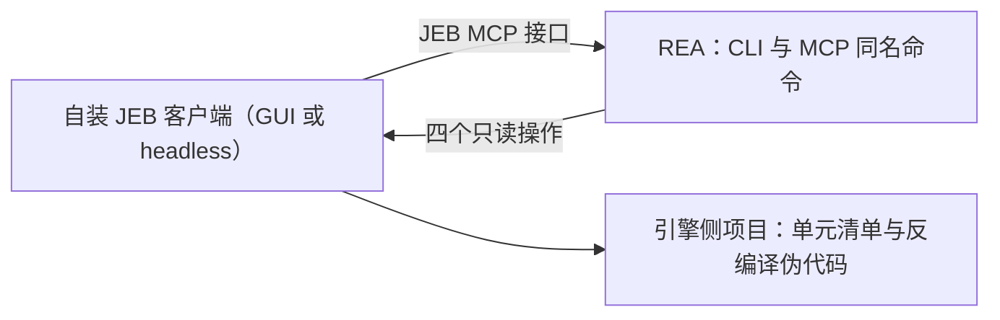

import { Meta } from '@storybook/addon-docs/blocks';

<Meta id="jeb-projects" title="移动与桌面应用包/Android/JEB 项目" name="Docs" />

# JEB 项目

REA 的 JEB 通道把一个已经在运行的 JEB 客户端接进统一的 CLI/MCP/Evidence 体系：检查客户端、打开或创建引擎侧项目、分页列出单元、把单个类型或方法反编译成引擎伪代码。它与 [6.1.1 应用分析](?path=/docs/android-analysis--docs) 的 JADX 通道根本不同在引擎归属——JADX 由 REA 拉起固定版本的 headless 引擎，JEB 则是彻底的 bring-your-own：REA 不安装、不启动、也不代管 JEB 的项目数据库，一切从你自装、自许可的客户端开始。

先记住两条主线判断：其一，通道能力由引擎构建决定——不同构建 advertise 的操作不同，版本号本身代表不了可用操作，动手前先探测；其二，四个命令全部只读、保留目标文件字节，重命名、注释、`save_project`、`close_project` 这类修改流程 REA 目前有意不暴露。通道本身不限于 Android——官方 CE 审计的反编译对象就是一个原生 SQLite 单元；本课按路线放在 Android 组，聚焦 Android 使用场景。



| 项 | 默认值 | 覆盖方式与约束 |
| --- | --- | --- |
| JEB MCP 端点 | `http://127.0.0.1:8425/mcp` | `REA_JEB_MCP_URL`：绝对 `http`/`https` URL，host 仅限字面 `127.0.0.1` 或 `[::1]`；重定向、远程主机、凭据、query string、fragment 都被拒绝 |
| 单次工具调用截止 | 60 秒 | `REA_JEB_MCP_TIMEOUT_MS`（正十进制毫秒，如 `300000`）；只作用于单个 `tools/call` |
| 工具目录发现截止 | 60 秒 | 连接与分页合计共用；不随单次调用预算调整 |

| 命令 | MCP 工具 | 回答的问题 |
| --- | --- | --- |
| `inspect-jeb-client` | `inspect_jeb_client` | 引擎是什么版本、GUI 还是 headless、何时启动 |
| `open-jeb-project` | `open_jeb_project` | 目标怎么打开或创建成引擎侧项目 |
| `list-jeb-units` | `list_jeb_units` | 项目里有哪些单元，按什么路径与类型组织 |
| `decompile-jeb-item` | `decompile_jeb_item` | 一个类型或方法的引擎伪代码长什么样 |

## 快速上手

前置：一个已安装并完成 EULA 与许可证激活的 JEB；headless 路线还需要 JDK 21+。官方验证基于 licensed 5.48.0（Linux x64，`jeb-mcp-server` 1.3.0）与官方 Linux CE 构建 `5.48.0.202610071539`；CE 构建的验证不确立 licensed/Demo 构建的 Android 反编译与 GUI 行为。

最小闭环四步：启动引擎（启动时用 `--infile` 选定目标——这是被验证构建实际支持的路线，原因见下文"打开项目"）→ 确认可达 → 列单元 → 反编译。

```sh
# 1) 在 JEB 安装目录启动 headless 引擎（官方 Linux CE 5.48.0.202610071539 支持 -c --mcp）
export JAVA_HOME=/path/to/jdk-21
"$JAVA_HOME/bin/java" -jar bin/app/jeb.jar -c --mcp --interface=127.0.0.1 \
  --port=8425 --infile=/absolute/path/to/target
# 首次使用按提示完成厂商 EULA 与许可证激活

# 2) 另开一个终端，确认 REA 看得到引擎
rea inspect-jeb-client

# 3) 分页浏览引擎侧项目的单元
rea list-jeb-units

# 4) 反编译一个类型或方法（unit_path 与 item_address 的语义见下文"反编译单项"）
rea decompile-jeb-item
```

每步都能核对到文档记载的读数：第 2 步返回引擎版本、GUI 或 headless 模式与启动时间；第 3 步返回按稳定路径与类型分页的单元清单，满页时 `coverage` 为 `"partial"`；第 4 步返回目标伪代码，Evidence 记录端点、调用参数与引擎报告的摘要。需要保存结果时加全局选项 `--json`（输出与过滤约定见 [1.3 CLI 与 Evidence](?path=/docs/cli-evidence--docs)）。

## 接入引擎

REA 与 JEB 的分工在官方文档里写得很硬：REA 从不安装、从不启动、从不自行打开 JEB 的项目数据库；JEB 的许可完全由 JEB 客户端自己处理，REA 只转发你的凭据上下文。因此接入阶段的目标只有一个——让一个 serve MCP 的 JEB 客户端在端点上活着，然后让 REA 指向它。端点不可达会按 provider 可用性失败（provider-availability failure）报告并附恢复指引；REA 既不重试，也不会代你拉起引擎。

### 启动 JEB 客户端

三种方式，按手里的构建与场景选：

- **GUI 客户端：** 在 _File_ 菜单启动 MCP server（或通过 VIBRE assistant）。适合已经在 GUI 里开着项目的场景。
- **headless：** 官方 Linux CE 构建 `5.48.0.202610071539` 支持 `-c --mcp`。在 JEB 安装目录里通过 `JAVA_HOME` 选定 JDK 21 或更新，显式绑定 loopback 并用 `--infile` 选定目标：

  ```sh
  "$JAVA_HOME/bin/java" -jar bin/app/jeb.jar -c --mcp --interface=127.0.0.1 \
    --port=8425 --infile=/absolute/path/to/target
  ```

  按提示完成厂商首次使用的 EULA 与许可证激活。官方 CE 审计在隔离安装、1536 MiB Java 堆、单个活动处理器与独立限界的进程族内进行——只给 JVM 设堆上限并不能约束整个进程族。
- **编程式：** 走 JEB API 的 `JebMcpServerInstance`。早前 licensed 5.48 的 headless 验证走这条路，就是因为它的 CLI 不接受 `--mcp`。你装的构建支持哪些启动选项，要用该构建自己的 `-c --help` 与活体工具目录核实——单看版本号说明不了这些问题。

### 端点与 setup 注册

默认端点是 `http://127.0.0.1:8425/mcp`。需要改时设 `REA_JEB_MCP_URL`：必须是绝对的 `http`/`https` URL，host 只能是字面 `127.0.0.1` 或 `[::1]`；重定向、远程主机、凭据、query string、fragment 一律被拒绝，而不是被静默丢弃。

要把端点注册进 setup，先在运行 `rea setup` 之前把 `REA_JEB_MCP_URL` 放进 REA 进程环境；批准的 setup 计划会在校验语法后原样保留所选 URL（setup 流程见 [1.1 安装与设置](?path=/docs/installation--docs)）。注意这道语法校验既不建立"服务可达"，也不建立"项目已打开"——可达性用 `inspect-jeb-client` 的只读查询确认。

### 探测与超时

- **探测：** MCP 会话 `binary_session` 探测活体 JEB 服务与其 advertise 的工具目录，可用性按操作逐项报告——一个可达的 headless 客户端完全可以支持检查与反编译、却拒绝 `open_jeb_project`。目录发现（连接加分页）共用一个 60 秒截止：响应再快的服务器也无法靠多返回几页让发现无限继续。
- **超时：** 每个上游工具调用默认 60 秒绝对请求截止。设 `REA_JEB_MCP_TIMEOUT_MS`（正十进制毫秒）改变单次预算，例如 `REA_JEB_MCP_TIMEOUT_MS=300000` 给一次五分钟的反编译。三条边界：预算在目录发现之后才开始计时；只作用于单个 `tools/call`，不延长那 60 秒目录发现截止，也不构成整个 CLI/MCP 操作的端到端截止；到点的请求返回 typed timeout，调用方主动取消仍然算取消。

## 分析命令

四条命令在 CLI 与 MCP 侧同名成对（`rea inspect-jeb-client` 对应 `inspect_jeb_client`），共享同一批语义：

- **全部只读。** 四个操作都保留目标文件字节；`open_jeb_project` 只选择或创建引擎侧项目，后续分析查询可以在其中填充计算分析。引擎也提供的修改类流程（重命名、注释、`save_project`、`close_project`）REA 有意不暴露。
- **Evidence 完整。** 每次操作记录端点、调用方所选参数与可得的引擎报告摘要（如输入文件 SHA-256）。
- **拒绝被保留。** 引擎返回 `success: false` 信封时，REA 原样保留为 unsupported-target 错误并携带引擎自己的消息，例如不存在的 item address。

### 检查客户端

回答"连上的是谁"：引擎版本、GUI 还是 headless 模式、启动时间。它是接入后的第一个动作，也是端点语法校验之后确认可达性的途径。

```sh
rea inspect-jeb-client
```

解析成功的客户端信息会在 MCP 连接生命周期内复用，引擎不报版本时也一样；显式的客户端检查与可用性探测会刷新它。

### 打开项目

回答"目标怎么进项目"：从引擎主机上的 artifact 或 `.jdb2` 打开或创建一个项目，返回输入文件 SHA-256 摘要与顶层单元。

两条语义必须记住：

- **路径由 JEB 进程解析，不是 REA。** REA 不要求 artifact 在 REA 这台机器上存在——文件只需对 JEB 进程可见。
- **前提是引擎 advertise 了 `open_project`。** 早前 licensed 5.48.0 的 headless 验证没有 advertise 这个操作——它在引擎客户端启动时就选定了目标；被审计的 CE headless 目录同样没有。REA 会保留不可用工具的拒绝，`open_jeb_project` 只在引擎 advertise `open_project` 时可用。

构建不支持时的替代路径：headless 用 `--infile` 在启动时选目标（CE 验证过的 CLI 路线），GUI 直接在界面里打开文件。当前引擎到底 advertise 了什么，用 `binary_session` 查。CE 审计也不确立 GUI 打开项目的支持。

### 列出单元

回答"项目里有什么"：按稳定路径与类型分页列出单元，参数为 `filter`、`parent-unit-path`、`index`、`count`。它是反编译前确定 `unit_path` 的目录来源。

```sh
rea list-jeb-units
```

分页语义：引擎把每页上限设为 100；返回满页即报告 `coverage: "partial"`（可能还有更多单元）；只有返回数少于请求数（余量耗尽）才报告 `complete`。

### 反编译单项

回答"这段代码长什么样"：把一个类型或方法反编译成引擎伪代码。

```sh
rea decompile-jeb-item
```

三条语义决定成败：

- **`unit_path` 省略时引擎隐式选项目的第一个 code unit。** REA 会在结果里报告 `unit_path: null` 并附上 limitation，而不是替你猜有效单元——引用结论时不要省略这个字段。
- **`item_address` 必须是 JEB 的 code-item reference**，即引擎 `list_code_items` 返回的那类值；原样保留其表示，并显式选定所在 code unit。官方 CE 验证里，SQLite 单元导出的方法引用 `sqlite3_libversion_number` 可以反编译，换成原始 ELF 符号地址则失败。文件偏移、ELF 虚拟地址与引擎 item 引用是三种不同语义，不能混用。
- **code-item 的发现仍是上游 JEB 操作。** REA 目前只暴露单元清单；要拿 item reference，去 JEB 侧（GUI 或其 API）完成。

## 与 JADX 通道取舍

两条 Android 静态通道都只读、都不执行目标，差异集中在引擎归属与操作面：

| 维度 | JADX 通道（6.1.1） | JEB 通道（本课） |
| --- | --- | --- |
| 引擎 | REA 拉起 pin 版 headless JADX 进程 | 你自装自许可的 JEB，REA 不装、不启、不代管 |
| 目标位置 | 每次请求带 REA 主机上的 APK `path` | 引擎侧的 artifact 或 `.jdb2`，路径由 JEB 进程解析，不必在 REA 主机 |
| 操作面 | 包/类/方法/引用逐级问询 + 应用图投影 | 客户端检查、开项目、单元分页清单、逐项反编译 |
| 反编译输出 | 方法体的 Java 或 smali（带回退标记） | 类型或方法的引擎伪代码 |
| 前置成本 | pin 版 JAR + 含编译器模块的 JDK 17+ | JEB 许可与 EULA、JDK 21+（headless）；构建能力决定 `open-jeb-project` 是否可用 |
| 许可 | 开源引擎，无商业许可 | 商业软件（另有 CE 构建） |

选择建议：只是快速看清 APK 的清单、组件、类与方法体，用 JADX 通道——零许可成本、命令即问即答。目标已经是 JEB 项目（`.jdb2`）、或需要 JEB 引擎的反编译与单元视图，才走本课通道——先确认引擎构建 advertise 的操作，再决定目标经 `--infile` 启动进入，还是用 `open-jeb-project` 打开。

## 最佳实践

- **先探测，再选路径。** 版本号不代表能力：licensed 5.48.0 headless 与被审计的 CE headless 目录都没有 `open_project`。首次接入或更换构建后，先 `inspect-jeb-client` 加 `binary_session` 看清 advertise 的操作，再决定项目打开方式，避免把"工具不可用"误判成"环境坏了"。
- **把构建与模式写进结论。** CE 构建的验证不确立 licensed/Demo 构建的 Android 反编译，也不确立 GUI 行为；引用反编译结果时注明引擎构建（如 licensed 5.48.0 与 CE `5.48.0.202610071539`）、GUI 或 headless 模式与所用通道，避免把一个构建的验证结论外推到另一个。

## 常见问题

- `open-jeb-project` 被拒绝，提示工具不可用
  这不是故障，而是当前引擎构建没有 advertise `open_project`（licensed 5.48.0 headless 与被审计的 CE headless 目录都没有）。改用启动时 `--infile` 选目标，或在 GUI 里打开文件；用 `binary_session` 确认当前目录里到底有哪些操作。
- 拿 ELF 符号地址或文件偏移当 `item_address`，反编译失败
  `item_address` 只接受 JEB 的 code-item reference（引擎 `list_code_items` 返回的那类值）。CE 验证里 `sqlite3_libversion_number` 可用而 raw ELF symbol address 不行；文件偏移、ELF 虚拟地址、引擎引用三种语义互不相通。先在 JEB 侧拿到 item reference 再来调用。
- REA 报端点不可达
  不可达端点按 provider 可用性失败报告并附恢复指引，REA 不重试也不会代你启动引擎。先确认 JEB 客户端真的活着并 serve MCP，再核对 `REA_JEB_MCP_URL`：host 只能是字面 `127.0.0.1` 或 `[::1]`，重定向、远程主机、凭据、query string、fragment 都会被直接拒绝。
- 反编译总在 60 秒处超时
  这是默认的单请求预算。设 `REA_JEB_MCP_TIMEOUT_MS`（如 `300000`）放宽；注意它只作用于单个 `tools/call`——不延长 60 秒的目录发现截止，也不构成整个操作的端到端时限，列表分页和反编译各自独立计时。
- `list-jeb-units` 的 `coverage` 是 `"partial"`，怀疑结果不全
  满页即 `"partial"`（每页上限 100），不代表出错；只有返回数少于请求数才是 `"complete"`。继续用 `index` 翻页即可。

## 总结回顾

摘要：

JEB 通道把"自装、自启动、自许可"的 JEB 客户端接进 REA：GUI 从 _File_ 菜单、headless 用 `-c --mcp` 加 `--infile`、或经 JEB API 的 `JebMcpServerInstance` 启动后，REA 在默认端点 `http://127.0.0.1:8425/mcp`（`REA_JEB_MCP_URL` 可覆盖，host 限 loopback 字面值）上转发四个只读命令——`inspect-jeb-client` 确认构建与模式，`open-jeb-project` 打开或创建引擎侧项目（要求引擎 advertise `open_project`），`list-jeb-units` 按路径与类型分页（每页上限 100，满页即 `"partial"`），`decompile-jeb-item` 输出引擎伪代码（`item_address` 只认引擎的 code-item reference）。单请求预算默认 60 秒，`REA_JEB_MCP_TIMEOUT_MS` 按单个调用放宽；所有操作保留目标文件字节，Evidence 记录端点、参数与引擎摘要。与 JADX 通道的分工由引擎归属决定：快速 APK 问询走 JADX，引擎侧项目与 JEB 反编译走本课。

一句话：

> JEB 通道是"你养引擎、REA 转发"：四个只读命令把已在运行的 JEB 客户端接进 Evidence 体系，能做什么由引擎构建 advertise 的目录说了算。

知识要点：

- REA 与 JEB 如何分工：谁安装、谁启动、谁管许可、谁解析路径？
- 三种启动方式怎么选，headless 需要哪些前置（JDK 版本、EULA、loopback 绑定）？
- 端点与超时的默认值、覆盖变量与约束分别是什么？
- 四个命令各自回答什么问题；`open-jeb-project` 何时不可用，替代路径是什么？
- `item_address` 应该传什么、不该传什么，从哪里获得？
- `coverage` 的 `"partial"` 与 `"complete"` 分别在什么条件下出现？
- JEB 通道与 JADX 通道按什么维度取舍？

## 参考资料

- [REA JEB instrumentation and analysis（仓库 docs/jeb-analysis.md）](https://github.com/morluto/rea/blob/main/docs/jeb-analysis.md)
- [REA Static Android APK analysis（仓库 docs/android-analysis.md）](https://github.com/morluto/rea/blob/main/docs/android-analysis.md)
- [REA CLI and Evidence（仓库 docs/cli.md）](https://github.com/morluto/rea/blob/main/docs/cli.md)
