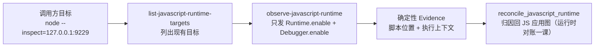

import { Meta } from '@storybook/addon-docs/blocks';

<Meta id="js-runtime-observation" title="JavaScript 与 Electron/运行时观测" name="Docs" />

# 运行时观测

运行时观测指把 REA 连到一个**已经在运行**的 Node.js 或 Electron V8 Inspector 目标上，被动记录观测窗口内的脚本解析与执行上下文元数据：`rea list-javascript-runtime-targets` 列出端点上的目标，`rea observe-javascript-runtime` 对选定目标做一次有界捕获，产出一份确定性的 Evidence。它回答的是"这次运行中，哪些脚本在哪个执行上下文里被解析了，位置在哪个文件"；它刻意不回答"谁 import 了它、功能有没有执行、先后顺序如何"——Inspector 协议根本不暴露这些事实，REA 把它们保留为显式 unknown。主线判断一句话：用两条只读协议命令换一份在场证明，动态现象的归因到文件位置为止。本课讲这两个命令的边界模型、目标与角色声明、Evidence 读法；观测结果与静态应用图的对账归运行时对账一课，浏览器网页观测归阶段 3 的浏览器观测，Electron 观测专项与 fuses 细读归 Electron 观测与 Fuses 一课，静态侧的 `analyze-javascript-application` 归静态分析一课，这里只给边界和入口。



| 回查项 | 值 |
| --- | --- |
| 列目标 | `rea list-javascript-runtime-targets http://127.0.0.1:9229 --json` |
| 观测 | `rea observe-javascript-runtime http://127.0.0.1:9229 TARGET_ID --runtime-kind node --json` |
| MCP 同源工具 | `list_javascript_runtime_targets` / `observe_javascript_runtime` |
| 前提 | 目标已带 `--inspect=127.0.0.1:9229` 运行；REA 不启动、不拥有、不终止它 |
| `--runtime-kind` | `node`、`electron-main` 要求协议类型 `node`；`electron-preload`、`electron-renderer` 要求 `page` |
| 角色权威 | `caller-declared-unverified`：Inspector 不认证 PID，也不区分 Electron 角色 |
| `--observation-ms` | 观测窗口毫秒数，默认 `100` |
| 协议命令 | 只发 `Runtime.enable` 与 `Debugger.enable` |
| 预算与超时 | 捕获聚合 8 MiB；单条 CDP 消息 16 MiB；每次握手与命令响应 20 秒 |
| 产出 | 确定性 Evidence：相同输入与相同捕获元数据得到相同 `evidence_id` |

## 快速上手

先有一个带 Inspector 的目标。建一个两文件的最小应用：主模块启动后在 1.5 秒时动态加载功能模块，第二个定时器只为让进程活到观测结束。

```js
// app.mjs
console.log('notes-app: boot');
setTimeout(() => {
  import('./search-feature.mjs').then((m) => console.log(m.search('pin')));
}, 1500);
setTimeout(() => console.log('notes-app: done'), 20000);
```

```js
// search-feature.mjs
export function search(q) {
  return `results for ${q}`;
}
```

一个终端里把目标跑起来（监听回环地址）：

```bash
node --inspect=127.0.0.1:9229 ./app.mjs
```

另一个终端先列目标，拿到 `target_id`：

```bash
rea list-javascript-runtime-targets http://127.0.0.1:9229 --json > list.json
jq -r '.normalized_result.targets[] | [.target_id, .protocol_type, .attached, .location.file_path] | @tsv' list.json
```

实测输出（`target_id` 每次启动目标都会变，以下同）：

```text
0cf0a1a5-9f93-4dba-8929-5d500f7ef0a8	node	false	/private/tmp/rea-jsrt-demo/app.mjs
```

再观测这个目标，窗口给 4000 毫秒——盖过 1.5 秒时的动态 import：

```bash
rea observe-javascript-runtime http://127.0.0.1:9229 0cf0a1a5-9f93-4dba-8929-5d500f7ef0a8 \
  --runtime-kind node --observation-ms 4000 --json > obs.json
jq -c '{evidence_id, files: [.normalized_result.scripts.items[] | select(.location.kind != "builtin") | .location.file_path], contexts: [.normalized_result.execution_contexts[] | [.context_key, .state, .name]]}' obs.json
```

实测输出：

```json
{"evidence_id":"ev_138962d8b705ac4acdc9ce4d5916718af8f2d95836853e3599da55d11981ff37","files":["/private/tmp/rea-jsrt-demo/app.mjs","/private/tmp/rea-jsrt-demo/search-feature.mjs"],"contexts":[["1","created","node[41876]"]]}
```

三个直接可核对的结果：`search-feature.mjs` 出现在脚本清单里——观测窗口捕获到了迟加载的模块；两个文件都带完整磁盘路径——这就是"归因到代码位置"；整个应用共 101 个脚本，其中 99 个是 `node:` 内建模块，应用自己的文件只有 2 个。看完结果让应用按自己的生命周期退出即可——REA 断开的只是自己的 WebSocket，从不终止目标。

## 被动协议边界

这套观测是**被动的**：provider 对目标只发两条协议命令——`Runtime.enable` 和 `Debugger.enable`，然后记录窗口内到达的事件。它有一份坚决不做的清单，这决定了每条结论的性质：

- 不发 `Runtime.evaluate`，不读脚本源码，不装断点，不暂停也不恢复执行，不发 `Runtime.runIfWaitingForDebugger`。
- 不启动目标，不对 JavaScript 插桩，不调用任何 Electron API。
- 结束一次调用只关闭 REA 自己的 WebSocket，目标进程原样继续运行。

窗口内直接观测到的只有三类事件：

| 事件 | 记录成什么 |
| --- | --- |
| `Debugger.scriptParsed` | 一个有界脚本位置在观测的执行上下文中被解析（`status` 为 `observed-loaded`） |
| `Debugger.scriptFailedToParse` | 只保留一个有界的解析失败计数 |
| `Runtime.executionContextCreated` / `Destroyed` / `Cleared` | 窗口内的执行上下文生命周期；上下文 ID 缺失或非安全整数的同类事件不产生记录，只计入 `unknowns` 的计数 |

Inspector 协议不直接暴露的事实同样明确——require/import 的调用方边、EventEmitter 的触发与监听器调用、Electron IPC 消息与处理器、脚本卸载事件，全部保留为显式 unknown（Evidence 的 `unavailable_without_instrumentation` 字段逐项列出）。所以 `scriptParsed` 证明的是**脚本在场**：这个位置的资源确实在本次运行的该上下文中被解析了。它不证明导入它的模块是谁、功能逻辑执行过没有、初始化顺序如何、更不构成因果。

每次 WebSocket 握手和每条命令响应各有独立的 20 秒期限，与观测窗口分开计算。握手或命令停滞时报 `provider_timeout`，已收到的观测照常保留；调用方取消时仍按取消报告。

## 目标与角色

授权模型很直接：调用方直接给一个**字面回环 HTTP 端点**。选中一个端点就暴露了它服务的全部目标及其本地脚本位置或 renderer 来源；要观测的目标必须精确匹配请求的 target ID，并暴露该端点报告的同端口 WebSocket。本地路径在符号链接解析之后规范化——实测中 `/tmp/rea-jsrt-demo/app.mjs` 记录为 `/private/tmp/...` 就是 macOS 上 `/tmp` 符号链接的产物。

结果里的 `attached` 字段可空：`true` 与 `false` 只在发现层提供了布尔值时报出，`null` 表示端点没报或报不了该状态。显式标记 `attached: true` 的目标会被直接拒绝——REA 不挤掉别的调试器；`null`（未知）会报告该局限并允许观测。CDP 的 worker 记录要求 `attached` 布尔值，缺失或畸形值的 worker 记录按无效协议值剔除。

目标按发现层的报告保留位置。Node 的发现报告是不带 URI 编码的尽力路径名：POSIX 上无歧义的路径按字面解释（文件名含 `#`、`%` 也没问题），但 Node 会把反斜杠和双引号替换成下划线，且这个替换不可逆。Windows 路径、歧义下划线路径、无法核实的路径仍可凭端点和精确 target ID 观测，位置保留为未解析对象：

```json
{
  "kind": "unresolved",
  "reported_url": "file://C:_tools_entry.js",
  "reason": "unverifiable-file-location"
}
```

这个位置不断言文件存在，也不授权读取内容；列目标始终是纯 HTTP。不支持的 scheme、远程文件主机、裸 `file://` 一律排除。

观测前要声明一个角色（`--runtime-kind`）：

| 声明角色 | 要求的协议目标类型 |
| --- | --- |
| `node`、`electron-main` | `node` |
| `electron-preload`、`electron-renderer` | `page` |

Inspector 协议不认证操作系统 PID，也不区分 Electron 角色，所以 Evidence 里角色权威固定为 `caller-declared-unverified`。推论有两条：Electron 主进程、preload、渲染进程只能作为**三个独立的 Inspector 目标**分别观测，provider 不会推断它们属于同一个 Electron 应用；对打包的 Electron 应用，启动 `electron-main` 目标之前先读 fuse——`EnableNodeCliInspectArguments` 被禁用或移除时，Electron 会直接忽略 `--inspect` 与 `--inspect-brk`。启动后列表里缺 main 进程目标本身不能证明是这个 fuse，先用 `rea inspect-electron-fuses` 确认（命令细读归 Electron 观测与 Fuses 一课）。

## 读懂观测 Evidence

一次成功观测返回一份确定性 Evidence，`normalized_result` 分七块，逐块对应"这次运行看到了什么"：

| 块 | 内容（本课示例应用的实测值） |
| --- | --- |
| `target` | `target_id`、`protocol_type`、`attached`、位置，以及 `runtime_kind` 与 `runtime_kind_authority`（实测 `caller-declared-unverified`） |
| `runtime` | 实测 `node.js/v24.13.0`、协议版本 `1.1` |
| `scripts` | `items` 数组：`script_key`、`location`（`kind: "builtin"` 带 `specifier`，`kind: "file"` 带 `file_path`）、`execution_context_key`、`cdp_hash`、`length`、`is_module`、`status` |
| `execution_contexts` | 实测一条：`context_key` 为 `1`、`state` 为 `created`、名称 `node[41876]` |
| `unknowns` | 三条文字局限（attach 前回收的脚本可能缺失；有界窗口不能证明未观测脚本或行为不发生；角色未经认证） |
| `unavailable_without_instrumentation` | 协议不暴露的四类事实（调用方边、事件触发、IPC、脚本卸载） |
| `capture` | 实测 `observation_ms` 4000、`events_observed` 102、`events_retained` 102、`events_dropped` 0、`metadata_bytes_retained` 76682、`truncated` false |

`scripts.items` 是回查主体。`kind: "file"` 的条目就是能落到磁盘的代码位置；`kind: "builtin"` 的 `node:` 内建模块是运行时专属节点——静态分析不会为它们建模，静态对账后它们仍保持 runtime-only。`status: "observed-loaded"` 表示"窗口内确认已解析"，不是"已执行"。

确定性是这份 Evidence 的设计目标：捕获结束后脚本才做校验、按稳定元数据去重、规范化排序，墙钟时间戳和协议脚本 ID 都不进入持久结果——所以相同输入与相同捕获元数据产生相同的 `evidence_id`。实测：对同一个已稳定的目标连续两次 200 毫秒观测，得到同一个 ID：

```text
ev_a6e9b10a77edf3c5c7b5c12cd5c5c2ff3cd239566a969c0211dd666fe1336d3a
ev_a6e9b10a77edf3c5c7b5c12cd5c5c2ff3cd239566a969c0211dd666fe1336d3a
```

反过来，窗口不同、捕获内容不同，ID 就不同——ID 差异先去 diff `scripts` 与 `execution_contexts`，不要当成"运行有随机性"。

捕获有两条预算线：单条 CDP 消息超过 16 MiB 直接以 `payload_limit` 失败；聚合保留预算 8 MiB（含 UTF-16 字符串的保守估算、记录与集合开销、投影 URL 字段），耗尽后后续元数据事件被丢弃，部分结果带 `events_dropped`、`truncated: true` 与 `retained_metadata_budget_exceeded`。重复的上下文创建/销毁只更新当前上下文记录，不堆积重复对象。

attach 天然不完整：启用 `Debugger` 会报告已知且未回收的脚本，但在 attach 之前已被回收的脚本可能缺失。窗口里没出现某个脚本，永远不能证明它没运行。取消（SIGINT 退出码 `130`、SIGTERM `143`）会保留已完成的部分 Evidence 和原始取消原因：已检查的目标前缀保留，未检查的目标记为未知。

## 最佳实践

- **两次调用用同一个字面端点。** list 与 observe 必须传完全相同的 loopback URL 字面量；目标按精确 ID 加同端口 WebSocket 校验，端点写法不一致只会白跑一趟。
- **窗口长度贴合触发时机。** 默认 100 毫秒适合"进程已在跑、只看当前状态"的目标；要捕捉迟加载的模块，把窗口盖过触发动作——实测 4000 毫秒窗口稳稳接住了 1.5 秒时的动态 import。
- **Electron 三个角色分开观测、先查 fuse。** 主进程、preload、渲染进程是三个独立目标，逐个 list、逐个 observe；对打包应用先跑 `inspect-electron-fuses`，别拿"列表里没有 main 目标"直接定罪。
- **观测完就喂对账。** 把观测 Evidence 和 `analyze-javascript-application` 的 Evidence 一起交给 `reconcile_javascript_runtime`，把动态现象归因回应用图。这个 provider 从不读源码字节，匹配通常靠唯一且已授权的位置，弱于捕获字节的身份；`node:` 内建模块保持 runtime-only。
- **别把在场证明当执行证明。** 需要知道"代码真的跑了、跑了几次"时，这套工具给不了——执行计数与覆盖率是阶段 3 浏览器观测的能力，静态语义关系归语义追踪（应用图与工作流一课）。

## 常见问题

- `observe` 直接报错退出，`provider_unavailable`、`endpoint_unreachable`？
  目标进程多半已经退出或端口不对。实测中应用跑完 20 秒生命周期退出后再观测，就得到这个错误（`retryable` 为 true）。先确认目标进程还活着、`--inspect` 端口与传入端点一致，再重试。
- 观测 `--inspect-brk` 目标"成功"了，却一个应用脚本都没有？
  正常现象。`--inspect-brk` 让应用在用户代码启动前暂停，而 REA 从不恢复它：实测观测退出码 0，但捕获到的 69 个脚本全是引导内建模块、应用文件为 0，断开后应用仍停在暂停状态。先用调用方自己的调试器恢复应用，再对运行中的目标观测。
- Electron 应用启动了，列表里却没有 main 进程目标？
  先跑 `rea inspect-electron-fuses` 查 `EnableNodeCliInspectArguments`：被禁用或移除时 Electron 忽略 Inspector 参数。但目标缺失本身不能证明是这个 fuse——先查 fuse 字节，再排查启动参数与端口。
- 窗口里没看到某个脚本，能断定它没被加载吗？
  不能。attach 前已回收的脚本可能缺失，有界窗口也只能证明窗口内的事。要判断"没观测到"的含义，先看 `unknowns` 与 `capture` 的 `truncated`，再把证据交给 `reconcile_javascript_runtime` 与静态图对账。
- 两次观测的 `evidence_id` 不一样，是有随机性吗？
  没有。ID 由捕获内容决定：捕获元数据相同则 ID 逐字符相同（实测验证），不同则不同。先 diff 两份 Evidence 的 `scripts` 与 `execution_contexts` 找出差异事件，再把差异归因到窗口时机。
- 结果里 `truncated: true`、`events_dropped` 不为零？
  8 MiB 聚合预算耗尽，之后的元数据事件被丢弃，已收到的部分仍可用；单条消息超过 16 MiB 则整个调用以 `payload_limit` 失败。处理办法是缩短窗口或缩小观测范围，然后重跑。

## 总结回顾

摘要：

运行时观测由 `list-javascript-runtime-targets` 与 `observe-javascript-runtime` 两个命令组成，作用于调用方自己启动并持有的 Node/Electron V8 Inspector 目标。provider 只发 `Runtime.enable` 与 `Debugger.enable` 两条只读命令，在调用方选定的窗口（`--observation-ms`，默认 100 毫秒）内记录三类事件：脚本解析、解析失败计数、执行上下文生命周期；调用方边、事件触发、IPC、脚本卸载这些协议不暴露的事实保留为显式 unknown，`scriptParsed` 只证明脚本在场，不证明导入者、执行与因果。角色由调用方声明、标注 `caller-declared-unverified`，Electron 三个角色作为独立目标分别观测，打包应用先查 fuse。产出的 Evidence 去时间戳、去重、规范化排序，相同捕获得到相同 `evidence_id`；attach 天然不完整，缺席不证明不发生，预算耗尽时以 `events_dropped` 与 `truncated` 明示。观测 Evidence 最终交给 `reconcile_javascript_runtime` 与静态应用图对账，把动态现象归因到文件位置。

一句话：

> 运行时观测是用两条只读命令换一份确定性的在场证明：它证明哪些脚本与上下文在窗口内出现并归因到位置，其余动态语义仍是显式未知，要靠对账与追踪补齐。

知识要点：

- REA 观测 JS 运行时只发哪两条协议命令？因此哪些事它绝不会做？
- 一次观测直接记录哪三类事件？哪四类动态事实协议根本不暴露？
- `scriptParsed` 证明什么、不证明什么？
- 四种 `--runtime-kind` 各要求什么协议目标类型？角色权威为什么是 `caller-declared-unverified`？
- Evidence 的 `scripts`、`execution_contexts`、`unknowns`、`capture` 各回答什么问题？
- 什么情况下 `truncated`、`events_dropped`、`payload_limit`、`provider_timeout` 出现，各自意味着什么？
- 为什么窗口里没看到某脚本不能证明它没运行？观测 Electron main 目标前要先查什么？

## 参考资料

- [Passive Node and Electron runtime observation（docs/javascript-runtime-observation.md）](https://github.com/morluto/rea/blob/main/docs/javascript-runtime-observation.md)
  本课一手来源：两条命令、被动协议边界、目标与角色规则、捕获预算与确定性、静态对账入口。
- [REA CLI 文档（docs/cli.md）](https://github.com/morluto/rea/blob/main/docs/cli.md)
  运行时命令的 CLI 入口与指南索引、`--json` 输出选择、退出码体系（0/1/128+N）与取消语义。
- [Electron fuse state（docs/electron-fuses.md）](https://github.com/morluto/rea/blob/main/docs/electron-fuses.md)
  `inspect-electron-fuses` 与 `EnableNodeCliInspectArguments` 对 `--inspect` 的门槛作用。
- [JavaScript application workflows（docs/javascript-application-workflows.md）](https://github.com/morluto/rea/blob/main/docs/javascript-application-workflows.md)
  `reconcile_javascript_runtime` 产出的 Evidence 可被六个只读图工作流消费的下游关系。
