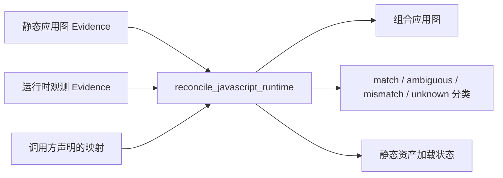

import { Meta } from '@storybook/addon-docs/blocks';

<Meta id="js-runtime-reconciliation" title="JavaScript 与 Electron/运行时对账" name="Docs" />

# 运行时对账

静态分析回答"应用结构上有什么"，运行时观测回答"窗口里实际出现了什么脚本"，两者经常对不上。`reconcile_javascript_runtime`（CLI：`rea reconcile-javascript-runtime`）把已验证的静态应用图与一份或多份浏览器、Electron 或 Node V8 Inspector 观测合并，返回派生 Evidence：一张组合应用图，加 match、ambiguous、mismatch、unknown 四类显式分类，以及静态资产的加载状态。它不裁决"哪边正确"：配对成功也只记 `inferred`，字节冲突记显式 `mismatch`，对不上的一律 `unknown`，绝不把缺失悄悄说成"不存在"。

对账操作本身不做文件系统、浏览器或 Electron I/O——它只消费语义验证过的 Evidence。输入输出关系如下：



请求的三个组成部分，回查先看这里：

| 组成 | 内容 | 要求 |
| --- | --- | --- |
| `static_layers` | 静态应用图 Evidence | 恰好一个 `application` 角色，可附加 `cache`、`assets` 角色 |
| `runtime_observations` | 运行时观测 Evidence 数组 | 只接受五类来源的语义验证 Evidence，传完整 Evidence 对象 |
| `runtime_mappings` | `url-prefix` / `file-root` 映射，声明在每个静态层上 | 浏览器 URL 通常必须显式给出；只作用于已授权位置 |

## 快速上手

前提：已安装 REA（见安装与设置一课）。用同机 Node 目标走最小闭环：静态分析一层 → 观测运行中的进程 → 对账。运行时文件位于被分析输入根之下时，文件位置自动映射，这一步不需要手工 mapping。

```bash
# 1. 静态分析应用目录
rea analyze-javascript-application /absolute/path/to/app --json > static-evidence.json

# 2. 用 Inspector 启动同一个应用并保持运行。用 --inspect，不要用 --inspect-brk：
#    后者把目标停在启动前，REA 不会恢复执行
node --inspect=127.0.0.1:9229 /absolute/path/to/app/main.mjs

# 3. 另开终端：列出目标，观测选定的目标 ID
rea list-javascript-runtime-targets http://127.0.0.1:9229 --json
rea observe-javascript-runtime http://127.0.0.1:9229 TARGET_ID --runtime-kind node --json > runtime-evidence.json

# 4. 组装对账输入：analysis 与观测都是完整 Evidence 对象，不是 evidence ID
node --input-type=module -e '
import { readFileSync, writeFileSync } from "node:fs";
writeFileSync("reconciliation-input.json", JSON.stringify({
  static_layers: [
    { role: "application", analysis: JSON.parse(readFileSync("static-evidence.json", "utf8")) }
  ],
  runtime_observations: [JSON.parse(readFileSync("runtime-evidence.json", "utf8"))]
}));'

# 5. 对账，得到派生 Evidence
rea reconcile-javascript-runtime reconciliation-input.json --json > reconciliation-evidence.json
```

可观察结果：

- 派生 Evidence 同时包含组合应用图与逐条分类：对上号的运行时脚本在组合图里以 `observed_as` 边挂到静态实体，authority 为 `cross-layer-reconciliation`，state 为 `inferred`。
- 对账是确定性的：同一批已验证 Evidence 与映射重跑，得到相同的 reconciliation、graph 与 Evidence 标识。
- CLI 也接受同样的 JSON 内联传参；真实 Evidence 很大时用文件路径，避免操作系统的命令行长度限制。
- 边界：Inspector attach 天然不完整，attach 前已收集的脚本可能缺席——这会直接影响对账给出的加载状态。

## 输入与映射

对账只接受五类来源产生的语义验证 Evidence。仅凭操作名相同不够：provider 身份、predicate 类型、subject digest、目标参数和规范化结果 schema 都会在对账前校验。

| MCP 来源工具 | 提供什么 | 对账侧注意 |
| --- | --- | --- |
| `analyze_javascript_application` | 静态应用图 Evidence | 恰好一层 `application`；cache、assets 目录可独立分析后作附加层 |
| `inspect_web_page` / `inspect_electron_page` | 浏览器 / Electron 页面被动捕获 | 浏览器 URL 通常需要显式 `url-prefix` 映射 |
| `observe_javascript_runtime` | attach-only 的 V8 Inspector 观测 | 从不读源码字节，通常只能按唯一授权位置匹配 |
| `capture_electron_scenario` | Electron 场景捕获 | 只提供 target-only partial 观测，不建立 loaded-script coverage |

`static_layers` 的输入形状如下，`analysis` 与 `runtime_observations` 放完整 Evidence 对象，不是 evidence ID：

```json
{
  "static_layers": [
    {
      "role": "application",
      "analysis": "ANALYZE_JAVASCRIPT_APPLICATION_EVIDENCE",
      "runtime_mappings": [
        {
          "kind": "url-prefix",
          "prefix": "https://example.test/assets/",
          "artifact_prefix": "dist"
        }
      ]
    }
  ],
  "runtime_observations": ["INSPECT_WEB_PAGE_EVIDENCE"]
}
```

映射只有两种：

- `url-prefix`：把一个精确 HTTP(S) origin 加路径前缀翻译到 artifact 相对前缀。
- `file-root`：把运行时的规范化文件系统根翻译到 artifact 相对前缀，例如 `--mapping '{"layer":1,"kind":"file-root","root":"/runtime/cache","artifact_prefix":""}'`。

什么时候要手工映射：Electron 与 V8 Inspector 提取出的文件位置在被分析输入根之下时自动映射；被搬移的文件、ASAR 投影、cache 与 assets 根需要显式映射。

映射的边界：映射不能新增 CDP origins、不能扩大 Electron roots、不能读文件、也不能授权 source-map 访问——它们只是调用方声明的推断输入，只作用于已经授权的位置。

对账结论还受输入覆盖约束：缺失授权映射、不完整或截断的输入 coverage 保持 unknown 或 truncated，而不是变成"不存在"的断言。想从操作者提供的路径做可重复的本地核对，用配套 verifier——它分析给定静态路径、读取有界的 Evidence JSON 文件，打印 graph IDs、evidence IDs、路径、digest、计数、原因与 coverage，不打印捕获的源码文本：

```bash
npm run verify:javascript-runtime -- \
  --application /absolute/path/to/app \
  --cache /absolute/path/to/cache \
  --runtime-evidence /absolute/path/to/electron-evidence.json \
  --mapping '{"layer":1,"kind":"file-root","root":"/runtime/cache","artifact_prefix":""}'
```

## 匹配规则

对账不裁决静态与运行时谁对谁错。运行时 target、frame、脚本和 worker 先成为 capture 范围内的图节点，REA 再对兼容的静态候选按下列规则保守判定，从最强到最弱：

| 判定 | 条件 | 结果 |
| --- | --- | --- |
| content-and-location match | captured-source SHA-256 与一个 mapped 位置上的静态候选一致 | 字节加位置双重一致，最强匹配 |
| 唯一 digest 匹配 | mapped 位置没有静态候选，但存在唯一精确内容 digest 匹配 | whole-asset digest 与重建 module-factory source digest 在 reported basis 中保持可区分 |
| 位置匹配 | 没有 captured bytes，只有唯一 mapped artifact path | medium confidence 位置匹配 |
| ambiguous | 存在多个兼容候选 | 不发 `observed_as` 边；`candidate_static_count` 报告合格的层/节点计数，`candidate_static_nodes` 列出每个唯一候选引用 |
| mismatch | captured bytes 与 mapped 路径上的静态候选不一致 | 显式 mismatch；别处 digest 相同也不能掩盖这次不一致 |
| unknown | 候选 digest 不可得且无已知内容匹配，或缺映射、覆盖不完整 | 保持 unknown 或 truncated，绝不变成缺席断言 |

两条判定细节：

- 有 captured source 且存在 mapped 候选时，只有 mapped 内容匹配有资格成立，发生在别处的内容匹配被排除——字节相同不等于身份相同。
- 每条成功的跨层 `observed_as` 边都带 `authority: cross-layer-reconciliation`、`state: inferred`；底层 artifact/AST 观测与运行时观测原样保留，各自维持自己的 Evidence 链接。

以哪边为准：两边都没有被推翻。配对只产生 `inferred` 关联；运行时字节与静态候选冲突时记为显式 mismatch 供人判断，而不是自动改写静态图；一切对不上的都留在 unknown、ambiguous 或 truncated 分类里。对账产物的可核对面因此完整：组合图、四类分类、加载状态加候选统计。

## 加载状态

静态 asset、chunk 和 module 另有独立的加载状态分类：

| 状态 | 含义 |
| --- | --- |
| `loaded` | 找到被接受的运行时脚本对应：精确字节，或唯一 mapped 位置 |
| `resident-in-loaded-asset` | 所在 asset 被观测到，但内嵌模块没有被独立观测到，也没有被证明执行 |
| `not-observed-in-capture` | 没出现在本次调用提供的完整授权捕获里，且 artifact path 位于已执行的（自动或手工声明的）映射前缀之下 |
| `unknown` | 捕获不完整、层在运行时范围之外、对应关系未解析；位于映射前缀之外的节点，即使同层其他前缀被观测过也保持 unknown |

边界：四种状态都不证明功能执行、初始化顺序、可达性或因果。尤其注意 `not-observed-in-capture` 永远不等于"全局未加载"——它只对本次对账所提供捕获的范围说话。

## 证据边界

哪些证据有资格参与匹配、哪些永远不能，决定了对账结论的上限。

### V8 Inspector 观测

`observe_javascript_runtime` 暴露 execution-context ID，但没有经过认证的 frame 关系，所以它的脚本在组合图中直接挂到精确的运行时 target 上。它不提供源码字节、require/import 调用边、EventEmitter 活动、Electron IPC 或脚本卸载证据。唯一且已授权的文件或 URL 位置可以把"脚本出现过"关联到静态 asset，但不证明模块初始化或功能执行；因为从不读字节，匹配通常走唯一授权位置，弱于 captured-byte 身份。内置 `node:` 脚本保持 runtime-only 节点。

Node 观测的发现位置无法核实时（Windows 路径、歧义下划线路径等），对账保留未解析的 `target_location`，报 `runtime-location-unresolved` 加 unknown confidence，不会从上报的 pathname 推导静态匹配；已验证的已加载脚本位置仍可独立参与匹配。

### 帧与 worker

被动页面观测为每条被接受的脚本保留 CDP 提供的 execution-context frame ID；Electron 捕获还会清点已授权的 worker、service worker 和 shared worker target，包括有界的 opener-target 与 parent-frame 关系。这些字段改善归属，同时保持原有的精确 origin 或规范化根过滤。

### source map

source-map 声明与原始源码读取始终是静态证据：它们进 `source_map_authority` 报告，但永远不用作主运行时字节匹配。source name 或 `sourcesContent` 的 digest 不会被悄悄等同于 CDP 观测到的生成字节。

## 确定性与边界

对账不对静态层、被动捕获、运行时实体、对账条目、加载状态、映射声明或候选引用施加聚合数量上限；各集合仍受每份 Evidence 的结构校验约束，被动观测返回窗口内通过逐值校验的全部条目。投影完整输入时报告零省略条目；静态 JS 分析自己有界的 AST coverage 仍可报 partial 或 truncated。

层、捕获、节点、边、匹配与 Evidence 链接都按规范序排列；重复同一批已验证 Evidence 与映射，得到相同的对账结果、图与 Evidence 标识——确定性本身就是核对对账产物的手段。

对账不做的事：不 attach CDP、不抓取脚本或 source map、不执行 JavaScript、不调用 Electron IPC、不检查原生插件、不推断任意 URL 重写、不搜索文件系统。

它也不替代旧的 `correlate_static_and_runtime` 调查工具：那个工具记录显式的跨版本静态/运行时比较假设；本操作把 JavaScript 运行时实例映射到静态应用图实体。两者并存，按问题选工具。

## 最佳实践

- **要最强匹配就带源码捕获。** `inspect_web_page` / `inspect_electron_page` 的脚本源码捕获是可选的，开启它才有 captured-byte 身份；attach-only 的 `observe_javascript_runtime` 从不读源码，通常只能拿 medium confidence 的位置匹配。
- **映射显式，且知道它不扩权。** 浏览器 URL 与被搬移、ASAR 投影、cache/assets 位置需要显式映射；映射只声明推断，不新增授权、不读文件。判定只在 mapped 位置内进行，映射缺失的直接后果是 unknown。
- **静态层分开分析。** cache 与 assets 目录独立分析后作为附加层传入，角色对号入座，`application` 恰好一个。
- **结论带等级引用。** `observed_as` 一律 `inferred`，位置匹配上限是 medium；"脚本被观测到"不等于"模块执行过"，引用对账结论时保留 authority 与 confidence。
- **用 verifier 留下可重复核对。** `npm run verify:javascript-runtime` 从操作者路径重建分析，打印 IDs、digest、计数、原因与 coverage，适合做回归核对。

## 常见问题

- 明明应该对上，结果报 ambiguous？
  存在多个兼容静态候选时不发 `observed_as` 边。用 `candidate_static_count` 和 `candidate_static_nodes` 查看全部候选；有 captured source 时只有 mapped 内容匹配有资格成立，先检查映射是否对准了实际运行的位置。
- 对账报 mismatch，静态分析是不是错了？
  mismatch 是显式分歧：捕获字节与 mapped 路径上的静态候选不一致。先核对映射是否指向了错误位置、静态层覆盖的字节是否就是实际部署运行的字节；对账本身不改写静态图，底层 Evidence 原样保留。
- `not-observed-in-capture` 能当"没加载"用吗？
  不能。它只说明实体没出现在本次调用提供的完整授权捕获中，且路径在已执行的映射前缀之下；绝不等于全局未加载，更不能推出功能缺失。前缀之外的节点连这个状态都拿不到，保持 unknown。
- 对账成功配对，能证明功能被执行了吗？
  不能。匹配分类和加载状态都不证明执行、初始化顺序、可达性或因果；V8 Inspector 观测到脚本也只证明解析过。要行为证据，另做行为观测或场景捕获。
- 旧的 `correlate_static_and_runtime` 被它替代了吗？
  没有。那个工具记录跨版本静态/运行时比较假设；`reconcile_javascript_runtime` 把运行时实例映射到静态应用图实体。两者并存，按问题选工具。

## 总结回顾

摘要：

对账把静态应用图与一份或多份运行时观测合并成派生 Evidence：组合图、match/ambiguous/mismatch/unknown 四类分类、静态资产加载状态。输入只接受五类来源的语义验证 Evidence——静态分析恰好一层 `application`，可附加 `cache`/`assets` 层；Evidence 传完整对象。浏览器 URL 与被搬移、ASAR 投影、cache/assets 位置需要显式 `url-prefix` 或 `file-root` 映射，映射只是调用方声明的推断输入，不扩权。匹配按保守规则从强到弱定级：字节加位置、唯一 digest、唯一位置（medium confidence）、多候选 ambiguous、字节冲突显式 mismatch、其余 unknown；成功配对产出 authority 为 `cross-layer-reconciliation`、state 为 `inferred` 的 `observed_as` 边，底层证据原样保留。加载状态四态各有明确范围，`not-observed-in-capture` 不是全局未加载。整个操作无 I/O、无聚合上限、规范排序、可重复；缺证据永远显式留在 unknown 或 truncated，不变成缺席断言。

一句话：

> 对账不裁决对错：按保守规则把运行时实例定级挂到静态图上，配对只记 inferred，冲突记显式 mismatch，对不上一律 unknown，绝不把缺失说成不存在。

知识要点：

- 对账接受哪五类 Evidence 来源，为什么"操作名相同"不够？
- `static_layers` 的角色约束是什么，两类映射各翻译什么、边界在哪？
- 六档匹配判定按什么顺序定级，ambiguous 与 mismatch 分别在什么条件下出现？
- 四个加载状态各是什么意思，`not-observed-in-capture` 的范围限定是什么？
- V8 Inspector 观测、帧与 worker、source map 在对账中各自有资格提供什么、不能提供什么？
- 对账的确定性与 non-goals 边界是什么，与 `correlate_static_and_runtime` 怎么分工？

## 参考资料

- [JavaScript static/runtime reconciliation — morluto/rea docs](https://github.com/morluto/rea/blob/main/docs/javascript-runtime-reconciliation.md)
- [Passive Node and Electron runtime observation — morluto/rea docs](https://github.com/morluto/rea/blob/main/docs/javascript-runtime-observation.md)
