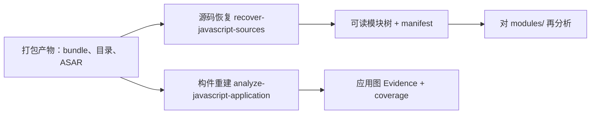

import { Meta } from '@storybook/addon-docs/blocks';

<Meta id="js-source-recovery" title="JavaScript 与 Electron/源码恢复与重建" name="Docs" />

# 源码恢复与重建

拿到手的 JS 应用往往只剩打包产物：混淆过的 bundle、ASAR 归档、压缩过的 chunk。REA 在「产物 → 源头」方向上有两条互不执行的路径：**源码恢复**把显式选定的 UTF-8 JS 文件反解成可读模块，产出带溯源的输出树；**构件重建**把应用目录或 ASAR 投影成 JavaScript Application Graph，产出结构化事实与覆盖报告。两条路径都不运行目标代码，也都不打「还原度分数」——还原度藏在状态、范围、覆盖与限制字段里，判读纪律只有一条：把「没看到」和「不存在」分开。命令的执行机制与双图读法归静态分析一课，功能追踪归应用图与工作流一课，运行时行为归运行时观测与运行时对账两课，本课只讲恢复与重建本身；以重建就绪度、覆盖率与义务台账驱动的整体功能重建，入口在重建工作流一课。



| 回查项 | 值 |
| --- | --- |
| 恢复命令 | `rea recover-javascript-sources <input> <output-dir> [--additional-path <file>]... [--json]` |
| 恢复引擎 | 调用方自备 Wakaru，`REA_WAKARU_COMMAND` 指绝对路径；Linux x64，解析行为以 1.14.0 验证 |
| 恢复产出 | `inputs/`、`modules/`、`reports/`、`manifest.json`；输出目录必须不存在，从不覆盖 |
| 恢复还原度 | 无分数：`success` / `partial` 状态、extraction ranges、manifest 警告与限制 |
| 重建命令 | `rea analyze /absolute/path/to/app.asar --json` 自动路由；或 `rea analyze-javascript-application` |
| 重建产出 | Evidence：应用图、静态观测、统计、局限与 coverage |
| 重建还原度 | 无分数：coverage 状态、unknown scopes、IPC 配对状态、指纹 `truncated` 标记 |
| 共同边界 | 不执行代码、仅本地运行；语法不证明运行时行为 |

## 快速上手

环境要求先说清：源码恢复当前只声明 Linux x64 主机——Wakaru 引擎经 prlimit 限界调用，REA 不负责安装 Wakaru 与 prlimit；macOS 等其他主机不在声明范围，恢复步骤需在 Linux 环境（物理机、容器或 CI）执行，最后的分析步骤任何 REA 主机都能跑。

在 Linux x64 主机上准备引擎并登记路径，两种安装方式任选其一：

```bash
# 方式一：下载官方发布的二进制
curl -fL https://github.com/pionxzh/wakaru/releases/download/v1.14.0/wakaru-linux-x64.tar.gz | tar -xz wakaru
export REA_WAKARU_COMMAND="$PWD/wakaru"

# 方式二：npm 安装后指向平台包内的二进制
npm install wakaru@1.14.0
export REA_WAKARU_COMMAND="$(realpath node_modules/@wakaru/cli-linux-x64/wakaru)"
```

然后一条命令恢复，一条命令把恢复产物接回分析：

```bash
rea recover-javascript-sources /tmp/web-scripts/app.js /tmp/recovered-app --json
rea analyze-javascript-application /tmp/recovered-app/modules --json
```

恢复完成后，`/tmp/recovered-app` 下会出现四个条目：`inputs/`（输入快照）、`modules/`（反解出的可读模块与随带的 source maps）、`reports/`（引擎原始报告）、`manifest.json`（身份、模块清单、变换选择、警告与限制）。`--json` 的内联结果里带有完整文件路径、摘要、大小、extraction ranges、警告，以及一个 `analysis_input`——它可以直接作为 analyze 的参数，这就是上面第二条命令的由来。

## 源码恢复

恢复解决「只有一坨打包产物」的问题：把显式选定的 UTF-8 JavaScript 文件或 bundle 反解成可读模块。三条定性决定了结论的性质：引擎由调用方自备，REA 只负责调度与限界；全程不执行代码——选定的和恢复出来的都不执行；产物是一棵自包含、带溯源的输出树，已存在的输出目录从不被覆盖。典型输入是网站分析线 `export_web_scripts` 导出的脚本（入口在源码定位与导出一课），也接受其他本地脚本文件。

### 引擎前置：Wakaru

恢复引擎是外部工具 Wakaru，两个环境变量完成接线：

- `REA_WAKARU_COMMAND`：Wakaru 二进制的绝对路径。版本接受 `^1.13.0`，解析行为仅以 1.14.0 验证过，其他版本会在结果里记录一条限制。
- `REA_JAVASCRIPT_PRLIMIT_COMMAND`：覆盖 prlimit 路径，默认 `/usr/bin/prlimit`，用于给引擎加地址空间等限界。

REA 既不安装 Wakaru 也不安装 prlimit，这两样由调用方准备；平台边界同样明确：只声明 Linux x64 主机，Bun、Vue 等其他运行时或框架的恢复不做声明。

### 命令与输出树

单输入和多 chunk 各一条模板：

```bash
rea recover-javascript-sources /tmp/web-scripts/app.js /tmp/recovered-app --json

rea recover-javascript-sources /tmp/web-scripts/main.js /tmp/recovered-chunks \
  --additional-path /tmp/web-scripts/runtime.js \
  --additional-path /tmp/web-scripts/shared.js \
  --additional-path /tmp/web-scripts/checkout.chunk.js --json
```

`--additional-path` 可重复给出，把与入口相关的 chunk 一起送进引擎；MCP 侧同源工具 `recover_javascript_sources` 的 `additional_paths` 上限是 16 个额外文件，字段为 `path`、`additional_paths`、`output_directory`。

启动门槛在调用引擎之前就会检查，任何一条不满足都直接失败：

- 输出目录必须不存在、必须是绝对路径、父目录必须已存在；已存在的输出从不覆盖，失败时回滚。
- 输入必须 UTF-8，否则报 `invalid_format`。
- 多输入时相对文件名必须是 NFC 形式且不含反斜杠。

通过门槛后产出一棵独占的输出树：

```text
recovered-app/
├── inputs/        # 单输入时的精确快照；多输入按相对路径保留
├── modules/       # 反解出的可读模块 + 随带上游 source maps
├── reports/       # stdout.json 与 provenance.json：引擎原始报告
└── manifest.json  # 身份、模块清单、变换选择、警告与限制
```

每次运行都会请求 maps 与 provenance。资源上限是每次调用一份：单 worker、1 GiB 地址空间、120 秒期限、输入总量 64 MiB、暂存输出 128 MiB 或 10000 条目、每条诊断与报告流 8 MiB；超限返回不可重试的 `resource_constraint`，`resource: "file-size"` 时错误里的 `reported_limits.maximum_input_bytes` 与 `remaining_input_bytes` 给出上限和剩余额度。这些限制不声称跨并发调用者的主机级约束。

### 变换选项与还原度判读

变换行为由两组选项控制：

- `extraction_mode`：`structural`（默认，对应 `--unpack=strict`）、`heuristic`（`--unpack=auto`）、`inspection`（`--unpack=inspect`）。
- `rewrite_level`：`minimal`、`standard`（默认）、`aggressive`。

还原度没有分数，判读落在三处：

- **状态。** `success` 表示全部完成；`partial` 表示报告有效但部分变换失败，原始警告与文件都保留；`error` 表示报告不可用、溯源不一致、路径逃逸、符号链接或缺模块等硬失败。
- **extraction ranges。** 每个模块记录它来自原文件哪些字节——基于原始快照的半开 UTF-8 字节偏移。这是位置记录，不是覆盖率断言。
- **manifest 警告与限制。** source maps 原样保留但不声称独立验证过映射准确性；原始变量名与运行时等价性本来就未知。

模块数量与格式反映真实结果，官方文档给出两个对照：webpack 5 的 bundle 能反解出两个模块，而 esbuild scope-hoisted 的产物仍是一个 unknown-format 脚本——恢复不承诺拆散所有打包形态。由恢复得到的证据 confidence 记为 `derived`：它是从反解派生的事实，不是对原始源码的观测。

## 构件重建

重建是另一个方向：不产出可读源码，而是把目录或 ASAR 投影成 JavaScript Application Graph——一份「这包里有什么、怎么连」的结构化事实，封存为带应用图、静态观测、统计、局限与 coverage 的 Evidence。全程不执行代码、不需要任何原生引擎或活动进程，且因为完全本地，工件路径、摘要、解析位置始终可操作。命令怎么跑、五个执行阶段、双图怎么绑定归静态分析一课；图节点与功能追踪归应用图与工作流一课；本节只回答两个问题：重建出哪些事实、还原度怎么判读。

### 重建了哪些事实

清单层记录每个条目的规范路径、字节数、SHA-256、inventory ID、ASAR 容器身份与 `.asar.unpacked` 状态；源文件以惰性文本解析，覆盖 `.js/.jsx/.mjs/.cjs` 与 `.ts/.tsx/.mts/.cts`。在清单之上，重建恢复出这些关系与配置面：

- `package.json` 元数据与入口；Electron preload/renderer 路径；BrowserWindow 选项与 `webPreferences`（含 `const` 别名解析）。
- 静态与动态导入、CommonJS `require`、worker（仅 `new Worker(new URL(...))` 形态可解析）与 service worker。
- webpack/Rspack chunk 注册；HTML script 入口（不含内联脚本）。
- `contextBridge` API 键；IPC 操作及配对状态；校验候选；utility-process 入口与 `.node` 绑定请求。
- 网络端点、tRPC procedures 与 links、GraphQL 操作（按机制标注）。
- source maps 的名字与摘要（不含 `sourcesContent`）；每模块 factory-source 摘要与可选的 `babel-ast-v3` 结构指纹。

结果通常很大，出口都已备好：CLI 的 `--format jsonl`、`--filter-output` 与 `--source-path` 精确选择文件；MCP 的 `detail: "summary"` 加 `inspect_analysis_view` 按 Evidence ID 分页查看（如按页取 `modules` 集合）；以及可导出的 Evidence 包。输出选项的通用读法归 CLI 与 Evidence 一课。

### 还原度与覆盖率判读

重建同样没有分数，还原度读 coverage 与推断状态：

- **coverage 的 partial 语义。** 只要仍有文件在分析范围外，coverage 就是 `partial`——包括用 `--source-path` 主动收窄范围的情况，范围外条目记为 `text_status: "outside-analysis-scope"`。`analysis_status` 区分 `interrupted` 与 `not-started`；`hash_status` 记录哈希核对状态（如 `.asar.unpacked` 伴生文件缺失时不可用）；无法统计省略数量时 `omitted_count` 为 `null`；截断时用 `coverage.next_offset` 续读。
- **unknown scopes。** 未解析或畸形的输入不会静默消失，而是成为带类型原因的 unknown scope，例如 `value_resource_limit`、`resource_constraint`（`input_reason: "too-large"`）、`worker_heap_limit_bytes`，内联脚本的 unknown scope 会定位到 `parse-html-inline-scripts`。发生截断时，有效的节点与 unknown 上限都会报告。
- **推断状态。** IPC 配对是推断不是观测；`babel-ast-v3` 指纹是候选匹配用的结构性证据，不是行为等价的证明，指纹被截断时标记 `truncated`，绝不输出部分指纹。

### 静态推断的边界

静态语法能证明的有限，边界清单直接决定结论能推多远：

- 语法不证明运行时执行：图里有一条边不代表运行时真的走到。
- 这些情况不解析：动态 IPC 通道、歧义的 handler、字符串形式的 worker 路径、压缩后的 tRPC link 被调方、动态展开、浏览器全局。
- 内联 HTML 脚本不分析（unknown scope，每文件位置报告上限 100 条、10 行 limitation）；`.node` 原生插件只记元数据。
- 资源硬界同样存在：条目数、字节数、压缩比、路径深度与长度、AST 节点数、协作解析时间各有上限；语义侧为 256 个 primitive 候选、1 MiB JSON 字符串预算、256 层求值深度，wrapper 展开上限 100 万次访问与 128 层嵌套；analyzer 默认 `--max-heap-mb` 1024 MiB、`--analysis-timeout-ms` 每源 300000 ms。
- 目录读取不跟随符号链接；ASAR 中嵌套的失配 ASAR 保持不透明；MCP 的 summary 视图需要会话内保留 Evidence，否则返回 `capability_unavailable`。

## 恢复与重建的衔接

两条路径在分析处汇合：恢复产物的直接后手就是对 `modules/` 跑 analyze，内联结果的 `analysis_input` 可直接作为参数；恢复得到的证据 confidence 为 `derived`，下游引用时要记得它派生自反解，而非原始源码观测。

分工也要分开记：恢复产出可读模块树，但不重建可运行的工程——原始变量名与运行时等价性未知；重建产出结构化事实，但不产出可读源码。要把某个功能完整重建出来（判定重建就绪度、统计覆盖率、管理义务台账），那是另一套工作流，入口在重建工作流一课；本课的两条路径是它上游的输入手段。

## 最佳实践

- **先用默认参数恢复，看状态再加码。** `structural` + `standard` 是起点；结果里出现 unknown-format 脚本或 `partial` 时再换 `heuristic`；`inspection` 只用于观察混淆区域结构。多 chunk 一次给全——`--additional-path` 可重复，MCP 侧上限 16 个额外文件。
- **还原度判读固定三处。** 恢复读 manifest 的警告与限制、状态是否 `partial`，并记住 ranges 只是字节偏移；重建读 coverage 的 unknown scopes 与 limitations。两边「没看到」都不证明「不存在」。
- **ASAR 可信度与继续分析分开决策。** 字节与声明不符时：要继续分析就用 `--integrity-policy record-and-continue`（信任语义 `observed-untrusted`，覆盖降为 `partial`）；要等价性证明就换干净副本。校验机制细节归静态分析一课。
- **大 Evidence 先投影再阅读。** 优先 `detail: "summary"`、`--filter-output`、JSONL 与 `inspect_analysis_view` 分页，避免整份打印；需要跨会话使用就导出 Evidence 包。

## 常见问题

- 恢复报 `resource_constraint`，`resource: "file-size"`？
  输入总量超过单次 64 MiB 上限，该错误不可重试。拆分输入或减少 `--additional-path`；错误里的 `reported_limits.maximum_input_bytes` 与 `remaining_input_bytes` 给出上限与剩余额度。
- 恢复还没调引擎就失败？
  逐项核对启动门槛：输出目录必须不存在、为绝对路径且父目录已存在（已存在输出从不覆盖）；输入必须 UTF-8，否则 `invalid_format`；多输入的相对文件名不能含反斜杠、必须 NFC 形式。
- 报找不到 Wakaru，或引擎起不来？
  `REA_WAKARU_COMMAND` 必须是绝对路径并指向平台二进制（官方示例取 `node_modules/@wakaru/cli-linux-x64/wakaru`）；prlimit 默认取 `/usr/bin/prlimit`，可用 `REA_JAVASCRIPT_PRLIMIT_COMMAND` 覆盖。该能力只声明 Linux x64 主机，其他主机平台与 Bun、Vue 恢复不在声明范围。
- 状态是 `success`，但模块没拆开、变量名还是乱的？
  设计使然。模块数量与格式反映真实结果：webpack 5 bundle 反解出两个模块，esbuild scope-hoisted 产物仍是单个 unknown-format 脚本；原始变量名与运行时等价性本来就未知。用 extraction ranges 与 manifest 判断拆出了什么，不要期待还原成原始工程。
- 重建结果里 IPC 没配对、某个调用点缺失，是分析漏了吗？
  多数是推断边界而非遗漏：动态 IPC 通道不配对、歧义 handler 不加边、字符串 worker 路径不解析、内联 HTML 脚本不分析，语法本身也不证明运行时执行。要确认运行时行为，走运行时观测与运行时对账两课的路径。

## 总结回顾

摘要：

本课沿「产物 → 源头」给出两条不执行的路径。源码恢复用调用方自备的 Wakaru（Linux x64，经 `REA_WAKARU_COMMAND` 与 prlimit 接线）把显式选定的 UTF-8 bundle 反解成可读模块，产出 `inputs`、`modules`、`reports`、`manifest` 四件套；变换由 `extraction_mode` 与 `rewrite_level` 控制，还原度读 `success`/`partial` 状态、extraction ranges 与 manifest 警告限制，资源上限为每次调用 64 MiB 输入、120 秒、1 GiB 地址空间。构件重建把目录或 ASAR 投影成应用图 Evidence：清单事实、入口与 IPC、chunk 注册、网络端点、source maps 摘要与结构指纹，还原度读 coverage、unknown scopes、IPC 配对状态与 `truncated` 标记。恢复产物经 `analysis_input` 直接接回分析；整体功能重建的工作流入口在重建工作流一课。

一句话：

> 恢复产出可读模块，重建产出结构化事实；两者都不执行代码、都不打还原度分数——结论能推多远由状态、范围、覆盖与限制字段说了算，「没看到」不等于「不存在」。

知识要点：

- 源码恢复的引擎怎么准备？哪些主机平台受支持？
- 恢复的输出树包含什么？哪些启动门槛会让它在调用引擎前失败？
- `extraction_mode` 与 `rewrite_level` 各有哪些取值？恢复的还原度从哪里读？
- 构件重建把哪些事实投影进应用图？coverage、unknown scopes 与指纹状态怎么判读？
- 恢复产物怎么接回分析？整体功能重建的入口在哪一课？

## 参考资料

- [JavaScript source recovery（docs/javascript-recovery.md）](https://github.com/morluto/rea/blob/main/docs/javascript-recovery.md)
  恢复命令语法、Wakaru 与 prlimit 约定、输出树与 manifest、变换选项、状态语义与资源上限的出处。
- [JavaScript artifact reconstruction（docs/javascript-artifact-reconstruction.md）](https://github.com/morluto/rea/blob/main/docs/javascript-artifact-reconstruction.md)
  重建路由与选项、清点与恢复出的事实清单、coverage 字段语义、推断边界与资源上限的出处。
