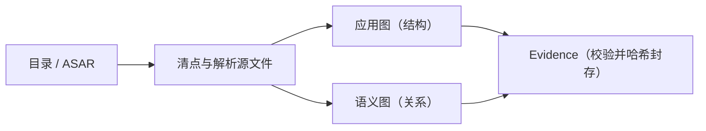

import { Meta } from '@storybook/addon-docs/blocks';

<Meta id="js-static-analysis" title="JavaScript 与 Electron/静态分析" name="Docs" />

# 静态分析

静态分析指用 `analyze-javascript-application` 把一个已解包的 JS/Electron 应用目录或 ASAR 重建成应用图与证据：命令不运行应用代码、不需要原生分析引擎，每条结论都带位置、来源与局限，最终封存成一份完整 Evidence。本课讲这条命令本身——什么能喂给它、运行时经历什么、产出什么形态、ASAR 字节与声明不符时怎么处理。主线是一条实测规律：同一应用用目录和 ASAR 各分析一次，分析实质完全一致，工件身份不同。Evidence 记录的字段读法（`ev_`、`jag_` 编号、authority 与 coverage）见第一次分析一课；输出选项与退出码见 CLI 与 Evidence 一课，本课只桥接不重讲；应用图的节点关系细节与功能追踪工作流归应用图与工作流一课，运行时行为归运行时观测一课，这里只给边界和入口。



| 回查项 | 值 |
| --- | --- |
| 命令 | `rea analyze-javascript-application /absolute/path/to/app --json` |
| 合法输入 | 已解包的应用目录，或 `.asar` 文件；用绝对路径 |
| 通用入口 | `rea analyze /absolute/path/to/app`：目标为目录或 `.asar` 且未给 `--provider`、`--snapshot` 时自动选中本工作流 |
| 是否运行应用代码 | 否；也不需要原生分析引擎 |
| `integrity_policy` 默认 | `fail`；可选 `record-and-continue` |
| 产出 | stdout 一份完整 Evidence（应用图 + 语义图）；真实应用可达数百 MB |
| 进度 | stderr 的 `rea_progress` 行；Notes 示例全程 19 条，stdout 只有结果 |
| 本课新增编号 | `ic_`（完整性矛盾记录）；`ev_`、`jag_` 等见第一次分析一课 |

## 快速上手

拿第一次分析用过的 Notes 示例（没有就从 `rea.tools/examples/notes-example.zip` 重新下载解压），把同一个应用分别以目录和 ASAR 各分析一次：

```bash
rea analyze-javascript-application /absolute/path/to/notes-example --json > notes-dir.json
npx -y @electron/asar pack /absolute/path/to/notes-example /absolute/path/to/notes-example.asar
rea analyze-javascript-application /absolute/path/to/notes-example.asar --json > notes-asar.json
```

两次都退出码 `0`。先看两条记录的身份字段（实测值）：

```bash
jq -c '{format: .subject.format, id: .evidence_id}' notes-dir.json notes-asar.json
```

```json
{"format":"directory","id":"ev_34a356f1a0d6bd97a8e2a51ad4d87e7e51ed299070789a13bea3bfa3479bbc82"}
{"format":"asar","id":"ev_3978d4ef8382912e2705e19d1a24f944f8103130db76f94ce44d8c175d5d7b4a"}
```

再用 `diff` 验证两次的分析实质逐字段一致：

```bash
diff <(jq -c .normalized_result.summary notes-dir.json) \
     <(jq -c .normalized_result.summary notes-asar.json) && echo summary-same
diff <(jq -c .normalized_result.statistics notes-dir.json) \
     <(jq -c .normalized_result.statistics notes-asar.json) && echo statistics-same
```

两段命令分别只输出 `summary-same` 和 `statistics-same`：同一条命令、两种输入、一份同样的分析实质，差别只在工件身份（格式、路径、摘要）。记住「输入形态改变身份、不改变实质」，后面所有判断都挂在这条主线上。

## 输入：目录与 ASAR

命令接受两种合法目标：已解包的应用目录和 ASAR 归档，`subject.format` 分别记录为 `directory` 与 `asar`。两种输入的分析过程与产出结构完全相同；ASAR 输入多出两样东西：绑定到归档字节的容器身份，以及下一节的完整性校验——目录没有完整性元数据，自然也没有这层校验。

不必记专用命令也能进对门：通用入口 `rea analyze` 对目录和 `.asar` 目标、且未指定 `--provider` 或 `--snapshot` 时，自动选中本工作流。实测与显式命令产出完全相同的记录：

```bash
rea analyze /absolute/path/to/notes-example --json > notes-auto.json
jq -r .operation notes-auto.json    # analyze_javascript_application
jq -r .evidence_id notes-auto.json  # ev_34a356f1…，与 notes-dir.json 相同
```

其他输入要点：

- ASAR 里还可以嵌套 ASAR，`normalized_result.statistics` 的 `nested_asar_containers` 字段清点嵌套容器数量。
- CLI 侧路径用绝对路径最稳；MCP 侧的同源工具 `analyze_javascript_application` 必须传绝对路径，接入方式归 MCP 接入一课。
- 一次调用一个目标：想比较两个版本，就各跑一次再用工作流比较（入口在应用图与工作流一课），不要把两个目录塞进同一条命令。

## 执行过程

命令在 stderr 上逐行打印 `rea_progress` 进度，stdout 保持纯净。Notes 示例（6 个文件）全程 19 条，按顺序归并为五个阶段：

| 阶段 | 对应进度 phase | 做什么 |
| --- | --- | --- |
| 清点与解析 | `analyze_javascript_application`、`read_javascript_artifacts`、`parse_javascript_source` 等 | 清点目标，逐个解析源文件与元数据 |
| 构建应用图 | `build_javascript_application_graph`、`seal_javascript_application_graph` | 建立模块、Electron 边界等结构关系并封存 |
| 构建语义图 | `build_javascript_semantic_graph`、`seal_javascript_semantic_graph` | 绑定并校验静态语义关系 |
| 交叉校验 | `validate_javascript_application_result` | 校验结果元数据与跨图绑定 |
| 封存 Evidence | `create_javascript_application_evidence`、`validate_javascript_application_evidence`、`hash_javascript_application_evidence` | 创建、校验并哈希封存 Evidence |

一条原始进度行长这样（`terminal: true` 的是最后一条）：

```json
{"rea_progress":{"phase":"build_javascript_application_graph","completed":0,"total":1,"message":"Constructing application and Electron boundary relationships","sequence":10}}
```

整个过程中命令有几件坚决不做的事，这决定了结论的性质：

- 不执行应用代码。静态 JS 分析只读取并解析你提供的文件，不需要目标能运行。
- 不附加到任何进程，也不打开原生分析引擎——不需要 Ghidra、IDA 之类的 provider。
- 内部确有独立的分析 worker 进程和私有临时源文件，那是分析器的实现细节，不代表你的应用被执行过。

事实保留规则：TypeScript 的 `import type` 与 `export type` 只保留为源事实，不生成运行时导入导出关系；`verbatimModuleSyntax` 下产生的空导入与再导出会保留为依赖候选，并在输出中报告编译器选项不可用。判断运行时依赖时要记得这些边不存在是设计使然。

中途取消也是一等公民：Ctrl+C（SIGINT）退出码 `130`，SIGTERM 为 `143`，可能先打印结构化的 `cancelled` 结果；已完成的事实可保留为部分 Evidence（错误信息中参考 `partial_observation`）。退出码体系见 CLI 与 Evidence 一课。

## ASAR 完整性

对 ASAR 输入，命令会校验头部声明的完整性元数据：每个条目的 SHA-256 是否与实际字节相符、每个条目的范围是否落在容器内。这是 ASAR 输入独有的保护，`parameters.integrity_policy` 默认为 `fail`。

翻转 Notes ASAR 内 `csv.js` 的一个字节后用默认策略分析，退出码 `1`，得到一条自带补救指引的结构化错误：

```json
{"error":"JavaScript application analysis failed","code":"artifact_integrity_mismatch","category":"integrity_mismatch","message":"Artifact bytes contradict declared integrity. If expected, rerun analyze_javascript_application with integrity_policy=record-and-continue (CLI: --integrity-policy record-and-continue) to retain observed bytes as untrusted; otherwise get a fresh copy.","retryable":false,"remediation":{"action":"Artifact bytes contradict declared integrity. If expected, rerun analyze_javascript_application with integrity_policy=record-and-continue (CLI: --integrity-policy record-and-continue) to retain observed bytes as untrusted; otherwise get a fresh copy."},"details":{"logical_path":"csv.js","declared_sha256":"6875aeecc1d3e6c1ff5b888a199c26b377d812d5b10e5fb4025e192a206b0018","calculated_sha256":"7afdc0c5a0212e57fb8c6f146b9897b9e7794cc6344acedc60a0996140ddeda4","unpacked":false}}
```

确认字节本来就改过（比如自己重打包的产物）时，按指引加策略重跑：

```bash
rea analyze-javascript-application /absolute/path/to/notes-tampered.asar --integrity-policy record-and-continue --json
```

这次退出码 `0`，分析照常完成，但 `normalized_result.integrity_contradictions` 里出现一条矛盾记录，图覆盖也降了级：

```json
{
  "contradiction_id": "ic_d58ab0036459bf24efc6c62c3c452392c5fd35be818bd9cb423855b52c24e30b",
  "occurrence_id": "occ_4c877a82623e3a7f87508bf8c1a74b2ac8fb0c07aa80ecae3ab3876c550c66a3",
  "parent_artifact_id": "art_a59229db87b2d442b7ce2315d844449d131b07e3c7e7aac1059a9a8c47d2666d",
  "logical_path": "csv.js",
  "declared_sha256": "6875aeecc1d3e6c1ff5b888a199c26b377d812d5b10e5fb4025e192a206b0018",
  "observed_sha256": "7afdc0c5a0212e57fb8c6f146b9897b9e7794cc6344acedc60a0996140ddeda4",
  "entry_kind": "file",
  "unpacked": false,
  "trust": "observed-untrusted",
  "provenance": "container-integrity-metadata-versus-observed-bytes",
  "limitations": [
    "Observed bytes contradict declared integrity metadata and cannot support equivalence."
  ]
}
```

矛盾记录把声明摘要与实际摘要并排给出，`trust` 为 `observed-untrusted`：字节仍被解析进图，但不再支持等价性结论；同时 `normalized_result.graph.coverage.status` 从 `complete` 变为 `partial`。

两条实测边界把「能救」和「不能救」分开：

- 结构损坏救不了。截短 ASAR 让条目范围越界后，`fail` 与 `record-and-continue` 都以 `artifact_operation_failed`（category `execution_failure`）退出 `1`，进度停在清点阶段。矛盾可以记录，容器结构损坏不能绕过。
- 尾部多余字节无害。在最后一个条目之后追加字节，两种策略都正常完成、无矛盾、覆盖仍为 `complete`——校验覆盖的是头部声明的内容，不要求文件在末尾截断。

## 应用图与语义图

产出不是一张图，而是绑定在一起的两张图。`normalized_result.graph` 是 JavaScript Application Graph，承载结构事实：模块、资产、Electron 主进程/preload/渲染进程、窗口、IPC 通道与处理器、`contextBridge` API 等；`normalized_result.semantic_graph` 单独承载静态语义关系。两者绑定在同一工件摘要上——Notes 实测中 `semantic_graph.application_graph_id` 与 `graph.graph_id` 相同，两者的 `root_artifact_sha256` 都等于 `subject.digest.sha256`。

Notes 示例一次分析的成员概览（回查用；词表含义与追踪方法归应用图与工作流一课）：

- 节点 32 个：`javascript-module` 13、`javascript-asset` 4、`artifact` 3、`javascript-expression` 3、`electron-renderer` 2，`electron-main`、`electron-preload`、`browser-window`、`context-bridge-api`、`ipc-channel`、`ipc-handler`、`package` 各 1。
- 边 45 条：`contains` 15、`imports` 13、`maps_to` 6、`loads` 5、`invokes` 2、`exposes` 2、`calls` 1、`handles` 1。

覆盖语义决定结论能推多远：

- `graph.coverage.status` 为 `complete` 表示清点与图构建没有截断；上一节的完整性矛盾会把它压成 `partial`。
- 语义图独立报告覆盖与未知项：Notes 的语义图汇总出 71 条 unknowns。空白页不证明不存在，读法见第一次分析一课。
- 每条结论的位置、authority、state 与 confidence 字段读法同样在第一次分析一课，本课不重复。

规模是这份产出的常态约束：Notes 示例的 Evidence 约 400 KB，真实应用可达数百 MB（官方测量：334 MB 的 Obsidian Evidence 投影出的摘要视图约 10 KB）。「保存完整记录、投影小视图、`inspect-analysis-view` 查看」的闭环由 CLI 与 Evidence 一课承载；模块页、引用投影、`trace-application-feature` 功能追踪与版本比较都以这份保存的 Evidence 为输入，入口在应用图与工作流一课。

## 最佳实践

- **优先喂原始 ASAR。** ASAR 输入保留容器身份和每条目的完整性元数据，能发现被改过的字节；目录输入分析实质相同，但丢了这层校验。怀疑目标动过手脚时直接加 `--integrity-policy record-and-continue`：分析照常完成，矛盾清单和 `partial` 覆盖会把「哪些文件不可信」摆在明面上。
- **跨版本比较用同一种输入形态。** Notes 示例目录输入得 32 节点 45 边，ASAR 输入得 38 节点 51 边——差异全部来自容器包装。比较两个版本时两边都用目录或都用 ASAR，否则节点与边的数量差异会混入形态噪声。

## 常见问题

- 报 `artifact_integrity_mismatch`，是文件坏了吗？
  不一定坏。重打包、转存、被工具修改过的 ASAR 都会让字节偏离头部声明的哈希。看错误 `details` 里的 `declared_sha256` 与 `calculated_sha256` 指向哪个 `logical_path`；要继续分析用 `--integrity-policy record-and-continue`，要等价性证明就换未改动的副本。
- 用了 `record-and-continue`，损坏的 ASAR 还是直接失败？
  该策略只救「字节与声明不符」这类可记录矛盾。条目范围越界（截断、容器结构损坏）是 `execution_failure` 硬错误，分析在清点阶段就中止。先修复或重新获取容器，再谈策略。
- 同一应用用目录和 ASAR 各分析一次，`evidence_id` 和节点数都不同，以哪个为准？
  都有效但身份不同：`summary` 与 `statistics` 逐字段一致，差异来自容器包装与绑定的字节。引用某条结论认准那一次运行的 `evidence_id`；比较内容读 `summary` 与 `statistics`，不比较 ID。
- TypeScript 项目里 `import type` 引用的模块没有依赖边？
  有意为之：类型导入不产生运行时导入导出关系，REA 把它保留为源事实；`verbatimModuleSyntax` 下的空导入同样保留为依赖候选并报告编译器选项不可用。判断运行时依赖时把这些情况排除。

## 总结回顾

摘要：

`analyze-javascript-application` 接受已解包目录与 ASAR 两种输入，`rea analyze` 对这两类目标自动选中它。命令分五个阶段只读地完成分析：清点解析源文件、构建并封存应用图、构建并封存语义图、交叉校验、哈希封存 Evidence——全程不执行应用代码、不附加进程、不需要原生引擎。同一应用用目录或 ASAR 分析，summary 与 statistics 逐字段一致，但格式、摘要与 `evidence_id` 不同。ASAR 输入额外触发完整性校验：默认 `fail` 在字节与头部声明不符时拦下并给出补救指引；`record-and-continue` 记录 `ic_` 矛盾、把图覆盖降为 `partial` 后继续，而容器结构损坏在两种策略下都是硬错误。图的深入结构与功能追踪归应用图与工作流一课，运行时行为归运行时观测一课。

一句话：

> 这条命令不运行任何应用代码：它把目录或 ASAR 重建成绑定在同一工件摘要上的两份图——输入形态决定证据的身份，完整性策略决定证据的可信语义。

知识要点：

- 哪些输入合法？`rea analyze` 什么时候自动选中这条工作流？
- 一次分析经过哪五个阶段？哪些事它坚决不做？
- 应用图与语义图靠什么互相绑定？coverage 什么时候从 `complete` 变 `partial`？
- ASAR 完整性默认怎么处理？`record-and-continue` 输出什么新记录、改变什么字段？
- 目录与 ASAR 分析同一应用，什么相同、什么不同？

## 参考资料

- [REA 仓库 README](https://github.com/morluto/rea/blob/main/README.md)
  JS/Electron 目标的能力面（模块、导入、source maps、路由、IPC 与原生插件关系），以及「静态分析无需原生引擎、不运行应用」的出处。
- [CLI and Evidence（docs/cli.md）](https://github.com/morluto/rea/blob/main/docs/cli.md)
  命令用法、`rea analyze` 自动路由、`--json` 行为、取消退出码与保存投影流程。
- [JavaScript application workflows（docs/javascript-application-workflows.md）](https://github.com/morluto/rea/blob/main/docs/javascript-application-workflows.md)
  双图绑定、TypeScript 类型导入的事实保留规则、Evidence 结构与引用方式。
- [MCP contracts（docs/mcp-contracts.md）](https://github.com/morluto/rea/blob/main/docs/mcp-contracts.md)
  `integrity_policy=record-and-continue` 行为、分析 worker 不执行应用代码、覆盖 `partial` 语义的出处。
