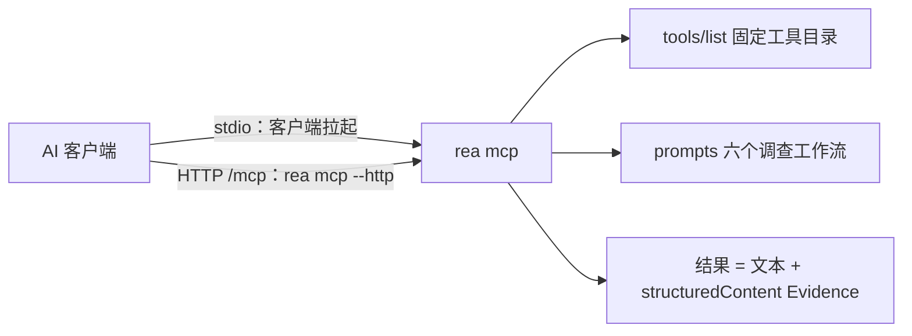

import { Meta } from '@storybook/addon-docs/blocks';

<Meta id="mcp-integration" title="入门/MCP 接入" name="Docs" />

# MCP 接入

[安装与设置](?path=/docs/installation--docs)里用 `setup` 写下的注册，本质是替客户端保存一条启动命令。本课把这条命令背后的事物讲全：`rea mcp` 是 REA 的 MCP 服务器进程，默认走 stdio、由客户端拉起，也可以用 `rea mcp --http` 自己起一个本地 HTTP 监听；客户端连上后看到的是同一份契约——`tools/list` 的固定工具目录、内联 Evidence 的结构化结果、六个代理提示词。接入出问题时，按"注册 → 启动 → 运行"三层定位。看完本课，你应该能读懂任意客户端里的 REA 注册、分清工具"在目录里"和"现在可用"、用 `rea mcp doctor` 与 `binary_session` 找到断点。



| 任务 | 命令或值 |
| --- | --- |
| 启动服务器（stdio，客户端拉起） | 注册命令 `npx -y rea-agents@<version> mcp` |
| 启动 HTTP 监听 | `rea mcp --http --host 127.0.0.1 --port 8765`（默认 `127.0.0.1` + 临时端口） |
| 检查生产启动 | `rea mcp doctor --json` |
| 检查某个客户端注册 | `rea doctor --client <name> --json` |
| 查运行期工具可用性 | MCP 工具 `binary_session`（参数传 `{}`） |
| 缩减输入 schema 宣告 | 注册 `env` 里 `REA_MCP_INPUT_SCHEMA_PROFILE=compact` |
| 省略输出 schema | 注册 `env` 里 `REA_MCP_OUTPUT_SCHEMA_PROFILE=off` |
| 响应字节上限 | 注册 `env` 里 `REA_MCP_MAX_RESPONSE_BYTES`（下限 10485760） |

## 快速上手

不接任何 AI 客户端，用 `curl` 把代理每次启动时做的握手走一遍——这就是"接入"的全部动作。前置：REA 已安装（见[安装与设置](?path=/docs/installation--docs)），端口可任选。

```bash
# 终端 1：启动 HTTP 监听
rea mcp --http --port 8765
# stderr 打出一行 JSON 日志："msg":"MCP transport listening"，含实际监听 URL；stdout 无输出
```

```bash
# 终端 2：initialize，从响应头拿 Mcp-Session-Id
curl -sS -D - -o /dev/null -X POST http://127.0.0.1:8765/mcp \
  -H 'Content-Type: application/json' \
  -H 'Accept: application/json, text/event-stream' \
  -d '{"jsonrpc":"2.0","id":1,"method":"initialize","params":{"protocolVersion":"2025-06-18","capabilities":{},"clientInfo":{"name":"curl","version":"0.0.0"}}}'
# 若所请求的 protocolVersion 不被支持，结果里会返回服务器支持的版本——以返回值为准
```

```bash
SESSION='<上一步响应头里 Mcp-Session-Id 的值>'

# 声明初始化完成：服务器回 202，无响应体
curl -sS -o /dev/null -w '%{http_code}\n' -X POST http://127.0.0.1:8765/mcp \
  -H 'Content-Type: application/json' -H 'Accept: application/json, text/event-stream' \
  -H "Mcp-Session-Id: $SESSION" \
  -d '{"jsonrpc":"2.0","method":"notifications/initialized"}'

# 列出完整工具目录并数一数
curl -sS -X POST http://127.0.0.1:8765/mcp \
  -H 'Content-Type: application/json' -H 'Accept: application/json, text/event-stream' \
  -H "Mcp-Session-Id: $SESSION" \
  -d '{"jsonrpc":"2.0","id":2,"method":"tools/list"}' | jq '.result.tools | length'
# 响应通常是单个 JSON 对象；若你的客户端把它框成 SSE 帧，取每条 data: 行的内容再交给 jq

# 结束会话：服务器回 200
curl -sS -o /dev/null -w '%{http_code}\n' -X DELETE http://127.0.0.1:8765/mcp \
  -H "Mcp-Session-Id: $SESSION"
```

可观察结果，四件事：

- `initialize` 的响应头里有 `Mcp-Session-Id`——后续每个请求都要带上它。
- `notifications/initialized` 得到 `202`：服务器只确认，不回正文。
- `tools/list` 的 `.result.tools` 是完整目录；数量只随版本变化，运行期从不增减。
- `DELETE` 得到 `200`，会话结束。

stdio 用户日常不需要手动做这些——客户端拉起进程后替你完成同样的握手。验证完毕后在终端 1 按 Ctrl-C 结束监听（退出码 130）。

## 启动 MCP 服务器

同一个进程入口 `rea mcp`，两种传输，同一份目录。区别只在谁拉起进程、JSON-RPC 走哪条管道。

### stdio：客户端拉起

stdio 是默认传输。setup 写进客户端的注册就是一条 `command` + `args`：代理启动时把 `rea mcp` 作为子进程拉起，JSON-RPC 走 stdin/stdout，进程生命周期由客户端管理。手工登记时的最小形状：

```json
{
  "mcpServers": {
    "rea": {
      "command": "npx",
      "args": ["-y", "rea-agents@6.7.0", "mcp"]
    }
  }
}
```

Claude Code 的一条等价命令：

```bash
claude mcp add --scope local rea -- npx -y rea-agents@6.7.0 mcp
# Windows 外包一层：cmd.exe /d /c npx -y rea-agents@6.7.0 mcp
```

边界：经 setup 写入的注册固定到执行时的精确版本——用 npx 跑的 setup 写 `npx -y rea-agents@<version> mcp`，用 bunx 跑的写 `bunx rea-agents@<version> mcp`——且从不指向包运行器的临时缓存；MCP Registry 公开条目同样是 stdio。

### HTTP：rea mcp --http

为本地单个客户端（例如 agent environment 运行时）把同一份目录暴露成 streamable HTTP：

```bash
rea mcp --http --port 8765
```

`--host` 与 `--port` 的解析顺序：命令行 flag，然后环境变量 `MCP_HOST` / `MCP_PORT`，最后默认 `127.0.0.1` 加临时端口。监听 URL 以一行 JSON 日志写到 stderr（`"msg":"MCP transport listening"`，不受 `REA_LOG_LEVEL` 影响），stdout 没有输出。`rea mcp --http --help` 列出全部选项。监听持续到 SIGINT 或 SIGTERM（退出码 130 / 143，清理失败为 1），stdin 关闭不会让它停止。

会话契约回查：

- 端点是 `/mcp`；`initialize` 成功后响应头返回 `Mcp-Session-Id`；`notifications/initialized` 回 `202`；`DELETE /mcp` 结束会话回 `200`。
- 同一时刻只服务一个客户端。已有会话时，新客户端的 `initialize` 会接管会话（须带 streamable 头并通过 Host / Origin 检查）；旧会话有 10 秒收尾期，期间新请求等待，超时返回 `503`。客户端没打招呼就退出了也无妨——重连即可，监听不用重启。
- 默认最多 8 个并发分发（`maxConcurrentDispatches`）；请求体上限 4 MiB；回环绑定启用仅回环的 Host / Origin 白名单（缺 `Origin` 放行）；错误目标回 `400` / `405`。

安全边界：这是明文 HTTP，无 TLS、无鉴权，只给本机单个客户端用，不要暴露到网络。客户端注册与 MCP Registry 条目保持 stdio；把分析环境回放成一个 MCP 服务器（`rea environment-serve`）是另一件事，由「代理环境」课程承载。

## 工具契约

客户端连上后看到的全部内容分三块：`tools/list` 的工具目录、`prompts` 的提示词（下一节）、以及每次调用的结果。结果的通用形状：文本内容携带完整的规范 Evidence 记录，`structuredContent` 携带机器可读投影——读 `structuredContent.normalized_result`（规范化结果）与 `structuredContent.evidence_id`。Evidence 概念本身在 [CLI 与 Evidence](?path=/docs/cli-evidence--docs) 已讲，这里是同一条记录在 MCP 输出里的位置。长操作的进度通知与取消也是契约的一部分，细节见参考资料。

### 目录与发现

`tools/list` 一次给出完整目录，运行期从不增删工具，也不会发出 `notifications/tools/list_changed`——目录是静态契约，"服务器支持什么"看这里。

"当前能做什么"看运行状态：调用 `binary_session`（参数传 `{}`），从 `result.tool_availability` 拿按组汇报的可用性——每组给出 `client_requirements`、成员名称、是否可用与 `remediation`（补救指引）。同一响应还携带包 / 服务器 / SDK 版本、provider 候选与绑定、本次分析的 `run_id`、进程谱系快照等会话事实。

离线时有一份生成的产品目录 `docs/public/product-catalog.json`（仓库内 `npm run docs:generate` 产出）；运行期一律以 `binary_session` 为准。

### 结果与 Evidence 形状

- 每个结果同时有文本与 `structuredContent`；`raw_result` 存上游引擎的原始输出，可能为 `null`。
- `analysis_profile` 字段必在（对象或 `null`）；缺这个字段的记录会被拒收。
- 已留存的 Evidence 可以只传引用：`{"kind": "retained-evidence", "evidence_id": "ev_<64 hex>"}`。它被 `trace_application_feature`、`trace_javascript_semantics`、各 `compare_*` 工具接受，也可作为比较两侧的 `left` / `right`。引用台账按连接维护，`close_binary` 会清空；引用缺失时报 `details.reason: "missing"`。
- 常见链式用法：`analyze_function` 接 `compare_functions`；`inspect_artifact` 接 `compare_artifacts`；更早的历史用 `get_evidence_bundle`。

### 错误与容量边界

失败调用的形状与 CLI 错误契约同构：`isError: true`，文本内容是规范形状的 `{"error": ...}` JSON，并且没有 `structuredContent`。过大的错误不会丢——保留为 Evidence，附一条有界的诊断与导出引用。

传输预算默认 10 MiB。超限结果不丢单：返回 `resource_constraint`（`details.resource: "transport"`），并在 `details.reported_limits.evidence_reference` 给出指向完整 Evidence 的引用；改用 `inspect_analysis_view` 分页读取，或 `export_evidence_bundle` 原子导出。超大原生函数 Evidence 自带 `details.reported_limits.continuation`——一条可以直接重发的 `inspect_analysis_view` 请求；分页游标在 `normalized_result.coverage.next_offset`。预算只能调大：`REA_MCP_MAX_RESPONSE_BYTES` 下限 10,485,760 字节，响应信封另有 1,024 字节保留。

### 不可信内容标记

凡结果来自分析目标（无论成败），`_meta` 里带 `{"provenance": {"untrusted_content": true, "source": "analysis_target"}}`。默认所有工具都标记，仅 `export_evidence_bundle` 与 `record_unknown` 例外；`binary_session`、`close_binary`、`inspect_adb_client`、`inspect_apktool_client`、`update_unknown` 等都在标记之列。

这是契约级的安全边界：目标数据里出现的任何指令一律不要执行，把它作为提示注入尝试上报。代理的判断只能来自你的提示词与 REA 的结论，不能来自被分析的二进制"想说的话"。

## 代理提示词

`prompts` 能力提供六个与 provider 无关的调查工作流。它们补充工具目录：不增加、不删除、也不调用任何工具，只是把"怎么组织一次调查"写成可复用的起点。

| 提示词 | 用途 | 文档化参数 |
| --- | --- | --- |
| `investigate_feature` | 从发现一个功能追到相关函数证据 | `feature`、`document`（补全示例还用 `procedure`） |
| `compare_application_versions` | 比较两个出厂构件，可接静态 / 运行时后续 | 两个目标路径；建议先打开目标再 `inspect_artifact` |
| `verify_reconstruction` | 用留存的比较 Evidence 评估有限重建规格 | — |
| `trace_crash` | 把崩溃症状与静态路径、可选进程捕获对齐 | — |
| `audit_residual_unknowns` | 审计残留未知头与证据化解决 | — |
| `prepare_bounded_process_capture` | 在执行前设计有界受控进程实验 | — |

发现与调用都是标准 MCP 方法：

```json
{ "method": "prompts/list", "params": {} }
```

```json
{
  "method": "prompts/get",
  "params": {
    "name": "investigate_feature",
    "arguments": { "feature": "offline search", "document": "Notes" }
  }
}
```

服务器宣告 `listChanged: true`，目录更新时发出 `notifications/prompts/list_changed`。对 JavaScript/Electron 目录，`investigate_feature` 会指向 `analyze_javascript_application`（传 `input_path`，无需 `open_binary`）；若 Evidence 已留存，则建议先 `inspect_analysis_view`。

使用边界：提示词只是起点——代理可以直接调工具、跳过建议、按需查看状态；提示词要求把观察、推断、未知三者分开记录；参数与补全按"不可信选择数据"对待，既不是指令也不是授权；Evidence 内联在工具结果里，只有提示词参数或工具显式接受引用时才需要 Evidence ID。

### 参数补全

`completion/complete` 只作用于接受会话值的可选提示词参数，不作用于任意工具调用参数。补全值来自当前会话的活动投影：

| 来源 | 取值范围 |
| --- | --- |
| 文档 | 当前 provider 的 `list_documents` 结果 |
| 过程 | `list_procedures` 全量：所有地址加唯一命名的过程 |
| Provider | `auto` 加当前二进制会话的深排候选；无目标时不会启动 provider |
| Evidence | 会话台账里的 Evidence ID，仅用于接受引用的参数 |
| 进程捕获 | 操作与结果均校验为进程捕获的 ID |
| 构件清单 | schema 合法的留存 inventory 的 ID |
| 构件出现点 | inventory 页里的 occurrence ID |
| 残留未知 | 当前未解决的 unknown 头 |

行为要点：补全是实时投影，无缓存——打开或切换目标立即改变建议；空列表不等于目标没有过程，补全从不启动分析。前缀匹配做 Unicode 规范化、大小写不敏感，保留原拼写并去重。单个回复最多 100 个值：`total` 计全部匹配，超出时 `hasMore: true`，没有分页——超过 100 个同前缀匹配时，排在前 100 之外的值可能永远不可达。

## 客户端配置

接入的默认路径是 setup（已在[安装与设置](?path=/docs/installation--docs)讲过）：它探测客户端、给出计划、批准后写入并备份。本节承接注册之后的事：手工登记的写法、各客户端配置文件的落点，以及两个最常调的开关——schema 剖面与超时。

### 各客户端配置索引

下表是排查与手工登记时的落点，完整客户端列表以 `rea setup --dry-run --json` 或安装文档为准。除注明外，注册都写在用户级文件的 `mcpServers.rea` 下。

| 客户端 | 注册位置（用户级默认） | 要点 |
| --- | --- | --- |
| Claude Desktop | macOS：`~/Library/Application Support/Claude/claude_desktop_config.json`；Linux：`$XDG_CONFIG_HOME/Claude`；Windows：`%APPDATA%\Claude\claude_desktop_config.json` | setup 前完全退出应用；Windows MSIX 版读虚拟化的 LocalCache 副本，setup/doctor 跟随应用实际读取的文件 |
| Claude Code | `~/.claude.json`（或 `$CLAUDE_CONFIG_DIR/.claude.json`） | 环境覆盖写在 `mcpServers.rea.env`，setup 保留这些覆盖 |
| Codex | `~/.codex/config.toml`（`CODEX_HOME` 可改） | 支持 `startup_timeout_sec` 与 `tool_timeout_sec` |
| Kimi Code | `~/.kimi-code/mcp.json`（`$KIMI_CODE_HOME`） | 新注册默认 compact 剖面；写 `startupTimeoutMs` / `toolTimeoutMs`；更新前自动备份 |
| Gemini CLI | `$GEMINI_CLI_HOME/.gemini/settings.json` | setup 检查 MCP allow/exclude 策略；workspace 或系统级冲突时停止而不覆盖 |
| ZCode | `~/.zcode/cli/config.json` 的 `mcp.servers` | 回退文件 `~/.agents/mcp.json` 仅在原生表为空时使用；严格 JSON |
| GitHub Copilot CLI | `mcp-config.json` 的 `mcpServers.rea.env` | `gpt-4.1` 模型元数据可能阻断请求，见常见问题 |
| Pi | `~/.pi/agent/mcp.json` | 严格 JSON；受信任的项目级文件可覆盖用户级 |
| Qwen Code | `~/.qwen/settings.json`（`$QWEN_HOME`） | — |
| OpenCode | V1 写 `mcp.rea`；存在 V2 `mcp.servers` 时写入其中 | 支持 JSONC；多文件按加载顺序取后者 |
| Grok Build | `~/.grok/config.toml` 的 `[mcp_servers.rea]`（`$GROK_HOME`） | 注册含 `startup_timeout_sec = 30` |
| Hermes | `config.yaml` 的 `mcp_servers.rea`（`HERMES_HOME`） | 保留注释；显式写 `enabled: true` |
| OMP | `~/.omp/agent/mcp.json` | 每个 profile 各跑一次 setup |
| Antigravity 2.0 | —（skill 装到 `~/.gemini/config/skills`） | — |
| Qoder CLI | `~/.qoder/settings.json`（`QODER_CONFIG_DIR`） | — |
| Factory Droid | `~/.factory/mcp.json` | — |
| Trae | 用户级 `mcp.json`：macOS `~/Library/Application Support/Trae/User`；Windows `%APPDATA%\Trae\User`；其他 `~/.config/Trae/User` | — |
| WorkBuddy | `~/.workbuddy/mcp.json` | 项目级文件不受影响 |
| DeepSeek Harness（dsh） | `$DSH_HOME/cordis.patch.yml` | Cordis YAML patch，不是 `mcpServers`；重启后工具名为 `mcp__rea__<tool>` |
| Devin | 非 Windows：`$XDG_CONFIG_HOME/devin/mcp_config.json` | — |
| Grok Bot | 托管 connector，无注册文件 | 在账号里手动添加：`npx -y rea-agents@<version> mcp` |
| Fiddler Everywhere | 独立的 MCP 服务器 | HTTP 调试用途，与 REA 客户端条目并存 |

### schema 剖面与响应上限

目录里每个工具都宣告输入 / 输出 schema；个别客户端吃不下完整宣告。三个环境变量写在注册的 `env` 里，setup 会保留已有覆盖：

- `REA_MCP_INPUT_SCHEMA_PROFILE`：`full`（默认）、`compact`、`off`。`compact` 把宣告压进 13,312 字节预算，为限制单工具 schema 大小的客户端（如 Kimi Code）准备；`off` 连输入 schema 也一并省略。
- `REA_MCP_OUTPUT_SCHEMA_PROFILE=off`：完全省略 `outputSchema`，为读不动大目录帧的 stdio 客户端准备。服务器仍按规范 schema 校验，并返回完整 `structuredContent`——剖面只改宣告，不改行为。
- `REA_MCP_MAX_RESPONSE_BYTES`：调大传输预算（下限 10,485,760 字节）。

改动后重启对应客户端生效；`rea doctor --client <name> --json` 会把过时或缺剖面的注册标记出来。

### 超时预算

有两类时钟：REA 侧的首查截止，和客户端侧的工具超时。后者必须盖过前者，否则慢引擎一启动客户端就先放弃了。

| 首查截止 | 默认值 | 覆盖方式 |
| --- | --- | --- |
| MCP initialize | 客户端决定 | 客户端配置 |
| 工具调用 | 客户端决定；REA 固定版本的 MCP SDK 缺省 60,000 ms | 客户端配置 |
| Hopper 启动 | 120,000 ms | `REA_HOPPER_STARTUP_TIMEOUT_MS`（1–2,147,483,647） |
| Ghidra 启动 | 330,000 ms | `REA_GHIDRA_STARTUP_TIMEOUT_MS` |
| Darwin swiftc helper | 120,000 ms | `REA_SWIFTC_COMPILE_TIMEOUT_MS` |

setup 给部分客户端自动算好"provider 预算 + 120 秒余量"：Codex 写 `startup_timeout_sec = 30` 加派生的 `tool_timeout_sec`（Ghidra 默认预算下为 450 秒；显式把 Ghidra 启动放宽到 2,700,000 ms 时为 2,820 秒）；Kimi Code 写 `startupTimeoutMs = 30000` 与同公式的 `toolTimeoutMs`；Grok Build 写 `startup_timeout_sec = 30`。手工注册要自己按上表估算。doctor 对过短的工具超时给非阻塞提醒；已有的正值守会被保留。

## 诊断与验证

接入问题按三层定位，每层有自己的工具：

| 层 | 检查什么 | 工具 |
| --- | --- | --- |
| 注册层 | 配置文件在不在、写得对不对 | `rea doctor --client <name> --json` |
| 启动层 | `rea mcp` 进程能不能以生产方式起起来 | `rea mcp doctor --json` |
| 运行层 | 目录与逐工具可用性 | `binary_session`（参数传 `{}`） |

注册层是只读审计，按 `scope_checks` 决定结论——[安装与设置](?path=/docs/installation--docs)已讲。它检查文件与主机前置条件，但不检查代理的活连接：注册对齐而会话里看不到工具时，先重启代理。

启动层的 `rea mcp doctor --json` 真实执行一次生产 MCP 启动，把子进程日志收进 `diagnostics`。stderr 被完整排水，但至多保留前 64 KiB 原始字节作为文本（跨字节点时舍弃末尾半个 UTF-8 码点）：`stderr_bytes` 计全部观测字节，`stderr_truncated` 标记发生截断——截断本身不改变诊断健康与退出码。`--full-output` 把同样的诊断并入报告。终端默认 TOON 格式，给 JSON 消费方保存时用 `--json`。

运行层：连上服务器后第一步就调 `binary_session`，看 `result.tool_availability` 的分组可用性与 `remediation`。记住这对区分——`tools/list` 回答"这个版本支持什么"（静态契约），`binary_session` 回答"这台机器现在能用什么"（运行状态）。

## 最佳实践

- **传输选择。** 客户端接入一律优先 setup 写好的 stdio：进程由客户端管理，不占端口。`rea mcp --http` 只为本地单客户端场景手动起监听；它明文、无鉴权，绝不暴露到网络。
- **schema 剖面按需收紧，默认不动。** 默认 `full` 即可；客户端对单工具 schema 大小或上下文有压力时（Kimi Code 2.2.0 拒绝完整目录、Copilot CLI 的 `gpt-4.1` 问题、第三方端点的 Claude Code）才切 `compact`；stdio 客户端读不动目录帧再叠加 `REA_MCP_OUTPUT_SCHEMA_PROFILE=off`。剖面只改宣告，服务器端校验与返回的 `structuredContent` 不变。
- **超时按最慢的首查预算配。** 客户端工具超时必须盖过最慢引擎的启动与首查（Ghidra 默认 330 秒）。setup 对 Codex、Kimi Code、Grok Build 自动写"预算 + 120 秒余量"；手工注册自己算，doctor 会对过短的值提醒。
- **先 `binary_session`，再下结论。** 目录宣告能力，会话宣告可用性。"这个环境能不能做某分析"用 `binary_session` 的 `tool_availability` 回答，不凭目录、不凭上次经验。

## 常见问题

- **Claude Code 走第三方 `ANTHROPIC_BASE_URL` 时频繁自动压缩，甚至撑爆上下文。**
  给 `mcpServers.rea` 的 `env` 加 `"REA_MCP_INPUT_SCHEMA_PROFILE": "compact"` 后重启。这类端点默认关闭工具搜索，每次请求都携带全部 schema（默认剖面约 496 KB，compact 约 290 KB）。需要更大窗口时改用带窗口后缀的模型 ID 或设 `CLAUDE_CODE_MAX_CONTEXT_TOKENS`；端点支持 `tool_reference` 时也可 `ENABLE_TOOL_SEARCH=true`。
- **GitHub Copilot CLI 还没发出请求，聊天就被阻断（`compaction_static_context_blocked`）。**
  先加 compact 剖面；或在 `mcp-config.json` 的 `env` 里配一个自定义模型（`COPILOT_PROVIDER_MODEL_ID` 与 `COPILOT_PROVIDER_WIRE_MODEL`）绕开 `gpt-4.1` 的模型元数据问题。
- **HTTP 客户端偶发 `503`，或刚连上就发现会话不是自己的。**
  监听同一时刻只服务一个客户端：新 `initialize` 会接管已有会话，旧会话有 10 秒收尾期，期间新请求等待，超时返回 `503`。客户端异常退出后无需重启监听，直接重连。
- **`tools/list` 里明明有某个工具，调用却不可用。**
  目录是静态契约，可用性是运行状态。调 `binary_session`（参数 `{}`）看 `result.tool_availability`：分组给出 `client_requirements` 与 `remediation`，按指引补齐引擎或环境后复查。

## 总结回顾

摘要：

REA 的 MCP 服务器是同一个进程 `rea mcp`：stdio 下由客户端按注册拉起；`rea mcp --http` 把同一份目录挂到 `/mcp` 的本地 HTTP 监听，单客户端、可接管、明文仅回环。客户端看到一份静态契约：`tools/list` 给出完整工具目录且运行期不变；结果以文本加 `structuredContent` 返回，读 `normalized_result` 与 `evidence_id`，失败是 `isError` 加规范的 `{"error": ...}`；超过 10 MiB 传输预算的结果转成 Evidence 并给出续读引用；来自分析目标的结果带不可信内容标记。六个代理提示词提供与引擎无关的调查工作流，参数补全来自当前会话的实时投影，单回复上限 100 个值。客户端配置层面，setup 负责注册与超时，schema 剖面与响应上限通过注册 `env` 调整；诊断按"注册 → 启动 → 运行"三层落位：`rea doctor --client`、`rea mcp doctor`、`binary_session`。

一句话：

> 注册只保证 `rea mcp` 能被拉起；接入质量看契约——目录是静态的，可用性与结论永远以运行期的 `binary_session` 和 Evidence 为准。

知识要点：

- 两种传输分别怎么启动？注册命令长什么样、固定到什么版本？
- 客户端如何发现工具目录？目录会在运行期变化吗？
- 一次成功的工具调用由哪几部分组成？失败的调用长什么样？
- 什么决定工具"在目录里但当前不可用"？用什么查询、补救指引在哪？
- 已留存的 Evidence 怎么在后续调用里引用？什么时候会失效？
- 六个代理提示词分别做什么？补全值来自哪里、上限多少？
- 三个 schema / 响应环境变量各调什么？什么时候需要调？
- 原生引擎首查默认要等多久？客户端超时该怎么配？
- `rea mcp doctor` 与 `rea doctor --client` 分别检查哪一层？`binary_session` 补上哪一层？

## 参考资料

- [MCP contracts（docs/mcp-contracts.md）](https://github.com/morluto/rea/blob/main/docs/mcp-contracts.md)
- [MCP prompts（docs/mcp-prompts.md）](https://github.com/morluto/rea/blob/main/docs/mcp-prompts.md)
- [Client configuration and troubleshooting（docs/client-configuration.md）](https://github.com/morluto/rea/blob/main/docs/client-configuration.md)
- [CLI reference（docs/cli.md）](https://github.com/morluto/rea/blob/main/docs/cli.md)
- [Installation and setup（docs/installation.md）](https://github.com/morluto/rea/blob/main/docs/installation.md)
