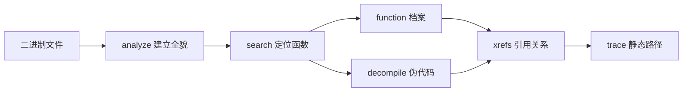

import { Meta } from '@storybook/addon-docs/blocks';

<Meta id="native-investigation" title="原生二进制/静态调查/原生调查" name="Docs" />

# 原生调查

面对 Mach-O、ELF、PE 这类原生二进制，REA 自己不做反汇编：`rea` CLI 提供六条调查命令（`analyze`、`search`、`function`、`decompile`、`xrefs`、`trace`）作为统一入口，真正的分析由配置好的 provider 引擎（Ghidra、Hopper、IDA、Kuna）执行。每条命令回答一个独立问题，输入都是同一个二进制路径，输出都是结构化证据；没有可用的 provider，六条命令都无法开始。本课建立这层模型，并给每条命令的输入、输出与回查要点。原始字节与 ELF 诊断见 [4.1.2 原始二进制与诊断](?path=/docs/raw-binary-diagnostics--docs)，崩溃记录见 [4.1.3 崩溃记录](?path=/docs/recorded-crashes--docs)，provider 安装与配置见 [4.3.1 Provider 体系](?path=/docs/native-providers--docs)。



| 命令 | 回答的问题 | 关键输入 | 返回 |
| --- | --- | --- | --- |
| `analyze` | 这个二进制整体是什么 | `PATH` | 原生概览（与 `inspect` 共享工作流） |
| `search` | 哪些过程/符号匹配 | `PATH`、查询词、`--kind` | 匹配列表 |
| `function` | 一个函数的完整档案 | `PATH`、过程名或地址 | 函数档案（dossier） |
| `decompile` | 伪代码长什么样 | `PATH`、地址或过程 | 伪代码 |
| `xrefs` | 谁引用它、它引用谁 | `PATH`、地址 | 引用列表（含来源标注） |
| `trace` | 从这里静态能追到哪 | `PATH`、查询词或过程 | 有界静态调用追踪 |

## 快速上手

前置：已安装 REA（见 [1.1 安装与设置](?path=/docs/installation--docs)）并有至少一个就绪的原生 provider；`PATH` 换成任意一个 Mach-O、ELF 或 PE 文件，macOS 的 `.app` 包可以直接给出。

```bash
# 1. 看有哪些 provider 可用
rea providers --json

# 2. 建立全貌
rea analyze /path/to/program --provider ghidra --json

# 3. 按名字定位函数
rea search /path/to/program entry --kind procedures --provider ghidra --json

# 4. 深入其中一个函数
rea function /path/to/program main --provider ghidra --json
```

观察：第 1 步返回已配置的 provider 列表；第 2 步返回带 provider 标注的原生概览；第 3 步返回名字匹配 `entry` 的过程；第 4 步返回 `main` 的函数档案。四条命令都输出结构化结果（`--json` 在终端缩进显示，进入管道或重定向后转为紧凑格式），退出码 `0` 表示完成——完成不等于没有警告，部分证据和未决问题会作为证据一并返回。MCP 侧同样的调查由 `open_binary`、`list_procedures`、`analyze_function` 等工具完成（见 [1.4 MCP 接入](?path=/docs/mcp-integration--docs)）。

## Provider 选择

六条命令共享同一个前置条件：选一个能处理目标格式的分析引擎。选择按固定顺序生效：

1. 显式 `--provider <ID>`：优先级最高，本课示例统一用它。
2. 环境变量 `REA_ANALYSIS_PROVIDER`：适合整个会话固定用一个引擎。
3. 自动选择：只有一个可用 provider 支持目标时自动选中；有多个候选时报错，错误的 `details.candidate_ids` 列出全部候选。

动手前可以先自检：

```bash
rea providers --json                 # 已配置的 provider
rea capabilities --json              # provider 与辅助能力
rea doctor --provider ghidra --json  # 单个 provider 的就绪诊断
```

provider 决定的不只是"能不能跑"，还改变行为细节：Ghidra 的搜索用 Java 正则，表达式过于复杂触发栈耗尽时回退为字面量匹配；Hopper 用 ECMAScript Unicode 正则，正则有五秒时限，符号名上限 1024 个 UTF-16 字符。引擎的安装、就绪问题与选型对比见 [4.3.1 Provider 体系](?path=/docs/native-providers--docs)。

## 六条调查命令

六条命令共享同一调用形态 `rea <命令> PATH [定位参数] --provider <ID> --json`：`PATH` 是二进制文件或 macOS `.app` 包，定位参数把命令缩到具体函数或地址（写法见下方"地址与选择器"）。输出由全局选项控制——`--format`、`--filter-output`、`--token-limit`、`--token-offset` 调整返回内容，缺值时以 `MISSING_OUTPUT_VALUE` 报错且命令不执行；输出选择不改变操作状态。全局选项与退出码（`0`、`1`、`128+N`）的完整规则见 [1.3 CLI 与 Evidence](?path=/docs/cli-evidence--docs)，本课不重复。

### analyze：建立全貌

`analyze` 与 `inspect` 共享原生概览工作流，返回目标的原生整体概览。它是调查的第一步：后续 `search`、`function` 的定位参数都从这里的输出里来。

```bash
rea analyze /path/to/program --provider ghidra --json
```

边界：不带 `--provider`（或 `--snapshot`）时，`rea analyze PATH` 对目录和 `.asar` 自动选择 JavaScript 工作流——调查原生二进制时始终显式给出 `--provider`。Go、Rust 等语言平台的构建元数据专题见 [4.2.1 Go 二进制](?path=/docs/go-binaries--docs) 与 [4.2.2 Rust 二进制](?path=/docs/rust-binaries--docs)。

### search：按名字定位

`search` 按名字或模式在二进制中定位过程与符号，是缩小范围的入口。常用形式是用 `--kind procedures` 把范围限定在函数：

```bash
rea search /path/to/program entry --kind procedures --provider ghidra --json
```

正则行为随 provider 而变（见"Provider 选择"）。没有命中不能证明"不存在"——先放宽模式或换 `--kind` 再下结论；按字节签名找代码用 `rea search-bytes`（见下方"定点原语工具"）。

### function：单个函数档案

`function` 以过程名或地址定位，返回单个过程的完整档案（dossier），是深入一个函数前的集中入口。

```bash
rea function /path/to/program main --provider ghidra --json
```

### decompile：读伪代码

`decompile` 以地址或过程定位，返回目标的伪代码（pseudocode）：

```bash
rea decompile /path/to/program 0x1000 --provider ghidra --json
```

只要汇编本身、不需要伪代码时，改用 `rea instructions`（语法细节用 `rea instructions --help` 确认）。

### xrefs：引用关系

`xrefs` 以地址定位，返回该处的交叉引用，区分 incoming（谁引用它）与 outgoing（它引用谁）两个方向，并给每条引用标注来源（provenance）：`analysis`（分析推导）、`default`、`imported`、`user_defined`（人工标注）。

```bash
rea xrefs /path/to/program 0x1000 --provider ghidra --json
```

判断"谁调用了这个函数"时先看 incoming，再按 provenance 分辨哪些是引擎推导、哪些是导入或人工结论。

### trace：有界静态追踪

`trace` 从种子出发做有界静态调用追踪，回答"从这里静态能追到哪些调用路径"。它在分析引擎的推导结果上工作，不执行目标程序：

```bash
rea trace /path/to/program "search" --provider ghidra --json
```

两个深挖变体把追踪推进到更细的证据：`rea trace-native-ui-action` 从一次 UI 动作出发，经 `authored_ui_dispatch` 或 `native_seed_call_trace` 两条发现路线建立追踪；`rea trace-native-values` 在过程的数据流上追值的来源，产出受预算约束——8 MiB 节点、32 MiB 结果、每个 dossier 最多 3000 条 p-code 操作。跳转表目标的证据会分开列出映射、默认目标和数据来源。静态追踪回答不了运行时行为，需要插桩观测时见 [4.4 动态分析](?path=/docs/frida-instrumentation--docs)。

### 定点原语工具

家族中的定点工具回答单点问题，同样需要 provider：

| 命令 | 用途 | 关键输入与限制 |
| --- | --- | --- |
| `rea inspect-native-instruction` | 查看单个地址处指令的细节 | 需要精确地址，写法见"地址与选择器" |
| `rea resolve-native-call-targets` | 解析一个调用点的跳转目标 | 传入调用点地址 |
| `rea inspect-native-data-type` | 查看类型定义或某地址的类型化数据 | `--type /MyStruct` 按名查，`--address` 按址查；Ghidra 下字段数超限会被截断 |
| `rea search-bytes` | 按字节签名定位代码 | `'48 8B ?? ?? 89'` 中 `??` 为掩码通配；`start`/`end` 限定窗口，`next_cursor` 翻页；未命中不能证明未初始化内存中没有目标字节 |

## 地址与选择器

`function`、`decompile`、`xrefs` 的定位参数有两套写法：位置参数直接跟在 `PATH` 后；精确选择器用 `=` 形式消除歧义。名字本身以 `-` 开头（如 Objective-C selector）时，位置参数会被当成选项解析，必须改用精确选择器：

```bash
rea function ./app '--procedure=-[REAWidget delegate]' --provider hopper --format json
rea trace ./app --query=--help --provider hopper --format json
```

缺失或互相冲突的选择器在分析开始前就报错失败，不会产生半截结果。以 Ghidra 为例，地址按以下规则解析：

- 十六进制地址 `0x` 前缀可有可无；规范化输出统一为小写偏移。
- 支持带地址空间的形式，如 `EXTERNAL:0x1`。
- 符号名优先于裸十六进制地址。
- 地址有歧义时命令报错，错误中列出全部候选入口地址，从中选一个重试。

## 最佳实践

- **按 analyze → search → function/decompile → xrefs → trace 的顺序推进。** 每一步的输出都是下一步的定位参数：概览给出候选，search 缩小名单，档案与伪代码建立理解，xrefs 找到调用方，trace 收束路径。跳过前两步直接猜地址，是最常见的无效调查。
- **面向 agent 或脚本时控制返回体积。** `--json` 配合 `--filter-output`、`--token-limit`、`--token-offset` 裁剪结果；对同一二进制反复调查时用 `--snapshot` 保存并复用分析快照，避免每条命令重新分析。
- **把 null 和失败读对。** 返回中的 null 表示"此处不可用"，不是 false 或"不存在"；失败的观测会以类型化证据保留在输出里，不会静默消失——排查时先翻证据再重试。
- **静态结论只到静态为止。** 六条命令的全部产出都是静态事实，不能证明运行时行为；要确认"运行时到底发生了什么"，转入 [4.4 动态分析](?path=/docs/frida-instrumentation--docs)。

## 常见问题

- 命令报 provider 相关错误，或自动选择失败
  先运行 `rea providers --json` 确认可用引擎，再用 `rea doctor --provider <ID> --json` 做就绪诊断；多候选歧义时错误带 `details.candidate_ids`，显式指定其中一个即可。引擎装不上或未就绪的处理见 [4.3.1 Provider 体系](?path=/docs/native-providers--docs)。
- 对目录或 `.asar` 跑 `analyze`，得到的是 JavaScript 分析而不是原生概览
  不带 `--provider`（或 `--snapshot`）时，`rea analyze PATH` 对目录和 `.asar` 自动选择 JS 工作流；调查原生二进制时始终显式加 `--provider`。
- Objective-C selector 这类以 `-` 开头的名字作位置参数时报错
  位置参数被当成选项解析了；改用精确选择器 `--procedure=-[Class selector]`，并把整个名字用引号包住。
- `decompile` 或 `xrefs` 报地址歧义
  错误会列出候选入口地址；解析时符号名优先于裸十六进制，优先传符号名，或从候选中选一个精确地址重试。
- `search` 没有命中，能断定二进制里没有这个函数吗
  不能。先放宽模式或换 `--kind` 重试；Ghidra 下复杂正则会回退字面量匹配，`search-bytes` 未命中也不能证明未初始化内存中没有目标字节。

## 总结回顾

摘要：

本课建立原生调查的基本模型：REA 的六条 CLI 命令是薄入口，分析由 provider 引擎完成，引擎按"显式 `--provider` → `REA_ANALYSIS_PROVIDER` 环境变量 → 自动选择"的顺序确定，动手前可用 `providers`、`capabilities`、`doctor` 自检。调查沿 `analyze`（全貌）→ `search`（定位）推进，再用 `function`（单函数档案）、`decompile`（伪代码）、`xrefs`（带 provenance 的引用）、`trace`（有界静态追踪）逐层深入；`instructions` 与 `inspect-native-instruction`、`resolve-native-call-targets`、`inspect-native-data-type`、`search-bytes` 等定点工具覆盖单点需求。定位参数可用位置形式或 `=` 精确选择器，以 `-` 开头的名字必须用选择器；地址支持十六进制（`0x` 可省略）、地址空间形式和符号名，歧义时报错并列出候选。null 表示不可用而非 false，失败观测保留为证据，静态结论不外推到运行时。

一句话：

> 原生调查是 provider 驱动的六个问题：先 analyze 建图，search 定位，再按需用 function、decompile、xrefs、trace 深入。

知识要点：

- 跑第一条原生分析命令前，怎样确认并选择 provider？
- 六条命令各回答什么问题、输入和返回分别是什么？
- 为什么对目录跑 `analyze` 会进入 JavaScript 工作流，怎样避免？
- 以 `-` 开头的函数名该用什么参数形式传入？
- 地址的十六进制、地址空间、符号名写法各是什么？歧义时怎么处理？
- 搜索未命中、返回 null、命令失败各自说明什么、不能说明什么？

## 参考资料

- [Native binary investigation — morluto/rea docs](https://raw.githubusercontent.com/morluto/rea/main/docs/native-investigation.md)
- [CLI and Evidence — morluto/rea docs](https://raw.githubusercontent.com/morluto/rea/main/docs/cli.md)
