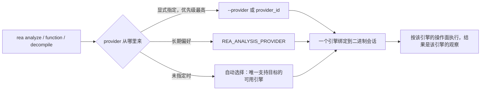

import { Meta } from '@storybook/addon-docs/blocks';

<Meta id="native-providers" title="原生二进制/反汇编 Provider/Provider 体系" name="Docs" />

# Provider 体系

REA 对原生二进制的每次静态分析都由一个可插拔的分析引擎完成，这个引擎就是 provider。REA 自身不内置反编译器：原生 provider 家族目前是 Hopper、Ghidra、IDA、Kuna 四个外装引擎，各自独立安装、授权与能力边界各不相同；objdump、GDB、Rizin 这类辅助命令行工具不是 provider，而是经 `rea capabilities` 报告的辅助能力。选定 provider 后它会绑定到当前二进制会话：这条会话能用哪些操作、结果以哪个引擎的观察为准，都由它决定，并且分析失败时 REA 不会自动改用另一个引擎。因此每次原生分析前先回答两个问题——本机有哪些引擎可用（用 `rea providers` 与 `rea doctor` 盘点体检），这一个目标该用哪个引擎（用 `--provider` 指定或交给自动选择）。本课讲清这套机制、选择方式、三个管理命令的输出判读与四个引擎的选型入口；各引擎的具体安装配置见「Ghidra 接入」与「IDA 与 Kuna」。



| 条目 | 默认行为或取值 | 回查 |
| --- | --- | --- |
| provider 指定（CLI） | 未指定时自动选择；显式 `--provider` 优先于 `REA_ANALYSIS_PROVIDER` | 选择 provider |
| provider 指定（MCP） | `open_binary` 的 `provider_id` 字段 | 选择 provider |
| 原生 provider 家族 | Hopper、Ghidra、IDA、Kuna，均为外装引擎（Hopper 可由 setup 代装） | Provider 一览 |
| 管理命令 | `rea providers`、`rea capabilities`、`rea doctor` | 管理命令 |
| 选择失败信号 | `ambiguous`（多个候选引擎）、`provider_unavailable`（引擎不可用） | 常见问题 |

## 快速上手

前置：REA 已安装（见「安装与设置」），手边有一个原生可执行文件（ELF、Mach-O 或 PE 均可），本机至少有一个 provider 就绪。以下以 Ghidra 为例；一个引擎都没有时，最快的路径是让 setup 代装 Hopper：

```bash
rea setup --yes --install-hopper --json
```

第一步，盘点本机可用的 provider 与各自支持的操作：

```bash
rea providers --json
```

第二步，对选定引擎做一次只读体检：

```bash
rea doctor --provider ghidra --json
```

就绪范围内的必需检查全部通过时以退出码 0 结束；任一必需检查失败则退出码为 1，报告中给出失败的检查项与修复建议。

第三步，用它对目标跑一次真实分析：

```bash
rea analyze /absolute/path/to/program --provider ghidra --json
```

返回带证据编号的 JSON 结果即完成最小闭环。三条命令的完整语义分别见「管理命令」与「选择 provider」。

## 选择 provider

provider 决定一次原生分析「由谁做、能做什么」：它提供该会话的全部操作面，结果（伪代码、符号、引用边）都是这个引擎在自己数据库上的观察，不是跨引擎的等价事实。运行失败时 REA 保持绑定不变，也从不自动回退到另一个 provider；要换引擎就必须显式重新指定。

### 自动选择与显式指定

未指定 provider 时，REA 使用唯一一个支持该目标的可用 provider。当多个引擎都支持同一目标时，自动选择拒绝猜测，返回 `capability_unavailable` 并要求显式指定。

CLI 用 `--provider` 指定：

```bash
rea analyze /absolute/path/to/program --provider hopper --json
```

MCP 向 `open_binary` 传 `provider_id`：

```json
{"path": "/absolute/path/to/program", "provider_id": "hopper"}
```

一旦打开目标，选定的 provider 保持绑定到会话，直到显式切换或关闭会话；会话内的后续操作都落在同一个引擎上。

### REA_ANALYSIS_PROVIDER 与优先级

`REA_ANALYSIS_PROVIDER` 设置长期生效的引擎偏好，作为未显式指定时的默认选择；显式 `--provider` 标志优先于它。优先级从高到低：显式 `--provider`、`REA_ANALYSIS_PROVIDER`、自动选择。

```bash
export REA_ANALYSIS_PROVIDER=ghidra
rea analyze /absolute/path/to/program --json                 # 使用长期偏好的 Ghidra
rea analyze /absolute/path/to/program --provider kuna --json # 本条临时改用 Kuna
```

### 选择失败的两种形态

选择失败以 `capability_unavailable` 返回，`details.selection_reason` 只有两种取值：

- `ambiguous`：多个已配置引擎都支持该目标，自动选择不替你决定。从 `details.candidate_ids` 列出的候选中选一个，用 `--provider` 显式指定后重试。
- `provider_unavailable`：引擎未安装、未配置或就绪检查未通过。按返回的 `message` 与 `remediation.action` 处理，原始拒绝原因保留在 `details.rejections`；先对目标引擎跑一次 `rea doctor`（如 `rea doctor --provider ghidra --json`）定位缺失项。

## Provider 一览

四个引擎共享同一套选择与会话机制，也共享四条边界：

- **结果是引擎的观察。** 不同 provider 的伪代码或文本不可按「相同 / 不同」比较，一个引擎的结果也不等价于另一个引擎的分析数据库。
- **失败不回退。** 运行期失败永远以错误返回，REA 不会自动换一个引擎重试。
- **会话绑定。** 选定的 provider 保持绑定，直到显式切换或关闭。
- **快照跟着引擎走。** `--snapshot` 保存的结果只在目标字节、操作、参数、provider 与设置全部一致时精确复用，换了引擎就要重新分析。

| Provider | 形态与授权 | 典型目标 | 能力概要 | 配置入口 |
| --- | --- | --- | --- | --- |
| Hopper | 商业软件，demo 可用；唯一可由 `rea setup` 代装的引擎 | macOS/Linux 上的 Mach-O 与 ELF 快速调查 | 函数清单、正则搜索、伪代码、重命名、书签、字符串解码；字节搜索不可用 | 自动发现，可用 `HOPPER_LAUNCHER_PATH` 覆盖 |
| Ghidra | 开源；自备 Ghidra 12.1.x 与 64 位 JDK 21+ | ELF/PE/Mach-O 深度静态分析，平台覆盖最广 | 26 个只读操作，外加函数名与入口注释编辑（非 Windows） | `GHIDRA_INSTALL_DIR` |
| IDA | 商业；REA 适配其 MCP 服务器，不代装不许可 | 已有 IDA 授权与工程的用户 | 清单、搜索、伪代码、汇编、调用关系、xrefs、函数档案 | `REA_IDA_MCP_CONFIG` |
| Kuna | Apache-2.0，单个 `kuna` 可执行文件 | ELF 与 thin Mach-O 的轻量反编译 | 伪代码、汇编、调用图、字符串；无类型、基本块与注解 | `REA_KUNA_COMMAND` |

objdump、GDB、Rizin、Cutter 桥接等辅助工具链不在上表：它们不是 provider，不参与绑定与选择，出现在 `rea capabilities` 的输出中，见「离线工具链」。provider 机制同样服务于其他目标线——例如 Android 线的 JADX 也接受 `rea doctor --provider` 检查——本课只覆盖原生二进制组。

### Hopper

Hopper 是商业反编译器，自带许可，免费 demo 有厂商限制；它是唯一一个 `rea setup` 能自动安装的 provider（`rea setup --yes --install-hopper`），适合在 macOS 或 Linux 上想最快开始、不想自建 Ghidra 环境的场景。Windows 上无法安装 Hopper。

支持的操作：函数与过程清单（支持 Objective-C 名称选择，如 `'--procedure=-[REAWidget delegate]'`）、字面量与 ECMAScript 正则搜索（有五秒匹配期限，可取消）、伪代码、光标导航、重命名（上限 1024 个 UTF-16 码元）、书签、字符串解码，以及地址与文件偏移换算；调用边保留 Hopper 自身的引用分类。

边界：字节搜索尚不可用；分析请求串行化执行；macOS 上拒绝 `.hop` 工程目标，应选原始可执行文件。体检入口：

```bash
rea doctor --provider hopper --json
```

检查项如 `hopper-demo-runtime`（含嵌入式 Python 与私有显示诊断）和 `reported_release_version`。安装细节见「安装与设置」。

### Ghidra

Ghidra 是开源引擎，REA 永远不代装 Ghidra 或 Java：需自备 Ghidra 12.1.x 与 64 位 JDK 21+，导出 `GHIDRA_INSTALL_DIR`（未设置时也会在 PATH 上发现 `ghidra` / `ghidraRun`）。它适合需要最深静态能力或最广平台覆盖的场景：ELF/PE/Mach-O 之外，DOS、MIPS、PowerPC、PSP、RISC-V、NativeAOT 等专题平台也由它承载（见「Ghidra 平台专题」）。

支持的操作：验证覆盖 26 个只读操作——元数据与概览、过程与符号清单、字符串、字面量与 Java 正则搜索、掩码字节搜索、反编译、完整指令清单、xrefs、调用者与被调用者、CFG 档案、p-code 值流、跳转表恢复、数据类型检查、地址与文件偏移换算等；Linux/macOS 上另有函数名与入口注释的原子编辑。

边界：没有 GUI 控制，不修改可执行字节；每个安装必须含主机原生反编译器；Windows 上为只读的 P0 支持。体检入口：

```bash
rea doctor --provider ghidra --json
```

依次校验平台与架构、12.1.x 版本、`analyzeHeadless`、JDK 版本与主机匹配等。接入与就绪修复见「Ghidra 接入」。

### IDA

IDA provider 是 REA 对现有 IDA MCP 服务器的适配层：REA 不安装、升级、激活或许可 IDA，只对接你已有的 IDA。两种生命周期形态——attached 连接已打开 GUI 的 IDA 实例，headless 通过 database supervisor API 分析目标；另有面向 IDA Pro 与 IDA Free 的实验性 native 桥接。适合已经购买 IDA、想把既有 GUI 会话与工程接入 REA 的用户。

支持的操作：函数与字符串清单、字面量与正则搜索、函数解析、伪代码、汇编、原始函数指令、被调用者解析、入站地址引用、函数档案；现代 headless 形态额外支持 `resolve_containing_procedure`，直接调用者仅 legacy 形态可用。

边界：完整函数体范围、类型化引用边、CFG、数据库修改、调试均不可用，空的 facet 表示「未知」而非「确认不存在」；attached 形态拒收 Universal Mach-O（需先用 `lipo -thin` 提取或改用 headless）；上游的分页与截断限制被保留为显式限制说明。体检入口：

```bash
rea doctor --provider ida --json
```

doctor 校验注册但不会启动 IDA，运行时兼容性与目标绑定留给实际分析。配置见「IDA 与 Kuna」。

### Kuna

Kuna 是 Apache-2.0 授权的轻量静态反编译器，以单个 `kuna` 可执行文件分发；REA 不代装，用 `REA_KUNA_COMMAND` 给出绝对路径即可，以 1.833 版本验证，其他版本会被接受但标记为未验证。它只读取镜像、绝不执行目标，适合在没有重型引擎的机器上快速拿到 ELF 或 thin Mach-O（x86-64、AArch64、ARM）的伪代码与调用图。

支持的操作：函数清单（含不反编译的导入槽位）、过程搜索、伪代码（单函数与批量）、汇编、调用者与被调用者、字符串清单与搜索（ECMAScript 正则）、精确地址的入站 xrefs，以及汇总伪代码、汇编与调用关系的函数分析。

边界：PE 与 universal Mach-O 被以类型化原因拒收，Windows 尚不支持；类型化引用、基本块、原始内存访问、注解与类型恢复都不可用，间接调用的覆盖是部分的；分析结果带缓存（默认上限 4 GiB，LRU 逐出）。体检入口：

```bash
rea doctor --provider kuna
```

doctor 会报告缓存目录，并把非 1.833 的版本标记为 unverified。配置见「IDA 与 Kuna」。

## 管理命令

三个命令回答三个不同的问题：`providers` 盘点本机有哪些二进制分析引擎、各自支持什么操作；`capabilities` 盘点 provider 之外的辅助能力；`doctor` 对指定引擎做只读体检。

### providers

```bash
rea providers --json
```

列出本机可用的二进制会话 provider 及其支持的操作，用来回答「这台机器现在能用哪些引擎、每个引擎能做什么」。输出与「Provider 一览」的官方描述互相印证：某个引擎没出现，说明它尚未安装或未通过配置；出现了，再核对它支持的操作是否覆盖你接下来要做的分析。

### capabilities

```bash
rea capabilities --json
```

列出 provider 之外的辅助能力：objdump、GDB、Rizin、Cutter 桥接等外部命令行工具。这些工具由调用方自备，REA 不安装也不更新，可用 `REA_OBJDUMP_COMMAND`、`REA_GDB_COMMAND`、`REA_RIZIN_COMMAND` 指定可执行文件（取值直接传给进程启动，不经 shell 展开）。辅助能力的系统使用见「离线工具链」。

### doctor

```bash
rea doctor --json                       # 全量只读审计
rea doctor --provider ghidra --json     # 只查指定引擎，报告中 scope.mode 为 explicit
```

- **只读。** doctor 不安装、不修复、不启动引擎：例如 IDA 的 doctor 只校验注册，不会拉起 IDA 进程。
- **退出码。** 所选就绪范围内的必需检查任一失败即退出 1；可选 provider 不可用只作提示（informational），不影响无关任务。
- **检查项。** Hopper 检查 `hopper-demo-runtime`（嵌入式 Python、私有显示）与 `reported_release_version`；Ghidra 检查平台与架构、12.1.x 版本、`analyzeHeadless`、JDK 与主机匹配；Kuna 报告缓存目录并核对版本是否经过验证。
- **边界。** `pwntools-elf` 一类适配器不被 `doctor --provider` 接受，它们直接报告自身的配置要求；MCP 启动诊断另有 `rea mcp doctor --json`，见「MCP 接入」。

## 最佳实践

- **多引擎并存时显式指定。** 同时配置 Ghidra 与 Kuna 后，同一个 ELF 目标两者都支持，自动选择会以 `ambiguous` 失败。把常用引擎写进 `REA_ANALYSIS_PROVIDER` 作为长期偏好，个别命令需要换引擎时用 `--provider` 临时覆盖。
- **环境变更后先 doctor 再分析。** 新机器、升级引擎版本或搭 CI 时，先跑 `rea doctor --provider ghidra --json` 并确认退出码为 0，把「引擎缺失、路径无效、版本不符」提前到分析前暴露，而不是在半途中收到 `provider_unavailable`。
- **换引擎即换证据，不做跨引擎文本对比。** 不同 provider 的伪代码是各自数据库上的重建，文本之间不可按相同或不同比较；切换引擎后需要重新分析，旧快照因 provider 不匹配不会复用，结论都应标注生成它的引擎。
- **按目标形态选引擎，而不是按习惯。** PE 目标只能选 Ghidra 或 IDA（Kuna 拒收）；universal Mach-O 在 IDA attached 形态被拒收，可 `lipo -thin` 提取或改用 headless；特殊架构（MIPS、PowerPC、PSP 等）看 Ghidra 的平台支持；没有文件格式的原始字节没有 provider 可用，转「离线工具链」的 objdump 与 Rizin 路线。

## 常见问题

- 报错 `capability_unavailable`，`details.selection_reason` 为 `ambiguous`
  从 `details.candidate_ids` 列出的候选里选一个，用 `--provider` 显式指定后重试；这是多个引擎都支持同一目标时的预期行为，REA 拒绝替你挑引擎。
- 报错 `provider_unavailable`
  先对目标引擎跑 `rea doctor`（如 `rea doctor --provider ghidra --json`），按报告修复缺失项；错误中的 `remediation.action` 给出建议动作，`details.rejections` 保留每个候选被拒的原始原因。
- 对目录或 `.asar` 执行 `rea analyze` 时没有走原生 provider
  这是正常行为：不带 `--provider` 或 `--snapshot` 时，目录与 `.asar` 目标会自动进入 JavaScript 静态分析工作流；分析原生程序时给出可执行文件的路径。
- 换了一个 provider 之后，同一函数的反编译文本「对不上」
  不是 bug：各引擎的伪代码文本不可按相同或不同比较，也不存在与另一引擎数据库的等价性；以绑定引擎的观察为准，需要另一家结论时显式切换引擎重新分析。

## 总结回顾

摘要：

REA 把原生分析能力外包给可插拔的 provider：Hopper、Ghidra、IDA、Kuna 四个外装引擎各自安装、能力不同，objdump 等辅助工具链则作为 capabilities 存在、不参与选择。指定遵循「显式 `--provider` 优先于 `REA_ANALYSIS_PROVIDER`，二者皆无时自动选择」的顺序，多个引擎同时可用会报 `ambiguous`，引擎不可用报 `provider_unavailable`；选定后引擎绑定会话，失败不回退，快照复用也要求 provider 一致。`rea providers` 盘点本机引擎与操作面，`rea capabilities` 盘点外部辅助工具，`rea doctor` 对指定引擎做只读体检并在必需检查失败时退出 1。选引擎看目标形态与所需深度：平台广度与深度静态能力选 Ghidra，快速开始选 Hopper，既有 IDA 资产走 IDA 适配层，轻量 ELF/Mach-O 反编译选 Kuna。

一句话：

> Provider 决定一次原生分析「由谁做、能做什么」，显式指定引擎并先用 doctor 体检，是避免选择失败与证据混乱的最短路径。

知识要点：

- REA 的原生 provider 有哪四个？objdump、GDB、Rizin 为什么不算 provider？
- 不指定 provider 时 REA 如何选择？三种指定方式的优先级如何？
- `ambiguous` 与 `provider_unavailable` 分别在什么条件下出现，各自怎么处理？
- `rea providers`、`rea capabilities`、`rea doctor` 各回答什么问题？doctor 的退出码如何判读？
- 为什么不同 provider 的反编译文本不能直接比较？快照复用与 provider 有什么关系？

## 参考资料

- [REA CLI 文档（providers、capabilities、doctor 与 --provider）](https://github.com/morluto/rea/blob/main/docs/cli.md)
- [REA 安装文档（Hopper 与 Ghidra 的安装、检测与 doctor 检查项）](https://github.com/morluto/rea/blob/main/docs/installation.md)
- [REA 原生二进制调查指南（provider 绑定与操作差异）](https://github.com/morluto/rea/blob/main/docs/native-investigation.md)
- [Ghidra provider 指南（26 个只读操作与边界）](https://github.com/morluto/rea/blob/main/docs/ghidra-provider.md)
- [IDA provider 指南（attached/headless 形态与操作限制）](https://github.com/morluto/rea/blob/main/docs/ida-provider.md)
- [Kuna provider 指南（操作面与平台边界）](https://github.com/morluto/rea/blob/main/docs/kuna-provider.md)
- [逆向工程工具集成（objdump、GDB、Rizin 等辅助能力与环境变量）](https://github.com/morluto/rea/blob/main/docs/reverse-engineering-tools.md)
