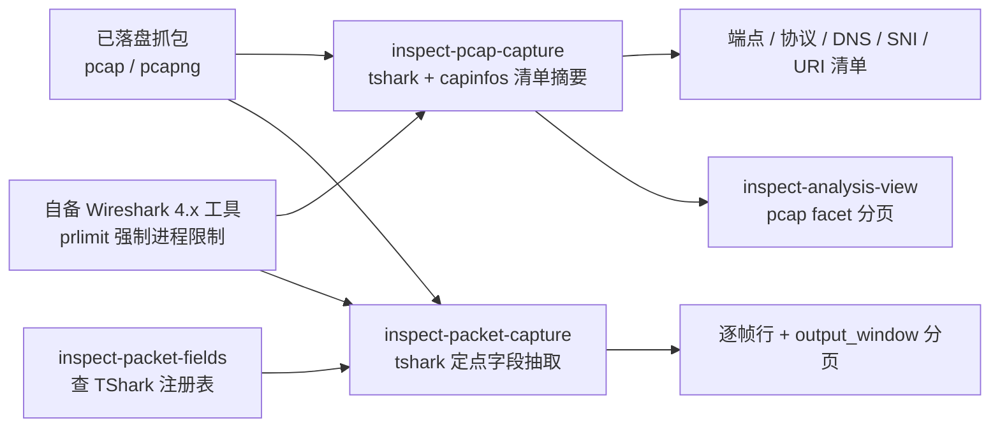

import { Meta } from '@storybook/addon-docs/blocks';

<Meta id="packet-captures" title="固件、数据与流量/数据包捕获" name="Docs" />

# 数据包捕获

REA 的数据包通道处理**已经落盘的 pcap 与 pcapng 文件**：用调用方自备的 Wireshark 4.x 工具链离线解剖，不抓流量、不开接口、不控设备，也不访问文件里记录的任何目标。两条工具线互补——定点抽取线 `inspect-packet-capture`（MCP `inspect_packet_capture`）按字段选择加 Wireshark 显示过滤器回答「我选的协议字段被 TShark 观察成什么样」，配 `inspect-packet-fields` 查询所装 TShark 的字段注册表；清单摘要线 `inspect-pcap-capture`（MCP `inspect_pcap_capture`）用 tshark 加 capinfos 生成端点、协议栈、DNS 问答、TLS SNI 与 HTTP URI 清单，大文件经 summary 留存后按 facet 分页。两条线的前置并不相同：定点线只在 Linux 上可用（macOS 与 Windows 在检查前直接拒绝），清单线支持 Linux 与 Windows、macOS 返回能力缺口但版本探测仍可用。应用层的 HAR/SAZ/mitmproxy 抓包归 [3.3 网络抓包](?path=/docs/web-network-captures--docs)，本课只管线缆级 PCAP；TShark 自身不做系统教学，字段名、过滤器与 decode-as 语法以 TShark 手册为准（见参考资料）。



默认值与两条线的分工是本课的回查入口，后文所有小节都以这张表为基准：

| 回查项 | 定点字段抽取 | 全量清单摘要 |
| --- | --- | --- |
| CLI | `rea inspect-packet-capture <path> --fields F ... [--display_filter F] --format json` | `rea inspect-pcap-capture <path> --json` |
| MCP 工具 | `inspect_packet_capture` | `inspect_pcap_capture`（可选 `detail: "summary"`） |
| 回答的问题 | 选中的协议字段出现在哪些帧、观察到什么值 | 端点、协议、DNS、SNI、URI 清单与 capture 元数据 |
| 工具前置 | 自备 TShark 4.x + util-linux prlimit | 自备 TShark 4.x + capinfos（Linux prlimit / Windows Job Objects） |
| 平台 | 仅 Linux；macOS/Windows 检查前拒绝 | Linux 与 Windows；macOS 检查不可用、版本探测可用 |
| 输入准入 | 读取前限 32 MiB | 流式只读快照，2 GiB 磁盘预算 |
| 关键默认值 | `match_limit` 50、`match_offset` 0、`two_pass` true | `offset` 0、`limit` 64；complete 交付为默认 |
| 输出预算 | stdout 加 stderr 合计 4 MiB，溢出失败 | tshark 8 MiB、capinfos 64 KiB、保留事实 16 MiB |

两条线共享的底线：源文件从不直接交给工具（走私有只读副本）、私有空 Wireshark 配置、名称解析关闭、已安装的库与插件始终被信任——这不是 OS 沙箱。

## 快速上手

前置与平台差异的完整规则见下一节「自备 TShark 与平台前置」。注意本工作区主机是 macOS：两条线的检查在 macOS 上都不可用（定点线检查前直接拒绝，清单线返回能力缺口），下面的最小闭环要在 Linux 上跑，Windows 只支持清单线。

在 Linux 上以绝对路径导出工具命令：

```sh
export REA_TSHARK_COMMAND=/absolute/path/to/tshark
export REA_CAPINFOS_COMMAND=/absolute/path/to/capinfos
```

先自检再检查——客户端自检不读任何抓包文件：

```sh
rea inspect-pcap-client
rea inspect-pcap-capture /captures/session.pcapng --json
```

清单检查应能核对到：`target.sha256` 绑定分析所用的稳定快照，`capture_start`/`capture_end` 给出 RFC 3339 UTC 起止时刻，观察与保留计数、`coverage` 与两条 stderr 诊断长度一并在场。

再对同一个文件做定点抽取：

```sh
rea inspect-packet-capture /captures/session.pcapng \
  --fields ip.addr --fields udp.port --fields data.data \
  --display_filter 'udp' --format json
```

应能核对到：每行带原始 `frame.number`（恒在字段），重复值是有序字符串数组（如 `"ip.addr": ["192.0.2.1", "192.0.2.2"]`），输出窗口 `output_window` 报告读取范围内的匹配数、返回数与 `has_more`。字段名没把握时先跑一次 `inspect-packet-fields`，见下节「发现协议与字段名」。

## 自备 TShark 与平台前置

REA 从不代装工具：两条线都要求调用方自备 Wireshark 4.x 的可执行文件，执行时校验身份、执行后复查；已安装的库、全局配置与插件不被完整指纹、可能影响解剖结果。检查使用私有的空个人 Wireshark 配置（`WIRESHARK_CONFIG_DIR` 置空）并关闭名称解析。

### 环境变量与进程限制

三个环境变量决定工具来源：

```sh
export REA_TSHARK_COMMAND=/absolute/path/to/tshark
export REA_CAPINFOS_COMMAND=/absolute/path/to/capinfos
export REA_TSHARK_PRLIMIT_COMMAND=/absolute/path/to/prlimit
```

- `REA_TSHARK_COMMAND` 两条线都要，指向 tshark 的绝对路径；清单线另用 `REA_CAPINFOS_COMMAND` 指向 capinfos。
- 清单线在未显式给出工具命令时经 PATH 解析并记录选择来源；定点线的文档形态是绝对路径导出。
- `prlimit` 默认取 `/usr/bin/prlimit`，需要时用 `REA_TSHARK_PRLIMIT_COMMAND` 覆盖绝对路径；限流器的路径、摘要与参数留进 Evidence。具体限额数值见「资源与生命周期限制」。

### 平台可用性与自检

两条线的平台规则不同，这是本课最容易被忽略的前置：

| 线 | Linux | Windows | macOS |
| --- | --- | --- | --- |
| 定点字段抽取 | 可用（prlimit 强制地址空间上限） | 检查前拒绝 | 检查前拒绝 |
| 全量清单摘要 | 可用（prlimit） | 可用（自有 Job Objects） | 检查不可用（能力缺口）；版本探测可用 |

定点线拒绝 macOS 与 Windows 的理由是该集成需要强制的地址空间限制；清单线在 macOS 的缺口源于新的原生内存边界未经验证。`rea inspect-pcap-client` 自检客户端设置、不读任何抓包文件，是确认清单线工具解析与版本的最快入口。

## 发现协议与字段名

选字段之前先弄清所装 TShark 认识哪些名字。`inspect_packet_fields`（CLI `rea inspect-packet-fields`）查询已安装 TShark 的注册表——底层是 `tshark -G fields`，沿用同样的私有空配置与 Linux 进程限制：

```sh
rea inspect-packet-fields --query usb
rea inspect-packet-fields --kind fields --protocol usb --query idVendor
rea inspect-packet-fields --kind fields --protocol udp --all
```

参数与窗口语义：

- `kind` 默认 `protocols`，`fields` 选字段定义；`protocol` 选精确协议缩写（协议本身或其子字段）。
- `query` 是名称、缩写或描述中的大小写不敏感字面子串；`offset` 跳过匹配记录；`limit` 默认 50；MCP `limit: null` 或 CLI `--all` 取全部剩余匹配——`--all` 与 `--limit` 冲突。
- 窗口报告所选 kind 过滤前的检查记录数、匹配数、返回数与 `has_more`，从不统计抓包包数。

返回记录保留字段类型、父协议、显示 base、位掩码、描述与原始注册表行号；空字符串保持为空，协议记录的字段专有属性为 null，重复缩写保留为独立注册。三条边界：列出的字段是**安装能力**，不证明它出现在所选记录里；每次调用重读注册表，没有缓存、也没有跨页快照一致性；已装名字已确定时直接选字段可省一次注册表探测，比较调查成本时把发现次数与重试都算进去。

预算：发现通道最多接受 32 MiB 合计命令输出（TShark 4.6.9 的完整注册表实测约 22.3 MB），选中记录按源 UTF-8 字节六倍加 512 字节计入 8 MiB 表示预算——超预算时收窄查询或页大小，结果不会静默截断。发现与定点检查共享同一个接纳槽位与清理属主。

## 定点字段抽取

`inspect_packet_capture` 回答「所选协议字段被 TShark 观察成什么样」。网络、USB 或蓝牙记录都走同一字段/过滤器接口，前提是所装 TShark 支持其封装与解析器。最小命令与 MCP 同源：

```sh
rea inspect-packet-capture /artifacts/device.pcapng \
  --fields ip.addr --fields udp.port --fields data.data \
  --display_filter 'udp' --format json
```

```json
{
  "name": "inspect_packet_capture",
  "arguments": {
    "path": "/artifacts/device.pcapng",
    "fields": ["ip.addr", "udp.port", "data.data"],
    "display_filter": "udp"
  }
}
```

### 选择字段与过滤器

- `fields`：CLI 重复传 `--fields`，MCP 传数组。`frame.number` 恒在；重复值成为有序字符串数组（如 `"ip.addr": ["192.0.2.1", "192.0.2.2"]`）；缺失字段保持缺席，不转成零或空数组；导出专用的 index/score 元数据被丢弃。
- 载荷字节不自动加入：需要时显式选择 `data.data` 或 `@data` 这类受支持的字节字段。
- `display_filter`：Wireshark 显示过滤器语法；省略即不过滤。无效字段或过滤器返回生产者诊断。
- `decode_as`：显式解析器覆盖，如 `["udp.port==5555,dns"]`；CLI 对多条覆盖重复传 `--decode_as`。
- 选择器上限（argv 展开前）：最多 1,024 个字段、1,024 条 `decode_as` 规则，每个选择器 8,192 个 UTF-16 码元，编码后的选择器参数合计 32 KiB——为 Linux 的 execve 参数与环境限制留出余量；异常庞大的继承环境仍可能阻止启动。

### 读取范围与分页

四个参数把「读多少输入」和「返回多少行」分开控制：

| 参数 | 默认 | 语义 |
| --- | --- | --- |
| `packet_limit` | 省略 = 读到 EOF | **过滤前**读取的输入包上限；报告记录 `to-eof` 或 `up-to-input-packet-limit`，不从返回包数推断总大小 |
| `two_pass` | true | 需要后续包与重组依赖的字段默认两遍；MCP 可设 false，CLI 用 `--no-two_pass` 单遍 |
| `match_offset` | 0 | 返回匹配行的起始偏移 |
| `match_limit` | 50 | 返回匹配行数上限；`match_limit: null`（CLI `--all_matches`）取全部剩余匹配 |

读法与边界：

- 输出在过滤后分页：结果保留原始帧号，并报告 `output_window`——读取范围内的匹配数、返回数与 `has_more`；用偏移请求后续页。分页不缩短输入读取、也不改变两遍重组。
- 生产者输出仍须装进资源预算：解剖输出过大时收缩字段、过滤器或输入包限制。
- 每次调用核对记录的当前摘要：不同源摘要的页不得混用。
- 有界前缀问题的官方算例：问「原始帧 1–2,000 内前十二个 PostgreSQL TCP 包」——字段 `tcp.srcport`、`tcp.dstport`、`tcp.flags`，过滤器 `tcp.port == 5432`，`packet_limit: 2000`，`match_limit: 12`；此时匹配数描述的就是该输入前缀。
- 反例：`frame.number <= 2000` 的过滤器不会缩短输入读取——没有输入上限时仍读整包；返回十二行也不限制生产者输出。这些控制回答有界问题，**不得用于推断整包缺席**。
- 两遍模式找不回缺失的捕获字节。

### 证据与执行边界

Evidence 保留：源路径/摘要/大小、精确选择器、类型化包字段、配置与解析后的可执行路径/摘要/完整版本横幅、参数与 stderr。退出码为零时 warnings 仍然可见；`tool.version_diagnostics` 另存独立版本探测的告警。执行后身份失败会指明受影响的私有副本、可执行文件或限流器；资源信号错误保留信号与生效上限。

每次调用使用私有只读副本与空的个人配置目录，名称解析关闭，可执行文件、限流器与私有输入副本在执行后复查；源文件从不直接交给 TShark。每个 provider 一次只接纳一个检查（含获取与清理），占用时返回可重试的容量错误。验证覆盖要分开看：官方夹具只确立 Ethernet/IPv4/UDP/DNS 与 Bluetooth HCI 的 PCAP——PCAPNG、USB、BLE ATT 与真实物理捕获未被夹具确立；这是验证覆盖的边界，不是功能拒绝。

## 全量清单摘要

官方分工原话：定点抽取用于选字段、过滤与 decode-as；这条清单线用于地址、DNS、SNI、协议栈与 URI 清单。它读已保存的 pcap/pcapng，用 tshark 加 capinfos，同样不抓流量、不取回记录目标。

### 检查与摘要模式

```sh
rea inspect-pcap-client
rea inspect-pcap-capture /captures/session.pcapng --json
```

```json
{
  "name": "inspect_pcap_capture",
  "arguments": { "path": "/captures/session.pcapng", "detail": "summary" }
}
```

完整交付是默认。`detail: "summary"` 提交并留存同样的完整 Evidence，只返回身份、capture 元数据、观察计数、保留计数、源覆盖与诊断长度（不带大列表）。大文件的便携路径：拿 `normalized_result.parent_evidence_id` 作 `retained-evidence` 源交给 `inspect_analysis_view` 分页；CLI 没有摘要旗标，保存完整检查 JSON 后用 `inspect-analysis-view` 以 inline 完整 Evidence 投影同一套视图契约。

### pcap 视图分页

视图请求形如（`kind` 固定为 `pcap`，默认 offset 0、limit 64）：

```json
{"kind":"pcap","facet":"endpoints","offset":0,"limit":20}
{"kind":"pcap","facet":"dns-queries","offset":0,"limit":20}
{"kind":"pcap","facet":"dns-addresses","query":"example.com","offset":0,"limit":20}
{"kind":"pcap","facet":"tls-sni","offset":0,"limit":20}
{"kind":"pcap","facet":"diagnostics","stream":"tshark","offset":0,"limit":4096}
```

| facet | 内容 |
| --- | --- |
| `endpoints` | 地址清单 |
| `protocols` | 协议分布（按精确 `frame.protocols` 栈串计数） |
| `dns-queries` | DNS 问题，页内带地址计数 |
| `dns-addresses` | 单个问题的关联地址，需先选定一个确切的保留问题 |
| `tls-sni` | TLS SNI |
| `http-uris` | HTTP URI |
| `unattributed-addresses` | 未能归因的歧义地址，单独成清单 |
| `diagnostics` | 两条工具的 stderr（示例窗口选 `stream: "tshark"`；诊断窗口按 UTF-16 码元计数，其余窗口按行计数） |

缺失或歧义的选择器直接失败；未知的历史诊断保持未知，不当作观察到的空流。视图从不重读源文件、不启动 Wireshark，原文件删除后仍然可用；页耗尽只覆盖保留的 facet，不确立网络完整性、也找不回缺失流量。

### 读数语义与 coverage

- `target.sha256` 把观察绑定到被接纳的稳定快照；两个工具都读这份副本，分析后再哈希一次。capture 元数据与字面字段值是生产者观察；地址/协议计数与 DNS 关联是推导。Capture Evidence 具有历史引用权威。
- `capture_start`/`capture_end` 是由 `capinfos -S` 纪元秒派生的 RFC 3339 UTC 时刻，保留生产者全部小数位（至纳秒）；空抓包、坏时间戳与 0000–9999 年之外的时刻保持 `null`，无时区的主机本地时间不做推断。
- 地址每包计一次，含 loopback 与嵌套 IP 出现。DNS 地址只与同一响应包内的一个问题关联——附加记录可能被包含，这不证明最终解析结果。
- TLS SNI 是记录到的握手元数据，不是进程身份、也不证明目标真实性。
- 无固定截断（没有 200/100/50 条上限），预算内全部保留；HTTP 传输凭据被排除且不改写其他 URI 字节，歧义凭据跨度导致整条省略；计数在省略或合并前保留不同源 URI。
- `coverage: "partial"` 记录未解决的 DNS 归因或 URI 条目丢失；组件级凭据排除也显式计数。
- 记录到的字段不确立解密载荷、因果关系、进程身份、未记录流量的缺席或当前部署。

## 资源与生命周期限制

| 限制 | 定点字段抽取 | 全量清单摘要 |
| --- | --- | --- |
| 输入 | 读取前限 32 MiB | 流式只读快照，2 GiB 磁盘预算 |
| 输出预算 | stdout 加 stderr 合计 4 MiB，溢出即失败、不截断 | tshark 8 MiB（分配前查五层字段形状与 128 MiB 图扩展估算）、capinfos 64 KiB、保留事实另 16 MiB |
| 墙钟期限 | 每条命令 30 秒 | 解剖 300 秒、元数据 60 秒、探测 20 秒 |
| Linux 进程限制 | 每进程 1 GiB 地址空间、每文件 64 MiB、30 CPU 秒、禁 core dump | 至多 1 GiB 地址空间、300 CPU 秒、每文件 64 MiB、禁 core dump |
| Windows | 不可用 | 每个自有工具树 1 GiB 提交内存（Job Objects） |
| 并发 | 每 provider 一次一个检查，占用返回可重试容量错误 | 同左 |
| 失败语义 | 损坏/超大输出无部分成功；未验证的部分 JSON 不作为事实返回 | 同左 |

两条线的更严格继承软/硬限制都会保留，这些限额都不是聚合进程内存或文件系统配额。取消会到达探测、获取、命令与投影；清理失败返回类型化错误，保留已完成的 Evidence 与自有资源供重试——单次 CLI 在等待清理重试时保留原始失败与已完成 Evidence，MCP 会话里已完成的观察在取消或清理失败后仍在场。

## 最佳实践

- **两条线按问题分工，先地图后定点。** 不知道抓包里有什么时先用清单线建全景（端点、协议、DNS、SNI、URI），再带着具体字段问题进定点线；定点线的价值在字段选择、过滤器与 decode-as 的精确控制，不在扫描全包。
- **把问题写成有界问题。** 已知输入前缀的问题用 `packet_limit` 圈输入、按需字段加 `match_limit` 圈输出，让匹配数描述该前缀；过滤器里的 `frame.number` 条件替代不了输入限制，分页证据也不能推断整包缺席。
- **大文件用 summary 留存加分页，不重复全量投递。** MCP `detail: "summary"` 留存完整 Evidence 后按 facet 翻页；CLI 保存完整检查 JSON 再以 inline 源投影。两条线的分页语义不同：定点线每次核对源摘要、不同摘要的页不得混用；清单视图不重读源文件、原文件删除后仍可用。
- **字段名没把握就先探测一次。** `inspect-packet-fields` 用精确协议加窄查询；已确定的名字直接选字段，省一次注册表探测——比较成本时把发现与重试次数都算进去。
- **平台不对就换主机。** macOS 上定点线被直接拒绝、清单线检查不可用：定点问题必须上 Linux；纯清单问题还可以用 Windows。

## 常见问题

- macOS 上一执行就报错？
  定点线在 macOS 与 Windows 上检查前直接拒绝（集成需要强制的地址空间限制）；清单线在 macOS 返回能力缺口（原生内存边界未验证），但版本探测仍可用。定点问题换 Linux；清单问题可用 Linux 或 Windows。
- `packet_limit` 设 1 却零命中，抓包里明明有匹配帧？
  `packet_limit` 限制的是**过滤前**读取的输入包数：上限 1 只读第一包，后面的帧根本不进过滤器。省略该参数才读到 EOF（资源限额内）。报告会记录 `to-eof` 或 `up-to-input-packet-limit`，不要从返回包数反推总大小。
- 过滤器写了 `frame.number <= 2000`，为什么还是读整包？
  显示过滤器不缩短输入读取；要界住输入用 `packet_limit`。返回行数（`match_limit`）也不限制生产者输出——解剖输出太大时收缩字段、过滤器或输入包限制，否则撞输出预算直接失败。
- 输出报错说超限，而不是给截断结果？
  设计如此：定点线 stdout 加 stderr 合计 4 MiB、清单线 tshark 8 MiB 与 capinfos 64 KiB，溢出按失败处理、不返回截断成功；损坏或超大的生产者输出也不产生部分结果，未验证的部分 JSON 不作为事实返回。
- `--all` 和 `--limit` 一起传报冲突？
  字段发现里二选一：`limit` 默认 50，`--all`（MCP `limit: null`）取全部剩余匹配；要翻页用 `offset`。
- `dns-addresses` 分页失败或拿不到地址？
  先从 `dns-queries` 页选定一个确切的保留问题（带 `query` 选择器）再翻它的地址；缺失或歧义的选择器直接失败。DNS 问题页自带每题地址计数，可先用它定位。
- 空结果是不是证明没有这种流量？
  不是。空结果只说明所选记录、过滤器或读取范围内没有匹配——不证明这些范围之外的流量缺席；解析器结果是观察，不是独立验证过的设备行为。

## 总结回顾

摘要：

REA 的数据包通道对已落盘的 pcap/pcapng 做离线解剖，两条自备工具线互补：`inspect-packet-capture` 按字段加显示过滤器定点抽取，`frame.number` 恒在、重复字段成有序数组，输出按 `output_window` 分页，`packet_limit` 与 `match_limit` 把「读多少输入」和「返回多少行」分开；`inspect-pcap-capture` 用 tshark 加 capinfos 生成端点、协议、DNS、SNI 与 URI 清单，大文件经 `detail: "summary"` 留存后按 pcap facet 分页，`coverage: "partial"` 标记未解决的归因。字段名靠 `inspect-packet-fields` 查安装注册表，列出的名字是安装能力而非出现证明。前置的共同点是 REA 不代装工具、私有只读副本、空 Wireshark 配置、名称解析关闭、非沙箱；差异在平台：定点线仅 Linux，清单线 Linux 加 Windows、macOS 只有版本探测。两条线各有输入、输出与期限预算，超限失败而非截断；空结果不证明流量缺席，解析器结果只是观察。

一句话：

> PCAP 通道只读不抓：清单线画地图、定点线答字段题，Linux 是定点抽取的唯一主场——所有读数都是观察，不证明设备行为，也不证明流量缺席。

知识要点：

- 两条线分别叫什么、各回答什么问题、平台可用性差在哪？
- 定点线的字段选择有什么规则（`frame.number`、重复值、缺失字段、载荷字节、选择器上限）？
- `packet_limit` 与过滤器里的 `frame.number` 条件差在哪？有界前缀问题怎么写？
- `output_window` 报告什么？分页为什么要绑定同一源摘要？
- 字段发现的参数与窗口语义是什么？`--all` 与 `--limit` 为什么冲突？
- 清单线的八个 facet 分别是什么？`dns-addresses` 为什么必须先选问题？
- `capture_start`/`capture_end`、地址计数、DNS 关联、TLS SNI 各是什么语义？`coverage: "partial"` 标记什么？
- 两条线的输入、输出、期限与进程限制各是多少？超限时的表现是什么？

## 参考资料

- [Recorded packet capture inspection（docs/packet-captures.md）](https://raw.githubusercontent.com/morluto/rea/main/docs/packet-captures.md)
  本课一手来源：`inspect_packet_capture` 与 `inspect_packet_fields` 契约、选择器上限、分页与两遍语义、证据结构、资源预算与验证覆盖。
- [Packet capture summaries（docs/pcap-analysis.md）](https://raw.githubusercontent.com/morluto/rea/main/docs/pcap-analysis.md)
  本课一手来源：清单线工具供给、`inspect_pcap_capture` 与 pcap facet 视图、出处与 coverage 语义、资源与生命周期、验证范围。
- [TShark manual（Wireshark 官方手册页）](https://www.wireshark.org/docs/man-pages/tshark.html)
  字段名、显示过滤器、decode-as 语法与两遍语义的权威出处，官方文档为本课指定的工具侧参考。
- [REA CLI 文档（docs/cli.md）](https://raw.githubusercontent.com/morluto/rea/main/docs/cli.md)
  清单线便携视图所用的 `inspect-analysis-view` 请求文件模式与 inline Evidence 投影。
